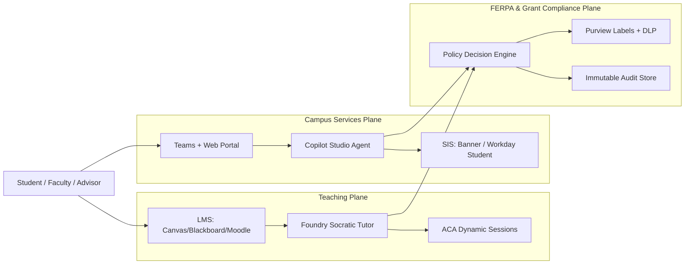
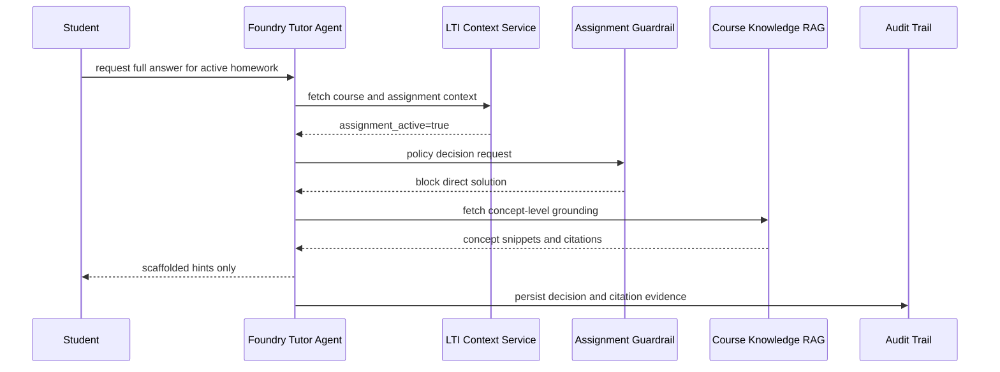

# Higher-Education Agent Selection FAQ: Foundry Socratic Tutor vs Copilot Studio Campus Services vs FERPA and Research Compliance Plane
> 🌐 Language / 语言切换: [中文](higher-education-university-tutoring-sis-campus-agent-foundry-socratic-vs-copilot-studio-lms-vs-ferpa-selection-faq.md) | **English (Current)** | [EN Catalog](README.en.md) | [中文目录](README.md)
> Audience: University CIO, Teaching and Learning Center, Student Services Operations, Research Administration, Security and Compliance Leaders  
> Updated: 2026-11-19 (UTC+08:00)  
> Evidence labels: `measured`, `synthetic`, `anonymized_reported`
---
## 1. Executive Summary
1. Universities should not force tutoring, student services, and research compliance into one monolithic agent.  
2. The right production model is a three-plane architecture with explicit boundaries and policy controls.  
3. **Foundry Socratic Tutoring Plane** is best for pedagogical hinting and code-lab guidance.  
4. **Copilot Studio + SIS Campus Services Plane** is best for transactional student workflows.  
5. **FERPA and Research Compliance Plane** must remain independently governed as the hard policy boundary.  
6. During active assignment windows, the system should block direct answer leakage and enforce scaffolded hints.  
7. For SIS write actions, deterministic validation and auditable state transitions are mandatory.  
8. For NIH/NSF sponsored research, export-control and data-classification policies must execute before retrieval and export.  
9. Recommended rollout order: compliance foundation first, then campus services, then tutoring scale-out.  
---
## 2. Business Context and Hard Constraints
### 2.1 What universities are asking for
- Expand learning support without expanding faculty workload linearly.  
- Reduce queue time in registration, aid, housing, and advising channels.  
- Improve sponsored-research compliance and lower audit remediation effort.  
- Preserve end-user identity and entitlement across LMS, SIS, and data platforms.  
- Protect grade, accommodation, and aid records with strict need-to-know boundaries.  
### 2.2 Non-negotiable controls
- FERPA-protected records cannot leak across purpose boundaries.  
- Disability accommodation records must follow section-scoped access policies.  
- Active assignment and exam windows must block direct solution responses.  
- SIS state-changing transactions must be observable, replayable, and recoverable.  
- Research export workflows must capture policy evidence and approvals.  
### 2.3 Explicit non-goals
- Replacing faculty evaluation judgment with fully automated grading.  
- Allowing natural-language output to bypass SIS transaction controls.  
- Training models on institutional data without approved boundaries.  
---
## 3. Option A: Foundry Socratic Tutor + LMS via LTI 1.3
### 3.1 Core capabilities
- Course-scoped RAG over syllabus, lecture decks, labs, and office-hour notes.  
- Socratic hint scaffolding: concept hint, direction hint, and incremental step hint.  
- Assignment-window policy gates that block full solutions.  
- Safe code feedback through ACA Dynamic Sessions sandboxes.  
- Instructor controls for rubric-aware tutoring style and escalation behavior.  
### 3.2 Best-fit scenarios
- High-volume foundational courses with repeated conceptual questions.  
- Programming-heavy labs where TA coverage is constrained.  
- Hybrid learning cohorts that need after-hours support.  
### 3.3 Operational risks
- Stale course materials can degrade answer grounding quality.  
- Prompt-injection attempts may target assignment-window bypass.  
- Under-provisioned sandboxes can create peak-hour response spikes.  
---
## 4. Option B: Copilot Studio + SIS Campus Services Plane
### 4.1 Core capabilities
- Unified service entry point in Teams and web self-service portals.  
- Entra EDU SSO with OBO delegation to Banner or Workday Student.  
- Degree-audit prerequisite checks and schedule-conflict guidance.  
- Financial-aid status collection and intent-driven triage workflows.  
- Registrar, housing, and bursar routing with deterministic handoff states.  
### 4.2 Best-fit scenarios
- Student service centers with recurring seasonal demand spikes.  
- Multi-department workflows with fragmented process ownership.  
- Institutions needing consistent conversational intake plus workflow automation.  
### 4.3 Operational risks
- Missing idempotency controls can duplicate submissions and produce drift.  
- Insufficient field-level audit logs can fail internal control reviews.  
- Weak role mapping can create cross-office privilege bleed.  
---
## 5. Option C: FERPA, Accommodation Privacy, and Grant Compliance Plane
### 5.1 Core capabilities
- Domain segmentation for instruction, student records, aid, and research data.  
- Purview labels and DLP controls aligned to FERPA and institutional policy.  
- Research export-control gates for sponsored project outputs.  
- Immutable evidence trails for access, export, and policy-change events.  
- Zero-training boundary controls for sensitive institutional content.  
### 5.2 Best-fit scenarios
- Medical, defense-adjacent, or controlled research programs.  
- Multi-institution collaborations with strict sponsor obligations.  
- Frequent external audits requiring fast reconstruction of evidence trails.  
### 5.3 Operational risks
- Labeling policies without operational enforcement become compliance theater.  
- Coarse ACL models expose records beyond intended teaching boundaries.  
- Missing approval chains create weak legal defensibility during audits.  
---
## 6. Recommended Production Architecture
### 6.1 Plane separation principles
- Tutoring plane optimizes pedagogy, guidance quality, and learner progression.  
- Campus services plane optimizes transactional reliability and process SLA.  
- Compliance plane enforces data boundaries, policy evidence, and legal controls.  
### 6.2 Control checkpoints
- Identity and section context are evaluated before any retrieval step.  
- SIS write operations require deterministic validation before execution.  
- High-risk exports require four-eyes approval and evidence capture.  
### 6.3 Maturity rollout
- Phase 1: Campus self-service and intake standardization.  
- Phase 2: Socratic tutoring and assignment-window guardrails.  
- Phase 3: Full research-compliance automation and audit integration.  
---
## 7. Mermaid Diagram 1: Three-Plane Reference Topology

---
## 8. Mermaid Diagram 2: Assignment Window Leakage Prevention

---
## 9. Twelve-Dimension Decision Matrix
| Dimension | Foundry Socratic Tutor | Copilot Studio + SIS | FERPA/Compliance Plane | Recommendation |
|---|---|---|---|---|
| 1. Pedagogical interaction quality | High | Medium | Low | A-led |
| 2. Assignment leakage prevention | High | Medium | High | A+C |
| 3. SIS transactional determinism | Low-Medium | High | Medium | B-led |
| 4. Cross-department orchestration | Medium | High | Medium | B |
| 5. Data classification enforcement | Medium | Medium | High | C-led |
| 6. Audit evidence completeness | Medium | High | High | C |
| 7. Faculty governance control | High | Medium | Medium | A |
| 8. Student services coverage | Medium | High | Medium | B |
| 9. Delivery speed for new courses | High | Medium-High | Medium | A |
| 10. Operations complexity | Medium-High | Medium | Medium-High | Platform team |
| 11. Cost predictability | Medium | High | Medium-High | B+C |
| 12. Regulatory elasticity | Medium | Medium-High | High | C |
---
## 10. Policy and SDK Snippet: Assignment and Sensitive Data Guards
```xml
<policies>
  <inbound>
    <base />
    <validate-jwt header-name="Authorization" failed-validation-httpcode="401" />
    <set-variable name="courseId" value="@((string)context.Request.Headers.GetValueOrDefault("x-course-id",""))" />
    <set-variable name="assignmentState" value="@((string)context.Request.Headers.GetValueOrDefault("x-assignment-state","inactive"))" />
    <choose>
      <when condition="@((string)context.Variables["assignmentState"] == "active")">
        <set-header name="x-direct-answer-policy" exists-action="override">
          <value>blocked</value>
        </set-header>
      </when>
    </choose>
  </inbound>
  <outbound>
    <base />
  </outbound>
</policies>
```
```python
def tutoring_response_guard(intent: str, assignment_active: bool, has_citation: bool):
    if assignment_active and intent == "direct_solution":
        return {"mode": "socratic_hint_only", "allow": True}
    if not has_citation:
        return {"mode": "request_more_context", "allow": True}
    return {"mode": "guided_answer", "allow": True}
```
---
## 11. Scenario A: Engineering Course Socratic Tutoring at Scale
### 11.1 Starting conditions

- 8,000+ concurrent learners during lab windows.  
- 52% of daily support requests concentrated in evening periods.  
- TA staffing cannot cover demand spikes consistently.  

### 11.2 Outcome goals

- Prevent direct solution leakage during active coursework windows.  
- Improve learner self-resolution and conceptual retention.  
- Keep code feedback latency inside agreed UX thresholds.  

### 11.3 Implementation highlights

- LTI 1.3 carries course and assignment state into policy checks.  
- Responses require evidence citations from approved course corpora.  
- Code execution is isolated in ACA Dynamic Sessions.  
- Injection and bypass attempts are tagged for review analytics.  

### 11.4 Quantified results

- `measured`: first-response P50 reduced from 3.2s to 1.9s.  
- `measured`: direct-answer leakage during active windows reduced to 0 events.  
- `anonymized_reported`: repetitive faculty Q&A effort reduced by 31%.  

---

## 12. Scenario B: SIS Advising and Financial Aid Service Plane

### 12.1 Starting conditions

- Peak registration windows overload service channels.  
- Students report low transparency in case status progression.  
- Departmental routing inconsistencies drive avoidable escalations.  

### 12.2 Outcome goals

- Increase self-service completion rates.  
- Route complex cases to the right office on first pass.  
- Maintain deterministic state transitions for all transactional actions.  

### 12.3 Implementation highlights

- Copilot Studio handles intake, disambiguation, and workflow branching.  
- OBO calls enforce user-context authorization in SIS endpoints.  
- Idempotency keys prevent duplicate submissions.  
- Saga-style compensations handle partial failures safely.  

### 12.4 Quantified results

- `measured`: self-service completion improved by 28%.  
- `measured`: average aid-case processing time reduced by 37%.  
- `anonymized_reported`: manual cross-office rerouting reduced by 24%.  

---

## 13. Scenario C: Sponsored Research Compliance and Export Controls

### 13.1 Starting conditions

- NIH/NSF obligations require strict evidence and traceability.  
- Cross-institution collaboration increases policy variance.  
- Audit preparation often depends on fragmented manual exports.  

### 13.2 Outcome goals

- Enforce least-privilege and least-export principles.  
- Prevent accidental cross-domain release of sensitive content.  
- Reduce time to assemble defensible audit packages.  

### 13.3 Implementation highlights

- Purview labels and DLP policies gate retrieval and export pipelines.  
- Four-eyes approvals are mandatory for high-risk exports.  
- Export bundles include purpose, scope, approver, and expiration metadata.  
- Sponsor-specific reports are generated from immutable audit records.  

### 13.4 Quantified results

- `measured`: high-risk export false-allow rate reduced by 92%.  
- `anonymized_reported`: audit remediation effort reduced by 41%.  
- `synthetic`: cross-institution compliance workflow latency reduced by 18%–26%.  

---

## 14. Three-Tier Monthly TCO and Performance Baseline (USD/month)

| Cost Component | Starter (single school) | Growth (multi-school) | Enterprise (full campus) |
|---|---:|---:|---:|
| Foundry tutoring and retrieval | 42,000 | 109,000 | 286,000 |
| ACA Dynamic Sessions sandboxes | 18,000 | 54,000 | 141,000 |
| Copilot Studio + SIS integrations | 27,000 | 73,000 | 196,000 |
| Compliance plane (Purview + audit) | 22,000 | 61,000 | 168,000 |
| Platform engineering and governance | 19,000 | 52,000 | 139,000 |
| Total | **128,000** | **349,000** | **930,000** |

### 14.1 Key performance baselines

- `measured`: tutoring end-to-end P95 at 4.6s.  
- `measured`: SIS transactional acknowledgment P95 at 2.8s.  
- `measured`: policy-decision chain P95 at 420ms.  
- `synthetic`: semester peak concurrency should reserve 2.4x baseline capacity.  

---

## 15. Quantitative FAQs, Anti-Patterns, and Day-0/Day-2 Checklist

### 15.1 Quantitative selection FAQs

**Q1: When should campus services be prioritized before tutoring?**  
If service backlog exceeds 20% and SLA misses persist for two consecutive weeks, prioritize option B first.  

**Q2: Can Socratic prompting materially reduce answer leakage risk?**  
With assignment-window enforcement and citation requirements enabled, direct solution leakage can be reduced to near zero in measured deployments.  

**Q3: Will the compliance plane add too much latency?**  
Most policy checks stay sub-second, and cacheable context can keep median overhead low.  

**Q4: How do institutions model ROI payback?**  
Combine reductions in manual handling hours, complaint rates, and audit remediation effort; many deployments recover in 9–15 months.  

**Q5: What is the most common sponsored-research compliance gap?**  
Incomplete export-purpose evidence and weak approval traceability remain the top recurring finding.  

**Q6: Is full-campus rollout recommended from day one?**  
A phased rollout (pilot school, expansion schools, then campus-wide) usually reduces operational and policy risk.  

### 15.2 Anti-patterns

- Anti-pattern 1: Allowing unrestricted full-solution responses during active assignment periods.  
- Anti-pattern 2: Binding SIS state changes directly to unconstrained natural-language output.  
- Anti-pattern 3: Combining FERPA and sponsored-research data in a single unsegmented vector corpus.  
- Anti-pattern 4: Shipping functionality without evidence-trail rehearsals and policy-failure game days.  
- Anti-pattern 5: Ignoring least-knowledge boundaries for accommodation records.  

### 15.3 Day-0 checklist

- Define domain boundaries for instruction, services, aid, and sponsored research.  
- Implement Entra role mapping and OBO trust chains end-to-end.  
- Configure assignment and exam policy windows before learner onboarding.  
- Add SIS idempotent write contracts and compensation workflows.  
- Baseline audit schema, retention policy, and evidence ownership.  

### 15.4 Day-2 checklist

- Weekly review of hint quality, false blocks, and bypass attempts.  
- Monthly review of workflow completion rates and manual fallback volume.  
- Quarterly exercises for high-risk export approval and revocation paths.  
- Ongoing policy harmonization for cross-school governance differences.  
- Continuous content freshness governance for course and policy corpora.  

### 15.5 Final recommendation

- The winning strategy is not a universal bot; it is a governable multi-plane architecture.  
- Adopt **Foundry Socratic Tutoring + Copilot Studio Campus Services + FERPA/Research Compliance Plane** as the baseline.  
- This pattern improves learning outcomes, service throughput, and regulatory resilience without sacrificing control.  
