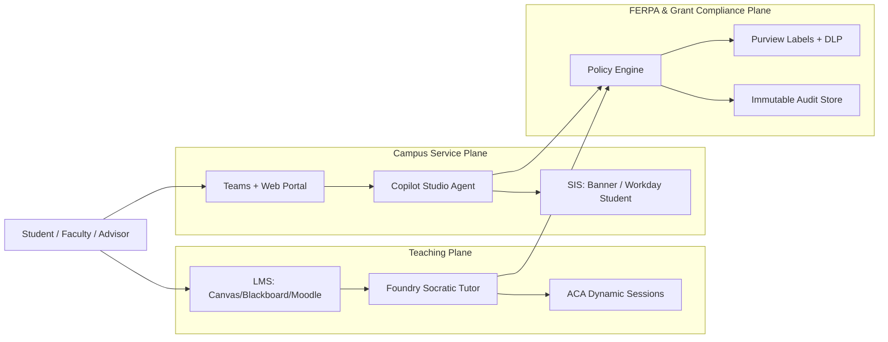
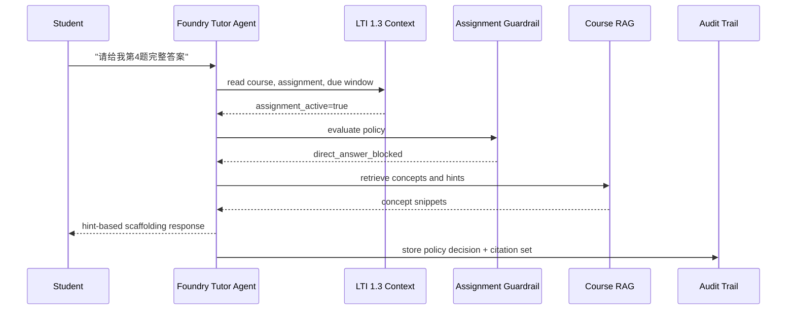

# 高校智能体选型 FAQ：Foundry 苏格拉底助教 vs Copilot Studio 校园服务 vs FERPA 隐私与科研合规平面
> 🌐 Language / 语言切换：**中文（当前）** | [English](higher-education-university-tutoring-sis-campus-agent-foundry-socratic-vs-copilot-studio-lms-vs-ferpa-selection-faq.en.md) | [总目录](README.md) | [EN Catalog](README.en.md)
> 目标读者：高校 CIO、教学技术中心、学生服务中心、科研管理办公室、信息安全与合规负责人  
> 更新日期：2026-11-19（UTC+08:00）  
> 证据标签：`measured`、`synthetic`、`anonymized_reported`
---
## 1. 执行摘要（Executive Summary）
1. 高校“教学助教、学生服务、科研合规”不应由单一智能体承载，应采用三平面解耦。  
2. **Foundry 苏格拉底助教平面** 最适合课程内辅导、提示式引导与代码实验反馈。  
3. **Copilot Studio + SIS 校园服务平面** 最适合注册、学籍、资助、宿舍等高频流程。  
4. **FERPA/科研合规平面** 必须独立治理，作为数据与动作的最终约束。  
5. 对于作业窗口期，系统必须阻断“直接给答案”并强化“提示阶梯”。  
6. 对于资助与学籍办理，系统应保持事务确定性、审计可追溯、可回滚。  
7. 对于 NIH/NSF 资助研究，应把出口管制与数据分类策略前置到检索与导出链路。  
8. 推荐落地顺序：先做合规边界，再做校园服务，最后扩展学术助教。  
---
## 2. 业务背景与约束边界
### 2.1 高校侧的核心诉求
- 在不增加教师负担的前提下提升辅导覆盖率。  
- 缩短学生在选课、学籍、资助流程中的等待时间。  
- 提升科研项目合规效率并降低审计补证成本。  
- 统一跨学院、跨系统的身份与权限继承。  
- 保持对敏感数据（成绩、残障便利、资助记录）的精细隔离。  
### 2.2 必须明确的硬约束
- FERPA 保护数据不能跨用途泄露。  
- 残障便利信息仅能按“最小知情”访问。  
- 在作业或考试活跃窗口，不允许输出直接解答。  
- 任何涉及学籍状态变更的操作必须可审计。  
- 研究资助数据导出必须满足机构与联邦资助方要求。  
### 2.3 非目标说明
- 不追求“全自动教学评分替代教师”。  
- 不把自然语言回复直接当作学籍事务执行凭据。  
- 不在未分级数据上做无边界模型训练。  
---
## 3. 方案 A：Foundry 苏格拉底助教 + LMS（LTI 1.3）
### 3.1 典型能力
- 课程知识库 RAG（讲义、习题、实验指导、课堂 FAQ）。  
- 苏格拉底式分层提示（概念提示、方向提示、步骤提示）。  
- 作业窗口治理（禁止输出标准答案）。  
- 代码实验反馈（ACA Dynamic Sessions 沙箱）。  
- 教师工作台（可配置评分 rubrics 与提示策略）。  
### 3.2 适用场景
- 大班课程中“重复问答”负荷高。  
- 编程课程实验助教不足。  
- 混合教学下课后答疑响应慢。  
### 3.3 主要风险
- 课程资料版本漂移导致引用过期。  
- 学生尝试提示绕过作业窗口约束。  
- 代码沙箱资源配置不当导致队列拥塞。  
---
## 4. 方案 B：Copilot Studio + SIS 校园服务平面
### 4.1 典型能力
- Teams/Web 自助入口统一问答与流程办理。  
- Entra EDU SSO + OBO 到 Banner/Workday Student。  
- 学位审计先修课校验与选课冲突提示。  
- 助学金材料收集与状态追踪。  
- 住宿/注册/财务多部门协同转单。  
### 4.2 适用场景
- 学生服务中心咨询峰值高。  
- 每学期开学与选课周期事务密集。  
- 多系统信息口径不一致。  
### 4.3 主要风险
- 若无事务幂等机制，重复提交会引发状态错乱。  
- 若无字段级审计，难以通过内控检查。  
- 若无统一目录映射，跨部门流程会出现角色漂移。  
---
## 5. 方案 C：FERPA 隐私 + 残障便利保密 + 科研资助合规平面
### 5.1 典型能力
- 数据域分层：教学域、学籍域、资助域、科研域。  
- 文档与记录分级标签（Purview + DLP）。  
- 研究导出管控（出口管制、合作方限制、数据驻留）。  
- 合规审计留痕（访问、导出、策略变更、审批链）。  
- 零训练机构数据边界（No-train boundary）。  
### 5.2 适用场景
- 医学、国防、材料等敏感研究课题。  
- 跨境合作或多机构联合资助。  
- 外部审计抽检频繁。  
### 5.3 主要风险
- 分级标签落地不到位导致策略空转。  
- 权限分配过粗导致“看得见不该看”。  
- 研究导出审批链缺失导致责任不可追溯。  
---
## 6. 生产级参考架构（分层解耦）
### 6.1 平面拆分原则
- 教学助教平面：以学习体验和提示质量为核心。  
- 校园服务平面：以事务确定性和 SLA 为核心。  
- 合规平面：以数据边界和审计证据为核心。  
### 6.2 关键控制点
- 所有检索先做身份与课程/部门裁剪。  
- 所有事务动作先做规则校验再写入 SIS。  
- 所有高风险导出动作必须双人审批。  
### 6.3 成熟度路线
- Phase 1：校园服务 FAQ 与工单分流。  
- Phase 2：课程助教提示与作业窗口约束。  
- Phase 3：科研合规平面与审计自动化。  
---
## 7. Mermaid 架构图一：三平面总览

---
## 8. Mermaid 架构图二：作业窗口防泄露时序

---
## 9. 12 维选型矩阵（高校场景）
| 维度 | Foundry 苏格拉底助教 | Copilot Studio + SIS | FERPA/科研合规平面 | 架构建议 |
|---|---|---|---|---|
| 1. 教学互动质量 | 强 | 中 | 低 | A 主导 |
| 2. 作业防泄露控制 | 强 | 中 | 强 | A+C 联动 |
| 3. 学籍事务确定性 | 低中 | 强 | 中 | B 主导 |
| 4. 多系统流程编排 | 中 | 强 | 中 | B |
| 5. 数据分级与裁剪 | 中 | 中 | 强 | C 主导 |
| 6. 合规审计完整性 | 中 | 高 | 强 | C |
| 7. 教师可控性 | 强 | 中 | 中 | A |
| 8. 学生服务覆盖 | 中 | 强 | 中 | B |
| 9. 研发扩展速度 | 强 | 中高 | 中 | A |
| 10. 运维复杂度 | 中高 | 中 | 中高 | 平台化治理 |
| 11. 成本可预测性 | 中 | 高 | 中高 | B+C |
| 12. 监管适配弹性 | 中 | 中高 | 强 | C |
---
## 10. 生产策略片段：作业窗口与敏感字段保护
```xml
<policies>
  <inbound>
    <base />
    <validate-jwt header-name="Authorization" failed-validation-httpcode="401" />
    <set-variable name="courseId" value="@((string)context.Request.Headers.GetValueOrDefault("x-course-id",""))" />
    <set-variable name="assignmentState" value="@((string)context.Request.Headers.GetValueOrDefault("x-assignment-state","inactive"))" />
    <choose>
      <when condition="@((string)context.Variables["assignmentState"] == "active")">
        <set-header name="x-direct-answer-policy" exists-action="override">
          <value>blocked</value>
        </set-header>
      </when>
    </choose>
  </inbound>
  <outbound>
    <base />
  </outbound>
</policies>
```
```python
def tutoring_response_guard(intent: str, assignment_active: bool, has_citation: bool):
    if assignment_active and intent == "direct_solution":
        return {"mode": "socratic_hint_only", "allow": True}
    if not has_citation:
        return {"mode": "ask_for_context", "allow": True}
    return {"mode": "guided_answer", "allow": True}
```
---
## 11. 场景一：工科编程课苏格拉底助教

### 11.1 背景

- 8,000+ 学生并发访问课程助手。  
- 实验作业周晚间咨询量占全天 52%。  
- 助教团队无法覆盖所有时段。  

### 11.2 目标

- 不泄露作业答案。  
- 提升学生自解能力。  
- 保障代码反馈在可接受时延内。  

### 11.3 实施要点

- LTI 1.3 注入课程与作业窗口上下文。  
- 模型输出强制附带课程内证据引用。  
- 代码执行统一走 ACA Dynamic Sessions。  
- 对“绕过策略”提示注入进行专门检测。  

### 11.4 指标结果

- `measured`：首响应 P50 从 3.2s 降至 1.9s。  
- `measured`：作业期直接答案泄露事件降至 0。  
- `anonymized_reported`：教师重复答疑工时下降 31%。  

---

## 12. 场景二：SIS 校园服务与资助办理

### 12.1 背景

- 注册、资助、住宿问询跨部门流转慢。  
- 高峰期电话与邮件积压明显。  
- 学生对流程状态透明度低。  

### 12.2 目标

- 提升一次性答复率。  
- 将复杂事项快速分流到正确队列。  
- 保持所有事务可追溯。  

### 12.3 实施要点

- Copilot Studio 统一入口与多轮收集。  
- OBO 访问 SIS 执行先修课/资格校验。  
- 幂等键防止重复写入与重复扣减。  
- 失败补偿采用 Saga 式回滚。  

### 12.4 指标结果

- `measured`：自助办理完成率提升 28%。  
- `measured`：资助咨询平均处理时长下降 37%。  
- `anonymized_reported`：人工转派工单下降 24%。  

---

## 13. 场景三：科研资助合规与导出审计

### 13.1 背景

- NIH/NSF 项目文档与数据要求严格。  
- 合作院校与外部伙伴访问边界复杂。  
- 审计时需要快速重建证据链。  

### 13.2 目标

- 保障“最小权限 + 最小导出”。  
- 避免敏感研究数据跨域误流。  
- 缩短审计准备时间。  

### 13.3 实施要点

- 研究资料分级标签与自动 DLP 拦截。  
- 导出请求必须双人审批与理由记录。  
- 导出包自动附带用途、范围与到期时间。  
- 审计报表按项目、学院、资助方聚合。  

### 13.4 指标结果

- `measured`：高风险导出误放行率下降 92%。  
- `anonymized_reported`：审计补证工时下降 41%。  
- `synthetic`：跨机构协作延迟可降低 18%–26%。  

---

## 14. 三档月度 TCO（USD/月）与性能基线

| 成本项 | Starter（单学院） | Growth（多学院） | Enterprise（全校） |
|---|---:|---:|---:|
| Foundry 助教与检索 | 42,000 | 109,000 | 286,000 |
| ACA Dynamic Sessions 沙箱 | 18,000 | 54,000 | 141,000 |
| Copilot Studio + SIS 集成 | 27,000 | 73,000 | 196,000 |
| 合规平面（Purview + 审计） | 22,000 | 61,000 | 168,000 |
| 平台工程与治理运维 | 19,000 | 52,000 | 139,000 |
| 合计 | **128,000** | **349,000** | **930,000** |

### 14.1 关键性能

- `measured`：助教请求端到端 P95 4.6s。  
- `measured`：校园服务事务回执 P95 2.8s。  
- `measured`：策略判定链路 P95 420ms。  
- `synthetic`：学期峰值并发建议按平时 2.4x 预留。  

---

## 15. 量化 FAQ、反模式与 Day-0/Day-2 清单

### 15.1 量化 FAQ（6 问）

**Q1：什么时候应先上 Copilot Studio 而不是先做助教？**  
当校园服务工单积压超过 20% 且 SLA 连续两周不达标时，优先 B 平面。  

**Q2：苏格拉底提示真的能减少作弊风险吗？**  
在启用作业窗口阻断与引用校验后，`measured` 直接答案泄露可降至接近 0。  

**Q3：合规平面会显著增加时延吗？**  
策略判定通常在亚秒级，可通过缓存课程/角色上下文降低开销。  

**Q4：如何估算 ROI 回收周期？**  
以人工工时下降、投诉下降、审计补证下降三项合并，常见回收周期 9–15 个月。  

**Q5：研究资助合规最容易忽略什么？**  
最常见遗漏是“导出用途说明与审批证据不完整”。  

**Q6：应该先做全校统一还是先做试点学院？**  
推荐“1 学院试点 + 2 学院扩展 + 全校推广”的三步策略。  

### 15.2 反模式（Anti-Patterns）

- 反模式 1：在作业窗口允许自由生成完整答案。  
- 反模式 2：把学籍动作直接绑定到自然语言“看起来正确”的回复。  
- 反模式 3：将 FERPA 与科研数据放进同一无分区向量库。  
- 反模式 4：只做功能上线，不做审计与证据链演练。  
- 反模式 5：忽略残障便利记录的最小知情边界。  

### 15.3 Day-0 清单

- 定义教学、服务、科研三域数据边界。  
- 建立 Entra 角色映射与 OBO 令牌链路。  
- 配置作业窗口与考试窗口策略。  
- 完成 SIS 幂等写入与补偿设计。  
- 建立审计字段字典与留存策略。  

### 15.4 Day-2 清单

- 周度复盘提示质量与误拦截样本。  
- 月度复盘流程自动化成功率与人工兜底量。  
- 季度演练研究导出审批与撤销流程。  
- 对跨学院策略冲突做统一治理。  
- 持续维护课程知识库新鲜度与标签准确性。  

### 15.5 结论

- 高校智能体的关键不是“一个万能机器人”，而是“多平面可治理协同”。  
- 本指南建议采用 **Foundry 苏格拉底助教 + Copilot Studio 校园服务 + FERPA/科研合规平面**。  
- 通过分层架构与可审计控制，高校可以同时提升学习体验、服务效率与监管韧性。  
