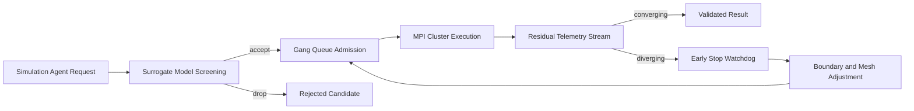
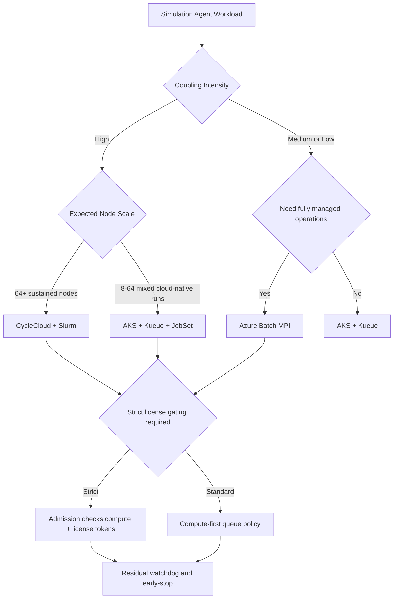

# Enterprise HPC Simulation Agent Selection FAQ: AKS Kueue+JobSet vs CycleCloud Slurm vs Azure Batch
> 🌐 **Language / 语言切换**: **[🇨🇳 中文版](hpc-mpi-gang-scheduling-simulation-agent-aks-kueue-jobset-vs-cyclecloud-slurm-vs-batch-selection-faq.md)** | **[🇬🇧 English](hpc-mpi-gang-scheduling-simulation-agent-aks-kueue-jobset-vs-cyclecloud-slurm-vs-batch-selection-faq.en.md)** | **[📚 Back to Catalog](README.en.md)**
> Evidence labels: `measured` / `synthetic` / `anonymized_reported`
> Retrieval date: 2026-11-22

## 1) Executive Summary: simulation agents need deterministic group admission, not best-effort pod starts
In automotive CFD and crash analysis,
molecular dynamics and docking,
battery thermal runaway simulation,
and weather-energy forecasting,
agent workflows often invoke
tightly coupled MPI solvers.
These workloads are fundamentally different
from independent batch tasks.
The first hard boundary is
gang scheduling discipline.
If two jobs each require 64 nodes
and both are partially admitted,
the cluster can deadlock
while utilization looks deceptively high.
The second boundary is network behavior.
MPI barriers are tail-latency sensitive.
At larger node counts,
general TCP fabrics can inflate
synchronization stalls.
The third boundary is license economics.
Commercial solvers may charge
per core or per token hour.
If scheduler queues and license pools
are not coordinated,
teams pay for idle compute
while waiting for licenses.
A production architecture should therefore
treat compute slots,
network topology,
and license gates
as one admission contract.

## 2) Workload Reality: why tightly coupled jobs break generic batch assumptions
Many platforms begin with
simple task-queue abstractions.
That can work for pre-processing
or embarrassingly parallel analytics.
It fails for tightly coupled solvers
that require synchronized node cohorts.
Failure mode one is
partial allocation lock contention.
Jobs consume fragments of capacity
without reaching runnable state.
Failure mode two is
communication-path mismatch.
Small pilot tests might pass,
but large runs degrade
when barrier overhead dominates.
Failure mode three is
license/compute decoupling.
A job obtains nodes first,
then blocks on floating tokens,
destroying effective throughput.
Failure mode four is
late divergence detection.
Residual instability can appear early,
yet jobs keep burning
thousands of core-hours.
This is why enterprise architects
must evaluate orchestration correctness
before raw capacity scale.

## 3) Source Baseline and Evidence Scope
Source 1 (`measured`): Kueue documentation (cohorts, all-or-nothing admission)  
https://kueue.sigs.k8s.io/
Source 2 (`measured`): JobSet documentation  
https://jobset.sigs.k8s.io/
Source 3 (`measured`): Kubeflow MPI operator docs  
https://www.kubeflow.org/docs/components/trainer/legacy-v1/user-guides/mpi/
Source 4 (`measured`): Azure CycleCloud documentation  
https://learn.microsoft.com/azure/cyclecloud/
Source 5 (`measured`): Slurm official documentation  
https://slurm.schedmd.com/documentation.html
Source 6 (`measured`): Azure Batch documentation  
https://learn.microsoft.com/azure/batch/
Source 7 (`measured`): Azure HBv4 HPC VM documentation  
https://learn.microsoft.com/azure/virtual-machines/hbv4-series
Source 8 (`measured`): Azure Managed Lustre documentation  
https://learn.microsoft.com/azure/azure-managed-lustre/
Source 9 (`anonymized_reported`): anonymized automotive and pharma simulation platform postmortems.  
Source 10 (`synthetic`): modeled core-hour, license, and early-stop cost scenarios.  
This guide stays at enterprise architecture depth.
It intentionally excludes
NIC register tuning details
and numerical PDE derivations.

## 4) Design Principles: four controls that must be present together
Control one:
admit tightly coupled jobs
only when the full group is available.
Control two:
make network topology
a scheduling attribute,
not a post-launch afterthought.
Control three:
align license token availability
with compute admission.
Control four:
stream residual telemetry
to an automated watchdog
for early-stop and safe requeue.
If only one or two controls exist,
platform-level efficiency
will still collapse under load.
These controls should be expressed
as auditable policy contracts,
not as ad hoc runbook steps.

## 5) Option A: AKS + Kueue + JobSet / MPIJob
This option fits enterprises
that already run
cloud-native platform engineering
on Kubernetes.
Kueue provides
all-or-nothing queue admission
and cohort-aware quota borrowing.
JobSet or MPIJob provides
grouped workload expression.
Together they reduce
partial-allocation deadlocks
for multi-node simulations.
The major benefit is
control-plane convergence.
Agent orchestration,
surrogate inference services,
and simulation jobs
can share one governance stack.
Observability and policy tooling
can also be unified.
The trade-off is
engineering complexity.
Teams need capability in
scheduling policy,
queue lifecycle operations,
and HPC-aware platform SRE.
For organizations with
mature Kubernetes operations,
this path offers
the strongest long-term flexibility.

## 6) Option B: CycleCloud + Slurm on HPC-oriented node families
This option is ideal
for heavy MPI estates
running long-lived physics solvers.
CycleCloud standardizes
cluster deployment automation,
while Slurm provides
mature HPC queue semantics
and broad ecosystem support.
With HBv4, HXv4, or NDv5 classes,
teams can preserve
high-throughput low-latency communication
for larger parallel jobs.
Managed Lustre integration
can improve staging throughput
for large transient datasets.
A key advantage is
operational familiarity
for traditional HPC groups.
A key trade-off is
cross-platform integration cost
when enterprise agent systems
primarily live in cloud-native stacks.
For sustained high-scale MPI workloads,
this option typically delivers
the most predictable scaling behavior.

## 7) Option C: Azure Batch multi-instance MPI pools
This option fits teams
that want managed job execution
without maintaining
a persistent Slurm control plane
or deep Kubernetes scheduler extensions.
Batch supports
multi-instance MPI task models
with lifecycle-driven pool provisioning.
It can reduce day-2 operations burden
for moderate simulation programs.
With checkpoint-aware workflows
and spot-aware strategies,
cost can be controlled
for interruption-tolerant jobs.
The advantage is
faster managed onboarding.
The trade-off is
less customization depth
for advanced queue economics,
license-aware semantics,
or topology-specialized policies.
As a result,
Batch is often effective
as a managed starting lane
or for bounded simulation portfolios.

## 8) Two-Stage Agent Pattern: surrogate pruning before high-fidelity MPI
A practical architecture
uses a two-stage funnel.
Stage one runs
GPU or CPU surrogate models
for fast candidate pruning.
Stage two sends
qualified candidates
to high-fidelity MPI solvers.
During stage two execution,
the agent monitors
residual trajectories,
stability indicators,
and convergence windows.
When divergence signatures appear,
a watchdog can trigger
early termination,
parameter correction,
and controlled requeue.
This avoids
long expensive non-convergent runs.
The outcome is often
better budget efficiency
without sacrificing
physics-grade final validation quality.

## 9) 12-Dimension Platform Comparison
| Dimension | AKS + Kueue + JobSet | CycleCloud + Slurm | Azure Batch MPI |
|---|---|---|---|
| Gang admission rigor | High | High | Medium |
| Multi-tenant quota borrowing | High | Medium | Medium |
| Topology-aware placement depth | Medium-High | High | Medium |
| License-aware queue integration | Medium | High | Medium |
| Cloud-native control-plane alignment | High | Medium | Medium |
| Traditional HPC team affinity | Medium | High | Medium-High |
| Managed operations convenience | Medium | Medium | High |
| Very-large MPI scale behavior | Medium-High | High | Medium |
| Agent workflow integration potential | High | Medium | Medium |
| Initial implementation complexity | High | Medium-High | Low |
| Tidal cost elasticity | High | Medium | High |
| 3-year governance extensibility | High | High | Medium |

## 10) Mermaid: coupling-level and node-scale decision tree

## 11) Deadlock Prevention: replacing partial occupancy with deterministic admission
The most expensive queue failures
often happen when
capacity appears available
but no job can fully start.
Deterministic group admission
prevents this partial occupancy trap.
For enterprise shared clusters,
quota borrowing and reclaim policies
should be explicit
and time-bounded.
Starvation controls are also needed
so low-priority large jobs
are not permanently postponed.
A useful governance metric is
gang-admission success rate,
not just average utilization.
Another useful signal is
time-to-runnable state
for multi-node jobs.
When both metrics degrade,
policy and topology rules
should be tuned together.

## 12) RDMA vs TCP breakpoint: evaluate full-job completion, not node microbenchmarks
At small scale,
TCP-based fabrics
may be acceptable
for validation runs.
As synchronization frequency rises
and node count expands,
barrier overhead dominates.
In that phase,
teams often misread the system:
CPU remains busy,
yet effective simulation progress drops.
RDMA benefits here are
about reducing tail jitter
for collective communication,
not only maximizing peak bandwidth.
Architectural decisions should compare
end-to-end completion time,
cost per converged run,
and failure-adjusted throughput.
When TCP domain efficiency
degrades sharply with scale,
workloads should be moved
to HPC network-aware queues.

## 13) Core-Hour and License TCO Model
Let:
`N` be monthly job count,
`H` be average core-hours per job,
`P` be cost per core-hour,
`L` be license cost per core-hour,
`F` be divergence failure rate,
`R` be retry multiplier.
A practical monthly estimate is:
`Cost = N * H * (P + L) * (1 + F*R)`.
With surrogate pruning
and early-stop watchdogs,
the effective failure burden drops,
which can reduce total cost
even without lower unit pricing.
That is why enterprise FinOps
should track:
license idle ratio,
early-stop savings,
and converged-core-hour share.
These KPIs provide
better economic signal
than generic node occupancy alone.

## 14) Five-Step Implementation Path
Step one:
classify workloads by
coupling intensity,
node scale,
and turnaround target.
Step two:
define queue domains
for cloud-native mixed jobs,
heavy HPC jobs,
and managed batch jobs.
Step three:
enforce admission contracts
that check compute
and license availability together.
Step four:
deploy residual-stream telemetry
with early-stop automation
and controlled requeue templates.
Step five:
run monthly governance reviews
covering gang-admission success,
parallel efficiency,
license idle burn,
and cost per thousand runs.
Use quarterly tuning cycles to rebalance quota policies and baseline capacity targets.

## 15) Practical FAQ (8 questions)
### Q1: when should AKS + Kueue be the first choice?
When the enterprise already operates
a strong Kubernetes platform
and wants unified agent+simulation governance.

### Q2: when is CycleCloud + Slurm preferable?
When tightly coupled MPI
is the dominant workload
at sustained larger node scales.

### Q3: is Azure Batch only for small jobs?
No.
It is suitable for managed MPI lanes,
but it is less flexible
for deeply customized queue economics.

### Q4: does gang scheduling alone solve platform waste?
No.
Network topology,
license gating,
and divergence control
must be addressed together.

### Q5: why tie license checks to admission?
Because compute-only admission
can reserve expensive nodes
while waiting on unavailable tokens.

### Q6: will surrogate screening reduce scientific accuracy?
Not if it is used
as a candidate filter
before high-fidelity final validation.

### Q7: how should early-stop value be measured?
Track saved core-hours, avoided license burn, and successful convergence rate after controlled requeue.

### Q8: what is Good fit vs Not for?
Good fit:
tightly coupled multi-node simulations
with strict budget and license controls.
Not for:
independent single-pod batch workloads
with minimal synchronization dependency.
