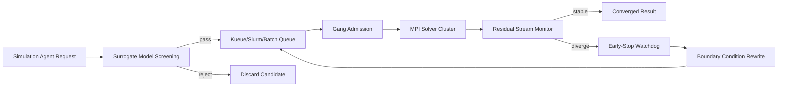
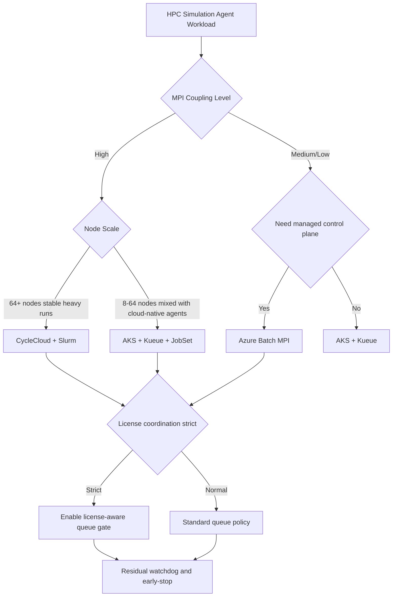

# 企业级 HPC 仿真智能体选型 FAQ：AKS Kueue+JobSet vs CycleCloud Slurm vs Azure Batch
> 🌐 **Language / 语言切换**: **[🇨🇳 中文版](hpc-mpi-gang-scheduling-simulation-agent-aks-kueue-jobset-vs-cyclecloud-slurm-vs-batch-selection-faq.md)** | **[🇬🇧 English](hpc-mpi-gang-scheduling-simulation-agent-aks-kueue-jobset-vs-cyclecloud-slurm-vs-batch-selection-faq.en.md)** | **[📚 返回目录](README.md)**
> 证据标签：`measured` / `synthetic` / `anonymized_reported`
> 抓取日期：2026-11-22

## 1) 执行摘要：仿真智能体不是“多跑几个 Pod”，而是“先保证成组资源一致到位”
在汽车气动与碰撞仿真、
生物分子动力学、
新能源热失控推演、
气象与能源联合预测里，
智能体面对的是
紧耦合多节点求解器。
这类工作负载的核心约束
不是单任务排队时延，
而是成组启动一致性。
如果调度层缺乏
All-or-Nothing 成组准入，
两个 64 节点作业
可能各占 32 节点，
形成互锁僵局。
即使资源“看起来够”，
也会出现长时间空转等待。
第二个拐点在网络面。
跨节点 MPI 屏障
对尾延迟极其敏感。
普通 TCP 以太网络
在中高节点规模
会放大同步停顿。
第三个拐点在许可证面。
商业求解器常按核或令牌计费。
若调度与 License 分离，
将出现“拿到计算槽位，
却拿不到许可证”的空跑浪费。
因此推荐架构应同时覆盖
成组调度、
拓扑感知网络、
License 协同排队、
以及发散熔断止损。

## 2) 场景痛点：紧耦合作业与散列批处理有本质差异
许多团队把 HPC 仿真
错误映射为普通批处理。
这在前期样例规模下
不一定立刻暴露问题。
当节点数提升到
16、32、64 甚至更高后，
隐性成本开始急剧放大。
痛点一是成组准入缺失。
任务 A 与任务 B
都需要整组资源同时就绪。
若使用逐 Pod 抢占，
会在高峰时段陷入
“谁都启动不了”的状态。
痛点二是网络层错配。
低耦合预处理任务
可容忍较高抖动，
但 MPI/NCCL 同步步
无法容忍屏障抖动。
痛点三是许可证治理断层。
求解器 License 令牌
与计算节点调度脱节时，
队列表面吞吐增长，
真实求解产出却下降。
痛点四是发散检测滞后。
很多作业在第 5 分钟
就出现残差爆炸迹象，
却持续运行 4 小时后失败，
直接烧穿核时预算。
所以企业架构决策
必须把“编排正确性”
放在“算力可得性”之前。

## 3) 可验证来源与证据边界
来源 1（`measured`）：Kueue 官方文档（Gang admission、Cohort、借配额机制）  
https://kueue.sigs.k8s.io/
来源 2（`measured`）：Kubernetes JobSet 项目文档（成组作业管理）  
https://jobset.sigs.k8s.io/
来源 3（`measured`）：Kubeflow MPI Operator 文档  
https://www.kubeflow.org/docs/components/trainer/legacy-v1/user-guides/mpi/
来源 4（`measured`）：Azure CycleCloud 文档  
https://learn.microsoft.com/azure/cyclecloud/
来源 5（`measured`）：Slurm 官方文档（调度与 License 插件）  
https://slurm.schedmd.com/documentation.html
来源 6（`measured`）：Azure Batch 文档（Multi-Instance MPI）  
https://learn.microsoft.com/azure/batch/
来源 7（`measured`）：Azure HBv4 / HX 系列 HPC 文档  
https://learn.microsoft.com/azure/virtual-machines/hbv4-series
来源 8（`measured`）：Azure Managed Lustre 文档  
https://learn.microsoft.com/azure/azure-managed-lustre/
来源 9（`anonymized_reported`）：匿名化车企与生物医药仿真集群复盘。  
来源 10（`synthetic`）：万核时成本、License 利用率与发散熔断收益仿真模型。  
本文不涉及
底层网卡寄存器调优，
也不展开 PDE 推导细节，
仅聚焦企业级平台治理与选型。

## 4) 架构原则：四条硬规则
规则一：
紧耦合作业必须成组准入。
如果不能保证
整组资源同时到位，
就不应启动作业。
规则二：
把网络拓扑当作调度维度。
队列系统需感知
RDMA 域与机架邻近性，
而非只看 vCPU 数量。
规则三：
License 令牌与计算槽位联排。
“先占机器再等 License”
在商业求解器场景
属于高成本反模式。
规则四：
把残差曲线纳入治理闭环。
智能体应监控
收敛速度与震荡趋势，
触发 Early-Stop、
边界条件修正、
自动重提与降尺度求解。
这四条同时满足时，
平台才具备
可扩展的仿真生产力。

## 5) 方案一：AKS + Kueue + JobSet / MPIJob
该方案适合
已将智能体编排面
构建在 Kubernetes 的团队。
Kueue 提供
All-or-Nothing 队列准入，
可降低半调度死锁风险。
Cohort 配额借用机制
支持多部门峰谷错配共享。
JobSet 或 MPIJob
用于表达成组 Pod 拓扑。
结合拓扑感知调度策略，
可把通信密集副本
尽量放在低延迟域内。
优势在于
统一控制面与统一可观测。
智能体推理池、
预处理任务、
高保真求解任务
可在一个平台治理框架下联动。
短板在于
平台工程复杂度较高。
团队需要掌握
K8s 调度扩展、
队列治理、
以及 HPC 网络运维协作。
当企业已有
成熟 Kubernetes 平台能力，
该路径长期弹性最强。

## 6) 方案二：CycleCloud + Slurm + HPC 专用节点
该方案适合
重度紧耦合 MPI 求解器，
尤其是数十到数百节点规模。
CycleCloud 提供
可重复的 Slurm 集群编排。
Slurm 在 HPC 生态中
有成熟的作业与队列能力，
且与商业求解器 License
协同经验丰富。
搭配 HBv4 / HXv4 / NDv5 等
高带宽低时延计算实例，
可获得更稳定的并行扩展。
若叠加 Managed Lustre，
可提升大规模中间文件吞吐。
优势是
HPC 经验沉淀深，
对传统 CAE 团队友好。
短板是
与云原生业务系统联动时，
控制面分裂成本会上升。
若企业仿真部门独立运营、
并追求极致 MPI 效率，
该路径通常是首选。

## 7) 方案三：Azure Batch 多实例 MPI 池
该方案适合
希望降低常驻控制面负担、
并按作业生命周期
动态拉起集群的团队。
Batch 支持
Multi-Instance MPI 作业形态，
并提供批量任务编排能力。
对中等规模仿真任务，
其托管化体验
可以显著降低运维门槛。
结合 Spot 与检查点续算，
可在可容忍中断的任务上
进一步压降成本。
优势是
上手与运维负担较低。
短板是
在复杂多租户队列治理、
细粒度拓扑调度、
与深度 License 联动上
可定制空间较小。
如果企业目标是
“先可用、再逐步优化”，
Batch 路径适合
作为托管起步层。

## 8) 双层协同：AI 初筛 + 高保真 MPI 精算 + 发散熔断
推荐将仿真任务
拆成两级漏斗。
第一级由神经代理模型
执行毫秒级初筛，
快速淘汰明显无效方案。
第二级将候选集合
送入多节点高保真求解器。
在第二级执行中，
智能体持续读取残差轨迹、
网格质量信号、
与关键约束指标。
一旦出现发散趋势，
触发 Early-Stop，
释放节点与 License 令牌，
并自动修正参数后重提。
该模式可在不牺牲精度前提下
显著减少无效核时消耗。
对预算敏感企业，
这通常比单纯“买更多算力”
更具 ROI。

## 9) 12 维选型对比表
| 对比维度 | AKS + Kueue + JobSet | CycleCloud + Slurm | Azure Batch MPI |
|---|---|---|---|
| 成组准入能力 | 高 | 高 | 中 |
| 多租户配额借用 | 高 | 中 | 中 |
| 拓扑感知调度深度 | 中高 | 高 | 中 |
| License 协同排队 | 中 | 高 | 中 |
| 云原生生态整合 | 高 | 中 | 中 |
| HPC 传统团队适配 | 中 | 高 | 中高 |
| 托管化运维负担 | 中 | 中 | 高 |
| 超大规模 MPI 扩展 | 中高 | 高 | 中 |
| 智能体联动可编排性 | 高 | 中 | 中 |
| 初期建设复杂度 | 高 | 中高 | 低 |
| 成本弹性（潮汐） | 高 | 中 | 高 |
| 三年治理可扩展性 | 高 | 高 | 中 |

## 10) Mermaid：耦合度与规模决策树

## 11) 成组调度防死锁机制：从“部分占用”转向“整体准入”
最常见调度事故
并非机器不足，
而是资源碎片化占用。
任务需要 32 节点，
但每次只拿到 8 节点，
导致启动失败后反复重排。
解决路径是
将作业视作不可分割单元。
队列仅在
整组资源满足时放行。
对于跨部门共享集群，
应配合配额借用与回收策略，
避免长期静态切片造成浪费。
还应配置等待上限与回退策略，
防止低优先级大作业
永久排队饥饿。
在企业治理层面，
建议定义
“成组调度成功率”
作为核心 SLO，
而不仅是节点利用率。

## 12) RDMA 与 TCP 的规模拐点：什么时候必须上 HPC 网络域
在小规模节点下，
TCP 以太网络
可能足以支持验证任务。
当同步频率高、
消息粒度细、
节点数持续增长时，
屏障等待将快速放大。
此时若仍用通用网络，
会看到 CPU 利用率不低，
但有效求解步进变慢。
RDMA 价值不在“更快”本身，
而在降低同步尾延迟抖动。
这直接影响
MPI 全局步进稳定性。
企业决策建议
不要按“单节点性能”评估，
而应按“整作业完成时长”
与“核时单价后的有效产出”
做比较。
当并行效率曲线
在 TCP 域明显折损时，
应将任务迁移到
InfiniBand 友好队列域。

## 13) 万核时 TCO 测算：把核时、许可证、失败重试放在同一公式
定义：
`N` 为月度仿真作业数，
`H` 为单作业核时，
`P` 为每核时成本，
`L` 为许可证小时成本，
`F` 为发散失败率，
`R` 为失败重提倍率。
近似月成本可写为：
`Cost = N * H * (P + L) * (1 + F*R)`。
若引入 AI 初筛与 Early-Stop，
可把无效运行比例下降。
即使算力单价不变，
总成本也可明显下行。
对大企业而言，
真正成本黑洞
常来自“无效长跑”而非“单价偏高”。
因此平台 KPI 应加入：
发散提前终止率、
许可证空转率、
有效收敛核时占比。
这些指标比
单纯节点利用率
更能反映经营效率。

## 14) 五步落地指南：从试点到平台化
第一步：
分层工作负载画像。
把任务按耦合度、
节点规模、
时效要求分类。
第二步：
建立三类队列域。
云原生混合域、
重度 HPC 域、
托管批处理域。
第三步：
打通 License 与调度联动。
在准入阶段就校验
许可证可用性。
第四步：
上线残差流监控与熔断器。
让智能体具备
自动止损与重提能力。
第五步：
按月运营治理看板。
跟踪成组准入成功率、
并行效率、
空转许可证小时、
千作业成本。
通过季度复盘
调整队列策略与容量基线。

## 15) 实战 FAQ（8 问）
### Q1：什么时候应优先 AKS + Kueue？
当企业已具备 Kubernetes 平台能力，
且希望统一智能体编排与仿真编排时。

### Q2：什么时候应优先 CycleCloud + Slurm？
当重度 MPI 求解是主业务，
并且节点规模长期处于高位时。

### Q3：Azure Batch 是否只适合小任务？
不是。
它适合托管化批调度诉求，
但在深度定制与极致拓扑优化上
不如 Slurm 路径灵活。

### Q4：成组调度能否单独解决所有问题？
不能。
还必须同时治理网络拓扑、
License 队列、
以及发散熔断。

### Q5：为什么要把 License 纳入准入门禁？
因为许可证不足时，
计算节点会空占，
造成双重浪费。

### Q6：AI 初筛会不会牺牲工程精度？
若用于候选剪枝并保留
高保真复算闭环，
通常不会破坏最终精度目标。

### Q7：如何衡量 Early-Stop 的收益？
看“提前终止后节省核时”
与“重提后收敛成功率”。
二者组合才是业务收益。

### Q8：Good fit 与 Not for 如何界定？
Good fit：
多节点紧耦合仿真、
许可证敏感、
预算约束严格的企业平台。
Not for：
纯独立单 Pod 批处理，
几乎无跨节点同步依赖的任务。
