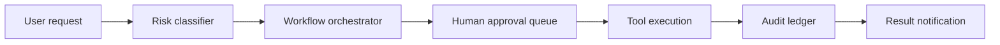
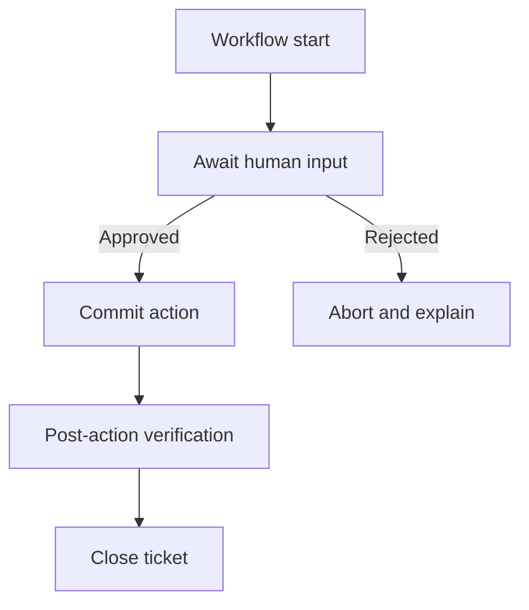

# Enterprise human-approval gates and durable agent workflow orchestration selection FAQ (Durable Functions vs Temporal on AKS vs Logic Apps BPMN)

> Audience: Cloud & AI Solution Architects, enterprise platform teams, and compliance/governance owners.

## 1. Executive summary

When enterprise agents trigger external commitments, regulated disclosures, fee confirmations, or contractual mutations, execution must be transformed from best-effort automation into replayable, auditable, and human-reviewable long-running workflows.

- **Route A**: `Durable Functions` (Azure-native, low-ops event-driven approvals).
- **Route B**: `Temporal on AKS` (high-throughput, multi-team complex orchestration).
- **Route C**: `Logic Apps + BPMN-style integration` (fast connector-based business automation).
- **Route D**: single synchronous request chaining approvals and side effects (anti-pattern).

## 2. Typical failure modes

- Approval timeout is incorrectly interpreted as implicit approval.
- Tool execution is not atomically coupled with state transition.
- Missing compensations produce external/internal ledger divergence.
- No deterministic replay path for audit investigations.

## 3. Route definitions

### Route A: Durable Functions orchestration
- Use Orchestrator + Entities for waits, timeout handling, compensation, and replay.
- Best for Azure-native event sources and low platform overhead.

### Route B: Temporal on AKS
- Separate workflow state machine and execution activities explicitly.
- Best for cross-domain dependency graphs and very high execution scale.

### Route C: Logic Apps with BPMN-like process design
- Leverage managed connectors to integrate ERP/CRM/email approvals quickly.
- Best for integration-led business process automation.

### Route D: anti-pattern baseline
- Bundle approval and side-effect execution into one synchronous request.
- Retry without idempotency keys, causing duplicate side effects.

## 4. Quantitative models

### 4.1 Human-review wait cost
`C_wait = N_cases * T_review_avg * Cost_reviewer_per_min`

### 4.2 Timeout risk exposure
`Risk_timeout = P(timeout) * Impact_per_timeout`

### 4.3 Duplicate execution risk
`Risk_duplicate = P(retry_without_idempotency) * Loss_per_duplicate`

### 4.4 Orchestration recovery objective
`RTO_orchestration = max(T_state_recover, T_dependency_restore)`

## 5. Twelve-dimension comparison matrix

| Dimension | Route A Durable | Route B Temporal on AKS | Route C Logic Apps | Route D anti-pattern |
|---|---|---|---|---|
| Azure-native integration | High | Medium | High | Low |
| High-concurrency scaling | Medium-high | High | Medium | Low |
| Complex dependency modeling | Medium-high | High | Medium | Low |
| Replayability | High | High | Medium-high | Low |
| Human-gate governance | High | High | Medium-high | Low |
| Operations complexity | Low-medium | High | Low | Low (short-term) |
| Multi-team autonomy | Medium | High | Medium | Low |
| Cost controllability | High | Medium | Medium-high | Low |
| Compensation maturity | High | High | Medium | Low |
| Connector ecosystem | Medium | Medium | High | Low |
| Compliance readability | High | High | Medium-high | Low |
| Recommendation | ✅ default | ✅ hyperscale | ✅ integration-fast | ⛔ |

## 6. Deep Q&A (Q1-Q8)
### Q1: Should timeout default to approve or reject?
High-risk actions should fail closed: reject or move to mandatory manual review queue.

### Q2: How do we prevent duplicate execution?
Use business idempotency keys and persist side-effect outcomes in an execution ledger.

### Q3: Does human approval hurt throughput?
Yes, but risk-tier routing can preserve fast paths for low-risk cases.

### Q4: Durable vs Temporal decision rule?
Pick Durable for Azure-native low-ops; pick Temporal for multi-team complex dependency graphs.

### Q5: When is Logic Apps better?
When process complexity is moderate and integration speed dominates architecture constraints.

### Q6: How should compensation be designed?
Define irreversible boundaries first, then implement compensating steps for reversible actions.

### Q7: How to satisfy audit evidence?
Persist approvals, policy versions, input digests, tool calls, and output hashes.

### Q8: How to roll out safely?
Use tenant/cohort canaries with timeout, rejection, and rollback SLO monitoring.

## 7. Mermaid architecture diagrams





## 8. Production snippet: Durable orchestrator (pseudo-code)

```python
@orchestration_trigger
def orchestrator(ctx):
    req = ctx.get_input()
    risk = yield ctx.call_activity("classify_risk", req)
    if risk in ["high", "regulated"]:
        decision = yield ctx.wait_for_external_event("approval")
        if decision != "approved":
            return {"status": "rejected"}
    result = yield ctx.call_activity("execute_tool", req)
    yield ctx.call_activity("append_audit", result)
    return {"status": "done", "result": result}
```

## 9. Production snippet: Temporal idempotent activity

```python
def execute_with_idempotency(cmd, idem_key):
    if ledger.exists(idem_key):
        return ledger.fetch(idem_key)
    out = run_external_action(cmd)
    ledger.store(idem_key, out)
    return out
```

## 10. Enterprise scenarios (2+)

### Scenario A: financial customer notice and pricing-change control
- Outbound customer changes require principal review and fail-closed controls.
- Route A + Route C is usually the practical baseline.

### Scenario B: global manufacturing emergency spare allocation
- Cross-region inventory and high-value release approvals require compensation safety.
- Route B is preferred for complex cross-domain dependencies.

### Scenario C: e-commerce merchant policy enforcement
- Automated rules plus manual appeals demand replayable decision traces.
- Route A for core state transitions, Route C for connector-rich workflows.

## 11. Three-tier 3-year TCO (USD)

| Scale tier | Route A Durable | Route B Temporal | Route C Logic Apps | A+C hybrid |
|---|---:|---:|---:|---:|
| 50K workflows/month | 1,120,000 | 1,480,000 | 1,050,000 | 1,260,000 |
| 1M workflows/month | 5,900,000 | 7,800,000 | 6,200,000 | 6,550,000 |
| 20M workflows/month | 31,500,000 | 36,800,000 | 34,700,000 | 33,900,000 |

## 12. Day-0 / Day-1 / Day-2 checklist

### Day-0 (governance contracts)
- Day-0 control 1: define approval policy, idempotency keys, compensation boundaries, and audit fields.
- Day-0 control 2: define approval policy, idempotency keys, compensation boundaries, and audit fields.
- Day-0 control 3: define approval policy, idempotency keys, compensation boundaries, and audit fields.
- Day-0 control 4: define approval policy, idempotency keys, compensation boundaries, and audit fields.
- Day-0 control 5: define approval policy, idempotency keys, compensation boundaries, and audit fields.
- Day-0 control 6: define approval policy, idempotency keys, compensation boundaries, and audit fields.
- Day-0 control 7: define approval policy, idempotency keys, compensation boundaries, and audit fields.
- Day-0 control 8: define approval policy, idempotency keys, compensation boundaries, and audit fields.
- Day-0 control 9: define approval policy, idempotency keys, compensation boundaries, and audit fields.
- Day-0 control 10: define approval policy, idempotency keys, compensation boundaries, and audit fields.
- Day-0 control 11: define approval policy, idempotency keys, compensation boundaries, and audit fields.
- Day-0 control 12: define approval policy, idempotency keys, compensation boundaries, and audit fields.
- Day-0 control 13: define approval policy, idempotency keys, compensation boundaries, and audit fields.
- Day-0 control 14: define approval policy, idempotency keys, compensation boundaries, and audit fields.
- Day-0 control 15: define approval policy, idempotency keys, compensation boundaries, and audit fields.
- Day-0 control 16: define approval policy, idempotency keys, compensation boundaries, and audit fields.
- Day-0 control 17: define approval policy, idempotency keys, compensation boundaries, and audit fields.
- Day-0 control 18: define approval policy, idempotency keys, compensation boundaries, and audit fields.
- Day-0 control 19: define approval policy, idempotency keys, compensation boundaries, and audit fields.
- Day-0 control 20: define approval policy, idempotency keys, compensation boundaries, and audit fields.
- Day-0 control 21: define approval policy, idempotency keys, compensation boundaries, and audit fields.
- Day-0 control 22: define approval policy, idempotency keys, compensation boundaries, and audit fields.
- Day-0 control 23: define approval policy, idempotency keys, compensation boundaries, and audit fields.
- Day-0 control 24: define approval policy, idempotency keys, compensation boundaries, and audit fields.
- Day-0 control 25: define approval policy, idempotency keys, compensation boundaries, and audit fields.
- Day-0 control 26: define approval policy, idempotency keys, compensation boundaries, and audit fields.
- Day-0 control 27: define approval policy, idempotency keys, compensation boundaries, and audit fields.
- Day-0 control 28: define approval policy, idempotency keys, compensation boundaries, and audit fields.
- Day-0 control 29: define approval policy, idempotency keys, compensation boundaries, and audit fields.
- Day-0 control 30: define approval policy, idempotency keys, compensation boundaries, and audit fields.
- Day-0 control 31: define approval policy, idempotency keys, compensation boundaries, and audit fields.
- Day-0 control 32: define approval policy, idempotency keys, compensation boundaries, and audit fields.
- Day-0 control 33: define approval policy, idempotency keys, compensation boundaries, and audit fields.
- Day-0 control 34: define approval policy, idempotency keys, compensation boundaries, and audit fields.
- Day-0 control 35: define approval policy, idempotency keys, compensation boundaries, and audit fields.
- Day-0 control 36: define approval policy, idempotency keys, compensation boundaries, and audit fields.
- Day-0 control 37: define approval policy, idempotency keys, compensation boundaries, and audit fields.
- Day-0 control 38: define approval policy, idempotency keys, compensation boundaries, and audit fields.
- Day-0 control 39: define approval policy, idempotency keys, compensation boundaries, and audit fields.
- Day-0 control 40: define approval policy, idempotency keys, compensation boundaries, and audit fields.
- Day-0 control 41: define approval policy, idempotency keys, compensation boundaries, and audit fields.
- Day-0 control 42: define approval policy, idempotency keys, compensation boundaries, and audit fields.
- Day-0 control 43: define approval policy, idempotency keys, compensation boundaries, and audit fields.
- Day-0 control 44: define approval policy, idempotency keys, compensation boundaries, and audit fields.
- Day-0 control 45: define approval policy, idempotency keys, compensation boundaries, and audit fields.
- Day-0 control 46: define approval policy, idempotency keys, compensation boundaries, and audit fields.
- Day-0 control 47: define approval policy, idempotency keys, compensation boundaries, and audit fields.
- Day-0 control 48: define approval policy, idempotency keys, compensation boundaries, and audit fields.
- Day-0 control 49: define approval policy, idempotency keys, compensation boundaries, and audit fields.
- Day-0 control 50: define approval policy, idempotency keys, compensation boundaries, and audit fields.
- Day-0 control 51: define approval policy, idempotency keys, compensation boundaries, and audit fields.
- Day-0 control 52: define approval policy, idempotency keys, compensation boundaries, and audit fields.
- Day-0 control 53: define approval policy, idempotency keys, compensation boundaries, and audit fields.
- Day-0 control 54: define approval policy, idempotency keys, compensation boundaries, and audit fields.
- Day-0 control 55: define approval policy, idempotency keys, compensation boundaries, and audit fields.
- Day-0 control 56: define approval policy, idempotency keys, compensation boundaries, and audit fields.
- Day-0 control 57: define approval policy, idempotency keys, compensation boundaries, and audit fields.
- Day-0 control 58: define approval policy, idempotency keys, compensation boundaries, and audit fields.
- Day-0 control 59: define approval policy, idempotency keys, compensation boundaries, and audit fields.
- Day-0 control 60: define approval policy, idempotency keys, compensation boundaries, and audit fields.
- Day-0 control 61: define approval policy, idempotency keys, compensation boundaries, and audit fields.
- Day-0 control 62: define approval policy, idempotency keys, compensation boundaries, and audit fields.
- Day-0 control 63: define approval policy, idempotency keys, compensation boundaries, and audit fields.
- Day-0 control 64: define approval policy, idempotency keys, compensation boundaries, and audit fields.
- Day-0 control 65: define approval policy, idempotency keys, compensation boundaries, and audit fields.
- Day-0 control 66: define approval policy, idempotency keys, compensation boundaries, and audit fields.
- Day-0 control 67: define approval policy, idempotency keys, compensation boundaries, and audit fields.
- Day-0 control 68: define approval policy, idempotency keys, compensation boundaries, and audit fields.
- Day-0 control 69: define approval policy, idempotency keys, compensation boundaries, and audit fields.
- Day-0 control 70: define approval policy, idempotency keys, compensation boundaries, and audit fields.
- Day-0 control 71: define approval policy, idempotency keys, compensation boundaries, and audit fields.
- Day-0 control 72: define approval policy, idempotency keys, compensation boundaries, and audit fields.
- Day-0 control 73: define approval policy, idempotency keys, compensation boundaries, and audit fields.
- Day-0 control 74: define approval policy, idempotency keys, compensation boundaries, and audit fields.
- Day-0 control 75: define approval policy, idempotency keys, compensation boundaries, and audit fields.
- Day-0 control 76: define approval policy, idempotency keys, compensation boundaries, and audit fields.
- Day-0 control 77: define approval policy, idempotency keys, compensation boundaries, and audit fields.
- Day-0 control 78: define approval policy, idempotency keys, compensation boundaries, and audit fields.
- Day-0 control 79: define approval policy, idempotency keys, compensation boundaries, and audit fields.
- Day-0 control 80: define approval policy, idempotency keys, compensation boundaries, and audit fields.

### Day-1 (implementation rollout)
- Day-1 control 1: integrate orchestrator, approval channel, executors, and audit pipeline.
- Day-1 control 2: integrate orchestrator, approval channel, executors, and audit pipeline.
- Day-1 control 3: integrate orchestrator, approval channel, executors, and audit pipeline.
- Day-1 control 4: integrate orchestrator, approval channel, executors, and audit pipeline.
- Day-1 control 5: integrate orchestrator, approval channel, executors, and audit pipeline.
- Day-1 control 6: integrate orchestrator, approval channel, executors, and audit pipeline.
- Day-1 control 7: integrate orchestrator, approval channel, executors, and audit pipeline.
- Day-1 control 8: integrate orchestrator, approval channel, executors, and audit pipeline.
- Day-1 control 9: integrate orchestrator, approval channel, executors, and audit pipeline.
- Day-1 control 10: integrate orchestrator, approval channel, executors, and audit pipeline.
- Day-1 control 11: integrate orchestrator, approval channel, executors, and audit pipeline.
- Day-1 control 12: integrate orchestrator, approval channel, executors, and audit pipeline.
- Day-1 control 13: integrate orchestrator, approval channel, executors, and audit pipeline.
- Day-1 control 14: integrate orchestrator, approval channel, executors, and audit pipeline.
- Day-1 control 15: integrate orchestrator, approval channel, executors, and audit pipeline.
- Day-1 control 16: integrate orchestrator, approval channel, executors, and audit pipeline.
- Day-1 control 17: integrate orchestrator, approval channel, executors, and audit pipeline.
- Day-1 control 18: integrate orchestrator, approval channel, executors, and audit pipeline.
- Day-1 control 19: integrate orchestrator, approval channel, executors, and audit pipeline.
- Day-1 control 20: integrate orchestrator, approval channel, executors, and audit pipeline.
- Day-1 control 21: integrate orchestrator, approval channel, executors, and audit pipeline.
- Day-1 control 22: integrate orchestrator, approval channel, executors, and audit pipeline.
- Day-1 control 23: integrate orchestrator, approval channel, executors, and audit pipeline.
- Day-1 control 24: integrate orchestrator, approval channel, executors, and audit pipeline.
- Day-1 control 25: integrate orchestrator, approval channel, executors, and audit pipeline.
- Day-1 control 26: integrate orchestrator, approval channel, executors, and audit pipeline.
- Day-1 control 27: integrate orchestrator, approval channel, executors, and audit pipeline.
- Day-1 control 28: integrate orchestrator, approval channel, executors, and audit pipeline.
- Day-1 control 29: integrate orchestrator, approval channel, executors, and audit pipeline.
- Day-1 control 30: integrate orchestrator, approval channel, executors, and audit pipeline.
- Day-1 control 31: integrate orchestrator, approval channel, executors, and audit pipeline.
- Day-1 control 32: integrate orchestrator, approval channel, executors, and audit pipeline.
- Day-1 control 33: integrate orchestrator, approval channel, executors, and audit pipeline.
- Day-1 control 34: integrate orchestrator, approval channel, executors, and audit pipeline.
- Day-1 control 35: integrate orchestrator, approval channel, executors, and audit pipeline.
- Day-1 control 36: integrate orchestrator, approval channel, executors, and audit pipeline.
- Day-1 control 37: integrate orchestrator, approval channel, executors, and audit pipeline.
- Day-1 control 38: integrate orchestrator, approval channel, executors, and audit pipeline.
- Day-1 control 39: integrate orchestrator, approval channel, executors, and audit pipeline.
- Day-1 control 40: integrate orchestrator, approval channel, executors, and audit pipeline.
- Day-1 control 41: integrate orchestrator, approval channel, executors, and audit pipeline.
- Day-1 control 42: integrate orchestrator, approval channel, executors, and audit pipeline.
- Day-1 control 43: integrate orchestrator, approval channel, executors, and audit pipeline.
- Day-1 control 44: integrate orchestrator, approval channel, executors, and audit pipeline.
- Day-1 control 45: integrate orchestrator, approval channel, executors, and audit pipeline.
- Day-1 control 46: integrate orchestrator, approval channel, executors, and audit pipeline.
- Day-1 control 47: integrate orchestrator, approval channel, executors, and audit pipeline.
- Day-1 control 48: integrate orchestrator, approval channel, executors, and audit pipeline.
- Day-1 control 49: integrate orchestrator, approval channel, executors, and audit pipeline.
- Day-1 control 50: integrate orchestrator, approval channel, executors, and audit pipeline.
- Day-1 control 51: integrate orchestrator, approval channel, executors, and audit pipeline.
- Day-1 control 52: integrate orchestrator, approval channel, executors, and audit pipeline.
- Day-1 control 53: integrate orchestrator, approval channel, executors, and audit pipeline.
- Day-1 control 54: integrate orchestrator, approval channel, executors, and audit pipeline.
- Day-1 control 55: integrate orchestrator, approval channel, executors, and audit pipeline.
- Day-1 control 56: integrate orchestrator, approval channel, executors, and audit pipeline.
- Day-1 control 57: integrate orchestrator, approval channel, executors, and audit pipeline.
- Day-1 control 58: integrate orchestrator, approval channel, executors, and audit pipeline.
- Day-1 control 59: integrate orchestrator, approval channel, executors, and audit pipeline.
- Day-1 control 60: integrate orchestrator, approval channel, executors, and audit pipeline.
- Day-1 control 61: integrate orchestrator, approval channel, executors, and audit pipeline.
- Day-1 control 62: integrate orchestrator, approval channel, executors, and audit pipeline.
- Day-1 control 63: integrate orchestrator, approval channel, executors, and audit pipeline.
- Day-1 control 64: integrate orchestrator, approval channel, executors, and audit pipeline.
- Day-1 control 65: integrate orchestrator, approval channel, executors, and audit pipeline.
- Day-1 control 66: integrate orchestrator, approval channel, executors, and audit pipeline.
- Day-1 control 67: integrate orchestrator, approval channel, executors, and audit pipeline.
- Day-1 control 68: integrate orchestrator, approval channel, executors, and audit pipeline.
- Day-1 control 69: integrate orchestrator, approval channel, executors, and audit pipeline.
- Day-1 control 70: integrate orchestrator, approval channel, executors, and audit pipeline.
- Day-1 control 71: integrate orchestrator, approval channel, executors, and audit pipeline.
- Day-1 control 72: integrate orchestrator, approval channel, executors, and audit pipeline.
- Day-1 control 73: integrate orchestrator, approval channel, executors, and audit pipeline.
- Day-1 control 74: integrate orchestrator, approval channel, executors, and audit pipeline.
- Day-1 control 75: integrate orchestrator, approval channel, executors, and audit pipeline.
- Day-1 control 76: integrate orchestrator, approval channel, executors, and audit pipeline.
- Day-1 control 77: integrate orchestrator, approval channel, executors, and audit pipeline.
- Day-1 control 78: integrate orchestrator, approval channel, executors, and audit pipeline.
- Day-1 control 79: integrate orchestrator, approval channel, executors, and audit pipeline.
- Day-1 control 80: integrate orchestrator, approval channel, executors, and audit pipeline.

### Day-2 (operations optimization)
- Day-2 control 1: track approval latency, timeout ratio, rejection ratio, and compensation success SLOs.
- Day-2 control 2: track approval latency, timeout ratio, rejection ratio, and compensation success SLOs.
- Day-2 control 3: track approval latency, timeout ratio, rejection ratio, and compensation success SLOs.
- Day-2 control 4: track approval latency, timeout ratio, rejection ratio, and compensation success SLOs.
- Day-2 control 5: track approval latency, timeout ratio, rejection ratio, and compensation success SLOs.
- Day-2 control 6: track approval latency, timeout ratio, rejection ratio, and compensation success SLOs.
- Day-2 control 7: track approval latency, timeout ratio, rejection ratio, and compensation success SLOs.
- Day-2 control 8: track approval latency, timeout ratio, rejection ratio, and compensation success SLOs.
- Day-2 control 9: track approval latency, timeout ratio, rejection ratio, and compensation success SLOs.
- Day-2 control 10: track approval latency, timeout ratio, rejection ratio, and compensation success SLOs.
- Day-2 control 11: track approval latency, timeout ratio, rejection ratio, and compensation success SLOs.
- Day-2 control 12: track approval latency, timeout ratio, rejection ratio, and compensation success SLOs.
- Day-2 control 13: track approval latency, timeout ratio, rejection ratio, and compensation success SLOs.
- Day-2 control 14: track approval latency, timeout ratio, rejection ratio, and compensation success SLOs.
- Day-2 control 15: track approval latency, timeout ratio, rejection ratio, and compensation success SLOs.
- Day-2 control 16: track approval latency, timeout ratio, rejection ratio, and compensation success SLOs.
- Day-2 control 17: track approval latency, timeout ratio, rejection ratio, and compensation success SLOs.
- Day-2 control 18: track approval latency, timeout ratio, rejection ratio, and compensation success SLOs.
- Day-2 control 19: track approval latency, timeout ratio, rejection ratio, and compensation success SLOs.
- Day-2 control 20: track approval latency, timeout ratio, rejection ratio, and compensation success SLOs.
- Day-2 control 21: track approval latency, timeout ratio, rejection ratio, and compensation success SLOs.
- Day-2 control 22: track approval latency, timeout ratio, rejection ratio, and compensation success SLOs.
- Day-2 control 23: track approval latency, timeout ratio, rejection ratio, and compensation success SLOs.
- Day-2 control 24: track approval latency, timeout ratio, rejection ratio, and compensation success SLOs.
- Day-2 control 25: track approval latency, timeout ratio, rejection ratio, and compensation success SLOs.
- Day-2 control 26: track approval latency, timeout ratio, rejection ratio, and compensation success SLOs.
- Day-2 control 27: track approval latency, timeout ratio, rejection ratio, and compensation success SLOs.
- Day-2 control 28: track approval latency, timeout ratio, rejection ratio, and compensation success SLOs.
- Day-2 control 29: track approval latency, timeout ratio, rejection ratio, and compensation success SLOs.
- Day-2 control 30: track approval latency, timeout ratio, rejection ratio, and compensation success SLOs.
- Day-2 control 31: track approval latency, timeout ratio, rejection ratio, and compensation success SLOs.
- Day-2 control 32: track approval latency, timeout ratio, rejection ratio, and compensation success SLOs.
- Day-2 control 33: track approval latency, timeout ratio, rejection ratio, and compensation success SLOs.
- Day-2 control 34: track approval latency, timeout ratio, rejection ratio, and compensation success SLOs.
- Day-2 control 35: track approval latency, timeout ratio, rejection ratio, and compensation success SLOs.
- Day-2 control 36: track approval latency, timeout ratio, rejection ratio, and compensation success SLOs.
- Day-2 control 37: track approval latency, timeout ratio, rejection ratio, and compensation success SLOs.
- Day-2 control 38: track approval latency, timeout ratio, rejection ratio, and compensation success SLOs.
- Day-2 control 39: track approval latency, timeout ratio, rejection ratio, and compensation success SLOs.
- Day-2 control 40: track approval latency, timeout ratio, rejection ratio, and compensation success SLOs.
- Day-2 control 41: track approval latency, timeout ratio, rejection ratio, and compensation success SLOs.
- Day-2 control 42: track approval latency, timeout ratio, rejection ratio, and compensation success SLOs.
- Day-2 control 43: track approval latency, timeout ratio, rejection ratio, and compensation success SLOs.
- Day-2 control 44: track approval latency, timeout ratio, rejection ratio, and compensation success SLOs.
- Day-2 control 45: track approval latency, timeout ratio, rejection ratio, and compensation success SLOs.
- Day-2 control 46: track approval latency, timeout ratio, rejection ratio, and compensation success SLOs.
- Day-2 control 47: track approval latency, timeout ratio, rejection ratio, and compensation success SLOs.
- Day-2 control 48: track approval latency, timeout ratio, rejection ratio, and compensation success SLOs.
- Day-2 control 49: track approval latency, timeout ratio, rejection ratio, and compensation success SLOs.
- Day-2 control 50: track approval latency, timeout ratio, rejection ratio, and compensation success SLOs.
- Day-2 control 51: track approval latency, timeout ratio, rejection ratio, and compensation success SLOs.
- Day-2 control 52: track approval latency, timeout ratio, rejection ratio, and compensation success SLOs.
- Day-2 control 53: track approval latency, timeout ratio, rejection ratio, and compensation success SLOs.
- Day-2 control 54: track approval latency, timeout ratio, rejection ratio, and compensation success SLOs.
- Day-2 control 55: track approval latency, timeout ratio, rejection ratio, and compensation success SLOs.
- Day-2 control 56: track approval latency, timeout ratio, rejection ratio, and compensation success SLOs.
- Day-2 control 57: track approval latency, timeout ratio, rejection ratio, and compensation success SLOs.
- Day-2 control 58: track approval latency, timeout ratio, rejection ratio, and compensation success SLOs.
- Day-2 control 59: track approval latency, timeout ratio, rejection ratio, and compensation success SLOs.
- Day-2 control 60: track approval latency, timeout ratio, rejection ratio, and compensation success SLOs.
- Day-2 control 61: track approval latency, timeout ratio, rejection ratio, and compensation success SLOs.
- Day-2 control 62: track approval latency, timeout ratio, rejection ratio, and compensation success SLOs.
- Day-2 control 63: track approval latency, timeout ratio, rejection ratio, and compensation success SLOs.
- Day-2 control 64: track approval latency, timeout ratio, rejection ratio, and compensation success SLOs.
- Day-2 control 65: track approval latency, timeout ratio, rejection ratio, and compensation success SLOs.
- Day-2 control 66: track approval latency, timeout ratio, rejection ratio, and compensation success SLOs.
- Day-2 control 67: track approval latency, timeout ratio, rejection ratio, and compensation success SLOs.
- Day-2 control 68: track approval latency, timeout ratio, rejection ratio, and compensation success SLOs.
- Day-2 control 69: track approval latency, timeout ratio, rejection ratio, and compensation success SLOs.
- Day-2 control 70: track approval latency, timeout ratio, rejection ratio, and compensation success SLOs.
- Day-2 control 71: track approval latency, timeout ratio, rejection ratio, and compensation success SLOs.
- Day-2 control 72: track approval latency, timeout ratio, rejection ratio, and compensation success SLOs.
- Day-2 control 73: track approval latency, timeout ratio, rejection ratio, and compensation success SLOs.
- Day-2 control 74: track approval latency, timeout ratio, rejection ratio, and compensation success SLOs.
- Day-2 control 75: track approval latency, timeout ratio, rejection ratio, and compensation success SLOs.
- Day-2 control 76: track approval latency, timeout ratio, rejection ratio, and compensation success SLOs.
- Day-2 control 77: track approval latency, timeout ratio, rejection ratio, and compensation success SLOs.
- Day-2 control 78: track approval latency, timeout ratio, rejection ratio, and compensation success SLOs.
- Day-2 control 79: track approval latency, timeout ratio, rejection ratio, and compensation success SLOs.
- Day-2 control 80: track approval latency, timeout ratio, rejection ratio, and compensation success SLOs.
- Day-2 control 81: track approval latency, timeout ratio, rejection ratio, and compensation success SLOs.
- Day-2 control 82: track approval latency, timeout ratio, rejection ratio, and compensation success SLOs.
- Day-2 control 83: track approval latency, timeout ratio, rejection ratio, and compensation success SLOs.
- Day-2 control 84: track approval latency, timeout ratio, rejection ratio, and compensation success SLOs.
- Day-2 control 85: track approval latency, timeout ratio, rejection ratio, and compensation success SLOs.
- Day-2 control 86: track approval latency, timeout ratio, rejection ratio, and compensation success SLOs.
- Day-2 control 87: track approval latency, timeout ratio, rejection ratio, and compensation success SLOs.
- Day-2 control 88: track approval latency, timeout ratio, rejection ratio, and compensation success SLOs.
- Day-2 control 89: track approval latency, timeout ratio, rejection ratio, and compensation success SLOs.
- Day-2 control 90: track approval latency, timeout ratio, rejection ratio, and compensation success SLOs.
- Day-2 control 91: track approval latency, timeout ratio, rejection ratio, and compensation success SLOs.
- Day-2 control 92: track approval latency, timeout ratio, rejection ratio, and compensation success SLOs.
- Day-2 control 93: track approval latency, timeout ratio, rejection ratio, and compensation success SLOs.
- Day-2 control 94: track approval latency, timeout ratio, rejection ratio, and compensation success SLOs.
- Day-2 control 95: track approval latency, timeout ratio, rejection ratio, and compensation success SLOs.
- Day-2 control 96: track approval latency, timeout ratio, rejection ratio, and compensation success SLOs.
- Day-2 control 97: track approval latency, timeout ratio, rejection ratio, and compensation success SLOs.
- Day-2 control 98: track approval latency, timeout ratio, rejection ratio, and compensation success SLOs.
- Day-2 control 99: track approval latency, timeout ratio, rejection ratio, and compensation success SLOs.
- Day-2 control 100: track approval latency, timeout ratio, rejection ratio, and compensation success SLOs.
- Day-2 control 101: track approval latency, timeout ratio, rejection ratio, and compensation success SLOs.
- Day-2 control 102: track approval latency, timeout ratio, rejection ratio, and compensation success SLOs.
- Day-2 control 103: track approval latency, timeout ratio, rejection ratio, and compensation success SLOs.
- Day-2 control 104: track approval latency, timeout ratio, rejection ratio, and compensation success SLOs.
- Day-2 control 105: track approval latency, timeout ratio, rejection ratio, and compensation success SLOs.
- Day-2 control 106: track approval latency, timeout ratio, rejection ratio, and compensation success SLOs.
- Day-2 control 107: track approval latency, timeout ratio, rejection ratio, and compensation success SLOs.
- Day-2 control 108: track approval latency, timeout ratio, rejection ratio, and compensation success SLOs.
- Day-2 control 109: track approval latency, timeout ratio, rejection ratio, and compensation success SLOs.
- Day-2 control 110: track approval latency, timeout ratio, rejection ratio, and compensation success SLOs.
- Day-2 control 111: track approval latency, timeout ratio, rejection ratio, and compensation success SLOs.
- Day-2 control 112: track approval latency, timeout ratio, rejection ratio, and compensation success SLOs.
- Day-2 control 113: track approval latency, timeout ratio, rejection ratio, and compensation success SLOs.
- Day-2 control 114: track approval latency, timeout ratio, rejection ratio, and compensation success SLOs.
- Day-2 control 115: track approval latency, timeout ratio, rejection ratio, and compensation success SLOs.
- Day-2 control 116: track approval latency, timeout ratio, rejection ratio, and compensation success SLOs.
- Day-2 control 117: track approval latency, timeout ratio, rejection ratio, and compensation success SLOs.
- Day-2 control 118: track approval latency, timeout ratio, rejection ratio, and compensation success SLOs.
- Day-2 control 119: track approval latency, timeout ratio, rejection ratio, and compensation success SLOs.
- Day-2 control 120: track approval latency, timeout ratio, rejection ratio, and compensation success SLOs.

## 13. Good fit vs Not for

### ✅ Good fit
- High-risk external actions requiring human gate controls and accountability.
- Long-running workflows with explicit compensation and audit obligations.

### ⛔ Not for
- Pure read-only Q&A paths with no side-effect execution.
- Teams without governance and process-operations ownership capacity.

## 14. Five-step rollout guide
1. Define risk tiers and approval routing contracts.
2. Wrap side effects in idempotent activities with evidence capture.
3. Enforce fail-closed timeout and rejection defaults.
4. Build replayable audit records and investigation runbooks.
5. Iterate with canary cohorts and timeout/rollback SLOs.

## 15. Core KPIs
- `approval_wait_p95_minutes`
- `workflow_timeout_rate`
- `duplicate_execution_rate`
- `compensation_success_rate`
- `audit_replay_success_rate`

## 16. Final recommendation
Use Route A as the default enterprise baseline, add Route B for high-scale complex dependency domains, and add Route C for connector-heavy business integration; explicitly ban Route D.
