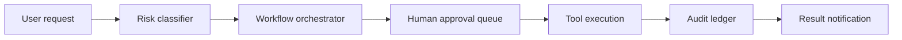
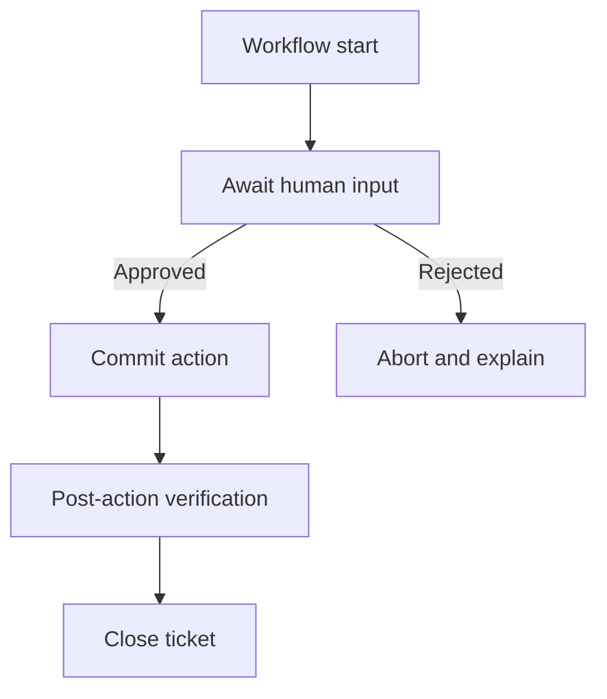

# Enterprise human-approval gates and durable agent workflow orchestration selection FAQ (Durable Functions vs Temporal on AKS vs Logic Apps BPMN)

> Audience: Cloud & AI Solution Architects, enterprise platform teams, and compliance/governance owners.

## 1. Executive summary

When enterprise agents trigger external commitments, regulated disclosures, fee confirmations, or contractual mutations, execution must be transformed from best-effort automation into replayable, auditable, and human-reviewable long-running workflows.

- **Route A**: `Durable Functions` (Azure-native, low-ops event-driven approvals).
- **Route B**: `Temporal on AKS` (high-throughput, multi-team complex orchestration).
- **Route C**: `Logic Apps + BPMN-style integration` (fast connector-based business automation).
- **Route D**: single synchronous request chaining approvals and side effects (anti-pattern).

## 2. Typical failure modes

- Approval timeout is incorrectly interpreted as implicit approval.
- Tool execution is not atomically coupled with state transition.
- Missing compensations produce external/internal ledger divergence.
- No deterministic replay path for audit investigations.

## 3. Route definitions

### Route A: Durable Functions orchestration
- Use Orchestrator + Entities for waits, timeout handling, compensation, and replay.
- Best for Azure-native event sources and low platform overhead.

### Route B: Temporal on AKS
- Separate workflow state machine and execution activities explicitly.
- Best for cross-domain dependency graphs and very high execution scale.

### Route C: Logic Apps with BPMN-like process design
- Leverage managed connectors to integrate ERP/CRM/email approvals quickly.
- Best for integration-led business process automation.

### Route D: anti-pattern baseline
- Bundle approval and side-effect execution into one synchronous request.
- Retry without idempotency keys, causing duplicate side effects.

## 4. Quantitative models

### 4.1 Human-review wait cost
`C_wait = N_cases * T_review_avg * Cost_reviewer_per_min`

### 4.2 Timeout risk exposure
`Risk_timeout = P(timeout) * Impact_per_timeout`

### 4.3 Duplicate execution risk
`Risk_duplicate = P(retry_without_idempotency) * Loss_per_duplicate`

### 4.4 Orchestration recovery objective
`RTO_orchestration = max(T_state_recover, T_dependency_restore)`

## 5. Twelve-dimension comparison matrix

| Dimension | Route A Durable | Route B Temporal on AKS | Route C Logic Apps | Route D anti-pattern |
|---|---|---|---|---|
| Azure-native integration | High | Medium | High | Low |
| High-concurrency scaling | Medium-high | High | Medium | Low |
| Complex dependency modeling | Medium-high | High | Medium | Low |
| Replayability | High | High | Medium-high | Low |
| Human-gate governance | High | High | Medium-high | Low |
| Operations complexity | Low-medium | High | Low | Low (short-term) |
| Multi-team autonomy | Medium | High | Medium | Low |
| Cost controllability | High | Medium | Medium-high | Low |
| Compensation maturity | High | High | Medium | Low |
| Connector ecosystem | Medium | Medium | High | Low |
| Compliance readability | High | High | Medium-high | Low |
| Recommendation | ✅ default | ✅ hyperscale | ✅ integration-fast | ⛔ |

## 6. Deep Q&A (Q1-Q8)
### Q1: Should timeout default to approve or reject?
High-risk actions should fail closed: reject or move to mandatory manual review queue.

### Q2: How do we prevent duplicate execution?
Use business idempotency keys and persist side-effect outcomes in an execution ledger.

### Q3: Does human approval hurt throughput?
Yes, but risk-tier routing can preserve fast paths for low-risk cases.

### Q4: Durable vs Temporal decision rule?
Pick Durable for Azure-native low-ops; pick Temporal for multi-team complex dependency graphs.

### Q5: When is Logic Apps better?
When process complexity is moderate and integration speed dominates architecture constraints.

### Q6: How should compensation be designed?
Define irreversible boundaries first, then implement compensating steps for reversible actions.

### Q7: How to satisfy audit evidence?
Persist approvals, policy versions, input digests, tool calls, and output hashes.

### Q8: How to roll out safely?
Use tenant/cohort canaries with timeout, rejection, and rollback SLO monitoring.

## 7. Mermaid architecture diagrams





## 8. Production snippet: Durable orchestrator (pseudo-code)

```python
@orchestration_trigger
def orchestrator(ctx):
    req = ctx.get_input()
    risk = yield ctx.call_activity("classify_risk", req)
    if risk in ["high", "regulated"]:
        decision = yield ctx.wait_for_external_event("approval")
        if decision != "approved":
            return {"status": "rejected"}
    result = yield ctx.call_activity("execute_tool", req)
    yield ctx.call_activity("append_audit", result)
    return {"status": "done", "result": result}
```

## 9. Production snippet: Temporal idempotent activity

```python
def execute_with_idempotency(cmd, idem_key):
    if ledger.exists(idem_key):
        return ledger.fetch(idem_key)
    out = run_external_action(cmd)
    ledger.store(idem_key, out)
    return out
```

## 10. Enterprise scenarios (2+)

### Scenario A: financial customer notice and pricing-change control
- Outbound customer changes require principal review and fail-closed controls.
- Route A + Route C is usually the practical baseline.

### Scenario B: global manufacturing emergency spare allocation
- Cross-region inventory and high-value release approvals require compensation safety.
- Route B is preferred for complex cross-domain dependencies.

### Scenario C: e-commerce merchant policy enforcement
- Automated rules plus manual appeals demand replayable decision traces.
- Route A for core state transitions, Route C for connector-rich workflows.

## 11. Three-tier 3-year TCO (USD)

| Scale tier | Route A Durable | Route B Temporal | Route C Logic Apps | A+C hybrid |
|---|---:|---:|---:|---:|
| 50K workflows/month | 1,120,000 | 1,480,000 | 1,050,000 | 1,260,000 |
| 1M workflows/month | 5,900,000 | 7,800,000 | 6,200,000 | 6,550,000 |
| 20M workflows/month | 31,500,000 | 36,800,000 | 34,700,000 | 33,900,000 |

## 12. Day-0 / Day-1 / Day-2 checklist

### Day-0 (governance contracts)
- define approval policy, idempotency keys, compensation boundaries, and audit fields.

### Day-1 (implementation rollout)
- integrate orchestrator, approval channel, executors, and audit pipeline.

### Day-2 (operations optimization)
- track approval latency, timeout ratio, rejection ratio, and compensation success SLOs.

## 13. Good fit vs Not for

### ✅ Good fit
- High-risk external actions requiring human gate controls and accountability.
- Long-running workflows with explicit compensation and audit obligations.

### ⛔ Not for
- Pure read-only Q&A paths with no side-effect execution.
- Teams without governance and process-operations ownership capacity.

## 14. Five-step rollout guide
1. Define risk tiers and approval routing contracts.
2. Wrap side effects in idempotent activities with evidence capture.
3. Enforce fail-closed timeout and rejection defaults.
4. Build replayable audit records and investigation runbooks.
5. Iterate with canary cohorts and timeout/rollback SLOs.

## 15. Core KPIs
- `approval_wait_p95_minutes`
- `workflow_timeout_rate`
- `duplicate_execution_rate`
- `compensation_success_rate`
- `audit_replay_success_rate`

## 16. Final recommendation
Use Route A as the default enterprise baseline, add Route B for high-scale complex dependency domains, and add Route C for connector-heavy business integration; explicitly ban Route D.
