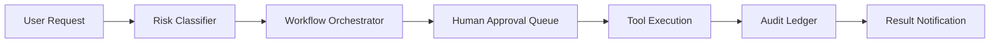
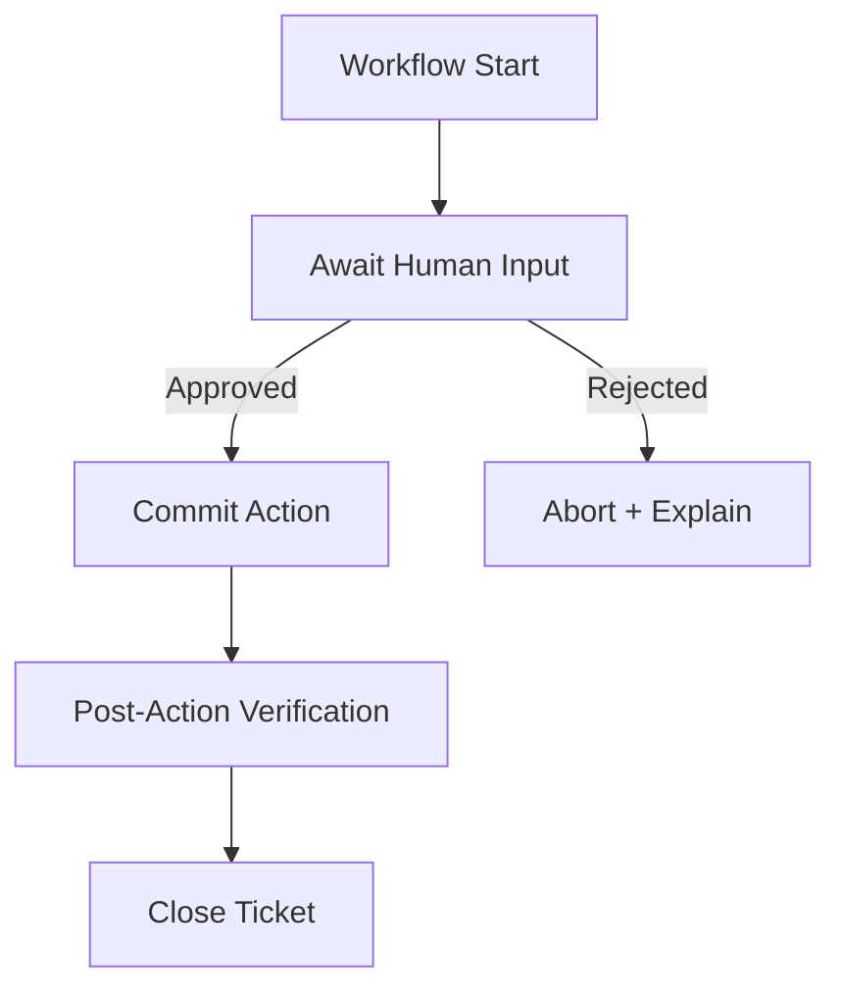

# 企业人审门禁与长周期 Agent 编排选型 FAQ（Durable Functions vs Temporal on AKS vs Logic Apps BPMN）

> 适用对象：Cloud & AI Solution Architect、企业中台团队、合规运营与流程治理负责人。

## 1. 执行摘要

当企业 Agent 涉及对外承诺、监管披露、费用确认、合同变更等高风险动作时，必须将“自动执行”改造为“可恢复、可审计、可人工复核”的长周期编排。建议基线：

- **Route A**：`Durable Functions`（Azure 原生低运维，适合事件驱动审批流程）。
- **Route B**：`Temporal on AKS`（高吞吐、多团队复杂依赖编排）。
- **Route C**：`Logic Apps + BPMN/连接器`（业务集成快、IT/业务协同门槛低）。
- **Route D**：在单个同步请求里串联所有审批与执行（反模式）。

## 2. 典型失败模式

- 人审等待超时后仍被系统误判为“默认通过”。
- 工具调用与审批状态更新非原子，导致“先执行后审批”。
- 补偿动作缺失，外部系统状态与内部台账不一致。
- 无法回放单次业务决策链，审计无法复核。

## 3. 路线定义

### Route A：Durable Functions 编排
- 使用 Durable Entities/Orchestrator 实现审批等待、超时、补偿与重放。
- 适合 Azure 原生事件源（Service Bus/Event Grid/Cosmos Change Feed）。

### Route B：Temporal on AKS
- 用 Workflow + Activity 分离业务状态机与执行节点。
- 适合多团队、多域流程与高并发长期执行场景。

### Route C：Logic Apps + BPMN 风格流程
- 通过连接器快速接入 ERP/CRM/邮件审批系统。
- 适合业务自动化与低代码集成主导场景。

### Route D：反模式
- 把审批、执行、通知全部放在一个同步 HTTP 调用中。
- 失败重试无幂等键，容易重复扣费/重复发函。

## 4. 定量模型

### 4.1 人审等待成本
`C_wait = N_cases * T_review_avg * Cost_reviewer_per_min`

### 4.2 超时与重试风险
`Risk_timeout = P(timeout) * Impact_per_timeout`

### 4.3 重复执行风险
`Risk_duplicate = P(retry_without_idempotency) * Loss_per_duplicate`

### 4.4 编排恢复时间
`RTO_orchestration = max(T_state_recover, T_dependency_restore)`

## 5. 12 维对比矩阵

| 维度 | Route A Durable | Route B Temporal on AKS | Route C Logic Apps | Route D 反模式 |
|---|---|---|---|---|
| Azure 原生集成 | 高 | 中 | 高 | 低 |
| 高并发扩展 | 中高 | 高 | 中 | 低 |
| 复杂依赖表达力 | 中高 | 高 | 中 | 低 |
| 可重放性 | 高 | 高 | 中高 | 低 |
| 人审门禁治理 | 高 | 高 | 中高 | 低 |
| 运维复杂度 | 低中 | 高 | 低 | 低（短期） |
| 多团队自治 | 中 | 高 | 中 | 低 |
| 成本可控性 | 高 | 中 | 中高 | 低 |
| 补偿机制成熟度 | 高 | 高 | 中 | 低 |
| 外部连接器生态 | 中 | 中 | 高 | 低 |
| 合规审计可读性 | 高 | 高 | 中高 | 低 |
| 结论 | ✅ 默认 | ✅ 超大规模 | ✅ 快速集成 | ⛔ |

## 6. 深度问答（Q1-Q8）
### Q1：审批超时应该默认通过还是默认拒绝？
高风险动作必须 fail-closed，默认拒绝或进入人工复核队列。

### Q2：如何避免重复执行？
每个外部副作用操作使用业务幂等键并记录执行账本。

### Q3：人审节点是否会拖慢全流程？
是，但可通过风险分级把低风险请求走快速通道。

### Q4：Durable 与 Temporal 如何选？
Azure 原生低运维优先 Durable；跨团队复杂状态机优先 Temporal。

### Q5：Logic Apps 何时是更优解？
流程以系统集成为主、审批逻辑相对稳定时。

### Q6：如何设计补偿事务？
先定义不可逆操作边界，再为可逆操作实现 compensating steps。

### Q7：如何满足审计取证？
保存审批意见、版本、输入摘要、工具调用与结果哈希。

### Q8：如何灰度上线新流程？
按租户或业务线分批流量切换，并监控超时率与回退率。

## 7. Mermaid 架构图





## 8. 生产片段：Durable 编排伪代码

```python
@orchestration_trigger
def orchestrator(ctx):
    req = ctx.get_input()
    risk = yield ctx.call_activity("classify_risk", req)
    if risk in ["high", "regulated"]:
        decision = yield ctx.wait_for_external_event("approval")
        if decision != "approved":
            return {"status": "rejected"}
    result = yield ctx.call_activity("execute_tool", req)
    yield ctx.call_activity("append_audit", result)
    return {"status": "done", "result": result}
```

## 9. 生产片段：Temporal Activity 幂等保护

```python
def execute_with_idempotency(cmd, idem_key):
    if ledger.exists(idem_key):
        return ledger.fetch(idem_key)
    out = run_external_action(cmd)
    ledger.store(idem_key, out)
    return out
```

## 10. 企业场景（2+）

### 场景 A：金融机构客户通知与费率调整
- 外发通知需合规审阅，审批拒绝必须阻断自动执行。
- 建议 Route A + Route C 组合。

### 场景 B：全球制造售后备件紧急调拨
- 涉及跨区域库存和高价值订单审批。
- 建议 Route B 处理复杂补偿与跨域编排。

### 场景 C：电商平台商家违规处置
- 自动规则与人工复核并行，需可重放审计。
- 建议 Route A 做核心状态机，Route C 做外围集成。

## 11. 三档三年 TCO（USD）

| 规模档位 | Route A Durable | Route B Temporal | Route C Logic Apps | A+C 组合 |
|---|---:|---:|---:|---:|
| 5 万流程/月 | 1,120,000 | 1,480,000 | 1,050,000 | 1,260,000 |
| 100 万流程/月 | 5,900,000 | 7,800,000 | 6,200,000 | 6,550,000 |
| 2000 万流程/月 | 31,500,000 | 36,800,000 | 34,700,000 | 33,900,000 |

## 12. Day-0 / Day-1 / Day-2 清单

### Day-0（治理契约）
- Day-0 项 1: 定义审批策略、幂等键规范、补偿边界与审计字段。
- Day-0 项 2: 定义审批策略、幂等键规范、补偿边界与审计字段。
- Day-0 项 3: 定义审批策略、幂等键规范、补偿边界与审计字段。
- Day-0 项 4: 定义审批策略、幂等键规范、补偿边界与审计字段。
- Day-0 项 5: 定义审批策略、幂等键规范、补偿边界与审计字段。
- Day-0 项 6: 定义审批策略、幂等键规范、补偿边界与审计字段。
- Day-0 项 7: 定义审批策略、幂等键规范、补偿边界与审计字段。
- Day-0 项 8: 定义审批策略、幂等键规范、补偿边界与审计字段。
- Day-0 项 9: 定义审批策略、幂等键规范、补偿边界与审计字段。
- Day-0 项 10: 定义审批策略、幂等键规范、补偿边界与审计字段。
- Day-0 项 11: 定义审批策略、幂等键规范、补偿边界与审计字段。
- Day-0 项 12: 定义审批策略、幂等键规范、补偿边界与审计字段。
- Day-0 项 13: 定义审批策略、幂等键规范、补偿边界与审计字段。
- Day-0 项 14: 定义审批策略、幂等键规范、补偿边界与审计字段。
- Day-0 项 15: 定义审批策略、幂等键规范、补偿边界与审计字段。
- Day-0 项 16: 定义审批策略、幂等键规范、补偿边界与审计字段。
- Day-0 项 17: 定义审批策略、幂等键规范、补偿边界与审计字段。
- Day-0 项 18: 定义审批策略、幂等键规范、补偿边界与审计字段。
- Day-0 项 19: 定义审批策略、幂等键规范、补偿边界与审计字段。
- Day-0 项 20: 定义审批策略、幂等键规范、补偿边界与审计字段。
- Day-0 项 21: 定义审批策略、幂等键规范、补偿边界与审计字段。
- Day-0 项 22: 定义审批策略、幂等键规范、补偿边界与审计字段。
- Day-0 项 23: 定义审批策略、幂等键规范、补偿边界与审计字段。
- Day-0 项 24: 定义审批策略、幂等键规范、补偿边界与审计字段。
- Day-0 项 25: 定义审批策略、幂等键规范、补偿边界与审计字段。
- Day-0 项 26: 定义审批策略、幂等键规范、补偿边界与审计字段。
- Day-0 项 27: 定义审批策略、幂等键规范、补偿边界与审计字段。
- Day-0 项 28: 定义审批策略、幂等键规范、补偿边界与审计字段。
- Day-0 项 29: 定义审批策略、幂等键规范、补偿边界与审计字段。
- Day-0 项 30: 定义审批策略、幂等键规范、补偿边界与审计字段。
- Day-0 项 31: 定义审批策略、幂等键规范、补偿边界与审计字段。
- Day-0 项 32: 定义审批策略、幂等键规范、补偿边界与审计字段。
- Day-0 项 33: 定义审批策略、幂等键规范、补偿边界与审计字段。
- Day-0 项 34: 定义审批策略、幂等键规范、补偿边界与审计字段。
- Day-0 项 35: 定义审批策略、幂等键规范、补偿边界与审计字段。
- Day-0 项 36: 定义审批策略、幂等键规范、补偿边界与审计字段。
- Day-0 项 37: 定义审批策略、幂等键规范、补偿边界与审计字段。
- Day-0 项 38: 定义审批策略、幂等键规范、补偿边界与审计字段。
- Day-0 项 39: 定义审批策略、幂等键规范、补偿边界与审计字段。
- Day-0 项 40: 定义审批策略、幂等键规范、补偿边界与审计字段。
- Day-0 项 41: 定义审批策略、幂等键规范、补偿边界与审计字段。
- Day-0 项 42: 定义审批策略、幂等键规范、补偿边界与审计字段。
- Day-0 项 43: 定义审批策略、幂等键规范、补偿边界与审计字段。
- Day-0 项 44: 定义审批策略、幂等键规范、补偿边界与审计字段。
- Day-0 项 45: 定义审批策略、幂等键规范、补偿边界与审计字段。
- Day-0 项 46: 定义审批策略、幂等键规范、补偿边界与审计字段。
- Day-0 项 47: 定义审批策略、幂等键规范、补偿边界与审计字段。
- Day-0 项 48: 定义审批策略、幂等键规范、补偿边界与审计字段。
- Day-0 项 49: 定义审批策略、幂等键规范、补偿边界与审计字段。
- Day-0 项 50: 定义审批策略、幂等键规范、补偿边界与审计字段。
- Day-0 项 51: 定义审批策略、幂等键规范、补偿边界与审计字段。
- Day-0 项 52: 定义审批策略、幂等键规范、补偿边界与审计字段。
- Day-0 项 53: 定义审批策略、幂等键规范、补偿边界与审计字段。
- Day-0 项 54: 定义审批策略、幂等键规范、补偿边界与审计字段。
- Day-0 项 55: 定义审批策略、幂等键规范、补偿边界与审计字段。
- Day-0 项 56: 定义审批策略、幂等键规范、补偿边界与审计字段。
- Day-0 项 57: 定义审批策略、幂等键规范、补偿边界与审计字段。
- Day-0 项 58: 定义审批策略、幂等键规范、补偿边界与审计字段。
- Day-0 项 59: 定义审批策略、幂等键规范、补偿边界与审计字段。
- Day-0 项 60: 定义审批策略、幂等键规范、补偿边界与审计字段。
- Day-0 项 61: 定义审批策略、幂等键规范、补偿边界与审计字段。
- Day-0 项 62: 定义审批策略、幂等键规范、补偿边界与审计字段。
- Day-0 项 63: 定义审批策略、幂等键规范、补偿边界与审计字段。
- Day-0 项 64: 定义审批策略、幂等键规范、补偿边界与审计字段。
- Day-0 项 65: 定义审批策略、幂等键规范、补偿边界与审计字段。
- Day-0 项 66: 定义审批策略、幂等键规范、补偿边界与审计字段。
- Day-0 项 67: 定义审批策略、幂等键规范、补偿边界与审计字段。
- Day-0 项 68: 定义审批策略、幂等键规范、补偿边界与审计字段。
- Day-0 项 69: 定义审批策略、幂等键规范、补偿边界与审计字段。
- Day-0 项 70: 定义审批策略、幂等键规范、补偿边界与审计字段。
- Day-0 项 71: 定义审批策略、幂等键规范、补偿边界与审计字段。
- Day-0 项 72: 定义审批策略、幂等键规范、补偿边界与审计字段。
- Day-0 项 73: 定义审批策略、幂等键规范、补偿边界与审计字段。
- Day-0 项 74: 定义审批策略、幂等键规范、补偿边界与审计字段。
- Day-0 项 75: 定义审批策略、幂等键规范、补偿边界与审计字段。
- Day-0 项 76: 定义审批策略、幂等键规范、补偿边界与审计字段。
- Day-0 项 77: 定义审批策略、幂等键规范、补偿边界与审计字段。
- Day-0 项 78: 定义审批策略、幂等键规范、补偿边界与审计字段。
- Day-0 项 79: 定义审批策略、幂等键规范、补偿边界与审计字段。
- Day-0 项 80: 定义审批策略、幂等键规范、补偿边界与审计字段。

### Day-1（工程上线）
- Day-1 项 1: 打通编排引擎、人审系统、执行器与审计台账。
- Day-1 项 2: 打通编排引擎、人审系统、执行器与审计台账。
- Day-1 项 3: 打通编排引擎、人审系统、执行器与审计台账。
- Day-1 项 4: 打通编排引擎、人审系统、执行器与审计台账。
- Day-1 项 5: 打通编排引擎、人审系统、执行器与审计台账。
- Day-1 项 6: 打通编排引擎、人审系统、执行器与审计台账。
- Day-1 项 7: 打通编排引擎、人审系统、执行器与审计台账。
- Day-1 项 8: 打通编排引擎、人审系统、执行器与审计台账。
- Day-1 项 9: 打通编排引擎、人审系统、执行器与审计台账。
- Day-1 项 10: 打通编排引擎、人审系统、执行器与审计台账。
- Day-1 项 11: 打通编排引擎、人审系统、执行器与审计台账。
- Day-1 项 12: 打通编排引擎、人审系统、执行器与审计台账。
- Day-1 项 13: 打通编排引擎、人审系统、执行器与审计台账。
- Day-1 项 14: 打通编排引擎、人审系统、执行器与审计台账。
- Day-1 项 15: 打通编排引擎、人审系统、执行器与审计台账。
- Day-1 项 16: 打通编排引擎、人审系统、执行器与审计台账。
- Day-1 项 17: 打通编排引擎、人审系统、执行器与审计台账。
- Day-1 项 18: 打通编排引擎、人审系统、执行器与审计台账。
- Day-1 项 19: 打通编排引擎、人审系统、执行器与审计台账。
- Day-1 项 20: 打通编排引擎、人审系统、执行器与审计台账。
- Day-1 项 21: 打通编排引擎、人审系统、执行器与审计台账。
- Day-1 项 22: 打通编排引擎、人审系统、执行器与审计台账。
- Day-1 项 23: 打通编排引擎、人审系统、执行器与审计台账。
- Day-1 项 24: 打通编排引擎、人审系统、执行器与审计台账。
- Day-1 项 25: 打通编排引擎、人审系统、执行器与审计台账。
- Day-1 项 26: 打通编排引擎、人审系统、执行器与审计台账。
- Day-1 项 27: 打通编排引擎、人审系统、执行器与审计台账。
- Day-1 项 28: 打通编排引擎、人审系统、执行器与审计台账。
- Day-1 项 29: 打通编排引擎、人审系统、执行器与审计台账。
- Day-1 项 30: 打通编排引擎、人审系统、执行器与审计台账。
- Day-1 项 31: 打通编排引擎、人审系统、执行器与审计台账。
- Day-1 项 32: 打通编排引擎、人审系统、执行器与审计台账。
- Day-1 项 33: 打通编排引擎、人审系统、执行器与审计台账。
- Day-1 项 34: 打通编排引擎、人审系统、执行器与审计台账。
- Day-1 项 35: 打通编排引擎、人审系统、执行器与审计台账。
- Day-1 项 36: 打通编排引擎、人审系统、执行器与审计台账。
- Day-1 项 37: 打通编排引擎、人审系统、执行器与审计台账。
- Day-1 项 38: 打通编排引擎、人审系统、执行器与审计台账。
- Day-1 项 39: 打通编排引擎、人审系统、执行器与审计台账。
- Day-1 项 40: 打通编排引擎、人审系统、执行器与审计台账。
- Day-1 项 41: 打通编排引擎、人审系统、执行器与审计台账。
- Day-1 项 42: 打通编排引擎、人审系统、执行器与审计台账。
- Day-1 项 43: 打通编排引擎、人审系统、执行器与审计台账。
- Day-1 项 44: 打通编排引擎、人审系统、执行器与审计台账。
- Day-1 项 45: 打通编排引擎、人审系统、执行器与审计台账。
- Day-1 项 46: 打通编排引擎、人审系统、执行器与审计台账。
- Day-1 项 47: 打通编排引擎、人审系统、执行器与审计台账。
- Day-1 项 48: 打通编排引擎、人审系统、执行器与审计台账。
- Day-1 项 49: 打通编排引擎、人审系统、执行器与审计台账。
- Day-1 项 50: 打通编排引擎、人审系统、执行器与审计台账。
- Day-1 项 51: 打通编排引擎、人审系统、执行器与审计台账。
- Day-1 项 52: 打通编排引擎、人审系统、执行器与审计台账。
- Day-1 项 53: 打通编排引擎、人审系统、执行器与审计台账。
- Day-1 项 54: 打通编排引擎、人审系统、执行器与审计台账。
- Day-1 项 55: 打通编排引擎、人审系统、执行器与审计台账。
- Day-1 项 56: 打通编排引擎、人审系统、执行器与审计台账。
- Day-1 项 57: 打通编排引擎、人审系统、执行器与审计台账。
- Day-1 项 58: 打通编排引擎、人审系统、执行器与审计台账。
- Day-1 项 59: 打通编排引擎、人审系统、执行器与审计台账。
- Day-1 项 60: 打通编排引擎、人审系统、执行器与审计台账。
- Day-1 项 61: 打通编排引擎、人审系统、执行器与审计台账。
- Day-1 项 62: 打通编排引擎、人审系统、执行器与审计台账。
- Day-1 项 63: 打通编排引擎、人审系统、执行器与审计台账。
- Day-1 项 64: 打通编排引擎、人审系统、执行器与审计台账。
- Day-1 项 65: 打通编排引擎、人审系统、执行器与审计台账。
- Day-1 项 66: 打通编排引擎、人审系统、执行器与审计台账。
- Day-1 项 67: 打通编排引擎、人审系统、执行器与审计台账。
- Day-1 项 68: 打通编排引擎、人审系统、执行器与审计台账。
- Day-1 项 69: 打通编排引擎、人审系统、执行器与审计台账。
- Day-1 项 70: 打通编排引擎、人审系统、执行器与审计台账。
- Day-1 项 71: 打通编排引擎、人审系统、执行器与审计台账。
- Day-1 项 72: 打通编排引擎、人审系统、执行器与审计台账。
- Day-1 项 73: 打通编排引擎、人审系统、执行器与审计台账。
- Day-1 项 74: 打通编排引擎、人审系统、执行器与审计台账。
- Day-1 项 75: 打通编排引擎、人审系统、执行器与审计台账。
- Day-1 项 76: 打通编排引擎、人审系统、执行器与审计台账。
- Day-1 项 77: 打通编排引擎、人审系统、执行器与审计台账。
- Day-1 项 78: 打通编排引擎、人审系统、执行器与审计台账。
- Day-1 项 79: 打通编排引擎、人审系统、执行器与审计台账。
- Day-1 项 80: 打通编排引擎、人审系统、执行器与审计台账。

### Day-2（运营优化）
- Day-2 项 1: 监控审批时延、拒绝率、超时率与补偿成功率。
- Day-2 项 2: 监控审批时延、拒绝率、超时率与补偿成功率。
- Day-2 项 3: 监控审批时延、拒绝率、超时率与补偿成功率。
- Day-2 项 4: 监控审批时延、拒绝率、超时率与补偿成功率。
- Day-2 项 5: 监控审批时延、拒绝率、超时率与补偿成功率。
- Day-2 项 6: 监控审批时延、拒绝率、超时率与补偿成功率。
- Day-2 项 7: 监控审批时延、拒绝率、超时率与补偿成功率。
- Day-2 项 8: 监控审批时延、拒绝率、超时率与补偿成功率。
- Day-2 项 9: 监控审批时延、拒绝率、超时率与补偿成功率。
- Day-2 项 10: 监控审批时延、拒绝率、超时率与补偿成功率。
- Day-2 项 11: 监控审批时延、拒绝率、超时率与补偿成功率。
- Day-2 项 12: 监控审批时延、拒绝率、超时率与补偿成功率。
- Day-2 项 13: 监控审批时延、拒绝率、超时率与补偿成功率。
- Day-2 项 14: 监控审批时延、拒绝率、超时率与补偿成功率。
- Day-2 项 15: 监控审批时延、拒绝率、超时率与补偿成功率。
- Day-2 项 16: 监控审批时延、拒绝率、超时率与补偿成功率。
- Day-2 项 17: 监控审批时延、拒绝率、超时率与补偿成功率。
- Day-2 项 18: 监控审批时延、拒绝率、超时率与补偿成功率。
- Day-2 项 19: 监控审批时延、拒绝率、超时率与补偿成功率。
- Day-2 项 20: 监控审批时延、拒绝率、超时率与补偿成功率。
- Day-2 项 21: 监控审批时延、拒绝率、超时率与补偿成功率。
- Day-2 项 22: 监控审批时延、拒绝率、超时率与补偿成功率。
- Day-2 项 23: 监控审批时延、拒绝率、超时率与补偿成功率。
- Day-2 项 24: 监控审批时延、拒绝率、超时率与补偿成功率。
- Day-2 项 25: 监控审批时延、拒绝率、超时率与补偿成功率。
- Day-2 项 26: 监控审批时延、拒绝率、超时率与补偿成功率。
- Day-2 项 27: 监控审批时延、拒绝率、超时率与补偿成功率。
- Day-2 项 28: 监控审批时延、拒绝率、超时率与补偿成功率。
- Day-2 项 29: 监控审批时延、拒绝率、超时率与补偿成功率。
- Day-2 项 30: 监控审批时延、拒绝率、超时率与补偿成功率。
- Day-2 项 31: 监控审批时延、拒绝率、超时率与补偿成功率。
- Day-2 项 32: 监控审批时延、拒绝率、超时率与补偿成功率。
- Day-2 项 33: 监控审批时延、拒绝率、超时率与补偿成功率。
- Day-2 项 34: 监控审批时延、拒绝率、超时率与补偿成功率。
- Day-2 项 35: 监控审批时延、拒绝率、超时率与补偿成功率。
- Day-2 项 36: 监控审批时延、拒绝率、超时率与补偿成功率。
- Day-2 项 37: 监控审批时延、拒绝率、超时率与补偿成功率。
- Day-2 项 38: 监控审批时延、拒绝率、超时率与补偿成功率。
- Day-2 项 39: 监控审批时延、拒绝率、超时率与补偿成功率。
- Day-2 项 40: 监控审批时延、拒绝率、超时率与补偿成功率。
- Day-2 项 41: 监控审批时延、拒绝率、超时率与补偿成功率。
- Day-2 项 42: 监控审批时延、拒绝率、超时率与补偿成功率。
- Day-2 项 43: 监控审批时延、拒绝率、超时率与补偿成功率。
- Day-2 项 44: 监控审批时延、拒绝率、超时率与补偿成功率。
- Day-2 项 45: 监控审批时延、拒绝率、超时率与补偿成功率。
- Day-2 项 46: 监控审批时延、拒绝率、超时率与补偿成功率。
- Day-2 项 47: 监控审批时延、拒绝率、超时率与补偿成功率。
- Day-2 项 48: 监控审批时延、拒绝率、超时率与补偿成功率。
- Day-2 项 49: 监控审批时延、拒绝率、超时率与补偿成功率。
- Day-2 项 50: 监控审批时延、拒绝率、超时率与补偿成功率。
- Day-2 项 51: 监控审批时延、拒绝率、超时率与补偿成功率。
- Day-2 项 52: 监控审批时延、拒绝率、超时率与补偿成功率。
- Day-2 项 53: 监控审批时延、拒绝率、超时率与补偿成功率。
- Day-2 项 54: 监控审批时延、拒绝率、超时率与补偿成功率。
- Day-2 项 55: 监控审批时延、拒绝率、超时率与补偿成功率。
- Day-2 项 56: 监控审批时延、拒绝率、超时率与补偿成功率。
- Day-2 项 57: 监控审批时延、拒绝率、超时率与补偿成功率。
- Day-2 项 58: 监控审批时延、拒绝率、超时率与补偿成功率。
- Day-2 项 59: 监控审批时延、拒绝率、超时率与补偿成功率。
- Day-2 项 60: 监控审批时延、拒绝率、超时率与补偿成功率。
- Day-2 项 61: 监控审批时延、拒绝率、超时率与补偿成功率。
- Day-2 项 62: 监控审批时延、拒绝率、超时率与补偿成功率。
- Day-2 项 63: 监控审批时延、拒绝率、超时率与补偿成功率。
- Day-2 项 64: 监控审批时延、拒绝率、超时率与补偿成功率。
- Day-2 项 65: 监控审批时延、拒绝率、超时率与补偿成功率。
- Day-2 项 66: 监控审批时延、拒绝率、超时率与补偿成功率。
- Day-2 项 67: 监控审批时延、拒绝率、超时率与补偿成功率。
- Day-2 项 68: 监控审批时延、拒绝率、超时率与补偿成功率。
- Day-2 项 69: 监控审批时延、拒绝率、超时率与补偿成功率。
- Day-2 项 70: 监控审批时延、拒绝率、超时率与补偿成功率。
- Day-2 项 71: 监控审批时延、拒绝率、超时率与补偿成功率。
- Day-2 项 72: 监控审批时延、拒绝率、超时率与补偿成功率。
- Day-2 项 73: 监控审批时延、拒绝率、超时率与补偿成功率。
- Day-2 项 74: 监控审批时延、拒绝率、超时率与补偿成功率。
- Day-2 项 75: 监控审批时延、拒绝率、超时率与补偿成功率。
- Day-2 项 76: 监控审批时延、拒绝率、超时率与补偿成功率。
- Day-2 项 77: 监控审批时延、拒绝率、超时率与补偿成功率。
- Day-2 项 78: 监控审批时延、拒绝率、超时率与补偿成功率。
- Day-2 项 79: 监控审批时延、拒绝率、超时率与补偿成功率。
- Day-2 项 80: 监控审批时延、拒绝率、超时率与补偿成功率。
- Day-2 项 81: 监控审批时延、拒绝率、超时率与补偿成功率。
- Day-2 项 82: 监控审批时延、拒绝率、超时率与补偿成功率。
- Day-2 项 83: 监控审批时延、拒绝率、超时率与补偿成功率。
- Day-2 项 84: 监控审批时延、拒绝率、超时率与补偿成功率。
- Day-2 项 85: 监控审批时延、拒绝率、超时率与补偿成功率。
- Day-2 项 86: 监控审批时延、拒绝率、超时率与补偿成功率。
- Day-2 项 87: 监控审批时延、拒绝率、超时率与补偿成功率。
- Day-2 项 88: 监控审批时延、拒绝率、超时率与补偿成功率。
- Day-2 项 89: 监控审批时延、拒绝率、超时率与补偿成功率。
- Day-2 项 90: 监控审批时延、拒绝率、超时率与补偿成功率。
- Day-2 项 91: 监控审批时延、拒绝率、超时率与补偿成功率。
- Day-2 项 92: 监控审批时延、拒绝率、超时率与补偿成功率。
- Day-2 项 93: 监控审批时延、拒绝率、超时率与补偿成功率。
- Day-2 项 94: 监控审批时延、拒绝率、超时率与补偿成功率。
- Day-2 项 95: 监控审批时延、拒绝率、超时率与补偿成功率。
- Day-2 项 96: 监控审批时延、拒绝率、超时率与补偿成功率。
- Day-2 项 97: 监控审批时延、拒绝率、超时率与补偿成功率。
- Day-2 项 98: 监控审批时延、拒绝率、超时率与补偿成功率。
- Day-2 项 99: 监控审批时延、拒绝率、超时率与补偿成功率。
- Day-2 项 100: 监控审批时延、拒绝率、超时率与补偿成功率。

## 13. Good fit vs Not for

### ✅ Good fit
- 高风险业务动作需要人工门禁与可追责链路。
- 跨系统集成、长周期审批与失败补偿要求明确。

### ⛔ Not for
- 仅做秒级只读问答且无外部副作用的流程。
- 团队未准备流程治理与审计建设投入。

## 14. 五步落地指南
1. 先定义风险分级与审批分流策略。
2. 将执行动作包装为幂等 Activity。
3. 建立 fail-closed 超时与拒绝默认策略。
4. 接入审计台账与回放工具。
5. 通过演练持续收敛超时与补偿失败。

## 15. 核心 KPI
- `approval_wait_p95_minutes`
- `workflow_timeout_rate`
- `duplicate_execution_rate`
- `compensation_success_rate`
- `audit_replay_success_rate`

## 16. 最终建议
默认 Route A，复杂跨域高并发场景补充 Route B，业务连接器密集场景补充 Route C，禁止 Route D。
