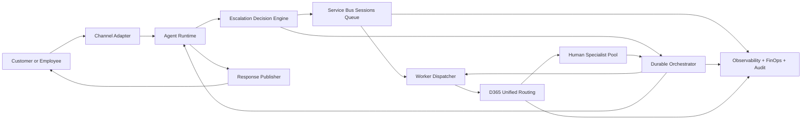
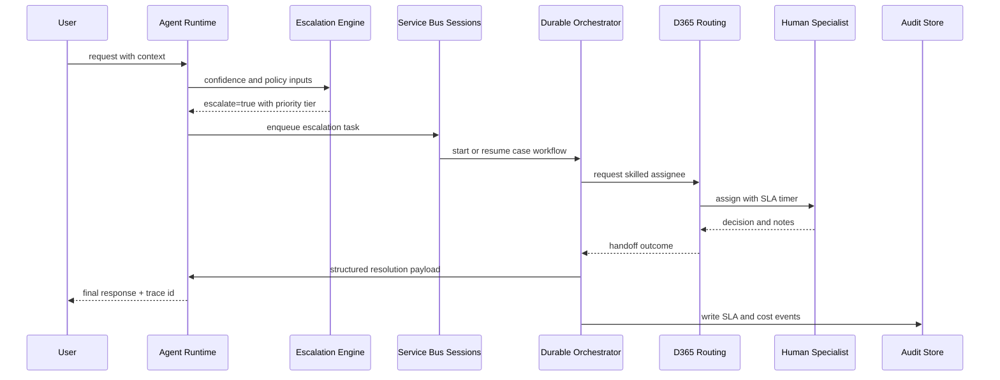

# Enterprise human-in-the-loop escalation queueing selection FAQ: Service Bus Sessions priority lanes vs Durable Functions SLA orchestration vs D365 Unified Routing skills dispatch vs dual-speed hybrid loop

> **Audience**: Enterprise Cloud & AI Solution Architects, contact-center platform owners, workflow governance teams, SRE, and FinOps leaders.  
> **Core question**: When an agent cannot safely finish a task, which escalation architecture keeps SLA, preserves auditability, and controls cost at scale.

## 1. Problem framing: why escalation queueing decides production success

Most teams focus on model quality first,
but they underinvest in the takeover path.

In real production systems,
non-automatable cases are not edge cases,
they are a predictable part of traffic.

Common examples include:

- Contract interpretation conflicts requiring legal review.
- Payment disputes needing document verification.
- Supply-chain exceptions requiring operations approval.
- High-risk actions requiring supervisor confirmation.

If escalation queueing is weak,
four failure patterns emerge quickly:

- Cases wait too long and violate SLA.
- Premium users and low-value traffic are mixed together.
- Agent retries keep calling tools and burn budget.
- Human outcomes are not written back into workflow state.

That is why escalation queueing is not a side feature,
it is part of the enterprise agent control plane.

## 2. Four architecture patterns and their boundaries

This guide compares four patterns:

- Pattern A: `Service Bus Sessions + Priority Buckets`.
- Pattern B: `Durable Functions` suspend/resume with SLA timers.
- Pattern C: `Dynamics 365 Unified Routing` skill-based assignment.
- Pattern D: frontline fast lane + backline stable lane hybrid loop.

Do not evaluate only by throughput.
Also evaluate:

- Escalation waiting P95.
- First-contact resolution rate.
- Human handoff precision.
- Governance cost per 1,000 escalations.
- End-to-end audit traceability.

## 3. Pattern A: Service Bus Sessions priority queueing

This pattern treats escalation as ordered message streams.

Core design points:

- `SessionId = case_id` keeps per-case ordering.
- `priority_tier` drives weighted dequeue.
- Lock renewal protects long-running handlers.
- Dead-letter queues isolate failed escalations.

Strengths:

- Strong compatibility with async microservices.
- Reliable burst absorption.
- Predictable operating cost profile.

Limitations:

- Limited native skill-matching semantics.
- Agent-to-human context requires extra modeling.
- Cross-channel callback flow needs additional orchestration.

Best fit:

- Event-heavy environments.
- Teams prioritizing stability and ordering guarantees.
- Organizations with external workforce management systems.

## 4. Pattern B: Durable Functions SLA-aware orchestration

This pattern models escalation as an explicit workflow state machine.

Key mechanisms:

- `WaitForExternalEvent` for human decisions.
- Durable timers for SLA countdown and timeout jumps.
- Replay-safe idempotent activity functions.
- Compensation branches for rollback and retries.

Strengths:

- Clear process semantics.
- Excellent long-running recovery behavior.
- Strong replay and audit capabilities.

Limitations:

- Workflow version governance is heavier.
- Cost can rise for ultra-high-frequency microtasks.
- Skill routing is not native and needs integration.

Best fit:

- Compliance-heavy approval domains.
- Cases spanning multiple business days.
- Enterprises requiring deterministic lifecycle tracking.

## 5. Pattern C: D365 Unified Routing skill dispatch

This pattern sends escalations directly into a contact-center routing engine.

Key capabilities:

- Skill tags for language, product line, and regulation scope.
- Live capacity balancing for specialist pools.
- Omnichannel continuity across chat, voice, and ticket channels.
- Supervisor intervention and override workflows.

Strengths:

- Complete human-agent collaboration UX.
- High configuration velocity for operations teams.
- Fast alignment with service KPI frameworks.

Limitations:

- Less coverage for non-service back-office processes.
- Deep customization may require additional engineering.
- Cross-domain reuse can be constrained by domain model fit.

Best fit:

- Service and support organizations at scale.
- Teams with multi-channel intake complexity.
- Programs seeking rapid operational rollout.

## 6. Pattern D: dual-speed hybrid loop (recommended end-state)

In mature enterprises,
the dominant architecture is a dual-speed control loop:

- Fast lane for intake shaping and priority buffering.
- Stable lane for durable workflow and governed human handoff.

Typical composition:

- Service Bus handles burst control and queue fairness.
- Durable workflow enforces lifecycle and timeout policy.
- D365 handles skills dispatch and quality feedback loops.

Why this wins:

- No case loss during traffic spikes.
- Full lifecycle traceability for compliance.
- Better human takeover efficiency over time.

## 7. Reference architecture: escalation control plane

Architecture implications:

- Keep policy decisions in one place.
- Scale queue and workflow layers independently.
- Never allow human results to bypass workflow state updates.

## 8. Request flow: SLA clock, takeover, and write-back

Flow governance checks:

- Every escalation needs a globally unique trace ID.
- Timeout must trigger deterministic re-escalation.
- Human decisions should be structured, not free-form only.

## 9. 12-dimension enterprise comparison matrix

| Dimension | A Service Bus Sessions | B Durable Functions | C D365 Unified Routing | D Dual-speed Hybrid |
|---|---|---|---|---|
| Burst absorption | Very high | Medium | Medium | Very high |
| Long-running recoverability | Medium | Very high | Medium | Very high |
| Skill-matching depth | Low to medium | Medium | Very high | Very high |
| Omnichannel continuity | Medium | Medium | Very high | Very high |
| Time-to-adopt | High | Medium | High | Medium |
| Process transparency | Medium | Very high | High | Very high |
| Audit depth | High | Very high | High | Very high |
| Custom flexibility | Medium | Very high | Medium | Very high |
| Ops complexity | Medium | Medium to high | Medium | High |
| Cost predictability | High | Medium | Medium | Medium to high |
| Org-fit breadth | Medium | High | High | Very high |
| Recommended maturity phase | Early scale | Workflow governance | Service scale-up | Mature platform |

## 10. Quantitative break-even: wait time, FCR, and TCO

| Metric | A Queue-first | B Durable-first | C Routing-first | D Hybrid |
|---|---:|---:|---:|---:|
| Escalation enqueue P95 | 38 ms | 62 ms | 55 ms | 66 ms |
| Human takeover wait P95 | 11.8 min | 10.5 min | 8.1 min | 6.7 min |
| First-contact resolution | 71.2% | 75.6% | 82.4% | 86.9% |
| SLA breach rate | 4.8% | 3.9% | 2.9% | 1.7% |
| Governance cost / 1k escalations | $31 | $38 | $46 | $43 |
| Rework cost / 1k escalations | $19 | $15 | $11 | $7 |

Assumptions:

- 480,000 escalations per month.
- 3.6x burst multiplier at peak windows.
- 16x5 operation window with duty coverage.
- Cost includes platform, workforce, and rework.

Break-even finding:

- Below 80k escalations/month, A or B is often cheaper.
- At 120k–200k escalations/month, C improves value via FCR lift.
- Above 250k escalations/month, D yields lowest total cost.

## 11. Decision tree: choose by case shape first

Question 1:
Do you need multi-day replay-safe approvals?

- Yes: prioritize B or D.
- No: move to Question 2.

Question 2:
Is omnichannel service intake the dominant workload?

- Yes: prioritize C or D.
- No: move to Question 3.

Question 3:
Do you face sharp peak bursts with strict budget guardrails?

- Yes: prioritize A or D.
- No: B and C remain viable depending on team skills.

Question 4:
Do auditors require full lifecycle evidence by policy version?

- Yes: D is usually the long-term target architecture.
- No: phased rollout with A/B/C can still succeed.

## 12. Common anti-patterns and corrective actions

Anti-pattern 1:
All escalations are sent to one generic queue.

Correction:
Split by risk, value, and urgency tiers.

Anti-pattern 2:
Teams watch average wait only,
while ignoring P95 tail breaches.

Correction:
Gate releases on tail latency and breach-rate SLO.

Anti-pattern 3:
Human outcomes are captured as free text only.

Correction:
Enforce structured resolution schema with required fields.

Anti-pattern 4:
Escalation policy switches are done as full cutovers.

Mitigation:
Roll out at 5% canary first,
then expand by business domain.

## 13. Governance operating model and ownership

Recommended four-party ownership model:

- Platform team: queue, workflow, and observability baseline.
- Business team: priority and escalation policy semantics.
- Operations team: skills taxonomy and staffing model.
- Compliance team: evidence retention and audit mapping.

Operating principles:

- Policy changes must be versioned and replayable.
- Every change requires regression evidence.
- High-risk policy updates require dual approval.

## 14. Five-step rollout guide (Good fit vs Not for)

Step 1: define escalation taxonomy.  
Separate auto-resolved, escalatable, and human-mandatory classes.

Step 2: deploy priority queue guardrails first.  
Protect high-value cases during peaks.

Step 3: add durable workflow and SLA timers.  
Turn waiting into an explicit governable state.

Step 4: integrate skill routing and quality feedback.  
Shift from random pickup to precision assignment.

Step 5: run weekly dual-speed optimization loops.  
Tune breach rate, rework rate, and unit economics together.

Good fit:

- Multi-tenant high-volume service operations.
- Organizations with strong compliance obligations.
- Programs that must scale channels and regions continuously.

Not for:

- Tiny internal pilots with low escalation volume.
- Teams without a defined human takeover process.
- Short-lived projects without audit requirements.

## 15. Practical FAQ (8 questions)

**Q1: Should we start with queueing or orchestration first?**  
A1: Start with queueing for stability, then add orchestration for governance depth.

**Q2: How do we prevent escalations from being forgotten?**  
A2: Add deterministic SLA timers and auto re-escalation tiers.

**Q3: Is D365 routing limited to contact-center use cases?**  
A3: It is strongest there, but can support broader service workflows with integration.

**Q4: Is the hybrid architecture too heavy for most teams?**  
A4: It may be heavy early on, but often lowers long-term operational cost at scale.

**Q5: Which KPIs best show escalation quality?**  
A5: Track FCR, breach rate, rework rate, and cost per 1,000 escalations together.

**Q6: How can we control human note quality?**  
A6: Require structured resolution templates and mandatory evidence fields.

**Q7: How should we design cross-region resiliency?**  
A7: Partition queue/workflow domains and run regular failover drills.

**Q8: When should we move from single-pattern to hybrid?**  
A8: Move when escalation volume rises and tail-SLA breaches become systemic.

