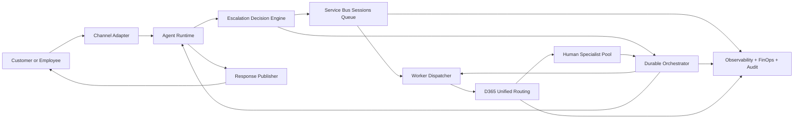
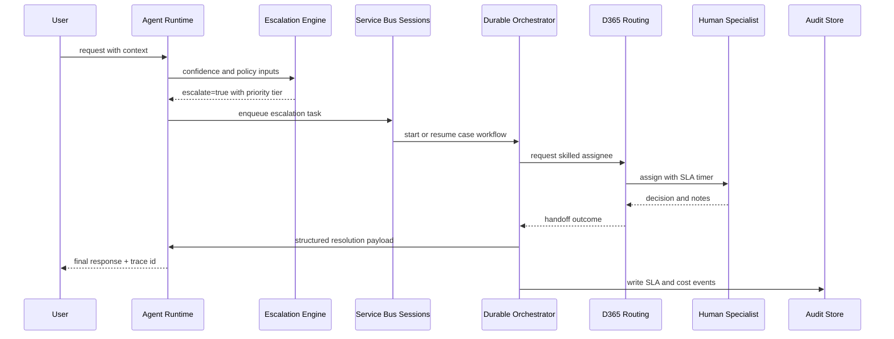

# 企业人机协同升级队列选型 FAQ：Service Bus Sessions 优先队列 vs Durable Functions SLA 计时编排 vs D365 Unified Routing 技能路由 vs 双速混合闭环

> **适用对象**：企业 Cloud & AI Solution Architect、客服平台负责人、流程治理团队、SRE 与 FinOps 团队。  
> **目标问题**：当 Agent 无法自动完成任务时，如何在大规模多租户环境下实现“可解释、可追踪、可控成本”的人机升级与回落闭环。

## 1. 问题定义：为什么升级队列是企业 Agent 成败分水岭

多数团队先把注意力放在模型效果，
却忽视“无法自动完成时谁来接手”。

在生产环境里，
失败不是异常，
而是常态分布的一部分。

典型场景包括：

- 合同条款冲突需要法务裁决。
- 支付争议需要人工核验凭证。
- 供应链例外订单需要运营审批。
- 高风险工单需要主管二次确认。

如果升级队列设计粗糙，
就会出现四类连锁问题：

- 工单长期滞留，
  最终违约 SLA。
- 高价值客户与低价值请求混排，
  导致体验反转。
- 机器人重复尝试调用工具，
  成本失控。
- 人工处理后结果未回写，
  造成状态分叉。

因此升级队列不是“客服功能”，
而是企业 Agent 控制平面的核心。

## 2. 四种企业级方案与边界定义

本文比较四条路线：

- 方案 A：`Service Bus Sessions + Priority Buckets`。
- 方案 B：`Durable Functions` 挂起恢复与 SLA 计时器。
- 方案 C：`Dynamics 365 Unified Routing` 技能与容量路由。
- 方案 D：前台快层 + 后台稳层双速混合闭环。

评估时不应只看吞吐量，
还要看：

- 升级等待 P95。
- 工单一次解决率（FCR）。
- 人工接手准确率。
- 每千次升级治理成本。
- 处理链路审计可追溯性。

## 3. 方案 A：Service Bus Sessions 优先级队列

该方案以消息队列为核心，
将升级请求映射为可排序会话流。

关键设计点：

- `SessionId = case_id` 保证同案有序。
- `priority_tier` 决定出队权重。
- `lock renewal` 防止长处理超时丢锁。
- `dead-letter` 接收失败升级请求。

优势：

- 与异步系统天然兼容。
- 峰值削峰能力稳定。
- 成本可预测，易做容量规划。

短板：

- 对技能匹配表达有限。
- 人工排班上下文不原生。
- 跨渠道回执需要额外编排。

适用阶段：

- 多系统事件汇聚期。
- 强调稳定吞吐与顺序语义。
- 人工池已在外部系统管理。

## 4. 方案 B：Durable Functions 挂起恢复编排

该方案把升级流程显式建模为状态机，
并以持久化历史实现可恢复执行。

关键机制：

- `WaitForExternalEvent` 等待人工决策。
- 定时器实现 SLA 倒计时与超时升级。
- 幂等活动函数回放安全。
- 补偿分支处理撤销与重试。

优势：

- 流程语义清晰且可视化。
- 对跨天长流程更友好。
- 审计与回放能力强。

短板：

- 编排定义与版本治理较重。
- 高频微任务场景成本偏高。
- 不具备开箱技能路由。

适用阶段：

- 法务/财务等强流程治理域。
- 需明确审批链责任追踪。
- 需要精细超时分级策略。

## 5. 方案 C：D365 Unified Routing 技能路由

该方案把升级接管直接放入联络中心引擎，
利用技能、容量与渠道规则统一分配。

关键能力：

- 技能标签匹配（语言/产品/法规）。
- 实时坐席容量控制。
- Omnichannel 会话连续性。
- Supervisor 手工改派与监控。

优势：

- 人机协同体验完整。
- 业务规则配置化程度高。
- 与客服 KPI 体系对齐快。

短板：

- 对非客服后台流程覆盖有限。
- 深度自定义需二次开发。
- 跨业务域通用性受限。

适用阶段：

- 客服与服务台主导组织。
- 多渠道统一接待要求高。
- 需要快速复制成熟运营模式。

## 6. 方案 D：双速混合闭环（推荐终局）

在成熟企业中，
常见终局是双速架构：

- 前台快层：队列快速承接与限流。
- 后台稳层：流程编排与审计闭环。

典型组合：

- Service Bus 负责入口整形与优先级调度。
- Durable 承担跨系统长流程状态机。
- D365 负责人工技能派发与质检反馈。

该方案价值在于：

- 峰值不丢单。
- 复杂流程可追踪。
- 人工接手体验可运营。

## 7. 参考架构：升级队列与人机协同控制平面

架构解读：

- 决策引擎仅决定升级策略，
  不直接绑定某一渠道。
- 队列与编排解耦，
  可分别扩缩容。
- 人工处理结果必须回写编排层，
  禁止旁路完成。

## 8. 请求与升级时序：SLA 时钟、接管、回填

时序要点：

- 每次升级都要产生唯一追踪号。
- SLA 超时要自动二次升级。
- 人工批注应结构化回写，
  避免自由文本污染后续自动化。

## 9. 12 维企业选型对比矩阵

| 维度 | A Service Bus Sessions | B Durable Functions | C D365 Unified Routing | D 双速混合 |
|---|---|---|---|---|
| 峰值削峰能力 | 很高 | 中 | 中 | 很高 |
| 长流程可恢复性 | 中 | 很高 | 中 | 很高 |
| 技能匹配能力 | 低到中 | 中 | 很高 | 很高 |
| 多渠道连续性 | 中 | 中 | 很高 | 很高 |
| 上线速度 | 高 | 中 | 高 | 中 |
| 流程透明度 | 中 | 很高 | 高 | 很高 |
| 审计追踪深度 | 高 | 很高 | 高 | 很高 |
| 自定义灵活性 | 中 | 很高 | 中 | 很高 |
| 运维复杂度 | 中 | 中到高 | 中 | 高 |
| 成本可预测性 | 高 | 中 | 中 | 中到高 |
| 组织协作适配性 | 中 | 高 | 高 | 很高 |
| 推荐成熟度阶段 | 起步扩展 | 流程治理 | 客服规模化 | 企业成熟期 |

## 10. 定量对比：等待时延、解决率与 TCO 拐点

| 指标 | A 队列优先级 | B Durable 编排 | C D365 路由 | D 双速混合 |
|---|---:|---:|---:|---:|
| 升级入队 P95 | 38 ms | 62 ms | 55 ms | 66 ms |
| 人工接手等待 P95 | 11.8 min | 10.5 min | 8.1 min | 6.7 min |
| 一次解决率 FCR | 71.2% | 75.6% | 82.4% | 86.9% |
| SLA 违约率 | 4.8% | 3.9% | 2.9% | 1.7% |
| 每千升级治理成本（美元） | 31 | 38 | 46 | 43 |
| 每千升级返工成本（美元） | 19 | 15 | 11 | 7 |

测算口径：

- 月升级量 48 万单。
- 高峰倍率 3.6x。
- 业务窗口 16x5 + 值班覆盖。
- 成本含平台、坐席、返工三项。

拐点判断：

- 月升级量 < 8 万时，
  A 或 B 更经济。
- 月升级量在 12–20 万时，
  C 的 FCR 优势开始抵消费用。
- 月升级量 > 25 万时，
  D 的综合 TCO 最低。

## 11. 选型决策树：先看工单特征，再定平台路径

第一问：
是否需要跨天审批与回放？

- 是：优先考虑 B 或 D。
- 否：进入第二问。

第二问：
是否以客服渠道接待为主？

- 是：优先考虑 C 或 D。
- 否：进入第三问。

第三问：
是否存在强峰值与严格成本上限？

- 是：优先 A 或 D。
- 否：可按团队能力在 B/C 间权衡。

第四问：
是否需要统一审计与合规取证？

- 是：D 通常是最终演进目标。
- 否：A/B/C 皆可阶段落地。

## 12. 常见反模式与纠偏动作

反模式一：
将所有升级都推给同一人工队列。

改进动作：
按风险、价值、时效三维分层。

反模式二：
只看平均等待时长，
忽略 P95 与尾部违约。

修复动作：
把尾延迟纳入 SLO 契约门禁。

反模式三：
人工处理结果未标准化回写。

治理动作：
定义结构化结论模板与必填字段。

反模式四：
升级策略一次性全量切换。

落地动作：
先灰度 5%，
再按业务域滚动放量。

## 13. 平台治理模型与职责划分

建议采用四方协同模型：

- 平台团队：维护队列、编排、观测基线。
- 业务团队：定义升级规则与价值优先级。
- 运营团队：管理技能池与班表容量。
- 合规团队：审计链路与证据保全标准。

治理原则：

- 规则版本化与可回放。
- 变更需附带回归报告。
- 高风险策略变更必须双人审批。

## 14. 五步落地指南（Good fit vs Not for）

步骤 1：建立升级分类字典。  
把工单分为自动完成、可升级、必须人工三类。

步骤 2：上线队列优先级护栏。  
先保证高价值工单不被淹没。

步骤 3：引入流程编排与 SLA 计时。  
把“等待”变成可治理状态。

步骤 4：接入技能路由与运营反馈。  
让人工接手由“抢单”升级为“精确派单”。

步骤 5：构建双速闭环与周度复盘。  
持续优化违约率、返工率与单位成本。

Good fit：

- 多租户高并发服务组织。
- 有成熟运营与合规要求。
- 需要持续扩展渠道与业务域。

Not for：

- 单一团队低流量内部工具。
- 无明确人工接手流程的小试点。
- 无审计要求且预算极小的短期项目。

## 15. 实战 FAQ（8 问）

**Q1：先做队列还是先做编排？**  
A1：通常先做队列保活，再做编排治理。

**Q2：如何避免升级后“石沉大海”？**  
A2：强制 SLA 计时器与超时再升级规则。

**Q3：D365 路由是否只能用于客服？**  
A3：最强场景在客服，但也可承载服务台流程。

**Q4：双速架构会不会太重？**  
A4：在高并发和强合规场景下，长期更省成本。

**Q5：怎么衡量升级策略是否有效？**  
A5：看 FCR、违约率、返工率与每千单成本。

**Q6：人工批注质量如何管控？**  
A6：使用结构化模板与必填校验，避免自由漂移。

**Q7：如何做跨区域高可用？**  
A7：队列与编排分区部署，并做异地灾备演练。

**Q8：何时应从单方案升级到混合闭环？**  
A8：当月升级量持续增长且尾部违约抬头时。

