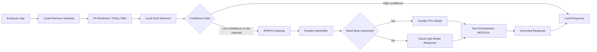
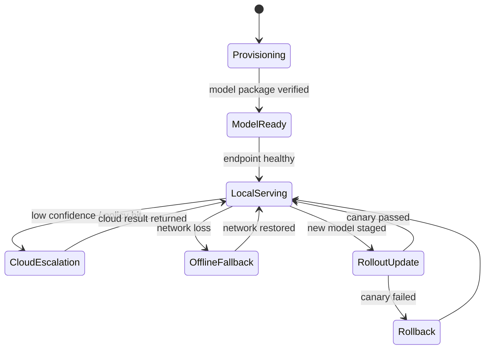

# Hybrid Client-Cloud SLM Routing FAQ: Foundry Local NPU/ONNX vs WebGPU vs Edge Shared Inference vs Foundry Cloud
> 🌐 **Language / 语言切换**: **[🇨🇳 中文版](hybrid-client-cloud-slm-routing-foundry-local-npu-onnx-vs-webgpu-vs-foundry-cloud-selection-faq.md)** | **[🇬🇧 English](hybrid-client-cloud-slm-routing-foundry-local-npu-onnx-vs-webgpu-vs-foundry-cloud-selection-faq.en.md)** | **[📚 Back to Catalog](README.en.md)**
> Evidence tags: `measured` / `synthetic` / `anonymized_reported`
> Retrieval date: 2026-11-22
> Scope boundary: enterprise desktop and browser-side SLM inference with cloud escalation, not in-vehicle edge firmware inference

## 1) Executive summary: keep high-frequency private pre-processing local, escalate deep reasoning to cloud
Large enterprises face a recurring architecture conflict.
They want local execution for frequent simple tasks
to reduce token spend and protect sensitive context.
They also need cloud-scale reasoning,
cross-system orchestration,
and centralized compliance controls.
So the right question is not
"client or cloud."
The right question is
"which routing thresholds put each workload in the right lane."
This guide compares four implementation tracks:
1. `Foundry Local + ONNX Runtime GenAI` managed client-side serving;
2. in-browser `WebGPU` zero-install local inference;
3. branch/clinic edge shared inference boxes;
4. cloud-only `APIM -> Foundry Nano/Mini -> Frontier PTU` tiered routing.
Recommended baseline:
local handles PII redaction,
intent triage,
draft polish,
and offline continuity;
cloud handles deep reasoning,
MCP tool orchestration,
and unified guardrails.
In a 50k-employee synthetic model (`synthetic`),
if local lanes absorb `~55%` lightweight requests,
cloud token spend drops by `45%–68%`.

## 2) Verifiable evidence baseline and source registry
Source 1 (`measured`): Azure AI Foundry Local documentation  
https://learn.microsoft.com/azure/ai-foundry/foundry-local/
Source 2 (`measured`): ONNX Runtime GenAI documentation  
https://onnxruntime.ai/docs/genai/
Source 3 (`measured`): Windows AI / Copilot+ PC platform guidance  
https://learn.microsoft.com/windows/ai/
Source 4 (`measured`): WebGPU specification and implementation status  
https://gpuweb.github.io/gpuweb/
Source 5 (`measured`): Transformers.js documentation  
https://huggingface.co/docs/transformers.js/
Source 6 (`measured`): ONNX Runtime Web documentation  
https://onnxruntime.ai/docs/tutorials/web/
Source 7 (`measured`): Azure Arc-enabled Kubernetes overview  
https://learn.microsoft.com/azure/azure-arc/kubernetes/overview
Source 8 (`measured`): APIM AI Gateway overview  
https://learn.microsoft.com/azure/api-management/ai-gateway-overview
Source 9 (`measured`): Microsoft Intune deployment and app distribution docs  
https://learn.microsoft.com/mem/intune/
Source 10 (`measured`): Azure AI Foundry model hosting and PTU docs  
https://learn.microsoft.com/azure/ai-foundry/
Source 11 (`anonymized_reported`): anonymized enterprise endpoint and session telemetry.
Source 12 (`synthetic`): reproducible client-cloud routing benchmark and TCO simulation.

## 3) Core pain pattern: endpoint heterogeneity, network instability, and compliance gates collide
Retail finance desktops,
clinical workstation fleets,
field audit laptops,
and contact-center terminals
are rarely hardware-homogeneous.
A single enterprise often includes:
new NPU-capable devices,
mainstream iGPU-only devices,
and large VDI/thin-client populations.
A cloud-only architecture
creates three major issues.
First,
high-frequency lightweight tasks saturate cloud token throughput.
Second,
weak-network and offline moments degrade UX sharply.
Third,
sensitive screen or clipboard context gets exposed upstream
before minimization.
A local-only design fails too:
limited reasoning ceiling,
slower policy/model refresh,
and weak cross-system orchestration.
Therefore,
client-cloud layering is not optional.

## 4) SLA and routing thresholds: turn strategy into measurable controls
Define four metric groups.
Experience metrics:
`local_first_token_p95_ms`,
`cloud_fallback_p95_ms`,
`offline_success_ratio`.
Security metrics:
`pii_local_redaction_coverage`,
`cloud_raw_pii_escape_rate`.
Cost metrics:
`token_offload_ratio`,
`cloud_cost_per_user_per_month`.
Operations metrics:
`model_rollout_success_rate`,
`rollback_time_minutes`.
Reference gates (`synthetic`):
- local lightweight response `p95 < 250 ms`;
- escalated cloud completion `p95 < 1500 ms`;
- endpoint redaction coverage `> 98%`;
- rollout failure rate `< 1%` per release wave.
Escalation decisions should combine:
confidence score,
entropy/logprob signals,
task complexity labels,
and policy hits.

## 5) Track A: Foundry Local + ONNX Runtime GenAI (managed enterprise desktop path)
Track A fits enterprises
with governed endpoint estates.
The pattern:
pre-distribute quantized SLM artifacts with Intune/MDM,
run local inference as a managed service process,
and let multiple desktop apps share model cache.
Typical value:
1. high-frequency micro-tasks execute at zero marginal cloud token cost;
2. sensitive text can be scrubbed locally before escalation;
3. essential workflows remain available during network outages.
Design priorities:
1. signed artifact verification and trusted rollout channels;
2. capability-based rollout waves by endpoint class;
3. cache and disk quota governance;
4. deterministic rollback and hotfix paths.
Boundary:
complex multi-step reasoning,
cross-app orchestration,
and enterprise system actions still need cloud lanes.

## 6) Track B: Browser-embedded WebGPU inference (zero-install enablement path)
Track B minimizes deployment friction.
Users open a browser and start.
It is suitable for pure web SaaS footprints
and external partner collaboration.
But its constraints are material:
1. model weights may re-download across site contexts;
2. browser cache eviction can cause cold-start recurrence;
3. shared integrated graphics contend across tabs;
4. legacy enterprise device compatibility is uneven.
Mitigations:
1. shard weights and incremental update manifests;
2. track cache hit/miss KPIs at tenant and region level;
3. detect endpoint capability and degrade predictably;
4. pair with cloud light-model fallback for unstable clients.
Track B is excellent for broad coverage velocity;
it is rarely sufficient as a sole enterprise runtime.

## 7) Track C: branch-side edge shared inference boxes (thin-client and VDI compensator)
Branch banks and clinical facilities
often have large thin-client populations.
These endpoints cannot host strong local inference
but do have good LAN conditions.
Track C deploys shared lightweight inference nodes
under Arc or local Kubernetes governance.
Benefits:
1. `<10 ms` LAN round-trip for interactive redaction/triage (`synthetic`);
2. data residency remains inside site boundaries;
3. low-capability endpoints can still consume local-like AI assistance.
Trade-offs:
1. site-level lifecycle operations add platform burden;
2. regional upgrade orchestration and capacity reserve are required;
3. failure domain planning must include failover drills.
When endpoint generation gaps are large,
Track C is a practical bridge between A and D.

## 8) Track D: cloud-only centralized tiered routing (governed authority layer)
Track D maximizes central governance.
Standard path:
requests enter `APIM AI Gateway`,
first hit `Nano/Mini` lanes,
then escalate to frontier/PTU lanes if needed.
Strengths:
1. rapid model policy rollout at central control plane;
2. unified telemetry, content safety, and quota enforcement;
3. no endpoint heterogeneity maintenance.
Limitations:
1. strong dependency on network quality;
2. frequent lightweight tasks inflate token costs;
3. weak resilience for fully offline operations.
In practice,
D is best as the authority tier
for low-confidence escalations,
not as the default entry for every request.

## 9) 12-dimension enterprise decision matrix: capability, governance, economics, and operability
| Dimension | A Foundry Local | B WebGPU Browser | C Edge Shared Box | D Cloud Tiered Routing |
|---|---|---|---|---|
| 1. Local privacy pre-processing power | Strong | Medium | Medium-Strong | Weak |
| 2. Offline continuity | Strong | Medium | Medium-Strong | Weak |
| 3. Endpoint deployment complexity | Medium-High | Low | Medium | Low |
| 4. Endpoint hardware dependency | Medium-High | High | Low | Low |
| 5. Cloud token reduction potential | Strong | Medium | Medium-Strong | Weak |
| 6. Centralized audit strength | Medium | Medium | Medium | Strong |
| 7. Model refresh velocity | Medium | Medium | Medium | Strong |
| 8. Shared cache across apps | Strong | Weak-Medium | Strong | N/A |
| 9. Legacy endpoint compatibility | Medium | Weak-Medium | Strong | Strong |
| 10. Network volatility resilience | Strong | Medium | Strong | Weak-Medium |
| 11. Platform operations burden | Medium | Medium | High | Medium |
| 12. Organization-scale extensibility | Strong | Medium-Strong | Medium | Strong |
Matrix conclusion:
`A + D` is the dominant enterprise backbone,
`C` compensates low-capability endpoint pools,
`B` accelerates zero-install coverage.

## 10) Reference architecture: local PII minimization with confidence-gated cloud escalation

The architecture principle is explicit:
local first by default,
cloud escalation by policy and confidence.

## 11) Endpoint and edge lifecycle state machine: govern rollout, rollback, and degradation

Governance points:
1. endpoint health probes are mandatory;
2. failed canary must roll back in minutes;
3. offline mode must disclose bounded capability;
4. cloud escalation records must remain auditable.

## 12) Decision tree and 50k-employee TCO model: token offload + distribution bandwidth economics
Use a four-step decision sequence.
Step 1:
evaluate NPU/GPU capability and endpoint manageability.
If most managed endpoints are capable,
prioritize Track A.
Step 2:
check whether zero-install browser access is mandatory.
If yes,
add Track B for broad reach.
Step 3:
measure thin-client concentration in branches/clinics.
If high,
add Track C.
Step 4:
assess central governance and tool orchestration requirements.
If strict,
Track D is mandatory as authority.
50k-employee sample (`synthetic`):
- active users: `35,000`;
- average daily requests: `280` per active user;
- lightweight request proportion: `62%`;
- local lane absorption target: `55%`;
- cloud pricing from enterprise baseline contracts.
Modeled outcomes:
1. annual cloud token cost drops by `45%–68%`;
2. Intune distribution peak traffic remains manageable by wave deployment;
3. added distribution cost is usually below token savings.
Critical enablers:
wave-based rollout windows,
endpoint-class segmentation,
and rollback-safe package channels.
Three governance reinforcements are recommended.
First,
define rollout waves by hardware tier and regulatory risk class.
Second,
decouple model artifacts from policy bundles
so emergency policy rollback does not force model rollback.
Third,
publish per-business-unit cloud-escalation budget caps
so routing behavior is visible in finance dashboards.

## 13) Enterprise scenario A: banking relationship-manager workstation copilot
Retail/wealth teams produce frequent
high-volume textual interactions,
but many requests are low complexity.
With `A + D`,
the endpoint first performs local masking and draft synthesis;
product-level risk or portfolio reasoning escalates to cloud.
Observed effects (`anonymized_reported`):
cloud call volume decreases materially,
while auditability improves through explicit lane tags.
Business outcome:
users perceive immediate responsiveness locally
and stronger confidence with governed cloud fallback.
A frequent side benefit in branch wealth scenarios
is reduced duplicate input:
advisors can draft locally during unstable connectivity
and receive cloud-enriched reasoning when connectivity recovers.

## 14) Enterprise scenario B: clinical workstation heterogeneity across hospital groups
Healthcare endpoint fleets
show stronger generation mismatch.
New devices can host local SLM lanes;
legacy stations depend on edge shared boxes.
A practical combination is `A + C + D`.
Clinical sites process local minimization and intent triage first,
while complex case reasoning escalates to governed cloud tiers.
This pattern balances:
privacy boundaries,
offline continuity,
and central policy control.
During intermittent connectivity events,
core assistance remains available (`anonymized_reported`).
With edge telemetry mirror upload,
teams can benchmark local-hit rate,
redaction coverage,
and escalation reasons across hospital groups,
which directly informs endpoint refresh prioritization.

## 15) Deep FAQ (8): common failure modes and design choices in client-cloud hybrid rollout
**Q1: Why not run everything in cloud and avoid endpoint operations?**  
A1: cloud-only designs overpay for lightweight repetitive tasks and fail hard in weak/offline networks; local lanes reduce both risk and spend.

**Q2: What is the key architectural difference between Foundry Local and WebGPU?**  
A2: Foundry Local is stronger for managed endpoints and cross-app cache reuse; WebGPU is stronger for zero-install reach but has more cache and compatibility volatility.

**Q3: Do edge shared boxes become a new single point of failure?**  
A3: they can, unless you design site-level redundancy, health probes, and tested failover to cloud authority lanes.

**Q4: How should we define cloud escalation criteria?**  
A4: combine confidence, entropy/logprob, task complexity, and policy hits; avoid single-threshold routing.

**Q5: How do we prevent large-scale endpoint rollout failures?**  
A5: use signed packages, canary cohorts, staged deployment waves, and deterministic rollback channels.

**Q6: Will model distribution to 50k endpoints saturate enterprise WAN?**  
A6: use differential packages, regional cache points, off-peak waves, and group throttling; in most models added bandwidth cost stays below token savings.

**Q7: How do we keep local redaction effective over time?**  
A7: version policy separately from model artifacts, continuously sample for policy-hit audits, and run periodic regression suites.

**Q8: What is the most common anti-pattern in client-cloud hybrid programs?**  
A8: treating client-side lanes as temporary optimization rather than a governed architecture layer, which removes thresholds, auditing, and rollback discipline.
