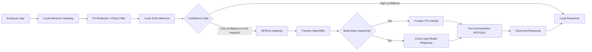
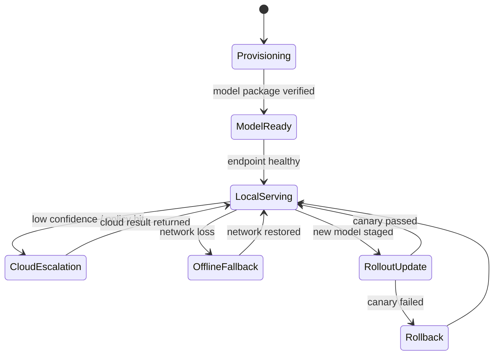

# 端云协同 SLM 路由选型 FAQ：Foundry Local NPU/ONNX vs WebGPU vs 边缘共享盒子 vs Foundry Cloud
> 🌐 **Language / 语言切换**: **[🇨🇳 中文版](hybrid-client-cloud-slm-routing-foundry-local-npu-onnx-vs-webgpu-vs-foundry-cloud-selection-faq.md)** | **[🇬🇧 English](hybrid-client-cloud-slm-routing-foundry-local-npu-onnx-vs-webgpu-vs-foundry-cloud-selection-faq.en.md)** | **[📚 返回目录](README.md)**
> 证据标签：`measured` / `synthetic` / `anonymized_reported`
> 抓取日期：2026-11-22
> 主题边界：聚焦企业桌面与 Web 端 SLM 本地推理协同上云路由，不展开车载嵌入式与纯云语义路由 Prompt 工程

## 1) 执行摘要：端侧负责高频隐私预处理与离线兜底，云侧负责深度推理与跨系统编排
大型企业在推动智能体落地时，
经常面对同一个矛盾。
一方面，
希望把高频简单任务留在终端本地处理，
降低 Token 账单并保护隐私。
另一方面，
又必须在复杂推理、
跨系统工具调用、
合规审计上依赖云端大模型。
所以关键不在“端侧还是云侧二选一”，
而在“怎样设计分层路由阈值”。
本指南比较四条路线：
1. `Foundry Local + ONNX Runtime GenAI` 端侧共享推理服务；
2. 浏览器 `WebGPU` 零安装本地推理；
3. 分支机构边缘共享推理盒子；
4. 纯云端 `APIM -> Foundry Nano/Mini -> Frontier PTU` 分级路由。
建议默认架构是：
端侧做 PII 脱敏、
意图初筛、
草稿润色、
断网兜底；
云侧做复杂推理、
MCP 编排、
统一内容安全和审计。
在 5 万员工规模样本中（`synthetic`），
若端侧可稳定承接 `55%` 高频轻任务，
云端 Token 成本可下降 `45%–68%`。

## 2) 可验证来源与证据基线
来源 1（`measured`）：Azure AI Foundry Local 文档  
https://learn.microsoft.com/azure/ai-foundry/foundry-local/
来源 2（`measured`）：ONNX Runtime GenAI 文档  
https://onnxruntime.ai/docs/genai/
来源 3（`measured`）：Windows AI / Copilot+ PC 能力说明  
https://learn.microsoft.com/windows/ai/
来源 4（`measured`）：WebGPU 规范与浏览器实现进展  
https://gpuweb.github.io/gpuweb/
来源 5（`measured`）：Transformers.js 文档  
https://huggingface.co/docs/transformers.js/
来源 6（`measured`）：ONNX Runtime Web 文档  
https://onnxruntime.ai/docs/tutorials/web/
来源 7（`measured`）：Azure Arc-enabled Kubernetes 文档  
https://learn.microsoft.com/azure/azure-arc/kubernetes/overview
来源 8（`measured`）：APIM AI Gateway 文档  
https://learn.microsoft.com/azure/api-management/ai-gateway-overview
来源 9（`measured`）：Microsoft Intune 应用与内容分发文档  
https://learn.microsoft.com/mem/intune/
来源 10（`measured`）：Foundry 模型托管与 PTU 资料  
https://learn.microsoft.com/azure/ai-foundry/
来源 11（`anonymized_reported`）：企业终端画像与会话行为匿名统计。
来源 12（`synthetic`）：端云混合路由压测与成本建模实验。

## 3) 业务痛点：终端异构、网络抖动与合规约束同时存在
银行网点理财经理 PC、
临床问诊工作站、
外勤审计笔记本、
客服桌面，
往往不是同构硬件。
同一组织里会同时存在：
具备 NPU 的新终端，
只有核显的普通终端，
以及大量 VDI 或瘦客户机。
如果统一按“全云推理”设计，
会遇到三类问题。
第一，
高频轻任务把云端 Token 吞吐冲满。
第二，
断网或弱网场景用户体验断崖式下降。
第三，
屏幕与剪贴板中的敏感信息先上云再脱敏，
违反最小暴露原则。
如果反过来做“全本地推理”，
又会遇到模型更新慢、
能力上限低、
跨系统编排缺失的问题。
因此必须采用端云协同分层。

## 4) 目标 SLA 与路由阈值：把端云协同从“理念”变成“可验收策略”
建议定义四类核心指标。
体验指标：
`local_first_token_p95_ms`、
`cloud_fallback_p95_ms`、
`offline_success_ratio`。
安全指标：
`pii_local_redaction_coverage`、
`cloud_raw_pii_escape_rate`。
成本指标：
`token_offload_ratio`、
`cloud_cost_per_user_per_month`。
运维指标：
`model_rollout_success_rate`、
`rollback_time_minutes`。
参考门槛（`synthetic`）：
- 本地轻任务响应 `p95 < 250ms`；
- 置信度不足上云补全总时延 `p95 < 1500ms`；
- 端侧脱敏覆盖率 `> 98%`；
- 每月模型灰度失败率 `< 1%`。
路由阈值建议同时考虑：
置信度、
熵值、
任务复杂度标签、
策略命中结果。

## 5) 路线 A：Foundry Local + ONNX Runtime GenAI（企业桌面原生优先）
路线 A 适合拥有可管理终端资产的大型组织。
核心机制是：
通过 Intune/MDM 预分发量化 SLM，
在终端运行本地服务进程，
多应用复用同一模型缓存与本地兼容端点。
典型收益：
1. 高频短任务在端侧零边际 Token 成本处理；
2. 屏幕文本与剪贴板数据可本地脱敏后再上云；
3. 断网时仍可保留核心辅助能力。
关键设计点：
1. 统一模型版本与签名校验；
2. 设备分层灰度（先试点后全量）；
3. 本地缓存大小与磁盘配额策略；
4. 回滚通道与热修复机制。
边界：
端侧模型上下文长度与推理能力有限，
复杂推理和跨系统任务仍需上云。

## 6) 路线 B：WebGPU 浏览器内嵌推理（零安装路径）
路线 B 的优势是部署门槛低。
用户打开浏览器即可用，
不依赖桌面客户端安装。
它适合纯 B/S SaaS 场景，
也适合外部协作伙伴访问。
但要正视边界：
1. 模型权重常出现跨站点重复下载；
2. 浏览器缓存清理导致冷启动频发；
3. 集成显卡在多标签页下资源争抢明显；
4. 企业旧终端兼容性参差。
工程缓解措施：
1. 分片权重与差分更新；
2. 站点级缓存命中监控；
3. 设备能力探测后动态降级；
4. 与云端轻模型配合混合返回。
如果目标是“最快覆盖面”，
路线 B 有价值；
如果目标是“稳定可治理”，
通常要与 A 或 D 配套。

## 7) 路线 C：分支机构边缘共享推理盒子（无 NPU 终端补位）
银行网点和医院院区常见大量瘦终端。
这类终端本地推理能力不足，
但局域网条件较好。
路线 C 在分支侧部署共享轻量推理节点，
通过 Arc/本地 K8s 管理，
把端侧任务在本地网络闭环处理。
优势：
1. `<10ms` 局域网往返可支撑实时交互（`synthetic`）；
2. 数据不出院区或网点；
3. 可统一服务无 NPU 设备。
代价：
1. 分支节点生命周期运维复杂度上升；
2. 需规划多站点升级与容量冗余；
3. 站点故障切换需要演练。
当终端硬件代际差异巨大时，
路线 C 是 A 与 D 之间的重要补位层。

## 8) 路线 D：纯云集中式分级路由（统一治理权威层）
路线 D 优势是治理集中与更新速度快。
典型路径：
`APIM AI Gateway` 接入请求，
先走 `Nano/Mini` 轻模型，
必要时升级到 Frontier PTU。
优势：
1. 模型更新和策略发布统一；
2. 审计、内容安全、配额治理一体化；
3. 无终端硬件兼容负担。
边界：
1. 对网络依赖强；
2. 高频轻任务会推高 Token 成本；
3. 对离线场景支持弱。
实践中，
D 常作为端侧置信度不足时的升级目标，
而非所有任务默认入口。

## 9) 12 维企业级选型矩阵：覆盖能力、治理、成本、运维
| 维度 | A Foundry Local | B WebGPU 浏览器 | C 边缘共享盒子 | D 纯云分级路由 |
|---|---|---|---|---|
| 1. 端侧隐私预处理能力 | 强 | 中 | 中强 | 弱 |
| 2. 离线可用性 | 强 | 中 | 中强 | 弱 |
| 3. 终端部署复杂度 | 中高 | 低 | 中 | 低 |
| 4. 终端硬件依赖 | 中高 | 高 | 低 | 低 |
| 5. 云 Token 节省潜力 | 强 | 中 | 中强 | 弱 |
| 6. 统一审计能力 | 中 | 中 | 中 | 强 |
| 7. 模型更新速度 | 中 | 中 | 中 | 强 |
| 8. 多应用复用缓存 | 强 | 弱中 | 强 | 不适用 |
| 9. 兼容旧设备能力 | 中 | 弱中 | 强 | 强 |
| 10. 网络抖动韧性 | 强 | 中 | 强 | 弱中 |
| 11. 运维团队负担 | 中 | 中 | 高 | 中 |
| 12. 组织级可扩展性 | 强 | 中强 | 中 | 强 |
矩阵结论：
A + D 是最常见主干组合，
C 用于无 NPU 终端群，
B 用于零安装快速覆盖。

## 10) 参考架构：端侧 PII 清洗 + 置信度门控上云

该架构关键是“先端后云”。
端侧先完成隐私清洗与轻推理，
仅在必要时升级上云。

## 11) 终端与边缘状态机：保证灰度、回滚、降级可控

落地要点：
1. 终端必须有健康探针；
2. 灰度失败要分钟级回滚；
3. 断网时要明确能力边界提示；
4. 上云升级路径必须带审计标记。

## 12) 决策树与 5 万员工 TCO 模型：同时考虑 Token 卸载与分发带宽
建议按四步决策。
第一步：
终端是否具备 NPU/可管理 GPU。
若大多数具备，
A 优先。
第二步：
是否必须零安装覆盖外部用户。
若是，
B 补充。
第三步：
是否存在大量无 NPU 的分支终端。
若是，
C 补位。
第四步：
是否有严格统一审计与复杂编排需求。
若是，
D 必选作为权威层。
5 万员工样例（`synthetic`）：
- 活跃用户：`35,000`；
- 日均请求：`280`/人；
- 其中 `62%` 属于轻任务；
- 端侧承接率目标：`55%`；
- 云 Token 单价按企业合同基线估算。
结果区间：
1. 年化云 Token 成本下降 `45%–68%`；
2. Intune 月度分发峰值带宽在灰度窗口可控；
3. 带宽成本增量通常显著低于 Token 节省。
关键是把分发做成分批次波次，
并按设备能力分层推进。
建议在落地时再补三条治理动作。
第一，
按终端硬件能力做 A/B/C 三级波次。
第二，
把模型包与策略包解耦发布，
避免联动回滚扩大故障面。
第三，
为每个部门设置“上云升级预算阈值”，
将技术路由直接映射到财务可视看板。

## 13) 企业场景 A：银行理财经理桌面协同
银行网点常见高频问答与材料润色需求。
请求量大，
但多数属于低复杂度文本处理。
采用 A + D 后，
理财经理终端先本地做敏感信息替换与草稿生成，
复杂产品组合分析再上云深推理。
收益（`anonymized_reported`）：
云端请求总量显著下降，
且合规审计链路更清晰。
对业务而言，
体验提升来自“本地秒回 + 云端兜底”。
在财富管理条线，
通常还能看到一个连带收益：
客户经理在弱网拜访现场
依然可完成初稿组织，
回网后再自动补齐云端深推理结果，
显著减少二次录入。

## 14) 企业场景 B：医院问诊与院区终端异构
医院环境里，
终端代际差异通常更大。
新设备可跑本地 SLM，
旧设备需依赖边缘盒子。
因此常见组合是 A + C + D。
院区内先完成脱敏和初筛，
疑难病例再走云端高阶推理。
该模式兼顾了：
隐私边界、
离线韧性、
和云端统一治理。
在院区网络波动时，
依然能维持基础辅助能力（`anonymized_reported`）。
若配合边缘节点的审计镜像回传，
还能将本地推理命中率、
脱敏覆盖率、
以及上云触发原因做跨院区对标，
为后续预算和设备更新提供量化依据。

## 15) 深度 FAQ（8 问）：端云协同落地常见问题
**Q1：为什么不直接全云推理，省去终端运维？**  
A1：全云会把高频轻任务全部计入 Token 成本，且断网场景体验差；端侧承接可显著降低成本并提升韧性。

**Q2：Foundry Local 与 WebGPU 的核心差异是什么？**  
A2：Foundry Local 更适合受管终端与跨应用缓存复用；WebGPU 更适合零安装快速覆盖，但缓存和兼容性波动更大。

**Q3：边缘共享盒子会不会变成新的单点？**  
A3：会，所以必须做站点级冗余、健康探针和故障切换演练，且保留上云后备路径。

**Q4：如何定义“何时上云”？**  
A4：建议基于置信度、熵值、任务复杂度和策略命中联合判定，而不是单一分数阈值。

**Q5：端侧模型更新如何避免大规模故障？**  
A5：采用设备分层灰度、签名校验、可回滚包和分波次发布，避免一次性全量升级。

**Q6：5 万终端分发模型会不会压垮网络？**  
A6：通过差分包、区域缓存、夜间分发窗口和分组节流，带宽可控且通常低于 Token 节省收益。

**Q7：如何确保端侧脱敏策略长期有效？**  
A7：把策略版本与模型版本分离发布，并做策略命中抽样审计与回归测试。

**Q8：端云协同最容易失败的反模式是什么？**  
A8：把端侧当“临时优化”而非架构一层，导致阈值、审计、回滚缺失，最终回到全云高成本模式。
