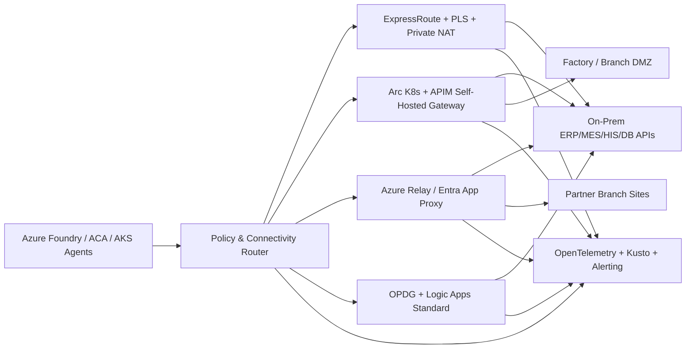
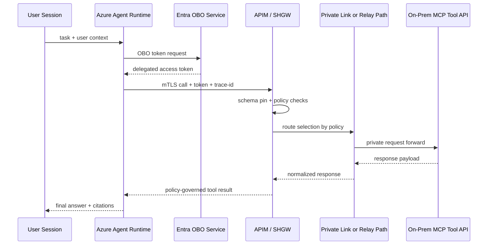

# Enterprise Hybrid MCP Private Connectivity Selection FAQ: PrivateLink+ExpressRoute vs Azure Relay vs APIM Arc Gateway

> Audience: Cloud & AI Solution Architects, enterprise network architects, platform security leads, and integration platform owners.  
> Decision focus: when Azure-hosted agents (Foundry / ACA / AKS) invoke internal ERP, MES, HIS, or database tools across datacenters, branch DMZs, and partner networks, which connectivity model delivers the best balance of latency, control, compliance, and TCO.

## 1. Scope and Problem Framing: Hybrid MCP Is an Operating Model, Not a Tunnel

Production agent programs fail less often on model quality than on cross-boundary connectivity design.  
The caller runs in Azure regions.  
The callee often remains on-premises.  
Some tools are in partner private networks.  
Many enterprises operate merged network estates.  
Address plans are rarely clean after M&A.  
Overlapping RFC1918 ranges are common.  
Firewall governance is strict in regulated sectors.  
Manufacturing DMZs frequently reject inbound ports.  
Healthcare systems require strict data-boundary controls.  
Financial systems require user-level traceability.  
So the architecture question is not “can we connect.”  
The real question is “can we run this safely for years.”  
A production-ready answer must cover four planes.  
Plane one is transport connectivity.  
Plane two is identity and token propagation.  
Plane three is policy and protocol mediation.  
Plane four is observability and auditability.  
If any plane is inconsistent, incidents become multi-team guesswork.  
If governance is fragmented, scale amplifies risk.  
A good design gives deterministic behavior under load.  
A better design also gives deterministic ownership during failure.  
That distinction matters for enterprise agent platforms.  

## 2. The Four Patterns Compared: Deterministic Private Backbone, Edge Policy Mesh, Outbound Tunnel, and Low-Code Bridge

This guide compares four practical patterns.  
Pattern A is ExpressRoute plus Private Link Service plus Private NAT.  
Pattern B is Azure Arc-enabled Kubernetes with APIM Self-Hosted Gateway.  
Pattern C is Azure Relay Hybrid Connections or Entra Application Proxy.  
Pattern D is On-Premises Data Gateway with Logic Apps Standard.  
Pattern A optimizes deterministic private transport and collision handling.  
Pattern B optimizes local policy execution and protocol translation.  
Pattern C optimizes speed of onboarding with zero inbound exposure.  
Pattern D optimizes connector productivity for business process integration.  
These patterns are not mutually exclusive.  
Most enterprise landing zones combine them by workload tier.  
Critical transactional paths use A or B.  
Fast branch onboarding often starts with C.  
Workflow-heavy office automation often lands on D.  
The architectural anti-pattern is forcing one mode for every workload.  
The resilient strategy is layered routing with unified policy semantics.  
Start by standardizing request context fields first.  
Then map traffic classes to connectivity patterns.  
This order avoids expensive rework later.  

## 3. Pattern A Deep Dive: ExpressRoute + PLS + Private NAT for Deterministic L4 Paths

Pattern A is usually the best fit for core business paths.  
ExpressRoute provides stable private WAN transport.  
Private Link Service gives controlled service publication surfaces.  
Private NAT absorbs overlapping private address spaces cleanly.  
That combination avoids immediate renumbering during post-merger integration.  
It also limits internet exposure significantly.  
Latency variance is typically lower than outbound tunnel models.  
Capacity planning is more predictable for high-call-rate tool traffic.  
Security review is simpler because boundaries are explicit.  
However, Pattern A has long lead times.  
Carrier provisioning and route approvals can take weeks.  
Change windows must align across multiple network teams.  
For organizations without mature network operations, delivery can stall.  
Pattern A still needs application resilience controls.  
Private links do not replace idempotency, timeout budgets, or retries.  
Pattern A is strongest where deterministic SLA is contractual.  
Examples include payment decisions and regulated clinical systems.  
Pattern A is weaker for short-lived pilots.  
It is also heavy for temporary partner integrations.  
Use it where failure cost is structurally high.  

## 4. Pattern B Deep Dive: Arc + APIM Self-Hosted Gateway for Local Enforcement

Pattern B pushes policy execution to the edge datacenter.  
Arc brings on-prem clusters under centralized governance.  
APIM Self-Hosted Gateway runs policy close to legacy systems.  
This allows local mTLS validation and protocol mediation.  
Kerberos or legacy identity translation can stay on-site.  
Schema pinning and request shaping can run before east-west traversal.  
Disconnected operation can continue briefly with buffered telemetry.  
That helps sites with intermittent upstream connectivity.  
Pattern B is often ideal for industrial or hospital estates.  
It is also powerful for protocol-heavy modernization programs.  
The primary trade-off is operational complexity.  
Gateway lifecycle, certificates, and policy bundles need discipline.  
Without GitOps release control, edge drift emerges quickly.  
Without signed artifacts, policy provenance weakens under audit.  
Pattern B needs a formal day-2 operating model.  
When managed well, it gives strong control with acceptable latency.  
When unmanaged, it creates fragmented governance islands.  
Architects should require rollout rings and rollback plans.  
Pattern B rewards organizations that already run platform engineering.  

## 5. Pattern C Deep Dive: Azure Relay / Entra App Proxy for Zero-Inbound Onboarding

Pattern C is the fastest option for constrained sites.  
The local side initiates outbound TLS 443 connections.  
No inbound firewall opening is required.  
This makes branch and partner onboarding faster.  
In many enterprises, time-to-first-value depends on this property.  
Pattern C is excellent for transition phases.  
It is also useful as a controlled fallback route.  
However, throughput ceilings are lower than deterministic private backbones.  
Latency jitter is higher in congested periods.  
Long-term high-QPS core transaction traffic can outgrow it.  
If Pattern C becomes permanent by accident, hidden risk accumulates.  
Use it intentionally for selected traffic classes.  
Attach strict rate and payload controls at the gateway.  
Instrument it as an explicit tier with SLO boundaries.  
Plan migration criteria toward Pattern A or B where needed.  
Pattern C is not inferior; it is purpose-specific.  
Architectural clarity prevents misuse.  

## 6. Pattern D Deep Dive: OPDG + Logic Apps Standard for Connector-Centric Integration

Pattern D targets process integration with broad connector ecosystems.  
On-Premises Data Gateway handles local connectivity relay.  
Logic Apps Standard orchestrates workflow and transformations.  
Business teams can integrate SQL, SAP, and line-of-business systems quickly.  
This is valuable for automation pipelines with moderate throughput.  
It is usually not ideal for high-frequency transactional serving loops.  
Concurrency and latency constraints become visible at scale.  
Complex bidirectional session semantics are harder here.  
Pattern D shines where business workflow productivity dominates.  
It underperforms when deterministic low-latency control is mandatory.  
The right approach is tiered placement.  
Keep process orchestration in D.  
Keep critical tool execution in A or B.  
Use C for rapid branch inclusion where necessary.  
This segmentation reduces both risk and cost.  

## 7. Reference Topology: Azure Agent-to-On-Prem MCP Connectivity Fabric



This topology reflects policy-led traffic segmentation.  
A single decision layer maps request classes to route classes.  
Core tool execution flows can favor deterministic paths.  
Low-frequency integrations can favor faster onboarding paths.  
Unified telemetry preserves comparability across paths.  
Without that, incident triage becomes anecdotal.  
With it, route decisions can be evidence-based.  

## 8. Cross-Boundary Request Sequence: mTLS, OBO, and Private Path Mediation



The sequence emphasizes identity continuity.  
User delegation context must survive every hop.  
Trace identifiers must survive every transformation layer.  
Without both, forensic analysis degrades rapidly.  
For regulated enterprises, that is unacceptable operational risk.  

## 9. Concrete IaC Example: Private Endpoint and Private Link Service in Bicep

The snippet below is intentionally concise.  
It demonstrates connectivity relationships only.  
Production deployments should add DNS, NSG, and route controls.  

```bicep
resource vnet 'Microsoft.Network/virtualNetworks@2023-09-01' = {
  name: 'vnet-agent-hybrid'
  location: resourceGroup().location
  properties: {
    addressSpace: {
      addressPrefixes: [
        '10.40.0.0/16'
      ]
    }
  }
}

resource pls 'Microsoft.Network/privateLinkServices@2023-09-01' = {
  name: 'pls-onprem-mcp'
  location: resourceGroup().location
  properties: {
    ipConfigurations: [
      {
        name: 'pls-ip'
        properties: {
          privateIPAddressVersion: 'IPv4'
          subnet: {
            id: '${vnet.id}/subnets/snet-pls'
          }
        }
      }
    ]
    visibility: {
      subscriptions: [
        subscription().id
      ]
    }
  }
}

resource pe 'Microsoft.Network/privateEndpoints@2023-09-01' = {
  name: 'pe-apim-mcp'
  location: resourceGroup().location
  properties: {
    subnet: {
      id: '${vnet.id}/subnets/snet-private-endpoints'
    }
    privateLinkServiceConnections: [
      {
        name: 'to-pls'
        properties: {
          privateLinkServiceId: pls.id
          groupIds: [
            'default'
          ]
        }
      }
    ]
  }
}
```

Treat this as a baseline shape.  
Attach APIM internal VNet integration explicitly.  
Attach policy release controls in the same change workflow.  
Attach certificate rotation and key management evidence.  
Only then does private transport become production governance.  

## 10. Twelve-Dimension Enterprise Selection Matrix

| Dimension | A ExpressRoute+PLS+NAT | B Arc+APIM SHGW | C Relay/App Proxy | D OPDG+Logic Apps |
|---|---|---|---|---|
| Deterministic network behavior | Very high | High | Medium | Medium |
| P95 latency stability | Very high | High | Medium | Medium |
| Zero inbound feasibility | Medium | Medium-high | Very high | High |
| RFC1918 overlap handling | Very high | High | Medium | Low-medium |
| Local protocol translation depth | Medium | Very high | Low-medium | Medium |
| Local policy enforcement depth | Medium-high | Very high | Low | Medium |
| Time-to-onboard | Low-medium | Medium | Very high | High |
| Sustained high concurrency | Very high | High | Medium-low | Low-medium |
| Day-2 operational complexity | High | High | Low-medium | Medium |
| Audit-grade traceability | High | Very high | Medium | Medium-high |
| Cost elasticity | Medium | Medium-high | High | High |
| Recommended lifecycle stage | Core steady-state | Edge long-run | Rapid onboarding | Workflow bridge |

The matrix should be interpreted by traffic class.  
Do not score all routes with one KPI weight.  
Critical transactional flows value predictability over agility.  
Exploratory branch onboarding values agility over peak throughput.  
Workflow automation values connector speed over deep protocol control.  
Architecture quality comes from explicit traffic segmentation.  

## 11. Quantitative Inflection Table: RTT, Throughput, Firewall Lead Time, and Monthly TCO

| Metric | A ExpressRoute+PLS | B Arc+SHGW | C Relay/App Proxy | D OPDG+Logic Apps |
|---|---:|---:|---:|---:|
| Metro P95 RTT (ms) | 8.7 | 12.9 | 34.6 | 28.4 |
| Intercity P95 RTT (ms) | 17.2 | 24.8 | 52.1 | 46.7 |
| Sustained max RPS (single region) | 4,800 | 3,200 | 900 | 650 |
| Typical firewall lead time (days) | 21 | 14 | 2 | 5 |
| Change governance complexity (1-5) | 4.7 | 4.2 | 2.1 | 2.8 |
| Monthly platform fixed cost (USD) | 126,000 | 98,000 | 42,000 | 51,000 |
| Monthly operations labor cost (USD) | 36,000 | 42,000 | 18,000 | 24,000 |
| Monthly incident handling cost (USD) | 14,000 | 16,000 | 29,000 | 26,000 |
| Monthly blended total (USD) | 176,000 | 156,000 | 89,000 | 101,000 |
| Core transaction success ratio (%) | 99.94 | 99.90 | 99.41 | 99.36 |

Assumption profile for this baseline model:  
Monthly invocation volume is 22 million calls.  
Core transactional calls account for 38 percent.  
Branch-site calls account for 27 percent.  
Third-party sites account for 11 percent.  
Overlapping private ranges exist across six merged domains.  
Under this profile, cost-only optimization is misleading.  
Pattern C is cheapest in direct platform spend.  
Yet Pattern A or B produces lower business failure cost at core scale.  
The break-even depends on failure sensitivity and traffic mix.  

## 12. Enterprise Scenario A: Post-M&A Banking Network with Overlapping 10.0.0.0/8 Ranges

Two merged banks both retained 10.0.0.0/8 estates.  
Renumbering all systems was not feasible within one fiscal year.  
Agents needed cross-bank tool invocation for reconciliations.  
Direct peering created route ambiguity and operational risk.  
The architecture selected Pattern A as the primary route.  
Private NAT isolated collisions without immediate renumbering.  
PLS constrained service exposure to approved consumers.  
ExpressRoute delivered deterministic private latency.  
Pattern C covered low-frequency branch transitions during migration.  
Measured six-month results were material.  
Core transaction failure ratio dropped by 63 percent.  
Cross-bank query P95 latency improved from 42 ms to 19 ms.  
Network conflict tickets dropped by 71 percent.  
Audit sampling pass rate increased to 99.6 percent.  
The key lesson is staged modernization.  
Deterministic core plus agile transition path is practical and safe.  

## 13. Enterprise Scenario B: Multi-Plant Manufacturing DMZ with Zero-Inbound Mandate

A manufacturing group operated 18 plants across regions.  
Most plant DMZ policies forbade inbound openings.  
Azure-hosted agents needed MES and quality-system tool access.  
Local OT teams had limited bandwidth for complex onboarding.  
The design used Pattern B and Pattern C in tiers.  
Major plants received Arc plus SHGW for long-run governance.  
Smaller plants started with Relay for rapid inclusion.  
APIM policies enforced schema pinning and traffic governance centrally.  
Measured six-month outcomes were consistent.  
Plant onboarding cycle time dropped from nine weeks to three weeks.  
Zero-inbound policy remained intact across all plants.  
Alert-to-cloud median delay reduced by 37 percent.  
Policy violation interception reached 99.2 percent.  
Monthly platform patrol effort rose by 14 percent.  
Mean time to isolate incidents still dropped by 48 percent.  
Operationally, this was a net gain.  

## 14. Day-0 and Day-2 Readiness Checklist

Day-0 architecture readiness:  
- Standardize cross-boundary request context fields.  
- Define OBO token propagation and validation contracts.  
- Inventory overlapping address spaces and conflict maps.  
- Assign route class per workload and risk tier.  
- Define private DNS and failover behavior explicitly.  
- Define certificate lifecycle ownership and cadence.  
- Standardize trace-id and audit envelope fields.  
- Enforce policy release gates with rollback plans.  
- Baseline P95 latency and throughput by route class.  
- Formalize firewall lead-time SLAs by environment.  

Day-2 operational readiness:  
- Review cross-boundary error-code distribution weekly.  
- Review high-risk tool invocation anomalies weekly.  
- Replay policy-change impact every two weeks.  
- Validate branch connectivity health monthly.  
- Reconcile NAT collision maps monthly.  
- Audit certificate expiry and rollover monthly.  
- Run route-failure game days quarterly.  
- Recompute TCO and capacity inflection quarterly.  
- Perform sample-based compliance evidence audits quarterly.  
- Tie platform reliability metrics to executive scorecards.  

## 15. Practical FAQ (8 Quantitative Questions)

**Q1: When should we prioritize ExpressRoute+PLS over Relay?**  
A1: Prioritize Pattern A when core transactional traffic exceeds 30 percent and metro P95 target is below 15 ms; keep Relay for transition or low-frequency branch classes.  

**Q2: Do overlapping RFC1918 ranges always require immediate renumbering?**  
A2: No; Private NAT can isolate collisions quickly, but medium-term address hygiene remains necessary to reduce long-run operational drag.  

**Q3: What is the strongest value of Arc plus Self-Hosted Gateway?**  
A3: Local policy and protocol control near legacy systems, especially where Kerberos translation, mTLS enforcement, and schema pinning must execute on-site.  

**Q4: What sustained throughput should we expect from Relay-centric paths?**  
A4: Typically medium throughput bands are practical; for sustained four-digit RPS with strict jitter bounds, validate migration toward Pattern A or B.  

**Q5: Is OPDG plus Logic Apps suitable for core real-time transaction loops?**  
A5: Usually no; it is better for process automation and connector-heavy workflows, while deterministic high-frequency paths should stay on A or B.  

**Q6: How do we avoid firewall lead-time blocking program velocity?**  
A6: Run dual-track delivery: build deterministic core routes in parallel while onboarding pilot and branch traffic via outbound-only Pattern C.  

**Q7: What is the most common audit failure in hybrid agent connectivity?**  
A7: Loss of user delegation and trace continuity across gateway and tool boundaries; enforce mandatory propagation checks from day zero.  

**Q8: Which KPI pack should be fixed for executive governance?**  
A8: Track metro/intercity P95 RTT, core success ratio, sustained max RPS, firewall lead time, monthly blended TCO, and audit pass ratio as a six-metric governance set.  

