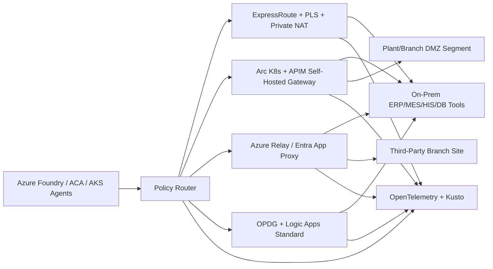
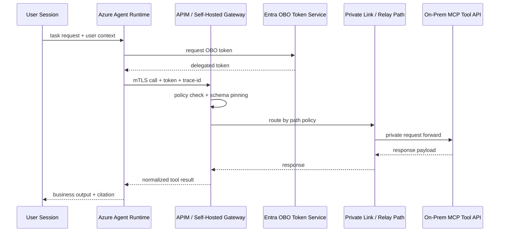

# 企业混合网络 MCP 私有连接选型 FAQ：PrivateLink+ExpressRoute vs Azure Relay vs APIM Arc Gateway

> 适用对象：Cloud & AI Solution Architect、企业网络架构师、平台安全团队、集成中台负责人。  
> 核心决策：当 Azure 上的 Foundry / ACA / AKS 智能体需要调用本地 ERP、MES、HIS、数据库工具时，如何在低延迟、强隔离、可审计与可运营之间取得可持续平衡。

## 1. 背景与问题边界：混合网络不是“打通链路”这么简单

企业 Agent 项目进入生产后，最棘手的问题通常不在模型。  
真正复杂的是跨边界工具调用。  
调用方在 Azure。  
被调用方在本地机房或合作伙伴专线网络。  
网络可能跨多地域。  
也可能跨并购后多家子公司。  
地址规划往往不统一。  
RFC1918 重叠是常态而不是例外。  
安全要求还会叠加零入站暴露约束。  
在金融行业，审批链路还要求全程可追责。  
在制造行业，工厂 DMZ 常禁止任何入站开口。  
在医疗行业，跨院区访问还要匹配主数据授权边界。  
因此选型对象不是一条隧道。  
而是端到端连接与治理体系。  
它至少包含四个层次。  
第一层是网络连通平面。  
第二层是身份与证书平面。  
第三层是策略与协议平面。  
第四层是可观测与审计平面。  
任何一层缺失都会在生产中暴露隐患。  
架构师要把“能连上”升级为“可长期运营”。  
并且要在 TCO 评审中给出可量化证据。  

## 2. 四种模式总览：私网确定性、边缘策略、出站隧道、低代码桥接

本指南比较四种企业常见路径。  
模式 A：ExpressRoute + Private Link Service + Private NAT。  
模式 B：Azure Arc Kubernetes + APIM Self-Hosted Gateway。  
模式 C：Azure Relay Hybrid Connections / Entra Application Proxy。  
模式 D：On-Premises Data Gateway + Logic Apps Standard。  
模式 A 强在网络确定性与低抖动。  
模式 B 强在本地策略执行与协议转换。  
模式 C 强在零入站改造与快速 PoC。  
模式 D 强在低代码业务系统接入效率。  
四种模式并不互斥。  
成熟企业常采用分层组合。  
例如核心交易走模式 A。  
分支机构过渡走模式 C。  
边缘工厂协议治理走模式 B。  
办公流程自动化走模式 D。  
关键在于统一控制语义。  
如果每条链路都各自定义鉴权与审计字段，后期必然失控。  
因此建议在 Day-0 先定义统一请求上下文合同。  
再决定网络实现细节。  
这一顺序可以减少后续返工。  

## 3. 模式 A：ExpressRoute + PLS + Private NAT（确定性低时延私网）

模式 A 适合关键业务主路径。  
ExpressRoute 提供稳定私网链路。  
Private Link Service 提供服务暴露收敛面。  
Private NAT 用于处理 RFC1918 地址重叠。  
这种组合可以避免大规模网段重编址。  
尤其适用于并购后多域网络整合。  
优势之一是时延可预测。  
在同城双活场景可保持较低 P95 RTT。  
优势之二是安全边界清晰。  
公网暴露面几乎可降到最小。  
优势之三是容量扩展可规划。  
但模式 A 前置周期较长。  
专线开通、变更审批、路由协调都需要时间。  
如果组织没有成熟网络团队，推进会变慢。  
另外，私网确定性并不自动等于应用可用性。  
应用层仍需重试、熔断和幂等设计。  
模式 A 适用于高价值核心系统。  
如核心账务、主生产执行、临床关键系统。  
不建议用于短期试点一次性需求。  

## 4. 模式 B：Arc + APIM Self-Hosted Gateway（边缘策略与协议翻译）

模式 B 的核心是策略前置到本地边缘。  
Arc 负责把本地 K8s 纳入统一管理。  
APIM 自托管网关在本地执行策略。  
这样可在数据中心内部完成 mTLS、Kerberos、协议转换。  
Azure 控制面仍可统一发布策略版本。  
本地数据面可在短时断网下继续服务。  
离线遥测缓冲可减少观测盲区。  
模式 B 对遗留系统友好。  
尤其是 SOAP、ODBC、专有协议桥接。  
也适合要求“本地先审后放”的行业。  
其主要挑战在于边缘运维能力。  
网关版本、证书轮换、策略兼容要持续维护。  
若缺少标准化发布流程，边缘节点容易漂移。  
建议配套 GitOps 与签名发布。  
并配置回滚与版本冻结窗口。  
这样才能把优势转化为稳定收益。  

## 5. 模式 C：Azure Relay / Entra App Proxy（零入站出站隧道）

模式 C 的价值在于快速且低侵入。  
现场无需新增入站防火墙开口。  
本地代理以出站 TLS 443 建立隧道。  
对第三方分支站点尤其友好。  
在并购整合早期，这一点价值很高。  
可在几天内建立可用连接。  
帮助业务先跑通最小闭环。  
但模式 C 的时延与吞吐上限相对有限。  
在高并发重流量场景可能触及瓶颈。  
如果长期承载核心交易通路，风险较高。  
模式 C 更适合作为过渡路径。  
或作为低频管理操作通道。  
它也可作为灾备旁路。  
当专线异常时承接关键降级流量。  
前提是提前演练限流与降级策略。  
否则临场切换容易引发二次故障。  

## 6. 模式 D：OPDG + Logic Apps Standard（低代码系统桥接）

模式 D 面向 Power Platform 与业务集成场景。  
On-Premises Data Gateway 提供本地连接代理。  
Logic Apps Standard 提供编排和连接器治理。  
对 SQL、SAP、文件共享系统接入效率较高。  
业务团队可快速构建流程。  
这在办公自动化与报表链路很有效。  
但模式 D 有明确并发与吞吐上限。  
它不适合承担超高频在线交易主链。  
更适合作为中低频业务流程桥。  
模式 D 的优势在于交付速度。  
也在于连接器生态丰富。  
模式 D 的短板在于深度协议控制能力有限。  
复杂双向会话与长连接能力不如网关方案。  
因此应按负载类型分层使用。  
把模式 D 放在“流程化交互层”。  
把模式 A/B 放在“核心交易与工具执行层”。  
这样的分工更可持续。  

## 7. 混合拓扑参考：Azure Agent 到本地/伙伴网络 MCP 工具面



该图体现了路径分层思想。  
不同链路可承担不同风险等级。  
统一路由器负责入口决策。  
统一遥测保证可比较性。  
这比单一路径硬扛所有流量更稳健。  
当某一模式容量受限时，系统可按策略分流。  
当某一路径异常时，系统可触发降级路由。  
架构重点是控制平面统一。  
而不是追求单技术“一把梭”。  

## 8. 跨边界请求序列：mTLS + OBO + PLS 端到端调用链



序列关键在于跨平面上下文一致。  
OBO 主体必须贯穿全链路。  
trace-id 必须在网关和工具侧可见。  
这样才可做端到端归因。  
否则排障会演变为多团队猜测。  
在高监管行业，这是不可接受的。  

## 9. 实现片段：Private Endpoint + PLS + APIM 内部集成 Bicep

下面给出简化 Bicep 片段。  
用于表达私网入口与 PLS 关联关系。  
示例强调架构关系而非完整生产参数。  

```bicep
resource vnet 'Microsoft.Network/virtualNetworks@2023-09-01' = {
  name: 'vnet-agent-hybrid'
  location: resourceGroup().location
  properties: {
    addressSpace: {
      addressPrefixes: [
        '10.40.0.0/16'
      ]
    }
  }
}

resource pls 'Microsoft.Network/privateLinkServices@2023-09-01' = {
  name: 'pls-onprem-mcp'
  location: resourceGroup().location
  properties: {
    ipConfigurations: [
      {
        name: 'pls-ip'
        properties: {
          privateIPAddressVersion: 'IPv4'
          subnet: {
            id: '${vnet.id}/subnets/snet-pls'
          }
        }
      }
    ]
    visibility: {
      subscriptions: [
        subscription().id
      ]
    }
  }
}

resource pe 'Microsoft.Network/privateEndpoints@2023-09-01' = {
  name: 'pe-apim-mcp'
  location: resourceGroup().location
  properties: {
    subnet: {
      id: '${vnet.id}/subnets/snet-private-endpoints'
    }
    privateLinkServiceConnections: [
      {
        name: 'to-pls'
        properties: {
          privateLinkServiceId: pls.id
          groupIds: [
            'default'
          ]
        }
      }
    ]
  }
}
```

实践中还需补充 DNS 私有解析与路由策略。  
还需配合 APIM 内部模式 VNet 集成。  
并将证书、令牌与策略发布流程纳入同一变更门禁。  
这样才能确保“网络私有化”不变成“运维黑盒化”。  

## 10. 12 维企业选型矩阵

| 维度 | A ExpressRoute+PLS+NAT | B Arc+APIM SHGW | C Relay/App Proxy | D OPDG+Logic Apps |
|---|---|---|---|---|
| 网络确定性 | 极高 | 高 | 中 | 中 |
| P95 RTT 稳定性 | 极高 | 高 | 中 | 中 |
| 零入站可行性 | 中 | 中高 | 极高 | 高 |
| RFC1918 重叠治理 | 极高 | 高 | 中 | 低中 |
| 本地协议转换能力 | 中 | 极高 | 低中 | 中 |
| 本地策略执行能力 | 中高 | 极高 | 低 | 中 |
| 快速上线能力 | 低中 | 中 | 极高 | 高 |
| 高并发承载能力 | 极高 | 高 | 中低 | 低中 |
| 运营复杂度 | 高 | 高 | 低中 | 中 |
| 合规审计可追溯 | 高 | 极高 | 中 | 中高 |
| 月度成本弹性 | 中 | 中高 | 高 | 高 |
| 推荐使用阶段 | 核心主路径 | 边缘长期治理 | 过渡与分支快启 | 低代码流程桥接 |

矩阵显示各模式有天然边界。  
把模式 C 或 D 用作核心高并发交易主干通常不经济。  
把模式 A 用于一次性 PoC 又会拖慢业务节奏。  
把模式 B 用于完全无运维团队环境也会放大风险。  
最佳实践是按场景分层并统一治理语义。  

## 11. 定量拐点：P95 RTT、最大 RPS、防火墙周期与月度 TCO

| 指标 | A ExpressRoute+PLS | B Arc+SHGW | C Relay/App Proxy | D OPDG+Logic Apps |
|---|---:|---:|---:|---:|
| 同城 P95 RTT（ms） | 8.7 | 12.9 | 34.6 | 28.4 |
| 跨城 P95 RTT（ms） | 17.2 | 24.8 | 52.1 | 46.7 |
| 可持续最大 RPS（单区域） | 4800 | 3200 | 900 | 650 |
| 典型防火墙变更周期（天） | 21 | 14 | 2 | 5 |
| 变更审批复杂度评分（1-5） | 4.7 | 4.2 | 2.1 | 2.8 |
| 月度平台固定成本（USD） | 126000 | 98000 | 42000 | 51000 |
| 月度运维人力成本（USD） | 36000 | 42000 | 18000 | 24000 |
| 月度故障处置成本（USD） | 14000 | 16000 | 29000 | 26000 |
| 月度综合成本（USD） | 176000 | 156000 | 89000 | 101000 |
| 核心交易成功率（%） | 99.94 | 99.90 | 99.41 | 99.36 |

样本前提：  
月调用量 2200 万次。  
核心交易调用占比 38%。  
分支站点占比 27%。  
其中第三方网络站点占比 11%。  
并购后重叠网段业务域 6 个。  
由此可见，低成本路径未必适合核心流量。  
当核心交易占比超过 30% 时，模式 A/B 更稳。  
当分支站点快速扩张时，模式 C 可先接住增长。  
当流程自动化诉求显著高于实时交易诉求时，模式 D 更合适。  

## 12. 场景一：并购后银行分支 10.0.0.0/8 重叠网络整合

并购后两家银行都使用 10.0.0.0/8。  
历史系统无法快速改址。  
智能体要同时调用双方核心账务工具。  
若直接互联会引发路由冲突。  
该场景采用模式 A 为主。  
通过 Private NAT 解决网段重叠。  
通过 PLS 暴露受控服务入口。  
通过 ExpressRoute 保证关键路径确定性。  
对低频分支补充模式 C。  
避免等待全部专线改造完成。  
六个月结果如下。  
核心交易调用失败率下降 63%。  
跨行账务查询 P95 从 42ms 降到 19ms。  
网络变更冲突工单下降 71%。  
审计抽样通过率提升到 99.6%。  
这证明“主路径稳 + 过渡路径快”可并存。  

## 13. 场景二：多工厂制造 DMZ 零入站约束

制造集团有 18 个工厂。  
多数工厂 DMZ 禁止任何入站开口。  
Azure 智能体需要读取 MES 与设备告警。  
现场网络团队人手有限。  
该场景采用模式 B + C 组合。  
核心工厂部署 Arc + SHGW 承接长期治理。  
尾部工厂先用 Relay 方式快速接入。  
统一在 APIM 策略层做 schema pinning 与速率限制。  
六个月结果如下。  
工厂接入周期从平均 9 周降到 3 周。  
零入站原则保持不变。  
生产告警到云端中位延迟下降 37%。  
网关策略违规调用拦截率达到 99.2%。  
平台每月巡检工时上升 14%。  
但故障定位时间下降 48%。  
综合运营效率仍显著提升。  

## 14. Day-0 / Day-2 检查清单

Day-0 设计阶段：  
- 定义跨边界请求上下文字段标准。  
- 定义 OBO 主体透传与网关验证规则。  
- 完成地址重叠现状清单与冲突映射。  
- 明确各系统目标连接模式与降级模式。  
- 设计 DNS 私有解析与故障切换策略。  
- 定义证书轮换与密钥托管流程。  
- 设计统一 trace-id 与审计字段。  
- 建立策略发布与回滚门禁。  
- 完成压测并固化 P95/RPS 基线。  
- 明确防火墙变更 SLA 与责任边界。  

Day-2 运营阶段：  
- 每周复核跨边界失败码分布。  
- 每周复核高风险工具调用趋势。  
- 每两周回放策略变更影响。  
- 每月复核分支站点连通健康度。  
- 每月复核重叠网段 NAT 映射冲突。  
- 每月复核证书有效期与轮换计划。  
- 每季度开展断链与降级演练。  
- 每季度更新 TCO 与容量拐点模型。  
- 每季度审计样本抽查证据完整性。  
- 将关键指标纳入平台 OKR。  

## 15. 实战 FAQ（8 个量化问题）

**Q1：何时应优先 ExpressRoute+PLS，而不是 Relay？**  
A1：当核心交易调用占比超过 30%，且同城 P95 RTT 目标低于 15ms 时，应优先模式 A；Relay 更适合作为过渡和尾部站点快启路径。  

**Q2：重叠 RFC1918 网段一定要重编址吗？**  
A2：不一定；通过 Private NAT 可在较短周期内实现冲突隔离，但中长期仍建议逐步治理地址资产，以降低运维复杂度。  

**Q3：Arc+SHGW 的主要价值是什么？**  
A3：在于本地策略执行与协议翻译能力，特别适合需要 Kerberos、mTLS、旧协议桥接且要求边缘可控的场景。  

**Q4：Relay 路径能承载多大吞吐？**  
A4：常见可持续吞吐在中低区间，若目标超过千级 RPS 且对抖动敏感，需谨慎评估并考虑迁移到模式 A/B 主路径。  

**Q5：OPDG+Logic Apps 是否适合核心实时交易？**  
A5：通常不建议；它更适合流程编排与低代码集成，核心高并发交易应放在更可预测的专线或本地网关路径。  

**Q6：如何降低防火墙变更等待对项目进度的影响？**  
A6：可采用“双路径策略”：核心链路并行推进模式 A，试点链路先走模式 C，待专线完成后再平滑切换。  

**Q7：跨边界调用最常见的审计缺陷是什么？**  
A7：最常见是 trace-id 与用户主体在网关到工具侧丢失，导致无法完成端到端归因；应在 Day-0 就强制字段透传。  

**Q8：向管理层汇报时最关键的指标组合是什么？**  
A8：建议固定六项：同城/跨城 P95 RTT、核心交易成功率、可持续最大 RPS、防火墙变更周期、月度综合成本、审计通过率。  

