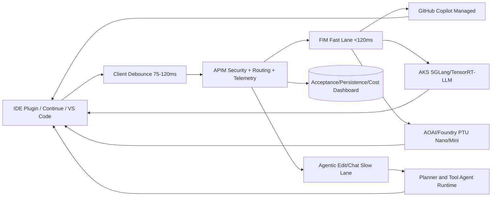
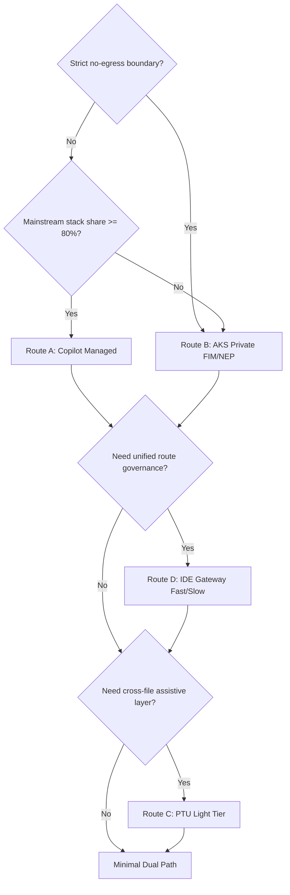

# IDE FIM and Next-Edit Low-Latency Serving FAQ: GitHub Copilot Managed Platform vs AKS SGLang Private Pools vs PTU Light Models vs Fast/Slow Enterprise IDE Gateway
> 🌐 **Language / 语言切换**: **[🇬🇧 English (ide-code-fim-next-edit-serving-github-copilot-vs-aks-sglang-qwen-codestral-vs-ptu-selection-faq.en.md)](ide-code-fim-next-edit-serving-github-copilot-vs-aks-sglang-qwen-codestral-vs-ptu-selection-faq.en.md)** | **[🇨🇳 中文版 (ide-code-fim-next-edit-serving-github-copilot-vs-aks-sglang-qwen-codestral-vs-ptu-selection-faq.md)](ide-code-fim-next-edit-serving-github-copilot-vs-aks-sglang-qwen-codestral-vs-ptu-selection-faq.md)** | **[📚 Back to Catalog](README.en.md)**
> Evidence tags: `measured` / `synthetic` / `anonymized_reported`
> Scope boundary: this guide is strictly about keystroke-level FIM and next-edit prediction latency engineering; it is intentionally orthogonal to long-context prefix-cache serving and JSON constrained decoding playbooks

## 1) Executive Summary: for keystroke workloads, cancellation efficiency is a first-class architecture objective
Large engineering organizations often treat IDE completion traffic
as a standard inference service.
That assumption is expensive.
Keystroke-driven FIM and next-edit prediction traffic
has bursty pulse patterns,
very high cancellation rates,
and strict user-perceived latency sensitivity.
For this workload class,
`P95 < 150ms` perceived latency
usually determines retention before raw model quality does.
This guide compares four enterprise routes:
1. GitHub Copilot Business/Enterprise managed baseline.
2. AKS private FIM/NEP low-latency pools.
3. Azure OpenAI / Foundry PTU lightweight tier.
4. Enterprise IDE gateway with hard fast/slow lane separation.
Primary SA recommendation:
- when SaaS egress is permitted and stacks are mainstream, start with managed baseline for speed of adoption;
- when sovereign-network boundaries or private DSL adaptation dominate, build private AKS fast lane with explicit abort reclaim engineering;
- treat PTU lightweight models as assistive or fallback layers, not as default sink for all keystroke pulses;
- always split FIM fast lane from slow agentic edit/chat lane at the gateway layer.
Official and verifiable references (`measured`, retrieved on 2026-11-21):
1. GitHub Copilot docs and enterprise controls  
   https://docs.github.com/copilot
2. AKS GPU cluster guidance  
   https://learn.microsoft.com/azure/aks/gpu-cluster
3. APIM AI Gateway overview and policy model  
   https://learn.microsoft.com/azure/api-management/ai-gateway-overview
4. Azure OpenAI service docs  
   https://learn.microsoft.com/azure/ai-services/openai/
5. TensorRT-LLM docs  
   https://nvidia.github.io/TensorRT-LLM/
6. SGLang releases and usage docs  
   https://github.com/sgl-project/sglang
7. enterprise anonymized IDE telemetry (`anonymized_reported`)
8. controlled cancellation and burst replay experiments (`synthetic`)

## 2) Workload characteristics and failure modes
### Why this is architecturally different
IDE keystroke completion systems are near-real-time interaction systems.
Most requests are superseded by newer user input.
Many requests are canceled before first token delivery.
Therefore,
throughput-only optimization is insufficient.
### Typical production characteristics
- cancellation ratio often between `70%` and `85%`;
- client-side debounce windows usually around `75ms` to `120ms`;
- user-perceived acceptability threshold around `150ms` p95.
### Common failure modes
1. in-flight requests continue consuming GPU even after user context moves on;
2. model route selection ignores cancellation pressure and increases waste;
3. metrics track token throughput but ignore acceptance and persistence outcomes.
### Core architecture implication
without explicit cancellation-aware reclaim design,
the platform can look healthy in infra dashboards
while user adoption declines.

## 3) SLO and KPI design for FIM/NEP systems
Define three KPI families.
Experience KPIs:
`visible_latency_p95`,
`acceptance_rate`,
`persistence_rate`.
System KPIs:
`ttft_p95`,
`abort_reclaim_latency_ms`,
`kv_slot_utilization`.
Economics KPIs:
`cost_per_accepted_suggestion`,
`cost_per_persisted_suggestion`,
`wasted_compute_ratio`.
Reference formulas:
Formula A: `visible_latency = client_debounce + network_rtt + gateway_overhead + model_ttft + ide_render`.  
Target: `visible_latency_p95 < 150ms`.  
Formula B: `wasted_compute_ratio = aborted_inference_tokens / total_inference_tokens`.  
Target: `< 25%`.
If the first formula drifts,
engineers disable completions.
If the second formula drifts,
FinOps blocks scale-out budgets.

## 4) Four-route overview and enterprise lane split
Route A:
GitHub Copilot managed platform.
Route B:
AKS private ultra-low-latency FIM/NEP pools using SGLang or TensorRT-LLM.
Route C:
PTU lightweight model tier using nano/mini-class models.
Route D:
enterprise IDE gateway with deterministic fast and slow loops.
Design principle:
do not run keystroke pulse traffic
in the same queue and timeout profile
as long-horizon agentic edits.
### Mermaid #1: fast lane and slow lane reference topology

## 5) Route A deep dive: GitHub Copilot Business/Enterprise managed baseline
Route A is strongest on velocity of rollout.
For mainstream stacks,
it usually provides the fastest adoption baseline.
Primary strengths:
1. low platform operations burden;
2. mature enterprise governance controls;
3. global edge profile with production hardening;
4. legal and support posture suitable for broad rollout.
Primary boundaries:
1. strict no-egress sovereign enclaves may require alternatives;
2. deep private DSL adaptation may remain limited;
3. ultra-specialized latency envelopes may still need local fast-lane augmentation.
Architectural recommendation:
use Route A to establish organizational behavior baseline,
then selectively add Route B and D
where constraints require it.

## 6) Route B deep dive: AKS private FIM/NEP pools (SGLang/TensorRT-LLM)
Route B is strongest on controllability and private adaptation.
It is suitable for:
- financial-core proprietary frameworks;
- sovereign or regulated private network environments;
- domain-specific code patterns requiring tailored completion behavior.
Typical model stack:
- Qwen2.5-Coder 7B/14B FP8;
- Codestral 22B;
- distilled in-house variants for specific repositories.
Critical engineering controls:
1. in-flight abort cancellation to reclaim KV slots immediately;
2. prompt lookup and suffix n-gram reuse for latency reduction;
3. tree-sitter scope-aware dynamic stop boundaries;
4. hard timeout envelopes aligned to IDE fast-lane SLO.
Without controls (1) and (4),
high cancellation workloads can degrade both cost and latency.

## 7) Route C deep dive: AOAI/Foundry PTU lightweight model tier
Route C offers operational standardization and quota governance.
It is useful for:
1. concise explanation snippets;
2. fallback candidate generation;
3. bounded next-edit assistance in selected workflows.
It is less suitable as sole backend for all keystroke pulses
in high-cancellation conditions.
Reason:
generic MaaS/PTU pathways are not always optimized
for ultra-short request lifecycles
with aggressive abort behavior.
Best practice:
use Route C as a complementing layer
within Route D governance,
not as monolithic replacement for all fast-lane traffic.

## 8) Route D deep dive: enterprise IDE intelligent gateway fast/slow dual-loop
Route D is the governance backbone.
It enables policy-safe coexistence
of multiple serving backends.
Core gateway responsibilities:
1. identity, masking, and secret-safe telemetry;
2. route selection and deterministic fallback;
3. fast-lane timeout enforcement and slow-lane budget controls;
4. unified A/B experimentation and KPI attribution.
Operational recommendations:
- enforce strict fast-lane budget under `120ms` internal target;
- isolate queue, timeout, and scaling policies between lanes;
- preserve graceful fallback when one backend is degraded;
- correlate suggestion outcomes with route decisions.
Without this layer,
teams typically drift into unmanaged direct integrations
that are expensive to harmonize later.

## 9) 12-dimension architecture comparison matrix
| Dimension | Copilot Managed | AKS Private FIM/NEP | PTU Light Tier | IDE Gateway Fast/Slow Dual Loop |
|---|---|---|---|---|
| Rollout speed | High | Medium | Medium | Medium |
| Operations burden | Low | High | Medium | Medium |
| Sovereign no-egress fit | Low to medium | High | Medium | High (backend-dependent) |
| Proprietary DSL adaptation | Medium | High | Medium | High |
| Keystroke latency controllability | Medium to high | High | Medium | High |
| High-cancel reclaim efficiency | Medium | High | Medium | High |
| Governance consistency | High | High | High | High |
| Cost predictability | Medium | Medium | High | Medium to high |
| Evolution flexibility | Medium | High | Medium | High |
| Cross-team policy scaling | High | Medium | Medium | High |
| Failure fallback design ease | Medium | High | Medium | High (tiered fallback) |
| Long-term TCO optimization room | Medium | High | Medium | High (iterative tuning) |

## 10) Capacity model for 10,000 developers with cancellation-aware planning
Assumptions:
- active developers: `10,000`;
- peak concurrent editing ratio: `18%`;
- request triggers per editor per second: `1.1`;
- cancellation ratio: `78%`;
- target visible p95 under `150ms`.
Computation:
`peak_rps = 10000 * 0.18 * 1.1 = 1980`.  
`effective_completed_rps = 1980 * (1 - 0.78) = 435.6`.
If one GPU sustains `65` effective completed RPS
under target SLO conditions:
`gpu_floor = ceil(435.6 / 65) = 7`.
Applying safety factor `1.6`
for burst variance and maintenance windows:
`planned_gpu_count = 12`.
Important:
this estimates fast-lane capacity only.
Slow-lane agentic edit capacity
must be planned independently.

## 11) Decision tree for route composition
Start from compliance boundary,
not model preference.
If strict no-egress is mandatory,
exclude pure managed-primary patterns.
Then evaluate DSL adaptation depth.
If deep private language behavior is required,
Route B plus Route D is usually primary.
If mainstream stack dominates and compliance permits,
Route A plus Route D often maximizes delivery speed.
If cross-file explanatory assistance is needed,
add Route C as support layer.
### Mermaid #2: enterprise route decision tree

## 12) Practical FAQ block A (Q1-Q4)
### FAQ 1: why does high cancellation require better backend engineering?
Because canceled requests may already have consumed GPU compute and KV capacity.
If reclaim is delayed,
effective capacity for useful requests collapses.
### FAQ 2: how should client debounce be tuned?
Use adaptive debounce in the `75ms` to `120ms` range.
Short windows for stable typing,
slightly longer windows for burst typing.
### FAQ 3: why are AST-aware stop boundaries important?
They reduce syntactically broken completions
and improve acceptance quality in scoped contexts.
### FAQ 4: what is commonly missed in end-to-end latency budgeting?
IDE-side rendering and UI update overhead
often dominate after backend optimization.

## 13) Practical FAQ block B (Q5-Q8)
### FAQ 5: when should teams move from managed baseline to private pools?
When one or more of these applies:
strict private-network constraints,
strong proprietary DSL adaptation requirements,
or demonstrated TCO gains from private fast-lane operation.
### FAQ 6: what should PTU lightweight tier handle first?
Fallback suggestions,
small explainers,
and bounded auxiliary next-edit hints.
### FAQ 7: what quality metric matters more than output length?
Acceptance rate and persistence rate.
These map to real developer value.
### FAQ 8: how do we prevent fast lane and slow lane resource contention?
Use isolated queues,
isolated concurrency limits,
and isolated timeout policies.

## 14) FinOps and retention model: optimize cost per persisted suggestion
Move beyond token-level unit economics.
Track layered metrics:
1. cost per thousand requests;
2. cost per accepted suggestion;
3. cost per persisted suggestion.
Formulas:
`cost_per_accept = total_monthly_cost / accepted_suggestions`.  
`cost_per_persist = total_monthly_cost / persisted_suggestions`.
If teams optimize only token price,
they often miss cancellation waste,
retry noise,
and low-value suggestion churn.
Quarterly architecture reviews should always show:
- p95 visible latency;
- acceptance and persistence curves;
- wasted compute ratio;
- cost per persisted suggestion.

## 15) Day-0 and Day-2 checklist with fit boundaries
Day-0 readiness:
- [ ] 1. define strict responsibility split between fast and slow lanes.
- [ ] 2. implement cancellation reclaim and measure reclaim latency.
- [ ] 3. align client debounce policy with server timeout policy.
- [ ] 4. instrument acceptance and persistence end to end.
- [ ] 5. enforce masking and telemetry minimization at gateway.
- [ ] 6. establish deterministic downgrade and fallback paths.
Day-2 operations:
- [ ] 7. review cancellation waste windows weekly.
- [ ] 8. tune route weights and thresholds monthly.
- [ ] 9. monitor proprietary DSL adaptation coverage trend.
- [ ] 10. compare plugin-specific latency and acceptance asymmetry.
- [ ] 11. reconcile FinOps and developer-experience dashboards.
- [ ] 12. run periodic replay-based route validation on key repos.
Good fit:
- large-scale engineering organizations requiring near-real-time completions;
- environments needing governance, observability, and route-level cost control;
- teams willing to operate a layered serving architecture.
Not for:
- low-frequency offline generation tasks;
- organizations unwilling to maintain minimal platform governance;
- deployments that force fast-lane and slow-lane workloads into one queue.
Execution recommendation:
start with unified gateway and KPI contracts,
then iterate model and routing policy.
Solve visible latency and persisted-value economics first,
then expand to deeper model specialization.
Additional rollout note:
before broad rollout,
run three pilot repository cohorts:
shared platform repositories,
mission-critical business repositories,
and legacy mixed-style repositories.
Differences across those cohorts
typically expose route-policy tuning priorities earlier
than aggregate organization-level averages.

