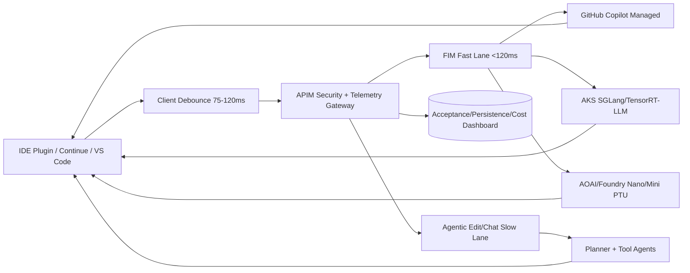
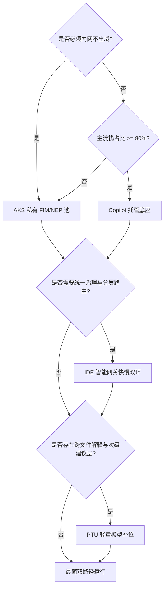

# IDE 行内补全与下一处编辑预测选型 FAQ：GitHub Copilot 托管底座 vs AKS 私有 FIM/NEP 池 vs PTU 轻量层 vs 快慢双环智能网关
> 🌐 **Language / 语言切换**: **[🇨🇳 中文版 (ide-code-fim-next-edit-serving-github-copilot-vs-aks-sglang-qwen-codestral-vs-ptu-selection-faq.md)](ide-code-fim-next-edit-serving-github-copilot-vs-aks-sglang-qwen-codestral-vs-ptu-selection-faq.md)** | **[🇬🇧 English (ide-code-fim-next-edit-serving-github-copilot-vs-aks-sglang-qwen-codestral-vs-ptu-selection-faq.en.md)](ide-code-fim-next-edit-serving-github-copilot-vs-aks-sglang-qwen-codestral-vs-ptu-selection-faq.en.md)** | **[📚 返回目录](README.md)**
> 证据标签：`measured` / `synthetic` / `anonymized_reported`
> 主题边界：仅讨论按键级 FIM/NEP 低延迟服务；不讨论多轮长上下文前缀缓存与 JSON 约束解码主线

## 1) Executive Summary：按键级补全的第一原则是“取消优先”，不是“吞吐优先”
万人级研发组织做 IDE 智能补全时，
最常见误判是把它当成普通推理服务。
但按键级请求是脉冲流量，
高度可取消，
且用户对延迟极度敏感。
在这类负载中，
`P95 < 150ms` 的目标通常比单次回复质量更先决定留存。
本指南比较四条企业级路线：
1. GitHub Copilot Business/Enterprise 托管底座；
2. AKS 私有 FIM/NEP 极速推理池；
3. Azure OpenAI / Foundry PTU 轻量模型层；
4. IDE 智能网关快慢双环架构。
面向 Cloud & AI SA 的结论：
- 出域合规允许且技术栈主流时，先用托管底座快速覆盖；
- 有内网不出域或专有 DSL 需求时，建设 AKS 私有低延迟池；
- PTU 轻量层适合作为某些解释与次级建议通道，不宜单独承担全部按键流；
- 统一网关应把 FIM 快车道与 Agentic Chat/Edit 慢车道严格拆分。
官方来源（抓取日期：2026-11-21）：
1. GitHub Copilot Business/Enterprise 文档（`measured`）  
   https://docs.github.com/copilot
2. Azure Kubernetes Service GPU 指南（`measured`）  
   https://learn.microsoft.com/azure/aks/gpu-cluster
3. Azure APIM AI Gateway 与策略文档（`measured`）  
   https://learn.microsoft.com/azure/api-management/ai-gateway-overview
4. Azure OpenAI / Foundry 配额与模型文档（`measured`）  
   https://learn.microsoft.com/azure/ai-services/openai/
5. TensorRT-LLM 文档（`measured`）  
   https://nvidia.github.io/TensorRT-LLM/
6. SGLang 文档与发布说明（`measured`）  
   https://github.com/sgl-project/sglang
7. 企业匿名 IDE 遥测样本（`anonymized_reported`）
8. 压测回放与取消行为仿真（`synthetic`）

## 2) 业务痛点与流量特征：这是“高取消率实时系统”，不是离线批处理
典型研发组织的真实模式：
开发者持续输入，
每一次按键都会触发补全候选刷新。
请求生命周期极短，
并且大量请求在返回前就被下一次输入覆盖。
这带来三类核心挑战：
1. 高取消率导致算力浪费；
2. 端到端延迟波动直接伤害接受率；
3. 代码上下文切片粒度不当会放大无效 token。
常见观测范围（`anonymized_reported`）：
- 请求取消率 `70%–85%`；
- IDE 去抖窗口 `75–120ms`；
- 用户感知阈值接近 `150ms`。
如果后端没有“连接终止即刻回收”机制，
GPU KV 槽位会被大量无效请求占据，
最终拖慢有效请求。
因此，
架构评估必须包含取消效率指标，
不能只看 tokens/s。

## 3) SLO 体系定义：把体验指标与系统指标分开建模
建议构建三层指标：
体验层：
`acceptance_rate`,
`persistence_rate`,
`visible_latency_p95`。
系统层：
`ttft_p95`,
`abort_reclaim_latency`,
`kv_slot_utilization`。
经济层：
`cost_per_accepted_suggestion`,
`wasted_tokens_due_to_abort`。
示例定义：
公式 A：`visible_latency = client_debounce + network_rtt + gateway + model_ttft + first_chunk_render`。  
目标：`visible_latency_p95 < 150ms`。  
公式 B：`wasted_compute_ratio = aborted_inference_tokens / total_inference_tokens`。  
目标：`wasted_compute_ratio < 25%`。
不满足第一条，
用户会关闭建议。
不满足第二条，
财务会关闭预算。

## 4) 四路线总览：先按边界条件分流，再比较单点性能
路线 A：Copilot 托管底座。
路线 B：AKS 私有 FIM/NEP 推理池。
路线 C：PTU 轻量模型层。
路线 D：APIM 驱动的 IDE 智能网关快慢双环。
总原则：
把“低延迟补全”
和“慢速复杂编辑”
拆成两条治理与容量模型。
### Mermaid #1：快慢双环拓扑

## 5) 路线 A：GitHub Copilot 托管底座（FIM + Next Edit）
路线 A 的核心价值是“低运维高覆盖”。
对于主流语言与常见框架，
它通常提供最快的组织级落地速度。
优势：
1. 全球边缘与托管模型栈；
2. 组织治理与策略能力成熟；
3. IP 保障与企业支持路径清晰；
4. 不需要自建 GPU 推理平台。
边界：
1. 强隔离内网与不出域场景受限；
2. 专有 DSL 深度定制空间有限；
3. 极端低延迟场景下，跨境链路仍需审慎评估。
建议：
先用 A 路线建立基线与组织采纳习惯，
再在特定团队叠加 B/D 路线。

## 6) 路线 B：AKS 私有 FIM/NEP 极速推理池（SGLang/TensorRT-LLM）
路线 B 的核心价值是“可控与可定制”。
适合金融核心专有框架、
政企内网、
或需深度 DSL 适配的团队。
典型模型组合：
- Qwen2.5-Coder-7B/14B FP8；
- Codestral-22B；
- 企业增量蒸馏小模型。
关键工程能力：
1. In-flight Abort Cancellation；
2. Prompt Lookup / Suffix N-gram 复用；
3. Tree-sitter AST 作用域 stop 截断；
4. HTTP/2 连接终止即刻释放 KV 槽位。
如果缺少第 1 条与第 4 条，
高取消率会把成本推高并拖慢 p95。
部署建议：
- 快车道优先小模型；
- 长尾复杂请求按策略升级；
- 队列层强制 TTL 与优先级回收。

## 7) 路线 C：AOAI/Foundry PTU 轻量模型层（nano/mini）
路线 C 的价值在于“标准化与稳定性”。
但在按键级超低延迟场景，
需明确边界。
适合承担：
1. 轻量补全解释；
2. 跨文件 Next-Edit diff 辅助；
3. 作为快车道后备路由。
不宜承担：
1. 所有按键脉冲主流量；
2. 高取消率下的大规模长上下文推理。
原因在于：
通用 MaaS/PTU 在极端短请求和高取消模式下，
经济性不一定优于专门优化的私有池。
正确姿势是“补位”，
不是“包办”。

## 8) 路线 D：IDE 智能网关快慢双环（APIM + 插件策略）
路线 D 的价值是“统一治理”。
它让多路线可并存并可演进。
核心职责：
1. 身份与脱敏；
2. 模型路由与降级；
3. 遥测统一与 A/B 实验；
4. 成本护栏与配额控制。
关键落地点：
- 快车道硬性预算 `<120ms`；
- 慢车道允许更高质量和更长上下文；
- 失败快速回退到本地最小建议；
- 全链路打通建议接受与保留指标。
没有 D 路线时，
多团队会出现“各自直连、不可治理”问题，
后期改造成本显著增加。

## 9) 12 维选型对比矩阵（FIM/NEP 场景）
| 维度 | Copilot 托管底座 | AKS 私有 FIM/NEP 池 | PTU 轻量层 | IDE 智能网关双环 |
|---|---|---|---|---|
| 落地速度 | 高 | 中 | 中 | 中 |
| 运维负担 | 低 | 高 | 中 | 中 |
| 内网不出域支持 | 低到中 | 高 | 中 | 高（取决于后端） |
| 专有 DSL 定制 | 中 | 高 | 中 | 高 |
| 按键级低延迟可控性 | 中到高 | 高 | 中 | 高 |
| 高取消率算力回收能力 | 中 | 高 | 中 | 高 |
| 合规与审计统一性 | 高 | 高 | 高 | 高 |
| 成本可预测性 | 中 | 中 | 高 | 中到高 |
| 多路线演进弹性 | 中 | 高 | 中 | 高 |
| 跨团队治理效率 | 高 | 中 | 中 | 高 |
| 故障回退策略可实现性 | 中 | 高 | 中 | 高 |
| 长期 TCO 优化空间 | 中 | 高 | 中 | 高 |

## 10) 万人研发并发与取消率容量模型（含 GPU 席位估算）
假设：
- 活跃开发者：`10,000`；
- 峰值并发编辑比：`18%`；
- 平均每秒触发请求：`1.1`；
- 取消率：`78%`；
- 目标可见延迟 p95：`<150ms`。
计算：
`peak_requests_per_sec = 10000 * 0.18 * 1.1 = 1980 RPS`。  
`effective_completed_rps = 1980 * (1 - 0.78) = 435.6 RPS`。
若单 GPU 在目标模型下可稳定提供 `65` 有效 RPS，
则理论最小 GPU 数约：
`gpu_floor = ceil(435.6 / 65) = 7`。
再乘以安全系数 `1.6`（峰值抖动 + 维护窗口）：
`gpu_plan = 12`。
这只是快车道估算，
慢车道需单独容量池。
不要把两者混在同一调度队列。

## 11) 场景决策树：什么时候走 A/B/C/D 组合
首先看合规边界。
若必须内网不出域，
直接排除纯托管主路径。
其次看 DSL 定制深度。
若需要深度企业语法适配，
优先 B + D。
若主要是主流代码栈，
优先 A + D。
若有跨文件解释类需求，
叠加 C 作为辅助层。
### Mermaid #2：选型决策树

## 12) 实战 FAQ（1/8 到 4/8）
### FAQ 1：为什么取消率高反而要求更强的后端工程能力？
因为每一次被取消的请求都可能已占用部分算力。
如果后端不能即时终止并回收，
浪费会在高峰期呈指数放大。
这会挤压真正有效请求的资源。
### FAQ 2：IDE 端去抖窗口应如何设置？
通常建议 `75–120ms` 自适应窗口。
输入稳定时收敛到更短窗口，
连续快速输入时适度拉长，
以减少无意义后端触发。
### FAQ 3：Tree-sitter AST 边界对 FIM 的价值是什么？
它能把 stop 截断定位在语义边界，
减少半截代码建议与语法断裂。
对接受率与可编译率都有直接帮助。
### FAQ 4：`P95 < 150ms` 里，最容易被忽略的环节是什么？
通常是“插件渲染与 UI 刷新”。
后端再快，
若客户端渲染抖动严重，
用户体感仍会变差。

## 13) 实战 FAQ（5/8 到 8/8）
### FAQ 5：什么时候应从托管底座切换到私有池？
当出现以下任一条件：
内网强隔离硬约束；
专有 DSL 显著影响建议质量；
或成本模型显示自建快车道更优。
### FAQ 6：PTU 轻量层最适合承接什么流量？
适合低复杂度解释、
次级候选扩展、
以及网关降级兜底流量。
不建议让其独立承担全部按键脉冲主流。
### FAQ 7：如何衡量“建议质量”而不是“输出长度”？
看 acceptance rate 与 persistence rate。
前者反映即时价值，
后者反映真实生产价值。
这两个指标必须和延迟、成本同屏展示。
### FAQ 8：快慢双环如何避免互相争抢资源？
使用独立队列、
独立并发上限、
独立超时策略。
快车道超时要短，
慢车道允许更长但数量受控。

## 14) FinOps 与留存评估：从“每 token 成本”升级为“每有效建议成本”
建议使用三层成本核算：
1. 每千请求成本；
2. 每接受建议成本；
3. 每保留建议成本。
示例（`synthetic`）：
`cost_per_accept = total_monthly_cost / accepted_suggestions`。  
`cost_per_persist = total_monthly_cost / persisted_suggestions`。
如果仅看 token 单价，
常会误导选型。
因为取消率、重试率、无效建议率
会严重扭曲真实投入产出。
推荐在季度评审中统一展示：
- latency p95；
- acceptance/persistence；
- wasted_compute_ratio；
- cost_per_persist。

## 15) Day-0/Day-2 清单 + Good fit / Not for
Day-0（上线前）：
- [ ] 1. 明确快车道与慢车道职责边界。
- [ ] 2. 定义取消回收策略与指标。
- [ ] 3. 建立 IDE 去抖与后端超时协同参数。
- [ ] 4. 接入 acceptance/persistence 埋点。
- [ ] 5. 配置网关脱敏与日志最小化。
- [ ] 6. 建立故障降级与回退路径。
Day-2（运行中）：
- [ ] 7. 每周复盘高取消时段与浪费算力。
- [ ] 8. 每月校准模型路由权重与阈值。
- [ ] 9. 跟踪专有 DSL 覆盖提升曲线。
- [ ] 10. 复盘跨团队插件差异导致的体验偏差。
- [ ] 11. 校验成本看板与留存看板一致性。
- [ ] 12. 对关键仓库进行分层 A/B 试验回放。
Good fit：
- 需要万人级研发实时补全；
- 需要可治理、可审计、可分层路由；
- 需要在体验与成本间持续优化。
Not for：
- 低频离线代码生成场景；
- 无法投入基本平台治理的团队；
- 把补全与慢速 agent 编辑混在同一路径的组织。
收尾建议：
先落地统一网关与指标，
再逐步迭代模型与路由策略。
先把“可见延迟”和“有效建议成本”打通，
再谈进一步模型升级。
补充提示：
在组织推广前，
建议先选取三类代码库做分层试点：
公共框架仓、
核心交易仓、
以及历史遗留仓。
三类样本的取消率与保留率差异，
会直接决定后续路由策略的收敛速度。

