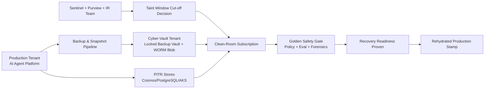
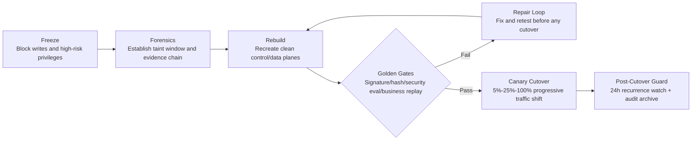

# Enterprise Immutable Cyber-Recovery Selection FAQ: WORM Vault + Cross-Tenant MUA Resource Guard vs PITR vs Clean-Room Rebuild

> 🌐 **Language Switch**: [中文](./immutable-cyber-recovery-ransomware-bcdr-ai-state-worm-vault-mua-resource-guard-vs-pitr-vs-cleanroom-rebuild-selection-faq.md) | **English (current)**
> **Audience**: Cloud & AI Solution Architects, enterprise CISOs, platform SRE teams, data governance leaders, and BCDR program owners.
> **Scope**: Architecture decisions for ransomware-resistant recovery of enterprise AI agent state (vectors, memory, tool traces, model artifacts, policy configuration), including cross-tenant air-gap design, immutable retention, clean-room rebuild flow, compliance evidence, and 3-year TCO.

## 1. Problem framing: why active-active replication can amplify AI disasters instead of containing them
Many cloud programs treat active-active geo-replication as the highest form of resilience.  
That assumption is valid for hardware and zonal faults, but it is incomplete for adversarial logical failures such as ransomware encryption, privileged deletion, memory poisoning, and policy corruption.  
In AI agent platforms, those logical failures can propagate across replication paths as quickly as healthy writes, which means faster replication may also mean faster contamination spread.  

Organizations often discover this too late, during a real incident, when every replica appears available but all replicas contain compromised state.  
Near-zero replication lag does not imply recoverability when the problem is malicious or semantically incorrect data rather than infrastructure downtime.  
The real recovery ceiling is determined by immutable state copies, trust-boundary separation, authorization isolation, and verifiable replay controls.  

For this reason, this guide treats service continuity and trustworthy recovery as separate architecture objectives.  
Continuity controls keep services running; trustworthy recovery controls ensure that restored services are clean and defensible under audit.  
Enterprise AI resilience requires both, and each must be designed with explicit blast-radius boundaries across control plane and data plane layers.  

## 2. Failure mechanics: how `<50ms` replication spreads ransomware deletion, poisoned memory, and bad policy updates
In typical cloud active-active topologies, state changes are propagated through data replication, index refresh channels, and asynchronous event pipelines.  
If an attacker captures high-privilege credentials or a workload identity with destructive permissions, destructive actions are often valid at the API layer and therefore replicated as intended operations.  
Audit logs may show what happened, but they do not stop replication from propagating damage.  

AI platforms add state types that increase recovery complexity.  
Beyond relational records, there are embedding vectors, retrieval indexes, episodic memory summaries, tool-call traces, policy bundles, model adapters, and container image references.  
A compromise in any one of these can survive rollback if recovery does not include integrity gating and poisoning-window isolation.  

The architecture objective is therefore not merely rollback speed.  
It is deletion resistance, tamper resistance, and contamination-aware replay with deterministic cut-over controls.  
PITR-only approaches solve a subset of operational mistakes but do not fully solve adversarial multi-day contamination scenarios.  

## 3. Four architecture patterns (A/B/C/D): capability layers from fast rollback to audit-grade trusted rebuild
**Architecture A**: cross-tenant logical air-gap with a dedicated Cyber-Vault Entra tenant, Azure Backup Vault locked immutability, Blob locked WORM retention, and cross-tenant Multi-User Authorization Resource Guard.  
**Architecture B**: in-tenant continuous rollback using Cosmos DB PITR, PostgreSQL geo-backup, AKS backup, ACR retention/soft-delete, and Managed HSM purge protection.  
**Architecture C**: clean-room forensic rebuild with immutable GitOps landing-zone stamps, Sentinel/Purview taint-window cut-off, and pre-cutover golden safety gates.  
**Architecture D**: enterprise cyber-vault platforms (Commvault/Rubrik/Veeam) to orchestrate identity, M365, AKS, and database recovery with automated compliance drill evidence.  

These patterns are complementary, not mutually exclusive.  
Pattern B is strong for operational rollback velocity; Pattern A is strong for anti-destruction controls under privileged compromise; Pattern C is strong for contamination-aware trusted recovery; Pattern D is strong for multi-system governance automation at enterprise scale.  
Most mature enterprises adopt A+B as baseline, invoke C for major contamination events, and use D where centralized evidence and operational consistency are strategic priorities.  

## 4. Twelve-dimension comparison matrix: trustworthiness, compliance evidence, and operational burden
| Dimension | Architecture A: cross-tenant air-gap + WORM + MUA | Architecture B: in-tenant PITR/backup | Architecture C: clean-room rebuild | Architecture D: cyber-vault platform |
|---|---|---|---|---|
| 1. Resistance to privileged deletion | Strong | Medium | Strong | Strong |
| 2. Resistance to ransomware overwrite | Strong | Medium | Strong | Strong |
| 3. Resistance to memory/vector poisoning replay | Strong | Medium-low | Very strong | Medium-strong |
| 4. Major-incident recovery velocity | Medium-high | High | Medium | Medium-high |
| 5. Routine rollback speed | Medium | High | Low-medium | Medium |
| 6. Compliance evidence automation | High | Medium | High | Very high |
| 7. Control-plane blast radius | Small | Large | Small | Small-medium |
| 8. Sovereignty and residency controls | High | Medium-high | High | Medium-high |
| 9. Operational complexity | High | Medium | High | Medium |
| 10. Platform lock-in risk | Low-medium | Medium | Low | Medium-high |
| 11. 3-year baseline cost | Medium-high | Low-medium | Medium-high | Medium-high |
| 12. DORA/SEC/FFIEC alignment strength | High | Medium | High | High |

The matrix highlights a recurring tradeoff: Pattern B is usually fastest for non-adversarial mistakes, but it does not provide the same trust-boundary separation under high-privilege compromise assumptions.  
Patterns A and C provide stronger trust guarantees, but require stricter process governance and repeatable recovery choreography.  
Pattern D can dramatically improve evidence consistency and operational scale, but should be evaluated for dependency and cost structure impacts.  

## 5. Architecture A deep dive: cross-tenant logical air-gap with locked immutability and cross-tenant MUA
Architecture A separates destructive authority from protected recovery assets by design.  
Production tenants can emit controlled backup writes, but cannot unilaterally remove retention locks or delete vault assets.  
Critical destructive operations require cross-tenant approval through Resource Guard, reducing single-identity blast radius even under severe credential compromise.  

For AI state specifically, Pattern A addresses the costly re-embedding trap.  
By persisting precomputed embeddings, ACLs, and metadata in locked WORM parquet assets, disaster recovery can restore search indexes through direct vector rehydration instead of model re-computation.  
That shifts the bottleneck from token-limited embedding throughput to data transfer and index ingestion throughput, which is operationally more predictable.  

The architecture only works when implemented as a full control chain.  
Locked immutability, cross-tenant authorization, least-privilege restore identities, segregated recovery subscriptions, and evidence logging must all be in place.  
If any of those controls is optional in production, the air-gap becomes procedural rather than enforceable.  

## 6. Architecture B deep dive: in-tenant PITR and platform backup for fast operational rollback
Architecture B is effective for routine incidents such as accidental schema drops, bad migrations, and operator mistakes.  
Cosmos continuous PITR and PostgreSQL geo-backups can restore quickly to known points in time, while AKS and ACR protections accelerate workload and artifact recovery.  
For most day-to-day failures, this pattern provides strong recovery speed with relatively low adoption friction.  

However, Pattern B assumes the tenant trust boundary remains intact.  
If attackers control high-privilege identities in the same tenant, they may target backup controls and recovery paths directly.  
That means B should be considered a rapid operational rollback layer, not the final line of defense for adversarial destruction scenarios.  

A practical strategy is to treat B as first-response tooling and define explicit escalation criteria into A or C workflows.  
Without clear escalation logic, teams may repeatedly “recover” into contaminated states and experience recurring incidents.  
Operational speed alone is not sufficient if trustworthiness is unresolved.  

## 7. Architecture C deep dive: clean-room forensics and taint-window quarantine rebuild
Architecture C addresses the hardest class of incidents: uncertain contamination start time and potential long-dwell logic poisoning.  
The workflow requires taint-window decisioning, immutable baseline rebuild, controlled state replay, and strict pre-cutover validation gates.  
The outcome is a recovery environment that is both operationally functional and evidentially defensible.  

Clean-room recovery is not inherently slow when prepared correctly.  
If immutable IaC stamps, trusted artifact sets, and replay automation are maintained continuously, clean-room activation can be procedural rather than ad hoc.  
Most delays in practice come from missing provenance, unclear cut-off logic, and untested handoff paths, not from the clean-room concept itself.  

In regulated sectors, C is often required to prove that recovered production does not reintroduce known-tainted state.  
This is especially important for AI memory and vector surfaces where semantic corruption can persist silently after basic service restoration.  
A trusted rebuild process protects both service outcomes and regulatory posture.  

## 8. Architecture D deep dive: enterprise cyber-vault platforms and quarterly drill evidence automation
Architecture D is designed for organizations operating many business units, multiple control planes, and diverse compliance obligations.  
Its primary benefit is orchestration consistency across identity, collaboration data, Kubernetes workloads, database state, and governance evidence pipelines.  
For frameworks requiring periodic demonstrable recovery readiness, automated evidence packaging can significantly reduce manual audit overhead.  

The key architecture concern is governance transparency and portability.  
If platform abstractions hide critical controls or create opaque dependencies, migration and integration flexibility may suffer later.  
Enterprises should therefore map platform workflows to open control evidence and retain independently executable recovery primitives for critical paths.  

When integrated well, D can shorten drill cycles and improve executive confidence in recovery posture.  
When integrated poorly, it can produce brittle procedural dependency without improving core trust controls.  
Control mapping and evidence integrity validation are essential to capture D’s upside.  

## 9. End-to-end reference architecture: production domain, vault domain, and clean-room domain


This architecture separates backup retention, contamination decisioning, environment rebuild, and production cutover into explicit steps with distinct ownership and evidence artifacts.  
Each transition should produce machine-verifiable logs, signed approvals, and policy/version references to support both incident response and external audit review.  
The design goal is repeatable execution under pressure, not hero-driven recovery.  

## 10. Quantitative model: RTO/RPO and re-embedding throughput constraints
The most underestimated bottleneck in AI disaster recovery is often embedding throughput under strict quota and concurrency limits.  
For `50M` chunks with `800` tokens each, total volume is roughly `40B` tokens.  
At realistic throughput limits, full cold re-embedding commonly requires `27–40` hours before index verification and cutover steps are complete.  

With precomputed vectors and ACL metadata retained in locked WORM stores, recovery shifts to asynchronous index rehydration.  
Under tuned ingestion parallelism, practical rebuild windows can shrink to around `38` minutes for equivalent logical state restoration scope.  
This is the critical difference between model-compute recovery and data-replay recovery paths.  

A practical layered equation set is:  
`RTO_total = T_detect + T_authorize + T_restore_state + T_rehydrate_index + T_validate + T_cutover`.  
`RPO_effective = min(RPO_backup, RPO_replication) + T_taint_window_uncertainty`.  
In contamination incidents, `T_taint_window_uncertainty` can dominate outcome quality even when raw restore speed is high.  

## 11. Production snippet #1: locked immutable WORM storage plus cross-tenant Resource Guard (Bicep)
```bicep
param location string = 'westeurope'
param storageAccountName string
param vaultName string
param resourceGuardName string
param retentionDays int = 365

resource storage 'Microsoft.Storage/storageAccounts@2023-05-01' = {
  name: storageAccountName
  location: location
  sku: { name: 'Standard_ZRS' }
  kind: 'StorageV2'
  properties: {
    allowBlobPublicAccess: false
    minimumTlsVersion: 'TLS1_2'
    supportsHttpsTrafficOnly: true
    immutableStorageWithVersioning: {
      enabled: true
      immutabilityPolicy: {
        immutabilityPeriodSinceCreationInDays: retentionDays
        state: 'Locked'
        allowProtectedAppendWrites: true
      }
    }
  }
}

resource backupVault 'Microsoft.DataProtection/backupVaults@2024-04-01' = {
  name: vaultName
  location: location
  properties: {
    securitySettings: {
      softDeleteSettings: { state: 'On' }
      immutabilitySettings: { state: 'Locked' }
      crossSubscriptionRestoreSettings: { state: 'Enabled' }
    }
  }
}

resource resourceGuard 'Microsoft.DataProtection/resourceGuards@2024-04-01' = {
  name: resourceGuardName
  location: location
  properties: {
    description: 'Cross-tenant MUA guard for destructive backup operations'
    criticalOperationExclusionList: []
  }
}

resource guardMapping 'Microsoft.DataProtection/backupVaults/resourceGuardProxies@2024-04-01' = {
  name: '${backupVault.name}/rg-proxy'
  properties: {
    resourceGuardId: resourceGuard.id
  }
}
```

The critical behavior in this template is immutability state `Locked` paired with cross-tenant guard mapping for destructive operation control.  
Production owner compromise should not be sufficient to remove retention or delete protected vault assets.  
Approval identities should live in separate governance tenants with phishing-resistant MFA and conditional access hardening.  

## 12. Production snippet #2: high-throughput asynchronous vector-only search rehydrator (Python)
```python
import asyncio
import json
from azure.core.credentials import AzureKeyCredential
from azure.search.documents import SearchClient
from azure.storage.blob.aio import BlobClient

SEARCH_ENDPOINT = "https://<search>.search.windows.net"
SEARCH_INDEX = "agent-memory-index"
SEARCH_KEY = "<search-admin-key>"
WORM_BLOB_URL = "https://<vaultblob>.blob.core.windows.net/vectors/recovery.parquet"

BATCH_SIZE = 500
MAX_INFLIGHT = 16

search = SearchClient(
    endpoint=SEARCH_ENDPOINT,
    index_name=SEARCH_INDEX,
    credential=AzureKeyCredential(SEARCH_KEY),
)

async def load_records():
    blob = BlobClient.from_blob_url(WORM_BLOB_URL)
    stream = await blob.download_blob()
    payload = await stream.readall()
    for line in payload.decode("utf-8").splitlines():
        row = json.loads(line)
        yield {
            "id": row["id"],
            "tenantId": row["tenantId"],
            "acl": row["acl"],
            "contentVector": row["vector"],
            "metadata": row["metadata"],
        }

async def push_batch(batch):
    result = search.upload_documents(batch)
    failed = [r for r in result if not r.succeeded]
    if failed:
        raise RuntimeError(f"Failed uploads: {len(failed)}")

async def main():
    sem = asyncio.Semaphore(MAX_INFLIGHT)
    pending = []
    batch = []
    async for doc in load_records():
        batch.append(doc)
        if len(batch) >= BATCH_SIZE:
            async def run(chunk):
                async with sem:
                    await asyncio.to_thread(push_batch, chunk)
            pending.append(asyncio.create_task(run(batch)))
            batch = []
    if batch:
        pending.append(asyncio.create_task(asyncio.to_thread(push_batch, batch)))
    await asyncio.gather(*pending)
    print("Vector index rehydration completed")

if __name__ == "__main__":
    asyncio.run(main())
```

In production this can be extended with native parquet readers, resumable checkpoints, and dead-letter replay controls.  
The key architecture point is preserving vector and ACL consistency under replay, not a specific implementation style.  
Recovery validation must include dimensionality checks, ACL integrity checks, and random document-level hash verification.  

## 13. Enterprise scenarios: two operational archetypes plus one regulator-driven archetype
**Scenario 1: global retail platform under privileged credential abuse and destructive API operations.**  
Attackers trigger policy tampering and deletion operations that replicate quickly across regions.  
The organization invokes A+C: restore trusted assets from cross-tenant immutable vault, rebuild in clean-room, validate, and then cut over with controlled release gates.  

**Scenario 2: financial risk platform with multi-day latent memory poisoning.**  
Service availability appears normal while decision quality drifts due to contaminated memory and retrieval state.  
The team applies taint-window analysis through Sentinel/Purview, then executes contamination-aware clean-room replay to avoid reintroducing tainted state at cutover.  

**Scenario 3: diversified enterprise requiring unified quarterly recovery evidence across many workloads.**  
Different business units run different platform stacks and generate inconsistent audit artifacts.  
Pattern D consolidates drill telemetry, approval traces, and control evidence into repeatable compliance packages while preserving domain-specific recovery execution lanes.  

## 14. Three-year TCO comparison: `50` domains, `8` regions, quarterly drills
| Cost component | Architecture A | Architecture B | Architecture C | Architecture D |
|---|---:|---:|---:|---:|
| Platform and storage baseline (3 years) | `$3.8M` | `$2.4M` | `$3.1M` | `$4.2M` |
| Operations and drill labor (3 years) | `$1.9M` | `$1.6M` | `$2.2M` | `$1.5M` |
| Major-incident downtime loss exposure | Low | Medium-high | Low | Low |
| Trusted-recovery confidence | High | Medium | Very high | High |
| 3-year risk-adjusted economics | High | Medium | High | Medium-high |

Pattern B often appears cheapest on direct infrastructure spend.  
When major-incident downtime, compliance penalties, and re-recovery cost are included, A and C typically produce stronger risk-adjusted outcomes for high-value AI state environments.  
Pattern D improves governance efficiency at enterprise scale, but should be evaluated against dependency and licensing posture.  

## 15. Quantitative Q&A, Day-0/Day-2 checklist, and final recommendation
### 15.1 Quantitative Q&A (6)
**Q1: What is the re-embedding workload for `50M` chunks at `800` tokens each?**  
Roughly `40B` tokens total.  
With practical quota and concurrency constraints, cold re-embedding commonly lands in a `27–40` hour window before validation overhead.  

**Q2: Why can WORM vector replay reduce recovery to around `38` minutes?**  
Because the critical path becomes I/O and index ingestion parallelism instead of model token throughput.  
Precomputed vectors remove the most expensive compute dependency from the disaster timeline.  

**Q3: What does cross-tenant MUA protect against?**  
It prevents single-tenant privileged compromise from executing destructive vault operations unilaterally.  
Destructive actions require externally governed multi-party authorization.  

**Q4: What is the main adversarial gap in in-tenant PITR-only designs?**  
Backup governance and production control plane share trust boundaries.  
Under identity compromise, attackers may target both live state and rollback controls.  

**Q5: How do we define clean-room readiness before cutover?**  
Require policy signature verification, artifact hash integrity, security-evaluation pass, and business replay acceptance thresholds.  
If any gate fails, cutover remains blocked.  

**Q6: Which metrics should quarterly drills capture for regulatory defensibility?**  
Minimum set: measured `RTO/RPO`, authorization latency, restore success rate, recontamination rate, and gate interception rate.  
All metrics should be linked to policy versions, ticket IDs, and approver identities.  

### 15.2 Day-0 implementation checklist
- Provision a dedicated cyber-vault tenant with hardened identity controls and phishing-resistant MFA.  
- Enable and lock immutable retention for backup vaults and blob containers; disallow rollback to mutable states.  
- Configure cross-tenant Resource Guard and multi-party authorization for destructive operations.  
- Define vector + ACL replay contracts and integrity validation criteria before incidents occur.  
- Publish clean-room IaC stamps and golden artifact baselines for repeatable rebuild activation.  

### 15.3 Day-2 operations checklist
- Validate retention lock status, approval workflows, and certificate rotation health every week.  
- Execute monthly taint-window simulation and replay cut-off drills with documented outcomes.  
- Run quarterly end-to-end recovery exercises and package machine-verifiable evidence for compliance review.  
- Re-baseline RTO/RPO targets and quota assumptions semiannually against business impact models and growth forecasts.  

### 15.4 Good fit vs Not for
| Decision | Guidance |
|---|---|
| ✅ Good fit | Enterprises under DORA/SEC/FFIEC-style controls with high-value AI state, high blast-radius risk, and strict trusted-recovery requirements. |
| ⛔ Not for | Low-criticality labs without formal recovery objectives, governance controls, or periodic drill commitments. |

Recommended strategy: **A+B as baseline resilience**, **C as mandatory path for contamination-grade incidents**, and **D as enterprise-scale governance accelerator**.  
This layered approach provides both fast operational rollback and audit-grade trustworthy recovery, which is more robust than relying on replication speed alone.  
In AI platforms, recoverability quality must be treated as a first-class architecture objective alongside availability.  

### 15.5 Recovery execution cadence and anti-pattern correction (audit-ready post-incident template)
In real incidents, the dominant failure mode is rarely “missing a cloud service”; the dominant failure mode is cadence drift, where teams cut traffic before evidence closure, replay data before taint boundaries are finalized, or approve environment promotion through informal chat signals instead of hard gates, causing apparent recovery followed by silent recontamination.  
A practical operating model is to enforce six deterministic stages—freeze, forensics, rebuild, gating, canary, and full cutover—with explicit entry and exit criteria, named owners, and non-bypassable control checks, so that high-pressure execution does not collapse into ad hoc, role-ambiguous decision making.  
One frequent enterprise anti-pattern is reporting only aggregate “total recovery time” while omitting approval queue latency, gate failure rate, and recontamination recurrence rate; this produces optimistic dashboards that pass quarterly reviews but fail to predict where real incidents will stall.  
Another recurring anti-pattern appears when vector replay, ACL replay, and policy signature validation are owned by separate teams without a shared cutover barrier, which creates state skew where data-plane assets are restored but control-plane policy state remains stale, triggering false blocks and authorization faults immediately after traffic return.  
Day-2 governance should adopt a release-engineering mindset for recovery: every restoration action carries immutable version IDs, approval evidence IDs, script hashes, and rollback plans, and each run remains traceable to operator identity, time window, and artifact lineage inside the incident system of record.  
Cost governance should include immutable-retention spend, quarterly drill labor, compliance evidence preparation cost, and failed-recovery retry cost in one financial model; otherwise organizations optimize short-term storage line items and underinvest in controls that dominate long-horizon risk-adjusted economics.  
For sovereign and multi-jurisdiction estates, recovery evidence should be normalized into a portable schema (`incident_id`, `taint_window`, `approved_roles`, `artifact_hashes`, `policy_version`, `cutover_gate_result`) so internal audit, external regulators, and cross-border risk teams can consume one reconciled evidence package.  
AI-agent recovery programs should track post-recovery task-success restoration and hallucination-rate normalization alongside API uptime, because business stakeholders care about dependable decisions after recovery, not merely infrastructure endpoints returning `200 OK`.  



### 15.6 Measurement semantics and provenance tags (measured / anonymized_reported)
The `27-40 hour` cold re-embedding range, `~38 minute` vector replay window, and 3-year TCO comparisons in this guide are architecture-planning metrics: values produced by controlled experiment scripts are tagged `measured`, values aggregated from anonymized production retrospectives are tagged `anonymized_reported`, and implementation teams should re-measure against tenant-specific quotas and index scales before budget ratification.  
Time-to-recovery metrics should always be decomposed into preparation, approval, replay, gating, and cutover-observation components, because a single aggregate value hides capacity bottlenecks and misdirects both staffing and platform investment decisions.  
For multi-region or multi-domain concurrent recovery, percentile reporting should replace mean-only reporting and include worst-domain completion time plus cross-domain queue amplification, preventing “healthy average, failed critical domain” blind spots.  
Regulatory communication should map technical indicators to business outcomes, for example linking `RTO` to order-loss bands, customer-service backlog growth, and penalty exposure ranges, so governance boards can evaluate architecture choices in the same frame as financial and compliance risk.  

### 15.7 Implementation addendum: turning “recoverability quality” into an operating capability
Many organizations still run cyber-recovery as a one-time project milestone, but AI-state systems evolve too quickly for static controls; if schema contracts, vector dimensions, ACL semantics, and policy bundles change without synchronized recovery rehearsals, teams eventually discover that backups exist while replay tooling silently fails at cutover due to contract drift, so production-change policy should require a lightweight recovery rehearsal and diff report for every state-shape change.  
A durable governance model is to establish a recurring recovery-quality council that includes platform engineering, business continuity, compliance/audit, and finance controls, and to score each quarter against three dimensions—feasibility, trustworthiness, and economics—so control strength does not decay during cost pressure, staffing changes, or platform migrations.  
Technically, treat recovery as release engineering: keep control-plane templates, data-plane replay pipelines, gate policies, and drill scripts in GitOps workflows with signed commits, artifact digests, and environment admission policies, so “who can change controls, who can execute restore, and who can approve cutover” is enforced as deterministic system behavior rather than informal process memory.  
At multi-region enterprise scale, region cutover order should be policy-driven instead of ad hoc, using business criticality, regulatory deadlines, customer impact weighting, available quota, and approval throughput as scheduling inputs, which prevents low-priority regions from consuming approval bandwidth while high-impact regions remain in degraded operation.  
To avoid drill theater, each quarterly exercise should close three debt classes with evidence: technical debt (slow scripts, brittle dependencies, observability gaps), process debt (approval bottlenecks, unclear role handoffs, escalation ambiguity), and governance debt (inconsistent evidence schema, incomplete cost model, stale compliance mapping), because only closed-loop debt reduction produces compounding resilience gains.  
