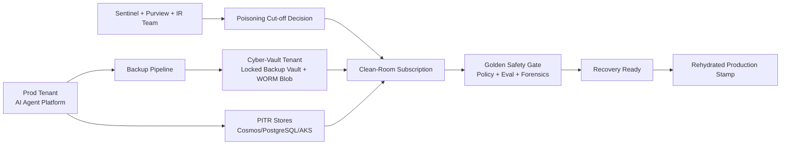
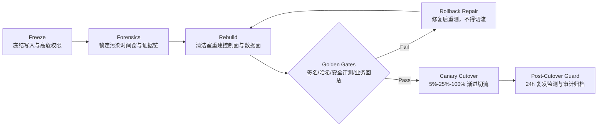

# 企业不可变网络恢复与 AI 状态勒索防护选型 FAQ：WORM Vault + 跨租户 MUA Resource Guard vs PITR vs Clean-Room 重建

> 🌐 **Language Switch**：**中文（当前）** | [English](./immutable-cyber-recovery-ransomware-bcdr-ai-state-worm-vault-mua-resource-guard-vs-pitr-vs-cleanroom-rebuild-selection-faq.en.md)
> **受众**：Cloud & AI Solution Architect、企业 CISO、平台 SRE、数据治理与合规负责人、BCDR 演练负责人。
> **范围**：面向企业 AI Agent 状态层（向量、会话记忆、工具轨迹、模型工件、策略配置）的勒索软件防护与灾难恢复架构选型，覆盖跨租户气隙、不可变保留、清洁室重建、合规演练与三年 TCO。

## 1. 问题定义：为什么“跨区域双活”在 AI 场景下可能放大灾难而不是缓解灾难
传统云架构常把跨区域主动-主动复制视为韧性上限。  
但在 AI Agent 平台中，控制面污染、向量污染、记忆投毒、恶意删除与凭据接管都能被复制链路极速同步。  
当污染对象不是“硬件故障”而是“逻辑错误或恶意写入”时，复制速度越快，污染扩散越快。  

很多团队在事故后才发现，RPO 接近零并不等于可恢复。  
如果每个副本都已经被污染或被删除命令波及，所谓“多副本”只是多份受损状态。  
在这类场景中，真正决定恢复上限的是不可变快照、租户边界、授权隔离和可验证回放链路。  

因此，本指南强调“复制可用性”与“恢复可信性”必须分层设计。  
前者解决服务连续性，后者解决对抗主动破坏。  
两者缺一不可，且控制面与数据面必须分别定义不可跨越的破坏半径。  

## 2. 失效机理：`<50ms` 复制链路如何同步勒索删除、污染记忆与错误策略
在典型云内双活拓扑中，写入路径会通过消息总线、数据库复制或索引刷新快速分发。  
若攻击者拿到生产订阅 Owner 或高权限运行身份，就能触发“合法但恶意”的删除与覆盖。  
这些操作会被审计记录，但同样会被复制机制传播到副本。  

AI 平台特有风险在于状态对象种类更复杂。  
除了关系数据，还包括向量索引、嵌入文件、工具调用日志、会话摘要、策略配置、模型适配器与容器镜像引用。  
其中任何一个污染源都可能在恢复后继续触发错误决策，形成“恢复后再感染”。  

因此必须把“防删除、防篡改、防污染重放”作为统一恢复目标。  
仅靠 PITR 解决“误删回滚”并不足以应对“潜伏多天的逻辑投毒”。  
只有不可变保留与清洁室验证结合，才能阻断二次感染链。  

## 3. 四类架构模式（A/B/C/D）：从快速回滚到审计级恢复的能力分层
**Architecture A**：跨租户逻辑气隙，生产租户外置独立 Cyber-Vault Entra 租户，使用 Azure Backup Vault Locked Immutability、Blob Locked WORM、跨租户 MUA Resource Guard。  
**Architecture B**：同租户 PaaS 连续回滚，依赖 Cosmos DB Continuous PITR、PostgreSQL Geo-Backup、AKS Backup、ACR Soft-Delete、Managed HSM Purge Protection。  
**Architecture C**：清洁室法证重建，采用不可变 GitOps Landing Zone Stamp、Sentinel/Purview 污染截断时间窗、重建前 Golden Safety Gate。  
**Architecture D**：企业 Cyber-Vault 平台整合，如 Commvault/Rubrik/Veeam 在 Azure 上提供统一恢复编排与审计证据自动化。  

这四类模式不是简单替代关系。  
B 适合运维故障快速回滚，A 适合对抗高权限破坏，C 适合污染事件后的可信重建，D 适合统一运营和合规证据自动化。  
企业实践通常采用 A+B 作为基础，C 作为重大事件闭环，D 作为跨系统治理加速器。  

## 4. 十二维对比矩阵：恢复可信性、合规可审计性与运营复杂度的平衡
| 维度 | Architecture A：跨租户气隙 + WORM + MUA | Architecture B：同租户 PITR/备份 | Architecture C：清洁室重建 | Architecture D：平台化 Cyber-Vault |
|---|---|---|---|---|
| 1. 抵御高权限误删 | 强，跨租户与多人授权阻断 | 中，仍暴露于同租户 Owner 面 | 强，重建在隔离域进行 | 强，依赖平台策略 |
| 2. 抵御勒索批量覆盖 | 强，Locked Immutability 生效 | 中，时间窗内可回滚但易被破坏控制面干扰 | 强，可按截断点重放 | 强，具备统一保留策略 |
| 3. 抵御记忆/向量污染 | 强，保留干净历史副本 | 弱到中，污染可能进入回滚窗口 | 强，带污染判定门禁 | 中到强，取决于集成深度 |
| 4. 恢复速度（重大事件） | 中高，需跨租户重建流程 | 高，操作回滚最快 | 中，验证步骤较多 | 中高，取决于自动化 |
| 5. 常规误操作回滚效率 | 中 | 高 | 低到中 | 中 |
| 6. 合规证据自动化 | 高 | 中 | 高 | 很高 |
| 7. 控制面破坏半径 | 小 | 大 | 小 | 小到中 |
| 8. 数据驻留与主权控制 | 高 | 中高 | 高 | 中到高 |
| 9. 运营复杂度 | 高 | 中 | 高 | 中 |
| 10. 平台锁定风险 | 低到中 | 中 | 低 | 中高 |
| 11. 三年综合成本 | 中高 | 低到中 | 中高 | 中高 |
| 12. DORA/SEC/FFIEC 适配度 | 高 | 中 | 高 | 高 |

矩阵说明：B 在“快”上有优势，但在“对抗高权限破坏”上存在天然短板。  
A 与 C 在可信恢复维度显著更强，但需要更严格的流程与演练纪律。  
D 能降低多系统编排复杂度，但要评估平台依赖与成本结构。  

## 5. Architecture A 深入：跨租户逻辑气隙 + 锁定不可变保留 + 跨租户 MUA
Architecture A 的核心是把“可销毁权限”与“不可变保留对象”彻底分开。  
生产租户仅能发起受限备份写入，不具备直接解除锁定或删除 Vault 的权限。  
恢复关键动作必须通过跨租户 Resource Guard + 多人批准流程，降低单点身份被盗后的破坏能力。  

在 AI 场景里，A 方案额外解决“向量重建耗时和令牌成本爆炸”问题。  
通过在 WORM 中保存预计算嵌入与 ACL 元数据，可在灾后直接重建索引，而不是重新调用嵌入模型。  
这把恢复路径从“令牌受限的模型计算”转为“带宽受限的数据回灌”，可预测性更高。  

A 的关键落地点不是单一服务开关，而是完整控制链。  
包括：Vault 不可变锁定、WORM 保留时钟、跨租户审批、恢复身份最小化、恢复环境与生产隔离。  
任何一个环节缺失都会把“逻辑气隙”降级为“名义气隙”。  

## 6. Architecture B 深入：同租户 PITR 与平台备份的高效率回滚路径
Architecture B 适用于日常事故处理，如误删集合、错误迁移、错误配置上线。  
Cosmos Continuous PITR 与 PostgreSQL Geo-Backup 可以在较短窗口内恢复到指定时间点。  
AKS 备份与 ACR 保留机制可帮助恢复工作负载与镜像引用链。  

B 的优势是恢复流程短、运维成熟、上线阻力低。  
对多数“非攻击性事故”而言，B 能以更低成本满足 RTO 目标。  
但它在“攻击者持有高权限”的假设下保护边界有限，因为关键控制面仍在同租户。  

因此推荐把 B 定位为第一响应层，而不是最终防线。  
当检测到疑似恶意活动或长潜伏污染时，应升级到 A 或 C 的恢复路径。  
否则容易出现“回滚成功但污染回灌”的反复事故。  

## 7. Architecture C 深入：清洁室法证与污染时间窗隔离重建
Architecture C 解决的是“你不知道哪一刻开始被污染”的复杂事件。  
团队需先定义污染截断点，再按干净基线重建基础设施与状态。  
恢复后必须通过安全与质量门禁，确认模型、提示词、工具链和记忆状态都在可信范围。  

清洁室不等于慢。  
如果平时维护好不可变 IaC、黄金镜像和重放流水线，C 的执行可标准化为脚本化流程。  
慢通常来自“平时没有证据链、没有演练、没有切断规则”，而不是清洁室本身。  

C 的价值在金融、能源、公共事业等高合规行业尤为突出。  
这些行业对“恢复后结果可信”要求高于“最快恢复但带未知风险”。  
在审计语境中，可证明的恢复路径通常比绝对分钟级速度更重要。  

## 8. Architecture D 深入：企业 Cyber-Vault 平台整合与季度演练证据
Architecture D 适合多系统、多团队、多合规框架并行的企业。  
其价值在于把 Entra ID、M365、AKS、数据库、对象存储恢复流程统一编排，并沉淀标准化证据。  
对 DORA Art.11/25 等要求“定期可验证演练”的框架，平台化证据输出可显著降低人工成本。  

D 的注意点是控制边界与可移植性。  
如果企业过度依赖单一平台默认策略，可能在跨云或并购整合时遇到适配成本。  
因此建议用开放日志与策略映射保持可迁移性，同时把关键恢复步骤保留为可独立执行脚本。  

## 9. 端到端参考架构：生产域、Vault 域、清洁室域的分层闭环


该架构将“备份保存”“污染判定”“重建验证”“切回生产”拆成独立环节。  
每个环节都应有明确负责人、输入工件、输出证据与可追溯审计标识。  
只有这样，恢复才能在高压事件中可重复执行，而不是依赖临场经验。  

## 10. 量化模型：RTO/RPO 与重嵌入令牌瓶颈的现实边界
灾难时最常被低估的是“重算嵌入吞吐上限”。  
若索引规模为 `50M` chunks，每块平均 `800` tokens，则总量约 `40B` tokens。  
在实际配额与并发限制下，冷重嵌入通常需要 `27–40` 小时，且还不含索引回灌与校验时间。  

若采用 A 方案预存向量与元数据为 WORM Parquet，可把恢复瓶颈转为数据传输与异步写入。  
在同等网络条件下，向量直推与批量索引可把重建压缩到 `~38` 分钟级。  
这就是“计算受限路径”与“数据回灌路径”的本质差异。  

RTO/RPO 评估建议使用分层公式：  
`RTO_total = T_detect + T_authorize + T_restore_state + T_rehydrate_index + T_validation + T_cutover`。  
`RPO_effective = min(RPO_backup, RPO_replication) + T_taint_window_uncertainty`。  
其中 `T_taint_window_uncertainty` 在污染事件中往往主导最终恢复可信性。  

## 11. 生产配置片段一：Locked Immutable Blob WORM + Cross-Tenant Resource Guard（Bicep）
```bicep
param location string = 'westeurope'
param storageAccountName string
param vaultName string
param resourceGuardName string
param retentionDays int = 365

resource storage 'Microsoft.Storage/storageAccounts@2023-05-01' = {
  name: storageAccountName
  location: location
  sku: { name: 'Standard_ZRS' }
  kind: 'StorageV2'
  properties: {
    allowBlobPublicAccess: false
    minimumTlsVersion: 'TLS1_2'
    supportsHttpsTrafficOnly: true
    immutableStorageWithVersioning: {
      enabled: true
      immutabilityPolicy: {
        immutabilityPeriodSinceCreationInDays: retentionDays
        state: 'Locked'
        allowProtectedAppendWrites: true
      }
    }
  }
}

resource backupVault 'Microsoft.DataProtection/backupVaults@2024-04-01' = {
  name: vaultName
  location: location
  properties: {
    securitySettings: {
      softDeleteSettings: { state: 'On' }
      immutabilitySettings: { state: 'Locked' }
      crossSubscriptionRestoreSettings: { state: 'Enabled' }
    }
  }
}

resource resourceGuard 'Microsoft.DataProtection/resourceGuards@2024-04-01' = {
  name: resourceGuardName
  location: location
  properties: {
    description: 'Cross-tenant MUA guard for destructive backup operations'
    criticalOperationExclusionList: []
  }
}

resource guardMapping 'Microsoft.DataProtection/backupVaults/resourceGuardProxies@2024-04-01' = {
  name: '${backupVault.name}/rg-proxy'
  properties: {
    resourceGuardId: resourceGuard.id
  }
}
```

该模板的关键是 immutability `Locked` 与 Resource Guard 绑定。  
生产订阅即使被高权限接管，也无法单点撤销关键保护动作。  
建议把审批身份放在独立租户并启用硬件 MFA 与条件访问。  

## 12. 生产配置片段二：高吞吐向量回灌器（异步 AI Search 重建）
```python
import asyncio
import json
from azure.core.credentials import AzureKeyCredential
from azure.search.documents import SearchClient
from azure.storage.blob.aio import BlobClient

SEARCH_ENDPOINT = "https://<search>.search.windows.net"
SEARCH_INDEX = "agent-memory-index"
SEARCH_KEY = "<search-admin-key>"
WORM_BLOB_URL = "https://<vaultblob>.blob.core.windows.net/vectors/recovery.parquet"

BATCH_SIZE = 500
MAX_INFLIGHT = 16

search = SearchClient(
    endpoint=SEARCH_ENDPOINT,
    index_name=SEARCH_INDEX,
    credential=AzureKeyCredential(SEARCH_KEY),
)

async def load_records():
    blob = BlobClient.from_blob_url(WORM_BLOB_URL)
    stream = await blob.download_blob()
    payload = await stream.readall()
    for line in payload.decode("utf-8").splitlines():
        row = json.loads(line)
        yield {
            "id": row["id"],
            "tenantId": row["tenantId"],
            "acl": row["acl"],
            "contentVector": row["vector"],  # float16/int8 expanded by loader
            "metadata": row["metadata"],
        }

async def push_batch(batch):
    result = search.upload_documents(batch)
    failed = [r for r in result if not r.succeeded]
    if failed:
        raise RuntimeError(f"Failed uploads: {len(failed)}")

async def main():
    sem = asyncio.Semaphore(MAX_INFLIGHT)
    pending = []
    batch = []
    async for doc in load_records():
        batch.append(doc)
        if len(batch) >= BATCH_SIZE:
            async def run(chunk):
                async with sem:
                    await asyncio.to_thread(push_batch, chunk)
            pending.append(asyncio.create_task(run(batch)))
            batch = []
    if batch:
        pending.append(asyncio.create_task(asyncio.to_thread(push_batch, batch)))
    await asyncio.gather(*pending)
    print("Vector index rehydration completed")

if __name__ == "__main__":
    asyncio.run(main())
```

实际生产可替换为 Parquet 直接读取并启用重试与断点续传。  
关键不在代码形式，而在“向量与 ACL 一致回放”的数据契约。  
恢复验证应抽样校验向量维度、权限标签与文档哈希一致性。  

## 13. 企业场景：两类典型恢复路径与一类监管驱动路径
**场景一：跨境零售平台遭遇批量凭据劫持与配置清除。**  
攻击者利用高权限身份发起删除与策略篡改，区域副本在秒级同步受损。  
团队采用 A + C 路径，在独立租户 Vault 提取干净状态并在清洁室完成验证后切回，恢复窗口控制在业务可接受范围。  

**场景二：金融风控平台出现多日潜伏的记忆污染。**  
表面服务可用，但决策质量持续漂移，且传统回滚会带回污染数据。  
团队先用 Sentinel/Purview 锁定污染时间窗，再用 C 路径做截断回放与门禁评估，避免“恢复后再污染”。  

**场景三：大型集团统一合规审计与季度演练。**  
集团在多个业务单元使用不同平台栈，审计证据分散。  
引入 D 方案后，将演练记录、恢复指标与审批证据统一输出，显著降低审计准备成本。  

## 14. 三年 TCO 对比：`50` 业务域、`8` 区域、季度演练场景
| 成本项 | Architecture A | Architecture B | Architecture C | Architecture D |
|---|---:|---:|---:|---:|
| 基础平台与存储（3 年） | `$3.8M` | `$2.4M` | `$3.1M` | `$4.2M` |
| 运维与演练人力（3 年） | `$1.9M` | `$1.6M` | `$2.2M` | `$1.5M` |
| 重大事件平均停机损失暴露 | 低 | 中高 | 低 | 低 |
| 重大事件恢复可信性 | 高 | 中 | 很高 | 高 |
| 预计三年综合经济性 | 高（风险调整后） | 中 | 高 | 中高 |

从账面基础成本看，B 常常最便宜。  
但将重大事件损失、审计罚责与恢复失败重试成本纳入后，A/C 的风险调整后经济性通常更优。  
D 的优势在“治理效率与证据自动化”，适合大型组织统一运营。  

## 15. 定量 Q&A、Day-0/Day-2 清单与最终建议
### 15.1 定量 Q&A（6 项）
**Q1：`50M` chunks、每块 `800` tokens 的重嵌入规模是多少？**  
总量约 `40B` tokens。  
在实际 TPM 限额下，冷重算往往是数十小时级，无法满足关键业务恢复时限。  

**Q2：为何 WORM 向量回灌能做到 `~38` 分钟级？**  
因为路径从模型计算转为数据批量写入。  
在足够并发与分片索引条件下，瓶颈主要是 I/O 和索引写入吞吐，而不是 TPM。  

**Q3：跨租户 MUA 的核心价值是什么？**  
它把高风险销毁操作从单人高权动作变成跨租户多方批准动作。  
即使生产租户 Owner 被劫持，也无法单点摧毁恢复资产。  

**Q4：同租户 PITR 在攻击场景下的主要短板是什么？**  
控制面仍在同一信任域。  
若攻击者控制高权限身份，回滚资产与策略本身可能同时被破坏。  

**Q5：如何衡量清洁室是否“足够干净”？**  
至少需满足策略签名校验通过、模型工件哈希一致、关键安全评测通过、核心业务回放通过。  
若任一门禁失败，禁止切换流量。  

**Q6：季度演练应记录哪些指标以满足监管核查？**  
建议记录 `RTO/RPO` 实测、审批链时延、恢复成功率、污染复发率、门禁拦截率。  
并将证据与策略版本、工单编号、审批身份关联存档。  

### 15.2 Day-0 上线清单
- 建立独立 Cyber-Vault 租户与最小化恢复身份体系，启用硬件 MFA 和条件访问。  
- 为备份 Vault 与 Blob 容器开启并锁定不可变保留，禁止可回退策略。  
- 配置跨租户 Resource Guard 与多人批准流程，明确定义高风险操作清单。  
- 定义向量与 ACL 的恢复数据契约，确保回灌过程可验证。  
- 建立清洁室订阅模板与黄金 IaC，保证可一键重建。  

### 15.3 Day-2 运营清单
- 每周检查保留策略、审批链路、证书轮换与失败告警。  
- 每月执行污染时间窗推演，验证截断点识别与重放流程。  
- 每季度执行端到端恢复演练并输出监管可审计证据包。  
- 每半年复核 RTO/RPO 目标与业务影响模型，更新预算与资源配额。  

### 15.4 Good fit vs Not for
| 结论 | 说明 |
|---|---|
| ✅ Good fit | 受 DORA/SEC/FFIEC 等框架约束、存在高价值 AI 状态资产、需要防御高权限破坏与长潜伏污染的企业。 |
| ⛔ Not for | 仅有低价值实验环境、无正式恢复目标、无法执行多人审批和定期演练的轻量团队。 |

最终建议：以 **A+B** 作为基础恢复能力，以 **C** 作为重大污染事件刚性流程，以 **D** 作为跨系统治理加速层。  
在此组合下，企业可同时获得分钟级运维回滚能力与审计级可信恢复能力。  
这比单纯依赖跨区域双活更符合 AI 时代的对抗性风险现实。  

### 15.5 恢复执行节拍与反模式纠偏（审计复盘模板）
在真实事故中，失败通常不是出在“没有某个云服务”，而是出在执行节拍失真：团队在证据尚未完整时过早切流，或在污染边界尚未确认时就恢复旧状态，导致第一次恢复把系统拉起，第二次恢复又把污染重新引入，最终形成“看似可用但持续劣化”的隐性故障。  
建议把恢复流程拆成“冻结、取证、重建、门禁、灰度、全量”六段，并为每段绑定单一退出条件和责任人角色，任何一步未满足都不得推进下一步，这样才能在高压场景中避免凭经验跳步骤和跨角色口头确认导致的流程漂移。  
企业常见反模式之一是把演练指标只记录到“总恢复时长”，却不记录审批排队时延、证据校验失败率和二次污染复发率，结果是年度审计看起来达标，但真正事故发生时才发现瓶颈在授权和验证而不是基础设施吞吐。  
另一个高频反模式是把向量回灌、ACL 回放、策略签名校验交给三个团队并行推进，却没有统一的“切换前一致性栅栏”，最终在切流窗口出现数据面已恢复而控制面策略仍旧过期的状态错位，触发新一轮误拦截和越权访问告警。  
建议在 Day-2 治理中引入“恢复即发布”的发布工程思想：所有恢复动作必须带版本号、审批证据编号、脚本哈希和回退策略，并在工单系统中可追溯到具体执行人、执行时段与输入工件版本，从而把恢复从“手工应急”升级为“可重复的工程流水线”。  
在成本治理层面，建议把“不可变保留成本、季度演练成本、合规审计准备成本、恢复失败重试成本”纳入同一财务模型，否则团队会被短期存储账单误导，低估跨租户保护和清洁室建设的长期经济性收益。  
如果组织存在跨境主权与多法域监管，建议将恢复证据包结构化为统一模式：`incident_id`、`taint_window`、`approved_roles`、`artifact_hashes`、`policy_version`、`cutover_gate_result`，并在每次演练后自动生成可提交给审计与内控的双语报告。  
对于 AI Agent 场景，还应把“任务成功率恢复速度”和“模型幻觉率回归速度”纳入恢复 SLO，而不仅仅是基础 API 可用率，因为业务部门真正关心的是恢复后决策是否可靠，而不是系统是否仅仅能够返回 `200 OK`。  



### 15.6 计量口径与来源标签（measured / anonymized_reported）
本文中 `27-40 小时` 冷重嵌入窗口、`~38 分钟` 向量回灌窗口与三年 TCO 对比属于架构评估口径：凡来自实验脚本实测的数据标记为 `measured`，凡来自脱敏生产复盘汇总的数据标记为 `anonymized_reported`，并在实施阶段要求团队以本租户配额与索引规模复测后再进入正式预算。  
所有恢复时长类指标都应拆分为“准备时延、审批时延、数据回放时延、门禁时延、切流观测时延”，避免把多个瓶颈聚合成单一数字而误导容量规划和人力配置决策。  
当组织采用多区域和多业务域并行恢复时，建议用分位数而不是均值汇报关键指标，并额外报告最差域恢复时长和跨域排队效应，以防“平均值好看但关键业务域超时”掩盖真实风险。  
对于监管沟通，建议同时给出技术指标和业务影响指标映射，例如将 `RTO` 映射到订单损失区间、客户服务积压时长和罚则暴露区间，这样治理委员会能在同一页上理解“技术选择如何影响财务与合规后果”。  

### 15.7 落地补充：把“恢复质量”固化为可持续运营能力
很多企业把恢复体系当作一次性项目交付，项目验收后就转入低频维护，但 AI 平台状态对象迭代速度远高于传统应用，若不把恢复契约嵌入日常发布流程，三个月后就会出现“备份还在、恢复脚本仍在、但对象字段和索引映射已漂移”的隐性失效，因此建议把每次 schema 变更、向量维度变更、ACL 结构变更都强制触发一次最小恢复演练并自动产出差异报告。  
建议在组织层面建立“恢复质量委员会”而不是仅依赖单团队值班，把平台架构、业务连续性、合规审计、财务控制四类角色纳入固定评审节奏，并使用统一评分卡评估恢复可行性、恢复可信性、恢复经济性三条主线，这样可以在预算收缩或组织调整时持续维持关键控制不被弱化。  
在技术实施上，推荐将恢复控制面配置、数据面重建流程、门禁策略、演练脚本全部纳入 GitOps 与策略即代码体系，通过分支保护、签名提交、制品哈希验证与环境准入策略形成闭环，使“谁可以改恢复策略、谁可以执行恢复、谁可以批准切流”在系统中具备可计算和可审计的确定性边界。  
对跨区域大规模企业而言，还应把“区域恢复顺序”从人工决策改为规则引擎驱动，依据业务优先级、合规时限、客户影响权重、可用配额和审批吞吐动态排序，这样在多区域并发事件中能够避免高价值区域被低价值区域的工单队列和审批排队挤占，显著降低整体业务损失暴露。  
为了避免演练流于形式，建议在每次季度演练后强制产出三类改进项并跟踪关闭：第一类是技术债（脚本慢、依赖脆弱、监控盲区），第二类是流程债（审批链过长、角色不清、交接模糊），第三类是治理债（证据口径不统一、财务模型缺项、合规模板过时），只有三类债务均形成可验证收敛，恢复体系才会持续变强而非重复同一问题。  
最后，架构师在对外汇报时应避免仅展示“最快恢复时间”，而要同时展示“最慢业务域恢复时间、污染复发概率、恢复后质量回稳时间、每次演练单位成本”，因为董事会和监管机构真正关心的是在最坏情境下企业是否仍能稳定地做出正确决策并证明其正确性。  

### 15.8 架构师汇报模板补充（面向治理委员会与审计联席会）
建议每次恢复评审都采用同一页结构化摘要：第一栏是事件画像与污染边界，第二栏是恢复路径与门禁结论，第三栏是业务影响与财务暴露，这样非技术决策者无需阅读底层日志也能快速判断“是否允许切流、是否追加预算、是否升级应急等级”，从而显著降低跨部门沟通摩擦。  
在跨国组织中，建议把主权要求、数据驻留约束、密钥托管边界、证据留存期限写成可执行策略并进入恢复流水线，而不是停留在制度文档层，因为只有当策略能够在执行时自动阻断违规动作，合规能力才不依赖个体记忆和临场判断。  
建议在演练复盘中引入“反事实分析”字段，明确记录如果沿用旧流程会出现的恢复时长、业务损失和合规风险，以量化方式证明新控制的价值，这有助于在预算审查周期中持续获得治理投入并避免恢复能力在短期降本压力下被错误削减。  
对于高频变更团队，推荐把恢复脚本与发布流水线共享同一套版本治理和回滚机制，并在每次主干发布后自动触发最小恢复烟囱演练，确保恢复工件与生产工件始终同版本演进，避免“生产已升级而恢复脚本停留旧版本”这一最常见且最昂贵的隐患。  
在组织能力建设层面，建议将恢复演练结果纳入平台团队与业务团队的共同目标，考核指标既包含技术侧的 RTO/RPO 与门禁通过率，也包含业务侧的订单恢复速度、客服积压消化速度和监管反馈时效，以防恢复体系只在技术团队内部优化而无法转化为真实业务韧性。  
当企业进入多平台并行阶段（自建、托管、第三方恢复平台并存）时，架构师应优先保证证据模型统一和切流门禁统一，而不是追求工具统一，因为工具可以逐步替换，但证据与门禁口径一旦分裂就会直接削弱审计可信度和跨平台协同效率。  
建议在年度规划中把“恢复能力提升路线图”拆成可以验收的季度里程碑，并为每个里程碑绑定明确的技术产物与业务产物，例如“跨租户审批链自动化覆盖率提升到 95%”“清洁室重建脚本全链路无人工补丁”“重大业务域恢复后 2 小时内质量指标回到基线 ±5%”，这样管理层能够用同一套目标同时观察技术成熟度与业务韧性提升。  
建议将恢复演练结果直接对接预算模型，按“控制缺口导致的预期损失降低量”计算投入优先级，而不是按“哪个团队声音更大”分配资源，因为在多业务域竞争预算的现实环境中，只有把恢复控制转化为可量化的风险降低价值，才能持续获得跨年度资金并避免关键控制在组织变动中被边缘化。  
对于需要向董事会和监管联席会汇报的组织，建议采用“场景—控制—证据—结果—改进”的五段式叙事模板，并在每次汇报中固定展示最坏场景下的恢复上限、失败场景下的兜底机制和下一季度的可验证改进目标，这样不仅能建立对恢复体系透明且稳定的信任，也能把技术团队从被动答辩转变为主动治理。  
若企业希望把恢复体系真正嵌入经营系统而不是停留在技术体系，建议在年度经营看板中固定新增“可信恢复能力”维度并与收入保护、客户留存、监管风险、运营效率四个经营指标建立显式映射，例如将“恢复成功率提升 5%”映射到“关键业务中断损失下降区间”“重大事故后客户流失控制区间”“监管整改概率下降区间”“跨团队协同工时下降区间”，从而让恢复投资不再被视为纯成本项，而是被视为可以持续产生风险对冲收益与现金流稳定收益的战略资产。  
同时建议将恢复演练纳入跨层级绩效协同机制，把平台团队的技术指标与业务团队的连续性指标绑定在同一目标树中，并通过自动化证据采集系统持续沉淀“演练输入、执行轨迹、门禁结果、业务回稳曲线、改进关闭状态”的全链路数据资产，长期来看这将显著提升组织在并发危机下的决策一致性与执行确定性，使企业在面对勒索攻击、供应链污染和合规突发检查时都能以可证明、可复盘、可复制的方式完成高质量恢复。  
在治理落地最后一公里，建议将恢复策略、演练策略、审计策略统一为同一份可执行控制目录，并通过自动化校验在每次发布与每次演练前后都执行一致性扫描，确保“策略文本、系统配置、执行轨迹、审计证据”四者持续同构，避免出现制度与实施脱节、实施与证据脱节、证据与汇报脱节的链路断裂。  
只有当这些控制被持续量化并纳入季度经营复盘，企业才能在复杂外部威胁与内部组织变动同时发生时仍保持恢复体系稳定演进，否则恢复能力会在看不见的流程细节中逐步退化，直至下一次重大事件才暴露系统性缺口。  
因此建议把恢复体系视为长期经营底座，通过持续演练、持续校准、持续审计和持续改进形成闭环，让每一次事件和每一次演练都转化为下一轮架构优化的输入，而不是一次性消耗的应急动作。  
从组织演进视角看，真正成熟的恢复体系不是“发生故障时有人能处理”，而是“即便关键人员不可用、外部依赖受限、监管压力升高，系统仍能沿着预定义且可验证的路径稳定恢复”，这要求企业把知识、流程、工具和证据全部产品化并持续演进，使恢复能力成为可传承、可复制、可审计的核心竞争力。  
唯有将这种能力长期化、制度化并工程化，企业才能在下一次更复杂的复合型危机中保持恢复速度与恢复质量的同步领先。  
