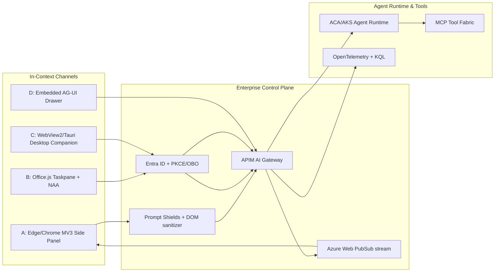
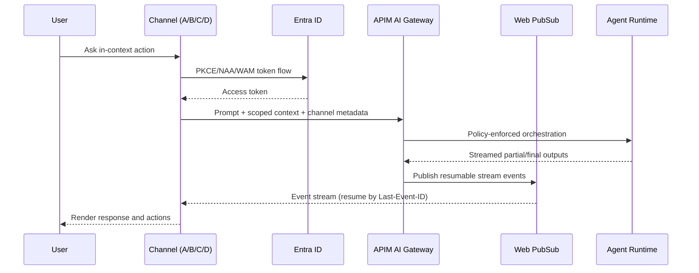
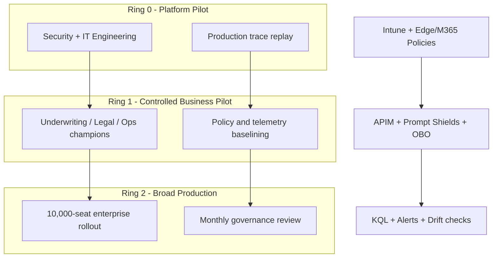

# In-Context Enterprise Workstation Co-Pilot Channel Selection FAQ: Edge MV3 Side Panel vs Office.js NAA Add-In vs Desktop WebView2 MCP Companion vs Host Embedded AG-UI

> 🌐 **Language Switch**: [中文](./in-context-workstation-copilot-channel-edge-mv3-sidepanel-extension-vs-officejs-naa-addin-vs-desktop-webview2-mcp-selection-faq.md) | **English (current)**
> **Audience**: Cloud and AI Solution Architects, enterprise workplace platform teams, digital workplace engineering leads, M365 platform owners, and CISO governance architects.
> **Scope**: Production channel architecture for in-context enterprise co-pilot experiences across browser SaaS, M365 documents, desktop thick-client workflows, and first-party host applications, including identity, streaming reliability, prompt-injection controls, seat rollout operations, and TCO.

## 1. Why standalone AI portals lose enterprise adoption despite good model quality
Standalone AI portals often fail because workers complete tasks inside third-party SaaS tabs, Word or Excel documents, and thick desktop applications, so every copy-paste context hop increases cognitive load, introduces lost-turn friction, and creates avoidable leakage risk through unmanaged clipboard artifacts.
In high-throughput roles such as underwriting, clinical review, legal redlining, and operations command desks, the marginal delay of each context switch compounds across dozens of decisions per day and quickly dominates user sentiment more than model benchmark deltas.
When the assistant is not embedded where users already act, prompts and evidence become detached from source context, answer traceability degrades, and business teams eventually classify the experience as “nice demo, weak production utility.”
The channel decision is therefore an architecture decision, not a UX ornament, because it directly affects identity posture, context fidelity, security boundary enforcement, and measurable ROI.

## 2. Four architecture families and where each one owns the interaction surface
**Architecture A** uses enterprise-managed browser side-panel extensions on Edge for Business or Chrome Enterprise, making it possible to augment third-party SaaS pages without modifying vendor code while preserving centralized install and policy control.
**Architecture B** uses Office.js unified add-ins with Nested App Authentication and M365 integrated deployment, delivering low-friction co-pilot entry points directly in Word, Excel, and Outlook where high-value document operations already occur.
**Architecture C** introduces signed desktop companions built on WebView2 or Tauri with local loopback or named-pipe MCP bridges, extending assistant workflows into thick Win32, terminal, SAP GUI, and VDI-dependent operational environments.
**Architecture D** embeds AG-UI drawers in first-party web applications, which minimizes selector breakage and operational drift because context is provided through typed application state contracts instead of opportunistic DOM scraping.

## 3. End-to-end reference architecture and trust boundaries

The architecture separates user-surface channels from a shared control and runtime backbone so teams can evolve channels independently without rebuilding identity, policy, streaming, and observability foundations every time business units request a new workstation touchpoint.

## 4. Architecture A deep dive: MV3 side-panel extension for third-party SaaS surfaces
A side-panel extension is highly pragmatic when the organization does not control the host web application code but still needs contextual co-pilot assistance inside systems like Guidewire, ServiceNow, Workday, or Veeva.
Enterprise governance comes from force-install and host allow or block policies, while runtime hardening comes from restricted host permissions, scoped content-script activation, and defensive sanitization that strips hidden DOM prompt-injection artifacts before context leaves the browser.
Because MV3 background service workers can suspend quickly, production reliability depends on reconnect-friendly streaming design with resumable event identifiers and explicit session continuity contracts at the gateway layer.
A is usually the fastest path to broad “where work already happens” coverage, but it requires disciplined selector lifecycle management and robust host-change monitoring.

## 5. Architecture B deep dive: unified Office.js add-in with NAA and M365 Copilot synergy
B is ideal when users spend significant time in Word drafting, Excel modeling, and Outlook triage, because the add-in can operate on structured document primitives instead of brittle visual extraction.
Nested App Authentication with broker-assisted sign-in improves SSO continuity and reduces token churn across desktop and web Office hosts, while OBO downstream access keeps API authorization aligned with the actual user context.
This channel supports high-value operations such as paragraph-level redline proposals, formula-safe worksheet mutation, and thread-aware email actioning with deterministic data boundaries.
B also benefits from enterprise deployment ergonomics because integrated app management can stage and ring-roll updates without local installer variance.

## 6. Architecture C deep dive: desktop companion for thick-client workflows
C is the preferred pattern when critical workflows still run in thick-client surfaces where browser extensions and Office taskpanes cannot see runtime context, such as Win32 front ends, terminal-heavy operations, and legacy VDI sessions.
A signed WebView2 or Tauri shell with local MCP bridge allows controlled context exchange between trusted local probes and central agent backends while preserving process-level verification and DLP-oriented protections.
To reduce endpoint risk, production implementations should enforce publisher signing checks, block unauthorized process injection, and maintain explicit capture exclusion controls for sensitive windows.
C expands coverage to hard-to-modernize operations but requires stronger endpoint engineering discipline and staged ring updates to avoid broad workstation disruption.

## 7. Architecture D deep dive: embedded AG-UI drawer in first-party applications
D is strategically optimal when engineering owns the host application and can expose typed context contracts directly to the co-pilot surface, eliminating fragile selector dependencies and reducing long-term maintenance drag.
Because context transfer is explicit and schema-governed, security and compliance teams can reason about exactly which fields are shared and can apply field-level policy controls without reverse-engineering page DOM dynamics.
This model usually yields the highest channel reliability and the lowest breakage rate after host releases, making it attractive for mission-critical internal tools where uptime and deterministic behavior matter.
D cannot solve contexts outside your own apps, so most enterprises combine D with A, B, or C depending on workstation surface mix.

## 8. 12-dimension comparison matrix
| Dimension | A: MV3 Side Panel | B: Office.js + NAA | C: Desktop Companion | D: Embedded AG-UI |
|---|---|---|---|---|
| Coverage of third-party web SaaS | Very high | Low | Medium | Low |
| Coverage of Word/Excel/Outlook native context | Low | Very high | Medium | Low |
| Coverage of thick desktop apps | Low | Low | Very high | Medium |
| Deployment speed to 10k seats | High | Very high | Medium | Medium |
| Selector/DOM maintenance burden | High | Low | Low | Very low |
| Identity and token consistency | High | Very high | High | High |
| Prompt-injection control surface | Medium-high | High | Medium-high | Very high |
| Streaming reliability complexity | Medium-high | Medium | Medium | Low |
| Endpoint hardening demand | Medium | Low | Very high | Medium |
| Governance evidence quality | High | High | High | Very high |
| 3-year operating cost predictability | Medium | High | Medium | High |
| Best-role recommendation | Unmodifiable SaaS augmentation | Document-centric enterprises | Thick-client estates | First-party app ecosystems |

## 9. Quantitative models: productivity ROI, MV3 reconnect, latency budget, and rollout velocity
The channel productivity model can be expressed as `ROI_time = Δt_minutes * turns_per_day * users * workdays_per_year`, so if each in-context turn saves `0.9` minutes across `22` turns, `4,200` users, and `230` workdays, annual recovered time is about `19.1 million` minutes.
Selector maintenance economics can be approximated with `FTE_selector = pages_with_automation * monthly_change_rate * remediation_hours / monthly_capacity_hours`, which helps compare A against D where typed-state contracts remove most selector rework.
MV3 reconnect resilience can be planned with `P_loss = p_idle_timeout * p_reconnect_fail * turns`, and service quality improves sharply when Web PubSub resume tokens and last-event identifiers reduce reconnect failure probability below agreed thresholds.
Latency governance should enforce `L_total = L_capture + L_sanitize + L_route + L_model + L_render`, with capture and sanitization budgets designed to keep channel overhead under `120ms` so user-perceived responsiveness remains model-dominated.

## 10. Reference sequence: cross-channel request and resumable stream

This sequence keeps channel state and runtime state decoupled so suspension or reconnect events do not force full conversation restart.

## 11. Reference topology: enterprise rollout rings and policy controls

Ring-based rollout is critical because channel defects can be user-visible immediately, and controlled expansion contains blast radius while preserving confidence.

## 12. Production JSON and TypeScript snippets
```json
{
  "manifest_version": 3,
  "name": "Contoso In-Context Copilot",
  "version": "1.0.0",
  "permissions": ["storage", "sidePanel", "scripting", "activeTab"],
  "host_permissions": [
    "https://*.guidewire.com/*",
    "https://*.service-now.com/*",
    "https://*.workday.com/*"
  ],
  "background": {
    "service_worker": "background.js",
    "type": "module"
  },
  "side_panel": {
    "default_path": "panel.html"
  },
  "content_scripts": [
    {
      "matches": ["https://*.guidewire.com/*", "https://*.service-now.com/*"],
      "js": ["content.js"],
      "run_at": "document_idle"
    }
  ]
}
```

```typescript
type DomSlice = { selector: string; text: string; ariaHidden?: boolean; opacity?: number };

const INJECTION_PATTERNS = [/ignore previous/i, /system prompt/i, /developer instruction/i];

export function sanitizeDomSlices(slices: DomSlice[]): DomSlice[] {
  return slices
    .filter((s) => !s.ariaHidden && (s.opacity ?? 1) > 0)
    .map((s) => ({ ...s, text: s.text.replace(/\s+/g, " ").trim() }))
    .filter((s) => s.text.length > 0)
    .filter((s) => !INJECTION_PATTERNS.some((p) => p.test(s.text)));
}

export async function acquireOfficeToken(naaApp: any, scope: string): Promise<string> {
  const account = naaApp.getAllAccounts()[0];
  const token = await naaApp.acquireTokenSilent({
    account,
    scopes: [scope],
  });
  return token.accessToken;
}
```
These snippets illustrate the core channel hardening pattern: strict host scope, deterministic context cleaning, and brokered token acquisition.

## 13. Production Bicep and Intune policy snippets
```bicep
param apimName string = 'apim-workstation-copilot-prod'
param webPubSubName string = 'wps-workstation-copilot-prod'

resource apim 'Microsoft.ApiManagement/service@2023-05-01-preview' existing = {
  name: apimName
}

resource pubsub 'Microsoft.SignalRService/WebPubSub@2023-02-01' = {
  name: webPubSubName
  location: resourceGroup().location
  sku: {
    name: 'Standard_S1'
    capacity: 2
  }
  properties: {
    publicNetworkAccess: 'Enabled'
  }
}

resource api 'Microsoft.ApiManagement/service/apis@2023-05-01-preview' = {
  name: '${apim.name}/workstation-copilot-stream'
  properties: {
    path: 'workstation-copilot'
    displayName: 'Workstation Copilot Stream API'
    protocols: [
      'https'
    ]
  }
}
```

```json
{
  "EdgeExtensionInstallForcelist": [
    "abcdefghijklmnopabcdefghijklmnop;https://edge.microsoft.com/extensionwebstorebase/v1/crx"
  ],
  "ExtensionSettings": {
    "abcdefghijklmnopabcdefghijklmnop": {
      "installation_mode": "force_installed",
      "runtime_allowed_hosts": [
        "https://*.guidewire.com/*",
        "https://*.service-now.com/*",
        "https://*.workday.com/*"
      ],
      "runtime_blocked_hosts": [
        "https://*.personal-mail.com/*",
        "https://*.consumer-storage.com/*"
      ]
    }
  }
}
```
The Bicep and policy pair should be promoted together through ringed release pipelines so runtime controls and endpoint governance remain aligned.

## 14. Enterprise scenarios and 3-year TCO
### 14.1 Scenario A: insurance underwriting workstation modernization
A global insurer had strong model capability but poor adoption because underwriters spent most of their day in Guidewire and Excel while the assistant lived in a separate portal that required repetitive copy and paste context transfer.
The enterprise deployed A+B as primary channels, enforced contextual sanitization and OBO token boundaries, and measured strong reductions in handle time with better auditability because responses remained linked to source surfaces.
Within two quarters, business teams shifted from optional pilot usage to daily operational dependence because the assistant became “where work happens” instead of “a second place to work.”

### 14.2 Scenario B: regulated legal and operations desks with thick-client dependencies
A regulated operations group needed assistance in document and thick-client workflows where browser-only approaches could not capture actionable context and where screenshot or clipboard leakage risk had to be tightly controlled.
The organization combined B+C and reserved D for first-party internal systems, using signed desktop companions, local MCP bridge governance, and strict endpoint policies to maintain channel trust and reduce uncontrolled data movement.
The result was improved cross-surface continuity without sacrificing compliance posture, and leadership accepted higher C-channel engineering spend because it unlocked otherwise unreachable productivity domains.

### 14.3 3-year TCO (`5k / 10k / 25k` seat mixed surface portfolio)
| 3-year cost item | A | B | C | D |
|---|---:|---:|---:|---:|
| Channel engineering and release ops | `$1.02M` | `$0.84M` | `$1.31M` | `$0.73M` |
| Identity and gateway integration | `$0.48M` | `$0.41M` | `$0.52M` | `$0.39M` |
| Endpoint and policy operations | `$0.36M` | `$0.28M` | `$0.71M` | `$0.31M` |
| Incident handling and break-fix | `$0.57M` | `$0.35M` | `$0.64M` | `$0.29M` |
| Governance, audit, and telemetry | `$0.42M` | `$0.39M` | `$0.46M` | `$0.34M` |
| Total 3-year cost | `$2.85M` | `$2.27M` | `$3.64M` | `$2.06M` |
A pure-cost ranking may prefer D or B, but channel mix must follow workstation reality because unavailable context coverage can erase theoretical savings.

## 15. Worked quantitative Q&A (6) and Day-0/Day-2 checklists
### 15.1 Worked quantitative Q&A (6)
**Q1: How do we quantify context-switch savings value?** Use `ROI_time = Δt * turns_per_day * users * workdays`; with `Δt=0.9 min`, `turns=22`, `users=4,200`, `workdays=230`, annual recovered time is about `19,126,800` minutes.

**Q2: How do we estimate MV3 reconnect loss exposure?** Use `LostTurns = turns * p_idle_timeout * p_reconnect_fail`; with `turns=30`, `p_idle_timeout=0.22`, `p_reconnect_fail=0.04`, expected lost turns are `0.264`, which is manageable when resume tokens are stable.

**Q3: How do we budget channel-side latency under `120ms`?** With `L_total = L_capture + L_sanitize + L_route`, if `L_capture=38ms`, `L_sanitize=27ms`, `L_route=41ms`, total is `106ms`, leaving `14ms` contingency before threshold breach.

**Q4: How do we estimate rollout velocity for 10,000 seats?** Use `Days = seats / (rings_per_day * seats_per_ring)`; with `rings_per_day=2` and `seats_per_ring=800`, rollout takes about `6.25` days excluding approval buffers.

**Q5: How do we compare selector maintenance burden across channels?** Use `FTE_selector = pages * change_rate * hours_fix / monthly_capacity`; with `pages=140`, `change_rate=0.18`, `hours_fix=1.6`, `capacity=128`, required effort is about `0.32 FTE`.

**Q6: How do we evaluate break-even against added channel engineering cost?** Use `NetValue = productivity_value - incremental_channel_cost`; if annual productivity value is `$2.4M` and added channel cost is `$0.9M`, net value is `$1.5M`.

### 15.2 Day-0 go-live checklist
1. Define channel ownership map and assign explicit product owners for A, B, C, and D surfaces.
2. Implement Entra PKCE or NAA token flow and validate OBO scope boundaries through APIM policies.
3. Enable prompt-injection stripping and context minimization before any gateway transmission.
4. Configure ringed deployment in Intune, Edge management, and M365 integrated apps with rollback levers.
5. Establish baseline telemetry for reconnect rate, latency budget, block rate, and user adoption metrics.

### 15.3 Day-2 operations checklist
1. Run weekly selector health checks and host-surface drift tests for browser channels.
2. Review Office add-in command usage and failure codes for Word, Excel, and Outlook actions.
3. Validate desktop companion signature compliance and update-ring adherence on managed endpoints.
4. Track APIM and Web PubSub reconnect patterns and tune resume timeout windows.
5. Hold monthly governance review on context scope minimization, token posture, and channel ROI.

### 15.4 Good fit vs Not for
This architecture family is a strong fit for enterprises where productivity depends on in-context assistance across heterogeneous workstation surfaces and where security teams require deterministic identity and data-boundary controls.
It is not ideal to force all channels at once in organizations with immature endpoint management or weak ownership boundaries, because operational complexity can outpace realized value if rollout sequencing is not disciplined.

### 15.5 Audit field mapping (example)
| Field | Source layer | Governance purpose | Minimum retention |
|---|---|---|---|
| `channel_type` | Client | Route-specific governance and analytics | 3 years |
| `host_surface` | Client | Context provenance and traceability | 3 years |
| `user_object_id` | Entra | Principal attribution | 5 years |
| `obo_scope` | APIM | Least-privilege verification | 5 years |
| `sanitizer_drop_count` | Client/gateway | Prompt-injection defense efficacy | 3 years |
| `dom_token_count_before` | Client | Context-size governance baseline | 2 years |
| `dom_token_count_after` | Client | Redaction effectiveness evidence | 2 years |
| `stream_resume_count` | Web PubSub | Reliability and reconnect quality | 2 years |
| `stream_resume_success` | Web PubSub | Session continuity proof | 2 years |
| `latency_capture_ms` | Client | Channel budget monitoring | 2 years |
| `latency_gateway_ms` | APIM | Control-plane performance monitoring | 2 years |
| `latency_model_ms` | Runtime | Model inference contribution | 2 years |
| `policy_block_reason` | APIM | Deterministic denial evidence | 5 years |
| `extension_version` | Device management | Ring rollout conformance | 3 years |
| `addin_manifest_version` | M365 admin | Office channel rollout evidence | 3 years |
| `desktop_companion_version` | Intune | Endpoint channel patch compliance | 3 years |
| `incident_case_id` | SOC | Response traceability | 7 years |
| `data_classification` | Purview | Sensitivity-aware channel policy | 7 years |
| `business_unit` | CMDB | Chargeback and accountability | 5 years |
| `acceptance_outcome` | Product analytics | Adoption and value realization | 3 years |

### 15.6 Runtime alert dictionary (example)
| Alert key | Trigger condition | Immediate action | Primary owner |
|---|---|---|---|
| `mv3_reconnect_spike` | Reconnect failures exceed threshold | Validate Web PubSub resume tokens and worker lifecycle | Channel platform |
| `dom_injection_pattern_detected` | Sanitizer blocks hidden instruction pattern surge | Raise shield sensitivity and review source surfaces | AppSec |
| `office_naa_token_fail` | NAA silent token acquisition failures spike | Verify broker health and app registration config | Identity platform |
| `desktop_signature_mismatch` | Companion signature check fails | Block launch and quarantine binary source | Endpoint security |
| `apim_obo_scope_violation` | Token scope mismatch at gateway | Deny request and open remediation task | API security |
| `latency_budget_breach` | Channel overhead exceeds `120ms` budget | Profile capture, sanitize, and route stages | Performance engineering |
| `selector_breakage_rate_high` | Browser selector failures rise rapidly | Roll back extension ring and patch selectors | Channel engineering |
| `stream_resume_degradation` | Resume success ratio drops below SLO | Tune retention window and connection policy | Realtime platform |
| `clipboard_leakage_risk` | Unmanaged copy events detected on protected surfaces | Enforce policy and notify security operations | Workplace security |
| `host_app_schema_drift` | AG-UI typed state schema mismatch | Block action and trigger contract update workflow | App platform |
| `ring_rollout_anomaly` | Seat rollout diverges from plan | Pause promotion and reconcile device groups | IT operations |
| `policy_exception_overdue` | Temporary exception expired | Auto-revoke and escalate owner review | Governance |
| `prompt_shield_block_spike` | Shield blocks jump above baseline | Investigate source app changes and attack campaigns | SOC |
| `desktop_pipe_auth_fail` | Local MCP bridge auth checks fail repeatedly | Disable local bridge and isolate endpoint | Endpoint platform |
| `adoption_drop_sudden` | Active usage drops over threshold week-over-week | Correlate with channel incidents and prioritize fixes | Product owner |

### 15.7 Layered rollout guidance for mixed-channel enterprises
In real enterprises, A/B/C/D are usually complementary rather than mutually exclusive, because workstation surfaces differ by controllability and modernization depth, so a practical sequence is to scale B for Office-heavy workflows, add A for third-party SaaS reach, then bring in C for thick-client and VDI long-tail paths while D remains the strategic low-drift option for first-party products.
To avoid big-bang risk, teams should enforce ring-entry criteria such as `Gate_n = (adoption_rate >= 0.35) ∧ (p95_latency <= 120ms) ∧ (security_incident_rate <= 0.002)`, and only promote to the next ring when all thresholds are met together.
When leadership needs rapid quarter-level value proof, run two business-line pilots and prioritize by `ValueScore = 0.5 * TimeSaved + 0.3 * ErrorReduction + 0.2 * ComplianceGain`, which prevents engineering capacity from being diluted across low-impact surfaces.
If channel overlap appears, for example extension and desktop companion both attempting context capture, enforce a deterministic “single active context origin per task” rule and arbitrate with gateway-level `channel_priority` plus `context_origin` tagging so audit trails and user behavior remain coherent.
