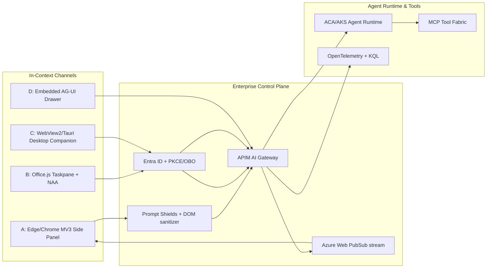
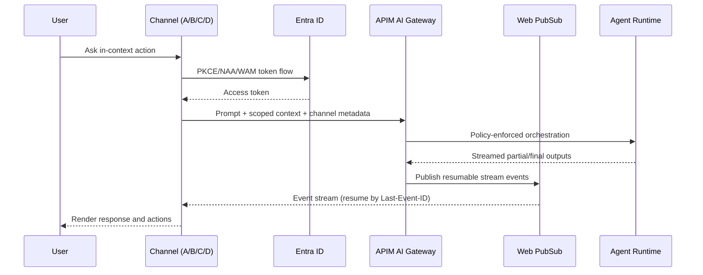
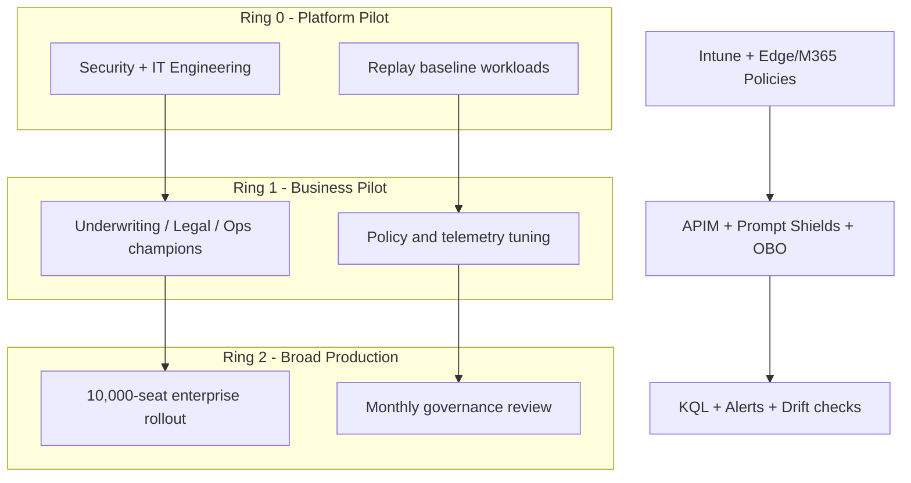

# 企业工作站 In-Context Co-Pilot 渠道选型 FAQ：Edge MV3 侧边栏扩展 vs Office.js NAA 加载项 vs Desktop WebView2 MCP Companion vs 宿主内嵌 AG-UI

> 🌐 **Language Switch**: **中文（当前）** | [English](./in-context-workstation-copilot-channel-edge-mv3-sidepanel-extension-vs-officejs-naa-addin-vs-desktop-webview2-mcp-selection-faq.en.md)
> **适用对象**：Cloud & AI Solution Architect、企业数字化办公平台团队、M365 平台负责人、终端工程团队、CISO 与合规架构团队。
> **讨论范围**：面向浏览器 SaaS、Word/Excel/Outlook、Win32 厚客户端与自研业务系统的生产级 In-Context Co-Pilot 渠道架构，覆盖身份链路、实时流恢复、提示注入防护、终端发布治理与三年 TCO。

## 1. 为什么独立 AI 门户在企业场景经常丢失超过 75% 活跃使用
企业一线用户通常在第三方 SaaS 页面、Office 文档和厚客户端之间连续处理任务，若每轮都要切到独立门户粘贴上下文，不仅增加认知负担，还会引入剪贴板泄露与上下文丢失风险。
在核保、临床审阅、法务修订、运营指挥等高频岗位中，单轮几十秒的切换损耗会在一天内叠加成显著时间成本，导致用户即使认可模型质量也难以形成稳定习惯。
当助手不在“完成工作的位置”而是在“另一个窗口”时，证据链追溯与操作闭环都变弱，业务团队最终会将其评价为演示价值高而生产价值不足。
因此渠道设计本质是架构问题而非皮肤问题，它直接决定身份边界、上下文质量、安全可控性与可量化 ROI。

## 2. 四类架构路径与交互面所有权
**Architecture A** 通过 Edge for Business 或 Chrome Enterprise 的 MV3 侧边栏扩展注入到第三方 SaaS，不改宿主代码即可交付上下文辅助能力，并由企业策略统一安装和治理。
**Architecture B** 通过 Office.js 统一加载项与 NAA，在 Word、Excel、Outlook 内提供原生任务窗格能力，适合文档与邮件密集型业务流程。
**Architecture C** 通过 WebView2 或 Tauri 的桌面签名伴随应用与本地 MCP 桥接，覆盖浏览器之外的 Win32、终端、SAP GUI 与 Citrix 场景。
**Architecture D** 在自研宿主应用内嵌 AG-UI 抽屉，使用类型化状态桥接替代 DOM 抓取，获得更低维护成本与更高稳定性。

## 3. 端到端参考架构与信任边界

该结构将渠道层与控制层解耦，使团队能够独立演进不同终端入口，而无需反复重建身份、策略、实时流、可观测这类共享底座能力。

## 4. Architecture A 深入：企业托管 MV3 侧边栏扩展
A 路径适合无法改造源码的第三方 SaaS 页面增强场景，能够在 Guidewire、ServiceNow、Workday、Veeva 等系统中提供就地辅助并保持部署速度。
企业治理依赖强制安装与域名策略，运行时安全依赖最小权限脚本注入、上下文范围限制、以及对隐藏 DOM 指令注入的清洗与过滤。
由于 MV3 Service Worker 存在空闲挂起行为，生产可靠性必须通过可恢复流式协议、断线重连与 Last-Event-ID 机制来保障对话连续性。
A 架构通常是“覆盖面最快”的方案，但需要建立选择器漂移监控与批量修复机制以应对宿主页面频繁变化。

## 5. Architecture B 深入：Office.js 统一加载项 + NAA + M365 协同
B 路径对文档和邮件工作负载最友好，因为它使用 Office 对象模型而非视觉抓取，能够在段落、单元格、会话线程级别提供结构化操作。
NAA 与原生代理协同可提升 SSO 连续性，减少重复登录弹窗与令牌抖动，同时通过 OBO 保持下游调用严格继承用户权限边界。
该模式可以稳定支持 Word Track Changes 红线建议、Excel 公式安全改写、Outlook 会话分拣等高价值任务，且天然具备较强审计可解释性。
结合 M365 Integrated Apps 的分环发布能力，B 在大规模席位推广时通常拥有更低安装阻力与更可控发布节奏。

## 6. Architecture C 深入：Desktop Companion 覆盖厚客户端工作台
C 路径用于浏览器与 Office 之外的关键生产面，尤其是 Win32、终端、SAP GUI、VDI 等仍承担核心业务的桌面环境。
通过签名 WebView2/Tauri 容器与本地 named-pipe MCP 桥接，可在不破坏业务系统的前提下实现受控上下文接入与集中策略治理。
安全基线应包含发行签名校验、进程白名单、敏感窗口防截屏策略、与自动更新分环发布控制，避免客户端渠道本身成为攻击入口。
C 的覆盖能力最强但终端工程复杂度较高，适合将“不可替代的厚客户端流程”纳入企业 AI 能力版图时采用。

## 7. Architecture D 深入：宿主内嵌 AG-UI 抽屉
当企业拥有宿主应用工程主导权时，D 路径能以类型化 JSON 状态桥替代脆弱的 DOM 抽取，从根本上降低选择器维护开销与页面升级耦合。
由于上下文字段由宿主显式声明，安全与合规团队可以在字段级制定最小暴露策略，并对敏感字段传输形成可审计规则。
该模式在稳定性和长期 TCO 上通常最优，尤其适合内部核心系统与高可用场景，能够显著降低渠道层故障对业务连续性的冲击。
D 不能覆盖第三方 SaaS 与遗留桌面系统，因此企业常将 D 与 A/B/C 组合构建多入口矩阵。

## 8. 12 维度对比矩阵
| 维度 | A：MV3 侧边栏 | B：Office.js + NAA | C：Desktop Companion | D：内嵌 AG-UI |
|---|---|---|---|---|
| 第三方 SaaS 覆盖能力 | 很高 | 低 | 中等 | 低 |
| Word/Excel/Outlook 原生能力 | 低 | 很高 | 中等 | 低 |
| 厚客户端覆盖能力 | 低 | 低 | 很高 | 中等 |
| 10k 席位部署速度 | 高 | 很高 | 中等 | 中等 |
| 选择器维护负担 | 高 | 低 | 低 | 很低 |
| 身份与令牌一致性 | 高 | 很高 | 高 | 高 |
| 提示注入防护可控性 | 中高 | 高 | 中高 | 很高 |
| 流式恢复复杂度 | 中高 | 中等 | 中等 | 低 |
| 终端安全治理压力 | 中等 | 低 | 很高 | 中等 |
| 审计证据完备性 | 高 | 高 | 高 | 很高 |
| 三年运维成本可预测性 | 中等 | 高 | 中等 | 高 |
| 推荐落位 | 第三方页面增强 | 文档与邮件主场 | 厚客户端主场 | 自研宿主主场 |

## 9. 定量模型：效率收益、MV3 重连、时延预算与推广速度
上下文切换收益可建模为 `ROI_time = Δt_minutes * turns_per_day * users * workdays_per_year`，例如 `Δt=0.9`、`turns=22`、`users=4,200`、`workdays=230` 时，年化节省约 `19,126,800` 分钟。
选择器维护投入可建模为 `FTE_selector = pages * change_rate * fix_hours / monthly_capacity`，用于评估 A 相比 D 在宿主频繁改版时的长期工程成本差异。
MV3 挂起恢复风险可建模为 `LostTurns = turns * p_idle_timeout * p_reconnect_fail`，当 Web PubSub 断点恢复策略成熟后，可把 `p_reconnect_fail` 压到可接受范围。
渠道侧时延预算建议采用 `L_total = L_capture + L_sanitize + L_route + L_model + L_render`，并把捕获与清洗阶段约束在 `<120ms` 内，确保用户感知主要由模型响应决定。

## 10. 参考时序图：跨渠道请求与可恢复流

该时序强调渠道态与运行态分离，确保浏览器挂起、网络抖动或前台切换不会导致整轮对话重做。

## 11. 参考拓扑图：企业分环推广与治理路径

分环推广的价值在于控制爆炸半径并提高组织信任，避免“全量上线后再修复”的高风险路径。

## 12. 生产 JSON 与 TypeScript 片段
```json
{
  "manifest_version": 3,
  "name": "Contoso In-Context Copilot",
  "version": "1.0.0",
  "permissions": ["storage", "sidePanel", "scripting", "activeTab"],
  "host_permissions": [
    "https://*.guidewire.com/*",
    "https://*.service-now.com/*",
    "https://*.workday.com/*"
  ],
  "background": {
    "service_worker": "background.js",
    "type": "module"
  },
  "side_panel": {
    "default_path": "panel.html"
  },
  "content_scripts": [
    {
      "matches": ["https://*.guidewire.com/*", "https://*.service-now.com/*"],
      "js": ["content.js"],
      "run_at": "document_idle"
    }
  ]
}
```

```typescript
type DomSlice = { selector: string; text: string; ariaHidden?: boolean; opacity?: number };

const INJECTION_PATTERNS = [/ignore previous/i, /system prompt/i, /developer instruction/i];

export function sanitizeDomSlices(slices: DomSlice[]): DomSlice[] {
  return slices
    .filter((s) => !s.ariaHidden && (s.opacity ?? 1) > 0)
    .map((s) => ({ ...s, text: s.text.replace(/\s+/g, " ").trim() }))
    .filter((s) => s.text.length > 0)
    .filter((s) => !INJECTION_PATTERNS.some((p) => p.test(s.text)));
}

export async function acquireOfficeToken(naaApp: any, scope: string): Promise<string> {
  const account = naaApp.getAllAccounts()[0];
  const token = await naaApp.acquireTokenSilent({
    account,
    scopes: [scope],
  });
  return token.accessToken;
}
```
上述代码体现渠道安全基线：宿主范围收敛、上下文清洗前置、令牌获取标准化与最小权限传递。

## 13. 生产 Bicep 与 Intune 策略片段
```bicep
param apimName string = 'apim-workstation-copilot-prod'
param webPubSubName string = 'wps-workstation-copilot-prod'

resource apim 'Microsoft.ApiManagement/service@2023-05-01-preview' existing = {
  name: apimName
}

resource pubsub 'Microsoft.SignalRService/WebPubSub@2023-02-01' = {
  name: webPubSubName
  location: resourceGroup().location
  sku: {
    name: 'Standard_S1'
    capacity: 2
  }
  properties: {
    publicNetworkAccess: 'Enabled'
  }
}

resource api 'Microsoft.ApiManagement/service/apis@2023-05-01-preview' = {
  name: '${apim.name}/workstation-copilot-stream'
  properties: {
    path: 'workstation-copilot'
    displayName: 'Workstation Copilot Stream API'
    protocols: [
      'https'
    ]
  }
}
```

```json
{
  "EdgeExtensionInstallForcelist": [
    "abcdefghijklmnopabcdefghijklmnop;https://edge.microsoft.com/extensionwebstorebase/v1/crx"
  ],
  "ExtensionSettings": {
    "abcdefghijklmnopabcdefghijklmnop": {
      "installation_mode": "force_installed",
      "runtime_allowed_hosts": [
        "https://*.guidewire.com/*",
        "https://*.service-now.com/*",
        "https://*.workday.com/*"
      ],
      "runtime_blocked_hosts": [
        "https://*.personal-mail.com/*",
        "https://*.consumer-storage.com/*"
      ]
    }
  }
}
```
建议将 Bicep 与终端策略同源管理并在同一发布流水线分环推进，确保后端路由与前端权限策略一致生效。

## 14. 企业场景与三年 TCO
### 14.1 场景 A：保险核保工作站的渠道改造
某保险集团模型能力强但使用率低，根因是核保员主要在 Guidewire 与 Excel 中工作，独立门户导致高频复制粘贴与上下文断裂。
团队采用 A+B 组合并强化上下文清洗、OBO 鉴权、实时流恢复后，单案处理时长明显下降，且审计链路从“截图证明”升级为结构化追踪。
两季度后业务从“试点工具”转为“日常必需”，说明渠道贴近工作面的价值通常高于单纯模型参数升级。

### 14.2 场景 B：法务与运营厚客户端混合环境
某强监管企业大量关键流程仍在厚客户端和虚拟桌面内运行，浏览器单渠道方案无法覆盖核心动作，且截屏与剪贴板风险高。
团队采用 B+C 并对自研系统用 D，通过签名校验、本地桥接鉴权与分环更新控制，获得跨表面连续体验且满足终端安全要求。
尽管 C 的终端工程投入更高，但其带来的覆盖收益与合规可解释性使整体方案在业务上可持续。

### 14.3 三年 TCO（`5k / 10k / 25k` 席位混合组合）
| 三年成本项 | A | B | C | D |
|---|---:|---:|---:|---:|
| 渠道工程与发布运维 | `$1.02M` | `$0.84M` | `$1.31M` | `$0.73M` |
| 身份与网关集成 | `$0.48M` | `$0.41M` | `$0.52M` | `$0.39M` |
| 终端与策略治理 | `$0.36M` | `$0.28M` | `$0.71M` | `$0.31M` |
| 事故处置与修复 | `$0.57M` | `$0.35M` | `$0.64M` | `$0.29M` |
| 合规与可观测体系 | `$0.42M` | `$0.39M` | `$0.46M` | `$0.34M` |
| 三年总成本 | `$2.85M` | `$2.27M` | `$3.64M` | `$2.06M` |
若只看成本，D 或 B 可能更优；但渠道选型必须服从真实工作面覆盖，否则“低成本但不可用”会导致 ROI 为负。

## 15. 六个定量问答与 Day-0/Day-2 清单
### 15.1 定量问答（6）
**Q1：如何量化上下文切换节省价值？** 使用 `ROI_time = Δt * turns_per_day * users * workdays`；当 `Δt=0.9 min`、`turns=22`、`users=4,200`、`workdays=230` 时，年化节省约 `19,126,800` 分钟。

**Q2：如何估算 MV3 挂起导致的丢轮风险？** 使用 `LostTurns = turns * p_idle_timeout * p_reconnect_fail`；当 `turns=30`、`p_idle_timeout=0.22`、`p_reconnect_fail=0.04` 时，期望丢轮约 `0.264`，可通过断点恢复进一步压低。

**Q3：如何控制渠道侧 `<120ms` 时延预算？** 使用 `L_total = L_capture + L_sanitize + L_route`；若 `38ms + 27ms + 41ms = 106ms`，仍有 `14ms` 缓冲可用于异常波动吸收。

**Q4：如何估算 10,000 席位推广时长？** 使用 `Days = seats / (rings_per_day * seats_per_ring)`；当 `rings_per_day=2`、`seats_per_ring=800` 时，理论约 `6.25` 天，不含审批缓冲与回归窗口。

**Q5：如何衡量 A 渠道选择器维护压力？** 使用 `FTE_selector = pages * change_rate * fix_hours / monthly_capacity`；若 `pages=140`、`change_rate=0.18`、`fix_hours=1.6`、`capacity=128`，约需 `0.32 FTE`。

**Q6：如何判断渠道工程投入是否值得？** 使用 `NetValue = productivity_value - incremental_channel_cost`；若年化生产力收益 `$2.4M`、新增渠道成本 `$0.9M`，净值 `$1.5M` 表明投入合理。

### 15.2 Day-0 上线清单
1. 完成 A/B/C/D 渠道所有权映射并明确每个渠道的产品与运维负责人。
2. 打通 PKCE/NAA/WAM 身份链路并在 APIM 上验证 OBO scope 边界。
3. 在发送前启用上下文最小化与提示注入清洗策略。
4. 配置 Intune、Edge 管理、M365 集成应用的分环发布与回滚机制。
5. 建立重连率、时延预算、阻断率、活跃度等统一基线指标。

### 15.3 Day-2 运维清单
1. 周度执行浏览器渠道选择器健康巡检与宿主页漂移回归。
2. 跟踪 Word/Excel/Outlook 操作成功率与 NAA 鉴权失败码。
3. 校验 Desktop Companion 签名合规与更新环策略执行率。
4. 复盘 APIM 与 Web PubSub 的重连质量并调优恢复窗口。
5. 月度评审上下文范围、令牌风险、渠道 ROI 与策略例外。

### 15.4 Good fit vs Not for
该架构族适合跨多工作面且对安全边界和审计证据有要求的企业，因为它把“助手可用性”与“治理可控性”同时纳入同一交付体系。
对于终端治理能力不足且渠道所有权不清晰的组织，不建议一次性全渠道推进，应先按业务价值分层试点再扩展。

### 15.5 审计字段映射（示例）
| 字段 | 来源层 | 治理目的 | 最低保留期 |
|---|---|---|---|
| `channel_type` | Client | 渠道级治理与分析 | 3 年 |
| `host_surface` | Client | 上下文来源追踪 | 3 年 |
| `user_object_id` | Entra | 主体归因 | 5 年 |
| `obo_scope` | APIM | 最小权限验证 | 5 年 |
| `sanitizer_drop_count` | Client/Gateway | 注入防护效果评估 | 3 年 |
| `dom_token_count_before` | Client | 上下文规模基线 | 2 年 |
| `dom_token_count_after` | Client | 清洗减载效果 | 2 年 |
| `stream_resume_count` | Web PubSub | 连接恢复质量 | 2 年 |
| `stream_resume_success` | Web PubSub | 连续会话证据 | 2 年 |
| `latency_capture_ms` | Client | 渠道预算监控 | 2 年 |
| `latency_gateway_ms` | APIM | 控制面性能评估 | 2 年 |
| `latency_model_ms` | Runtime | 模型阶段贡献分析 | 2 年 |
| `policy_block_reason` | APIM | 拒绝原因可解释性 | 5 年 |
| `extension_version` | Device Mgmt | 扩展分环一致性 | 3 年 |
| `addin_manifest_version` | M365 Admin | 加载项发布证据 | 3 年 |
| `desktop_companion_version` | Intune | 终端版本合规 | 3 年 |
| `incident_case_id` | SOC | 事件与响应关联 | 7 年 |
| `data_classification` | Purview | 敏感级别策略联动 | 7 年 |
| `business_unit` | CMDB | 成本与责任归属 | 5 年 |
| `acceptance_outcome` | Product Analytics | 采纳与价值验证 | 3 年 |

### 15.6 运行时告警字典（示例）
| 告警键 | 触发条件 | 立即动作 | 责任团队 |
|---|---|---|---|
| `mv3_reconnect_spike` | 重连失败率超阈值 | 检查 Web PubSub 恢复链路与 worker 生命周期 | 渠道平台 |
| `dom_injection_pattern_detected` | 隐藏注入模式命中激增 | 提升清洗规则并审查来源页面 | 应用安全 |
| `office_naa_token_fail` | NAA 静默令牌获取失败升高 | 核验 Broker 与应用注册配置 | 身份平台 |
| `desktop_signature_mismatch` | 客户端签名校验失败 | 阻断启动并隔离来源 | 终端安全 |
| `apim_obo_scope_violation` | OBO scope 不匹配 | 拒绝请求并触发整改 | API 安全 |
| `latency_budget_breach` | 渠道侧时延超 `120ms` | 分段定位采集、清洗、路由耗时 | 性能工程 |
| `selector_breakage_rate_high` | 选择器失败率快速升高 | 暂停扩环并回滚有问题版本 | 渠道工程 |
| `stream_resume_degradation` | 恢复成功率低于 SLO | 调整恢复窗口与连接策略 | 实时平台 |
| `clipboard_leakage_risk` | 受控页面出现非托管复制行为 | 强化策略并通知安全运营 | 办公网安全 |
| `host_app_schema_drift` | AG-UI 状态契约不兼容 | 阻断动作并触发契约升级流程 | 应用平台 |
| `ring_rollout_anomaly` | 席位扩环偏离计划 | 暂停推进并对齐设备分组 | IT 运维 |
| `policy_exception_overdue` | 临时例外到期未关闭 | 自动撤销并升级责任人 | 治理团队 |
| `prompt_shield_block_spike` | Shield 阻断量异常上升 | 排查攻击活动与宿主改版影响 | SOC |
| `desktop_pipe_auth_fail` | 本地 MCP 桥鉴权连续失败 | 禁用本地桥并隔离终端 | 终端平台 |
| `adoption_drop_sudden` | 周活跃度突降 | 关联故障与版本变更快速定位 | 产品负责人 |

### 15.7 渠道组合落地补充（分层推进）
在真实企业里，A/B/C/D 四条路线通常不是互斥关系，而是按业务表面与终端可控性形成“主干 + 补盲”组合：先用 B 覆盖 Office 高价值场景，再用 A 打开第三方 SaaS，最后用 C 承接厚客户端与 VDI 长尾，D 则在自研核心系统中作为长期低维护主阵地。
为了避免一次性大爆炸上线，建议采用分环增量策略并给每一环设置进入阈值，例如 `Gate_n = (adoption_rate >= 0.35) ∧ (p95_latency <= 120ms) ∧ (security_incident_rate <= 0.002)`，只有同时满足三项门槛才推进到下一环。
当组织需要在季度内快速证明价值时，可先在两个业务条线执行“价值先行试点”，用 `ValueScore = 0.5 * TimeSaved + 0.3 * ErrorReduction + 0.2 * ComplianceGain` 统一排序，从而把资源集中到可快速放大的场景。
若出现渠道间冲突（例如浏览器扩展与桌面伴随应用重复注入），应优先遵循“同一任务只保留一个主动上下文源”的原则，并在网关层通过 `channel_priority` 与 `context_origin` 进行仲裁，确保审计与用户体验保持一致。
此外建议为每个渠道定义独立的“故障降级跑道”，例如 A 渠道失效时允许用户在同一会话中无缝切换到 B 或 D，并要求网关将切换前后的上下文快照绑定到同一 `trace_id`，这样既能减少业务中断，也能保留完整取证链路。对于高监管行业，可再叠加 `ManualApprovalRequired = risk_level >= high ∨ data_classification in {Confidential, Restricted}` 的人工确认门控，确保跨渠道回退不会绕过审批与合规策略。
