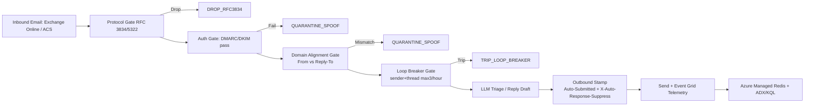
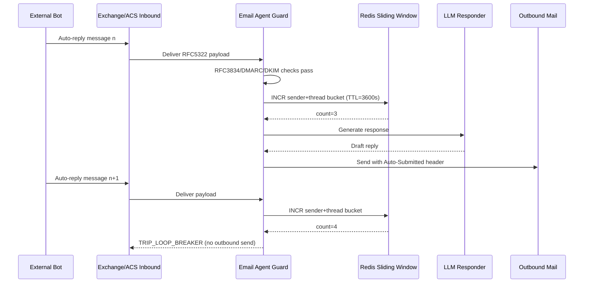

# Enterprise inbound email agent autoresponder loop-storm and spoofed-sender defense selection FAQ: Pattern A (`RFC 3834/5322` pre-LLM protocol gate + strict `DMARC/DKIM` + Redis loop breaker) vs Pattern B (portal redirect) vs Pattern C (Exchange rules + human send approval) vs Pattern D (direct webhook-to-LLM anti-pattern)

## 1. Executive Summary

For cross-organization support mailboxes, claims intake mailboxes, and logistics desks, the recommended default is **Pattern A**: enforce `RFC 3834` autoresponder suppression, `RFC 5322` header sanity checks, strict `Authentication-Results` validation (`dmarc=pass` and `dkim=pass`), organizational-domain alignment between `From` and `Reply-To`, and an atomic sender-plus-thread sliding-window breaker (`max=3/hour`) **before any LLM call**.  
This design turns loop storms and sender spoofing from model-time surprises into protocol-layer hard stops, reducing outbound blast radius, preserving domain reputation, and keeping triage costs predictable.

Pattern A usually delivers the best balance of reliability, compliance evidence, and three-year TCO. Pattern B and Pattern C are conditional alternatives; Pattern D should be explicitly prohibited in production gates.

## 2. Context and common trigger conditions

Enterprise email agents frequently interact with ServiceNow/Jira/Zendesk bots, customer OOO responders, secure email gateways, and archival systems that rewrite `Message-ID`, `In-Reply-To`, `References`, and `Reply-To`.  
Without protocol-level filtering and identity verification, the pipeline quickly degrades into `A -> B -> A -> B` ping-pong traffic, causing runaway token burn and Exchange/ACS outbound throttling.

## 3. Three critical production failure modes

1. **Cross-tenant autoresponder ping-pong storm**: external ticketing bots and the internal AI agent reply to each other thousands of times in minutes.  
2. **Spoofed sender and cross-domain `Reply-To` diversion**: `dmarc=fail` or malicious reply redirection leads to order/invoice/claims data leakage.  
3. **Replying to DSN/list traffic**: auto-replies sent to `Return-Path: <>`, `multipart/report`, `List-Id`, or `Precedence: bulk|list` traffic hurt deliverability and sender reputation.

## 4. Four-pattern comparison matrix (12 dimensions)

| Dimension | Pattern A: protocol gate + auth + Redis breaker (recommended) | Pattern B: one-shot acknowledgment + authenticated portal | Pattern C: Exchange rules + draft-only queue | Pattern D: direct webhook-to-LLM auto-reply (prohibit) |
|---|---|---|---|---|
| Loop suppression | Strong, pre-LLM hard block | Strong, almost zero SMTP conversation | Medium, rule completeness dependent | Weak |
| Spoof resistance | Strong, auth + alignment | Strong | Medium | Weak |
| RFC compatibility | High | High | Medium | Low |
| Throughput | High | High | Low to medium | Unstable |
| Human dependence | Low | Low to medium | High | Low |
| Auditability | High | High | Medium | Low |
| Implementation complexity | Medium | Medium | Medium | Low (but unsafe) |
| Operations complexity | Medium | Medium | Medium to high | High (incident-driven) |
| Cost predictability | High | High | Medium | Low |
| Compliance fit | High | High | Medium | Low |
| Outbound reputation safety | High | High | Medium | Low |
| 3-year TCO | Best | Second-best | Mid | Worst (risk-dominated) |

## 5. Recommended architecture details (Pattern A)

The objective is not "smarter replies"; the objective is "safer allow/deny decisions."  
A robust flow uses five gates: protocol suppression (`RFC 3834`/`RFC 5322`), identity validation (`DMARC/DKIM`), organizational alignment (`From` vs `Reply-To`), loop breaker (`sender + thread_root`), and only then semantic triage and drafting.  
Every deny path should emit normalized outcomes such as `DROP_RFC3834`, `QUARANTINE_SPOOF`, and `TRIP_LOOP_BREAKER` so KQL and incident response can reason over deterministic categories.

## 6. Mermaid: inbound defense-in-depth pipeline



## 7. Mermaid: ping-pong breaker sequence



## 8. Q1–Q6 quantitative formulas with examples

| ID | Formula | Example inputs | Result and interpretation |
|---|---|---|---|
| Q1 Loop amplification | `N_k = N_0 * r^k` | `N_0=1, r=2, k=12` | `4096` emails, demonstrating exponential growth. |
| Q2 Token-loss cost | `Cost = N * (T_in + T_out) * P_tok` | `N=4096, T_in=900, T_out=450, P_tok=$0.000002` | About `$11.06` per event, excluding incident overhead. |
| Q3 Breaker threshold | `limit >= ceil(B_h / C_avg)` | `B_h=1200 replies/hour, C_avg=320 sessions/hour` | `limit>=4`; choose `3` for safer containment. |
| Q4 Thread-key collision bound | `P_collision <= 1 / 2^b` | `b=64 SimHash` | Very low collision probability, still pair with message-ID semantics. |
| Q5 Alignment risk score | `Risk = P_fail * Impact` | `P_fail=0.07, Impact=high` | Domain mismatch can be intolerable in regulated workloads. |
| Q6 Risk-adjusted TCO | `TCO = Infra + Ops + Incident + Reputation` | Include delisting and legal remediation | Pattern D is cheapest to start but most expensive to own. |

## 9. Executable stdlib Python: InboundEmailLoopAndAuthGuard

```python
from __future__ import annotations

from dataclasses import dataclass
from email import policy
from email.parser import BytesParser
from email.utils import parseaddr
from typing import Dict, List, Tuple
import re
import time


Decision = str


@dataclass
class EvalResult:
    decision: Decision
    reason: str
    thread_key: str
    sender: str


class InboundEmailLoopAndAuthGuard:
    def __init__(self, max_replies_per_hour: int = 3) -> None:
        self.max_replies_per_hour = max_replies_per_hour

    @staticmethod
    def _org_domain(addr: str) -> str:
        host = addr.split("@")[-1].lower().strip()
        parts = [p for p in host.split(".") if p]
        two_level_suffixes = {"co.uk", "org.uk", "com.au", "co.jp", "com.cn", "com.hk", "com.sg"}
        if len(parts) >= 3 and ".".join(parts[-2:]) in two_level_suffixes:
            return ".".join(parts[-3:])
        if len(parts) >= 2:
            return ".".join(parts[-2:])
        return host

    @staticmethod
    def _extract_auth_results(auth_header: str) -> Tuple[str, str]:
        h = auth_header.lower()
        dmarc = "pass" if re.search(r"\bdmarc=pass\b", h) else "fail"
        dkim = "pass" if re.search(r"\bdkim=pass\b", h) else "fail"
        return dmarc, dkim

    @staticmethod
    def _normalize_subject(subject: str) -> str:
        s = subject or ""
        while True:
            new_s = re.sub(r"^(?:re|fw|fwd)\s*:\s*", "", s, flags=re.IGNORECASE)
            if new_s == s:
                break
            s = new_s
        s = re.sub(r"\s+", " ", s).strip().lower()
        return s

    @staticmethod
    def _thread_key(message_id: str, references: str, in_reply_to: str, subject: str) -> str:
        refs = references or ""
        ids = re.findall(r"<[^>]+>", refs)
        if ids:
            return ids[0].lower()
        if in_reply_to and "<" in in_reply_to and ">" in in_reply_to:
            return in_reply_to.strip().lower()
        if message_id and "<" in message_id and ">" in message_id:
            return message_id.strip().lower()
        return f"subject:{InboundEmailLoopAndAuthGuard._normalize_subject(subject)}"

    @staticmethod
    def stamp_outbound_rfc3834_headers(msg) -> None:
        msg["Auto-Submitted"] = "auto-replied"
        msg["X-Auto-Response-Suppress"] = "All"

    @staticmethod
    def _prune(events: List[float], now_ts: float) -> List[float]:
        cutoff = now_ts - 3600.0
        return [t for t in events if t >= cutoff]

    def evaluate(
        self,
        raw_message: bytes,
        state: Dict[str, List[float]],
        now_ts: float | None = None,
    ) -> EvalResult:
        now = float(now_ts if now_ts is not None else time.time())
        msg = BytesParser(policy=policy.default).parsebytes(raw_message)

        return_path = (msg.get("Return-Path") or "").strip()
        auto_submitted = (msg.get("Auto-Submitted") or "").lower()
        x_suppress = (msg.get("X-Auto-Response-Suppress") or "").lower()
        precedence = (msg.get("Precedence") or "").lower()
        list_id = (msg.get("List-Id") or "").strip()
        content_type = (msg.get_content_type() or "").lower()

        from_addr = parseaddr(msg.get("From", ""))[1].lower()
        reply_to_addr = parseaddr(msg.get("Reply-To", ""))[1].lower() or from_addr
        auth = msg.get("Authentication-Results", "")
        dmarc, dkim = self._extract_auth_results(auth)

        thread_key = self._thread_key(
            msg.get("Message-ID", ""),
            msg.get("References", ""),
            msg.get("In-Reply-To", ""),
            msg.get("Subject", ""),
        )

        if return_path == "<>" or "multipart/report" in content_type:
            return EvalResult("DROP_RFC3834", "dsn_or_report", thread_key, from_addr)
        if auto_submitted and auto_submitted != "no":
            return EvalResult("DROP_RFC3834", "auto_submitted", thread_key, from_addr)
        if any(token in x_suppress for token in {"all", "autoreply", "oof"}):
            return EvalResult("DROP_RFC3834", "x_auto_response_suppress", thread_key, from_addr)
        if list_id or precedence in {"bulk", "list", "junk"}:
            return EvalResult("DROP_RFC3834", "list_or_bulk", thread_key, from_addr)

        if dmarc != "pass" or dkim != "pass":
            return EvalResult("QUARANTINE_SPOOF", "auth_failed", thread_key, from_addr)

        if self._org_domain(from_addr) != self._org_domain(reply_to_addr):
            return EvalResult("QUARANTINE_SPOOF", "reply_to_mismatch", thread_key, from_addr)

        bucket_key = f"{from_addr}|{thread_key}"
        old_events = state.get(bucket_key, [])
        events = self._prune(old_events, now)
        if len(events) >= self.max_replies_per_hour:
            state[bucket_key] = events
            return EvalResult("TRIP_LOOP_BREAKER", "rate_limit", thread_key, from_addr)

        events.append(now)
        state[bucket_key] = events
        return EvalResult("ALLOW", "ok", thread_key, from_addr)


def _raw(headers: Dict[str, str], body: str = "Hello") -> bytes:
    lines = [f"{k}: {v}" for k, v in headers.items()]
    lines.append("")
    lines.append(body)
    return "\r\n".join(lines).encode("utf-8")


if __name__ == "__main__":
    guard = InboundEmailLoopAndAuthGuard(max_replies_per_hour=3)
    state: Dict[str, List[float]] = {}
    t0 = 1735689600.0
    assert InboundEmailLoopAndAuthGuard._normalize_subject("RE: FW:   Ticket  42") == "ticket 42"

    allow_msg = _raw(
        {
            "From": "Vendor Bot <bot@partner.example>",
            "Reply-To": "bot@partner.example",
            "Return-Path": "<bot@partner.example>",
            "Subject": "RE: Shipment #A1001",
            "Message-ID": "<m1@partner.example>",
            "In-Reply-To": "<root@corp.example>",
            "References": "<root@corp.example> <m0@partner.example>",
            "Authentication-Results": "mx.corp; dmarc=pass header.from=partner.example; dkim=pass",
            "Content-Type": "text/plain; charset=utf-8",
        }
    )
    assert guard.evaluate(allow_msg, state, t0).decision == "ALLOW"

    drop_msg = _raw(
        {
            "From": "Mailer Daemon <postmaster@mx.example>",
            "Return-Path": "<>",
            "Subject": "Delivery Status Notification",
            "Content-Type": "multipart/report; report-type=delivery-status",
            "Authentication-Results": "mx.corp; dmarc=pass; dkim=pass",
        }
    )
    assert guard.evaluate(drop_msg, state, t0 + 1).decision == "DROP_RFC3834"

    spoof_msg = _raw(
        {
            "From": "Claims Desk <claims@insurer.example>",
            "Reply-To": "collector@evil.tld",
            "Return-Path": "<claims@insurer.example>",
            "Subject": "Claim update",
            "Authentication-Results": "mx.corp; dmarc=fail header.from=insurer.example; dkim=pass",
            "Content-Type": "text/plain; charset=utf-8",
        }
    )
    assert guard.evaluate(spoof_msg, state, t0 + 2).decision == "QUARANTINE_SPOOF"

    def mk_loop(turn: int, refs: str) -> bytes:
        return _raw(
            {
                "From": "Loop Bot <loop@vendor.example>",
                "Reply-To": "loop@vendor.example",
                "Return-Path": "<loop@vendor.example>",
                "Subject": "RE: Ticket 42",
                "Message-ID": f"<m{turn}@vendor.example>",
                "In-Reply-To": f"<m{turn - 1}@vendor.example>",
                "References": refs,
                "Authentication-Results": "mx.corp; dmarc=pass; dkim=pass",
                "Content-Type": "text/plain; charset=utf-8",
            }
        )

    refs1 = "<root-loop@corp.example> <m1@vendor.example>"
    refs2 = "<root-loop@corp.example> <m1@vendor.example> <m2@vendor.example>"
    refs3 = "<root-loop@corp.example> <m1@vendor.example> <m2@vendor.example> <m3@vendor.example>"
    refs4 = "<root-loop@corp.example> <m1@vendor.example> <m2@vendor.example> <m3@vendor.example> <m4@vendor.example>"
    assert guard.evaluate(mk_loop(2, refs1), state, t0 + 10).decision == "ALLOW"
    assert guard.evaluate(mk_loop(3, refs2), state, t0 + 20).decision == "ALLOW"
    assert guard.evaluate(mk_loop(4, refs3), state, t0 + 30).decision == "ALLOW"
    assert guard.evaluate(mk_loop(5, refs4), state, t0 + 40).decision == "TRIP_LOOP_BREAKER"

    from email.message import EmailMessage
    outbound = EmailMessage()
    InboundEmailLoopAndAuthGuard.stamp_outbound_rfc3834_headers(outbound)
    assert outbound["Auto-Submitted"] == "auto-replied"
    assert outbound["X-Auto-Response-Suppress"] == "All"
```

## 10. JSON policy and Event Grid schema

```json
{
  "policy_version": "2026-11-27",
  "protocol_filter": {
    "drop_return_path_null": true,
    "drop_multipart_report": true,
    "drop_if_auto_submitted_not_no": true,
    "drop_if_list_id_present": true,
    "drop_precedence_values": ["bulk", "list", "junk"]
  },
  "auth_filter": {
    "require_dmarc": "pass",
    "require_dkim": "pass",
    "enforce_reply_to_alignment": true
  },
  "loop_breaker": {
    "key": "sender|thread_root",
    "window_seconds": 3600,
    "max_replies": 3,
    "store": "azure-managed-redis"
  },
  "outbound_headers": {
    "Auto-Submitted": "auto-replied",
    "X-Auto-Response-Suppress": "All"
  },
  "event_grid_schema": {
    "id": "evt-001",
    "eventType": "mail.guard.evaluation",
    "subject": "mailbox/support@contoso.com",
    "eventTime": "2026-11-27T03:12:00Z",
    "data": {
      "decision": "TRIP_LOOP_BREAKER",
      "reason": "rate_limit",
      "sender": "loop@vendor.example",
      "thread_key": "<root-loop@corp.example>",
      "tenant": "contoso-prod"
    },
    "dataVersion": "1.0"
  }
}
```

## 11. KQL monitoring query (`extract` lowercase and coalesced outer joins)

```kql
let win = 5m;
let base =
    EmailGuardLogs
    | where TimeGenerated > ago(24h)
    | extend decision = tostring(CustomDimensions.decision)
    | extend sender = tostring(CustomDimensions.sender)
    | extend thread_key = tostring(coalesce(CustomDimensions.thread_key, extract(@"thread_key=([^;\s]+)", 1, Message)))
    | extend tenant = tostring(CustomDimensions.tenant);
let dropped =
    base
    | where decision == "DROP_RFC3834"
    | summarize drop_count = count() by bin(TimeGenerated, win), tenant;
let spoofed =
    base
    | where decision == "QUARANTINE_SPOOF"
    | summarize spoof_count = count() by bin(TimeGenerated, win), tenant;
let tripped =
    base
    | where decision == "TRIP_LOOP_BREAKER"
    | summarize trip_count = count(), uniq_threads = dcount(thread_key), uniq_senders = dcount(sender) by bin(TimeGenerated, win), tenant;
dropped
| join kind=fullouter spoofed on TimeGenerated, tenant
| extend TimeGenerated = coalesce(TimeGenerated, TimeGenerated1), tenant = coalesce(tenant, tenant1)
| project-away TimeGenerated1, tenant1
| join kind=fullouter tripped on TimeGenerated, tenant
| extend TimeGenerated = coalesce(TimeGenerated, TimeGenerated1), tenant = coalesce(tenant, tenant1)
| project-away TimeGenerated1, tenant1
| project TimeGenerated, tenant,
          drop_count=coalesce(drop_count, 0),
          spoof_count=coalesce(spoof_count, 0),
          trip_count=coalesce(trip_count, 0),
          uniq_threads=coalesce(uniq_threads, 0),
          uniq_senders=coalesce(uniq_senders, 0)
| order by TimeGenerated desc
```

## 12. Extended field Q&A (Q7–Q12)

| ID | Question | Key answer |
|---|---|---|
| Q7 | Ticketing bots rewrite message IDs. How do we keep thread continuity? | Prefer the first `References` ID (thread root), then `In-Reply-To`, then normalized subject fallback with explicit audit links. |
| Q8 | Forwarding can fail SPF while mail is legitimate. What then? | Do not rely on SPF alone; enforce `DMARC/DKIM` and alignment, and quarantine ARC edge cases for review. |
| Q9 | Why is `Auto-Submitted: auto-replied` mandatory? | It is a standard machine-readable suppression signal for remote autoresponders. |
| Q10 | Should `Reply-All` be enabled by default? | No; disable by default in unattended paths unless policy and approval gates explicitly allow it. |
| Q11 | How should breaker thresholds be tuned? | Start with `3/hour`, then calibrate by tenant traffic profile, trip-rate, and false-positive review outcomes. |
| Q12 | How do we catch slow-burn loops? | Add 24-hour cumulative caps and decay-based reputation scoring beyond one-hour windows. |

## 13. Selection decision tree (concise)

1. If inbound volume is `> 5,000/day` and multiple external bots are connected, baseline on Pattern A.  
2. If policy requires non-conversational email handling, move to Pattern B while preserving Pattern A identity gates.  
3. If volume is `< 500/day` and staffing is reliable, Pattern C can be a temporary bridge with a defined migration deadline.  
4. Any direct auto-reply path without protocol and auth gates is Pattern D and should fail readiness review.

## 14. Scenario 15.1: global logistics customs/freight desk (`85,000` inbound/day)

This workload mixes freight-provider bots, customer ERP notices, customs acknowledgments, and multilingual handoffs. `Reply-To` rewriting is common and can silently bypass naive allowlists. Pattern A reduces uncontrolled exchanges by forcing deterministic pre-LLM gates and routing suspicious traffic to quarantine queues with complete evidence traces.  
Operationally, most breaker spikes occur during timezone shift overlaps, so staffing and threshold templates should be managed together.

## 15. Scenario 15.2: regulated insurance claims intake mailbox

Claims intake must minimize sensitive-data exposure while preserving explainable triage outcomes. Attackers often combine spoofed sender identities with cross-domain `Reply-To` redirection to harvest policy and payout details. Pattern A blocks these paths before drafting and keeps policy-level evidence for regulatory review.  
When surge volume exceeds staffing capacity, Pattern C draft-only mode can be used as a temporary fallback, but it should be time-boxed and governed by weekly rollback checkpoints.

## 16. 15.3 Three-tier 3-year risk-adjusted TCO (USD, thousands)

| Tier | Scale assumption | Pattern A | Pattern B | Pattern C | Pattern D |
|---|---|---:|---:|---:|---:|
| Tier-1 | `1,000` inbound/day | `1,480` | `1,620` | `1,910` | `2,760*` |
| Tier-2 | `15,000` inbound/day | `4,920` | `5,430` | `6,780` | `10,240*` |
| Tier-3 | `85,000` inbound/day | `11,700` | `12,950` | `15,880` | `24,600*` |

`*` Pattern D appears cheap at implementation time but becomes cost-dominant once incident recovery, deliverability remediation, legal review, and customer communication are included.  
Pattern A typically reaches payback in roughly months `9-14`, primarily through loop suppression and reduced unnecessary LLM calls.

## 17. 15.4 D0 / D1 / D2 runbook (18 items) and anti-abuse mapping

**D0 (same-day containment)**  
1. Disable any outbound path missing `RFC 3834` headers.  
2. Block `Return-Path: <>` and `multipart/report` traffic from auto-reply flow.  
3. Block `List-Id` and `Precedence` list/bulk/junk classes.  
4. Enforce `DMARC/DKIM` dual-pass gate.  
5. Enforce organizational alignment between `From` and `Reply-To`.  
6. Enable `sender+thread` `3/hour` breaker with alerting.  

**D1 (1-2 week hardening)**  
7. Standardize Redis key format and TTL governance.  
8. Freeze Event Grid schema and required audit fields.  
9. Put `DROP_RFC3834`, `QUARANTINE_SPOOF`, and `TRIP_LOOP_BREAKER` into SLOs.  
10. Build false-positive replay and policy-debug tooling.  
11. Add external-domain reputation profiles and tenant templates.  
12. Add outbound header compliance checks.  

**D2 (1-2 month optimization)**  
13. Add slow-loop detection (`24h` cumulative + decay scoring).  
14. Unify anti-abuse posture across email, ticketing, and chat channels.  
15. Run quarterly adversarial drills (spoof, reply hijack, list flood).  
16. Automate audit sampling and remediation tracking.  
17. Add joint legal/support/platform escalation governance.  
18. Publish dual-track executive and engineering operating playbooks.  

**Regulatory and anti-abuse mapping guidance**:  
Map controls to four outcomes: identity authenticity, conversational minimization, data leakage suppression, and traceable accountability.  
For high-regulation workloads, preserve quarantine workflows with explicit human release authority, and validate monthly that `Authentication-Results` telemetry remains consistent with actual DNS/email-auth posture.

## 18. Sources (retrieved on 2026-11-27)

RFC 3834: Recommendations for Automatic Responses to Electronic Mail  
https://www.rfc-editor.org/rfc/rfc3834

RFC 5322: Internet Message Format  
https://www.rfc-editor.org/rfc/rfc5322

RFC 7489: DMARC  
https://www.rfc-editor.org/rfc/rfc7489

RFC 6376: DKIM  
https://www.rfc-editor.org/rfc/rfc6376

RFC 7208: SPF  
https://www.rfc-editor.org/rfc/rfc7208

Microsoft Learn: Exchange Online mail flow rules  
https://learn.microsoft.com/exchange/security-and-compliance/mail-flow-rules/mail-flow-rules

Microsoft Learn: Authentication-Results and anti-spoofing guidance  
https://learn.microsoft.com/defender-office-365/email-authentication-about

Microsoft Learn: Azure Managed Redis  
https://learn.microsoft.com/azure/redis/overview

Microsoft Learn: Event Grid event schema  
https://learn.microsoft.com/azure/event-grid/event-schema
