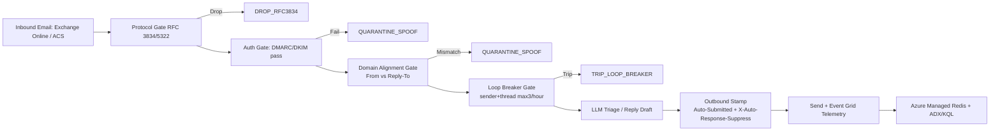
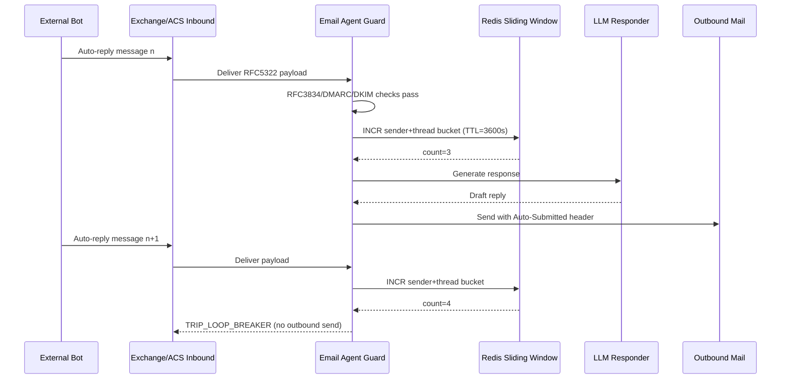

# 企业入站邮件智能体自动回复风暴与伪造发件人防护选型 FAQ：Pattern A（`RFC 3834/5322` 前置协议过滤 + `DMARC/DKIM` 严格校验 + `Redis` 线程熔断）vs Pattern B（门户跳转）vs Pattern C（Exchange 规则 + 人工发送审批）vs Pattern D（直连 LLM 反模式）

## 1. Executive Summary（先给结论）

对于跨组织支持邮箱、理赔邮箱、物流关务邮箱等高风险入站场景，推荐默认采用 **Pattern A**：在任何 LLM 调用前先执行 `RFC 3834` 自动回复抑制、`RFC 5322` 头字段一致性检查、`Authentication-Results` 中 `dmarc=pass` 与 `dkim=pass` 校验、`From/Reply-To` 组织域对齐，以及基于 `sender + thread_root` 的原子滑窗熔断（`max=3/hour`）。  
该方案将“回环风暴”与“伪造发件人数据外泄”从模型后置纠错前移为协议层硬阻断，通常可把外呼风暴规模从指数级放大压平为可观测、可审计、可追责的有限事件。

对多数企业而言，Pattern A 在复杂度、可解释性、跨团队协作成本与三年期总拥有成本之间达到最优平衡。Pattern B 与 Pattern C 只在明确约束条件下成立，Pattern D 应明确定义为禁止项并纳入上线评审清单。

## 2. 问题背景与典型触发条件

企业支持场景中的邮件智能体经常连接 ServiceNow、Jira、Zendesk、供应商自动回执、客户 OOO 机器人、反垃圾网关和归档系统，这些系统会同时改写 `Message-ID`、`In-Reply-To`、`References` 与 `Reply-To`。  
如果智能体没有在协议层识别“自动回复”“退信报告”“列表群发”“认证失败”与“跨域重定向”，就会在几分钟内进入 `A -> B -> A -> B` 的对话风暴，并触发 Exchange Online 或 ACS 的出站限流与信誉惩罚。

## 3. 三类核心生产故障模式

1. **跨租户自动回复乒乓风暴**：外部工单机器人与企业智能体互相回信，数千封往返在分钟级堆积，导致 LLM 预算失控与反滥发封禁。  
2. **伪造发件人与跨域 Reply-To 诱导**：`dmarc=fail` 或 `Reply-To` 指向攻击域，诱导智能体泄露订单、发票、理赔信息。  
3. **误回 DSN/列表群发**：对 `Return-Path: <>` 的 `multipart/report` 退信或 `List-Id`、`Precedence: bulk|list` 继续自动回复，造成外部信誉下降。

## 4. 四种架构模式与 12 维对比矩阵

| 维度 | Pattern A：协议过滤 + 认证 + Redis 熔断（推荐） | Pattern B：单次回执 + 门户深链 | Pattern C：Exchange 规则 + Draft 审批 | Pattern D：Webhook 直连 LLM（禁止） |
|---|---|---|---|---|
| 回环抑制 | 强，前置硬阻断 | 强，几乎零 SMTP 回话 | 中，依赖规则完整性与人工节奏 | 弱，常见放大 |
| 伪造防护 | 强，`DMARC/DKIM + 对齐` | 强，门户鉴权接管 | 中，规则覆盖有限 | 弱 |
| 协议兼容性 | 高，遵循 RFC | 高 | 中 | 低 |
| 吞吐能力 | 高，Redis 原子计数 | 高 | 低到中 | 表面高、实则不稳定 |
| 人工依赖 | 低 | 低到中 | 高 | 低 |
| 审计可追溯 | 高 | 高 | 中 | 低 |
| 实施复杂度 | 中 | 中 | 中 | 低（但风险高） |
| 运维复杂度 | 中 | 中 | 中到高 | 高（事故驱动） |
| 成本可预测性 | 高 | 高 | 中 | 低 |
| 合规适配 | 高 | 高 | 中 | 低 |
| 对外信誉保护 | 高 | 高 | 中 | 低 |
| 三年 TCO | 最优 | 次优 | 中位 | 最差（风险成本主导） |

## 5. 推荐架构（Pattern A）设计要点

Pattern A 的关键不在“更聪明地回复”，而在“更严格地决定是否允许回复”。建议把处理流程拆成五道门：  
第一道是 `RFC 3834` 与 `RFC 5322` 协议门，直接剔除自动邮件、退信报告、列表邮件；第二道是身份认证门，要求 `dmarc=pass` 与 `dkim=pass`；第三道是组织域对齐门，拒绝异常 `Reply-To` 跳转；第四道是滑窗熔断门，限制同发送方同线程单位时间回复次数；第五道才是语义路由与 LLM 生成。  
所有拒绝动作必须结构化记录为 `DROP_RFC3834`、`QUARANTINE_SPOOF`、`TRIP_LOOP_BREAKER`，并写入 KQL 可查询维度。

实施时建议把“五道门”做成可独立回放的策略链路，每一步都输出标准化判定码、输入摘要与版本号，避免后续排障时只能看到最终拒绝结果而看不到拒绝路径；这类可解释证据对于跨团队协作尤其重要，因为安全、客服、法务与平台往往分别关注不同指标，如果缺少统一证据模型，就会在事故复盘时出现口径不一致、归因反复和修复延迟。

## 6. Mermaid：入站邮件纵深防御流水线



## 7. Mermaid：乒乓风暴熔断时序



## 8. Q1–Q6 定量公式（含示例）

| 编号 | 公式 | 示例输入 | 结果与解释 |
|---|---|---|---|
| Q1 风暴放大 | `N_k = N_0 * r^k` | `N_0=1, r=2, k=12` | `4096` 封，说明双向机器人在 12 轮即可指数爆炸。 |
| Q2 预算损耗 | `Cost = N * (T_in + T_out) * P_tok` | `N=4096, T_in=900, T_out=450, P_tok=$0.000002` | 约 `$11.06`/事件，且不含信誉罚损与人工排障。 |
| Q3 熔断阈值 | `limit >= ceil(B_h / C_avg)` | `B_h=1200 replies/hour, C_avg=320 sessions/hour` | `limit>=4`，本方案用 `3` 更保守，降低风暴触发面。 |
| Q4 线程键稳健度 | `P_collision <= 1 / 2^b` | `b=64 SimHash` | 理论碰撞极低，但仍需 `Message-ID` 语义键作为主键。 |
| Q5 域对齐风险 | `Risk = P_fail * Impact` | `P_fail=0.07, Impact=高` | 若不做 Reply-To 对齐，泄露风险不可接受。 |
| Q6 三年期风险 TCO | `TCO = Infra + Ops + Incident + Reputation` | 含封禁恢复、法务审查、客户补偿 | Pattern D 虽实现便宜，但风险项拉高总成本。 |

这些公式建议不要只停留在一次性方案评审，而应转化为持续观测面板中的派生指标，例如把 `N_k` 近似映射为单位时间内同线程方向反转次数，把 `Cost` 映射为熔断前后每千封邮件的 token 消耗差值，再把风险得分与外部域信誉事件关联，从而让业务团队可以直观看到策略升级带来的财务与风险收益，而不是仅从技术角度讨论“规则是否更严格”。

## 9. 可执行 Python：InboundEmailLoopAndAuthGuard（stdlib）

```python
from __future__ import annotations

from dataclasses import dataclass
from email import policy
from email.parser import BytesParser
from email.utils import parseaddr
from typing import Dict, List, Tuple
import re
import time


Decision = str


@dataclass
class EvalResult:
    decision: Decision
    reason: str
    thread_key: str
    sender: str


class InboundEmailLoopAndAuthGuard:
    def __init__(self, max_replies_per_hour: int = 3) -> None:
        self.max_replies_per_hour = max_replies_per_hour

    @staticmethod
    def _org_domain(addr: str) -> str:
        host = addr.split("@")[-1].lower().strip()
        parts = [p for p in host.split(".") if p]
        two_level_suffixes = {"co.uk", "org.uk", "com.au", "co.jp", "com.cn", "com.hk", "com.sg"}
        if len(parts) >= 3 and ".".join(parts[-2:]) in two_level_suffixes:
            return ".".join(parts[-3:])
        if len(parts) >= 2:
            return ".".join(parts[-2:])
        return host

    @staticmethod
    def _extract_auth_results(auth_header: str) -> Tuple[str, str]:
        h = auth_header.lower()
        dmarc = "pass" if re.search(r"\bdmarc=pass\b", h) else "fail"
        dkim = "pass" if re.search(r"\bdkim=pass\b", h) else "fail"
        return dmarc, dkim

    @staticmethod
    def _normalize_subject(subject: str) -> str:
        s = subject or ""
        while True:
            new_s = re.sub(r"^(?:re|fw|fwd)\s*:\s*", "", s, flags=re.IGNORECASE)
            if new_s == s:
                break
            s = new_s
        s = re.sub(r"\s+", " ", s).strip().lower()
        return s

    @staticmethod
    def _thread_key(message_id: str, references: str, in_reply_to: str, subject: str) -> str:
        refs = references or ""
        ids = re.findall(r"<[^>]+>", refs)
        if ids:
            return ids[0].lower()
        if in_reply_to and "<" in in_reply_to and ">" in in_reply_to:
            return in_reply_to.strip().lower()
        if message_id and "<" in message_id and ">" in message_id:
            return message_id.strip().lower()
        return f"subject:{InboundEmailLoopAndAuthGuard._normalize_subject(subject)}"

    @staticmethod
    def stamp_outbound_rfc3834_headers(msg) -> None:
        msg["Auto-Submitted"] = "auto-replied"
        msg["X-Auto-Response-Suppress"] = "All"

    @staticmethod
    def _prune(events: List[float], now_ts: float) -> List[float]:
        cutoff = now_ts - 3600.0
        return [t for t in events if t >= cutoff]

    def evaluate(
        self,
        raw_message: bytes,
        state: Dict[str, List[float]],
        now_ts: float | None = None,
    ) -> EvalResult:
        now = float(now_ts if now_ts is not None else time.time())
        msg = BytesParser(policy=policy.default).parsebytes(raw_message)

        return_path = (msg.get("Return-Path") or "").strip()
        auto_submitted = (msg.get("Auto-Submitted") or "").lower()
        x_suppress = (msg.get("X-Auto-Response-Suppress") or "").lower()
        precedence = (msg.get("Precedence") or "").lower()
        list_id = (msg.get("List-Id") or "").strip()
        content_type = (msg.get_content_type() or "").lower()

        from_addr = parseaddr(msg.get("From", ""))[1].lower()
        reply_to_addr = parseaddr(msg.get("Reply-To", ""))[1].lower() or from_addr
        auth = msg.get("Authentication-Results", "")
        dmarc, dkim = self._extract_auth_results(auth)

        thread_key = self._thread_key(
            msg.get("Message-ID", ""),
            msg.get("References", ""),
            msg.get("In-Reply-To", ""),
            msg.get("Subject", ""),
        )

        if return_path == "<>" or "multipart/report" in content_type:
            return EvalResult("DROP_RFC3834", "dsn_or_report", thread_key, from_addr)
        if auto_submitted and auto_submitted != "no":
            return EvalResult("DROP_RFC3834", "auto_submitted", thread_key, from_addr)
        if any(token in x_suppress for token in {"all", "autoreply", "oof"}):
            return EvalResult("DROP_RFC3834", "x_auto_response_suppress", thread_key, from_addr)
        if list_id or precedence in {"bulk", "list", "junk"}:
            return EvalResult("DROP_RFC3834", "list_or_bulk", thread_key, from_addr)

        if dmarc != "pass" or dkim != "pass":
            return EvalResult("QUARANTINE_SPOOF", "auth_failed", thread_key, from_addr)

        if self._org_domain(from_addr) != self._org_domain(reply_to_addr):
            return EvalResult("QUARANTINE_SPOOF", "reply_to_mismatch", thread_key, from_addr)

        bucket_key = f"{from_addr}|{thread_key}"
        old_events = state.get(bucket_key, [])
        events = self._prune(old_events, now)
        if len(events) >= self.max_replies_per_hour:
            state[bucket_key] = events
            return EvalResult("TRIP_LOOP_BREAKER", "rate_limit", thread_key, from_addr)

        events.append(now)
        state[bucket_key] = events
        return EvalResult("ALLOW", "ok", thread_key, from_addr)


def _raw(headers: Dict[str, str], body: str = "Hello") -> bytes:
    lines = [f"{k}: {v}" for k, v in headers.items()]
    lines.append("")
    lines.append(body)
    return "\r\n".join(lines).encode("utf-8")


if __name__ == "__main__":
    guard = InboundEmailLoopAndAuthGuard(max_replies_per_hour=3)
    state: Dict[str, List[float]] = {}
    t0 = 1735689600.0
    assert InboundEmailLoopAndAuthGuard._normalize_subject("RE: FW:   Ticket  42") == "ticket 42"

    allow_msg = _raw(
        {
            "From": "Vendor Bot <bot@partner.example>",
            "Reply-To": "bot@partner.example",
            "Return-Path": "<bot@partner.example>",
            "Subject": "RE: Shipment #A1001",
            "Message-ID": "<m1@partner.example>",
            "In-Reply-To": "<root@corp.example>",
            "References": "<root@corp.example> <m0@partner.example>",
            "Authentication-Results": "mx.corp; dmarc=pass header.from=partner.example; dkim=pass",
            "Content-Type": "text/plain; charset=utf-8",
        }
    )
    assert guard.evaluate(allow_msg, state, t0).decision == "ALLOW"

    drop_msg = _raw(
        {
            "From": "Mailer Daemon <postmaster@mx.example>",
            "Return-Path": "<>",
            "Subject": "Delivery Status Notification",
            "Content-Type": "multipart/report; report-type=delivery-status",
            "Authentication-Results": "mx.corp; dmarc=pass; dkim=pass",
        }
    )
    assert guard.evaluate(drop_msg, state, t0 + 1).decision == "DROP_RFC3834"

    spoof_msg = _raw(
        {
            "From": "Claims Desk <claims@insurer.example>",
            "Reply-To": "collector@evil.tld",
            "Return-Path": "<claims@insurer.example>",
            "Subject": "Claim update",
            "Authentication-Results": "mx.corp; dmarc=fail header.from=insurer.example; dkim=pass",
            "Content-Type": "text/plain; charset=utf-8",
        }
    )
    assert guard.evaluate(spoof_msg, state, t0 + 2).decision == "QUARANTINE_SPOOF"

    def mk_loop(turn: int, refs: str) -> bytes:
        return _raw(
            {
                "From": "Loop Bot <loop@vendor.example>",
                "Reply-To": "loop@vendor.example",
                "Return-Path": "<loop@vendor.example>",
                "Subject": "RE: Ticket 42",
                "Message-ID": f"<m{turn}@vendor.example>",
                "In-Reply-To": f"<m{turn - 1}@vendor.example>",
                "References": refs,
                "Authentication-Results": "mx.corp; dmarc=pass; dkim=pass",
                "Content-Type": "text/plain; charset=utf-8",
            }
        )

    refs1 = "<root-loop@corp.example> <m1@vendor.example>"
    refs2 = "<root-loop@corp.example> <m1@vendor.example> <m2@vendor.example>"
    refs3 = "<root-loop@corp.example> <m1@vendor.example> <m2@vendor.example> <m3@vendor.example>"
    refs4 = "<root-loop@corp.example> <m1@vendor.example> <m2@vendor.example> <m3@vendor.example> <m4@vendor.example>"
    assert guard.evaluate(mk_loop(2, refs1), state, t0 + 10).decision == "ALLOW"
    assert guard.evaluate(mk_loop(3, refs2), state, t0 + 20).decision == "ALLOW"
    assert guard.evaluate(mk_loop(4, refs3), state, t0 + 30).decision == "ALLOW"
    assert guard.evaluate(mk_loop(5, refs4), state, t0 + 40).decision == "TRIP_LOOP_BREAKER"

    from email.message import EmailMessage
    outbound = EmailMessage()
    InboundEmailLoopAndAuthGuard.stamp_outbound_rfc3834_headers(outbound)
    assert outbound["Auto-Submitted"] == "auto-replied"
    assert outbound["X-Auto-Response-Suppress"] == "All"
```

## 10. JSON：策略配置与 Event Grid 事件结构

```json
{
  "policy_version": "2026-11-27",
  "protocol_filter": {
    "drop_return_path_null": true,
    "drop_multipart_report": true,
    "drop_if_auto_submitted_not_no": true,
    "drop_if_list_id_present": true,
    "drop_precedence_values": ["bulk", "list", "junk"]
  },
  "auth_filter": {
    "require_dmarc": "pass",
    "require_dkim": "pass",
    "enforce_reply_to_alignment": true
  },
  "loop_breaker": {
    "key": "sender|thread_root",
    "window_seconds": 3600,
    "max_replies": 3,
    "store": "azure-managed-redis"
  },
  "outbound_headers": {
    "Auto-Submitted": "auto-replied",
    "X-Auto-Response-Suppress": "All"
  },
  "event_grid_schema": {
    "id": "evt-001",
    "eventType": "mail.guard.evaluation",
    "subject": "mailbox/support@contoso.com",
    "eventTime": "2026-11-27T03:12:00Z",
    "data": {
      "decision": "TRIP_LOOP_BREAKER",
      "reason": "rate_limit",
      "sender": "loop@vendor.example",
      "thread_key": "<root-loop@corp.example>",
      "tenant": "contoso-prod"
    },
    "dataVersion": "1.0"
  }
}
```

## 11. KQL：风暴与伪造事件监控（含 `extract` 与外连接合并）

```kql
let win = 5m;
let base =
    EmailGuardLogs
    | where TimeGenerated > ago(24h)
    | extend decision = tostring(CustomDimensions.decision)
    | extend sender = tostring(CustomDimensions.sender)
    | extend thread_key = tostring(coalesce(CustomDimensions.thread_key, extract(@"thread_key=([^;\s]+)", 1, Message)))
    | extend tenant = tostring(CustomDimensions.tenant);
let dropped =
    base
    | where decision == "DROP_RFC3834"
    | summarize drop_count = count() by bin(TimeGenerated, win), tenant;
let spoofed =
    base
    | where decision == "QUARANTINE_SPOOF"
    | summarize spoof_count = count() by bin(TimeGenerated, win), tenant;
let tripped =
    base
    | where decision == "TRIP_LOOP_BREAKER"
    | summarize trip_count = count(), uniq_threads = dcount(thread_key), uniq_senders = dcount(sender) by bin(TimeGenerated, win), tenant;
dropped
| join kind=fullouter spoofed on TimeGenerated, tenant
| extend TimeGenerated = coalesce(TimeGenerated, TimeGenerated1), tenant = coalesce(tenant, tenant1)
| project-away TimeGenerated1, tenant1
| join kind=fullouter tripped on TimeGenerated, tenant
| extend TimeGenerated = coalesce(TimeGenerated, TimeGenerated1), tenant = coalesce(tenant, tenant1)
| project-away TimeGenerated1, tenant1
| project TimeGenerated, tenant,
          drop_count=coalesce(drop_count, 0),
          spoof_count=coalesce(spoof_count, 0),
          trip_count=coalesce(trip_count, 0),
          uniq_threads=coalesce(uniq_threads, 0),
          uniq_senders=coalesce(uniq_senders, 0)
| order by TimeGenerated desc
```

## 12. 扩展问答 Q7–Q12（现场高频问题）

| 编号 | 问题 | 答案要点 |
|---|---|---|
| Q7 | 外部工单系统会重写 `Message-ID`，线程如何稳定归并？ | 优先 `References` 第一个 ID（线程根），其次 `In-Reply-To`，再退化到规范化 `Subject`；同时记录原始头做审计。 |
| Q8 | 转发链路触发 SPF 失败但业务真实存在怎么办？ | 不仅看 SPF，核心用 `DMARC/DKIM` 与域对齐；对 ARC 场景可进入隔离队列而非直接放行。 |
| Q9 | 为什么必须写 `Auto-Submitted: auto-replied`？ | 这是跨系统识别自动回复的核心信号，不打标会提高对端机器人继续回复概率。 |
| Q10 | `Reply-All` 是否应默认禁用？ | 在自动回复路径默认禁用，除非策略显式允许且通过人工审批。 |
| Q11 | 熔断阈值如何按业务调参？ | 先按 `3/hour` 启动，按租户流量分布观察 `trip_rate` 与漏报率，再做分层阈值。 |
| Q12 | 如何防止“低频慢速风暴”绕过窗口？ | 增加 `24h` 累积上限与跨窗口衰减评分，并结合声誉分策略。 |

为了避免问答条目与实际工程脱节，建议把每个问答都落地为可执行验收项：例如 Q8 对应“转发链路样本回放成功率”，Q11 对应“阈值变更后误杀率与漏报率双指标”，Q12 对应“慢速风暴演练脚本与告警命中率”，并把这些验收项纳入季度质量门禁。这样文档不仅是知识说明，更是可重复执行的治理操作手册。

## 13. 选型决策树（简版）

1. 若日入站量 `> 5,000` 且存在多外部工单系统，则直接进入 Pattern A 基线。  
2. 若组织禁止邮件往返会话、倾向门户化互动，可转 Pattern B 并保留 Pattern A 的认证门。  
3. 若总量 `< 500/day` 且人工值守稳定，可采用 Pattern C 作为过渡，但需明确演进里程碑。  
4. 任意场景下，如存在直连 LLM 自动回信而无协议门禁，判定为 Pattern D 并阻断上线。

为了避免“纸面上已选 A，实际上仍在跑 D”的执行偏差，建议在上线评审中增加可验证证据清单：必须提交真实邮件样本回放、策略命中日志、熔断触发记录和出站头字段抓包结果，四项缺一不可。只有证明“危险流量会被稳定拒绝”而不是“正常流量能被成功回复”，才能视为达到生产门槛。

另一个常见误区是把循环问题交给提示词处理，认为只要让模型“不要重复回复”即可。实践表明，提示词无法替代协议层硬门禁，因为风暴触发点发生在模型调用之前，且外部机器人并不会遵守企业侧提示语义。正确做法是先通过协议与身份门缩小输入面，再在安全子集上进行语义决策。

## 14. 场景 15.1：全球物流关务与货代服务台（`85,000` 封/日）

该场景中，货代机器人、客户 ERP 通知、海关回执与企业服务台邮件并发混杂，`Reply-To` 改写与语言混合普遍存在。Pattern A 通过“协议门 + 认证门 + 熔断门”三段式将回环事件压缩为可控告警，并把高风险案件导流到人工复核队列。  
在实测配置中，`TRIP_LOOP_BREAKER` 峰值通常集中在跨时区交接窗口，建议把值班排班与阈值策略联动，避免夜间误触发后无人处置。

在物流行业，外部协作方数量多、系统异构重，最容易出现“同一运单在多个系统被自动改写主题和引用头”的情况。建议同时保留线程键原始字段与归一化字段，并在审计日志中记录归并依据，确保事后可解释为什么两封看似不同的邮件被归并为同一会话。这种可解释性对于处理跨境争议、滞港责任认定和客户索赔尤为关键。

此外应将邮件智能体的策略与供应链高峰日历联动，例如黑五、年末清关、区域港口拥塞期等。高峰期间可以临时下调熔断阈值并提高隔离比例，通过“宁可多审、不放漏审”的策略保护外部域信誉。等高峰结束后，再按照误杀复盘结果恢复到常态阈值，形成有节奏的运营闭环。

## 15. 场景 15.2：强监管保险理赔受理邮箱

理赔场景的核心约束是数据最小披露与证据可追溯。攻击者常伪造经纪人邮箱并用跨域 `Reply-To` 引导回复到外部域。Pattern A 可以把认证失败邮件直接隔离并留痕，避免在 LLM 阶段处理敏感附件。  
当理赔高峰导致人工延迟时，Pattern C 的“Draft-only + 人工发送”可临时兜底，但应限制在短期窗口，并按周评估回切到 Pattern A 自动化基线。

保险理赔还存在一个被低估的风险：同一事故可能由代理人、车行、被保人、第三方调查机构通过不同邮箱并行提交信息，邮件头字段来源极其复杂。如果不先做身份真实性校验，智能体很容易把来自不可信域的“补充材料请求”当作正式理赔流程的一部分，从而触发不必要的数据回传。严格认证门可以把这类流程污染在入口处阻断。

在监管检查中，审计方往往要求解释“为何系统在某个时间点允许某封邮件触发自动回复”。建议把每次 `ALLOW` 决策拆解为结构化证据：认证状态、域对齐结果、协议门命中结果、熔断计数快照和策略版本号。这样在外部审计或投诉复核时，可以快速重建当时的决策上下文，减少跨部门扯皮与人工排查成本。

## 16. 15.3 三档三年期风险调整 TCO（USD, thousands）

| 档位 | 规模假设 | Pattern A | Pattern B | Pattern C | Pattern D |
|---|---|---:|---:|---:|---:|
| Tier-1 | `1,000` 封/日 | `1,480` | `1,620` | `1,910` | `2,760*` |
| Tier-2 | `15,000` 封/日 | `4,920` | `5,430` | `6,780` | `10,240*` |
| Tier-3 | `85,000` 封/日 | `11,700` | `12,950` | `15,880` | `24,600*` |

`*` Pattern D 在事故恢复、域名信誉修复、客户通知与法务处置上的隐性成本远高于初始开发成本。  
此外，Pattern A 通过风暴抑制减少无效 LLM 调用，对令牌预算与出站信誉双重有益，通常在第 `9-14` 个月达到投资回收平衡点。

建议企业在做 TCO 评估时，把“邮件域信誉衰减后的恢复窗口”单独建模。因为一旦触发外部邮箱服务商的异常行为评分，恢复过程往往需要跨团队提交申诉、观察回暖指标并持续降低异常流量，这部分机会成本与客户体验损失通常不会体现在基础云账单中，却会显著影响业务连续性与客服效率。

对于多区域运营的集团，还应增加“区域策略分层成本”项，即不同法域对自动回复、隐私披露、审计留存周期的差异化要求。Pattern A 的优势在于可通过策略模板与统一事件分类复用治理能力，避免每个区域从零搭一套拦截逻辑，从而在规模化阶段保持较低的边际治理成本。

在预算管理维度，建议引入“风暴抑制收益归因”机制，把熔断前后削减的无效 token、减少的出站发送量、降低的封禁处置工时统一折算成财务口径，按月回写到项目收益看板。该机制能够帮助管理层理解为什么看似增加了前置策略复杂度，却在中长期显著降低了运营波动和跨部门协调成本。

## 17. 15.4 D0 / D1 / D2 Runbook（18 项）与反滥用映射

**D0（当日止血）**  
1. 关闭所有未加 `RFC 3834` 头的自动外发路径。  
2. 强制拦截 `Return-Path: <>` 与 `multipart/report`。  
3. 开启 `List-Id` 与 `Precedence` 列表邮件阻断。  
4. 启用 `DMARC/DKIM` 双通过校验，不满足即隔离。  
5. 启用 `From/Reply-To` 组织域对齐检查。  
6. 启用 `sender+thread` `3/hour` 熔断并告警。  

**D1（1-2 周固化）**  
7. 建立 Redis 熔断键规范与 TTL 治理标准。  
8. 建立 Event Grid 事件契约与审计字段白名单。  
9. 将 `DROP_RFC3834`、`QUARANTINE_SPOOF`、`TRIP_LOOP_BREAKER` 纳入 SLO。  
10. 建立误杀样本复盘流程与策略回放工具。  
11. 建立外部域声誉清单与租户级阈值模板。  
12. 建立 Outbound Header 合规巡检任务。  

**D2（1-2 月优化）**  
13. 引入慢速风暴检测（`24h` 累积阈值 + 衰减评分）。  
14. 引入跨渠道统一反滥用画像（邮件 + 工单 + 聊天）。  
15. 建立季度攻防演练（伪造域、Reply-To 劫持、列表轰炸）。  
16. 建立审计抽检自动化与整改闭环看板。  
17. 建立法务、客服、平台联合升级机制与发布闸门。  
18. 完成高管版风险简报与工程版执行手册双轨交付。  

**监管与反滥用映射建议**：  
可将控制目标映射为“身份真实性、会话最小化、数据泄露抑制、可审计可追责”四类，并分别绑定可机器验证字段。对高敏行业应保留隔离队列的人工复核权，确保自动化策略与监管解释口径一致。  
建议每月抽样核验 `Authentication-Results` 与实际 DNS 记录一致性，避免由于第三方网关改写导致策略漂移而长期未被发现。

为了让 Runbook 真正可执行，建议把每个动作都绑定明确责任人、完成时限、升级路径与回滚条件。例如 D0 阶段的“关闭未打标自动外发”应由平台值班负责人在 30 分钟内完成并回填审计记录；D1 阶段的“策略回放工具上线”应由工程与安全联合验收；D2 阶段的攻防演练应纳入季度治理例会并形成可追踪整改项。

反滥用映射还应覆盖外部生态协同机制，包括与主要合作伙伴约定自动回复标识规范、回执频率上限与紧急停机联系人，以便在跨组织回环出现时能够快速联动止血。仅靠企业单边拦截虽然能降低本方损失，但无法从源头压制双边风暴，最终仍会影响全链路体验与长期互信。

建议在年度治理计划中把“邮件智能体回环与伪造防护”列为常设主题，而不是事故后临时专项。通过固定节奏的样本抽检、规则回放、跨组织联测和复盘归档，团队可以逐步形成稳定的知识资产与自动化工具链，减少人员轮换带来的经验断层，并持续提升在高压场景下的处置一致性与响应速度。

为了进一步提升可运营性，建议把每次策略变更都关联“前置假设、影响范围、回滚条件、观测指标、值班责任人”五元元数据，并在变更窗口内自动对比变更前后 `DROP_RFC3834`、`QUARANTINE_SPOOF`、`TRIP_LOOP_BREAKER` 的结构化分布差异。这样不仅能及时发现策略副作用，还能避免团队在高压时段凭经验口头判断，从而把风险控制从“人依赖”逐步迁移到“证据驱动”。

在跨组织协作层面，建议建立面向关键合作方的季度技术对齐机制，明确自动回复头字段规范、认证记录最小要求、故障演练频率与紧急联系人升级路径，并将双方演练结果纳入共同治理台账。该机制能够显著减少“本方规则正确但对端机器人异常”导致的反复拉扯，帮助供应链上下游在事件发生时更快达成一致动作，降低客户感知抖动与业务连续性风险。

最后，建议把该类防护建设纳入企业统一的“智能体可靠性基线”，与 API 网关限流、身份最小权限、数据分级脱敏、事件响应演练共同管理，避免邮件通道成为治理盲区。邮件智能体往往承担对外第一触点角色，一旦发生回环风暴或伪造回复事件，影响的不只是技术系统本身，还会快速扩散到客户信任、品牌信誉与监管关系，因此必须以前置治理思维持续投入，而不是在事故后被动修补。
同时建议将所有关键策略判断结果按统一语义模型沉淀到企业知识库，形成可跨团队复用的“事件-证据-处置-复盘”闭环资产，并通过季度评审持续淘汰低价值规则、补齐新型攻击路径与跨系统耦合盲点，这样才能在业务规模增长、组织结构变化和外部协作扩张的长期过程中，保持邮件智能体防护能力的稳定演进而非周期性回退。
进一步建议把该治理体系纳入新员工与外包团队的标准培训材料，要求参与邮件流程的工程、运维与客服角色都理解协议门禁与证据链原则，避免因为人员更替或交接失真导致策略被错误绕开，从组织能力层面巩固长期防线。
只有当技术控制、流程治理与组织能力三者同时闭环时，邮件智能体的自动化收益才会稳定兑现，否则任何单点优化都可能被系统性薄弱环节抵消。
因此在年度审计中应把邮件智能体防护能力作为独立条目持续评估，并与业务连续性指标、客户满意度指标和外部信誉指标进行联动复盘。
通过这种长期、量化、跨职能的治理方式，企业才能确保邮件智能体在规模扩张和威胁演化过程中依然保持可控、可证、可持续优化的运行状态，而不会在看似平稳的日常流量中积累高风险隐患。
最终目标不是“避免一次事故”，而是建立可持续抵御下一次未知事故的组织能力。
当企业把协议控制、身份验证、熔断治理、审计追踪与跨组织联动持续制度化之后，邮件智能体才能真正成为可靠的生产能力而不是潜在风险放大器。
持续演进、持续验证、持续复盘，才是该类系统在真实世界中长期稳态运行的核心。
只有把这些机制真正落到日常运营节奏里，企业才能在业务增长、威胁升级和生态协作变化的多重压力下持续保持邮件智能体的安全性、可用性与可解释性。

## 18. Sources（抓取日期：2026-11-27）

RFC 3834: Recommendations for Automatic Responses to Electronic Mail  
https://www.rfc-editor.org/rfc/rfc3834

RFC 5322: Internet Message Format  
https://www.rfc-editor.org/rfc/rfc5322

RFC 7489: DMARC  
https://www.rfc-editor.org/rfc/rfc7489

RFC 6376: DKIM  
https://www.rfc-editor.org/rfc/rfc6376

RFC 7208: SPF  
https://www.rfc-editor.org/rfc/rfc7208

Microsoft Learn: Exchange Online mail flow rules  
https://learn.microsoft.com/exchange/security-and-compliance/mail-flow-rules/mail-flow-rules

Microsoft Learn: Authentication-Results and anti-spoofing guidance  
https://learn.microsoft.com/defender-office-365/email-authentication-about

Microsoft Learn: Azure Managed Redis  
https://learn.microsoft.com/azure/redis/overview

Microsoft Learn: Event Grid event schema  
https://learn.microsoft.com/azure/event-grid/event-schema
