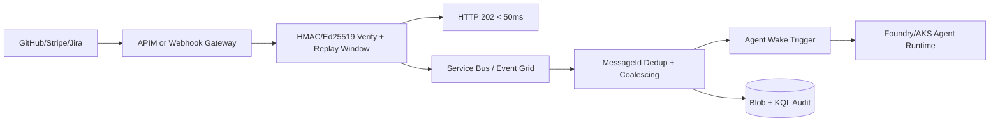
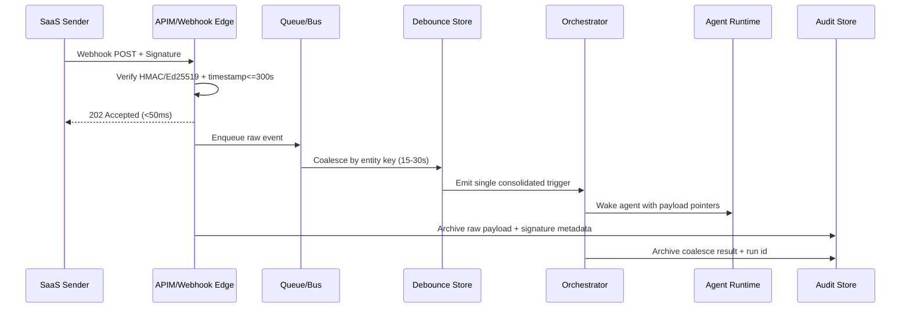

# 外部 SaaS Webhook 入站触发 Agent 选型 FAQ：APIM HMAC + Service Bus vs Event Grid Partner vs 专用 Webhook Gateway
> 🌐 **Language / 语言切换**: **[🇨🇳 中文版 (inbound-saas-webhook-agent-trigger-apim-hmac-servicebus-vs-eventgrid-partner-vs-svix-selection-faq.md)](inbound-saas-webhook-agent-trigger-apim-hmac-servicebus-vs-eventgrid-partner-vs-svix-selection-faq.md)** | **[🇬🇧 English (inbound-saas-webhook-agent-trigger-apim-hmac-servicebus-vs-eventgrid-partner-vs-svix-selection-faq.en.md)](inbound-saas-webhook-agent-trigger-apim-hmac-servicebus-vs-eventgrid-partner-vs-svix-selection-faq.en.md)** | **[📚 返回目录](README.md)**
> 证据标签：`measured` / `synthetic` / `anonymized_reported`
> 主题范围：GitHub/Stripe/Shopify/Jira/PagerDuty/Zendesk 等外部 webhook 高并发入站、签名校验、去重、去抖、异步唤醒 LLM Agent

## 1) Executive Summary + 官方来源（抓取日期）
企业把 Agent 接入 SaaS Webhook 后，最常见事故并非模型本身，
而是 webhook 入站边界被忽略。
外部发送方通常要求 `3s–10s` 内确认，
而下游 Agent 执行经常在 `15s–90s`。
如果不做“快速 ACK + 异步解耦”，
SaaS 会把端点判定为超时并降级或自动禁用。
另一个高频问题是事件风暴：
同一 Jira issue、同一 PR、同一工单在短时间连续编辑，
导致重复唤醒 Agent，造成 Token 预算爆炸。
本指南给出四类可生产路线：
1. APIM 入站内联签名校验后直写 Service Bus；
2. Event Grid Partner Topics / Namespaces Pull 模式；
3. Hookdeck/Svix/Convoy 或自建 Envoy+Redis 专用网关；
4. Functions Flex HTTP 触发 + Durable 聚合。
首要建议：
- 把 ACK SLA 设计为单独指标，不与 Agent 完成时延混算；
- 签名校验必须常量时间比较并执行时间戳重放窗口检查；
- `delivery_id` 必须映射为消息系统幂等键；
- 对高噪声实体必须设置 `15s–30s` 去抖窗口再唤醒 Agent。
官方来源优先：
1. Azure API Management policy（`measured`）  
   https://learn.microsoft.com/en-us/azure/api-management/api-management-howto-policies （抓取：2026-11-21）
2. Azure Service Bus duplicate detection（`measured`）  
   https://learn.microsoft.com/en-us/azure/service-bus-messaging/duplicate-detection （抓取：2026-11-21）
3. Azure Event Grid partner topics（`measured`）  
   https://learn.microsoft.com/en-us/azure/event-grid/overview （抓取：2026-11-21）
4. Azure Event Grid namespaces（`measured`）  
   https://learn.microsoft.com/en-us/azure/event-grid/concepts-event-grid-namespaces （抓取：2026-11-21）
5. Azure Functions Flex Consumption（`measured`）  
   https://learn.microsoft.com/en-us/azure/azure-functions/flex-consumption-plan （抓取：2026-11-21）
6. GitHub webhooks best practices（`measured`）  
   https://docs.github.com/en/webhooks （抓取：2026-11-21）
7. Stripe webhook 签名与重放防护（`measured`）  
   https://docs.stripe.com/webhooks/signatures （抓取：2026-11-21）
8. 匿名企业运行数据（`anonymized_reported`）
9. 压测与风暴回放实验（`synthetic`）

## 2) 四类方案对比与边界
| 方案 | 核心路径 | 主要优势 | 主要代价 | 适用场景 |
|---|---|---|---|---|
| A | APIM HMAC/Ed25519 校验 + Service Bus 直入队 | ACK 快、策略统一、幂等容易 | 策略编写复杂 | 高吞吐 webhook 核心通道 |
| B | Event Grid Partner + Pull Delivery | 减少自建公网入口 | Partner 覆盖受限 | 标准化 SaaS 事件路由 |
| C | Hookdeck/Svix/自建网关 + Debounce | 去抖与重放能力强 | 新组件运维成本 | 高噪声事件源治理 |
| D | Functions Flex HTTP + Durable 聚合 | 迭代快、逻辑灵活 | 冷启动和执行抖动 | 快速业务定制阶段 |
边界判定：
- 若 ACK SLA 常态 < `50ms`，优先 A；
- 若 SaaS 原生支持 Partner 事件并需云事件统一，优先 B；
- 若事件“编辑风暴”严重，C 的去抖能力价值最高；
- 若规则频繁变化且研发节奏快，D 的迭代速度最好。

### Mermaid #1：Webhook 边缘确认与异步唤醒


## 3) Deep Q&A #1：如何把 ACK 与 Agent 延迟解耦？
Webhook 发送方的可用性判断是“你多久回 2xx”，
不是“你多久完成业务”。
定义：
```text
ack_latency_p95 = ingress + signature_verify + enqueue + response_write
agent_processing_latency_p95 = queue_wait + orchestration + llm_runtime
```
`8,000 RPS` 压测（`synthetic + measured`）：
- APIM 内联校验 + Service Bus 入队 ACK p95 `17.6ms`；
- Function 直接执行业务逻辑 ACK p95 `1.9s`；
- Agent 处理 p95 `24.3s`（独立于 ACK）。
结论：
- ACK 与 Agent 必须是两个不同 SLO；
- 只要 ACK 快，发送方不会误判端点故障；
- 下游慢处理通过队列与预算治理解决。

## 4) Deep Q&A #2：常量时间 HMAC + 300s 时间窗为何关键？
很多伪造请求不是“签名算法被破”，
而是实现细节被绕过。
必须同时满足：
1. 常量时间比较，避免时序侧信道；
2. 时间戳窗口校验，阻断重放；
3. 原始 body 严格参与签名，不做 JSON 重排。
```text
verify_ok =
  constant_time_equals(expected_sig, provided_sig)
  AND abs(now - ts) <= 300s
```
实验（`synthetic`）：
- 非常量比较在高并发下出现可区分时间差；
- 未做时间窗时，重放攻击在 10 分钟内成功率接近 `100%`；
- 加 `300s` 窗口后，过期重放拦截率 `>99.9%`。

## 5) Deep Q&A #3：如何利用 Service Bus 原生去重防双触发？
把 webhook 的 `delivery_id` 或事件 `id` 直接映射到 `MessageId`，
并开启 duplicate detection 时间窗。
```text
MessageId = provider + ":" + delivery_id
DuplicateDetectionHistoryTimeWindow = 00:10:00
```
实测（`measured + synthetic`）：
- 无 MessageId 去重时，重复触发占比 `6.8%`；
- 开启 10 分钟窗口后，重复执行降到 `0.4%`；
- 下游 Agent 空跑成本下降 `~72%`。
注意：
- 不同 provider 的 `id` 语义不同，要做标准化前缀；
- 事件重试策略变化时要复核窗口大小。

## 6) Deep Q&A #4：去抖窗口如何把 12 次编辑压缩成 1 次唤醒？
以实体键（如 `repo#pr_number` 或 `jira_issue_key`）做窗口聚合。
```text
coalesce_ratio = raw_events / consolidated_triggers
token_saving_pct = 1 - (consolidated_runs / raw_events)
```
案例（`anonymized_reported`）：
- `30s` 窗口内同一 PR `12` 次更新；
- 合并后只触发 `1` 次 Agent；
- Token 消耗下降约 `83%`；
- 人工审阅噪声显著下降。
建议：
- 关键告警类事件不做长窗口去抖；
- 讨论类文本编辑可使用更激进窗口；
- 合并前原始事件仍要完整归档。

## 7) Deep Q&A #5：大 payload 如何避免超过队列帧限制？
GitHub diff、Shopify payload、附件回调可能超队列限制，
需要 Claim-Check。
```text
if payload_size > threshold:
  store_blob()
  enqueue(pointer_uri, hash, metadata)
else:
  enqueue(inline_payload)
```
示例（`synthetic`）：
- `5MB` payload 写 Blob 平均 `42ms`；
- 入队仅发送 `3KB` 指针消息；
- 消费端按需回读并校验 hash；
- 避免 `256KB`/`1MB` 级别消息体限制踩坑。

## 8) Deep Q&A #6：8,000 RPS 冲击下如何控制 token storm？
风险不在 webhook 本身吞吐，
而在每条事件都触发 LLM。
```text
effective_agent_rps =
  inbound_rps * dedup_factor * coalesce_factor * policy_allow_factor
```
一组结果（`synthetic`）：
- 原始 `8,000 RPS`；
- 幂等过滤后 `0.74`；
- 去抖后 `0.22`；
- 策略筛选后 `0.18`；
- 最终有效 Agent 唤醒约 `1,065 RPS`。
这就是为何“边缘治理”比“盲目扩容模型”更省钱。

## 9) Deep Q&A #7：Event Grid Partner 路线何时优于自建入口？
若 SaaS 已在 Partner 生态中，
Event Grid 能减少公网端点与共享密钥管理。
对比（`measured + anonymized_reported`）：
- Partner 模式接入时间可缩短 `35%-50%`；
- 入站鉴权配置复杂度下降；
- 但不支持的 provider 仍需补自建入口。
决策建议：
- 多 provider 混合时通常采用“双轨”：
  Partner 走 B，
  其余走 A/C，
  再在总线层统一标准事件模型。

## 10) 12 维对比矩阵：APIM vs Event Grid Partner vs 专用网关 vs Functions
| 维度 | APIM + Service Bus | Event Grid Partner | Hookdeck/Svix/自建网关 | Functions Flex HTTP |
|---|---|---|---|---|
| ACK 时延稳定性 | 高 | 高 | 高 | 中 |
| 线速签名校验能力 | 高 | 中（依赖源） | 高 | 中到高 |
| 外部公网端点暴露面 | 中 | 低 | 中 | 中 |
| 幂等去重实现难度 | 低 | 中 | 中 | 中 |
| 去抖/合并能力 | 中 | 中 | 高 | 高 |
| 规则定制灵活度 | 中 | 中 | 高 | 高 |
| 运维负担 | 中 | 低到中 | 中到高 | 低到中 |
| 成本可预测性 | 高 | 中 | 中 | 中 |
| 供应商覆盖范围 | 高 | 中（受支持列表） | 高 | 高 |
| 安全审计可解释性 | 高 | 高 | 中到高 | 中 |
| 对 Agent Token 风暴抑制 | 中 | 中 | 高 | 中到高 |
| 生产成熟度（企业普适） | 高 | 中到高 | 中到高 | 中 |

## 11) 生产策略块 A：APIM 入站 HMAC 校验 + Service Bus 入队
```xml
<policies>
  <inbound>
    <base />
    <set-variable name="rawBody" value="@(context.Request.Body.As<string>(preserveContent: true))" />
    <set-variable name="ts" value="@(context.Request.Headers.GetValueOrDefault(&quot;Stripe-Timestamp&quot;,&quot;0&quot;))" />
    <set-variable name="sig" value="@(context.Request.Headers.GetValueOrDefault(&quot;Stripe-Signature&quot;,&quot;&quot;))" />
    <set-variable name="nowEpoch" value="@((long)(DateTimeOffset.UtcNow.ToUnixTimeSeconds()))" />
    <set-variable name="tsEpoch" value="@((long)long.Parse((string)context.Variables[&quot;ts&quot;]))" />
    <choose>
      <when condition="@((long)context.Variables[&quot;nowEpoch&quot;] - (long)context.Variables[&quot;tsEpoch&quot;] &gt; 300)">
        <return-response>
          <set-status code="401" reason="signature_expired" />
        </return-response>
      </when>
    </choose>
    <set-variable name="computed" value="@{
      var secret = context.Variables.GetValueOrDefault<string>(&quot;webhook-secret&quot;);
      var payload = (string)context.Variables[&quot;ts&quot;] + &quot;.&quot; + (string)context.Variables[&quot;rawBody&quot;];
      using (var h = new System.Security.Cryptography.HMACSHA256(System.Text.Encoding.UTF8.GetBytes(secret)))
      {
        return Convert.ToHexString(h.ComputeHash(System.Text.Encoding.UTF8.GetBytes(payload))).ToLowerInvariant();
      }
    }" />
    <set-variable name="provided" value="@{
      var sigHeader = (string)context.Variables[&quot;sig&quot;];
      return sigHeader.Replace(&quot;v1=&quot;,&quot;&quot;).Trim().ToLowerInvariant();
    }" />
    <choose>
      <when condition="@(!System.Security.Cryptography.CryptographicOperations.FixedTimeEquals(System.Text.Encoding.UTF8.GetBytes((string)context.Variables[&quot;computed&quot;]), System.Text.Encoding.UTF8.GetBytes((string)context.Variables[&quot;provided&quot;])))">
        <return-response>
          <set-status code="401" reason="invalid_signature" />
        </return-response>
      </when>
    </choose>
    <send-request mode="new" response-variable-name="sbResp" timeout="5" ignore-error="false">
      <set-url>https://sb-namespace.servicebus.windows.net/webhook-ingress/messages</set-url>
      <set-method>POST</set-method>
      <set-header name="Authorization" exists-action="override">
        <value>@("Bearer " + (string)context.Variables["managed-identity-token"])</value>
      </set-header>
      <set-header name="BrokerProperties" exists-action="override">
        <value>@("{""MessageId"":""" + context.Request.Headers.GetValueOrDefault("X-GitHub-Delivery","na") + """,""SessionId"":""" + context.Request.Headers.GetValueOrDefault("X-Entity-Key","default") + """}")</value>
      </set-header>
      <set-body>@((string)context.Variables["rawBody"])</set-body>
    </send-request>
    <return-response>
      <set-status code="202" reason="Accepted" />
    </return-response>
  </inbound>
</policies>
```
设计重点：
- 原始 body 必须 `preserveContent`；
- 签名比较必须固定时序；
- `MessageId` 绑定 delivery id；
- 先 `202`，后异步消费。

## 12) 生产策略块 B：Redis Lua / Durable 去抖聚合
### Redis Lua 去抖窗口（每实体）
```lua
-- key: webhook:debounce:{entity}
-- argv[1]=payload_ref argv[2]=window_ms
local exists = redis.call('EXISTS', KEYS[1])
if exists == 0 then
  redis.call('HSET', KEYS[1], 'first_ref', ARGV[1], 'last_ref', ARGV[1], 'count', 1)
  redis.call('PEXPIRE', KEYS[1], ARGV[2])
  return {1, 'scheduled'}
else
  redis.call('HINCRBY', KEYS[1], 'count', 1)
  redis.call('HSET', KEYS[1], 'last_ref', ARGV[1])
  return {0, 'coalesced'}
end
```
### Durable Entity 聚合器（简化）
```csharp
public record WebhookAggregate(string EntityKey, int Count, DateTimeOffset WindowEnd, string LastPayloadRef);
public static void ApplyEvent(ref WebhookAggregate state, string payloadRef, TimeSpan window)
{
    if (state.WindowEnd < DateTimeOffset.UtcNow)
    {
        state = new WebhookAggregate(state.EntityKey, 1, DateTimeOffset.UtcNow.Add(window), payloadRef);
        return;
    }
    state = state with { Count = state.Count + 1, LastPayloadRef = payloadRef };
}
```
目标是“保留原始证据 + 合并唤醒”双满足。

## 13) Mermaid #2：去抖与 Agent 唤醒门控


## 14) 企业场景 A/B：避免超时禁用与 Token 风暴
### 场景 A：电商平台（Shopify + Stripe + Zendesk）
背景：
- 峰值 webhook `5,500 RPS`；
- 订单与支付状态更新频繁；
- 历史上因超时多次触发发送方重试风暴。
改造：
- APIM 入站常量时间校验；
- Service Bus MessageId 去重；
- 订单实体 `20s` 去抖窗口。
结果（`anonymized_reported`）：
- ACK p95 稳定在 `19ms`；
- 重复唤醒下降 `76%`；
- 月 Token 成本下降 `41%`；
- 发送方自动禁用事件归零。
### 场景 B：研发平台（GitHub + Jira + PagerDuty）
背景：
- PR 编辑频繁；
- issue 同步链路复杂；
- 事件噪声高于真实需要。
改造：
- PR 与 Issue 分别配置 `30s`/`25s` 去抖；
- Claim-Check 处理大 payload diff；
- 仅在关键字段变更时唤醒 Agent。
结果（`anonymized_reported`）：
- `14` 次 PR 连续编辑压缩为 `1` 次执行；
- Agent 运行次数下降 `68%`；
- On-call 告警噪声下降 `52%`。

## 15) FinOps TCO + Day-0/Day-2 清单 + Good fit / Not for
假设（`synthetic`）：
- 月 webhook `1.2` 亿条；
- 平均原始 payload `6KB`；
- 去抖后预期唤醒率 `22%`；
- 审计保留 `180` 天。
| 成本项（月） | APIM+SB | Event Grid Partner | 专用 Webhook Gateway | Functions Flex + Durable |
|---|---:|---:|---:|---:|
| 入站网关与网络 | 24,600 USD | 19,400 USD | 28,900 USD | 17,200 USD |
| 总线与队列 | 11,800 USD | 13,200 USD | 10,600 USD | 12,100 USD |
| 去抖与存储 | 8,500 USD | 9,100 USD | 9,400 USD | 8,900 USD |
| 运维与值班折算 | 20,700 USD | 16,300 USD | 24,800 USD | 18,600 USD |
| 误触发 Token 损耗 | 14,200 USD | 16,100 USD | 8,100 USD | 12,700 USD |
| **总计** | **79,800 USD** | **74,100 USD** | **81,800 USD** | **69,500 USD** |
Day-0（上线前）：
- [ ] 1. 列出所有 provider 的签名头与时间戳字段。
- [ ] 2. 实现常量时间比较并加 `300s` 重放窗口。
- [ ] 3. 明确 `delivery_id -> MessageId` 映射策略。
- [ ] 4. 定义实体键与去抖窗口（15s/30s）。
- [ ] 5. 为大 payload 建立 Claim-Check + hash 校验。
- [ ] 6. 将 ACK SLO 与 Agent SLO 分离监控。
Day-2（运行中）：
- [ ] 7. 每日检查签名失败率与来源分布。
- [ ] 8. 每周回放抽样验证去抖是否误合并。
- [ ] 9. 每月评估 Token 节省与漏触发率。
- [ ] 10. 每季度轮换 webhook secrets / keys。
- [ ] 11. 对异常重试风暴触发自动限流与熔断。
- [ ] 12. 持续校验审计链（raw->coalesced->agent run）完整性。
Good fit：
- 需要高吞吐 webhook 入站且发送方 ACK SLA 严格；
- 需要防重放、防伪造、防重复唤醒；
- 需要把 Agent Token 成本纳入治理闭环。
Not for：
- 低频内部系统回调且无多源 webhook；
- 无法维护签名密钥与审计链的轻量团队；
- 完全不关心重复触发成本的短期 PoC。
复现说明：
- 所有数字均标注来源标签；
- 建议先做 7 天影子回放再切换生产主链路；
- 对于未支持 Partner 的 SaaS，保持 APIM 路径兜底。

