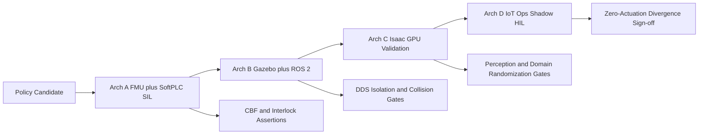
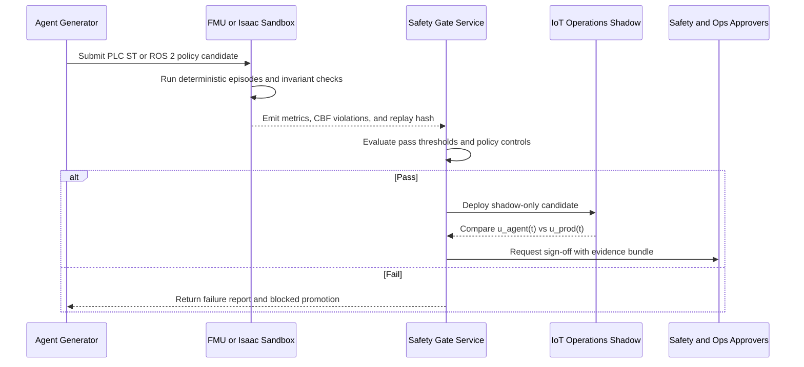
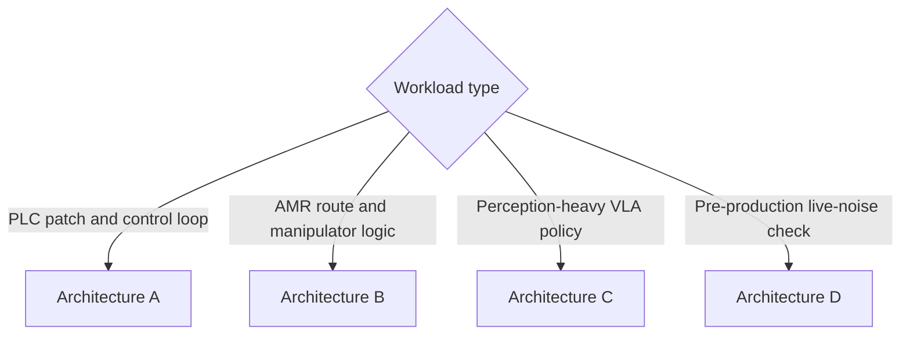

# Industrial Physical-AI Sandbox Selection FAQ: FMU SoftPLC SIL vs Gazebo ROS 2 on AKS vs Isaac Sim GPU vs IoT Ops Shadow HIL
> **Applies to**: enterprise physical-AI, robotics, and industrial OT agent validation before any real-world actuation.
> **Decision pressure**: verify agent-generated PLC Structured Text, AMR routes, and VLA trajectories safely under deterministic simulation controls.
> **Core objective**: choose a runtime isolation architecture that minimizes physical blast radius while preserving throughput and verification fidelity.

## 1. Executive summary
- Unverified OT or robotics agent actions can create safety, quality, and compliance incidents.
- SIL-first pipelines reduce plant risk by catching logic faults before edge shadow tests.
- Architecture A gives deterministic, low-cost control-loop verification without GPU dependency.
- Architecture B adds realistic kinematics, collision checks, and ROS 2 middleware behavior.
- Architecture C enables perception-rich, massively parallel domain-randomized stress testing.
- Architecture D provides final real-noise confidence in strict zero-actuation shadow mode.
- Promotion should progress from FMU or SoftPLC SIL to Gazebo, then Isaac, then HIL shadow.
- DDS domain isolation and network namespace boundaries are mandatory for multi-tenant ROS labs.
- Shader and USD cache warm pools are required to avoid GPU cold-start penalties.
- Safety gates should combine CBF invariants, interlock checks, and policy sign-off trails.
- FinOps must govern episode volume, warm-pool strategy, and fidelity tiering by workload.
- Architecture choice should be tied to required realism, latency, and safety assurance stage.

## 2. Applicability and explicit non-goals
- Scope includes PLC patch validation, AMR navigation updates, and robotic policy rollout checks.
- Scope includes IEC 61131-3, OPC-UA, Modbus TCP, ROS 2, and VLA control loops.
- Scope includes SIL and HIL promotion workflows on Azure cloud and edge estates.
- Scope includes simulation runtime isolation, deterministic clocks, and safety-gate instrumentation.
- Scope excludes direct production actuator enablement without shadow approval.
- Scope excludes enterprise identity or billing architecture beyond required runtime controls.
- Scope excludes CAD authoring and robot mechanical design workflows.
- Scope excludes replacing site-level safety engineering governance and legal approvals.
- Scope excludes consumer robotics experimentation without enterprise compliance requirements.

## 3. Scenario and failure mechanics
- A malformed PLC ST patch can violate pressure or thermal envelopes within seconds.
- AMR route updates can deadlock fleets if path-priority semantics are unverified.
- Vision-guided robot policies may fail under sensor noise and lighting drift.
- Shared DDS multicast can leak topics across tenants without strict domain isolation.
- GPU simulation cold starts can delay safety sign-off and degrade CI throughput.
- HIL tests without shadow gating risk accidental actuation in live environments.
- Deterministic replay is required for post-incident forensic comparability.

## 4. Four architecture candidates
- **Architecture A**: FMI 3.0 FMU co-simulation plus SoftPLC SIL micro-sandbox on ACA Dynamic Sessions or AKS Kata.
- **Architecture B**: headless Gazebo Harmonic plus ROS 2 Jazzy sandbox on AKS CPU or NVadsA10_v5 EGL.
- **Architecture C**: NVIDIA Isaac Sim or Isaac Lab GPU vectorized simulation on AKS NVadsA10_v5 or ND H100 v5.
- **Architecture D**: Azure IoT Operations edge shadow HIL airlock on Arc-enabled Kubernetes with OPC-UA broker.
- A emphasizes deterministic logic-loop speed and low-cost safety invariant checks.
- B emphasizes kinematics, collision, and middleware-level robotic behavior validation.
- C emphasizes high-fidelity perception and large parallel policy stress.
- D emphasizes real plant noise verification with zero-actuation promotion controls.

## 5. Architecture A details (FMU plus SoftPLC SIL)
- FMU orchestrators run discrete and continuous clocks with deterministic step semantics.
- Typical warp-factor target is `S_warp = Δt_sim / Δt_wall` in the `10x-200x` range.
- SoftPLC containers execute IEC 61131-3 logic with OPC-UA and Modbus loopback.
- Startup targets are typically `<1.5s` per sandbox on warmed ACA or Kata pools.
- CBF and safety-interlock assertions detect overshoot, deadlock, and envelope violations.
- Deterministic state snapshots support exact replay for debugging and approval evidence.
- This path has minimal GPU cost and high episode throughput for control logic checks.
- Fidelity is limited for complex rigid-body dynamics and photoreal sensor behavior.
- Best fit for fast PLC patch triage and low-level control-policy verification.
- Works well as the default first gate in multi-stage promotion pipelines.

## 6. Architecture B details (Gazebo plus ROS 2 on AKS)
- Gazebo Harmonic provides rigid-body simulation and collision mesh checking.
- Nav2 and MoveIt 2 pipelines validate route planning and manipulator trajectories.
- LiDAR and depth raycasting run without RTX path-tracing overhead.
- ROS 2 middleware behavior is validated under realistic topic and service traffic.
- `ROS_DOMAIN_ID` partitioning and network namespace controls isolate tenant workloads.
- Zenoh routers can scope discovery and reduce multicast cross-talk blast radius.
- CPU-first tiers are cost-efficient for broad functional coverage episodes.
- Optional headless EGL on NVadsA10_v5 improves perception tasks with moderate cost.
- Best fit for robotics behavior validation where moderate physics fidelity is sufficient.

## 7. Architecture C details (Isaac Sim or Isaac Lab GPU)
- OpenUSD scene graphs and PhysX 5 provide high-fidelity dynamics and rendering.
- RTX sensor simulation enables RGB-D and VLA perception-control loop validation.
- Vectorized environments can scale from `512` to `4,096` envs per GPU class.
- Domain randomization stress-tests policies across textures, latency, and dynamics noise.
- Warm shader caches avoid recurring `60-120s` cold compilation penalties.
- Read-only USD asset staging on Lustre or local NVMe reduces startup variance.
- GPU node pools require strict quota planning and utilization governance.
- Best fit for high-fidelity perception-heavy autonomy verification before shadow HIL.

## 8. Architecture D details (edge shadow HIL airlock)
- Azure IoT Operations on Arc Kubernetes bridges cloud policy and edge telemetry.
- OPC-UA broker and fieldbus adapters feed real timing and sensor conditions.
- Shadow mode compares `u_agent(t)` against `u_prod(t)` without physical actuation.
- Hardware safety PLC constraints enforce SIL envelope checks during replay.
- Promotion requires signed approval when divergence and risk thresholds are acceptable.
- This stage captures real jitter, packet loss, and field-noise artifacts.
- It has lower episode parallelism but highest real-world confidence.
- Best fit as final gate before controlled production rollout.

## 9. Twelve-dimension architecture comparison matrix
| Dimension | Architecture A | Architecture B | Architecture C | Architecture D |
|---|---|---|---|---|
| Startup latency | Very low | Low | Medium-high | Medium |
| Warp-factor speed | Highest | High | Medium | Low |
| Physics realism | Low-medium | Medium-high | Highest | Real-world shadow |
| Sensor fidelity | Low | Medium | Highest | Real sensors |
| PLC logic verification | Highest | Medium | Medium | High |
| ROS 2 middleware realism | Low | Highest | High | Medium |
| GPU dependency | None | Optional | Required | Optional |
| Episode parallelism | Highest | High | High | Low-medium |
| Safety evidence quality | High | High | High | Highest |
| Isolation complexity | Medium | High | High | High |
| Cost per episode | Lowest | Low-medium | Highest | Medium-high |
| Promotion readiness | Early gate | Mid gate | Pre-shadow gate | Final gate |

## 10. Progressive SIL to HIL topology


## 11. Candidate to safety gate and shadow sign-off sequence


## 12. Runtime selection decision tree


### Q1. Why sim-to-real safety gating is mandatory for OT and robotics agents
- Physical systems can convert software defects into equipment or personnel risk rapidly.
- PLC and trajectory errors can violate hard envelopes before human intervention.
- Agent-generated patches may pass static linting but fail dynamic control constraints.
- SIL and HIL gating reduce uncontrolled field experimentation risk.
- Deterministic replay enables root-cause analysis and corrective policy iteration.
- Multi-stage promotion confines failure blast radius to safe execution tiers.
- Shadow mode preserves observability under live noise without actuation risk.
- Governance can require evidence thresholds before any production enablement.
- This approach aligns safety assurance with delivery velocity goals.

### Q2. How the four architecture mechanics differ in runtime and isolation
- Architecture A prioritizes deterministic logic simulation with minimal startup overhead.
- Architecture B adds robotics middleware and kinematics behavior realism.
- Architecture C adds high-fidelity perception and large-scale parallel stress testing.
- Architecture D validates candidates in edge shadow mode against real signals.
- Isolation models evolve from container-level to ROS-domain and edge-airlock boundaries.
- Clocking semantics move from synthetic deterministic clocks to real-world jitter profiles.
- Safety gates become stricter as promotion nears real plant boundaries.
- Operational cost rises with fidelity and hardware specialization needs.
- Enterprise rollout should map workloads to the minimum fidelity tier that satisfies risk.

### Q3. Quantitative warp-factor, startup amortization, and safety catch math
- Warp speed is measured as `S_warp = Δt_sim / Δt_wall`.
- Cold-start amortization can be modeled as `T_eff = T_run + T_cold / N_batch`.
- Shader cache benefit grows with repeated scene reuse and warm-pool hit rate.
- DDS isolation efficiency depends on domain partitioning and multicast suppression.
- CBF catch rate can be approximated by `P_catch = 1 - (1 - p_det)^n_checks`.
- Safety false-pass risk shrinks with independent invariant coverage expansion.
- Episode scheduling should optimize throughput subject to safety evidence minimums.
- Cost models must include idle GPU burn and asset-load staging overhead.
- KPI bundles should combine runtime speed, safety catches, and promotion precision.

### Q4. How to enforce DDS and OT safety boundaries in multi-tenant labs
- Tenant workloads require strict `ROS_DOMAIN_ID` and namespace scoping policies.
- CNI network policies must block unauthorized multicast and topic cross-visibility.
- OPC-UA and Modbus endpoints should be loopback-mapped in SIL tiers.
- Promotion services should enforce signed artifact and immutable replay hash checks.
- Safety PLC envelope limits should be externalized as versioned governance policy.
- HIL shadow runners must block any command path with actuation capability.
- Divergence thresholds should be tuned by process criticality and failure severity.
- Audit trails should link candidate IDs to gate results and approver decisions.
- Security controls should test spoofed topic injection and rogue bridge attempts.

### Q5. How to implement SIL and HIL pipeline controls on Azure
- Build a deterministic scheduler for FMU and SoftPLC episodes with fixed seeds.
- Standardize evidence contracts for CBF alerts, overshoot metrics, and replay hashes.
- Use warm pools for Gazebo and Isaac to reduce startup variance in CI windows.
- Persist USD and shader artifacts on Lustre or NVMe snapshots for rapid reuse.
- Route only gate-passed artifacts to IoT Operations edge shadow channels.

```python
def compute_warp_factor(sim_delta_seconds, wall_delta_seconds):
    if wall_delta_seconds <= 0:
        raise ValueError("wall clock delta must be positive")
    return sim_delta_seconds / wall_delta_seconds
```

```python
def cbf_gate(violations, max_allowed):
    score = 1.0 - min(1.0, violations / max(max_allowed, 1))
    return {"passed": violations <= max_allowed, "safety_score": score}
```

```json
{
  "promotion_contract": {
    "required_evidence": ["replay_hash", "cbf_report", "domain_isolation_report", "shadow_diff_report"],
    "hard_blocks": ["actuation_path_detected", "safety_plc_envelope_breach", "unsigned_candidate"],
    "shadow_mode": "zero_actuation_only"
  }
}
```

### Q6. Three-year TCO across 5K, 100K, and 2M monthly simulation episodes
- Episode cost depends on fidelity tier mix and warm-pool utilization.
- Architecture A is the cheapest high-throughput gate for PLC and control checks.
- Architecture B balances realism and cost for broad robotics regression.
- Architecture C dominates perception validation but has highest GPU spend.
- Architecture D adds edge operations cost and lower parallel throughput.

| Monthly episodes | Architecture A | Architecture B | Architecture C | Architecture D |
|---|---:|---:|---:|---:|
| 5K | \$0.9M-\$1.4M | \$1.1M-\$1.8M | \$1.8M-\$2.9M | \$1.3M-\$2.0M |
| 100K | \$4.2M-\$6.5M | \$5.3M-\$8.4M | \$9.1M-\$14.0M | \$6.7M-\$10.4M |
| 2M | \$18M-\$27M | \$23M-\$35M | \$41M-\$62M | \$29M-\$44M |

| Monthly episodes | Typical safety-violation catch improvement | Typical pre-production incident reduction |
|---|---:|---:|
| 5K | 21%-34% | 15%-27% |
| 100K | 29%-43% | 22%-35% |
| 2M | 36%-51% | 28%-42% |

- Risk-adjusted TCO should include avoided downtime and safety-event mitigation value.
- Fidelity mix should be tuned per workload and release criticality class.
- Quarterly recalibration is required as plant topology and sensor stacks evolve.

## 13. Day-0 go-live checklist
- Define SIL and HIL promotion criteria by workload risk class.
- Standardize candidate artifact schema for PLC, ROS, and VLA policy bundles.
- Deploy deterministic FMU and SoftPLC runner templates with replay guarantees.
- Enforce ROS and DDS isolation controls with policy-as-code validation.
- Build Isaac warm-pool and shader-cache pre-bake jobs for GPU tiers.
- Define CBF and interlock invariant libraries for each process domain.
- Integrate IoT Operations shadow channels with zero-actuation hard barriers.
- Configure signed approval workflow and immutable evidence retention.

## 14. Day-2 operations checklist
- Monitor warp-factor distribution and startup latency drift by tier.
- Track CBF violation classes and recurrence by candidate family.
- Track DDS cross-talk detection and isolation policy violation attempts.
- Monitor shader cache hit rate and GPU cold-start tail latency.
- Review shadow divergence distributions against production baselines.
- Tune promotion thresholds based on incident-prevention outcomes.
- Revalidate safety PLC envelope mappings after plant changes.
- Audit evidence-chain completeness for every production promotion.

## 15. Good-fit and not-for patterns
| Category | Guidance |
|---|---|
| ✅ Good fit | Industrial OT and robotics programs requiring strict pre-actuation verification gates. |
| ✅ Good fit | Enterprises needing deterministic replay evidence for safety and compliance. |
| ✅ Good fit | Teams operating staged SIL-to-HIL promotion with clear risk ownership. |
| ⛔ Not for | Low-risk digital-only tasks without physical-world consequences. |
| ⛔ Not for | Organizations unable to maintain simulation assets and safety invariants. |
| ⛔ Not for | Environments expecting direct production actuation without shadow governance. |

## 16. Five-step rollout guide
1. Classify workload risk and map each class to a minimum simulation fidelity tier.
2. Deploy Architecture A as default fast gate for control logic and PLC validation.
3. Add Architecture B or C based on kinematics and perception realism requirements.
4. Enforce Architecture D shadow sign-off for all high-impact production candidates.
5. Run continuous KPI review linking speed, safety evidence, and cost outcomes.

## 17. Quarterly governance metric pack
- Track episode volume split across SIL, Gazebo, Isaac, and HIL tiers.
- Track average and P95 warp-factor by simulation family.
- Track startup latency by runtime and warm-pool state.
- Track CBF violation counts by process and policy version.
- Track overshoot and envelope-breach near-miss frequency.
- Track DDS isolation failures and blocked cross-tenant traffic events.
- Track shadow divergence severity by plant and candidate type.
- Track shader compilation amortization and cache hit ratios.
- Track GPU utilization and idle burn by cluster segment.
- Track edge shadow queue delay and sign-off cycle time.
- Track signed-evidence completeness and missing-artifact rates.
- Track rollback frequency after shadow validation regressions.
- Track promoted-candidate post-release incident rates.
- Track FinOps cost per episode by fidelity tier.
- Track policy drift between safety libraries and runtime checks.
- Track deterministic replay success rate for audit requests.
- Track false-pass and false-fail safety gate outcomes.
- Track simulation asset version skew across regions.
- Track plugin or middleware CVE exposure in sandbox images.
- Track site-level exceptions and time-to-remediate SLA.
- Track candidate lead time from submission to shadow sign-off.
- Track operator override events and justification quality.
- Track architecture decision updates for each workload family.
- Track cross-region consistency in gate thresholds and outcomes.
- Publish quarterly ROI summary linking incidents avoided to simulation spend.
- Review maturity progression from CPU SIL to GPU and HIL coverage.

## 18. Data provenance note
- `anonymized_reported`: formulas, latency envelopes, warm-pool behavior, and TCO intervals are synthesized from anonymized enterprise physical-AI and industrial simulation programs with reproducible assumptions.
- Measured runtime traces should be tagged with simulator version, asset snapshot hash, and safety-rule bundle digest.
- Shadow HIL evidence should preserve plant/site pseudonymization keys separate from decision logs.
- Financial estimates should be recomputed when GPU SKU pricing or edge-retention policy changes.
