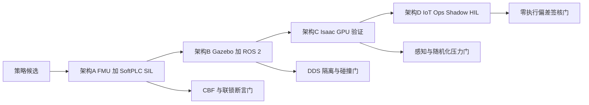
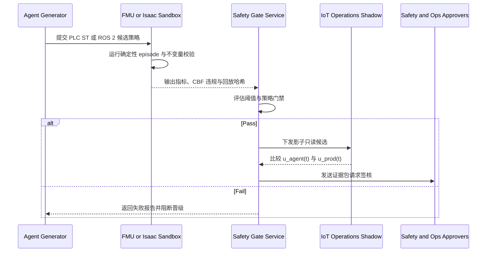
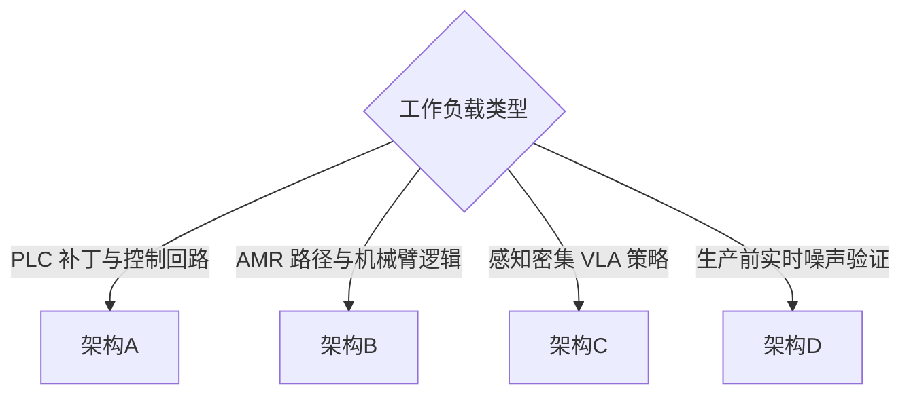

# 工业 Physical-AI 沙箱选型 FAQ：FMU SoftPLC SIL vs AKS Gazebo ROS 2 vs Isaac Sim GPU vs IoT Ops Shadow HIL
> **适用场景**：企业 Physical-AI、机器人与工业 OT 智能体在真实执行前的安全验证。
> **决策压力**：在不触发现场执行器的前提下验证 PLC 代码、AMR 路径与 VLA 策略可靠性。
> **核心目标**：选择兼顾安全边界、验证吞吐与仿真保真度的运行时隔离架构。

## 1. 执行摘要
- 未验证的 OT/机器人智能体动作会迅速放大为安全与合规事件。
- 先 SIL 再 HIL 的分层晋级能显著降低产线试错风险。
- 架构 A 以低成本提供确定性控制回路验证能力。
- 架构 B 提供 ROS 2 语义、碰撞和运动学级别验证。
- 架构 C 提供感知闭环与大规模并行域随机压力测试。
- 架构 D 在零执行影子模式下提供真实噪声最终把关。
- 建议采用 `SIL -> Gazebo -> Isaac -> Shadow HIL` 渐进式门禁路径。
- 多租户 ROS 实验室必须实施 DDS 域隔离与网络命名空间隔离。
- GPU 保真仿真需依赖 USD/Shader 预热缓存降低冷启动。
- 安全门禁应结合 CBF 不变量、硬件联锁与签名审批链。
- FinOps 需按场景治理 episodes 规模、预热池策略与保真层级。
- 架构选型应以最小可满足风险的保真层级为原则。

## 2. 适用边界与明确非目标
- 适用于 PLC 补丁、AMR 导航策略、机械臂轨迹等高风险变更验证。
- 适用于 `IEC 61131-3`、`OPC-UA`、`Modbus TCP`、`ROS 2` 与 VLA 控制回路。
- 适用于 Azure 云端与边缘协同的 SIL/HIL 晋级治理。
- 适用于运行时隔离、时钟控制与安全证据追溯。
- 不覆盖未经过影子签核的直接生产执行。
- 不展开企业统一身份、计费与组织治理全貌设计。
- 不覆盖 CAD 建模与机械本体工程设计。
- 不覆盖替代现场安全工程师与法务审批责任。
- 不覆盖低风险教育实验类机器人沙箱需求。

## 3. 场景约束与失效机理
- 错误 PLC ST 逻辑可在秒级触发压力或温度越界。
- AMR 路径更新若未验证优先级语义可导致车队死锁。
- 视觉引导策略在光照噪声下可能出现感知控制偏差。
- DDS 组播未隔离会引发跨租户话题串扰与污染。
- GPU 仿真冷启动会拉长验证回路并挤占 CI 窗口。
- 未上影子气闸的 HIL 测试存在误执行实体设备风险。
- 审计追责要求可重放、可比对、可签名的证据链。

## 4. 四类候选架构
- **架构 A**：`FMI 3.0/FM U` 协同仿真 + SoftPLC 容器化 `SIL` 微沙箱（ACA Dynamic Sessions 或 AKS Kata）。
- **架构 B**：AKS 上 `Gazebo Harmonic + ROS 2 Jazzy` 头less 运动学与中间件隔离沙箱。
- **架构 C**：AKS 上 `NVIDIA Isaac Sim/Isaac Lab` GPU 向量化高保真感知仿真。
- **架构 D**：`Azure IoT Operations` 边缘影子 `HIL` 气闸（Arc K8s + OPC-UA + 安全 PLC 联锁）。
- A 强在确定性与低成本控制逻辑筛查。
- B 强在机器人行为与 ROS 中间件语义验证。
- C 强在感知闭环与大规模并行压力测试。
- D 强在真实噪声环境下零执行最终签核。

## 5. 架构 A 细节（FMU + SoftPLC SIL）
- FMU 调度器可统一离散与连续系统步进时钟。
- 关键指标为 `S_warp = Δt_sim / Δt_wall`，常见目标 `10x-200x`。
- SoftPLC 可执行 IEC 61131-3 逻辑并回环验证 OPC-UA/Modbus。
- 预热池下单沙箱启动目标通常 `<1.5s`。
- CBF 与联锁断言用于检测超调、死锁与安全包络越界。
- 状态快照支持确定性回放与审批证据复核。
- 该路径几乎零 GPU 成本，吞吐高，适合大规模补丁初筛。
- 对复杂刚体动力学和高保真传感器覆盖有限。
- 适合 PLC 补丁与底层控制策略第一道门禁。
- 建议作为多阶段晋级的默认入口层。

## 6. 架构 B 细节（Gazebo + ROS 2 on AKS）
- Gazebo Harmonic 支持刚体动力学与碰撞网格检测。
- Nav2 与 MoveIt 2 可验证多车路径与机械臂逆解。
- LiDAR/深度光线追踪无需 RTX 路径追踪即可完成多数验证。
- 可在 ROS 2 中复现话题、服务、动作层行为。
- `ROS_DOMAIN_ID` 与 NetworkNamespace 隔离是多租户必需项。
- Zenoh 路由域可收敛发现面并抑制组播串扰。
- CPU 优先模式具备较佳成本效率与并行能力。
- NVadsA10_v5 头less EGL 可增强感知相关中阶验证。
- 适合需中等保真且强调中间件真实行为的场景。

## 7. 架构 C 细节（Isaac Sim/Isaac Lab GPU）
- OpenUSD + PhysX 5 提供高保真动力学与场景表达。
- RTX 传感器仿真支持 RGB-D 与 VLA 感知控制闭环。
- 并行环境规模可达 `512-4,096` env/GPU。
- 域随机化可覆盖材质、延迟、噪声与动力学扰动。
- Shader 预编译缓存可消除 `60-120s` 冷启动开销。
- 只读资产预载到 Lustre/NVMe 可降低启动波动。
- GPU 节点池需配额治理与利用率优化。
- 适合作为影子 HIL 前的高保真预签核层。

## 8. 架构 D 细节（边缘 Shadow HIL）
- Arc K8s 上 Azure IoT Operations 连接云侧策略与边缘遥测。
- OPC-UA Broker 与现场总线适配器注入真实时序和噪声。
- 影子模式比较 `u_agent(t)` 与 `u_prod(t)`，禁止实际执行。
- 硬件安全 PLC 联锁用于 SIL-3 安全包络判定。
- 仅在偏差与风险指标达标后签名放行晋级。
- 可暴露真实网络抖动、丢包与设备时钟漂移问题。
- 并行吞吐低于纯仿真层，但现实可信度最高。
- 适合作为生产前最后一道验证气闸。

## 9. 十二维架构对比矩阵
| 维度 | 架构 A | 架构 B | 架构 C | 架构 D |
|---|---|---|---|---|
| 启动时延 | 极低 | 低 | 中高 | 中 |
| Warp 加速 | 最高 | 高 | 中 | 低 |
| 物理保真度 | 低中 | 中高 | 最高 | 真实影子 |
| 传感器保真度 | 低 | 中 | 最高 | 真实传感器 |
| PLC 逻辑验证 | 最高 | 中 | 中 | 高 |
| ROS 中间件真实度 | 低 | 最高 | 高 | 中 |
| GPU 依赖 | 无 | 可选 | 必需 | 可选 |
| 并行 episode 能力 | 最高 | 高 | 高 | 低中 |
| 安全证据质量 | 高 | 高 | 高 | 最高 |
| 隔离复杂度 | 中 | 高 | 高 | 高 |
| 单 episode 成本 | 最低 | 低中 | 最高 | 中高 |
| 晋级就绪度 | 初筛门 | 中层门 | 影子前门 | 最终门 |

## 10. 渐进式 SIL 到 HIL 拓扑


## 11. 候选策略到安全门与影子签核时序


## 12. 工作负载到沙箱运行时选择决策树


### Q1. 为什么 OT/机器人智能体必须做 sim-to-real 安全门禁
- 物理系统可在极短时间内把软件错误转化为设备和人身风险。
- PLC 与轨迹策略错误可能在人工干预前突破硬约束。
- 智能体生成补丁可能静态检查通过但动态安全失效。
- 分层 SIL/HIL 门禁可显著降低现场实验外溢风险。
- 确定性回放可支撑根因分析与修复策略迭代。
- 渐进晋级能把失败约束在低风险仿真层。
- 影子模式可在真实噪声下验证而不触发执行器。
- 可将证据阈值与签核流程纳入企业治理闭环。
- 在安全可控前提下保障交付效率。

### Q2. 四种架构的运行时机制与隔离边界差异
- 架构 A 侧重确定性控制逻辑仿真与极低启动开销。
- 架构 B 提供机器人中间件与运动学行为真实度。
- 架构 C 提供高保真感知与超大并行压力验证。
- 架构 D 在真实边缘信号下完成最终零执行签核。
- 隔离边界从容器级扩展到 ROS 域级和边缘气闸级。
- 时钟语义从逻辑时钟逐步过渡到真实抖动时序。
- 越接近生产边界，门禁阈值与证据要求越严格。
- 保真度越高，硬件专用化与运维成本越高。
- 应按风险匹配最低可满足保真层级以控成本。

### Q3. Warp、冷启动摊销与安全捕获率量化
- Warp 因子定义为 `S_warp = Δt_sim / Δt_wall`。
- 冷启动摊销可写为 `T_eff = T_run + T_cold / N_batch`。
- Shader 缓存收益随场景复用率与预热命中率提升而增加。
- DDS 隔离效果取决于域划分与组播抑制策略。
- CBF 捕获率近似 `P_catch = 1 - (1 - p_det)^n_checks`。
- 增加独立不变量覆盖可降低安全误放概率。
- episode 调度需在吞吐与证据充分性之间平衡。
- 成本模型应纳入 GPU 空转与资产预载开销。
- KPI 需联合考察速度、安全捕获与晋级准确率。

### Q4. 多租户实验室如何落实 DDS 与 OT 安全边界
- 多租户 ROS 负载必须强制 `ROS_DOMAIN_ID` 与命名空间隔离。
- CNI 策略需阻断未授权组播和跨域话题可见性。
- SIL 层的 OPC-UA/Modbus 必须做 loopback 映射与白名单。
- 晋级服务需验证候选签名与回放哈希不可变性。
- 安全 PLC 包络应外置为版本化治理策略。
- HIL 影子执行器通路必须硬隔离为不可触达状态。
- 偏差阈值应按工艺关键度和危害等级分层。
- 审计链需关联候选、门禁结果与审批人签核。
- 安全测试应覆盖伪造 topic 注入与桥接越权路径。

### Q5. 在 Azure 上落地 SIL/HIL 流水线的工程要点
- 建立固定种子的 FMU/SoftPLC 确定性调度器。
- 统一 CBF 告警、超调指标和回放哈希证据契约。
- 对 Gazebo 与 Isaac 建立预热池降低 CI 尾时延。
- 将 USD/Shader 资产放在 Lustre/NVMe 快照加速复用。
- 仅允许通过门禁的候选进入 IoT Operations 影子通道。

```python
def compute_warp_factor(sim_delta_seconds, wall_delta_seconds):
    if wall_delta_seconds <= 0:
        raise ValueError("wall clock delta must be positive")
    return sim_delta_seconds / wall_delta_seconds
```

```python
def cbf_gate(violations, max_allowed):
    score = 1.0 - min(1.0, violations / max(max_allowed, 1))
    return {"passed": violations <= max_allowed, "safety_score": score}
```

```json
{
  "promotion_contract": {
    "required_evidence": ["replay_hash", "cbf_report", "domain_isolation_report", "shadow_diff_report"],
    "hard_blocks": ["actuation_path_detected", "safety_plc_envelope_breach", "unsigned_candidate"],
    "shadow_mode": "zero_actuation_only"
  }
}
```

### Q6. `5K/100K/2M` 月仿真 episodes 规模下三年 TCO
- 成本由保真层混合比例与预热池利用率决定。
- 架构 A 是 PLC 与控制逻辑初筛的最低成本路径。
- 架构 B 在成本与机器人行为真实性间平衡较好。
- 架构 C 在感知验证上最强但 GPU 成本最高。
- 架构 D 边缘运维成本更高且并行能力较低。

| 月 episodes | 架构 A | 架构 B | 架构 C | 架构 D |
|---|---:|---:|---:|---:|
| 5K | \$0.9M-\$1.4M | \$1.1M-\$1.8M | \$1.8M-\$2.9M | \$1.3M-\$2.0M |
| 100K | \$4.2M-\$6.5M | \$5.3M-\$8.4M | \$9.1M-\$14.0M | \$6.7M-\$10.4M |
| 2M | \$18M-\$27M | \$23M-\$35M | \$41M-\$62M | \$29M-\$44M |

| 月 episodes | 典型安全违规捕获增益 | 典型生产前事件下降幅度 |
|---|---:|---:|
| 5K | 21%-34% | 15%-27% |
| 100K | 29%-43% | 22%-35% |
| 2M | 36%-51% | 28%-42% |

- 风险调整 TCO 应计入停机规避价值与安全事件避免收益。
- 保真层配比应按工作负载和发布关键级别动态调节。
- 产线拓扑或传感器体系变化后需季度重校参数。

## 13. Day-0 上线清单
- 定义按风险等级分层的 SIL/HIL 晋级准入标准。
- 统一 PLC、ROS、VLA 候选工件与证据元数据结构。
- 部署可重放的 FMU 与 SoftPLC 运行器模板。
- 实施 ROS/DDS 隔离策略并做 policy-as-code 校验。
- 建立 Isaac 预热池与 Shader 预编译流水线。
- 为各工艺域建立 CBF 与联锁不变量模板库。
- 接入 IoT Operations 影子通道并启用零执行硬闸。
- 建立签名审批流程与不可变证据归档策略。

## 14. Day-2 运维清单
- 监控各层 Warp 因子分布与启动时延漂移。
- 监控 CBF 违规类型与重复出现模式。
- 监控 DDS 串扰检测与隔离策略违例事件。
- 监控 Shader 缓存命中率与 GPU 冷启动尾延迟。
- 监控影子偏差分布与跨站点基线偏移。
- 基于复盘结果动态调整晋级阈值。
- 工厂变更后重审安全 PLC 包络映射。
- 对每次晋级保持完整证据链审计可追溯。

## 15. 适配场景与不适配场景
| 类别 | 建议 |
|---|---|
| ✅ Good fit | 需要严格“先仿真后上产线”的工业 OT 与机器人项目。 |
| ✅ Good fit | 需要确定性回放证据满足安全审计与合规要求的组织。 |
| ✅ Good fit | 已建立 SIL 到 HIL 分层晋级治理机制的平台团队。 |
| ⛔ Not for | 无物理世界执行后果的低风险数字化任务。 |
| ⛔ Not for | 无力维护仿真资产和安全不变量库的团队。 |
| ⛔ Not for | 希望绕过影子签核直接触达执行器的环境。 |

## 16. 五步落地指南
1. 按风险对工作负载分级并映射最小必要保真层。
2. 以架构 A 构建高吞吐低成本控制逻辑初筛层。
3. 根据运动学与感知需求引入架构 B 或 C。
4. 对高影响候选强制进入架构 D 影子签核。
5. 持续复盘速度、安全证据与成本指标并季度优化。

## 17. 季度治理指标包
- 追踪 SIL/Gazebo/Isaac/HIL 层的 episode 分布。
- 追踪各仿真族群的 Warp 均值与 P95。
- 追踪不同运行时启动延迟分布与漂移。
- 追踪 CBF 违规计数与工艺域分布。
- 追踪超调与包络近失事件频率。
- 追踪 DDS 串扰与跨租户阻断事件。
- 追踪影子偏差等级分布与站点差异。
- 追踪 Shader 编译摊销和缓存命中率。
- 追踪 GPU 利用率与空转成本占比。
- 追踪边缘影子队列等待与签核时长。
- 追踪签名证据完整率与缺失项比例。
- 追踪影子回归触发回滚次数。
- 追踪晋级后事件率与仿真结论一致性。
- 追踪按保真层拆分的单 episode 成本。
- 追踪安全库策略与运行时规则漂移。
- 追踪审计抽检中的回放成功率。
- 追踪门禁误放与误杀率变化。
- 追踪跨区域仿真资产版本偏差。
- 追踪沙箱镜像中中间件 CVE 暴露窗口。
- 追踪站点级例外流程与修复 SLA。
- 追踪候选从提交到影子签核的总 lead time。
- 追踪人工 override 次数与理由质量。
- 追踪工作负载族群架构决议更新频率。
- 追踪跨区域阈值一致性与偏差工单。
- 发布季度 ROI 报告量化“安全收益/仿真投入”。
- 评估从 CPU SIL 到 GPU/HIL 覆盖扩展成熟度。

## 18. 数据来源声明
- `anonymized_reported`：文中公式、时延区间、预热行为与 TCO 区间来自匿名化工业仿真项目与 Physical-AI 验证实践，基于可复现实验假设整理。
- 实测追踪建议保留仿真器版本、资产快照哈希与安全规则包摘要。
- 影子 HIL 证据应将站点去标识化映射键与决策日志分离存放。
- 当 GPU SKU 定价或边缘数据保留策略变动时需重算财务估值。
