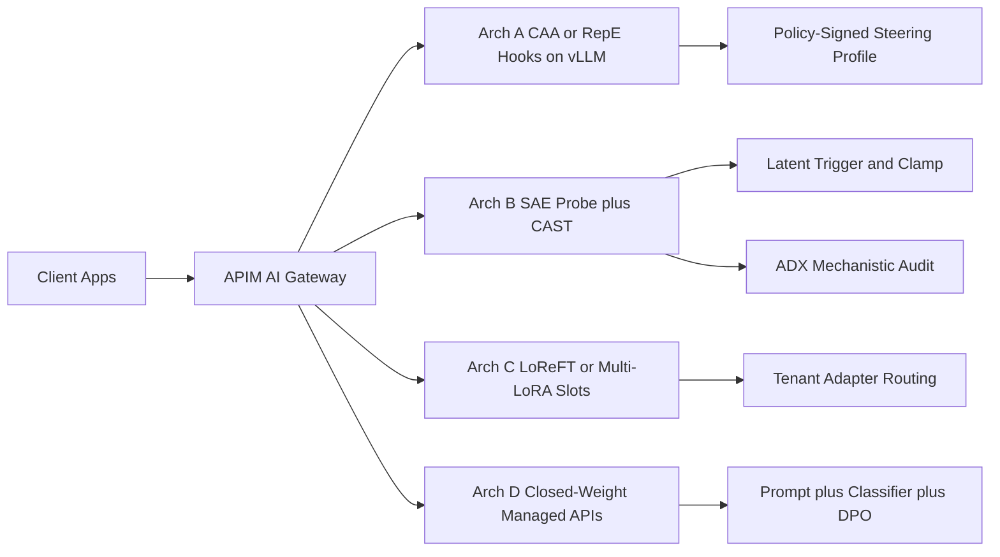
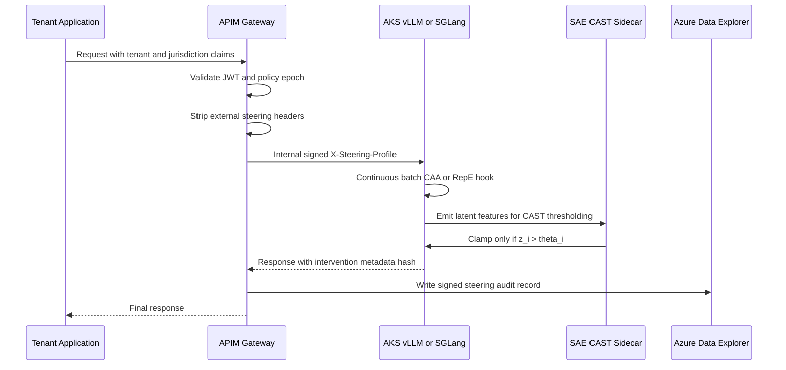
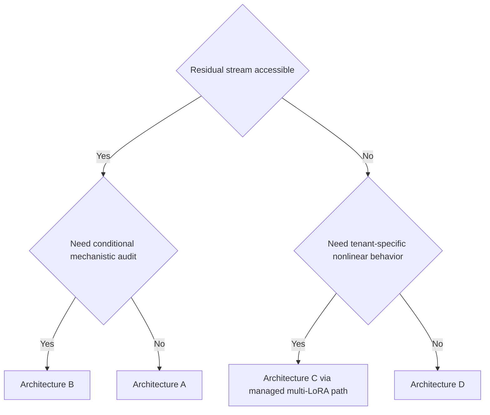

# Inference-Time Activation Steering Selection FAQ: CAA or RepE on AKS vs SAE CAST Clamping vs LoReFT or Multi-LoRA vs Foundry Guardrail plus DPO
> **Applies to**: enterprise multi-tenant inference serving that needs runtime behavior control without per-tenant model forks.
> **Decision pressure**: enforce non-sycophancy, jurisdiction-specific refusal boundaries, calibrated humility, and anti-jailbreak response at request time.
> **Core objective**: choose a serving architecture that gives measurable safety control with bounded TPOT overhead and auditable governance.

## 1. Executive summary
- Prompt-only constitutions degrade under long-context dilution and adversarial paraphrase drift.
- Full-weight DPO checkpoints for every region and tenant become operationally unsustainable.
- Runtime residual-stream steering can enforce policy without prompt-token inflation.
- Architecture A gives low-latency deterministic control-vector injection at request time.
- Architecture B gives conditional intervention only when risky latent circuits activate.
- Architecture C gives stronger tenant-specific nonlinear behavior shaping with adapter slots.
- Architecture D is practical for closed-weight APIs but has weaker mechanistic controllability.
- Signed policy headers and strict gateway stripping are mandatory for steering safety.
- Subspace orthogonalization is required when multiple steering vectors are composed.
- Norm-ratio clamps prevent fluency collapse from over-aggressive intervention.
- CAST trigger telemetry must be persisted for regulated audit and dispute workflows.
- FinOps ownership should include steering profile count, trigger rate, and latency envelope.

## 2. Applicability and explicit non-goals
- Scope covers enterprise risk, legal, compliance, and investigation agents in shared serving fleets.
- Scope covers `50-250` concurrent policy profiles across regional and contractual boundaries.
- Scope covers open-weight deployments on AKS with residual-stream access.
- Scope covers closed-weight managed stacks when only gateway-plus-classifier controls are available.
- Scope includes runtime anti-sycophancy and deception-circuit suppression.
- Scope excludes pretraining data-poisoning and model-weight provenance attestation.
- Scope excludes browser sandbox isolation and MCP egress governance design.
- Scope excludes low-risk consumer chatbot tonal personalization.
- Scope excludes replacing all post-hoc safety review with automation-only decisions.

## 3. Scenario and failure mechanics
- Enterprises often need over `100` policy profiles but cannot maintain over `100` DPO branches.
- Prompt-only controls consume `1K-2K` extra tokens and still fail under context drift.
- Region-specific refusal clauses can conflict unless intervention is profile-isolated.
- Sycophancy and latent jailbreak cooperation are often hidden from lexical filters.
- Mis-scoped steering headers can become a direct attack vector if not gateway-signed.
- Over-steering without clamps can degrade perplexity, code quality, and factual grounding.
- Audit and legal teams require latent intervention evidence, not only final text logs.

## 4. Four architecture candidates
- **Architecture A**: CAA or RepE control-vector addition on AKS `vLLM/SGLang` with APIM signed `X-Steering-Profile`.
- **Architecture B**: SAE feature probe and conditional CAST clamping on AKS H100 or B200 with ADX latent logs.
- **Architecture C**: learned subspace intervention (`LoReFT`) or multi-LoRA tenant adapter slots.
- **Architecture D**: closed-weight Foundry or AOAI stack using system prompts, classifiers, and periodic DPO/RFT.
- A emphasizes deterministic low-overhead residual-space intervention.
- B emphasizes conditional intervention and interpretability-linked auditability.
- C emphasizes tenant customization breadth at moderate runtime complexity.
- D emphasizes managed simplicity with weaker direct mechanistic control.

## 5. Architecture A details (CAA or RepE residual hooks)
- Steering uses `h'_{b,t,l} = h_{b,t,l} + Σ_k α_{b,k} \hat{v}_{k,l}` on middle layers.
- Typical hook span is `l in [0.35L, 0.75L]` to avoid shallow lexical noise and deep output destabilization.
- Per-batch vector lookup keys are derived from signed profile claims and policy epoch.
- Gram-Schmidt or SVD orthogonalization reduces destructive interference among vectors.
- Norm-ratio guard enforces `||Δh||_2 <= τ ||h||_2` at token and layer granularity.
- APIM must strip external steering headers and mint internal signed metadata.
- mTLS between gateway and inference plane prevents side-channel profile spoofing.
- Continuous batching preserves throughput while applying request-indexed vector maps.
- Typical TPOT overhead target is `<1.5%` for one to three vectors.
- Best fit when response style and refusal boundaries need deterministic real-time control.

## 6. Architecture B details (SAE feature probe plus CAST)
- SAE dictionary projection monitors sparse monosemantic features at selected layers.
- Typical `d_sae` range is `16x-64x d_model`, with compressed sparse activations.
- CAST applies intervention only when feature score `z_i > θ_i`.
- This conditional path preserves benign capability while clamping risky latent circuits.
- Feature IDs can encode sycophancy, covert jailbreak cooperation, and PII regurgitation.
- Triggered interventions and feature trajectories are signed and persisted to ADX.
- Regulatory teams can replay policy decisions using latent evidence and profile version.
- Overhead depends on probe layer count, dictionary width, and trigger frequency.
- Best fit for regulated domains that require explainable intervention evidence.

## 7. Architecture C details (LoReFT or multi-LoRA)
- LoReFT applies low-rank learned subspace corrections during forward pass.
- Core form is `h' = h + R^T(Wh + b - Rh)` with compact trainable state.
- Multi-LoRA slots can encode tenant formatting and domain workflow priors.
- Punica or SGMV-style batching can amortize adapter-switch overhead.
- This path supports stronger nonlinear behavior shaping than static vectors.
- It requires lifecycle management for adapter drift and compatibility.
- Latency and VRAM overhead increase with active adapter diversity.
- Best fit when behavior control and domain customization are both hard requirements.

## 8. Architecture D details (closed-weight managed stack)
- Managed APIs hide residual streams, preventing direct activation intervention.
- Policy relies on system prompts, classifier filters, and release-cycle DPO.
- Long-context windows can dilute constitutions under high retrieval token pressure.
- Pre and post classifiers add latency and false-positive operational burden.
- Frequent regional policy updates can outpace checkpoint release cycles.
- This pattern is easiest to operate but least precise for mechanistic control.
- It remains useful when open-weight operations are prohibited by policy.
- Strong gateway controls are still required for tenant isolation and budget protection.

## 9. Twelve-dimension architecture comparison matrix
| Dimension | Architecture A | Architecture B | Architecture C | Architecture D |
|---|---|---|---|---|
| Runtime controllability | High | High | High | Medium-low |
| Conditional precision | Medium | Highest | High | Medium |
| Interpretability evidence | Medium | Highest | Medium | Low |
| Typical TPOT overhead | Low | Medium | Medium-high | Medium |
| Prompt-token tax | Zero | Zero | Zero | High |
| Multi-profile scaling | High | High | Medium | Medium |
| Tenant customization depth | Medium | Medium | Highest | Medium |
| Closed-weight compatibility | Low | Low | Medium | Highest |
| Security boundary complexity | Medium | High | High | Medium |
| Operational complexity | Medium | High | High | Low-medium |
| Audit defensibility | High | Highest | High | Medium |
| FinOps predictability | High | Medium | Medium | Medium-low |

## 10. Four-architecture topology overview


## 11. Signed profile to steering and audit sequence


## 12. Open-weight versus closed-weight decision tree


### Q1. Why prompt-only and full-weight DPO struggle with 100-profile runtime control
- Prompt-only governance scales poorly with `100+` profile variants and retrieval-length entropy.
- Constitutional prefixes dilute when context exceeds `64K` tokens with mixed relevance chunks.
- Prompt-token tax can add `1K-2K` tokens per request under strict policy prose.
- Full-weight DPO per profile creates checkpoint sprawl and release bottlenecks.
- Regional legal updates may require daily or weekly policy changes.
- DPO release cycles are often monthly in tightly controlled production stacks.
- Prompt heuristics lack deterministic isolation when multiple tenant policies collide.
- Runtime intervention provides tighter control per request without full model retraining.
- Mechanistic hooks avoid repeated token spend for static policy instructions.

### Q2. How the four architecture mechanics and boundaries differ
- Architecture A uses signed per-request vectors, deterministic residual updates, and strict gateway stripping.
- Architecture B adds sparse latent probes and conditional clamp-only-on-trigger behavior.
- Architecture C applies learned low-rank or adapter-level intervention for richer behavior shaping.
- Architecture D relies on prompt plus classifier plus periodic fine-tune governance.
- A and B require open-weight serving access and forward-hook integration.
- C can operate in open-weight or some managed multi-adapter stacks.
- D is the default when residual internals are inaccessible.
- Security boundaries must include signer identity, profile epoch, and anti-replay nonce.
- Governance should track policy source, profile selection, and intervention outcome hash.

### Q3. Quantitative overhead, VRAM, and degradation math
- SAE memory overhead can be estimated by `ΔVRAM_SAE = 2 * |L_hook| * d_model * d_sae * bytes`.
- Residual intervention stability is governed by norm ratio `ρ = ||Δh||_2 / ||h||_2`.
- Practical clamps maintain `ρ <= 0.08` to keep fluency and coding regression bounded.
- KL drift can be approximated by `KL(p' || p) <= c * ρ^2` under local linearization.
- CAA or RepE FLOP overhead is near linear in active vectors and hook layers.
- CAST cost is `probe_cost + trigger_rate * clamp_cost` rather than always-on clamp.
- Trigger-rate control is critical for balancing safety recall and latency budgets.
- FinOps models should separate fixed probe tax from variable intervention tax.
- Evaluation must include refusal precision, non-sycophancy gain, and benign-turn retention.

### Q4. How to secure policy profile injection and multi-tenant isolation
- External clients must never set raw steering amplitudes or vector IDs directly.
- APIM should sign internal profile headers after JWT and contract validation.
- Gateway policies must strip caller-supplied `X-Steering-Profile` and related aliases.
- Inference plane should reject unsigned or expired profile metadata.
- Profile metadata should include policy epoch, tenant ID, region code, and nonce.
- Replay windows should be bounded with short TTL and nonce cache checks.
- Multi-tenant vector registries need immutable versioning and approval workflow.
- Negative-amplitude anti-safety vectors should be blocked by policy schema.
- Security tests should include spoofed headers, stale epochs, and tampered signatures.

### Q5. How to implement CAA or SAE CAST in production serving
- Runtime hooks should operate in continuous batches without breaking scheduler fairness.
- Orthogonalization must run on approved vector sets per profile epoch.
- SAE probes should monitor only safety-critical layers to cap overhead.
- ADX records must capture request hash, profile hash, trigger features, and clamp strength.
- Alerting should fire on sudden trigger-rate spikes or abnormal amplitude distributions.

```python
def apply_caa_repE(h, vectors, alphas, tau):
    delta = 0.0
    for v, a in zip(vectors, alphas):
        delta = delta + a * v
    if l2_norm(delta) > tau * l2_norm(h):
        delta = delta * (tau * l2_norm(h) / max(l2_norm(delta), 1e-8))
    return h + delta
```

```python
def cast_clamp(z_scores, theta, h, clamp_basis):
    triggered = []
    for i, z in enumerate(z_scores):
        if z > theta[i]:
            triggered.append(i)
    if not triggered:
        return h, triggered
    return clamp_projection(h, clamp_basis, triggered), triggered
```

```json
{
  "steering_contract": {
    "signed_header": "X-Steering-Profile",
    "required_fields": ["tenant_id", "region", "policy_epoch", "nonce", "expires_at"],
    "forbidden_caller_fields": ["alpha_raw", "vector_id_raw", "negative_safety_gain"],
    "reject_on": ["signature_invalid", "expired", "nonce_replay", "epoch_mismatch"]
  }
}
```

### Q6. Three-year TCO across 10M, 100M, and 1B monthly requests
- Cost depends on request scale, active profile count, and intervention trigger rate.
- Architecture A is usually lowest-cost among open-weight controlled paths.
- Architecture B adds probe tax but improves audit defensibility and selective control.
- Architecture C adds adapter lifecycle cost while enabling deeper tenant specialization.
- Architecture D can appear simple but incurs prompt-token and classifier tax.

| Monthly requests | Architecture A | Architecture B | Architecture C | Architecture D |
|---|---:|---:|---:|---:|
| 10M | \$3.8M-\$5.6M | \$4.2M-\$6.4M | \$4.6M-\$7.1M | \$4.4M-\$6.8M |
| 100M | \$24M-\$36M | \$27M-\$41M | \$31M-\$47M | \$29M-\$45M |
| 1B | \$142M-\$212M | \$162M-\$241M | \$183M-\$272M | \$175M-\$260M |

| Monthly requests | Typical non-sycophancy gain | Typical false-refusal reduction after calibration |
|---|---:|---:|
| 10M | 19%-31% | 11%-24% |
| 100M | 24%-38% | 15%-29% |
| 1B | 28%-43% | 19%-33% |

- Risk-adjusted TCO should include incident-prevention value and audit labor savings.
- Trigger-rate governance should be tuned per profile family and model generation.
- Quarterly recalibration is required for new jailbreak patterns and policy drift.

## 13. Day-0 go-live checklist
- Define policy profile taxonomy for tenant, region, and risk class.
- Finalize signed steering-header contract and APIM strip-and-mint policy.
- Register approved control vectors with immutable version IDs.
- Implement orthogonalization and norm-ratio clamps in serving hooks.
- Configure SAE probe layers, thresholds, and CAST clamp basis.
- Establish ADX schema for latent intervention and decision evidence.
- Build replay-safe nonce and short-TTL profile validation path.
- Run red-team tests for header spoofing and anti-safety vector attempts.

## 14. Day-2 operations checklist
- Monitor TPOT P50 and P95 deltas by profile and architecture path.
- Track trigger-rate anomalies for each SAE feature family.
- Audit rejection reasons for signature, nonce, and epoch failures.
- Review benign-turn quality regression against baseline canaries.
- Rebalance thresholds when false refusals exceed SLO bands.
- Rotate profile signing keys and verify mTLS trust-chain hygiene.
- Revalidate vector orthogonality after profile catalog changes.
- Review cost per 1K requests by profile family and intervention mode.

## 15. Good-fit and not-for patterns
| Category | Guidance |
|---|---|
| ✅ Good fit | Multi-tenant enterprise agents requiring runtime legal or risk behavior control. |
| ✅ Good fit | Regulated workloads requiring latent intervention evidence for audits. |
| ✅ Good fit | Teams operating open-weight stacks with strict gateway governance. |
| ⛔ Not for | Low-risk assistant workloads where prompt-only governance is sufficient. |
| ⛔ Not for | Teams without secure profile-signing and policy-lifecycle discipline. |
| ⛔ Not for | Environments that cannot support observability for trigger and drift monitoring. |

## 16. Five-step rollout guide
1. Classify operations and map them to profile families and intervention depth.
2. Deploy APIM signed-profile gateway controls and anti-spoofing enforcement.
3. Launch Architecture A baseline, then add Architecture B conditional controls.
4. Add Architecture C only for tenants needing deeper nonlinear specialization.
5. Run continuous evaluation, drift recalibration, and quarterly cost-policy reviews.

## 17. Quarterly governance metric pack
- Track profile-selection distribution by tenant and region.
- Track signed-header validation failure rates by cause.
- Track CAA or RepE amplitude distributions and clamp frequency.
- Track SAE probe overhead and CAST trigger rate by model.
- Track refusal precision and recall for policy-critical intents.
- Track non-sycophancy score changes versus baseline cohorts.
- Track benign capability retention for coding and reasoning tasks.
- Track latency deltas by intervention path and request size.
- Track budget burn by profile family and tenant class.
- Track replay-attempt blocks and nonce-cache hit rates.
- Track policy-epoch drift between gateway and inference planes.
- Track vector catalog churn and approval cycle times.
- Track false-positive classifier escalations in closed-weight paths.
- Track incident postmortems where intervention prevented unsafe output.
- Track audit inquiry response time using ADX latent evidence.
- Track ratio of open-weight versus closed-weight governed traffic.
- Track profile deprecation compliance and stale-profile access attempts.
- Track DPO release lag versus runtime policy update cadence.
- Track cross-region policy consistency and exception volumes.
- Track model-version migration impact on trigger thresholds.
- Track monthly recalibration workload for safety operations teams.
- Track intervention disablement events and justification quality.
- Track governance drift between contractual and implemented policies.
- Track production red-team findings and remediation SLA.
- Maintain architecture decision records for every profile-family change.
- Publish quarterly ROI summaries linking cost and risk outcomes.

## 18. Data provenance note
- `anonymized_reported`: formulas, overhead ranges, trigger-rate behavior, and TCO intervals are synthesized from anonymized enterprise activation-control programs with reproducible assumptions.
