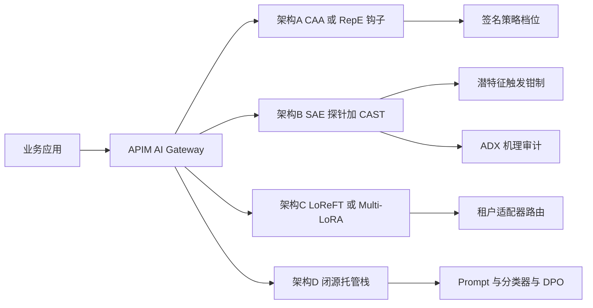
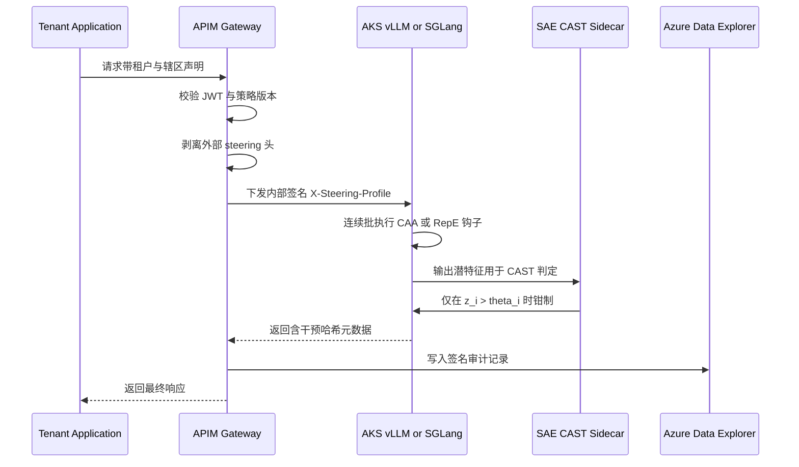
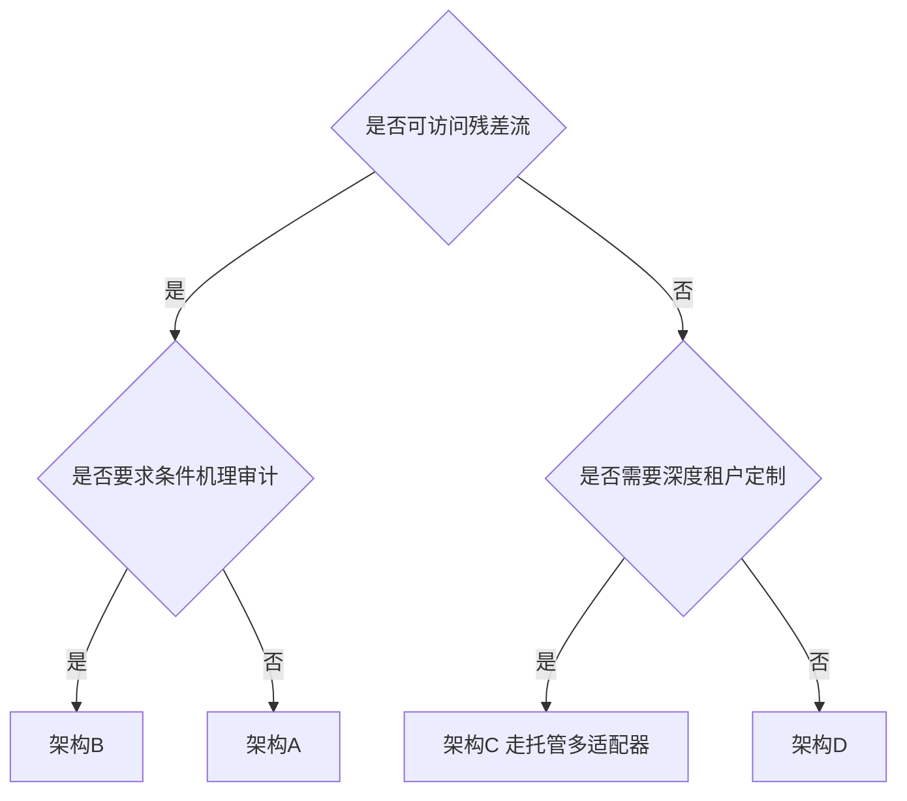

# 推理时激活引导选型 FAQ：AKS 上 CAA 或 RepE vs SAE CAST 钳制 vs LoReFT 或 Multi-LoRA vs Foundry Guardrail 与 DPO
> **适用场景**：企业多租户推理服务在不拆分大量模型分支的前提下进行运行时行为控制。
> **决策压力**：在请求级实现反谄媚、分司法辖区拒答边界、校准谦逊与实时反越狱。
> **核心目标**：选择具备可量化安全收益、可审计证据、且 TPOT 开销可控的生产架构。

## 1. 执行摘要
- 仅靠提示词宪法在长上下文与对抗改写下容易失真。
- 为每个区域和租户维护 DPO 检查点会快速失控。
- 推理时残差流干预可在零额外提示 token 下实施策略。
- 架构 A 提供低时延、确定性的控制向量注入能力。
- 架构 B 提供“仅在风险特征触发时”介入的条件钳制。
- 架构 C 提供更强租户定制能力与非线性行为塑形。
- 架构 D 在闭源模型下可行，但机理可控性最弱。
- 任何激活引导都必须依赖签名策略头与网关剥离机制。
- 多向量组合必须做子空间正交化避免相互破坏。
- 归一化比率钳制可避免语言流畅性与困惑度塌陷。
- CAST 触发遥测必须沉淀到审计可回放链路。
- FinOps 需同时治理 profile 数量、触发率与时延预算。

## 2. 适用边界与明确非目标
- 适用于共享推理底座中的法务、风控、审计与调查智能体。
- 适用于 `50-250` 策略档位并行生效的多租户场景。
- 适用于可访问残差流的 AKS 开源权重推理栈。
- 适用于残差流不可见时的托管闭源替代治理路径。
- 适用于运行时反谄媚、反隐性越狱与高风险拒答控制。
- 不覆盖预训练语料投毒和权重来源证明问题。
- 不覆盖浏览器沙箱隔离与 MCP 出网边界治理。
- 不覆盖低风险消费级聊天语气微调。
- 不等同于完全替代人工复核的自动化裁决系统。

## 3. 场景约束与失效机理
- 企业常需 `100+` 策略档位，但无法长期维护 `100+` DPO 分支。
- 提示词策略通常要附加 `1K-2K` token，成本与时延双升。
- 区域法规差异会导致拒答边界冲突，需 profile 级隔离执行。
- 谄媚与隐性配合型越狱往往难被词法过滤器捕获。
- 未签名策略头会成为激活干预注入攻击入口。
- 缺少幅度钳制时会出现困惑度飙升和回答质量下滑。
- 审计侧要求“为何介入”的潜特征证据，而非仅输出文本。

## 4. 四类候选架构
- **架构 A**：AKS `vLLM/SGLang` 上 CAA 或 RepE 控制向量注入 + APIM 签名 `X-Steering-Profile`。
- **架构 B**：AKS H100/B200 上 SAE 潜特征探针 + 条件 CAST 钳制 + ADX 证据链。
- **架构 C**：`LoReFT` 子空间干预或 Multi-LoRA 租户适配槽。
- **架构 D**：Foundry/AOAI 闭源托管栈 + 系统提示 + 分类器 + 周期性 DPO/RFT。
- A 强于低开销确定性残差干预。
- B 强于条件触发和可解释审计。
- C 强于深度租户行为定制。
- D 强于托管易用性但弱于机理精确控制。

## 5. 架构 A 细节（CAA/RepE 残差钩子）
- 核心形式为 `h'_{b,t,l} = h_{b,t,l} + Σ_k α_{b,k} \hat{v}_{k,l}`。
- 通常在中间层 `l in [0.35L, 0.75L]` 介入，平衡稳定性与控制力。
- 每请求向量映射由签名 profile 声明和策略版本共同索引。
- 多向量组合需做 Gram-Schmidt 或 SVD 正交化。
- 归一化约束 `||Δh||_2 <= τ ||h||_2` 防止语言崩塌。
- APIM 必须剥离外部策略头并内部重签发。
- 网关到推理平面采用 mTLS 防止 profile 伪造。
- 连续批处理下按请求索引向量，保持吞吐稳定。
- 典型 TPOT 额外开销目标为 `<1.5%`。
- 适合需要确定性实时拒答边界的企业场景。

## 6. 架构 B 细节（SAE 探针 + CAST）
- SAE 在指定层做稀疏字典投影捕获单义潜特征。
- 常见字典规模 `d_sae = 16x-64x d_model`。
- CAST 仅在 `z_i > θ_i` 时进行条件钳制。
- 该模式对良性请求保持最小干扰并保留基础能力。
- 可覆盖谄媚、越狱配合、违规建议、PII 泄露等特征簇。
- 触发记录与钳制强度写入签名遥测并落地 ADX。
- 审计可按策略版本与潜特征轨迹复盘决策。
- 开销由探针层数、字典宽度与触发率共同决定。
- 适合金融与医疗等高审计要求行业。

## 7. 架构 C 细节（LoReFT / Multi-LoRA）
- LoReFT 通过低秩子空间项做行为修正。
- 形式可写为 `h' = h + R^T(Wh + b - Rh)`，参数量低于全量 LoRA。
- Multi-LoRA 可承载租户格式与领域工作流能力定制。
- Punica/SGMV 批处理可摊销适配器切换开销。
- 行为塑形能力强于静态控制向量注入。
- 需治理适配器漂移、版本兼容与回滚策略。
- 活跃适配器数量越多，VRAM 与时延压力越高。
- 适合既要行为控制又要深度租户差异化的组织。

## 8. 架构 D 细节（闭源托管栈）
- 闭源 API 无残差流可见性，无法直接激活干预。
- 通常依赖系统提示、前后置分类器与周期性对齐发布。
- 长上下文下宪法提示会出现显著稀释效应。
- 前后置分类器带来额外时延与误报成本。
- 高频法规更新常快于 DPO 发布节奏。
- 该路径运维简单但精确控制能力受限。
- 若组织禁止开源权重运维，D 为现实可选路径。
- 即便采用 D，也需强网关隔离与租户预算治理。

## 9. 十二维架构对比矩阵
| 维度 | 架构 A | 架构 B | 架构 C | 架构 D |
|---|---|---|---|---|
| 运行时可控性 | 高 | 高 | 高 | 中低 |
| 条件精度 | 中 | 最高 | 高 | 中 |
| 可解释证据 | 中 | 最高 | 中 | 低 |
| TPOT 开销 | 低 | 中 | 中高 | 中 |
| Prompt Token 税 | 零 | 零 | 零 | 高 |
| 多档位扩展性 | 高 | 高 | 中 | 中 |
| 租户定制深度 | 中 | 中 | 最高 | 中 |
| 闭源兼容性 | 低 | 低 | 中 | 最高 |
| 安全边界复杂度 | 中 | 高 | 高 | 中 |
| 运维复杂度 | 中 | 高 | 高 | 中低 |
| 审计可辩护性 | 高 | 最高 | 高 | 中 |
| FinOps 可预测性 | 高 | 中 | 中 | 中低 |

## 10. 四架构拓扑总览


## 11. 策略签名到推理干预与审计时序


## 12. 开源权重与闭源托管决策树


### Q1. 为什么 prompt-only 与全量 DPO 不适合 100 档位运行时治理
- Prompt-only 在 `100+` 档位组合下会显著放大策略文本复杂度。
- 上下文超 `64K` 时，提示宪法容易被检索噪声稀释。
- 每请求附加 `1K-2K` token 会导致成本和时延持续上升。
- 按档位训练 DPO 分支会引入检查点爆炸与发布瓶颈。
- 法规高频变化常要求周级甚至日级更新策略。
- DPO 发布通常按月，难以跟上运行时策略变更节奏。
- 多租户冲突策略很难仅靠提示词实现确定性隔离。
- 推理时干预可在请求级精确控制且无需频繁重训。
- 激活干预能避免重复支付固定策略 token 成本。

### Q2. 四种架构的服务机制与安全边界差异
- 架构 A 通过签名向量与残差更新实现确定性干预。
- 架构 B 在潜特征触发时执行条件钳制并输出审计证据。
- 架构 C 通过低秩子空间或适配器实现深度行为塑形。
- 架构 D 以提示词和分类器为主，依赖周期性发布。
- A/B 需要开源权重与 forward hook 集成能力。
- C 可在部分托管多适配器环境与开源环境通用。
- D 适合残差流不可见的闭源边界。
- 安全边界必须绑定签发主体、策略 epoch 与 nonce。
- 治理平面需记录策略来源、档位决策和结果哈希。

### Q3. HBM、FLOP、TPOT 与质量退化量化方法
- SAE 显存增量可估算：`ΔVRAM_SAE = 2 * |L_hook| * d_model * d_sae * bytes`。
- 干预稳定性可用 `ρ = ||Δh||_2 / ||h||_2` 监控。
- 生产中常将 `ρ <= 0.08` 作为流畅性保护阈值。
- 局部线性近似下可用 `KL(p' || p) <= c * ρ^2` 评估分布漂移。
- CAA/RepE 开销与激活向量数量和钩子层数近线性相关。
- CAST 成本可写为 `probe_cost + trigger_rate * clamp_cost`。
- 触发率是安全收益与性能成本的关键平衡旋钮。
- FinOps 应拆分固定探针税与条件钳制税。
- 评测需同时关注拒答精度、反谄媚增益和良性保持率。

### Q4. 如何防止策略头注入并保障多租户隔离
- 外部调用方绝不能直接传递原始 `alpha` 或 `vector_id`。
- APIM 需在鉴权后内部签发策略头并附策略版本。
- 网关必须剥离来路 `X-Steering-Profile` 及同义伪装头。
- 推理平面必须拒绝未签名、过期或版本不匹配策略头。
- 策略载荷应包含租户、辖区、nonce、过期时间等字段。
- 通过短 TTL + nonce 缓存防止重放。
- 向量仓应采用不可变版本与审批发布流程。
- 负向安全增益向量必须被策略 Schema 明确禁止。
- 安全测试需覆盖伪造头、旧版本重放与签名篡改。

### Q5. CAA 与 SAE CAST 的生产实现要点
- 钩子逻辑需兼容连续批处理调度，不破坏公平性。
- 多向量正交化需按策略版本做离线审校与在线加载。
- SAE 仅对关键安全层探针以控制开销。
- ADX 审计记录需包含请求哈希、策略哈希与触发强度。
- 对触发率突增或异常幅度分布建立主动告警。

```python
def apply_caa_repe(h, vectors, alphas, tau):
    delta = 0.0
    for v, a in zip(vectors, alphas):
        delta = delta + a * v
    if l2_norm(delta) > tau * l2_norm(h):
        delta = delta * (tau * l2_norm(h) / max(l2_norm(delta), 1e-8))
    return h + delta
```

```python
def cast_clamp(z_scores, theta, h, clamp_basis):
    triggered = []
    for i, z in enumerate(z_scores):
        if z > theta[i]:
            triggered.append(i)
    if not triggered:
        return h, triggered
    return clamp_projection(h, clamp_basis, triggered), triggered
```

```json
{
  "steering_contract": {
    "signed_header": "X-Steering-Profile",
    "required_fields": ["tenant_id", "region", "policy_epoch", "nonce", "expires_at"],
    "forbidden_caller_fields": ["alpha_raw", "vector_id_raw", "negative_safety_gain"],
    "reject_on": ["signature_invalid", "expired", "nonce_replay", "epoch_mismatch"]
  }
}
```

### Q6. `10M/100M/1B` 月请求规模下三年 TCO
- 成本由请求规模、档位数量与条件触发率共同决定。
- 架构 A 通常是开源权重路径中成本最低的精控方案。
- 架构 B 增加探针税，但换来更强审计可辩护性。
- 架构 C 增加适配器生命周期成本，换取深度定制能力。
- 架构 D 运维简单，但 prompt 税和分类器税长期偏高。

| 月请求量 | 架构 A | 架构 B | 架构 C | 架构 D |
|---|---:|---:|---:|---:|
| 10M | \$3.8M-\$5.6M | \$4.2M-\$6.4M | \$4.6M-\$7.1M | \$4.4M-\$6.8M |
| 100M | \$24M-\$36M | \$27M-\$41M | \$31M-\$47M | \$29M-\$45M |
| 1B | \$142M-\$212M | \$162M-\$241M | \$183M-\$272M | \$175M-\$260M |

| 月请求量 | 典型反谄媚增益 | 校准后误拒下降幅度（典型） |
|---|---:|---:|
| 10M | 19%-31% | 11%-24% |
| 100M | 24%-38% | 15%-29% |
| 1B | 28%-43% | 19%-33% |

- 风险调整 TCO 需计入事故避免价值与审计工时节省。
- 触发率治理需按策略家族和模型代际分层调优。
- 新越狱模式出现后应按季度重校阈值。

## 13. Day-0 上线清单
- 定义租户、辖区、风险等级到策略档位映射。
- 固化签名策略头契约与 APIM 剥离重签发策略。
- 建立控制向量不可变版本发布与回滚机制。
- 在推理钩子中启用正交化与幅度钳制保护。
- 完成 SAE 探针层、阈值和 CAST 基向量配置。
- 建立 ADX 审计表结构与证据追溯索引。
- 实施 nonce 防重放与短期过期校验通道。
- 执行伪造策略头和负向增益向量红队演练。

## 14. Day-2 运维清单
- 监控按档位拆分的 TPOT P50/P95 变化。
- 监控各 SAE 特征簇触发率异常。
- 审计签名失效、重放、版本错配拒绝原因。
- 对良性请求质量回归做持续对照验证。
- 误拒高于阈值时调低触发阈值或重训探针。
- 定期轮转策略签名密钥并检查 mTLS 信任链。
- 每次档位目录变更后重做向量正交化校验。
- 按策略家族复盘每千请求成本变化。

## 15. 适配场景与不适配场景
| 类别 | 建议 |
|---|---|
| ✅ Good fit | 需要运行时法务/风控行为约束的多租户企业智能体。 |
| ✅ Good fit | 需要潜特征证据链用于审计与争议举证的行业。 |
| ✅ Good fit | 具备开源权重推理与网关签名治理能力的平台团队。 |
| ⛔ Not for | 低风险问答场景，prompt-only 已可满足目标。 |
| ⛔ Not for | 无策略签名与版本治理能力的组织。 |
| ⛔ Not for | 无法持续观测触发率与漂移指标的运行环境。 |

## 16. 五步落地指南
1. 完成操作分级并映射到策略档位与干预深度。
2. 部署 APIM 签名策略头与反伪造门禁。
3. 先落地架构 A，再叠加架构 B 条件控制。
4. 仅对高差异租户引入架构 C 深度定制。
5. 持续运行评测、阈值重校与季度成本复盘闭环。

## 17. 季度治理指标包
- 追踪租户与区域维度的策略档位分布。
- 追踪签名策略头验证失败率与失败类型。
- 追踪 CAA/RepE 幅度分布与钳制触发频次。
- 追踪 SAE 探针固定开销与 CAST 条件开销。
- 追踪策略关键意图的拒答精度与召回率。
- 追踪反谄媚评分相对基线的变化趋势。
- 追踪编码与推理任务的良性能力保持率。
- 追踪不同干预路径下的时延分位数变化。
- 追踪按策略家族拆分的预算消耗速率。
- 追踪重放攻击拦截与 nonce 缓存命中率。
- 追踪网关与推理平面的策略 epoch 漂移。
- 追踪向量目录变更频率与审批周期。
- 追踪闭源路径分类器误报升级工单量。
- 追踪干预阻断风险输出的事后复盘证据。
- 追踪利用 ADX 证据的审计响应时长。
- 追踪开源与闭源治理流量比例变化。
- 追踪策略下线合规率与陈旧策略调用。
- 追踪 DPO 发布滞后与运行时策略更新差。
- 追踪跨区域策略一致性与例外工单量。
- 追踪模型升级对触发阈值稳定性的影响。
- 追踪安全运营团队季度重校工作量。
- 追踪干预禁用事件及其审批质量。
- 追踪“合同策略”与“线上实现”差异项。
- 追踪红队发现问题的修复 SLA 达成率。
- 维护每次档位策略调整的架构决议记录。
- 发布季度 ROI 报告联动成本与风险收益。

## 18. 数据来源声明
- `anonymized_reported`：文中公式、开销区间、触发率行为与 TCO 区间来自匿名化企业激活控制项目，基于可复现实验假设汇总。
