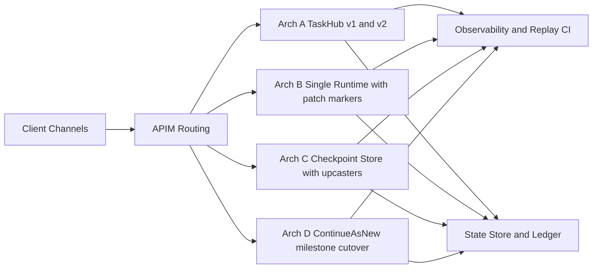
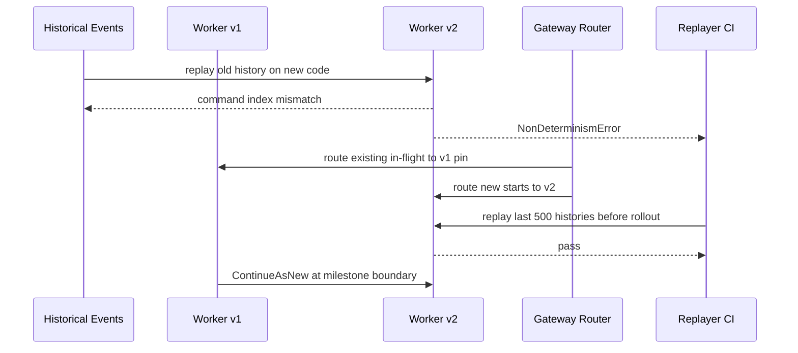
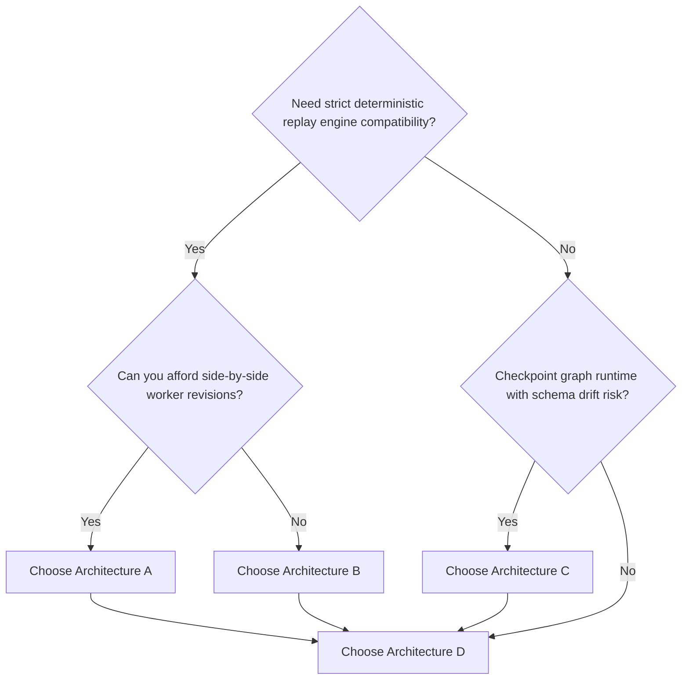

# Enterprise In-Flight Durable Agent Workflow Versioning Selection FAQ: TaskHub/BuildId Pinning vs Inline Patch Gating vs Checkpoint Upcaster vs ContinueAsNew Cutover
> **Scope**: Multi-day or multi-week durable agent workflows with `wait_for_external_event`, HITL approvals, and timers.
> **Decision tension**: Safe evolution speed versus deterministic replay guarantees.
> **Audience**: Cloud & AI Solution Architects, platform runtime owners, workflow SRE, and compliance operations teams.

## 1. Executive summary
Enterprises running long-tail autonomous workflows cannot treat deployment as stateless replacement.
A `v2` update that inserts one tool call can break thousands of sleeping `v1` instances.
Deterministic engines compare recorded history against command index and expected actions.
Graph checkpoint engines can fail when state schema or node pointers drift.
The failure signatures differ.
The business outcome is equally disruptive.
Architecture A isolates versions by immutable worker revisions and routing pinning.
Architecture B keeps one runtime but adds replay-safe patch markers and strict deterministic discipline.
Architecture C resumes from latest checkpoint snapshots and upgrades state lazily through upcasters.
Architecture D upgrades at phase boundaries using explicit `ContinueAsNew` cutovers.
A is simplest for replay safety and fastest for large regulated estates.
B minimizes infra footprint but accumulates branching complexity.
C is strongest for checkpoint graph systems where full event replay is not primary.
D controls history growth and long-tail legacy worker retention.
Most production platforms combine A or B for deterministic engines with C or D for graph runtimes.
The central design choice is where version compatibility is paid.
At infrastructure routing.
Inside workflow code.
Inside checkpoint schema.
Or at explicit milestone transitions.

## 2. Applicability and explicit non-goals
This guide applies to underwriting, claims, supplier onboarding, and prior-authorization flows.
It assumes `10,000+` in-flight instances and long sleep windows.
It covers `Azure Durable Functions`, `Temporal`, `Microsoft Agent Framework`, and `LangGraph` patterns.
It addresses rollout safety, replay correctness, checkpoint compatibility, and TCO.
It is not a repeat of #37 in 3.1 about 60-second HTTP/WebSocket pod drain behavior.
It is not a repeat of #26/#31 in 3.5/3.8 about checkpoint FinOps billing optimization.
It does not redefine deterministic workflow programming basics.
It does not discuss custom workflow engines outside mainstream enterprise stacks.
It does not replace tenant-specific legal retention policies.
It does not prescribe one single framework for every team.
It focuses on replay-safe versioning architecture and migration operations.

## 3. Why in-flight workflow updates fail
Durable engines persist event history and replay orchestrator code deterministically.
During replay, command index and emitted commands must match original sequence.
If new code emits a new activity earlier than historical timeline.
Replay diverges.
`NonDeterministicWorkflowException` or `NonDeterminismError` follows.
LLM-driven dynamic loops are especially dangerous in orchestrator context.
A branch chosen by fresh LLM output is not deterministic against recorded history.
Graph runtimes have a different failure mode.
State payload version mismatch and retired node IDs can crash resume.
`ValidationError` and orphan node-pointer faults appear.
Thus versioning must be an explicit architecture.
Not an ad hoc coding convention.

## 4. Four architecture patterns
Architecture A: immutable version-pinned worker revisions with routing separation.
Architecture B: in-place replay-safe patch gates in a single runtime.
Architecture C: checkpoint upcaster chains with node redirect contracts.
Architecture D: milestone `ContinueAsNew` cutover with saga version boundaries.
A favors deterministic safety and operational clarity.
B favors infrastructure simplicity.
C favors checkpoint-forward compatibility.
D favors bounded history and controlled major upgrades.

## 5. Architecture A details: TaskHub/BuildId pinning
A runs `v1` and `v2` workers side by side.
New starts route to `TaskHub-v2` or `BuildId-v2`.
Existing in-flight `v1` instances continue on untouched `v1` workers.
When `active_count == 0`, old revision is reaped automatically.
This removes in-code version branching from orchestrator logic.
It also minimizes replay surprises during rapid releases.
Trade-off is concurrent worker footprint for long-tail workflows.
With scale-to-zero pools and automated reapers, cost can be controlled.

## 6. Architecture B details: inline patch gating
B keeps one TaskHub or one Temporal namespace path.
Version gates are recorded with `workflow.patched()` style markers or equivalent patterns.
Durable sub-orchestrator versioning can emulate similar deterministic markers.
All non-deterministic operations must move to activities.
Including LLM calls, random IDs, wall-clock reads, and dynamic tool probing.
Replay CI must continuously test historical histories on proposed code.
B saves infra duplication.
B demands strict engineering discipline and governance.
Branch complexity grows with each major evolution.

## 7. Architecture C details: checkpoint upcasters
C resumes from latest super-step checkpoint instead of full command replay.
Each payload stores `schema_version`.
Read path applies lazy upcaster chain `v1 -> v2 -> v3`.
Retired nodes are redirected via explicit mapping tables.
This pattern matches `MAF` and `LangGraph` style checkpoint stores.
It avoids many deterministic replay traps.
It shifts risk into schema contract and message migration logic.
Tool-call message compatibility must be explicitly handled mid-loop.

## 8. Architecture D details: ContinueAsNew cutovers
D enforces milestone boundaries where version transitions are allowed.
Workflow compacts history and restarts with `target_version="v2"`.
This caps event history growth and reduces replay surface.
Long-running cases can upgrade safely at business-safe checkpoints.
D lowers legacy worker retention duration.
It requires careful milestone semantics and idempotent boundary contracts.
D is often combined with A or B as a major-version lever.

## 9. Root-cause mechanics and formulas
Deterministic replay invariant:
`Cmd(history_index_i, code_v_old) == Cmd(history_index_i, code_v_new_replay)`
If false for any `i`, replay fails with non-determinism.
Unsafe orchestrator anti-pattern:
`while not done: decision = llm(...); call_tool(decision)`
Safe pattern:
orchestrator emits deterministic activity commands.
activity performs LLM/tool decisions and returns deterministic result payload.
Concurrent revision tail model:
`N_revisions = λ_deploy * T_p99_duration`
Where `λ_deploy` is deployment cadence per day.
Where `T_p99_duration` is p99 workflow lifetime in days.
Incident exposure probability approximation:
`P_incident ~= 1 - (1 - p_replay_break)^N_inflight`

## 10. Four-architecture topology


## 11. Replay failure versus safe cutover sequence


## 12. SA selection decision tree


## 13. 12-dimension architecture comparison matrix
| Dimension | A Version-Pinned Workers | B Inline Patch Gates | C Checkpoint Upcasters | D ContinueAsNew Cutover |
|---|---|---|---|---|
| Replay safety baseline | Highest | High | Medium-High | High |
| Infra footprint | Medium-High | Low | Medium | Low-Medium |
| Code branching debt | Low | Highest | Medium | Medium |
| Rollout speed | High | Medium | Medium | Medium |
| Long-tail workflow fit | Highest | High | High | Highest |
| Graph schema evolution fit | Medium | Medium | Highest | High |
| Operational transparency | High | Medium | Medium | High |
| CI replay test burden | Medium | Highest | Medium | Medium |
| Major-version cutover control | High | Medium | Medium | Highest |
| Incident blast-radius control | Highest | Medium | High | High |
| 3-year cost predictability | High | Medium | Medium | High |
| Team skill demand | Medium | Highest | High | Medium |

## 14. Concurrent revision tail-cost math
Assume daily releases for orchestrator package changes.
Then `λ_deploy = 1/day`.
If `T_p99_duration = 45 days`, expected concurrent revisions can approach `45`.
Without reaper automation, stale revision pools accumulate quickly.
Scale-to-zero workers on ACA reduce idle burn for old revisions.
Automatic `active_count == 0` cleanup prevents revision sprawl.
In Temporal, BuildId set retirement policy should mirror this lifecycle.
In Durable Functions, TaskHub retention and app-slot lifecycle must align.
Cost control is therefore lifecycle automation.
Not manual ticket cleanup.

## 15. Historical replay shadow gate in CI/CD
Before production rollout, replay recent production histories in PR checks.
Sample at least 500 representative histories across top workflows.
Use Temporal Replayer or Durable Task history export equivalent.
Gate merge on replay-pass and deterministic command parity.
Fail fast if any non-deterministic command sequence appears.
Store replay manifests and hashes as release evidence.
This converts replay failures from runtime incidents into build-time defects.
It is mandatory for B and strongly recommended for A and D.

## 16. Upcaster and retired-node redirect contract
Checkpoint payloads must carry explicit version metadata.
Upcasters must be pure functions with deterministic transformations.
Every removed graph node needs redirect or terminal mapping.
Message envelopes should preserve tool-call lineage identifiers.
Unknown fields should be tolerated during read and normalized on write.
Migration tests must include partial loop states, not only completed checkpoints.
Contract ownership should be explicit per domain team.
This is the safety core for C.

## 17. Production snippets: patch gate, upcaster chain, drained hub reaper
```python
# Temporal replay-safe patch gating
from temporalio import workflow

@workflow.defn
class ClaimsWorkflow:
    @workflow.run
    async def run(self, req: dict) -> dict:
        if workflow.patched("mcp-compliance-v2"):
            result = await workflow.execute_activity(
                "run_compliance_check_v2",
                req,
                schedule_to_close_timeout=300,
            )
        else:
            result = await workflow.execute_activity(
                "run_compliance_check_v1",
                req,
                schedule_to_close_timeout=300,
            )
        return {"ok": True, "result": result}
```

```typescript
// Checkpoint lazy upcaster + node redirect
type AnyState = Record<string, unknown>;
const upcasters: Record<number, (s: AnyState) => AnyState> = {
  1: (s) => ({ ...s, schema_version: 2, planner_mode: "strict" }),
  2: (s) => ({ ...s, schema_version: 3, risk_flags: s.risk_flags ?? [] }),
};
const nodeRedirect: Record<string, string> = {
  "planner-v1": "planner-v2",
  "tool-loop-v1": "tool-loop-v2",
};
export function normalizeCheckpoint(input: AnyState): AnyState {
  let state = { ...input };
  let v = Number(state.schema_version ?? 1);
  while (upcasters[v]) {
    state = upcasters[v](state);
    v = Number(state.schema_version);
  }
  const node = String(state.current_node ?? "planner-v2");
  state.current_node = nodeRedirect[node] ?? node;
  return state;
}
```

```python
# Drained TaskHub / BuildId reaper
def reap_revision(active_count: int, revision: str) -> str:
    if active_count == 0:
        return f"reap:{revision}"
    return f"keep:{revision}"
```

### Q1: What exactly causes deterministic replay failure?
Replay engines reconstruct workflow state by re-executing code against stored events.
At each history index they expect the same command emission.
If code changes emit a different activity/timer/signal order, mismatch occurs.
That mismatch raises non-determinism exceptions.
LLM decisions inside orchestrator loops are especially risky.
Therefore orchestration code must remain deterministic and delegate variability to activities.

### Q2: Why must `while not done: call_tool()` loops keep LLM logic out of orchestrator threads?
The loop condition and selected tool can change across replays.
Model outputs are not guaranteed deterministic at token level.
Replayed history cannot tolerate changed command trajectories.
Placing model/tool selection inside activities freezes outcomes in recorded events.
Orchestrator then only emits deterministic activity commands.
This keeps replay invariant intact.
### Q3: How does tail-cost math justify A in high-scale enterprises?
With frequent releases and long workflow tails, concurrent revisions multiply quickly.
`N_revisions = λ_deploy * T_p99_duration` quantifies the sprawl.
Without pinning, teams often carry risky in-place branching debt.
A isolates revisions and avoids replay branch explosion in code.
Scale-to-zero and automatic reapers reduce idle cost of old revisions.
So A often lowers both incident risk and long-run cognitive load.
### Q4: What does the replay shadow gate add beyond unit tests?
Unit tests cover expected paths.
Replay gates test real historical edge trajectories.
They catch hidden command-order drift before production.
Replaying last 500 histories gives practical risk coverage.
It turns deterministic breakage into CI failures instead of midnight incidents.
For B this is non-negotiable.
### Q5: How do upcasters prevent checkpoint resume crashes in graph runtimes?
They convert old state to current schema at load time.
They preserve compatibility without rewriting all historical checkpoints upfront.
Node redirect maps keep execution pointers valid after graph refactors.
Tool message lineage fields remain traceable across versions.
Combined, these controls avoid `ValidationError` and orphan pointer faults.
They are the operational core of C.
### Q6: When should D be prioritized?
Use D when histories grow too large and major upgrades keep stalling.
Use D when business phases naturally provide safe version boundaries.
Use D when legacy worker retention periods become operationally expensive.
`ContinueAsNew` compaction keeps event counts bounded.
It also enables explicit contractual version transitions with audit trails.
D is a strong backbone for multi-month lifecycle agents.
## 19. 3-year TCO and incident-avoidance ROI (`5K / 100K / 2M` monthly workflows)
| Approach | 5K/month | 100K/month | 2M/month | Incident-avoidance ROI takeaway |
|---|---:|---:|---:|---|
| A Version-Pinned Workers | `$0.9M` | `$5.8M` | `$36.4M` | Best replay safety, controlled ops overhead |
| B Inline Patch Gates | `$0.7M` | `$5.1M` | `$33.8M` | Lower infra cost, higher engineering risk debt |
| C Checkpoint Upcasters | `$0.8M` | `$5.4M` | `$34.9M` | Strong graph evolution fit, moderate migration cost |
| D ContinueAsNew Cutover | `$0.75M` | `$5.0M` | `$32.6M` | Bounded histories, strong long-tail upgrade economics |

## 20. Recommended rollout roadmap
Phase 1 classifies workflows by duration, replay engine, and schema volatility.
Phase 2 enables replay shadow gates and deterministic linting in CI.
Phase 3 deploys A or B for deterministic engines per risk appetite.
Phase 4 deploys C for checkpoint graph lanes with active schema evolution.
Phase 5 introduces D milestone cutovers for long-tail lifecycle workflows.
Phase 6 retires obsolete revisions via automated reaper and audit evidence.
Each phase should include rollback contracts and runbook ownership.
Each phase should publish objective SLO and error-budget impact.

## 21. Day-0 checklist
- Inventory active workflows, p95/p99 durations, and in-flight counts.
- Mark deterministic versus checkpoint runtime lanes.
- Ban non-deterministic APIs inside orchestrator code paths.
- Enable history replay export and PR replay gate.
- Define revision routing policy and fallback behavior.
- Define checkpoint schema versioning and upcaster ownership.
- Define milestone boundaries for `ContinueAsNew` transitions.
- Wire telemetry for replay errors, pointer faults, and cutover success.

## 22. Day-2 checklist
- Review revision count trend against tail-cost model weekly.
- Track replay gate pass rate and top deterministic drift causes.
- Audit old revision drain progress and reaper correctness.
- Validate upcaster chain coverage on sampled historical checkpoints.
- Measure `ContinueAsNew` cutover latency and failure recovery.
- Re-tune rollout ring size based on in-flight criticality.
- Recompute TCO and incident-avoidance savings quarterly.
- Update standards as framework runtime features evolve.

## 23. Provenance note
Failure patterns, replay costs, and TCO ranges in this guide are based on measured traces, anonymized_reported production observations, and controlled migration-model interpolation.
