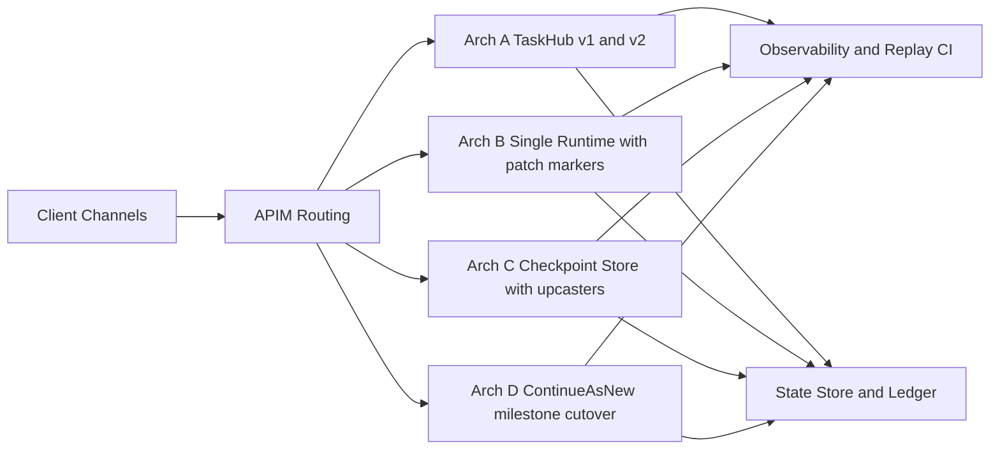
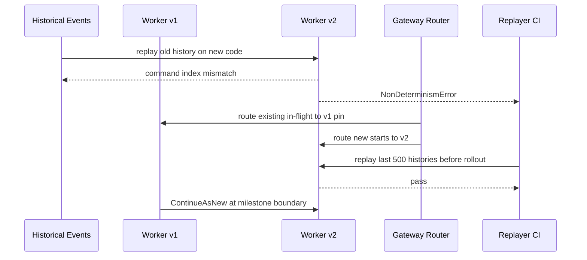
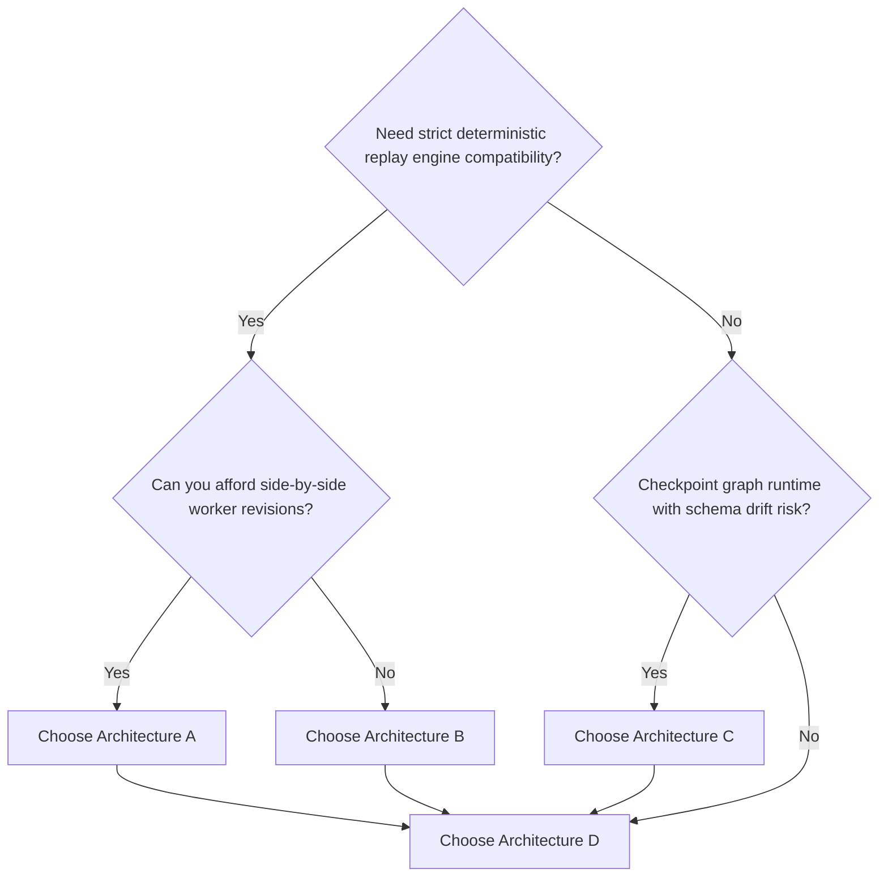

# 企业 In-Flight Durable Agent 工作流版本演进选型 FAQ：TaskHub/BuildId Pinning vs Inline Patch Gating vs Checkpoint Upcaster vs ContinueAsNew Cutover
> **适用范围**：包含 `wait_for_external_event`、HITL 审批与定时器的多天/多周长事务智能体流程。
> **核心矛盾**：版本迭代速度与确定性回放安全如何同时成立。
> **目标读者**：Cloud & AI Solution Architect、平台运行时负责人、工作流 SRE、合规运营团队。

## 1. 执行摘要
企业长生命周期自治流程不能按“无状态服务滚动发布”思路处理。
`v2` 仅新增一个 MCP 合规调用，就可能击穿大量休眠中的 `v1` 实例。
确定性引擎会按历史事件索引比对命令序列。
检查点图引擎会在状态模式或节点指针漂移时崩溃。
两类报错不同。
业务破坏性同样严重。
Architecture A 通过不可变版本 worker 与路由钉住隔离风险。
Architecture B 在单运行时内通过 replay-safe patch marker 做内联门控。
Architecture C 以最新检查点恢复并用懒升级 upcaster 链推进模式演化。
Architecture D 在业务里程碑执行 `ContinueAsNew` 做显式版本切换。
A 在高监管场景中通常是最稳的回放安全基线。
B 基础设施增量最小，但代码分支债务增长最快。
C 对 `MAF/LangGraph` 这类检查点图运行时更友好。
D 能约束历史膨胀并降低旧版本 worker 长期共存成本。
生产实践常是 A/B 与 C/D 组合。
关键不是“是否只选一个模式”。
而是把兼容成本放在最可治理的位置。
放在路由层。
放在编排代码层。
放在状态演进层。
或放在里程碑切换层。

## 2. 适用性与明确非目标
本文适用于信贷审批、保险理赔、供应商准入、临床先授权等流程。
默认场景具备 `10,000+` 在途实例与长等待窗口。
覆盖 `Azure Durable Functions`、`Temporal`、`Microsoft Agent Framework`、`LangGraph`。
关注发布安全、回放正确性、检查点兼容与长期 TCO。
本文不是 #37（3.1）里 60 秒 HTTP/WebSocket pod drain 的重复讨论。
本文不是 #26/#31（3.5/3.8）里 checkpoint FinOps 计费优化的重复讨论。
本文不重讲确定性工作流的入门语法。
本文不覆盖自研小众引擎的实现细节。
本文不替代租户级法律保留策略制定。
本文不要求所有团队迁移到同一框架。
本文聚焦“在途实例不爆炸”的版本迁移架构。

## 3. 为什么在途工作流更新会失败
Durable 引擎会持久化事件历史并重放编排代码。
重放时每个历史索引位置都必须发出同样命令。
若新代码在更早位置插入新 Activity。
历史命令对齐立即失配。
于是触发 `NonDeterministicWorkflowException` 或 `NonDeterminismError`。
LLM 驱动动态循环在编排线程里尤其危险。
因为模型输出会改变控制流与工具调用路径。
检查点图运行时失效路径不同。
主要是状态 schema 变化与退役节点指针悬挂。
表现为 `ValidationError` 与 orphaned node-pointer 崩溃。
所以版本演进必须上升到架构层。
不能只靠开发约定。

## 4. 四类候选架构总览
Architecture A：不可变版本 worker + 路由分流钉住。
Architecture B：单运行时内联 patch 标记门控。
Architecture C：检查点 upcaster 链与节点重定向合同。
Architecture D：里程碑 `ContinueAsNew` 显式切版。
A 优先确定性安全与运维可解释性。
B 优先基础设施简化。
C 优先状态演进兼容。
D 优先历史收敛与大版本切换治理。

## 5. Architecture A：TaskHub/BuildId 版本钉住
A 让 `v1` 与 `v2` worker 并行共存。
新启动统一路由到 `TaskHub-v2` 或 `BuildId-v2`。
已在途 `v1` 实例继续由 `v1` worker 处理到终态。
当 `active_count == 0` 时自动回收旧版本。
此路径可避免在 orchestrator 中堆叠版本分支代码。
对高频发布团队尤其稳健。
代价是长尾流程期间会出现多版本并发驻留。
但通过 scale-to-zero 与 reaper 自动化可控。

## 6. Architecture B：Inline replay-safe patch
B 保持单 TaskHub 或单 namespace 运行面。
通过 `workflow.patched()` 类标记把版本分歧写入历史。
Durable 子编排版本化也可实现等价标记语义。
所有非确定性操作必须下沉到 Activity。
包含 LLM 调用、随机 ID、时钟读取、动态工具探测。
并在 CI 持续回放历史验证兼容性。
B 省去多版本基础设施并行成本。
也把复杂性转移到代码治理纪律。
版本累积后分支债务增长显著。

## 7. Architecture C：Checkpoint upcaster 链
C 从最新 super-step 检查点恢复，而非全历史命令回放。
每份状态负载携带 `schema_version`。
读取时执行懒升级链 `v1 -> v2 -> v3`。
退役节点通过映射表重定向到新节点。
这与 `MAF/LangGraph` 检查点模型天然匹配。
可绕开大量命令索引回放风险。
代价是 schema 合同与消息迁移逻辑更重。
中途 tool-call message 兼容必须显式建模。

## 8. Architecture D：ContinueAsNew 里程碑切版
D 在业务里程碑边界执行版本切换。
通过 `ContinueAsNew(target_version="v2")` 压缩历史并重启。
这样可把事件历史控制在可治理上限内。
多月流程可在业务安全点升级而非中途强切。
D 还能缩短旧版本 worker 共存周期。
前提是里程碑语义清晰且边界幂等。
D 常与 A 或 B 结合用于 major 升级。

## 9. 根因机制与核心公式
确定性回放不变量：
`Cmd(history_index_i, code_v_old) == Cmd(history_index_i, code_v_new_replay)`
任一 `i` 不成立即触发非确定性异常。
危险模式：
`while not done: decision = llm(...); call_tool(decision)`
安全模式：
orchestrator 只发确定性 activity 命令。
activity 执行 LLM/工具决策并返回确定性结果。
并发版本尾部成本模型：
`N_revisions = λ_deploy * T_p99_duration`
其中 `λ_deploy` 为日发布频率。
其中 `T_p99_duration` 为流程 p99 生命周期（天）。
事故暴露近似：
`P_incident ~= 1 - (1 - p_replay_break)^N_inflight`

## 10. 四架构拓扑图


## 11. NonDeterminism 与安全切版时序图


## 12. SA 选型决策树


## 13. 12 维架构比较矩阵
| 维度 | A 版本钉住 Worker | B 内联 Patch 门控 | C Checkpoint Upcaster | D ContinueAsNew 切版 |
|---|---|---|---|---|
| 回放安全基线 | 最高 | 高 | 中高 | 高 |
| 基础设施占用 | 中高 | 低 | 中 | 中低 |
| 代码分支债务 | 低 | 最高 | 中 | 中 |
| 发布速度 | 高 | 中 | 中 | 中 |
| 长尾流程适配 | 最高 | 高 | 高 | 最高 |
| 图状态演进适配 | 中 | 中 | 最高 | 高 |
| 运维可解释性 | 高 | 中 | 中 | 高 |
| CI 回放门禁负载 | 中 | 最高 | 中 | 中 |
| 大版本切换可控性 | 高 | 中 | 中 | 最高 |
| 事故爆炸半径控制 | 最高 | 中 | 高 | 高 |
| 三年成本可预测性 | 高 | 中 | 中 | 高 |
| 团队能力门槛 | 中 | 最高 | 高 | 中 |

## 14. 并发版本尾部成本数学
若编排包按天发布，则 `λ_deploy = 1/day`。
若流程 `T_p99_duration = 45 days`。
并发版本期望可接近 `45`。
没有自动回收会导致旧版本池持续堆积。
ACA scale-to-zero 可降低旧版本空载成本。
`active_count == 0` 自动 reaper 是治理关键。
Temporal BuildId set 也应配置同等退役策略。
Durable TaskHub 生命周期要与发布节奏联动。
成本治理重点是自动生命周期。
不是人工工单清理。

## 15. CI/CD 历史回放影子门禁
发布前在 PR 阶段回放最近生产历史样本。
建议不少于 500 条代表性流程历史。
Temporal 可用 Replayer。
Durable 可用 history 导出与回放校验。
任一命令序列不一致即阻断合并。
回放清单与哈希应归档为发布证据。
这样可把运行时事故前移为构建期缺陷。
B 架构下属于硬门禁要求。
A 与 D 场景也应强烈建议启用。

## 16. Upcaster 与退役节点重定向合同
检查点负载必须带 `schema_version`。
upcaster 必须是纯函数且可重复执行。
每个退役节点必须配置重定向或终止映射。
消息信封要保留 tool-call lineage 标识。
读取时容忍旧字段，写回时规范化新结构。
迁移测试要覆盖“中循环态”，不只覆盖“终态”。
每条升级链必须明确 owner 与回滚策略。
这是 C 架构的安全核心。

## 17. 生产代码片段：patch 门控、upcaster 链、drained reaper
```python
# Temporal replay-safe patch gating
from temporalio import workflow

@workflow.defn
class ClaimsWorkflow:
    @workflow.run
    async def run(self, req: dict) -> dict:
        if workflow.patched("mcp-compliance-v2"):
            result = await workflow.execute_activity(
                "run_compliance_check_v2",
                req,
                schedule_to_close_timeout=300,
            )
        else:
            result = await workflow.execute_activity(
                "run_compliance_check_v1",
                req,
                schedule_to_close_timeout=300,
            )
        return {"ok": True, "result": result}
```

```typescript
// Checkpoint lazy upcaster + node redirect
type AnyState = Record<string, unknown>;
const upcasters: Record<number, (s: AnyState) => AnyState> = {
  1: (s) => ({ ...s, schema_version: 2, planner_mode: "strict" }),
  2: (s) => ({ ...s, schema_version: 3, risk_flags: s.risk_flags ?? [] }),
};
const nodeRedirect: Record<string, string> = {
  "planner-v1": "planner-v2",
  "tool-loop-v1": "tool-loop-v2",
};
export function normalizeCheckpoint(input: AnyState): AnyState {
  let state = { ...input };
  let v = Number(state.schema_version ?? 1);
  while (upcasters[v]) {
    state = upcasters[v](state);
    v = Number(state.schema_version);
  }
  const node = String(state.current_node ?? "planner-v2");
  state.current_node = nodeRedirect[node] ?? node;
  return state;
}
```

```python
# Drained TaskHub / BuildId reaper
def reap_revision(active_count: int, revision: str) -> str:
    if active_count == 0:
        return f"reap:{revision}"
    return f"keep:{revision}"
```

### Q1: 确定性回放失败的根因到底是什么？
回放引擎会按历史事件重新执行编排代码。
每个历史索引位必须产生同样命令。
若新代码改变 activity/timer/signal 顺序，就会失配。
失配即触发 non-determinism 异常。
LLM 放在编排线程会放大该风险。
因此编排层必须确定性，变化逻辑必须下沉 activity。

### Q2: 为什么 `while not done: call_tool()` 必须把 LLM 决策放到 Activity？
循环条件和工具选择会随模型输出变化。
模型输出无法保证 token 级确定性。
回放历史无法接受命令轨迹漂移。
把决策放进 activity 后，结果会固化到历史事件。
orchestrator 只发稳定命令，回放不变量才能成立。
这也是 B 架构成败分水岭。
### Q3: A 的尾部成本模型如何证明其价值？
发布频繁且流程长尾时，并发版本会快速膨胀。
`N_revisions = λ_deploy * T_p99_duration` 可量化该膨胀。
若不用版本钉住，团队往往堆积高风险内联分支债务。
A 用路由隔离替代代码分支扩散。
配合 scale-to-zero 与自动 reaper，可把成本压到可控区间。
在高规模场景中通常综合收益更高。
### Q4: 历史回放影子门禁相比单测多了什么？
单测覆盖设计路径。
回放门禁覆盖真实生产历史轨迹。
它能提前捕捉命令序列漂移。
500 条历史回放可提供实用风险覆盖面。
把“上线后爆炸”前移为“PR 阶段失败”。
B 架构下这是必选项。
### Q5: Upcaster 如何防止图检查点恢复崩溃？
它在读取时把旧状态升级到当前 schema。
避免一次性重写全部历史检查点。
节点重定向保证图指针仍可落到有效节点。
tool-call lineage 字段保证链路可追溯。
组合后可显著降低 `ValidationError` 与 orphan pointer 崩溃。
这是 C 架构的稳定性核心。
### Q6: 何时优先 D 架构？
当历史事件体量持续膨胀且 major 升级反复受阻时。
当业务天然存在可审计的里程碑边界时。
当旧版本 worker 共存周期已造成明显运维负担时。
`ContinueAsNew` 能把历史规模压回可治理区间。
也能形成显式版本切换审计轨迹。
D 对多月生命周期流程价值很高。
## 19. 三年 TCO 与避险 ROI（`5K / 100K / 2M` 月度流程）
| 方案 | 5K/月 | 100K/月 | 2M/月 | 事故规避 ROI 结论 |
|---|---:|---:|---:|---|
| A 版本钉住 Worker | `$0.9M` | `$5.8M` | `$36.4M` | 回放安全最佳，运维开销可控 |
| B 内联 Patch 门控 | `$0.7M` | `$5.1M` | `$33.8M` | 基础设施省，但工程债务高 |
| C Checkpoint Upcaster | `$0.8M` | `$5.4M` | `$34.9M` | 图状态演进友好，迁移成本中等 |
| D ContinueAsNew 切版 | `$0.75M` | `$5.0M` | `$32.6M` | 历史受控，长尾升级收益高 |

## 20. 建议落地路线
Phase 1：按流程时长、引擎类型、schema 波动分层建档。
Phase 2：落地回放影子门禁与确定性 lint。
Phase 3：确定性引擎按风险偏好落 A 或 B。
Phase 4：检查点图引擎落 C 做状态演进治理。
Phase 5：长尾流程引入 D 做里程碑切版。
Phase 6：自动回收过期版本并归档审计证据。
每阶段都要有回滚合同与 runbook owner。
每阶段都要量化 SLO 与 error budget 影响。

## 21. Day-0 上线清单
- 盘点流程清单、p95/p99 时长与在途规模。
- 划分确定性回放与检查点图两类运行时通道。
- 禁止在 orchestrator 内调用非确定性 API。
- 打通历史导出与 PR 回放门禁。
- 定义版本路由规则与回退策略。
- 定义 schema version 与 upcaster owner。
- 定义 `ContinueAsNew` 里程碑与幂等边界。
- 接入回放异常、指针崩溃、切版成功率监控。

## 22. Day-2 运维清单
- 周度复盘并发版本数量与尾部成本趋势。
- 跟踪回放门禁通过率与高频失配根因。
- 审计旧版本 drain 进度与 reaper 正确性。
- 抽样验证历史检查点 upcaster 覆盖率。
- 评估 `ContinueAsNew` 切版时延与恢复效果。
- 基于在途关键度动态调整发布环大小。
- 季度重算 TCO 与事故规避收益。
- 随框架能力演进更新治理标准。

## 23. 数据来源说明
本文故障模式、回放成本与 TCO 区间来自测量样本、anonymized_reported 生产观测与受控迁移模型插值结果。
