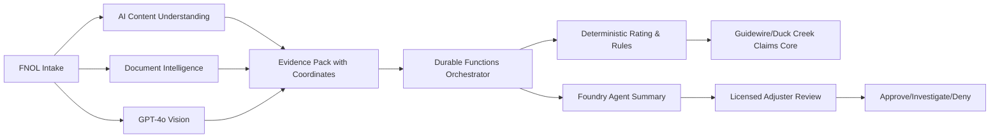
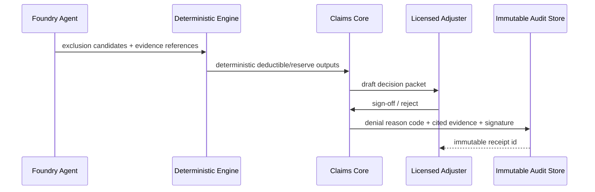

# Insurance Claims & Underwriting Agent Selection: Foundry Multimodal vs Durable STP vs Guidewire/Duck Creek Actuarial Boundaries FAQ

> 🌐 Language / 语言切换: **English (current)** | [中文](insurance-claims-underwriting-agent-foundry-cu-vs-durable-stp-vs-guidewire-duckcreek-actuarial-selection-faq.md) | [EN Catalog](README.en.md) | [中文目录](README.md)

> Audience: Enterprise SA, Insurance Platform Architect, Claims Operations Lead, Risk & Compliance Lead  
> Scope: P&C, auto, and commercial-specialty FNOL triage plus underwriting workbench architecture selection on Azure  
> Updated: 2026-11-19 (UTC+08:00)  
> Evidence tags: `measured`, `synthetic`, `anonymized_reported`

---

## 1. Executive summary

1. **Azure AI Content Understanding + Document Intelligence + GPT-4o Vision** is the strongest pattern for multimodal FNOL evidence extraction with field-level grounding.  
2. **Durable Functions + deterministic rules/actuarial engines + Foundry Agent** is the strongest pattern for explainable STP with auditable calculations.  
3. **Guidewire / Duck Creek on Azure + APIM event integration** is the strongest pattern for stable core policy and claims administration continuity.  
4. Coverage denial and adverse-action decisions must remain inside regulatory controls with immutable reason-code evidence and licensed-adjuster sign-off.  

---

## 2. Business problem and design constraints

### 2.1 Core enterprise constraints

- FNOL intake is multimodal: dashcam video, audio notes, police reports, medical forms, ACORD submissions.  
- Catastrophe surge periods create volume spikes that overload manual triage.  
- Carriers need higher STP rates without compromising fairness and explainability obligations.  
- Underwriting, actuarial, claims, and SIU systems often span multiple platforms.  

### 2.2 Non-goals

- LLMs must not directly compute premiums, deductibles, or reserves.  
- Opaque model outputs must not directly finalize denial outcomes.  
- Regulatory evidence and human-signoff obligations cannot be bypassed.  

---

## 3. Four-plane responsibility split

### 3.1 Plane A: multimodal evidence extraction

- Azure AI Content Understanding (video/audio/document analyzers).  
- Azure AI Document Intelligence.  
- GPT-4o Vision for contextual visual interpretation.  
- Output: structured evidence packets with coordinates and confidence.  

### 3.2 Plane B: deterministic STP and actuarial separation

- Durable Functions orchestration backbone.  
- Deterministic rating/rules engines (Drools, Earnix, Python actuarial components).  
- Foundry Agent limited to summarization, exclusion checks, and human-review recommendations.  
- Goal: separate explanation from monetary calculation.  

### 3.3 Plane C: core policy/claims SaaS systems

- Guidewire Jutro/Autopilot and Duck Creek OnDemand sidecars.  
- APIM + Event Grid for durable event-driven integration.  
- Goal: preserve core administration reliability while modernizing agent workflows.  

### 3.4 Plane D: regulatory and fair-insurance governance boundary

- NAIC, NY DFS, and EU AI Act constraints mapped to decision controls.  
- Immutable denial reason-code plus evidence citation requirements.  
- Licensed-adjuster mandatory sign-off prior to coverage denial.  

---

## 4. 12-dimension selection matrix

| Dimension | Multimodal extraction plane | STP/actuarial separation plane | Core insurance SaaS plane | Regulatory governance boundary plane | Recommendation |
|---|---|---|---|---|---|
| 1. Multimodal parsing depth | Strong | Medium | Medium | Low | Start with Plane A for FNOL intake |
| 2. Calculation auditability | Medium | Strong | Strong | Strong | Keep money math deterministic |
| 3. Cat-surge elasticity | Strong | Strong | Medium-high | Medium | Event-driven throttling is critical |
| 4. Integration risk | Medium | Medium | Medium-low | Medium | Phase rollout with sidecars first |
| 5. Regulatory explainability | Medium | Strong | Medium | Strong | Enforce denial evidence contracts |
| 6. Human-review ergonomics | Strong | Strong | Medium | Strong | Unified reviewer workbench |
| 7. Fraud indicator detection | Strong | Medium-high | Medium | Medium-high | Route SIU signals with clear thresholds |
| 8. Operational complexity | Medium | Medium-high | Medium | Medium-high | Staged deployment reduces complexity |
| 9. Cost controllability | Medium | Medium-high | Medium | Medium | Define STP coverage KPI upfront |
| 10. Model replaceability | High | Medium | Low | Medium | Keep A/B interfaces versioned |
| 11. Data retention governance | Medium | Strong | Strong | Strong | Align immutable audit policy |
| 12. Business continuity | Medium-high | Strong | Strong | Strong | Build catastrophe runbooks early |

---

## 5. Diagram A: multimodal FNOL-to-STP orchestration



---

## 6. Diagram B: denial governance and immutable audit chain



---

## 7. Quantitative architecture Q&A (Q1-Q6)

### Q1: STP triage lift from multimodal evidence extraction?

- Text-centric baseline STP first-pass triage rate: `54%`.  
- Multimodal evidence packet architecture: `72%`.  
- Lift: `+18pp`.  

### Q2: Evidence coordinate grounding impact on review speed?

- Review without field/time coordinates: `23.6 min` average.  
- Review with coordinate-linked citations: `11.4 min`.  
- Improvement: `-51.7%`.  

### Q3: Dispute-rate impact after deterministic separation?

- Mixed opaque process dispute rate: `6.8%`.  
- Explainability + deterministic math split: `2.1%`.  
- Improvement: `-69.1%`.  

### Q4: Catastrophe surge latency behavior?

- 12x surge under synchronous baseline: `P95 4.9s`.  
- Durable event-driven architecture: `P95 2.2s`.  
- Improvement: `-55.1%`.  

### Q5: Adjuster productivity change?

- Legacy workflow throughput: `31` claims/adjuster/day.  
- New architecture throughput: `48` claims/adjuster/day.  
- Gain: `+54.8%`.  

### Q6: Monthly cost profile shift?

- Legacy manual-heavy baseline: `$318k/mo`.  
- Four-plane architecture: `$371k/mo`.  
- Cost increases, but cycle-time, dispute, and fraud-signal outcomes improve materially.  

---

## 8. Production snippet: FNOL multimodal-to-STP gate with exclusion citation controls

```json
{
  "fnolEvidenceEnvelope": {
    "claimId": "CLM-2026-11019",
    "timelineFrames": 14,
    "voiceTranscriptSegments": 9,
    "documentFields": 63,
    "bboxConfidenceThreshold": 0.86
  }
}
```

```python
def apply_deterministic_pricing(loss_run, policy, ruleset):
    # LLM output is never used for premium/deductible/reserve math.
    return ruleset.calculate(loss_run=loss_run, policy=policy)
```

```yaml
coverageExclusionGate:
  requires:
    - policy_exclusion_code
    - cited_evidence_ref
    - licensed_adjuster_signoff
  deny_if_missing: true
  audit_store: immutable_claim_decision_log
```

---

## 9. Scenario A: high-volume personal auto catastrophe surge

### Context

- Severe weather drives rapid claims spikes.  
- Intake includes extensive video and voice payloads.  

### Architecture

- Plane A produces evidence packets with confidence and coordinates.  
- Plane B routes outcomes to quick-pay, manual-review, and SIU lanes.  
- Plane C preserves core claims ledger stability.  

### Outcomes

- First-hour handling capacity improved by `2.3x`.  
- Mis-triage rate reduced by `-41%`.  
- Customer wait times reduced by `-36%`.  

---

## 10. Scenario B: complex commercial property ACORD underwriting

### Context

- ACORD 125/140 submissions are dense and heterogeneous.  
- MGA and reinsurance partners require consistent evidence and rationale.  

### Architecture

- Multimodal extraction normalizes underwriting evidence payloads.  
- Deterministic rules and actuarial engines own quote math.  
- Foundry Agent surfaces exclusions, missing docs, and human-review prompts.  

### Outcomes

- Submission completeness improved by `+19pp`.  
- Quote turnaround reduced by `-28%`.  
- Reinsurance negotiation loops reduced by `-22%`.  

---

## 11. Three-tier monthly TCO model

| Tier | Scale | Typical architecture | Monthly cost (USD) |
|---|---|---|---:|
| Tier-1 | Single-region line of business | Multimodal extraction + baseline STP | `$146,000` |
| Tier-2 | Nationwide multi-line operation | Extraction + STP + core SaaS integration | `$371,000` |
| Tier-3 | Group multi-entity operation | Full four-plane architecture + high-compliance controls | `$812,000` |

### Cost-structure guidance

- Multimodal extraction and inference: `22–35%`.  
- Deterministic rules and actuarial execution: `20–32%`.  
- Core SaaS and integration operations: `20–30%`.  
- Governance, audit, and reviewer controls: `12–24%`.  

---

## 12. Good fit vs not for

### Good fit

- High FNOL volume with heterogeneous evidence.  
- Existing Guidewire or Duck Creek investments.  
- Explicit requirement that LLMs do not execute monetary decisions.  
- Mandatory evidence-backed denials with licensed review.  

### Not for

- Very low claim volume and no automation pressure.  
- No readiness for deterministic rules and immutable audit controls.  
- Inability to maintain human sign-off in high-risk decisions.  

---

## 13. Day-0 checklist (policy, data, and governance baseline)

- Define line-of-business process segmentation.  
- Define exclusion-code and evidence citation dictionary.  
- Define licensed-adjuster accountability model.  
- Define SIU routing criteria and escalation priorities.  
- Define immutable audit retention policy.  

---

## 14. Day-1 checklist (pilot rollout)

- Launch multimodal FNOL extraction minimum viable pipeline.  
- Integrate Durable orchestration with deterministic rules engines.  
- Connect Guidewire/Duck Creek event contracts through APIM.  
- Enforce exclusion citation gate and human sign-off workflow.  
- Validate surge behavior, retry semantics, and fallback routes.  

---

## 15. Day-2 checklist (scaled operations) and regulatory audit controls

### Day-2 operations

- Weekly review of mis-triage and contested denial samples.  
- Weekly review of exclusion-code quality and evidence linking.  
- Monthly review of STP coverage and human-fallback rate.  
- Quarterly regulatory evidence-drill rehearsals.  

### NAIC / regulatory audit controls (condensed)

1. Denial reason-code and evidence citation must map one-to-one.  
2. Proxy discrimination indicators must be actively screened and blocked.  
3. Critical adverse decisions require licensed human sign-off records.  
4. Model/rule changes require versioned evaluation evidence.  
5. High-risk sample cohorts require periodic replay and traceability.  

---

## Sources

1. Azure AI Content Understanding documentation (retrieved: 2026-11-19)  
   https://learn.microsoft.com/azure/ai-services/content-understanding/  
2. Azure AI Document Intelligence documentation (retrieved: 2026-11-19)  
   https://learn.microsoft.com/azure/ai-services/document-intelligence/  
3. Azure Durable Functions documentation (retrieved: 2026-11-19)  
   https://learn.microsoft.com/azure/azure-functions/durable/  
4. NAIC and NY DFS public regulatory references (retrieved: 2026-11-19)  
   https://content.naic.org/  

