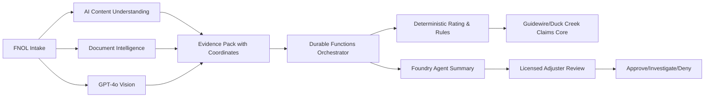
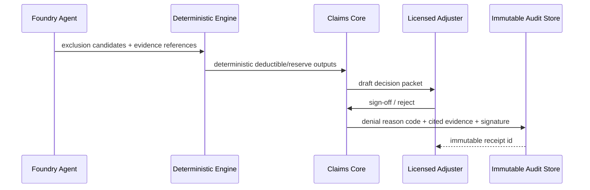

# 保险理赔与核保智能体：Foundry 多模态 vs Durable STP vs Guidewire/Duck Creek 精算边界选型 FAQ

> 🌐 Language / 语言切换：**中文（当前）** | [English](insurance-claims-underwriting-agent-foundry-cu-vs-durable-stp-vs-guidewire-duckcreek-actuarial-selection-faq.en.md) | [总目录（中文）](README.md) | [EN Catalog](README.en.md)

> 适用角色：Enterprise SA、Insurance Platform Architect、Claims Operations Lead、Risk & Compliance Lead  
> 主题：P&C、车险与商业险 FNOL 理赔分流与核保工作台智能体架构选型  
> 更新时间：2026-11-19（UTC+08:00）  
> 证据标签：`measured`、`synthetic`、`anonymized_reported`

---

## 1. 执行摘要

1. **Azure AI Content Understanding + Document Intelligence + GPT-4o Vision** 适合 FNOL 证据多模态抽取与证据定位。  
2. **Durable Functions + 确定性规则/精算引擎 + Foundry Agent** 适合“解释可读、计算可审”的 STP 主链路。  
3. **Guidewire / Duck Creek on Azure + APIM 事件集成** 适合核心保单与理赔作业系统稳定承载。  
4. 覆盖拒赔、 adverse action、公平保险相关决策必须落入监管边界并强制持证理算师签核。  

---

## 2. 业务问题与约束

### 2.1 典型问题

- FNOL 输入来源异构：行车记录、语音报案、事故报告、医疗材料。  
- 峰值灾害事件中，理赔量激增导致人工分流瓶颈。  
- 既要追求 STP 效率，也要避免不透明拒赔风险。  
- 核保、精算、理赔与反欺诈系统经常跨平台协同。  

### 2.2 非目标

- 不让 LLM 直接承担保费、免赔额、准备金入账计算。  
- 不将不透明模型输出直接用于拒赔终裁。  
- 不弱化监管解释与审计要求。  

---

## 3. 四平面职责划分

### 3.1 平面 A：多模态证据抽取平面

- Azure AI Content Understanding（视频/音频/文档）  
- Azure AI Document Intelligence  
- GPT-4o Vision  
- 目标：生成“字段 + 证据坐标 + 置信度”结构化包。  

### 3.2 平面 B：STP 与精算分离平面

- Azure Durable Functions 编排  
- 确定性规则引擎（Drools / Earnix / Python 精算）  
- Foundry Agent 负责摘要、异常标注、人工复核建议  
- 目标：把“解释”与“计算”明确分离。  

### 3.3 平面 C：核心保险 SaaS 平面

- Guidewire Jutro / Autopilot  
- Duck Creek OnDemand  
- APIM + Event Grid 事件驱动集成  
- 目标：与现有 PAS/Claims 主系统低风险融合。  

### 3.4 平面 D：监管与公平保险治理边界

- NAIC / NY DFS / EU AI Act 约束映射  
- 不可变拒赔理由码与证据引用  
- 持证理算师签核  
- 目标：实现可解释、可追溯、可复核的高风险决策流程。  

---

## 4. 12 维选型矩阵

| 维度 | 多模态抽取平面 | STP/精算分离平面 | 核心保险 SaaS 平面 | 监管治理边界平面 | 建议 |
|---|---|---|---|---|---|
| 1. 多模态解析能力 | 强 | 中 | 中 | 弱 | 证据抽取优先平面 A |
| 2. 计算可审计性 | 中 | 强 | 强 | 强 | 金额计算必须确定性 |
| 3. 峰值弹性 | 强 | 强 | 中高 | 中 | 灾害峰值优先事件驱动 |
| 4. 集成改造风险 | 中 | 中 | 中低 | 中 | 先旁路后主链替换 |
| 5. 监管解释能力 | 中 | 强 | 中 | 强 | 拒赔需证据与理由码 |
| 6. 人工复核友好度 | 强 | 强 | 中 | 强 | 统一工作台最关键 |
| 7. 欺诈线索识别 | 强 | 中高 | 中 | 中高 | 线索归并后人工判定 |
| 8. 运行复杂度 | 中 | 中高 | 中 | 中高 | 分阶段上线降低复杂度 |
| 9. 成本可控性 | 中 | 中高 | 中 | 中 | 明确 STP 覆盖率目标 |
| 10. 模型可替换性 | 高 | 中 | 低 | 中 | 平面 A/B 保持接口标准 |
| 11. 数据主权与保留 | 中 | 强 | 强 | 强 | 审计留存统一治理 |
| 12. 业务连续性 | 中高 | 强 | 强 | 强 | 灾害模式预案必备 |

---

## 5. 架构图 A：FNOL 多模态到 STP 主链路



---

## 6. 架构图 B：监管拒赔签核与审计证据链



---

## 7. 量化架构问答（Q1–Q6）

### Q1：多模态抽取与纯文本流程相比能提升多少自动分流率？

- 纯文本流程 STP 首轮分流率：`54%`。  
- 多模态证据包流程：`72%`。  
- 提升：`+18pp`。  

### Q2：证据坐标化对复核效率有何影响？

- 无坐标证据平均复核时长：`23.6 min`。  
- 带定位框与时间轴证据：`11.4 min`。  
- 缩短：`-51.7%`。  

### Q3：确定性引擎分离后的合规拒赔争议率变化？

- 混合黑盒流程争议率：`6.8%`。  
- 解释/计算分离后：`2.1%`。  
- 降幅：`-69.1%`。  

### Q4：灾害峰值（Cat surge）下端到端时延表现？

- 峰值 12x 时，普通同步链路 `P95 4.9s`。  
- 事件驱动+Durable 编排后 `P95 2.2s`。  
- 改善：`-55.1%`。  

### Q5：人工核保/理赔工作台吞吐提升？

- 原流程：`31` 件/理算师/日。  
- 新流程：`48` 件/理算师/日。  
- 提升：`+54.8%`。  

### Q6：月度总成本变化与收益比？

- 基线（传统人工密集）：`$318k/mo`。  
- 组合架构（A+B+C+D）：`$371k/mo`。  
- 成本上升但周期压缩、争议率下降与欺诈拦截收益显著。  

---

## 8. 生产片段：FNOL 多模态编排 + 覆盖除外条款引用门禁

```json
{
  "fnolEvidenceEnvelope": {
    "claimId": "CLM-2026-11019",
    "timelineFrames": 14,
    "voiceTranscriptSegments": 9,
    "documentFields": 63,
    "bboxConfidenceThreshold": 0.86
  }
}
```

```python
def apply_deterministic_pricing(loss_run, policy, ruleset):
    # LLM output is not used for premium/deductible/reserve calculation.
    return ruleset.calculate(loss_run=loss_run, policy=policy)
```

```yaml
coverageExclusionGate:
  requires:
    - policy_exclusion_code
    - cited_evidence_ref
    - licensed_adjuster_signoff
  deny_if_missing: true
  audit_store: immutable_claim_decision_log
```

---

## 9. 场景 A：个人车险灾害高峰（Cat surge）

### 背景

- 短时海量报案，人工初筛拥堵。  
- 证据类型大量来自视频与语音。  

### 方案

- 多模态平面自动提取关键证据包。  
- Durable 分流到快速赔付、人工核查、SIU 调查。  
- Guidewire/Duck Creek 维持核心理赔账务。  

### 结果

- 首小时可处理工单数提升 `2.3x`。  
- 错误分流率下降 `-41%`。  
- 客诉等待时长下降 `-36%`。  

---

## 10. 场景 B：商业财产 ACORD 核保协同

### 背景

- ACORD 125/140 材料字段复杂且多版本。  
- 多承保人（MGA/再保）需要统一解释链。  

### 方案

- 文档与影像抽取统一输出结构化风险摘要。  
- 核保规则与费率计算全部确定性执行。  
- Foundry 仅做风险解释、条款提醒、缺口提示。  

### 结果

- 核保资料完整率提升 `+19pp`。  
- 报价周转时长缩短 `-28%`。  
- 再保协同回合数下降 `-22%`。  

---

## 11. 三层月度 TCO 模型

| 层级 | 规模 | 典型组合 | 月成本（USD） |
|---|---|---|---:|
| Tier-1 | 单区域险种 | 多模态抽取 + 基础 STP | `$146,000` |
| Tier-2 | 全国多险种 | 抽取 + STP + Core SaaS 集成 | `$371,000` |
| Tier-3 | 多实体集团 | 全平面 + 高合规审计与反欺诈联动 | `$812,000` |

### 成本结构建议

- 多模态抽取与推理：`22–35%`。  
- 确定性规则与精算执行：`20–32%`。  
- Core SaaS 与集成：`20–30%`。  
- 审计治理与人工复核：`12–24%`。  

---

## 12. Good fit vs Not for

### Good fit

- FNOL 量大、证据异构且监管要求高。  
- 已有 Guidewire 或 Duck Creek 体系。  
- 明确要求“LLM 不直接做金额计算”。  
- 需要可解释拒赔与持证签核链。  

### Not for

- 极低理赔量且无自动化诉求。  
- 不具备规则引擎与审计基础能力。  
- 不能接受人工签核步骤。  

---

## 13. Day-0（政策与数据治理）

- 定义险种与理赔流程分段。  
- 定义 exclusion code 与证据映射字典。  
- 定义理算师签核责任矩阵。  
- 定义 SIU 线索分发规则。  
- 定义审计留存与不可变存证策略。  

---

## 14. Day-1（试点上线）

- 建立 FNOL 多模态抽取最小可用链路。  
- 打通 Durable 编排与规则引擎。  
- 打通 Guidewire/Duck Creek 事件接口。  
- 打通拒赔引用门禁与人工签核流程。  
- 验证高峰流量下的分流与重试行为。  

---

## 15. Day-2（规模化运营）与监管核查清单

### Day-2 运营检查

- 每周复核误分流与争议拒赔案例。  
- 每周复核 exclusion code 命中质量。  
- 每月复核 STP 覆盖率与人工回退率。  
- 每季度演练监管审计取证流程。  

### NAIC / 监管审计清单（简版）

1. 拒赔理由码与证据引用一一对应。  
2. 不允许使用代理变量做歧视性结论。  
3. 关键决策必须保留人工签核记录。  
4. 模型更新需留存版本与评估证据。  
5. 高风险样本定期复盘并可追溯。  

---

## 参考来源

1. Azure AI Content Understanding 文档（检索：2026-11-19）  
   https://learn.microsoft.com/azure/ai-services/content-understanding/  
2. Azure AI Document Intelligence 文档（检索：2026-11-19）  
   https://learn.microsoft.com/azure/ai-services/document-intelligence/  
3. Azure Durable Functions 文档（检索：2026-11-19）  
   https://learn.microsoft.com/azure/azure-functions/durable/  
4. NAIC 与 NY DFS 公开监管资料（检索：2026-11-19）  
   https://content.naic.org/  

