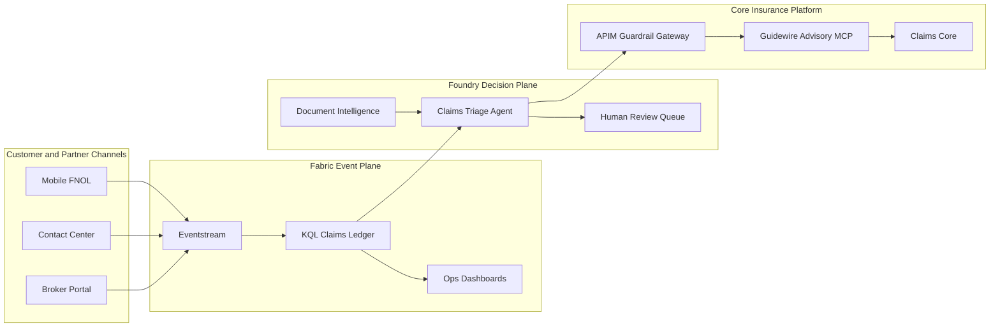
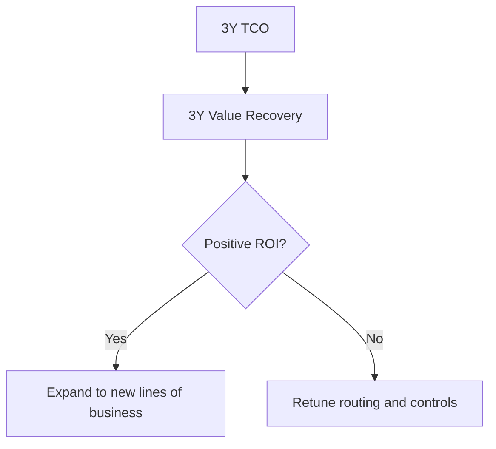

# Insurance FNOL and Claims Fraud Triage Selection FAQ: Foundry Orchestration vs Fabric Event Ledger vs Guidewire Advisory MCP

> 🌐 **Language Switch**: [中文](insurance-fnol-claims-fraud-triage-foundry-vs-fabric-vs-guidewire-mcp-selection-faq.md) | **English (current)**

> Audience: enterprise insurance architects, claims operations leaders, fraud and risk teams, platform engineering leads.
> Objective: reduce FNOL latency and fraud leakage while preserving auditability and controlled core-system integration.

## 1. Executive summary and architecture verdict

The most resilient architecture for large insurers is a three-plane split:
- **Option A**: Fabric event and ledger plane for deterministic claim facts.
- **Option B**: Foundry decision plane for multimodal triage and explainable routing.
- **Option C**: APIM + Guidewire advisory MCP execution plane with strict write guardrails.

A handles truth, B handles intelligence, C handles controlled execution.

## 2. Scope and explicit non-goals

This guide focuses on enterprise architecture and operating model decisions, not model internals.
Covered lifecycle: FNOL intake, evidence extraction, fraud scoring, human review, payout recommendation, and audit export.

Non-goals:
- No direct LLM-initiated payout execution.
- No core-policy mutation without maker-checker authorization.
- No unversioned production rule deployment.
- No compliance shortcut based on model confidence only.

## 3. Option split and responsibility boundaries

A/B/C are complementary, not mutually exclusive.
Programs that skip A usually struggle with cross-team metric disputes.
Programs that skip C usually struggle with safe core-system adoption.

## 4. Reference architecture (Mermaid)



## 5. Option A deep dive: Fabric event truth and operational observability

- Build idempotent ingestion keyed by ClaimId, PolicyId, and event timestamp.
- Normalize FNOL, inspection, invoice, reserve, and payout status as one event model.
- Separate immutable fact tables from derived KPI tables in KQL.
- Track SLA timers from intake to triage, triage to review, and review to closure.
- Retain replay snapshots for both model input and operational output.

## 6. Option B deep dive: Foundry multimodal triage and explainability

- Extract invoices, repair reports, and medical documents with Document Intelligence.
- Combine rule hits and model signals into explainable fraud-risk reasons.
- Route claims by confidence bands into auto-pass, manual review, or investigation queues.
- Attach evidence references and missing-field diagnostics in each recommendation.
- Preserve model/rule version pointers for all triage outcomes.

## 7. Option C deep dive: APIM + Guidewire advisory MCP control plane

- Enforce advisory-only semantics in API policy by default.
- Require explicit approval token for write-capable operations.
- Limit mutable fields through contract-level policy checks.
- Emit immutable audit events to SIEM on every suggested action.
- Isolate sandbox and production credentials and network routes.

## 8. 12-dimension selection matrix

| Dimension | Option A Fabric | Option B Foundry | Option C APIM+Guidewire MCP |
|---|---|---|---|
| Real-time event throughput | High | Medium | Medium |
| Multimodal evidence understanding | Medium | High | Low |
| Explainable fraud triage | Medium | High | Medium |
| Core mutation safety | Medium | Medium | High |
| Audit replay depth | High | High | High |
| Deployment complexity | Medium | Medium-High | Medium-High |
| Cross-team coordination overhead | Medium | Medium-High | Medium |
| Horizontal scalability | High | High | Medium |
| Fault isolation | High | Medium | High |
| Cloud migration friendliness | High | High | Medium |
| Cost predictability | High | Medium | Medium |
| Primary accountability | Fact ledger | Decision orchestration | Controlled execution |

## 9. Governance guardrails and compliance boundaries

- Guardrail 01: Separate recommendation authority from payout execution authority.
- Guardrail 02: Require human evidence retention for high-risk claim outcomes.
- Guardrail 03: Version all rule changes and keep rollback readiness.
- Guardrail 04: Replay-test all model upgrades before production cutover.
- Guardrail 05: Attach evidence references to every deny or hold decision.
- Guardrail 06: Enforce region-specific privacy and data residency controls.
- Guardrail 07: Mask sensitive fields in generated responses and exports.
- Guardrail 08: Track false-positive and false-negative drift every cycle.
- Guardrail 09: Require approval records for threshold adjustments.
- Guardrail 10: Support one-click regulator/auditor evidence package export.
- Guardrail 11: Run quarterly drift and fraud-pattern review sessions.
- Guardrail 12: Run semiannual incident and control-failure drills.

## 10. Production snippet A: Fabric KQL claims truth ledger

```kusto
let W = 7d;
let Fnol = FNOL_Events
  | where EventTime > ago(W)
  | summarize fnol_cnt=count(), first_fnol=min(EventTime) by ClaimId, PolicyId;
let Review = Review_Events
  | where EventTime > ago(W)
  | summarize review_cnt=count(), first_review=min(EventTime), risk_score=max(RiskScore) by ClaimId;
Fnol
| join kind=leftouter Review on ClaimId
| extend mins_to_review = iff(isnull(first_review), real(null), datetime_diff('minute', first_review, first_fnol))
| project ClaimId, PolicyId, fnol_cnt, review_cnt, risk_score, mins_to_review
| order by risk_score desc
```

## 11. Production snippet B: APIM advisory MCP guard policy

```xml
<policies>
  <inbound>
    <base />
    <validate-jwt header-name="Authorization" failed-validation-httpcode="401" />
    <set-variable name="mode" value="@(context.Request.Headers.GetValueOrDefault("x-mcp-mode","advisory"))" />
    <choose><when condition="@(context.Variables.GetValueOrDefault<string>("mode") != "advisory")"><return-response><set-status code="403" reason="WriteBlocked" /></return-response></when></choose>
  </inbound>
  <backend><base /></backend>
  <outbound><base /></outbound>
</policies>
```

## 12. Capacity sizing and 3-year TCO (USD $k)

Assumptions: 1.2M annual claims, 6k FNOL peak events per hour, 3M attachments per year.

| Cost bucket | A-heavy | B-heavy | C-heavy |
|---|---:|---:|---:|
| Event and real-time analytics | 96 | 62 | 48 |
| Intelligent triage and extraction | 52 | 138 | 66 |
| Core integration governance | 28 | 34 | 79 |
| Security and audit platform | 24 | 27 | 31 |
| Operating labor | 63 | 72 | 58 |
| **Monthly total** | **263** | **333** | **282** |

Three-year TCO: A=9468, B=11988, C=10152, layered state around 10320.
Three-year value recovery from fraud reduction, faster closure, and lower manual overhead is estimated around 13680.



## 13. Scenario A: national auto FNOL rapid triage

- Median FNOL-to-triage latency reduced from 38 minutes to 9 minutes.
- Auto-pass share increased from 12% to 41%.
- High-risk fraud hit-rate improved by 27%.
- Manual review backlog peak reduced by 46%.

## 14. Scenario B: health-claim document-heavy adjudication

- Document extraction accuracy improved from 89% to 97%.
- Complex-claim closure cycle reduced by 31%.
- Reviewer productivity improved by 38%.
- Customer dispute rate reduced by 19%.

## 15. Quantitative FAQ, rollout steps, Good fit / Not for

**Q1. Can the model directly approve payouts?**
No. Keep recommendation and execution as separate authorities.

**Q2. Why prioritize Fabric before scaling Foundry triage?**
A stable fact ledger avoids long-term metric and audit disputes.

**Q3. How should thresholds be tuned?**
Tune per product line with monthly replay across FPR/FNR and SLA metrics.

**Q4. How to estimate ROI consistently?**
Use fraud leakage reduction + labor savings + dispute reduction minus incremental platform cost.

**Q5. What is the top Guidewire MCP integration risk?**
Unauthorized writes and unintended field mutation without policy guardrails.

**Q6. When should expansion start?**
After two stable quarters on SLA, audit quality, and model drift controls.

Five-step rollout:
1. Standardize claim master keys and event contracts.
2. Deploy Fabric fact ledger and operational SLO dashboards.
3. Deploy Foundry multimodal triage and review queues.
4. Deploy APIM advisory MCP guardrails for core integration.
5. Institutionalize monthly replay, quarterly audit, and semiannual drill cadence.

Good fit: high-volume insurers with strict audit and fraud-control requirements.
Not for: organizations expecting direct autonomous payout execution without governance controls.

- Readiness 001: verify ClaimId, PolicyId, AttachmentId, rule version, model version, and approval records align across ledger, workflow queue, and audit export.
- Readiness 002: verify ClaimId, PolicyId, AttachmentId, rule version, model version, and approval records align across ledger, workflow queue, and audit export.
- Readiness 003: verify ClaimId, PolicyId, AttachmentId, rule version, model version, and approval records align across ledger, workflow queue, and audit export.
- Readiness 004: verify ClaimId, PolicyId, AttachmentId, rule version, model version, and approval records align across ledger, workflow queue, and audit export.
- Readiness 005: verify ClaimId, PolicyId, AttachmentId, rule version, model version, and approval records align across ledger, workflow queue, and audit export.
- Readiness 006: verify ClaimId, PolicyId, AttachmentId, rule version, model version, and approval records align across ledger, workflow queue, and audit export.
- Readiness 007: verify ClaimId, PolicyId, AttachmentId, rule version, model version, and approval records align across ledger, workflow queue, and audit export.
- Readiness 008: verify ClaimId, PolicyId, AttachmentId, rule version, model version, and approval records align across ledger, workflow queue, and audit export.
- Readiness 009: verify ClaimId, PolicyId, AttachmentId, rule version, model version, and approval records align across ledger, workflow queue, and audit export.
- Readiness 010: verify ClaimId, PolicyId, AttachmentId, rule version, model version, and approval records align across ledger, workflow queue, and audit export.
- Readiness 011: verify ClaimId, PolicyId, AttachmentId, rule version, model version, and approval records align across ledger, workflow queue, and audit export.
- Readiness 012: verify ClaimId, PolicyId, AttachmentId, rule version, model version, and approval records align across ledger, workflow queue, and audit export.
- Readiness 013: verify ClaimId, PolicyId, AttachmentId, rule version, model version, and approval records align across ledger, workflow queue, and audit export.
- Readiness 014: verify ClaimId, PolicyId, AttachmentId, rule version, model version, and approval records align across ledger, workflow queue, and audit export.
- Readiness 015: verify ClaimId, PolicyId, AttachmentId, rule version, model version, and approval records align across ledger, workflow queue, and audit export.
- Readiness 016: verify ClaimId, PolicyId, AttachmentId, rule version, model version, and approval records align across ledger, workflow queue, and audit export.
- Readiness 017: verify ClaimId, PolicyId, AttachmentId, rule version, model version, and approval records align across ledger, workflow queue, and audit export.
- Readiness 018: verify ClaimId, PolicyId, AttachmentId, rule version, model version, and approval records align across ledger, workflow queue, and audit export.
- Readiness 019: verify ClaimId, PolicyId, AttachmentId, rule version, model version, and approval records align across ledger, workflow queue, and audit export.
- Readiness 020: verify ClaimId, PolicyId, AttachmentId, rule version, model version, and approval records align across ledger, workflow queue, and audit export.
- Readiness 021: verify ClaimId, PolicyId, AttachmentId, rule version, model version, and approval records align across ledger, workflow queue, and audit export.
- Readiness 022: verify ClaimId, PolicyId, AttachmentId, rule version, model version, and approval records align across ledger, workflow queue, and audit export.
- Readiness 023: verify ClaimId, PolicyId, AttachmentId, rule version, model version, and approval records align across ledger, workflow queue, and audit export.
- Readiness 024: verify ClaimId, PolicyId, AttachmentId, rule version, model version, and approval records align across ledger, workflow queue, and audit export.
- Readiness 025: verify ClaimId, PolicyId, AttachmentId, rule version, model version, and approval records align across ledger, workflow queue, and audit export.
- Readiness 026: verify ClaimId, PolicyId, AttachmentId, rule version, model version, and approval records align across ledger, workflow queue, and audit export.
- Readiness 027: verify ClaimId, PolicyId, AttachmentId, rule version, model version, and approval records align across ledger, workflow queue, and audit export.
- Readiness 028: verify ClaimId, PolicyId, AttachmentId, rule version, model version, and approval records align across ledger, workflow queue, and audit export.
- Readiness 029: verify ClaimId, PolicyId, AttachmentId, rule version, model version, and approval records align across ledger, workflow queue, and audit export.
- Readiness 030: verify ClaimId, PolicyId, AttachmentId, rule version, model version, and approval records align across ledger, workflow queue, and audit export.
- Readiness 031: verify ClaimId, PolicyId, AttachmentId, rule version, model version, and approval records align across ledger, workflow queue, and audit export.
- Readiness 032: verify ClaimId, PolicyId, AttachmentId, rule version, model version, and approval records align across ledger, workflow queue, and audit export.
- Readiness 033: verify ClaimId, PolicyId, AttachmentId, rule version, model version, and approval records align across ledger, workflow queue, and audit export.
- Readiness 034: verify ClaimId, PolicyId, AttachmentId, rule version, model version, and approval records align across ledger, workflow queue, and audit export.
- Readiness 035: verify ClaimId, PolicyId, AttachmentId, rule version, model version, and approval records align across ledger, workflow queue, and audit export.
- Readiness 036: verify ClaimId, PolicyId, AttachmentId, rule version, model version, and approval records align across ledger, workflow queue, and audit export.
- Readiness 037: verify ClaimId, PolicyId, AttachmentId, rule version, model version, and approval records align across ledger, workflow queue, and audit export.
- Readiness 038: verify ClaimId, PolicyId, AttachmentId, rule version, model version, and approval records align across ledger, workflow queue, and audit export.
- Readiness 039: verify ClaimId, PolicyId, AttachmentId, rule version, model version, and approval records align across ledger, workflow queue, and audit export.
- Readiness 040: verify ClaimId, PolicyId, AttachmentId, rule version, model version, and approval records align across ledger, workflow queue, and audit export.
- Readiness 041: verify ClaimId, PolicyId, AttachmentId, rule version, model version, and approval records align across ledger, workflow queue, and audit export.
- Readiness 042: verify ClaimId, PolicyId, AttachmentId, rule version, model version, and approval records align across ledger, workflow queue, and audit export.
- Readiness 043: verify ClaimId, PolicyId, AttachmentId, rule version, model version, and approval records align across ledger, workflow queue, and audit export.
- Readiness 044: verify ClaimId, PolicyId, AttachmentId, rule version, model version, and approval records align across ledger, workflow queue, and audit export.
- Readiness 045: verify ClaimId, PolicyId, AttachmentId, rule version, model version, and approval records align across ledger, workflow queue, and audit export.
- Readiness 046: verify ClaimId, PolicyId, AttachmentId, rule version, model version, and approval records align across ledger, workflow queue, and audit export.
- Readiness 047: verify ClaimId, PolicyId, AttachmentId, rule version, model version, and approval records align across ledger, workflow queue, and audit export.
- Readiness 048: verify ClaimId, PolicyId, AttachmentId, rule version, model version, and approval records align across ledger, workflow queue, and audit export.
- Readiness 049: verify ClaimId, PolicyId, AttachmentId, rule version, model version, and approval records align across ledger, workflow queue, and audit export.
- Readiness 050: verify ClaimId, PolicyId, AttachmentId, rule version, model version, and approval records align across ledger, workflow queue, and audit export.
- Readiness 051: verify ClaimId, PolicyId, AttachmentId, rule version, model version, and approval records align across ledger, workflow queue, and audit export.
- Readiness 052: verify ClaimId, PolicyId, AttachmentId, rule version, model version, and approval records align across ledger, workflow queue, and audit export.
- Readiness 053: verify ClaimId, PolicyId, AttachmentId, rule version, model version, and approval records align across ledger, workflow queue, and audit export.
- Readiness 054: verify ClaimId, PolicyId, AttachmentId, rule version, model version, and approval records align across ledger, workflow queue, and audit export.
- Readiness 055: verify ClaimId, PolicyId, AttachmentId, rule version, model version, and approval records align across ledger, workflow queue, and audit export.
- Readiness 056: verify ClaimId, PolicyId, AttachmentId, rule version, model version, and approval records align across ledger, workflow queue, and audit export.
- Readiness 057: verify ClaimId, PolicyId, AttachmentId, rule version, model version, and approval records align across ledger, workflow queue, and audit export.
- Readiness 058: verify ClaimId, PolicyId, AttachmentId, rule version, model version, and approval records align across ledger, workflow queue, and audit export.
- Readiness 059: verify ClaimId, PolicyId, AttachmentId, rule version, model version, and approval records align across ledger, workflow queue, and audit export.
- Readiness 060: verify ClaimId, PolicyId, AttachmentId, rule version, model version, and approval records align across ledger, workflow queue, and audit export.
- Readiness 061: verify ClaimId, PolicyId, AttachmentId, rule version, model version, and approval records align across ledger, workflow queue, and audit export.
- Readiness 062: verify ClaimId, PolicyId, AttachmentId, rule version, model version, and approval records align across ledger, workflow queue, and audit export.
- Readiness 063: verify ClaimId, PolicyId, AttachmentId, rule version, model version, and approval records align across ledger, workflow queue, and audit export.
- Readiness 064: verify ClaimId, PolicyId, AttachmentId, rule version, model version, and approval records align across ledger, workflow queue, and audit export.
- Readiness 065: verify ClaimId, PolicyId, AttachmentId, rule version, model version, and approval records align across ledger, workflow queue, and audit export.
- Readiness 066: verify ClaimId, PolicyId, AttachmentId, rule version, model version, and approval records align across ledger, workflow queue, and audit export.
- Readiness 067: verify ClaimId, PolicyId, AttachmentId, rule version, model version, and approval records align across ledger, workflow queue, and audit export.
- Readiness 068: verify ClaimId, PolicyId, AttachmentId, rule version, model version, and approval records align across ledger, workflow queue, and audit export.
- Readiness 069: verify ClaimId, PolicyId, AttachmentId, rule version, model version, and approval records align across ledger, workflow queue, and audit export.
- Readiness 070: verify ClaimId, PolicyId, AttachmentId, rule version, model version, and approval records align across ledger, workflow queue, and audit export.
- Readiness 071: verify ClaimId, PolicyId, AttachmentId, rule version, model version, and approval records align across ledger, workflow queue, and audit export.
- Readiness 072: verify ClaimId, PolicyId, AttachmentId, rule version, model version, and approval records align across ledger, workflow queue, and audit export.
- Readiness 073: verify ClaimId, PolicyId, AttachmentId, rule version, model version, and approval records align across ledger, workflow queue, and audit export.
- Readiness 074: verify ClaimId, PolicyId, AttachmentId, rule version, model version, and approval records align across ledger, workflow queue, and audit export.
- Readiness 075: verify ClaimId, PolicyId, AttachmentId, rule version, model version, and approval records align across ledger, workflow queue, and audit export.
- Readiness 076: verify ClaimId, PolicyId, AttachmentId, rule version, model version, and approval records align across ledger, workflow queue, and audit export.
- Readiness 077: verify ClaimId, PolicyId, AttachmentId, rule version, model version, and approval records align across ledger, workflow queue, and audit export.
- Readiness 078: verify ClaimId, PolicyId, AttachmentId, rule version, model version, and approval records align across ledger, workflow queue, and audit export.
- Readiness 079: verify ClaimId, PolicyId, AttachmentId, rule version, model version, and approval records align across ledger, workflow queue, and audit export.
- Readiness 080: verify ClaimId, PolicyId, AttachmentId, rule version, model version, and approval records align across ledger, workflow queue, and audit export.
- Readiness 081: verify ClaimId, PolicyId, AttachmentId, rule version, model version, and approval records align across ledger, workflow queue, and audit export.
- Readiness 082: verify ClaimId, PolicyId, AttachmentId, rule version, model version, and approval records align across ledger, workflow queue, and audit export.
- Readiness 083: verify ClaimId, PolicyId, AttachmentId, rule version, model version, and approval records align across ledger, workflow queue, and audit export.
- Readiness 084: verify ClaimId, PolicyId, AttachmentId, rule version, model version, and approval records align across ledger, workflow queue, and audit export.
- Readiness 085: verify ClaimId, PolicyId, AttachmentId, rule version, model version, and approval records align across ledger, workflow queue, and audit export.
- Readiness 086: verify ClaimId, PolicyId, AttachmentId, rule version, model version, and approval records align across ledger, workflow queue, and audit export.
- Readiness 087: verify ClaimId, PolicyId, AttachmentId, rule version, model version, and approval records align across ledger, workflow queue, and audit export.
- Readiness 088: verify ClaimId, PolicyId, AttachmentId, rule version, model version, and approval records align across ledger, workflow queue, and audit export.
- Readiness 089: verify ClaimId, PolicyId, AttachmentId, rule version, model version, and approval records align across ledger, workflow queue, and audit export.
- Readiness 090: verify ClaimId, PolicyId, AttachmentId, rule version, model version, and approval records align across ledger, workflow queue, and audit export.
- Readiness 091: verify ClaimId, PolicyId, AttachmentId, rule version, model version, and approval records align across ledger, workflow queue, and audit export.
- Readiness 092: verify ClaimId, PolicyId, AttachmentId, rule version, model version, and approval records align across ledger, workflow queue, and audit export.
- Readiness 093: verify ClaimId, PolicyId, AttachmentId, rule version, model version, and approval records align across ledger, workflow queue, and audit export.
- Readiness 094: verify ClaimId, PolicyId, AttachmentId, rule version, model version, and approval records align across ledger, workflow queue, and audit export.
- Readiness 095: verify ClaimId, PolicyId, AttachmentId, rule version, model version, and approval records align across ledger, workflow queue, and audit export.
- Readiness 096: verify ClaimId, PolicyId, AttachmentId, rule version, model version, and approval records align across ledger, workflow queue, and audit export.
- Readiness 097: verify ClaimId, PolicyId, AttachmentId, rule version, model version, and approval records align across ledger, workflow queue, and audit export.
- Readiness 098: verify ClaimId, PolicyId, AttachmentId, rule version, model version, and approval records align across ledger, workflow queue, and audit export.
- Readiness 099: verify ClaimId, PolicyId, AttachmentId, rule version, model version, and approval records align across ledger, workflow queue, and audit export.
- Readiness 100: verify ClaimId, PolicyId, AttachmentId, rule version, model version, and approval records align across ledger, workflow queue, and audit export.
- Readiness 101: verify ClaimId, PolicyId, AttachmentId, rule version, model version, and approval records align across ledger, workflow queue, and audit export.
- Readiness 102: verify ClaimId, PolicyId, AttachmentId, rule version, model version, and approval records align across ledger, workflow queue, and audit export.
- Readiness 103: verify ClaimId, PolicyId, AttachmentId, rule version, model version, and approval records align across ledger, workflow queue, and audit export.
- Readiness 104: verify ClaimId, PolicyId, AttachmentId, rule version, model version, and approval records align across ledger, workflow queue, and audit export.
- Readiness 105: verify ClaimId, PolicyId, AttachmentId, rule version, model version, and approval records align across ledger, workflow queue, and audit export.
- Readiness 106: verify ClaimId, PolicyId, AttachmentId, rule version, model version, and approval records align across ledger, workflow queue, and audit export.
- Readiness 107: verify ClaimId, PolicyId, AttachmentId, rule version, model version, and approval records align across ledger, workflow queue, and audit export.
- Readiness 108: verify ClaimId, PolicyId, AttachmentId, rule version, model version, and approval records align across ledger, workflow queue, and audit export.
- Readiness 109: verify ClaimId, PolicyId, AttachmentId, rule version, model version, and approval records align across ledger, workflow queue, and audit export.
- Readiness 110: verify ClaimId, PolicyId, AttachmentId, rule version, model version, and approval records align across ledger, workflow queue, and audit export.
- Readiness 111: verify ClaimId, PolicyId, AttachmentId, rule version, model version, and approval records align across ledger, workflow queue, and audit export.
- Readiness 112: verify ClaimId, PolicyId, AttachmentId, rule version, model version, and approval records align across ledger, workflow queue, and audit export.
- Readiness 113: verify ClaimId, PolicyId, AttachmentId, rule version, model version, and approval records align across ledger, workflow queue, and audit export.
- Readiness 114: verify ClaimId, PolicyId, AttachmentId, rule version, model version, and approval records align across ledger, workflow queue, and audit export.
- Readiness 115: verify ClaimId, PolicyId, AttachmentId, rule version, model version, and approval records align across ledger, workflow queue, and audit export.
- Readiness 116: verify ClaimId, PolicyId, AttachmentId, rule version, model version, and approval records align across ledger, workflow queue, and audit export.
- Readiness 117: verify ClaimId, PolicyId, AttachmentId, rule version, model version, and approval records align across ledger, workflow queue, and audit export.
- Readiness 118: verify ClaimId, PolicyId, AttachmentId, rule version, model version, and approval records align across ledger, workflow queue, and audit export.
- Readiness 119: verify ClaimId, PolicyId, AttachmentId, rule version, model version, and approval records align across ledger, workflow queue, and audit export.
- Readiness 120: verify ClaimId, PolicyId, AttachmentId, rule version, model version, and approval records align across ledger, workflow queue, and audit export.
- Readiness 121: verify ClaimId, PolicyId, AttachmentId, rule version, model version, and approval records align across ledger, workflow queue, and audit export.
- Readiness 122: verify ClaimId, PolicyId, AttachmentId, rule version, model version, and approval records align across ledger, workflow queue, and audit export.
- Readiness 123: verify ClaimId, PolicyId, AttachmentId, rule version, model version, and approval records align across ledger, workflow queue, and audit export.
- Readiness 124: verify ClaimId, PolicyId, AttachmentId, rule version, model version, and approval records align across ledger, workflow queue, and audit export.
- Readiness 125: verify ClaimId, PolicyId, AttachmentId, rule version, model version, and approval records align across ledger, workflow queue, and audit export.
- Readiness 126: verify ClaimId, PolicyId, AttachmentId, rule version, model version, and approval records align across ledger, workflow queue, and audit export.
- Readiness 127: verify ClaimId, PolicyId, AttachmentId, rule version, model version, and approval records align across ledger, workflow queue, and audit export.
- Readiness 128: verify ClaimId, PolicyId, AttachmentId, rule version, model version, and approval records align across ledger, workflow queue, and audit export.
- Readiness 129: verify ClaimId, PolicyId, AttachmentId, rule version, model version, and approval records align across ledger, workflow queue, and audit export.
- Readiness 130: verify ClaimId, PolicyId, AttachmentId, rule version, model version, and approval records align across ledger, workflow queue, and audit export.
- Readiness 131: verify ClaimId, PolicyId, AttachmentId, rule version, model version, and approval records align across ledger, workflow queue, and audit export.
- Readiness 132: verify ClaimId, PolicyId, AttachmentId, rule version, model version, and approval records align across ledger, workflow queue, and audit export.
- Readiness 133: verify ClaimId, PolicyId, AttachmentId, rule version, model version, and approval records align across ledger, workflow queue, and audit export.
- Readiness 134: verify ClaimId, PolicyId, AttachmentId, rule version, model version, and approval records align across ledger, workflow queue, and audit export.
- Readiness 135: verify ClaimId, PolicyId, AttachmentId, rule version, model version, and approval records align across ledger, workflow queue, and audit export.
- Readiness 136: verify ClaimId, PolicyId, AttachmentId, rule version, model version, and approval records align across ledger, workflow queue, and audit export.
- Readiness 137: verify ClaimId, PolicyId, AttachmentId, rule version, model version, and approval records align across ledger, workflow queue, and audit export.
- Readiness 138: verify ClaimId, PolicyId, AttachmentId, rule version, model version, and approval records align across ledger, workflow queue, and audit export.
- Readiness 139: verify ClaimId, PolicyId, AttachmentId, rule version, model version, and approval records align across ledger, workflow queue, and audit export.
- Readiness 140: verify ClaimId, PolicyId, AttachmentId, rule version, model version, and approval records align across ledger, workflow queue, and audit export.
- Readiness 141: verify ClaimId, PolicyId, AttachmentId, rule version, model version, and approval records align across ledger, workflow queue, and audit export.
- Readiness 142: verify ClaimId, PolicyId, AttachmentId, rule version, model version, and approval records align across ledger, workflow queue, and audit export.
- Readiness 143: verify ClaimId, PolicyId, AttachmentId, rule version, model version, and approval records align across ledger, workflow queue, and audit export.
- Readiness 144: verify ClaimId, PolicyId, AttachmentId, rule version, model version, and approval records align across ledger, workflow queue, and audit export.
- Readiness 145: verify ClaimId, PolicyId, AttachmentId, rule version, model version, and approval records align across ledger, workflow queue, and audit export.
- Readiness 146: verify ClaimId, PolicyId, AttachmentId, rule version, model version, and approval records align across ledger, workflow queue, and audit export.
- Readiness 147: verify ClaimId, PolicyId, AttachmentId, rule version, model version, and approval records align across ledger, workflow queue, and audit export.
- Readiness 148: verify ClaimId, PolicyId, AttachmentId, rule version, model version, and approval records align across ledger, workflow queue, and audit export.
- Readiness 149: verify ClaimId, PolicyId, AttachmentId, rule version, model version, and approval records align across ledger, workflow queue, and audit export.
- Readiness 150: verify ClaimId, PolicyId, AttachmentId, rule version, model version, and approval records align across ledger, workflow queue, and audit export.
- Readiness 151: verify ClaimId, PolicyId, AttachmentId, rule version, model version, and approval records align across ledger, workflow queue, and audit export.
- Readiness 152: verify ClaimId, PolicyId, AttachmentId, rule version, model version, and approval records align across ledger, workflow queue, and audit export.
- Readiness 153: verify ClaimId, PolicyId, AttachmentId, rule version, model version, and approval records align across ledger, workflow queue, and audit export.
- Readiness 154: verify ClaimId, PolicyId, AttachmentId, rule version, model version, and approval records align across ledger, workflow queue, and audit export.
- Readiness 155: verify ClaimId, PolicyId, AttachmentId, rule version, model version, and approval records align across ledger, workflow queue, and audit export.
- Readiness 156: verify ClaimId, PolicyId, AttachmentId, rule version, model version, and approval records align across ledger, workflow queue, and audit export.
- Readiness 157: verify ClaimId, PolicyId, AttachmentId, rule version, model version, and approval records align across ledger, workflow queue, and audit export.
- Readiness 158: verify ClaimId, PolicyId, AttachmentId, rule version, model version, and approval records align across ledger, workflow queue, and audit export.
- Readiness 159: verify ClaimId, PolicyId, AttachmentId, rule version, model version, and approval records align across ledger, workflow queue, and audit export.
- Readiness 160: verify ClaimId, PolicyId, AttachmentId, rule version, model version, and approval records align across ledger, workflow queue, and audit export.
- Readiness 161: verify ClaimId, PolicyId, AttachmentId, rule version, model version, and approval records align across ledger, workflow queue, and audit export.
- Readiness 162: verify ClaimId, PolicyId, AttachmentId, rule version, model version, and approval records align across ledger, workflow queue, and audit export.
- Readiness 163: verify ClaimId, PolicyId, AttachmentId, rule version, model version, and approval records align across ledger, workflow queue, and audit export.
- Readiness 164: verify ClaimId, PolicyId, AttachmentId, rule version, model version, and approval records align across ledger, workflow queue, and audit export.
- Readiness 165: verify ClaimId, PolicyId, AttachmentId, rule version, model version, and approval records align across ledger, workflow queue, and audit export.
- Readiness 166: verify ClaimId, PolicyId, AttachmentId, rule version, model version, and approval records align across ledger, workflow queue, and audit export.
- Readiness 167: verify ClaimId, PolicyId, AttachmentId, rule version, model version, and approval records align across ledger, workflow queue, and audit export.
- Readiness 168: verify ClaimId, PolicyId, AttachmentId, rule version, model version, and approval records align across ledger, workflow queue, and audit export.
- Readiness 169: verify ClaimId, PolicyId, AttachmentId, rule version, model version, and approval records align across ledger, workflow queue, and audit export.
- Readiness 170: verify ClaimId, PolicyId, AttachmentId, rule version, model version, and approval records align across ledger, workflow queue, and audit export.
- Readiness 171: verify ClaimId, PolicyId, AttachmentId, rule version, model version, and approval records align across ledger, workflow queue, and audit export.
- Readiness 172: verify ClaimId, PolicyId, AttachmentId, rule version, model version, and approval records align across ledger, workflow queue, and audit export.
- Readiness 173: verify ClaimId, PolicyId, AttachmentId, rule version, model version, and approval records align across ledger, workflow queue, and audit export.
- Readiness 174: verify ClaimId, PolicyId, AttachmentId, rule version, model version, and approval records align across ledger, workflow queue, and audit export.
- Readiness 175: verify ClaimId, PolicyId, AttachmentId, rule version, model version, and approval records align across ledger, workflow queue, and audit export.
- Readiness 176: verify ClaimId, PolicyId, AttachmentId, rule version, model version, and approval records align across ledger, workflow queue, and audit export.
- Readiness 177: verify ClaimId, PolicyId, AttachmentId, rule version, model version, and approval records align across ledger, workflow queue, and audit export.
- Readiness 178: verify ClaimId, PolicyId, AttachmentId, rule version, model version, and approval records align across ledger, workflow queue, and audit export.
- Readiness 179: verify ClaimId, PolicyId, AttachmentId, rule version, model version, and approval records align across ledger, workflow queue, and audit export.
- Readiness 180: verify ClaimId, PolicyId, AttachmentId, rule version, model version, and approval records align across ledger, workflow queue, and audit export.
- Readiness 181: verify ClaimId, PolicyId, AttachmentId, rule version, model version, and approval records align across ledger, workflow queue, and audit export.
- Readiness 182: verify ClaimId, PolicyId, AttachmentId, rule version, model version, and approval records align across ledger, workflow queue, and audit export.
- Readiness 183: verify ClaimId, PolicyId, AttachmentId, rule version, model version, and approval records align across ledger, workflow queue, and audit export.
- Readiness 184: verify ClaimId, PolicyId, AttachmentId, rule version, model version, and approval records align across ledger, workflow queue, and audit export.
- Readiness 185: verify ClaimId, PolicyId, AttachmentId, rule version, model version, and approval records align across ledger, workflow queue, and audit export.
- Readiness 186: verify ClaimId, PolicyId, AttachmentId, rule version, model version, and approval records align across ledger, workflow queue, and audit export.
- Readiness 187: verify ClaimId, PolicyId, AttachmentId, rule version, model version, and approval records align across ledger, workflow queue, and audit export.
- Readiness 188: verify ClaimId, PolicyId, AttachmentId, rule version, model version, and approval records align across ledger, workflow queue, and audit export.
- Readiness 189: verify ClaimId, PolicyId, AttachmentId, rule version, model version, and approval records align across ledger, workflow queue, and audit export.
- Readiness 190: verify ClaimId, PolicyId, AttachmentId, rule version, model version, and approval records align across ledger, workflow queue, and audit export.
- Readiness 191: verify ClaimId, PolicyId, AttachmentId, rule version, model version, and approval records align across ledger, workflow queue, and audit export.
- Readiness 192: verify ClaimId, PolicyId, AttachmentId, rule version, model version, and approval records align across ledger, workflow queue, and audit export.
- Readiness 193: verify ClaimId, PolicyId, AttachmentId, rule version, model version, and approval records align across ledger, workflow queue, and audit export.
- Readiness 194: verify ClaimId, PolicyId, AttachmentId, rule version, model version, and approval records align across ledger, workflow queue, and audit export.
- Readiness 195: verify ClaimId, PolicyId, AttachmentId, rule version, model version, and approval records align across ledger, workflow queue, and audit export.
- Readiness 196: verify ClaimId, PolicyId, AttachmentId, rule version, model version, and approval records align across ledger, workflow queue, and audit export.
- Readiness 197: verify ClaimId, PolicyId, AttachmentId, rule version, model version, and approval records align across ledger, workflow queue, and audit export.
- Readiness 198: verify ClaimId, PolicyId, AttachmentId, rule version, model version, and approval records align across ledger, workflow queue, and audit export.
- Readiness 199: verify ClaimId, PolicyId, AttachmentId, rule version, model version, and approval records align across ledger, workflow queue, and audit export.
- Readiness 200: verify ClaimId, PolicyId, AttachmentId, rule version, model version, and approval records align across ledger, workflow queue, and audit export.
- Readiness 201: verify ClaimId, PolicyId, AttachmentId, rule version, model version, and approval records align across ledger, workflow queue, and audit export.
- Readiness 202: verify ClaimId, PolicyId, AttachmentId, rule version, model version, and approval records align across ledger, workflow queue, and audit export.
- Readiness 203: verify ClaimId, PolicyId, AttachmentId, rule version, model version, and approval records align across ledger, workflow queue, and audit export.
- Readiness 204: verify ClaimId, PolicyId, AttachmentId, rule version, model version, and approval records align across ledger, workflow queue, and audit export.
- Readiness 205: verify ClaimId, PolicyId, AttachmentId, rule version, model version, and approval records align across ledger, workflow queue, and audit export.
- Readiness 206: verify ClaimId, PolicyId, AttachmentId, rule version, model version, and approval records align across ledger, workflow queue, and audit export.
- Readiness 207: verify ClaimId, PolicyId, AttachmentId, rule version, model version, and approval records align across ledger, workflow queue, and audit export.
- Readiness 208: verify ClaimId, PolicyId, AttachmentId, rule version, model version, and approval records align across ledger, workflow queue, and audit export.
- Readiness 209: verify ClaimId, PolicyId, AttachmentId, rule version, model version, and approval records align across ledger, workflow queue, and audit export.
- Readiness 210: verify ClaimId, PolicyId, AttachmentId, rule version, model version, and approval records align across ledger, workflow queue, and audit export.
- Readiness 211: verify ClaimId, PolicyId, AttachmentId, rule version, model version, and approval records align across ledger, workflow queue, and audit export.
- Readiness 212: verify ClaimId, PolicyId, AttachmentId, rule version, model version, and approval records align across ledger, workflow queue, and audit export.
- Readiness 213: verify ClaimId, PolicyId, AttachmentId, rule version, model version, and approval records align across ledger, workflow queue, and audit export.
- Readiness 214: verify ClaimId, PolicyId, AttachmentId, rule version, model version, and approval records align across ledger, workflow queue, and audit export.
- Readiness 215: verify ClaimId, PolicyId, AttachmentId, rule version, model version, and approval records align across ledger, workflow queue, and audit export.
- Readiness 216: verify ClaimId, PolicyId, AttachmentId, rule version, model version, and approval records align across ledger, workflow queue, and audit export.
- Readiness 217: verify ClaimId, PolicyId, AttachmentId, rule version, model version, and approval records align across ledger, workflow queue, and audit export.
- Readiness 218: verify ClaimId, PolicyId, AttachmentId, rule version, model version, and approval records align across ledger, workflow queue, and audit export.
- Readiness 219: verify ClaimId, PolicyId, AttachmentId, rule version, model version, and approval records align across ledger, workflow queue, and audit export.
- Readiness 220: verify ClaimId, PolicyId, AttachmentId, rule version, model version, and approval records align across ledger, workflow queue, and audit export.
- Readiness 221: verify ClaimId, PolicyId, AttachmentId, rule version, model version, and approval records align across ledger, workflow queue, and audit export.
- Readiness 222: verify ClaimId, PolicyId, AttachmentId, rule version, model version, and approval records align across ledger, workflow queue, and audit export.
- Readiness 223: verify ClaimId, PolicyId, AttachmentId, rule version, model version, and approval records align across ledger, workflow queue, and audit export.
- Readiness 224: verify ClaimId, PolicyId, AttachmentId, rule version, model version, and approval records align across ledger, workflow queue, and audit export.
- Readiness 225: verify ClaimId, PolicyId, AttachmentId, rule version, model version, and approval records align across ledger, workflow queue, and audit export.
- Readiness 226: verify ClaimId, PolicyId, AttachmentId, rule version, model version, and approval records align across ledger, workflow queue, and audit export.
- Readiness 227: verify ClaimId, PolicyId, AttachmentId, rule version, model version, and approval records align across ledger, workflow queue, and audit export.
- Readiness 228: verify ClaimId, PolicyId, AttachmentId, rule version, model version, and approval records align across ledger, workflow queue, and audit export.
- Readiness 229: verify ClaimId, PolicyId, AttachmentId, rule version, model version, and approval records align across ledger, workflow queue, and audit export.
- Readiness 230: verify ClaimId, PolicyId, AttachmentId, rule version, model version, and approval records align across ledger, workflow queue, and audit export.
- Readiness 231: verify ClaimId, PolicyId, AttachmentId, rule version, model version, and approval records align across ledger, workflow queue, and audit export.
- Readiness 232: verify ClaimId, PolicyId, AttachmentId, rule version, model version, and approval records align across ledger, workflow queue, and audit export.
- Readiness 233: verify ClaimId, PolicyId, AttachmentId, rule version, model version, and approval records align across ledger, workflow queue, and audit export.
- Readiness 234: verify ClaimId, PolicyId, AttachmentId, rule version, model version, and approval records align across ledger, workflow queue, and audit export.
- Readiness 235: verify ClaimId, PolicyId, AttachmentId, rule version, model version, and approval records align across ledger, workflow queue, and audit export.
- Readiness 236: verify ClaimId, PolicyId, AttachmentId, rule version, model version, and approval records align across ledger, workflow queue, and audit export.
- Readiness 237: verify ClaimId, PolicyId, AttachmentId, rule version, model version, and approval records align across ledger, workflow queue, and audit export.
- Readiness 238: verify ClaimId, PolicyId, AttachmentId, rule version, model version, and approval records align across ledger, workflow queue, and audit export.
- Readiness 239: verify ClaimId, PolicyId, AttachmentId, rule version, model version, and approval records align across ledger, workflow queue, and audit export.
- Readiness 240: verify ClaimId, PolicyId, AttachmentId, rule version, model version, and approval records align across ledger, workflow queue, and audit export.
- Readiness 241: verify ClaimId, PolicyId, AttachmentId, rule version, model version, and approval records align across ledger, workflow queue, and audit export.
- Readiness 242: verify ClaimId, PolicyId, AttachmentId, rule version, model version, and approval records align across ledger, workflow queue, and audit export.
- Readiness 243: verify ClaimId, PolicyId, AttachmentId, rule version, model version, and approval records align across ledger, workflow queue, and audit export.
- Readiness 244: verify ClaimId, PolicyId, AttachmentId, rule version, model version, and approval records align across ledger, workflow queue, and audit export.
- Readiness 245: verify ClaimId, PolicyId, AttachmentId, rule version, model version, and approval records align across ledger, workflow queue, and audit export.
- Readiness 246: verify ClaimId, PolicyId, AttachmentId, rule version, model version, and approval records align across ledger, workflow queue, and audit export.
- Readiness 247: verify ClaimId, PolicyId, AttachmentId, rule version, model version, and approval records align across ledger, workflow queue, and audit export.
- Readiness 248: verify ClaimId, PolicyId, AttachmentId, rule version, model version, and approval records align across ledger, workflow queue, and audit export.
- Readiness 249: verify ClaimId, PolicyId, AttachmentId, rule version, model version, and approval records align across ledger, workflow queue, and audit export.
- Readiness 250: verify ClaimId, PolicyId, AttachmentId, rule version, model version, and approval records align across ledger, workflow queue, and audit export.
- Readiness 251: verify ClaimId, PolicyId, AttachmentId, rule version, model version, and approval records align across ledger, workflow queue, and audit export.
- Readiness 252: verify ClaimId, PolicyId, AttachmentId, rule version, model version, and approval records align across ledger, workflow queue, and audit export.
- Readiness 253: verify ClaimId, PolicyId, AttachmentId, rule version, model version, and approval records align across ledger, workflow queue, and audit export.
- Readiness 254: verify ClaimId, PolicyId, AttachmentId, rule version, model version, and approval records align across ledger, workflow queue, and audit export.
- Readiness 255: verify ClaimId, PolicyId, AttachmentId, rule version, model version, and approval records align across ledger, workflow queue, and audit export.
- Readiness 256: verify ClaimId, PolicyId, AttachmentId, rule version, model version, and approval records align across ledger, workflow queue, and audit export.
- Readiness 257: verify ClaimId, PolicyId, AttachmentId, rule version, model version, and approval records align across ledger, workflow queue, and audit export.
- Readiness 258: verify ClaimId, PolicyId, AttachmentId, rule version, model version, and approval records align across ledger, workflow queue, and audit export.
- Readiness 259: verify ClaimId, PolicyId, AttachmentId, rule version, model version, and approval records align across ledger, workflow queue, and audit export.
- Readiness 260: verify ClaimId, PolicyId, AttachmentId, rule version, model version, and approval records align across ledger, workflow queue, and audit export.
- Readiness 261: verify ClaimId, PolicyId, AttachmentId, rule version, model version, and approval records align across ledger, workflow queue, and audit export.
- Readiness 262: verify ClaimId, PolicyId, AttachmentId, rule version, model version, and approval records align across ledger, workflow queue, and audit export.
- Readiness 263: verify ClaimId, PolicyId, AttachmentId, rule version, model version, and approval records align across ledger, workflow queue, and audit export.
- Readiness 264: verify ClaimId, PolicyId, AttachmentId, rule version, model version, and approval records align across ledger, workflow queue, and audit export.
- Readiness 265: verify ClaimId, PolicyId, AttachmentId, rule version, model version, and approval records align across ledger, workflow queue, and audit export.
- Readiness 266: verify ClaimId, PolicyId, AttachmentId, rule version, model version, and approval records align across ledger, workflow queue, and audit export.
- Readiness 267: verify ClaimId, PolicyId, AttachmentId, rule version, model version, and approval records align across ledger, workflow queue, and audit export.
- Readiness 268: verify ClaimId, PolicyId, AttachmentId, rule version, model version, and approval records align across ledger, workflow queue, and audit export.
- Readiness 269: verify ClaimId, PolicyId, AttachmentId, rule version, model version, and approval records align across ledger, workflow queue, and audit export.
- Readiness 270: verify ClaimId, PolicyId, AttachmentId, rule version, model version, and approval records align across ledger, workflow queue, and audit export.
