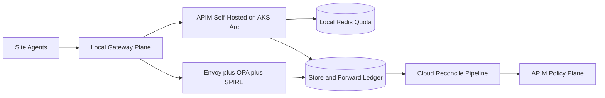
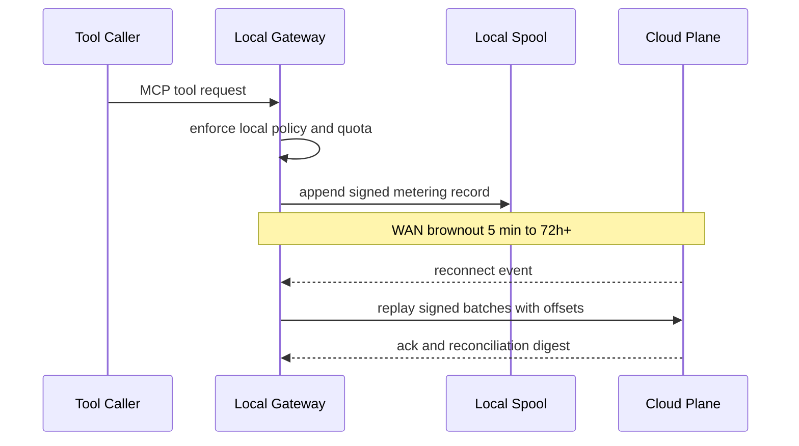

# Intermittent-WAN edge AI gateway and store-and-forward MCP governance selection FAQ: APIM self-hosted Arc vs GitOps Envoy SPIFFE vs cloud hairpin anti-pattern

> 🌐 **Language / 语言切换**: **English (Current)** | **[中文](intermittent-wan-edge-ai-gateway-store-and-forward-mcp-governance-apim-self-hosted-arc-vs-gitops-envoy-spiffe-vs-cloud-hairpin-selection-faq.md)** | **[Back to catalog](README.en.md)**

## 1. Executive summary

- **Primary recommendation**: use `APIM Self-Hosted Gateway + PVC config-backup + offline JWKS pinning + local Redis quota` so site routing and metering remain available during WAN partitions.
- **Long-isolation recommendation**: if outage windows may exceed `72h`, prefer heartbeat-free `Envoy + OPA/Cedar + SPIFFE/SPIRE` autonomy.
- **Split-plane option**: keep cloud-governed mutating tools and local read-only degraded brokers for SOP and telemetry access.
- **Anti-pattern warning**: site-local MCP tool calls hairpinned to cloud-only APIM create site-wide outages during fiber cuts.
- **Target metrics**: `LocalRouteP95 < 8ms`, `OfflineSurvival >= 72h`, `ReplayLoss = 0`, `AuditGap = 0`.

## 2. Route definitions

- **Route A**: `APIM Self-Hosted Gateway` on `AKS Arc/Azure Local` plus config-backup PVC, pinned JWKS cache, and store-forward ledger.
- **Route B**: `Envoy AI Gateway + SPIFFE/SPIRE + OPA/Cedar` GitOps autonomy with no cloud-heartbeat expiry cliff.
- **Route C**: cloud APIM primary plane plus `Azure IoT Operations` local read-only MCP degraded mode broker.
- **Route D (forbidden)**: cloud-only APIM hairpin; or self-hosted gateway without persistent config-backup and offline JWKS.

## 3. Reference architecture (Mermaid 1)



## 4. Partition and replay sequence (Mermaid 2)



## 5. Quantitative models

1. **Offline survival window**: `T_survive = Storage_spool / Ingest_rate`.
2. **Replay completion**: `T_replay = Backlog_bytes / Effective_uplink_bw`.
3. **Local latency**: `P95_local = policy_eval + cache_lookup + backend_hop`.
4. **Ledger integrity**: `Integrity = acked_records / emitted_records`, target `1.0`.
5. **Partition availability**: `Avail_partition = local_success / local_total`.

## 6. Twelve-dimension comparison matrix

| Dimension | Route A APIM SHGW | Route B Envoy GitOps | Route C Split Plane | Route D Anti-pattern |
|---|---|---|---|---|
| Partition tolerance | High (<=72h) | Very high (multi-week) | Medium | Low |
| Policy consistency | High | Medium-high | Medium | Low |
| Local latency | Very low | Very low | Low | High or unstable |
| Replay capability | High | High | Medium | Low |
| Offline OIDC/JWKS safety | High | High | Medium | Low |
| Operational complexity | Medium | High | Medium | Low surface, high risk |
| Multi-site scale | High | High | Medium | Low |
| Compliance auditability | High | High | Medium | Low |
| Cost elasticity | Medium-high | Medium | High | Low |
| Cloud dependency | Medium | Low | High | Critical |
| Three-year TCO | Medium | Medium | Medium-low | High |
| Anti-pattern exposure | Low | Low-medium | Medium | Critical |

## 7. Deep Q&A (Q1–Q8)

### Q1. When should Route A be selected?
- When most partition windows recover within 72 hours.
- When APIM policy assets and audit structures should be reused consistently.
- When edge teams need lower gateway implementation burden.
- When local model and tool quotas need unified control.

### Q2. When should Route B be selected?
- When outage windows may last for weeks and timing is uncertain.
- When sovereign or tactical networks require control-plane autonomy.
- When the platform already runs mature GitOps and SPIFFE operations.
- When cloud heartbeat expiry cliffs must be removed.

### Q3. What is the boundary for Route C?
- Use it when mutating tools must stay cloud-governed while read-only tools degrade locally.
- SOP and telemetry retrieval can remain available during WAN loss.
- High-risk change tools should remain online-gated by cloud policy.
- Define explicit downgrade and recovery criteria.

### Q4. How is zero-loss replay enforced?
- Sign and append every batch with monotonic offsets.
- Require cloud acknowledgments with digest reconciliation.
- Retain retry and dead-letter lanes for failed batches.
- Forbid historical rewrites during replay windows.

### Q5. How should offline JWKS expiry be handled?
- Maintain pinned key sets and staged trust windows at the site.
- Apply tighter privilege limits when key freshness degrades.
- Run immediate key freshness checks after reconnect.
- Fallback to least-privilege policy if key validity is uncertain.

### Q6. How should local quotas be modeled?
- Bucket by site, tenant, and tool category.
- Reserve minimum capacity for safety-critical traffic classes.
- Tighten burst limits during prolonged offline periods.
- Ramp thresholds slowly after reconnect to avoid replay storms.

### Q7. How can business value be measured?
- Track completed-task rate during offline windows.
- Compare backlog growth and recovery times before and after deployment.
- Measure reduction in audit evidence retrieval time.
- Estimate avoided outage opportunity cost.

### Q8. How should rollout be staged?
- Pilot at one to two sites for two weeks.
- Exercise scripted drills for outage, jitter, and reconnect.
- Expand via ring-based rollout across regions.
- Continuously review policy conflicts and quota fairness.

## 8. APIM self-hosted Helm plus PVC config-backup snippet

```yaml
gateway:
  replicaCount: 2
  persistence:
    enabled: true
    size: 20Gi
    storageClass: managed-csi
  env:
    - name: APIM_CONFIG_BACKUP_ENABLED
      value: "true"
    - name: APIM_HEARTBEAT_TOLERANCE_HOURS
      value: "72"
```

## 9. Offline-safe failover and replay snippets

```xml
<policies>
  <inbound>
    <choose>
      <when condition="@(context.Variables.GetValueOrDefault<bool>("wan_down"))">
        <set-backend-service backend-id="local-vllm" />
      </when>
      <otherwise>
        <set-backend-service backend-id="foundry-ptu" />
      </otherwise>
    </choose>
  </inbound>
</policies>
```

```python
def reconcile(batch, cloud_ack):
    if cloud_ack.offset != batch.end_offset:
        raise ValueError("offset mismatch")
    return {"status": "committed", "digest": cloud_ack.digest}
```

## 10. Enterprise scenario A: hospital chains and campus edge sites

- Scenario A point 01: keep local clinical SOP and device lookup available during outages, then reconcile metering and audit ledgers on reconnect.

## 11. Enterprise scenario B: mines, vessels, and plants under low-bandwidth long-isolation WAN

- Scenario B point 01: use offline policy cache and local quota buckets for critical continuity, then replay with offset-safe reconciliation.

## 12. Three-tier three-year TCO table (USD)

| Tier | Site count | Route A annual | Route B annual | Route C annual | Anti-pattern loss | Three-year total (recommended mix) |
|---|---:|---:|---:|---:|---:|---:|
| Small | 50 | 620,000 | 700,000 | 510,000 | 480,000 | 4,530,000 |
| Medium | 300 | 2,780,000 | 3,040,000 | 2,220,000 | 2,100,000 | 18,120,000 |
| Large | 1,000 | 8,260,000 | 9,140,000 | 6,900,000 | 6,500,000 | 52,800,000 |

## 13. Day-0 / Day-1 / Day-2 readiness checklist

### Day-0 design phase
- [ ] Day-0 design phase check 01: verify offline policy, quota, replay, alerting, evidence chain, and rollback path.

### Day-1 rollout phase
- [ ] Day-1 rollout phase check 01: verify offline policy, quota, replay, alerting, evidence chain, and rollback path.

### Day-2 operations phase
- [ ] Day-2 operations phase check 01: verify offline policy, quota, replay, alerting, evidence chain, and rollback path.

## 14. Anti-pattern breakdown and remediation

- Remediation 01: prohibit cloud hairpin as the only path for site-local MCP tools; enforce local autonomous or deterministic degraded mode.

## 15. Appendix: parameter and governance control catalog

- track weekly `local_p95_ms`, `offline_hours`, `replay_backlog_mb`, `jwks_age`, `quota_drop_rate`, and `reconcile_fail_rate`.
