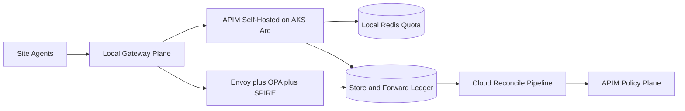
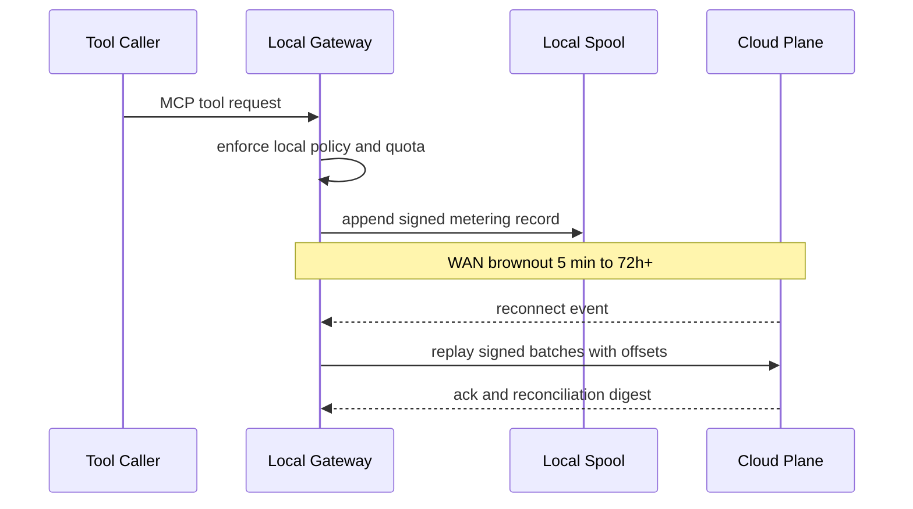

# 间歇 WAN 边缘 AI Gateway 与 Store-and-Forward MCP 治理选型 FAQ：APIM Self-Hosted Arc vs GitOps Envoy SPIFFE vs Cloud Hairpin 反模式

> 🌐 **Language / 语言切换**: **中文版（当前）** | **[English](intermittent-wan-edge-ai-gateway-store-and-forward-mcp-governance-apim-self-hosted-arc-vs-gitops-envoy-spiffe-vs-cloud-hairpin-selection-faq.en.md)** | **[返回目录](README.md)**

## 1. 一页结论（Executive Summary）

- **推荐主路径**：受监管站点优先 `APIM Self-Hosted Gateway + PVC config-backup + offline JWKS pinning + local Redis quota`，在 WAN 分区时保持本地策略执行与计量落盘。
- **超长离线路径**：若预计 `>72h` 持续离线，优先 `Envoy + OPA/Cedar + SPIFFE/SPIRE` 的无心跳自治控制面。
- **折中路径**：采用云主控 + 本地只读降级 Broker，保障 SOP 查询与遥测工具可用。
- **反模式警告**：本地 MCP 工具 hairpin 回云端 APIM，在光纤割接/卫星衰减期间导致整站 Agent 失效。
- **目标指标**：`LocalRouteP95 < 8ms`、`OfflineSurvival >= 72h`、`ReplayLoss = 0`、`AuditGap = 0`。

## 2. 路线定义

- **Route A**：`APIM Self-Hosted Gateway` on `AKS Arc/Azure Local` + config-backup PVC + 本地 JWKS 缓存 + store-and-forward 账本。
- **Route B**：`Envoy AI Gateway + SPIFFE/SPIRE + OPA/Cedar` GitOps 自治平面，无云心跳期限悬崖。
- **Route C**：云 `APIM` 主平面 + `Azure IoT Operations` 本地只读降级 MCP Broker。
- **Route D（禁用）**：Cloud-only APIM hairpin；或 Self-Hosted 无持久 config-backup 与离线 JWKS。

## 3. 参考架构（Mermaid 1）



## 4. 分区与回放时序（Mermaid 2）



## 5. 定量模型

1. **离线存活窗**：`T_survive = Storage_spool / Ingest_rate`。
2. **重放时延**：`T_replay = Backlog_bytes / Effective_uplink_bw`。
3. **本地路由延迟**：`P95_local = policy_eval + cache_lookup + backend_hop`。
4. **账本完整性**：`Integrity = (acked_records / emitted_records)`，目标 `1.0`。
5. **分区可用性**：`Avail_partition = local_success / local_total`。

## 6. 12 维度对比矩阵

| 维度 | Route A APIM SHGW | Route B Envoy GitOps | Route C Split Plane | Route D 反模式 |
|---|---|---|---|---|
| 分区容忍 | 高（<=72h） | 很高（周级） | 中 | 低 |
| 策略一致性 | 高 | 中-高 | 中 | 低 |
| 本地延迟 | 很低 | 很低 | 低 | 高/不稳 |
| 账本回放 | 高 | 高 | 中 | 低 |
| OIDC/JWKS 离线安全 | 高 | 高 | 中 | 低 |
| 运营复杂度 | 中 | 高 | 中 | 低(表面) |
| 多站点规模化 | 高 | 高 | 中 | 低 |
| 合规审计 | 高 | 高 | 中 | 低 |
| 成本弹性 | 中-高 | 中 | 高 | 低 |
| 云依赖 | 中 | 低 | 高 | 极高 |
| 三年 TCO（中规模） | 中 | 中 | 中-低 | 高 |
| 反模式暴露 | 低 | 低-中 | 中 | 极高 |

## 7. 深度问答（Q1–Q8）

### Q1. 何时选 Route A？
- 当站点多数分区在 72h 内可恢复时。
- 当需要统一复用 APIM 策略资产与审计结构时。
- 当本地团队希望降低自研网关负担时。
- 当本地模型与工具都需要统一配额治理时。

### Q2. 何时选 Route B？
- 当离线窗口可能跨周且不可预测时。
- 当主权网络要求完全自治控制面时。
- 当组织有成熟 GitOps 与 SPIFFE 运维能力时。
- 当需要规避云控制平面心跳过期风险时。

### Q3. Route C 的边界？
- 适合“写操作必须云控、读操作可本地降级”的场景。
- SOP/知识检索等只读工具可在 WAN 丢失下继续。
- 高风险变更类工具建议保持云联机门禁。
- 需定义清晰的降级触发与恢复条件。

### Q4. 如何保证回放零丢失？
- 每批记录追加签名与单调 offset。
- 云端 ACK 返回哈希摘要并对账。
- 失败批次保留重试与死信隔离。
- 回放期间禁止重写历史记录。

### Q5. 如何处理离线 JWKS 过期？
- 站点保留 pinset 与滚动窗口证书链。
- 设置离线宽限并限制高风险操作。
- 恢复联机后立即执行密钥新鲜度检查。
- 对过期令牌执行最小权限降级策略。

### Q6. 怎样定义本地配额？
- 按站点、租户、工具类别三维分桶。
- 对关键医疗/生产告警流量留保底容量。
- 离线期启用更严格突发限制。
- 恢复期逐步回调阈值避免回放风暴。

### Q7. 如何量化业务收益？
- 用“离线期间可完成任务率”衡量业务连续性。
- 比较分区前后工单积压与恢复时间。
- 统计审计取证时间缩短幅度。
- 测算因停机避免的机会损失。

### Q8. 如何灰度上线？
- 先选择 1~2 个站点试点 2 周。
- 建立故障演练脚本覆盖断网、抖动、重连。
- 通过 ring 扩展到多区域。
- 持续复盘策略冲突与配额公平性。

## 8. APIM Self-Hosted Helm + PVC config-backup 片段

```yaml
gateway:
  replicaCount: 2
  persistence:
    enabled: true
    size: 20Gi
    storageClass: managed-csi
  env:
    - name: APIM_CONFIG_BACKUP_ENABLED
      value: "true"
    - name: APIM_HEARTBEAT_TOLERANCE_HOURS
      value: "72"
```

## 9. 离线安全 failover 与回放策略片段

```xml
<policies>
  <inbound>
    <choose>
      <when condition="@(context.Variables.GetValueOrDefault<bool>("wan_down"))">
        <set-backend-service backend-id="local-vllm" />
      </when>
      <otherwise>
        <set-backend-service backend-id="foundry-ptu" />
      </otherwise>
    </choose>
  </inbound>
</policies>
```

```python
def reconcile(batch, cloud_ack):
    if cloud_ack.offset != batch.end_offset:
        raise ValueError("offset mismatch")
    return {"status": "committed", "digest": cloud_ack.digest}
```

## 10. 企业场景 A：连锁医院与院内边缘站点

- 场景A要点01：断网时本地问诊 SOP 与设备检索继续可用，恢复后自动回放审计与计量账本。

## 11. 企业场景 B：矿区/海事/制造站点低带宽长离线

- 场景B要点01：利用离线策略缓存和本地配额桶保持关键任务稳定，重连后按 offset 安全对账。

## 12. 三档三年 TCO（单位：USD）

| 规模 | 站点数 | Route A 年成本 | Route B 年成本 | Route C 年成本 | 反模式损失 | 三年总计（推荐组合） |
|---|---:|---:|---:|---:|---:|---:|
| Small | 50 | 620,000 | 700,000 | 510,000 | 480,000 | 4,530,000 |
| Medium | 300 | 2,780,000 | 3,040,000 | 2,220,000 | 2,100,000 | 18,120,000 |
| Large | 1,000 | 8,260,000 | 9,140,000 | 6,900,000 | 6,500,000 | 52,800,000 |

## 13. Day-0 / Day-1 / Day-2 上线核查清单

### Day-0 设计阶段
- [ ] Day-0 设计阶段 确认离线策略、配额、回放、告警、证据链、回滚预案。

### Day-1 发布阶段
- [ ] Day-1 发布阶段 确认离线策略、配额、回放、告警、证据链、回滚预案。

### Day-2 运营阶段
- [ ] Day-2 运营阶段 确认离线策略、配额、回放、告警、证据链、回滚预案。

## 14. 反模式剖析与纠偏

- 纠偏建议01：禁止站点本地调用 hairpin 到云端单点网关，必须提供本地自治或降级路径。

## 15. 附录：参数与治理控制目录

- 持续记录 `local_p95_ms`、`offline_hours`、`replay_backlog_mb`、`jwks_age`、`quota_drop_rate`、`reconcile_fail_rate`。
