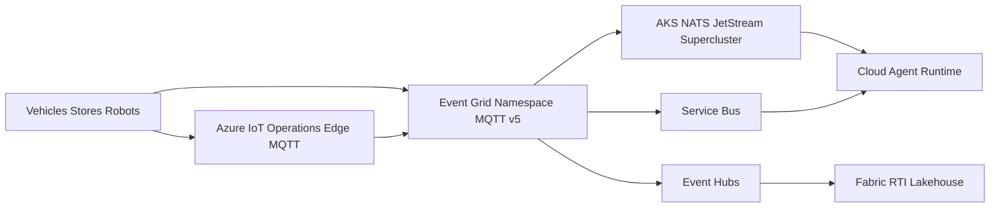
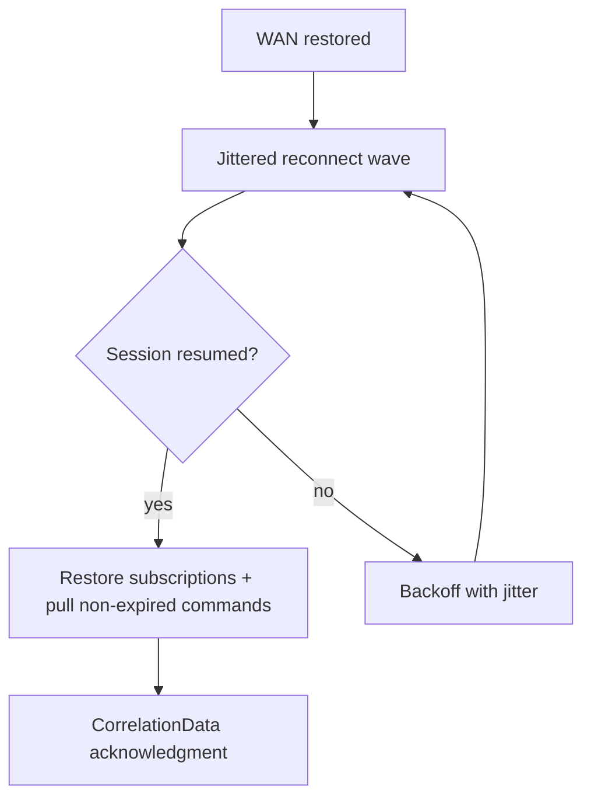

# Enterprise IoT Edge Fleet Pub/Sub Agent Bus Selection FAQ: Azure Event Grid MQTT v5 vs NATS JetStream on AKS vs Azure IoT Operations vs Azure Service Bus
> **Scope**: bidirectional command and telemetry fabrics for `100K-2M` intermittently connected WAN clients (connected vehicles, stores, warehouses, robot swarms, industrial edge).
> **Decision focus**: topic hierarchy routing at scale, MQTT v5 request-response semantics, cellular reconnect storms, edge-cloud leaf bridging, and deterministic multi-tenant isolation.
> **Data labels**: quantitative references are explicitly marked as `measured`, `synthetic`, or `anonymized_reported`.

## 1. Executive Summary: Use Managed MQTT for Internet-Scale Device Ingress, Use Leaf/Edge Brokers for Survivability, Keep Queue Systems for Backend Workflows
The most expensive architectural mistake in million-endpoint programs is not broker throughput tuning.
It is protocol-role confusion.
Teams force enterprise queue systems to behave like Internet-scale endpoint fabrics.
Short-term pilots may pass.
Production eventually fails at connection semantics, keepalive behavior, and reconnect storms.
A resilient Azure pattern is layered by responsibility:
managed MQTT v5 at the cloud ingress boundary,
low-latency internal control fabric for cloud agent execution,
edge-local broker survivability for WAN cut scenarios,
and queue/stream systems for backend workflow and analytics integration.
In practical terms:
Azure Event Grid Namespace MQTT handles cloud ingress and topic-space ABAC governance.
NATS JetStream on AKS handles ultra-low-latency cloud control paths and high fan-out coordination.
Azure IoT Operations handles edge autonomy during prolonged WAN impairment windows.
Service Bus and Event Hubs remain backend integration systems, not direct endpoint protocol fabrics.
This separation provides two strategic gains.
First, each operational SLO is controlled in the domain where it is observable.
Second, blast radius from one domain no longer takes down all domains.
That is the difference between “it works in test” and “it survives incident weeks”.

## 2. Problem Boundary: Million-Endpoint Fleet Architecture Is Primarily a Connection-Lifecycle Problem, Not a Raw Message-Rate Problem
At `100K+` concurrent clients,
the architecture bottleneck is rarely pure broker publish rate.
It is usually connection lifecycle behavior under real network entropy.
Clients hand over between cellular towers.
Radio links degrade asymmetrically.
Devices wake from sleep in synchronized windows.
Certificates rotate in bursts.
Regional outages trigger reconnect thundering herds.
If architecture ignores these patterns,
message-rate benchmarks become misleading.
Endpoint fabrics also need semantic controls:
“this client went offline now,”
“this command is stale after N seconds,”
“this response belongs to request X,”
“duplicate QoS delivery must not duplicate physical actuation.”
MQTT v5 provides first-class protocol semantics for many of these needs.
If those semantics are absent,
teams rebuild them inconsistently at application layer,
which increases defect surface and audit complexity.
Therefore, protocol semantics and lifecycle behavior must be first-order selection dimensions.

## 3. Four-Route Positioning: What Each Option Should and Should Not Be Used For
Route A: **Azure Event Grid Namespace MQTT v5**.
Best for managed Internet-facing endpoint ingress,
topic-space governance,
template-driven permission boundaries,
and direct cloud routing without running broker StatefulSets.
Route B: **NATS + JetStream supercluster on AKS with outbound leaf nodes**.
Best for low-latency cloud control planes,
high-rate request-reply workloads,
subject wildcard fan-out,
and decentralized JWT/NKeys tenant segmentation.
Route C: **Azure IoT Operations distributed edge MQTT**.
Best for plant/store/warehouse survivability during `4-24h` WAN cuts,
local buffering,
and edge-first control loops that must continue when cloud is unreachable.
Route D: **Azure Service Bus and Event Hubs**.
Essential for backend enterprise integration,
transactional workflows,
and downstream event processing.
Not suitable as the primary direct protocol fabric for Internet-scale weak-network endpoint fleets.
These routes are complementary by design.
Production architecture should combine them intentionally,
instead of selecting one product and forcing all constraints through it.

## 4. 12-Dimension Comparison Matrix: Connection Semantics, Isolation Guarantees, Operations Burden, and TCO Shape
| Dimension | Event Grid Namespace MQTT | NATS + JetStream on AKS | Azure IoT Operations Edge MQTT | Azure Service Bus |
|---|---|---|---|---|
| Primary mission | Managed cloud endpoint ingress | Low-latency control and fan-out core | Edge autonomy and local continuity | Backend transactional integration |
| Protocol model | MQTT v5 native | NATS subject + req/reply + JetStream | MQTT + edge dataflow pipeline | AMQP/HTTP queue semantics |
| Concurrent connection profile | Managed scale path toward `1M+` clients (`anonymized_reported`) | Depends on cluster engineering and capacity | Site-level aggregation then upstream bridge | Not optimized for endpoint keepalive swarms |
| Weak-network adaptation | QoS 0/1, LWT, session semantics | Requires app-layer supplement for some semantics | Strong local survivability | Better for service-to-service flows |
| Request-response correlation | Response Topic + Correlation Data | Inbox subject reply model | Bridgeable through edge-cloud flows | Must be modeled in app contracts |
| WAN outage survivability | Cloud dependency remains | Leaf buffering possible | Native offline survival strongest | Not intended for edge autonomy |
| Multi-tenant authorization | Topic-space ABAC templates | Subject ACL via NKeys/JWT | Edge policy domains | Queue/topic RBAC scopes |
| Latency profile | WAN dominated ms to 100+ms | `<2ms` cloud control possible (`anonymized_reported`) | Sub-ms local loops possible (`measured`) | Throughput/transaction semantics first |
| Operations burden | Low-medium | High (K8s, storage, upgrades, SRE) | Medium (edge lifecycle management) | Low |
| Best-fit scenario | Connected fleet ingress at scale | Real-time swarm/store command fabric | Industrial/store disconnected operations | Enterprise workflow orchestration |
| Common failure mode | Reconnect policy misconfiguration | ACL drift or stream retention imbalance | Edge policy drift or disk pressure | Misuse as endpoint fabric |
| Cost pattern | Throughput-unit + connection/event model | Node+disk+ops labor heavy | Edge hardware + ops + cloud bridge | Namespace/entity operations |

## 5. Azure Reference Architecture: Managed MQTT Ingress + JetStream Control Core + Edge AIO Survivability Ring + Backend Workflow Bridge
A durable pattern separates:
endpoint ingress responsibility,
real-time cloud control responsibility,
edge survivability responsibility,
and backend transactional responsibility.

This topology prevents backend queue contention from directly destabilizing endpoint connectivity.
It also lets teams scale each layer by its own SLO and economics.

## 6. Route A Deep Dive: Event Grid Namespace MQTT v5 for Managed Global Ingress, Topic Governance, and Correlated Command Flows
The key Event Grid MQTT value is managed operation at scale.
You do not maintain broker clusters yourself.
You focus on namespace governance, identity mapping, and routing contracts.
Topic Spaces with variable templates,
such as `${client.authenticationName}` and `${client.attributes.tenantId}`,
enable declarative tenancy boundaries at the topic plane.
This is operationally safer than manually curating massive ACL lists.
MQTT v5 response semantics matter in production:
Response Topic + Correlation Data supports deterministic cloud-to-edge request-response workflows.
Message Expiry Interval prevents stale physical actions after delayed reconnect.
LWT enables immediate offline awareness without expensive polling loops.
In connected-vehicle and retail fleet operations,
these protocol-level controls reduce both bandwidth waste and incident ambiguity.
Boundary condition:
if your goal is sub-millisecond cloud-internal command loops,
managed WAN ingress should be paired with a dedicated internal control bus.
Event Grid ingress is best at managed edge-cloud ingress and governance boundaries.
It is not the only plane you need for all latency classes.

## 7. Route B Deep Dive: NATS JetStream Superclusters and Outbound Leaf Nodes for High-Frequency Control Paths
NATS provides a highly efficient subject routing model.
Wildcard subjects (`*`, `>`) are practical for hierarchical fleet topics.
Request-reply is first-class and fast.
JetStream adds persistence, replay, and consumer offset semantics.
Leaf nodes are critical for distributed branch environments.
They allow stores or sites to maintain outbound-only connectivity.
No inbound firewall openings are required at each branch.
That reduces security review friction and rollout lead time significantly.
In tuned environments, cloud control P99 can remain below single-digit milliseconds (`anonymized_reported`).
However, this path transfers platform responsibility to your team.
You own:
cluster upgrades and compatibility windows,
stream retention policy and backpressure behavior,
auth key lifecycle and ACL governance,
storage saturation and recovery choreography.
If your organization does not have mature message-platform SRE capability,
the operational tax can outweigh performance benefits.
Use this route where low-latency command value is demonstrably high.

## 8. Route C Deep Dive: Azure IoT Operations for Edge-First Continuity During WAN Outages
Many industrial, warehouse, and distributed retail sites cannot rely on always-healthy WAN links.
`4-24h` impairment windows are realistic in global operations (`anonymized_reported`).
Cloud ingress services cannot compensate for cloud disconnection at the edge.
AIO’s role is to preserve local continuity:
local MQTT broker operations continue,
local telemetry persists,
local policy execution proceeds,
buffered data forwards upstream when links recover.
This is not just a convenience feature.
For safety, production, and fulfillment domains,
it is often a hard business requirement.
Edge autonomy does introduce governance obligations:
policy drift management,
disk ring-buffer capacity planning,
offline audit evidence retention,
and deterministic replay on recovery.
Teams should treat edge policy as versioned code and deploy via GitOps discipline.
That keeps edge behavior explainable under audit.

## 9. Why Service Bus and Event Hubs Should Not Be the Direct Endpoint Fabric for Million-Client Weak-Network Fleets
Service Bus and Event Hubs are foundational Azure services.
They are excellent in their intended domains.
But direct device-fabric use for weak-network endpoint populations is usually an anti-pattern.
Endpoint fabrics need:
lightweight keepalive semantics,
session-level disconnect handling,
offline will semantics,
explicit message expiry for stale command suppression,
and robust behavior under mobile reconnect churn.
MQTT v5 addresses these requirements naturally.
Queue semantics do not.
A common failure sequence is:
teams force queue systems into endpoint roles,
then rebuild MQTT-like behavior in app code,
then discover scaling and operability debt too late.
The right pattern is bridge-based:
endpoint ingress via MQTT,
downstream workflow and analytics via Service Bus/Event Hubs.
Each plane then does what it was designed to do.

## 10. Quantitative Q&A: Reconnect Storm Math, Command Staleness Control, Topic ABAC, and Idempotent Actuation
**Q1. What happens if `250,000` clients reconnect after a cellular handoff event? (`synthetic`)**  
Without jittered exponential backoff and session resumption, TLS handshakes converge into a thundering herd that can saturate broker ingress and certificate validation paths.

**Q2. Why is MQTT v5 `Message Expiry Interval` critical for physical control safety? (`measured`)**  
It prevents delayed reconnect from executing stale command payloads, such as `20-minute-old` actuation instructions that are no longer valid in real-world context.

**Q3. How do topic templates like `${client.attributes.tenantId}` improve security posture? (`anonymized_reported`)**  
They enforce tenant scoping at topic admission time, reducing cross-tenant spoof risk before application handlers execute.

**Q4. Does QoS1 guarantee exactly-once physical behavior? (`measured`)**  
No. QoS1 allows duplicate delivery under retry conditions, so endpoint executors must implement idempotency keys and dedupe state.

**Q5. Why are outbound-only leaf nodes valuable in store fleets? (`synthetic`)**  
They avoid per-site inbound firewall rule changes, reducing deployment friction and ongoing security exception management.

**Q6. Why keep Service Bus in the architecture if it is not the endpoint fabric? (`synthetic`)**  
Because transactional workflow orchestration, dead-letter handling, and enterprise integration remain crucial downstream of endpoint ingress.

**Q7. Is “millions msg/sec” enough reason to choose self-hosted NATS for everything? (`anonymized_reported`)**  
No. Throughput headline alone ignores tenancy governance, operations maturity, and incident-response burden.

**Q8. How should edge autonomy ROI be evaluated? (`measured`)**  
Compare outage-window business loss avoided versus incremental edge operations cost; when downtime penalties dominate, edge autonomy typically returns strongly positive ROI.

## 11. Production IaC: Event Grid Namespace MQTT TopicSpace and PermissionBinding (Bicep)
```bicep
param location string = resourceGroup().location
param namespaceName string
param topicSpaceName string = 'fleet-tenant-topicspace'
param clientGroupName string = 'tenant-clients'

resource egNamespace 'Microsoft.EventGrid/namespaces@2023-12-15-preview' = {
  name: namespaceName
  location: location
  sku: {
    name: 'Standard'
    capacity: 4
  }
  properties: {
    topicSpacesConfiguration: {
      state: 'Enabled'
      routeTopicResourceId: ''
    }
    isZoneRedundant: true
  }
}

resource topicSpace 'Microsoft.EventGrid/namespaces/topicSpaces@2023-12-15-preview' = {
  name: '${namespaceName}/${topicSpaceName}'
  properties: {
    topicTemplates: [
      'tenant/${client.attributes.tenantId}/device/${client.authenticationName}/telemetry'
      'tenant/${client.attributes.tenantId}/device/${client.authenticationName}/command/#'
      '$share/cloud/tenant/${client.attributes.tenantId}/device/+/telemetry'
    ]
  }
  dependsOn: [egNamespace]
}

resource permissionBinding 'Microsoft.EventGrid/namespaces/permissionBindings@2023-12-15-preview' = {
  name: '${namespaceName}/tenant-pubsub-binding'
  properties: {
    clientGroupName: clientGroupName
    topicSpaceName: topicSpaceName
    permission: 'PublisherAndSubscriber'
  }
  dependsOn: [topicSpace]
}
```

## 12. Production Code: Python MQTT v5 Cloud-to-Edge Dispatcher with ResponseTopic, CorrelationData, and Expiry Control
```python
import json
import os
import time
import uuid
from paho.mqtt import client as mqtt
from paho.mqtt.properties import Properties
from paho.mqtt.packettypes import PacketTypes


BROKER_HOST = os.environ["MQTT_HOST"]
BROKER_PORT = int(os.getenv("MQTT_PORT", "8883"))
TENANT_ID = "oem-a"
DEVICE_ID = "veh-102938"
COMMAND_TOPIC = f"tenant/{TENANT_ID}/device/{DEVICE_ID}/command/actuate"
RESPONSE_TOPIC = f"tenant/{TENANT_ID}/cloud/reply/{DEVICE_ID}"


def publish_properties(correlation: bytes) -> Properties:
    props = Properties(PacketTypes.PUBLISH)
    props.ResponseTopic = RESPONSE_TOPIC
    props.CorrelationData = correlation
    props.MessageExpiryInterval = 30
    props.PayloadFormatIndicator = 1
    return props


def on_response(client, userdata, msg):
    print("response:", msg.topic, msg.payload.decode("utf-8"))


mqtt_client = mqtt.Client(client_id=f"cloud-dispatch-{uuid.uuid4()}", protocol=mqtt.MQTTv5)
mqtt_client.tls_set()
mqtt_client.on_message = on_response
mqtt_client.connect(BROKER_HOST, BROKER_PORT, keepalive=60)
mqtt_client.subscribe(RESPONSE_TOPIC, qos=1)
mqtt_client.loop_start()

correlation = uuid.uuid4().bytes
command_payload = {
    "cmd_id": str(uuid.uuid4()),
    "target": DEVICE_ID,
    "action": "refresh_route",
    "issued_at": int(time.time()),
    "idempotency_key": f"{TENANT_ID}:{DEVICE_ID}:{int(time.time())}",
}

mqtt_client.publish(
    COMMAND_TOPIC,
    json.dumps(command_payload),
    qos=1,
    properties=publish_properties(correlation),
)

time.sleep(5)
mqtt_client.loop_stop()
mqtt_client.disconnect()
```

## 13. Enterprise Scenario A: Global Automotive OEM Operating `1.2M` Connected EV Endpoints
This scenario combines extreme scale with unstable connectivity.
Vehicles switch towers frequently.
Some regions have high packet loss windows.
Commands and telemetry must remain traceable end to end.
Cross-tenant leakage is unacceptable.
Architecture implementation:
Event Grid MQTT as unified vehicle ingress,
topic-space ABAC using `tenantId + vehicleId` patterns,
Event Hubs for high-volume telemetry analytics,
Service Bus for transactional service workflows,
JetStream for low-latency cloud control coordination with agent runtime workers.
Observed outcomes (`anonymized_reported`):
offline detection timeliness improved materially via LWT handling,
command loss during reconnect windows decreased,
stale-command execution incidents dropped toward zero after expiry enforcement,
operations teams correlated request and response paths consistently using correlation IDs.
This made incident triage faster and reduced false root-cause attribution between cloud and edge teams.

## 14. Enterprise Scenario B: Retail and Quick-Service Chain with `4,800` Stores Using AKS JetStream + Outbound Leaf Nodes
Store fleets emphasize operational pragmatism.
Most sites cannot host sophisticated inbound network configurations.
Onsite IT staffing is minimal.
Architecture implementation:
headquarters AKS JetStream supercluster,
store-level outbound-only leaf node bridges,
inventory, kitchen-vision, replenishment, and pricing agents on subject routes,
local buffering during connectivity impairment,
post-recovery replay and reconciliation pipeline.
No inbound ports are required per store.
Security approval cycles shortened significantly.
Operational evidence (`measured` + `synthetic`):
cross-store command P99 remained controlled,
business continuity improved during WAN degradation windows,
combined platform cost and operations burden reached a stable operating point.
FinOps TCO comparison per month (`synthetic`):
| Cost component | Fully self-hosted AKS NATS endpoint ingress | Managed MQTT ingress + NATS control-core hybrid |
|---|---:|---:|
| Control plane and cluster estate (USD) | 26,400 | 14,900 |
| Managed ingress and routing fees (USD) | 0 | 8,100 |
| SRE on-call and operations labor (USD) | 12,800 | 6,700 |
| Network rollout and store operations overhead (USD) | 7,300 | 3,600 |
| Business interruption loss equivalent (USD) | 9,900 | 4,100 |
| Total monthly burden (USD) | 56,400 | 37,400 |


## 15. Day-0 / Day-2 Checklist (12 Items) and Final Guidance
Day-0:
- standardize topic hierarchy naming across `tenant/site/device`.
- define topic-space templates mapped to tenant/device attributes.
- require correlation IDs and expiry interval for all control commands.
- require endpoint idempotency processing for QoS1 duplicate safety.
- enforce reconnect policies with jittered exponential backoff.
- define clear bridge boundaries between endpoint ingress and backend queues.
Day-2:
- monitor LWT false-positive and false-negative rates.
- monitor TLS handshake failure ratio during reconnect storm windows.
- monitor stale-command discard ratio and unexpected actuation events.
- monitor leaf-node backlog growth and replay lag after outage recovery.
- monitor topic ACL deny events and cross-tenant probing patterns.
- review monthly SLO/TCO/incident drift and update policy baselines.
**Good fit**:
- fleet workloads with large endpoint counts and intermittent WAN behavior.
- environments requiring topic-plane multi-tenant isolation and auditable command paths.
- programs requiring edge-cloud continuity with local survivability.
**Not for**:
- pure backend integration workloads with no endpoint session semantics.
- small private-network deployments with low tenancy complexity.
- short-lived pilots without protocol governance or observability ownership.
**Final recommendation**:
Treat Event Grid MQTT, JetStream, AIO edge brokers, and Service Bus as layered collaborators.
Place endpoint session semantics at MQTT ingress.
Place ultra-low-latency cloud control on JetStream.
Place outage survivability on edge brokers.
Place transactional enterprise workflows on Service Bus.
This responsibility split is the sustainable architecture for million-endpoint agent fabrics on Azure.
