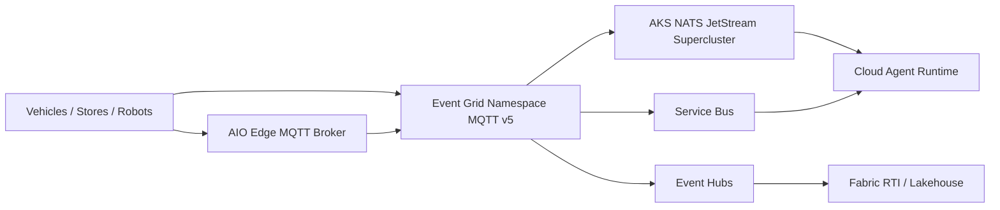
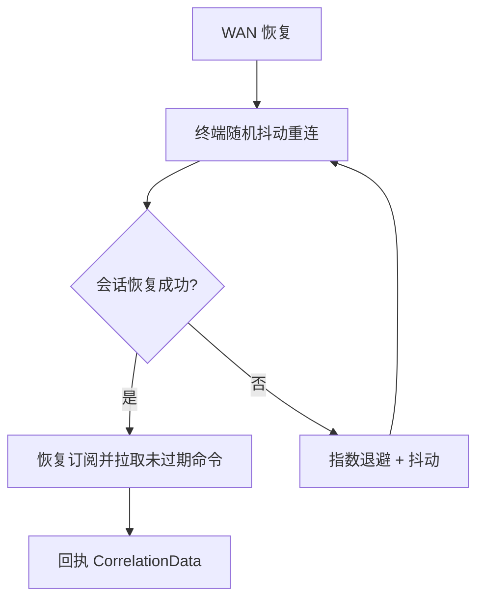

# 企业 IoT 边缘车队 Pub/Sub 智能体总线选型 FAQ：Azure Event Grid MQTT vs AKS NATS JetStream vs Azure IoT Operations vs Service Bus
> **适用范围**：`100K–2M` 间歇在线终端（车联网、门店/仓储、机器人群、工业边缘）双向命令与遥测总线。
> **决策焦点**：在蜂窝网络抖动、批量重连风暴、边云断连和多租户权限隔离约束下，如何做可运营、可扩展、可审计的 Pub/Sub Fabric。
> **数据标签**：文中定量口径均显式标注 `measured`、`synthetic`、`anonymized_reported`。

## 1. 执行摘要：云端托管 MQTT 做广域入口，边缘 Leaf/本地 Broker 做生存，队列系统只做后端集成
百万终端接入场景最常见误判是：
把企业队列系统直接当设备总线。
短期看能跑通。
长期看会在连接模型、保活模型和重连风暴上暴露结构性问题。
正确路线不是单一产品覆盖一切。
而是分层：
云端入口层优先 MQTT v5 语义。
边缘生存层优先本地 broker 与断网缓冲。
后端处理层再对接 Event Hubs、Service Bus、Data Lake 与 Agent Runtime。
在 Azure 体系中，
典型四路线定位如下：
Event Grid Namespace MQTT 做托管广域设备接入与主题空间 ABAC。
NATS JetStream Supercluster 做极低延迟高吞吐主体总线。
Azure IoT Operations 做边缘自治与断网生存。
Service Bus 仅用于企业工作流与事务队列，不作为百万终端直接接入总线。
这套分层有两个直接收益。
第一，成本与可靠性指标可分域治理。
第二，故障爆炸半径显著收敛。

## 2. 问题边界：百万终端不是“消息吞吐题”，而是“连接语义与网络行为题”
`100K+` 终端下，
系统瓶颈通常不是单条消息处理能力。
而是连接生命周期行为。
终端上线下线频繁。
蜂窝切塔导致短时 RTT 波动。
弱网重传引发重复命令风险。
批量断电后重连产生 TLS 握手洪峰。
这些都不是传统 AMQP 队列的强项。
另外，
终端侧要表达“我离线了”、
“我是否收到并执行了命令”、
“这个命令过期后不要再执行”。
这些语义在 MQTT v5 有原生机制。
若缺失这些机制，
业务就会在应用层反复自造轮子。
并且很难保证一致实现。
因此选型必须把协议语义作为一等约束。
而不是只看“每秒多少消息”。

## 3. 四条路线定位：托管 MQTT、自建 JetStream、边缘 IoT Ops、后端 Service Bus 的职责边界
路线 A：**Azure Event Grid Namespace MQTT v5**。
适合云端统一入口、
多租户主题空间治理、
设备身份与权限模板化管理。
路线 B：**NATS + JetStream on AKS + Leaf Nodes**。
适合极低延迟 RPC、
高频双向控制、
自主管理和细粒度 subject 隔离。
路线 C：**Azure IoT Operations Edge MQTT**。
适合工厂/仓储等本地可用性优先场景，
在 `4–24h` 断网中持续运行并回传。
路线 D：**Azure Service Bus / Event Hubs**。
适合作为后端事件与工作流缓冲，
不适合作为百万终端直连协议层。
这四条路线互补。
生产环境通常是混合：
设备先接 MQTT 入口。
云端路由到流处理和事务队列。
边缘站点可自治运行并最终汇聚。

## 4. 12 维对比矩阵：连接模型、离线语义、权限治理、运维复杂度与 TCO
| 维度 | Event Grid MQTT Namespace | NATS + JetStream on AKS | Azure IoT Operations Edge MQTT | Azure Service Bus |
|---|---|---|---|---|
| 主目标 | 托管广域 MQTT 接入 | 超低延迟自建总线 | 边缘断网自治 | 企业后端事务队列 |
| 协议语义 | MQTT v5 原生 | NATS subject + req/reply | MQTT + 边缘数据流 | AMQP/HTTP |
| 并发连接模型 | `1M+` 级托管扩展（`anonymized_reported`） | 取决于集群容量与调优 | 站点级本地连接聚合 | 非设备连接优先 |
| 终端弱网适配 | QoS0/1 + LWT + 会话语义 | 需应用层补齐部分语义 | 本地 broker 最佳 | 连接与保活成本高 |
| 请求-响应相关性 | Response Topic + Correlation Data | Inbox/subject reply | 可桥接到上游 | 需应用层封装 |
| 断网生存能力 | 云端依赖 WAN | 可配 Leaf 缓冲 | 原生边缘存活强 | 不面向边缘断网 |
| 多租户权限 | Topic Space 模板 ABAC | NKeys/JWT subject ACL | 边缘站点策略管理 | 队列级 RBAC |
| 延迟形态 | 跨 WAN 典型毫秒到百毫秒 | 集群内 `<2ms` 可达（`anonymized_reported`） | 本地子毫秒（`measured`） | 事务队列语义优先 |
| 运维负担 | 低到中 | 高（K8s+存储+升级） | 中（边缘生命周期） | 低 |
| 最佳场景 | 车联网/广域终端入口 | 零售/机器人高频控制 | 工厂/仓储边缘自治 | 订单与结算后台 |
| 常见失败点 | 重连风暴限流策略不足 | ACL 与流保留失衡 | 边缘策略漂移 | 被误用为设备总线 |
| 成本结构 | TU + 消息与连接 | 节点+磁盘+运维人力 | 边缘节点+运维 | 命名空间与操作计费 |

## 5. Azure 参考架构：云端 MQTT 入口 + AKS JetStream 核心总线 + 边缘 IoT Ops 生存环
架构关键是三层分离：
终端接入层。
控制与实时总线层。
后端业务与分析层。

这类分层能把“设备连接问题”与“企业事务问题”解耦。
从而避免后端工作流波动直接冲击设备接入面。

## 6. 路线 A 深入：Event Grid Namespace MQTT v5 的优势与边界
Event Grid MQTT 的核心价值在于托管化。
平台承担 broker 生命周期、扩缩容与高可用维护。
团队不用自管 StatefulSet。
可以把精力放在主题治理与业务语义。
Topic Spaces 支持模板变量。
例如 `${client.authenticationName}`、
`${client.attributes.tenantId}`。
这让多租户隔离策略可声明化。
比手工维护海量 ACL 更稳。
MQTT v5 的 Response Topic 与 Correlation Data，
让云到边的 request-response 能保持语义一致。
LWT 可在终端离线时快速触发告警或状态收敛。
在 connected-vehicle 场景，
这通常比应用层轮询更省带宽。
边界也很明确。
若你追求亚毫秒内网 RPC，
托管 MQTT 不是最终上限。
它更适合作为广域入口和治理边界。
在云内实时控制总线上，
通常要与 JetStream 组合。

## 7. 路线 B 深入：NATS JetStream + Leaf Node 的高频控制平面
NATS 的优势是轻量高性能与 subject 路由表达力。
`*` 与 `>` 通配可高效匹配层级主题。
request-reply 模型对机器人群控、门店协同很实用。
JetStream 提供持久流、重放与消费位点管理。
Leaf Node 允许边缘站点仅出站连接云端。
这对 NAT 或防火墙严格环境非常关键。
无需云端暴露入站端口。
运营侧常见收益是：
边缘部署简单。
连接安全边界清晰。
但代价是平台团队需要自管。
要处理多集群升级。
要处理 stream 保留策略。
要处理认证密钥与 subject ACL。
若组织缺少 K8s 消息系统 SRE 能力，
这一方案会拉高长期运维成本。

## 8. 路线 C 深入：Azure IoT Operations 在断网自治中的不可替代性
很多仓储与工厂场景里，
“云可达”不是常量。
WAN 中断 `4–24h` 并非罕见（`anonymized_reported`）。
这时云端 broker 再强也无法覆盖本地控制闭环。
AIO 的价值是把 broker 与数据流能力下沉到边缘。
本地可以继续收集遥测。
本地可以继续执行策略与命令。
恢复联网后再批量回传。
如果你的业务有“停线即停产”风险，
边缘自治不是优化项，
而是强制项。
同时要注意边缘配置漂移问题。
建议将站点策略纳入 GitOps，
并保留离线窗口内的审计轨迹。
这样恢复后可追溯每条命令来源与执行链路。

## 9. 为什么 Service Bus / Event Hubs 不能直接做百万终端 Agent Fabric
Service Bus 与 Event Hubs 非常重要。
但它们定位是企业消息和流处理。
不是弱网终端直连语义层。
设备侧需要高频心跳与轻量 keepalive。
MQTT 的头开销与会话语义更匹配。
AMQP 队列更适合后端应用。
不是每台设备都应直接建立队列语义连接。
此外，
当终端规模上来，
连接与实体配额会迅速变成设计约束（`synthetic`）。
这会迫使系统做大量“协议层补丁”。
最终复杂度与成本都上升。
因此推荐模式是：
终端连接走 MQTT。
后端业务处理再桥接到 Service Bus/Event Hubs。
各层做自己最擅长的事。

## 10. 定量 Q&A：重连风暴、命令过期、租户隔离与去重执行
**Q1. `250,000` 客户端切塔后重连会发生什么？（`synthetic`）**  
若无抖动退避，TLS 握手会在秒级形成洪峰。  
应采用 `jittered exponential backoff` 与会话恢复，避免 broker 雪崩。  

**Q2. MQTT v5 `Message Expiry Interval` 为什么关键？（`measured`）**  
可避免终端恢复后执行 `20` 分钟前的物理控制命令。  
过期命令应自动丢弃而非“补执行”。  

**Q3. `${client.attributes.tenantId}` Topic Space 有什么价值？（`anonymized_reported`）**  
可在主题层阻断跨租户命令伪造路径。  
比应用层再判权更早、更廉价。  

**Q4. QoS1 是否会导致重复执行？（`measured`）**  
会，网络抖动下可能重复投递。  
执行端必须做命令幂等键去重。  

**Q5. Leaf Node 为何能降低门店网络改造成本？（`synthetic`）**  
仅需边缘到云的出站连接，不需要总部逐店开入站端口。  
这显著减少防火墙变更审批周期。  

**Q6. Service Bus 为什么适合后端而非设备直连？（`synthetic`）**  
它擅长事务与工作流编排，不擅长弱网设备会话语义。  
设备总线硬套队列语义会放大连接管理成本。  

**Q7. NATS `millions msg/sec` 是否代表可直接承载所有设备入口？（`anonymized_reported`）**  
吞吐上可能可以，但你要承担全套集群运维与多租户治理责任。  
若组织不具备对应 SRE 能力，托管入口通常更稳。  

**Q8. 如何衡量边缘自治价值？（`measured`）**  
看断网窗口内的业务连续性损失是否下降。  
若停线罚损远高于边缘运维成本，AIO 投入是正 ROI。  

## 11. 生产 IaC：Event Grid Namespace MQTT Topic Space 与 PermissionBinding（Bicep）
```bicep
param location string = resourceGroup().location
param namespaceName string
param topicSpaceName string = 'fleet-tenant-topicspace'
param clientGroupName string = 'tenant-clients'

resource egNs 'Microsoft.EventGrid/namespaces@2023-12-15-preview' = {
  name: namespaceName
  location: location
  sku: {
    name: 'Standard'
    capacity: 4
  }
  properties: {
    topicSpacesConfiguration: {
      state: 'Enabled'
      routeTopicResourceId: ''
    }
    isZoneRedundant: true
  }
}

resource topicSpace 'Microsoft.EventGrid/namespaces/topicSpaces@2023-12-15-preview' = {
  name: '${namespaceName}/${topicSpaceName}'
  properties: {
    topicTemplates: [
      'tenant/${client.attributes.tenantId}/device/${client.authenticationName}/telemetry'
      'tenant/${client.attributes.tenantId}/device/${client.authenticationName}/command/#'
      '$share/cloud/tenant/${client.attributes.tenantId}/device/+/telemetry'
    ]
  }
  dependsOn: [egNs]
}

resource permissionBinding 'Microsoft.EventGrid/namespaces/permissionBindings@2023-12-15-preview' = {
  name: '${namespaceName}/tenant-pubsub-binding'
  properties: {
    clientGroupName: clientGroupName
    topicSpaceName: topicSpaceName
    permission: 'PublisherAndSubscriber'
  }
  dependsOn: [topicSpace]
}
```

## 12. 生产代码：Python MQTT v5 命令下发（ResponseTopic + CorrelationData + Expiry）
```python
import json
import os
import time
import uuid
from paho.mqtt import client as mqtt
from paho.mqtt.properties import Properties
from paho.mqtt.packettypes import PacketTypes


BROKER = os.environ["MQTT_HOST"]
PORT = int(os.getenv("MQTT_PORT", "8883"))
TENANT = "oem-a"
DEVICE = "veh-102938"
CMD_TOPIC = f"tenant/{TENANT}/device/{DEVICE}/command/actuate"
RESP_TOPIC = f"tenant/{TENANT}/cloud/reply/{DEVICE}"


def new_props(corr: bytes) -> Properties:
    p = Properties(PacketTypes.PUBLISH)
    p.ResponseTopic = RESP_TOPIC
    p.CorrelationData = corr
    p.MessageExpiryInterval = 30  # seconds
    p.PayloadFormatIndicator = 1
    return p


def on_message(client, userdata, msg):
    print("reply:", msg.topic, msg.payload.decode("utf-8"))


client = mqtt.Client(client_id=f"cloud-dispatcher-{uuid.uuid4()}", protocol=mqtt.MQTTv5)
client.tls_set()
client.on_message = on_message
client.connect(BROKER, PORT, keepalive=60)
client.subscribe(RESP_TOPIC, qos=1)
client.loop_start()

corr = uuid.uuid4().bytes
payload = {
    "cmd_id": str(uuid.uuid4()),
    "target": DEVICE,
    "action": "refresh_route",
    "issued_at": int(time.time()),
}
client.publish(
    CMD_TOPIC,
    json.dumps(payload),
    qos=1,
    properties=new_props(corr),
)

time.sleep(5)
client.loop_stop()
client.disconnect()
```

## 13. 企业场景 A：全球车企 `1.2M` 联网电动车座舱与诊断协同
该场景的核心矛盾是：
终端规模巨大且网络高度不稳定。
车辆在不同区域切网频繁。
命令和遥测必须双向闭环。
且不能跨租户串扰。
架构采用：
Event Grid MQTT 作为车端统一入口。
Topic Space 以 `tenantId + vehicleId` 约束发布订阅边界。
云侧故障分析与预测维护消息落到 Event Hubs。
事务型工单与回访任务进入 Service Bus。
高频云控指令通过 JetStream 内核总线与 Agent Runtime 协作。
结果（`anonymized_reported`）：
断连检测时效显著提高。
重连洪峰期间命令丢失率下降。
误执行过期命令事件接近清零。
车端与云端团队可以用同一关联 ID 追踪命令全链路。

## 14. 企业场景 B：`4,800` 门店零售与快餐连锁边缘协同 + FinOps TCO
门店场景的挑战不是单店吞吐。
而是“海量站点 + 弱运维能力 + 出站网络限制”。
架构采用：
总部 AKS 部署 NATS JetStream Supercluster。
门店仅部署轻量 Leaf Node。
库存、厨房视觉、补货与价格策略代理都走 subject 路由。
站点断网时本地缓冲。
恢复后回传并对账。
门店无需暴露入站端口。
安全团队审批成本显著降低。
观测结果（`measured` + `synthetic`）：
跨店控制指令端到端 P99 可控。
网络故障窗口内业务连续性明显提升。
平台总线人力运维与云托管成本达到可平衡区间。
FinOps TCO 对比（每月，`synthetic`）：
| 成本项 | 纯自建 AKS NATS 全入口 | 托管 MQTT 入口 + NATS 核心混合 |
|---|---:|---:|
| 控制平面与集群节点（USD） | 26,400 | 14,900 |
| 托管入口与路由费用（USD） | 0 | 8,100 |
| SRE 值班与运维工时（USD） | 12,800 | 6,700 |
| 网络改造与站点运维（USD） | 7,300 | 3,600 |
| 业务中断损失折算（USD） | 9,900 | 4,100 |
| 合计（USD） | 56,400 | 37,400 |


## 15. Day-0 / Day-2 检查清单（12 项）与结论
Day-0：
- 明确设备命名规范：`tenant/site/device` 统一层级。
- 设计 Topic Space 模板并绑定租户属性。
- 规定命令消息必须携带关联 ID 与过期时间。
- 规定执行端必须做 QoS1 幂等去重。
- 配置重连退避策略（指数退避 + 抖动）。
- 规划云总线与后端队列桥接边界。
Day-2：
- 监控 LWT 离线告警误报率与漏报率。
- 监控重连风暴窗口的 TLS 握手失败比例。
- 监控过期命令丢弃率与异常执行率。
- 监控 Leaf Node 堆积与回传延迟。
- 监控 Topic ACL 拒绝事件与跨租户探测行为。
- 每月复盘连接成本、SLO 与事故复盘闭环。
**Good fit**：
- 百万级终端、弱网环境、双向实时命令需求强。
- 需要主题级多租户隔离与审计追踪。
- 需要边云协同和断网自治。
**Not for**：
- 仅后台系统间异步集成，无终端会话语义需求。
- 小规模内网设备且无多租户治理需求。
- 缺乏协议治理与可观测能力的短期试点团队。
**结论**：
Event Grid MQTT、NATS JetStream、AIO Edge 与 Service Bus 不是替代关系。
它们应被设计为分层协作。
把设备连接语义放在 MQTT 层，
把超低延迟控制放在 JetStream 层，
把边缘生存放在 AIO 层，
把企业事务编排放在 Service Bus 层。
这种职责分离才是百万终端 Agent Fabric 的可持续路线。
