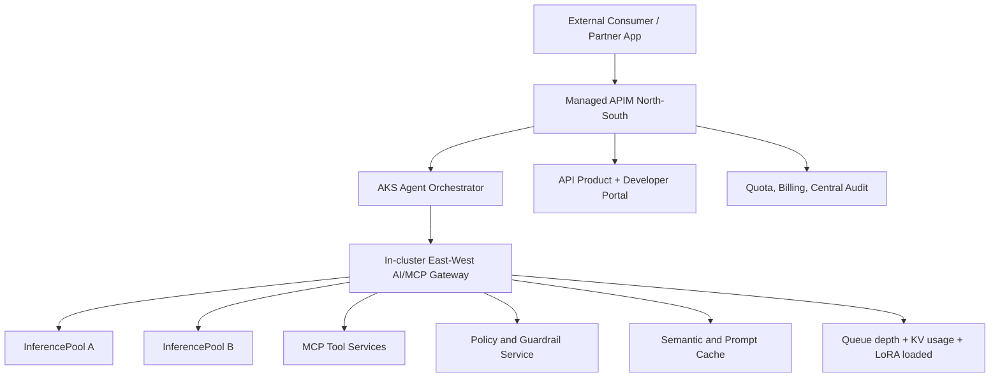
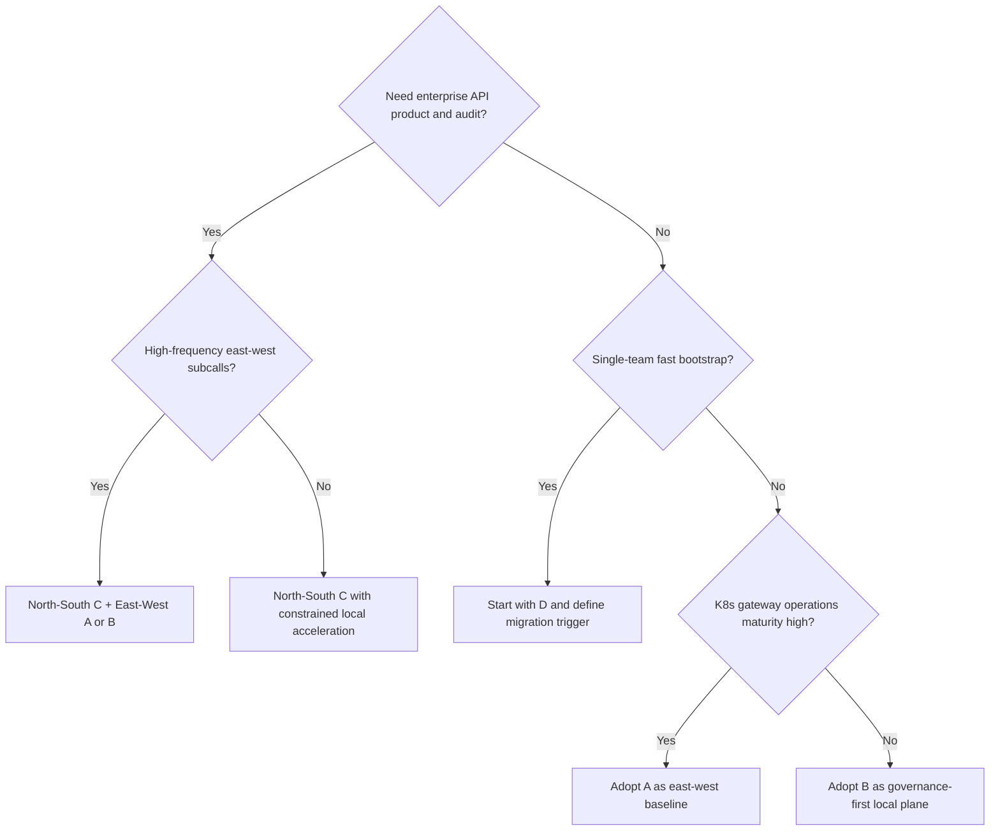

# K8s Gateway API Inference Extension Selection FAQ: Envoy AI Gateway vs APIM Self-Hosted Gateway vs Managed APIM North-South vs Lightweight Proxy Pools
> 🌐 **Language / 语言切换**: **[🇬🇧 English](k8s-gateway-api-inference-extension-envoy-ai-gateway-vs-apim-self-hosted-east-west-mcp-selection-faq.en.md)** | **[🇨🇳 中文版](k8s-gateway-api-inference-extension-envoy-ai-gateway-vs-apim-self-hosted-east-west-mcp-selection-faq.md)** | **[📚 Back to Catalog](README.en.md)**
> Evidence tags: `measured` / `synthetic` / `anonymized_reported`
> Scope boundary: this guide is strictly about AKS east-west AI/MCP gateway design in multi-cluster environments; it is orthogonal to #17/#18 north-south multi-cloud gateway guidance and #22 Istio federation guidance

## 1) Executive summary: decide north-south and east-west responsibilities before choosing products
When enterprise agent platforms scale to many internal sub-agents,
high-frequency MCP tools,
and self-hosted model pools,
the primary bottleneck is often gateway pathing,
not raw model throughput.
If east-west traffic is accidentally forced through a north-south path,
hairpin latency compounds across every internal subcall.
This guide compares four routes:
1. `Envoy AI Gateway / kgateway + Gateway API Inference Extension`.
2. `Azure APIM Self-Hosted Gateway`.
3. `Azure APIM Standard v2 / Premium v2` managed north-south gateway.
4. Lightweight proxy pools such as `Bifrost Go` or `LiteLLM`.
Primary SA takeaways:
- for high-frequency internal subcalls with Pod-level routing sensitivity,
  prefer an in-cluster east-west data plane with inference-aware endpoint picking;
- for governance-first organizations with strict audit and productized APIs,
  use APIM Self-Hosted to keep local forwarding while retaining central control;
- keep managed APIM as the external north-south front door;
- treat lightweight proxies as acceleration tools for early phases,
  not as default enterprise end-state.
Verifiable references (`measured`, retrieved on 2026-11-21):
1. APIM AI Gateway overview  
   https://learn.microsoft.com/en-us/azure/api-management/ai-gateway-overview
2. APIM service changelog  
   https://github.com/Azure/API-Management/blob/main/changelogs/api-management-service.md
3. Gateway API Inference Extension docs  
   https://gateway-api-inference-extension.sigs.k8s.io/
4. Envoy AI Gateway project  
   https://aigateway.envoyproxy.io/
5. ACA sessions docs  
   https://learn.microsoft.com/en-us/azure/container-apps/sessions
6. E2B release stream  
   https://github.com/e2b-dev/e2b/releases
7. enterprise anonymized latency traces (`anonymized_reported`)
8. controlled replay experiments (`synthetic`)

## 2) Problem framing: why east-west hairpinning breaks otherwise healthy platforms
In multi-cluster AKS deployments,
a single user request can fan out into many internal calls:
policy checks,
MCP tool queries,
embedding or reranker hops,
model inference,
and post-processing.
If those calls traverse a north-south gateway path,
three compounding penalties appear:
1. extra RTT and repeated TLS termination;
2. policy chains designed for external APIs get re-executed internally;
3. routing loses awareness of live Pod state such as queue depth and loaded adapters.
Observed production symptoms (`anonymized_reported`):
- P50 latency seems acceptable while P95/P99 spikes unpredictably;
- gateway CPU looks healthy but per-task completion time grows;
- runbooks show HTTP success rates but hide adapter miss and queue-root-cause details.
Therefore,
gateway-layer topology is a first-order architecture decision,
not an implementation detail.

## 3) Objectives and hard constraints for enterprise selection
Freeze objective constraints before implementation:
1. internal subcall path target: `P95 < 120ms` excluding model generation;
2. routing target: maximize hits on Pods already loaded with required LoRA adapters;
3. resiliency target: maintain minimum policy set during short control-plane disconnection windows;
4. economics target: avoid paying north-south governance overhead for purely east-west traffic.
Recommended KPI set:
- `hairpin_ratio`;
- `east_west_hop_count`;
- `adapter_hit_rate`;
- `local_policy_cache_hit_rate`;
- `cost_per_agent_task`.
Out of scope for this guide:
- model quality benchmarking;
- full service mesh replacement strategy;
- IDE/client UX decisions.
This scope discipline keeps selection focused and testable.

## 4) Layered reference architecture: north-south for perimeter, east-west for internal efficiency
Use a two-layer control pattern:
north-south gateway handles external identity,
subscription,
cross-business exposure,
and external developer contracts.
East-west gateway handles in-cluster fan-out,
real-time route selection,
and low-overhead internal policy enforcement.
### Mermaid #1: layered gateway topology

Operating principles:
- keep external API lifecycle ownership in north-south layer;
- keep high-frequency fan-out on local east-west layer;
- unify internal MCP and inference routing under shared contracts;
- validate disconnection behavior through scheduled failover drills.

## 5) Route A deep dive: Envoy AI Gateway + Gateway API Inference Extension
Route A is strongest when routing quality depends on live runtime state.
`InferencePool` and `InferenceModel` resources make routing policy declarative.
Endpoint Picker Plugin (EPP) can ingest queue depth,
KV-cache pressure,
and loaded-adapter labels.
This enables route decisions that are difficult to reproduce in generic gateways.
Strengths:
1. native Kubernetes resource model;
2. low data-plane overhead for in-cluster calls;
3. strong fit for adapter-aware and queue-aware routing.
Trade-offs:
- enterprise API productization needs supplemental platform layers;
- compliance reporting often requires integration work;
- operations teams must own CRD lifecycle and rollout discipline.
Best fit:
large platform teams already comfortable with advanced Kubernetes gateway operations.

## 6) Route B deep dive: APIM Self-Hosted Gateway in AKS or Arc
Route B balances governance consistency and local forwarding.
Control plane remains in APIM,
while data plane runs near workloads in cluster.
That pattern reduces hairpin penalties,
while preserving APIM policy model,
quota control,
and central audit integration.
Strengths:
1. policy parity with managed APIM governance model;
2. easier adoption in organizations with existing APIM operations;
3. practical for sovereign and hybrid footprints.
Trade-offs:
- version lifecycle of self-hosted images must be automated;
- disconnection-window behavior must be tested, not assumed;
- fine-grained Pod runtime signal routing may require extra telemetry bridge.
Best fit:
governance-first enterprises that still need local data-plane proximity.

## 7) Route C deep dive: managed APIM as enterprise north-south front door
Managed APIM remains the strongest option for:
- external identity enforcement,
- productized API contracts,
- developer portal workflows,
- cross-cloud and cross-BU governance.
However,
using this layer as a default path for internal high-frequency fan-out
usually creates avoidable overhead.
Typical anti-patterns:
1. every internal subcall traverses external-grade policy chains;
2. routing has limited visibility into Pod-level runtime dynamics.
Recommended role:
keep managed APIM as north-south system of record,
and delegate in-cluster fan-out to dedicated east-west data plane.

## 8) Route D deep dive: lightweight proxy pools for rapid bootstrap
Bifrost or LiteLLM-class proxies provide rapid setup.
Single-team groups can quickly standardize:
- provider protocol abstraction,
- base routing,
- minimal authentication flow,
- basic observability.
They are useful in:
- early validation,
- small-scale internal deployments,
- low-regulation environments.
Limits in enterprise multi-tenant programs:
1. policy governance depth is often limited;
2. audit and quota semantics may be incomplete;
3. large-scale connection management needs custom engineering;
4. migration friction rises if contracts are not normalized early.
Pragmatic recommendation:
use Route D for acceleration,
but codify migration contracts to Route A or B up front.

## 9) 12-dimension enterprise comparison matrix
Use this matrix as a decision baseline across architecture reviews.

| Dimension | A Envoy + Inference Extension | B APIM Self-Hosted | C Managed APIM North-South | D Lightweight Proxy Pool |
|---|---|---|---|---|
| East-west forwarding overhead | Lowest, typically sub-millisecond (`measured`) | Low with local placement (`measured`) | Medium to high under hairpin (`anonymized_reported`) | Low to medium (`synthetic`) |
| Pod runtime signal awareness | Strong, EPP-native | Medium with extensions | Limited | Limited to medium |
| LoRA-aware routing quality | Strong | Medium | Limited | Medium with custom logic |
| Disconnected autonomy | Strong in local mode | Strong within cache window | Weak | Medium |
| API productization maturity | Medium | Strong | Strongest | Weak to medium |
| Tenant quota governance | Medium | Strong | Strong | Weak |
| Audit and compliance chain | Medium with add-ons | Strong | Strong | Weak to medium |
| Kubernetes-native contract model | Strong | Medium | Weak | Weak |
| Operational complexity | Medium-high | Medium | Low-medium | Low early / high later |
| Extensibility | High via Envoy and K8s ecosystem | Medium via policy model | Medium | Medium |
| Cost predictability | Medium | Medium-high | High | Medium |
| Typical adoption phase | Mid to late platform | Mid to mature platform | All phases for perimeter | Early bootstrap |

How to read it:
if your primary KPI is internal latency stability,
prioritize first four dimensions.
If your primary KPI is compliance and API governance consistency,
prioritize productization and audit dimensions.

## 10) Decision tree: standardize ownership of north-south and east-west planes
Ask four gating questions:
1. Do you need enterprise-grade API productization and central audit now?
2. Is internal subcall frequency high enough to amplify hairpin costs?
3. Do you require policy continuity during short control-plane disconnections?
4. Does your platform team have strong Kubernetes gateway engineering depth?
### Mermaid #2: practical route decision flow

Governance action:
publish this decision tree in platform standards,
and require each domain team to attach route rationale in architecture review.

## 11) Multi-hop latency budget model for internal agent fan-out
Assume one task triggers `24` internal subcalls.
Per-hop incremental overhead ranges:
- in-cluster east-west plane: `0.8ms` to `2.5ms`;
- hairpin via north-south path: `8ms` to `22ms`.
Total delta over 24 hops:
approximately `173ms` to `468ms`.
That delta can shift task-level P95 from acceptable to unstable.
If adapter misses or queue spikes happen at the same time,
tail latency grows further.
Operational requirement:
monitor and gate on:
`latency_budget_per_hop`,
`hairpin_ratio`,
and `adapter_miss_ratio`.
Release pipelines should block when those drift beyond thresholds.

## 12) TCO model: route correctness often saves more than gateway SKU optimization
Build annual cost models with four components:
1. gateway compute and network costs;
2. platform operations labor;
3. model inference waste from retries and route misses;
4. productivity impact from latency regressions.
Illustrative pattern (`anonymized_reported` + `synthetic`):
- perimeter-only gateway for internal fan-out:
  gateway SKU spend may look stable,
  but inference waste can rise by `18%` to `33%`.
- layered gateway architecture:
  gateway-layer spend may increase by `6%` to `12%`,
  while total successful-task cost drops by `14%` to `27%`.
Use `cost_per_successful_agent_task` as primary FinOps KPI,
not isolated gateway infrastructure cost.

## 13) Enterprise scenario A: regulated financial platform with disconnected operating windows
A financial institution runs internal agent workflows on isolated AKS clusters.
Regulatory controls require continued read-only operations
during short control-plane interruptions.
Delivered pattern:
- managed APIM for north-south governance and external integration;
- APIM Self-Hosted for local forwarding and policy continuity;
- selective Envoy inference-aware routing in latency-critical lanes.
Observed outcomes (`anonymized_reported`):
- critical read-path availability remained `99.2%` during `20-minute` disconnection drills;
- internal subcall P95 reduced from `164ms` to `103ms`;
- audit continuity was maintained across drills.

## 14) Enterprise scenario B: multi-factory manufacturing with adapter-locality requirements
A manufacturing group runs quality-inspection agents
across `12` edge AKS clusters.
Each factory has distinct LoRA adapters and workload spikes.
Initial central-gateway-only routing produced unstable tails.
Refactored architecture:
- Route A for local east-west inference and MCP fan-out;
- adapter-label and queue-depth aware endpoint picking;
- managed APIM retained for enterprise perimeter identity and contracts.
Observed outcomes (`anonymized_reported`):
- adapter hit rate increased above `96%`;
- peak subcall P95 dropped by `31%`;
- cost per completed inspection task reduced by `19%`.

## 15) Deep FAQ (8 questions)
### Q1: Why not use one gateway for everything?
Because optimization goals conflict.
North-south gateways optimize external trust boundaries and API contracts.
East-west gateways optimize low-overhead internal fan-out and runtime-aware routing.
Forcing one layer to do both often degrades both objectives.
Codify separation as a platform policy,
not a team-by-team preference.

### Q2: When is Route A clearly better than Route B?
Route A wins when Pod-level runtime signals
directly determine route quality.
If your team can operate Gateway API and CRD workflows confidently,
A is usually the strongest east-west baseline.
If governance consistency is the dominant requirement
and K8s gateway depth is still maturing,
start with B and phase in A where needed.

### Q3: How should we define disconnection windows for Route B?
Start with `15` to `30` minute test windows.
Align cache TTL and certificate rollover behavior to those drills.
The objective is graceful continuity for critical functions,
not unlimited offline operation.
Always publish a validated capability matrix after each drill.

### Q4: How do we quantify hairpin cost convincingly?
Track at least:
`hairpin_ratio`,
`extra_rtt_ms_per_hop`,
`retry_amplification_factor`.
Then convert those into task-level cost and completion-time impact.
Infrastructure-only dashboards understate business impact.

### Q5: What migration trigger indicates Route D is no longer enough?
Any of the following:
1. multi-tenant isolation requirements increase;
2. compliance audit cadence rises;
3. custom patches for quota and routing become frequent;
4. APIs begin crossing business-unit boundaries.
At that point,
remaining on D usually costs more than migration.

### Q6: How can MCP tools and inference endpoints share one east-west control model?
Normalize both into shared route contracts.
Use common HTTPRoute ownership with labels for risk and tenancy boundaries.
This removes blind spots where tool calls bypass policy and observability controls.
Shared contracts also simplify SLO governance and incident triage.

### Q7: Will gateway selection lock our orchestration framework?
Not if contracts are stable.
Keep timeout,
retry,
and error semantics explicit at orchestration boundaries.
Then gateway layers can evolve from D to B or A
without rewriting business agent logic.
Contract discipline preserves portability.

### Q8: What is the minimum Day-0 and Day-2 checklist?
Day-0:
define north-south/east-west boundaries,
ship initial route and policy bundles,
validate cert and secret lifecycle,
record baseline latency budget.
Day-2:
review hairpin metrics weekly,
run disconnection drills monthly,
reassess route strategy quarterly.
Operational rhythm is what keeps gateway architecture healthy after launch.
