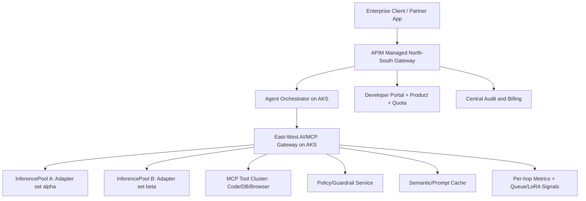
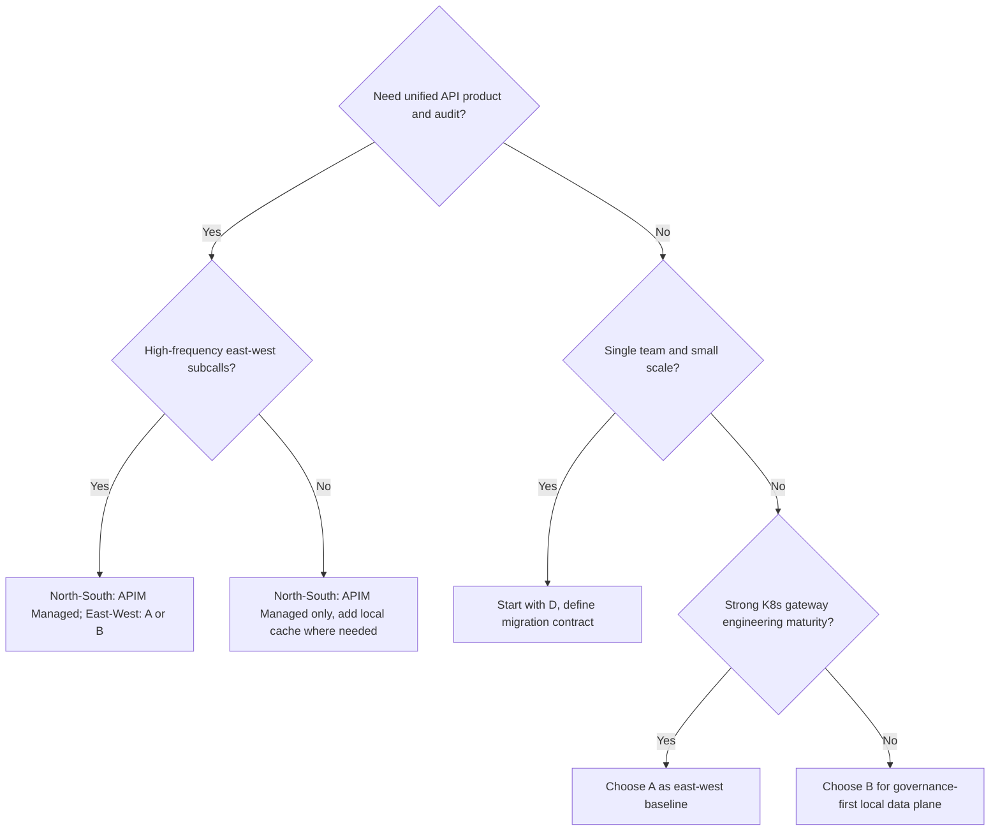

# K8s Gateway API Inference Extension 网关选型 FAQ：Envoy AI Gateway vs APIM 自托管网关 vs APIM 托管南北向 vs 轻量代理池
> 🌐 **Language / 语言切换**: **[🇨🇳 中文版](k8s-gateway-api-inference-extension-envoy-ai-gateway-vs-apim-self-hosted-east-west-mcp-selection-faq.md)** | **[🇬🇧 English](k8s-gateway-api-inference-extension-envoy-ai-gateway-vs-apim-self-hosted-east-west-mcp-selection-faq.en.md)** | **[📚 返回目录](README.md)**
> 证据标签：`measured` / `synthetic` / `anonymized_reported`
> 主题边界：仅讨论 AKS 多集群内东西向 AI/MCP 调用网关；与 #17/#18 的南北向多云网关、#22 的 Istio mTLS 联邦能力正交

## 1) 执行摘要：先做双层网关分工，再做单层技术优选
大型企业把 Agent 平台扩展到多集群阶段后，
最容易出现的性能与治理断层，
不是模型推理本身，
而是网关层把东西向流量误送到南北向链路。
当一次复杂任务触发 `15–40` 次子调用时，
任何跨区折返都会被放大成尾延迟与成本抖动。
本指南比较四条路线：
1. `Envoy AI Gateway / kgateway + Gateway API Inference Extension`；
2. `APIM Self-Hosted Gateway`；
3. `APIM Standard v2 / Premium v2` 托管网关；
4. `Bifrost Go / LiteLLM Proxy` 轻量代理池。
核心结论：
- 有高频东西向子调用和模型就近路由需求时，
  优先建设集群内 Inference Extension 数据面。
- 有统一审计、统一产品化 API 治理诉求时，
  用 APIM Self-Hosted 承担内部网关层，
  并由云端 APIM 控制面集中编排策略。
- 托管 APIM 继续作为企业对外唯一南北向入口，
  不直接承接大规模东向脉冲流量。
- 轻量代理适合单团队启动期，
  但应提前定义升级退出路径。
官方与仓库证据（抓取日期：2026-11-21）：
1. APIM AI Gateway 文档（`measured`）  
   https://learn.microsoft.com/en-us/azure/api-management/ai-gateway-overview
2. APIM 服务变更日志（`measured`）  
   https://github.com/Azure/API-Management/blob/main/changelogs/api-management-service.md
3. Gateway API Inference Extension 项目（`measured`）  
   https://gateway-api-inference-extension.sigs.k8s.io/
4. Envoy AI Gateway 项目（`measured`）  
   https://aigateway.envoyproxy.io/
5. Azure Container Apps Sessions（`measured`）  
   https://learn.microsoft.com/en-us/azure/container-apps/sessions
6. E2B 发布与演进（`measured`）  
   https://github.com/e2b-dev/e2b/releases
7. 企业内部调用追踪脱敏汇总（`anonymized_reported`）
8. 基于回放流量的压测仿真（`synthetic`）

## 2) 场景与痛点：Hairpinning 会把“可用”平台拖成“难用”平台
在 AKS 多集群 Agent 平台里，
一个看似简单的“取知识 + 选模型 + 调工具 + 结构化输出”事务，
往往穿越 MCP Server、Reranker、Guardrail、推理端点和审计服务。
如果这些调用先绕出集群再回流，
会出现三类直接损耗：
1. 额外 RTT 与 TLS 终止重建；
2. 南北向网关策略链不必要地重复执行；
3. 对 Pod 实时状态失去感知，
   导致把请求发给“队列最深”的实例。
常见症状（`anonymized_reported`）：
- P50 看起来正常，
  但 P95/P99 随流量脉冲突然上跳。
- Gateway CPU 并不高，
  但子调用总时延和 token 成本一起上升。
- 运维团队只能看到“HTTP 200”，
  却看不到 “LoRA 未命中导致冷装载” 这种真实根因。
这正是本指南聚焦“南北向与东西向分层”的原因。

## 3) 目标、约束与评估边界：把治理目标写成可验证 SLO
推荐先冻结四组硬约束：
1. 延迟约束：内部子调用链路 `P95 < 120ms`（不含模型首 token）；
2. 路由约束：请求应优先命中已加载对应 Adapter 的 Pod；
3. 合规约束：断网场景下仍可执行最小自治策略集；
4. 成本约束：东西向调用不应触发南北向级别的计费路径。
指标体系建议：
- `east_west_hop_count`；
- `hairpin_ratio`；
- `adapter_miss_ratio`；
- `local_policy_cache_hit`；
- `cost_per_agent_task`。
本指南不讨论：
- 端侧 SDK 体验细节；
- 具体模型精调策略；
- Istio 全网服务网格替代评估。
这样可避免把“网关分层问题”稀释成泛平台问题。

## 4) 分层双网关参考架构：南北向守边界，东西向守效率
建议采用双层控制：
第一层（南北向）负责身份、订阅、跨云外联与对外产品化入口；
第二层（东西向）负责子调用就近路由、实时状态感知与内部策略执行。
### Mermaid #1：双层网关分工与调用路径

落地要点：
- 南北向 APIM 只处理外部入站与跨域调用；
- 东西向网关绑定 K8s Service/Pod 拓扑；
- 内部 MCP 与推理都走同一 `HTTPRoute` 管理平面；
- 断网自治策略仅允许最小必需动作集。

## 5) 路线 A：Envoy AI Gateway + Inference Extension（EPP 智能选点）
该路线的关键优势是“实时感知 Pod 运行态”。
通过 `InferencePool` 与 `InferenceModel` CRD，
可在路由阶段读取队列深度、
KV-cache 利用率、
LoRA 装载状态等信号。
它非常适配：
- 同一集群内高频短调用；
- 同模型多 Adapter 复用；
- 需要极低额外转发开销的场景。
典型能力：
1. Endpoint Picker Plugin（EPP）可按业务特征扩展；
2. 通过 Gateway API 原生纳管 `HTTPRoute`；
3. 与 K8s 伸缩事件联动更直接。
主要边界：
- 企业级产品化能力需额外建设；
- 跨组织 API 生命周期治理要配套平台层；
- 团队需具备 CRD 与网关数据面运维能力。
当平台团队已经有强 K8s 工程成熟度时，
路线 A 往往是东西向最优起点。

## 6) 路线 B：APIM Self-Hosted Gateway（控制面云端，数据面本地）
路线 B 的价值是“统一治理 + 本地转发”。
它保持 APIM 的产品、
策略、
审计、
配额体系，
同时把数据面容器下沉到 AKS 或 Arc K8s。
因此既避免跨网折返，
又不丢企业级治理一致性。
适配场景：
- 主权云或强合规边缘；
- 总部与分支多站点统一策略；
- 需要离线窗口内保持核心策略生效。
优势：
1. 策略语义与托管 APIM 一致；
2. API Center/门户/审计链路延续；
3. 混合云迁移阻力较低。
注意点：
- 自托管网关版本治理要纳入发布流水线；
- 控制面失联容忍窗口需压测验证；
- 与 K8s 原生 Inference Extension 的细粒度状态感知能力不同，
  常需额外旁路指标输入。

## 7) 路线 C：APIM 托管南北向网关（外部入口首选，不是内部细粒度数据面）
路线 C 在企业对外 API 治理上最稳健。
它适合承担：
- Entra OAuth/OBO；
- 订阅与配额产品化；
- 跨云模型溢出路由；
- 开发者门户与合同管理。
但若把它直接用于集群内高频子调用，
通常会出现两类问题：
1. 每次子调用都经历南北向治理链，
   产生不必要开销；
2. 很难做到 Pod 级 LoRA/队列状态感知选点。
因此推荐姿势是：
托管 APIM 作为外部统一入口，
内部高频调用由东西向网关处理，
两层之间通过明确契约交接上下文。

## 8) 路线 D：Bifrost/LiteLLM 轻量代理池（快启方案，非终局平台）
轻量代理优势是上手极快。
单团队几天内就能实现：
- 协议统一；
- 基础路由；
- 简单鉴权；
- 可观测打点。
它很适合：
- 0 到 1 验证；
- 小规模模型池；
- 单租户工程组织。
但在多租户企业环境，
常见上限包括：
1. 缺少声明式 CRD 治理闭环；
2. 配额与审计能力偏弱；
3. 与平台级资产目录对接成本高；
4. 大规模连接池与故障域隔离需自建。
建议把路线 D 定位为阶段性加速器，
并在设计时预留迁移到 A 或 B 的接口契约。

## 9) 12 维企业级对比矩阵：先看约束匹配，再看峰值性能
下表聚焦企业 SA 最常见的 12 个决策维度。

| 维度 | A Envoy+Inference Extension | B APIM Self-Hosted | C APIM 托管南北向 | D 轻量代理池 |
|---|---|---|---|---|
| 东西向额外时延 | 最低，通常亚毫秒级转发开销（`measured`） | 低，取决于部署拓扑（`measured`） | 中到高，易出现折返（`anonymized_reported`） | 低到中，取决于实现（`synthetic`） |
| Pod 实时状态感知 | 强，原生对接 EPP 信号 | 中，需要旁路接入 | 弱，非 Pod 粒度优先 | 弱到中，需自研 |
| LoRA 命中路由 | 强，可按 Adapter 标签选点 | 中，可策略化但不天然 | 弱，通常在上游完成 | 弱到中，取决于实现 |
| 断网自治能力 | 强，完全本地数据面 | 强，策略缓存可维持窗口 | 弱，依赖云端可达性 | 中，本地可跑但治理薄弱 |
| 企业 API 产品化 | 中，需叠加平台层 | 强，继承 APIM 体系 | 强，最完整 | 弱到中 |
| 多租户配额治理 | 中，需自建计费配额栈 | 强，策略成熟 | 强，策略成熟 | 弱 |
| 审计与合规模型 | 中，需额外建设 | 强，统一审计链 | 强，统一审计链 | 弱到中 |
| Gateway API 一致性 | 强，K8s 原生 | 中，需映射 | 弱，偏云网关语义 | 弱 |
| 运维复杂度 | 中到高 | 中 | 低到中 | 低（初期）/高（后期） |
| 扩展插件生态 | 强（Envoy/K8s 生态） | 中（APIM 策略生态） | 中（APIM 策略生态） | 中（社区插件） |
| 成本可预测性 | 中，跟随集群资源 | 中到高，可按网关规模预算 | 高，SKU 清晰 | 中，隐性人力成本高 |
| 典型推荐阶段 | 平台中后期 | 平台中期到成熟期 | 全阶段的南北向入口 | 平台早期验证 |

矩阵解读建议：
若你的首要 KPI 是内部子调用延迟与 Adapter 命中率，
优先看前三行；
若你的首要 KPI 是审计与产品化，
优先看第五到第七行。

## 10) 选型决策树：把“谁做北向，谁做东向”固化成组织标准
先问四个问题：
1. 是否需要企业级统一 API 产品化与审计？
2. 是否存在大规模集群内高频子调用？
3. 是否要求断网自治窗口持续服务？
4. 团队是否具备 K8s CRD 与 Envoy 运维能力？
### Mermaid #2：网关分层决策树

组织落地动作：
- 把决策树作为平台准入门槛；
- 用 ADR 记录每个业务域选择；
- 每季度复核一次流量画像与成本曲线。

## 11) 多跳调用延迟预算：不要把每跳“少量开销”当作可忽略项
假设一次 Agent 任务触发 `24` 次内部子调用，
每次子调用包含：
客户端到网关、
网关到推理或 MCP、
返回聚合三段。
预算示例（`synthetic`）：
- 本地东西向网关附加开销：`0.8–2.5ms/跳`；
- 折返南北向附加开销：`8–22ms/跳`；
- `24` 跳累计差值：约 `173–468ms`。
这段差值足以把“看似达标”的任务，
从 `P95 1.1s` 推高到 `P95 1.5s+`。
再叠加 LoRA 未命中冷装载，
尾部会进一步放大。
因此建议强制维护：
`latency_budget_per_hop` 仪表板，
并在发布门禁中检查 “hairpin_ratio 是否上升”。

## 12) 网关实例与平台 TCO：算力成本之外，最贵的是路径错误
年度成本模型建议包含四块：
1. 网关计算与网络；
2. 平台运维人力；
3. 失败重试导致的模型推理浪费；
4. 由延迟升高造成的人效损失。
示例对比（`anonymized_reported` + `synthetic`）：
- 仅托管北向 + 错配内部流量：
  虽然网关 SKU 账面可控，
  但因重试与队列堆积导致推理费用增长 `18%–33%`。
- 分层双网关后：
  网关层总成本增加 `6%–12%`，
  但任务级总成本下降 `14%–27%`，
  且 P95 稳定性显著改善。
在平台评审会上，
应统一采用 `cost_per_successful_agent_task`，
而不是仅看“单个网关 SKU 费用”。

## 13) 企业场景 A：金融机构零信任研发云中的断网自治
某金融机构把核心量化 Agent 与内部 MCP 工具部署在隔离 AKS。
监管要求：
在控制面短暂不可达时，
关键读操作仍可持续。
落地策略：
- 北向统一走 APIM 托管；
- 东西向采用 APIM Self-Hosted Gateway；
- 关键策略与证书轮换窗口提前演练；
- 高频推理路径再叠加 A 路线做智能选点。
结果（`anonymized_reported`）：
- 断连 `20` 分钟窗口内核心读操作成功率保持 `99.2%`；
- 内部子调用 P95 从 `164ms` 降至 `103ms`；
- 审计链路未出现断档。

## 14) 企业场景 B：制造业多工厂边缘集群的 LoRA 就近路由
某制造集团在 `12` 个工厂边缘 AKS 集群运行视觉质检 Agent。
每个工厂对应不同 LoRA 适配器，
且夜班高峰并发明显。
初期全部经北向网关汇聚，
出现高峰延迟抖动与适配器冷装载冲突。
重构后：
- 采用 A 路线作为工厂内东西向网关；
- 以 Adapter 标签与队列深度做 EPP 选点；
- 北向 APIM 保留总部统一身份与外部集成。
结果（`anonymized_reported`）：
- Adapter 命中率提升到 `96%+`；
- 高峰 P95 子调用时延下降 `31%`；
- 质检任务单位成本下降 `19%`。

## 15) 深度 FAQ（8 问）：从实施细节到治理边界
### Q1：为什么不把所有流量都压到一个“万能网关”？
因为北向与东西向的优化目标不同。
北向强调产品化、对外契约与统一审计。
东西向强调低开销转发与实时运行态选点。
强行合并通常会让两边都不满意。
实践中应把边界写进平台规范，
避免团队各自解释。

### Q2：什么时候 A 比 B 更优先？
当你明确需要 Pod 级信号驱动选点，
并且平台团队具备 Gateway API/CRD 运维能力时，
A 往往能提供更低时延与更高命中率。
若组织更强调统一 API 生命周期治理，
或团队 K8s 数据面经验不足，
可先选 B，再逐步引入 A 的实时路由能力。

### Q3：B 方案断网自治窗口应该设多长？
建议从 `15–30` 分钟演练窗口起步，
并按证书轮换周期与策略缓存 TTL 校准。
目标不是无限离线，
而是在短时控制面抖动下维持核心业务连续性。
每次演练要输出“可服务能力清单”，
避免误把“网关可运行”当“业务可运行”。

### Q4：如何量化 Hairpinning 的真实代价？
至少记录三类指标：
`hairpin_ratio`、
`extra_rtt_ms_per_hop`、
`retry_amplification_factor`。
再把这些指标映射到任务级成本。
如果只看网关节点资源，
通常会低估问题。

### Q5：D 方案何时必须升级？
出现以下任一信号就应升级：
1. 多租户隔离要求提升；
2. 审计与合规稽核频率上升；
3. 连接池与限流策略开始频繁手工修补；
4. 团队开始跨 BU 共享 API 产品。
此时继续堆补丁，
长期成本会高于迁移成本。

### Q6：如何让 MCP Server 与推理端点共用一套东西向路由治理？
关键是统一路由契约。
把 MCP 与推理都映射为标准 `HTTPRoute` 资源，
并通过标签区分安全级别与租户边界。
这样可以共享可观测与策略门禁，
减少“工具流量无人管”的灰区。

### Q7：网关选型是否会影响 Agent 编排框架？
会，但影响可控。
只要在编排层维持稳定调用抽象，
网关层可替换。
建议提前定义：
超时语义、
重试语义、
错误码契约。
这样切换 A/B/C/D 不会牵动业务编排逻辑。

### Q8：Day-0 与 Day-2 最小检查清单是什么？
Day-0：
完成分层边界定义、
首批路由策略、
证书与密钥托管、
基础压测基线。
Day-2：
每周复核 hairpin 指标、
每月演练断网自治窗口、
每季度评估路线升级触发条件。
把这些动作纳入 SRE 例行节奏，
网关平台才会长期稳定。
