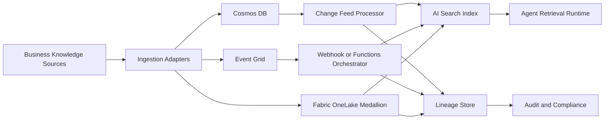
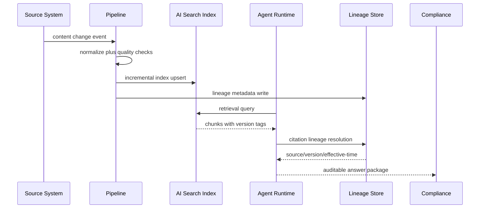

# Enterprise knowledge freshness and evidence lineage selection FAQ: Cosmos Change Feed incremental indexing vs Event Grid webhook orchestration vs Fabric OneLake semantic snapshots

> **Audience**: Enterprise Cloud & AI Solution Architects, knowledge platform owners, data governance teams, compliance auditors, and domain knowledge stewards.  
> **Core question**: In enterprise RAG and agent decision systems, how do you keep knowledge fresh, evidence traceable, and operating cost sustainable at the same time.

## 1. Problem framing: stale knowledge is a business and compliance risk

Most teams first optimize for RAG launch speed,
then discover continuous freshness is the real challenge.

Stale knowledge does more than reduce answer quality.
It creates direct business and audit risk.

Typical incident patterns:

- Quotes rely on superseded policy versions.
- Contract retrieval surfaces deprecated clauses.
- Risk thresholds update in source systems but not in agent context.
- Audit reviews cannot reconstruct citation provenance.

Freshness governance and lineage governance
must be designed as one control plane.

## 2. Design objective: balance freshness, correctness, and accountability

Enterprise knowledge platforms
cannot optimize a single metric.

Three goal classes must stay aligned:

- Update latency from source change to retrievable state.
- Content correctness with dedupe and conflict control.
- Accountability from answer output back to source version.

Recommended baseline metrics:

- Index lag P95.
- High-risk stale-hit rate.
- Citation traceability coverage.
- Knowledge update cost per 1,000 answers.

## 3. Pattern A: Cosmos Change Feed incremental indexing

Pattern A uses Cosmos Change Feed
as the near-real-time update trigger.

Typical flow:

- Business systems persist source knowledge.
- Change Feed captures incremental deltas.
- Processors chunk and enrich metadata.
- Incremental writes update the search index.

Strengths:

- Strong near-real-time capability.
- Efficient for frequent small changes.
- Natural fit for event-driven architectures.

Limitations:

- Historical rebuild can be expensive.
- Multi-source conflict handling needs extra controls.
- Weak lineage design creates audit blind spots.

## 4. Pattern B: Event Grid plus webhook orchestration pipeline

Pattern B emphasizes event routing
and policy-driven orchestration.

Core approach:

- Domains emit standardized change events.
- Event Grid routes and fans out events.
- Webhooks or Functions run transforms.
- Unified writers update index and lineage stores.

Strengths:

- High elasticity for many source systems.
- Flexible policy handling by event class.
- Strong fit for staged approvals and canary release.

Limitations:

- Event contract governance has higher overhead.
- Longer orchestration chains complicate troubleshooting.
- End-to-end latency depends on downstream stability.

## 5. Pattern C: Fabric OneLake semantic snapshots with batch-incremental mix

Pattern C adopts a medallion-semantic snapshot strategy.

Common pipeline:

- Bronze captures raw upstream changes.
- Silver normalizes and applies quality rules.
- Gold publishes semantic-ready snapshots.
- Scheduled or near-real-time sync feeds retrieval tiers.

Strengths:

- Strong lineage visibility and governance depth.
- Excellent for cross-domain semantic alignment.
- Robust historical replay capability.

Limitations:

- Near-real-time latency is usually higher.
- Higher platform skill requirement.
- Can be cost-heavy for small teams.

## 6. Pattern D: layered hybrid model (recommended)

Enterprises often combine all three patterns:

- High-frequency policy updates via A/B.
- Strong governance and replay via C.
- Unified version tags and lineage at retrieval boundary.

This balances update speed,
governance visibility, and audit readiness.

## 7. Reference architecture: freshness and lineage control plane

Architecture implications:

- Search index and lineage store must stay source-aligned.
- Every update needs explicit version and effective-time metadata.
- Deletion and withdrawal semantics must propagate deterministically.

## 8. Request path: update, retrieval, citation audit closure

Flow governance essentials:

- Citations must bind to explicit version snapshots.
- Output should include minimal auditable evidence.
- Retry paths must avoid duplicate lineage pollution.

## 9. 12-dimension enterprise comparison matrix

| Dimension | A Change Feed | B Event Grid | C OneLake Snapshot | D Hybrid Layer |
|---|---|---|---|---|
| Update latency capability | Very high | High | Medium | High |
| Multi-source onboarding elasticity | Medium | High | High | High |
| Lineage explainability | Medium | High | Very high | Very high |
| Historical replay capability | Medium | Medium | Very high | High |
| Contract-governance complexity | Medium | High | Medium | High |
| Troubleshooting observability | Medium | Medium | High | High |
| Audit friendliness | Medium | High | Very high | Very high |
| Cost predictability | High | Medium | Medium | Medium |
| Agile iteration fit | High | High | Medium | High |
| Cross-domain semantic consistency | Medium | Medium | Very high | High |
| Operations complexity | Medium | High | High | High |
| Recommended maturity phase | Real-time first | Event governance | Data governance mature | Enterprise scale |

## 10. Quantitative break-even: latency, accuracy, and cost

| Metric | A Change Feed | B Event Grid | C OneLake | D Hybrid |
|---|---:|---:|---:|---:|
| Update lag P95 | 42s | 68s | 7.8m | 55s |
| Citation traceability coverage | 93.4% | 96.2% | 99.1% | 99.3% |
| Stale-version hit rate | 2.9% | 2.1% | 1.7% | 1.2% |
| Update cost per 1k answers | $18 | $22 | $27 | $24 |
| Audit reconciliation effort | 19h/mo | 13h/mo | 6h/mo | 5h/mo |
| Critical-policy activation latency | 1.1m | 1.9m | 12.4m | 1.6m |

Assumptions:

- 1.2M knowledge objects under management.
- Daily change ratio around 2.4%.
- 20% of content classified high-risk policy.
- Monthly audit cycle with evidence sampling.
- 35% of retrieval turns require multi-document evidence stitching.
- Version-retention horizon is modeled at 18 months.
- Peak traffic concurrency multiplier is modeled at 3.6.

Summary interpretation:

- A suits near-real-time update pressure.
- B suits multi-system event orchestration.
- C suits strict lineage and replay governance.
- D is strongest under mixed enterprise objectives.

## 11. Decision tree: choose by risk class and update profile

Question 1:
Do you require minute-level policy propagation?

- Yes: prioritize A or D.
- No: continue to Question 2.

Question 2:
Must you coordinate updates across 10+ systems?

- Yes: prioritize B or D.
- No: continue to Question 3.

Question 3:
Does audit require full historical replay?

- Yes: prioritize C or D.
- No: continue to Question 4.

Question 4:
Do teams already operate medallion governance?

- Yes: accelerate C or D adoption.
- No: phase through A/B and evolve incrementally.

## 12. Anti-patterns and governance corrections

Anti-pattern 1:
Updating index only without lineage records.

Correction:
Require version lineage writes on every incremental update.

Anti-pattern 2:
Different domains use inconsistent effective-time semantics.

Mitigation:
Standardize temporal semantics and timezone policy.

Anti-pattern 3:
Citations include document ID only, no version identity.

Action:
Enforce version fingerprints and timestamps in evidence output.

Anti-pattern 4:
Rollback updates search index but not lineage stores.

Fix:
Use dual compensation flows to keep index and lineage consistent.

## 13. Platform governance: ownership and release gates

Recommended ownership split:

- Knowledge platform team owns update pipelines and retrieval policies.
- Data governance team owns schema and quality controls.
- Domain owners own source accountability and review workflows.
- Compliance team owns evidence retention and sampling policy.

Release gates:

- High-risk knowledge updates need dual authorization.
- Critical index changes require staged validation windows.
- Lineage-write failures should block promotion.

## 14. Five-step rollout guide (Good fit vs Not for)

Step 1:
Define a unified knowledge object and version schema.

Step 2:
Deploy incremental update paths for high-frequency domains.

Step 3:
Build a centralized lineage store and citation validator.

Step 4:
Add snapshot replay for high-risk policy domains.

Step 5:
Run weekly lag and stale-hit postmortems with domain teams.

Good fit:

- Regulated industries with strict evidence demands.
- High-frequency multi-domain knowledge changes.
- Need to trace answer output back to source lineage.

Not for:

- Static knowledge sets with rare change cadence.
- Lightweight demo assistants without compliance scope.
- Environments with no audit or evidence obligations.

## 15. Practical FAQ (8 questions)

**Q1: Is Change Feed always better than snapshot refresh?**  
A1: It is better for freshness, while snapshot-based pipelines are often stronger for audit replay.

**Q2: Does Event Grid orchestration add too much complexity?**  
A2: Complexity increases, but cross-system governance and policy routing improve significantly.

**Q3: Is OneLake too heavy for enterprise teams?**  
A3: It can be heavy for small teams, but is valuable for cross-domain semantic governance.

**Q4: How do we reduce stale-version retrieval risk?**  
A4: Enforce version filters during retrieval and verify citations before final answer emission.

**Q5: Which fields are mandatory for lineage evidence?**  
A5: Source system, source version, effective timestamp, and pipeline version are baseline fields.

**Q6: Should rollback start from source or index?**  
A6: Use one orchestrated compensation path so source, index, and lineage rollback coherently.

**Q7: When should we adopt the hybrid model?**  
A7: Adopt early when minute-level freshness and strict auditability are both mandatory.

**Q8: How do we prevent overwrite conflicts across domains?**  
A8: Apply version concurrency controls, conflict arbitration policies, and human override fallback.
Run quarterly architecture reviews to confirm conflict policies still match domain ownership boundaries.

