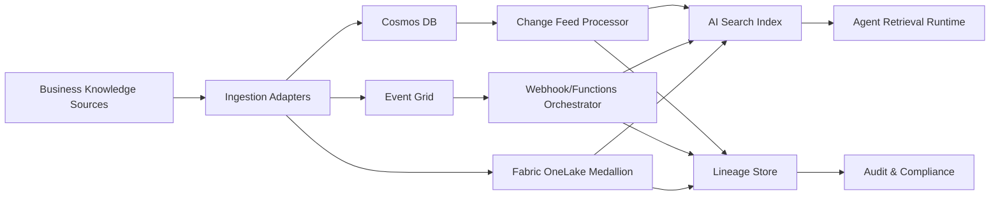
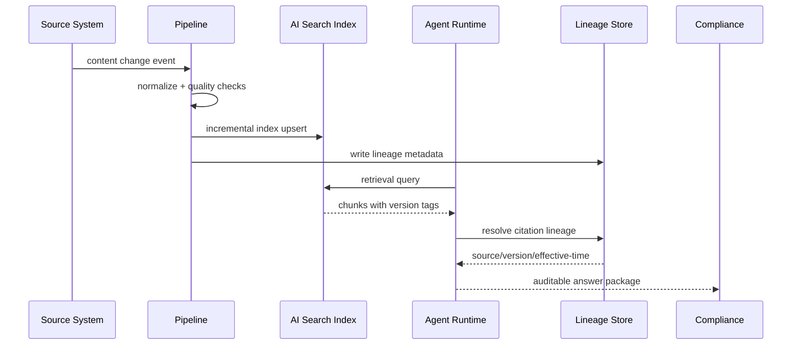

# 企业知识新鲜度与证据谱系选型 FAQ：Cosmos Change Feed 增量索引 vs Event Grid Webhook 编排 vs Fabric OneLake 语义快照

> **适用角色**：企业 Cloud & AI SA、知识平台负责人、数据治理团队、合规审计团队、业务域知识管理员。  
> **核心问题**：在企业 RAG 与 Agent 决策场景下，如何同时保证知识“新鲜可用”、证据“可追可审”与成本“可长期控制”。

## 1. 问题定义：知识过期不是体验问题，而是业务风险问题

多数团队先把 RAG 跑通，
随后才发现真实难点在持续更新。

过期知识的影响远超“答错一题”。
它会直接触发业务与合规风险。

高频事故包括：

- 报价依据仍引用旧政策版本。
- 合同条款已更新但检索命中旧稿。
- 风控阈值变更未及时传播到 Agent。
- 审计追问时无法还原引用来源。

因此知识新鲜度治理必须和谱系审计一体设计。

## 2. 设计目标：新鲜度、正确性、可追责三角平衡

企业知识系统不能只优化单一指标。

必须同时管理三类目标：

- 更新时延：从源数据变更到可检索。
- 内容正确性：去重、冲突检测与版本一致。
- 证据可追责：回答到文档版本的闭环链路。

统一度量建议：

- 索引滞后 P95。
- 高风险知识误命中率。
- 引用可追溯覆盖率。
- 每千问答知识更新成本。

## 3. 模式 A：Cosmos Change Feed 驱动增量索引

模式 A 以 Cosmos Change Feed
作为高频更新触发源。

典型链路：

- 业务系统写入知识主存。
- Change Feed 捕获增量变更。
- 处理器做切片与元数据补全。
- 增量写入 AI Search 索引。

优点：

- 近实时更新能力强。
- 增量效率高，适合高频小变更。
- 与事件驱动架构天然契合。

限制：

- 复杂回溯与重建成本较高。
- 多源冲突协调需要额外层。
- 谱系归档若设计不足会留审计盲区。

## 4. 模式 B：Event Grid + Webhook 编排更新流水线

模式 B 强调“事件编排与策略路由”。

核心做法：

- 业务域发布标准化变更事件。
- Event Grid 负责路由与扇出。
- Webhook 或 Functions 执行清洗。
- 统一写入索引与谱系库。

优点：

- 多系统接入弹性高。
- 可按事件类型分层处理策略。
- 易于纳入审批与灰度机制。

限制：

- 事件契约治理门槛较高。
- 编排链路长时排障复杂。
- 端到端时延受下游稳定性影响。

## 5. 模式 C：Fabric OneLake 语义快照与批增混合

模式 C 采用湖仓语义快照思路。

常见模式：

- Bronze 采集原始变更。
- Silver 做标准化与质量规则。
- Gold 输出可检索语义快照。
- 定时或准实时同步到检索层。

优点：

- 谱系可视化与治理能力强。
- 适合跨域统一口径与复盘分析。
- 便于做历史版本回放。

限制：

- 近实时性通常不如纯事件流。
- 体系较重，团队门槛较高。
- 小规模场景可能成本偏高。

## 6. 模式 D：分层混合（推荐）

企业常用组合是：

- 高频策略内容走 A/B 近实时链路。
- 关键治理与审计走 C 快照链路。
- 在检索层统一做版本标记与溯源。

该模式兼顾更新速度、
治理可见性与审计可追责。

## 7. 参考架构：知识新鲜度与谱系控制平面

架构关键点：

- 检索索引与谱系库必须同源对齐。
- 每次更新都要携带版本与生效时间。
- 删除与撤回策略需要显式传播。

## 8. 请求路径：更新、检索、引用审计闭环

流程治理重点：

- 引用必须绑定具体版本快照。
- 回答输出需附最小可审计证据集。
- 失败重试不能重复污染谱系记录。

## 9. 12 维企业选型对比矩阵

| 维度 | A Change Feed | B Event Grid | C OneLake 快照 | D 混合分层 |
|---|---|---|---|---|
| 更新时延能力 | 极高 | 高 | 中 | 高 |
| 多源接入弹性 | 中 | 高 | 高 | 高 |
| 谱系可解释性 | 中 | 高 | 极高 | 极高 |
| 历史回放能力 | 中 | 中 | 极高 | 高 |
| 契约治理复杂度 | 中 | 高 | 中 | 高 |
| 排障可观察性 | 中 | 中 | 高 | 高 |
| 审计友好度 | 中 | 高 | 极高 | 极高 |
| 成本可预测性 | 高 | 中 | 中 | 中 |
| 小步快跑适配 | 高 | 高 | 中 | 高 |
| 跨域统一口径 | 中 | 中 | 极高 | 高 |
| 运维复杂度 | 中 | 高 | 高 | 高 |
| 推荐成熟阶段 | 近实时优先 | 事件化治理 | 数据治理成熟 | 企业规模化 |

## 10. 量化拐点：时延、准确与成本

| 指标 | A Change Feed | B Event Grid | C OneLake | D 混合 |
|---|---:|---:|---:|---:|
| 更新滞后 P95 | 42s | 68s | 7.8m | 55s |
| 引用可追溯覆盖率 | 93.4% | 96.2% | 99.1% | 99.3% |
| 旧版本误命中率 | 2.9% | 2.1% | 1.7% | 1.2% |
| 每千问答更新成本 | $18 | $22 | $27 | $24 |
| 合规审计补录工时 | 19h/月 | 13h/月 | 6h/月 | 5h/月 |
| 关键策略生效时延 | 1.1m | 1.9m | 12.4m | 1.6m |

测算前提：

- 120 万条知识对象。
- 每日变更 2.4%。
- 20% 内容属于高风险政策域。
- 审计周期按月执行。
- 检索请求 35% 需要多文档交叉引用。
- 版本保留窗口按 18 个月计算。
- 高峰时段并发放大系数按 3.6 估算。

结论摘要：

- A 适合高频增量优先场景。
- B 适合多系统事件编排场景。
- C 适合强治理与复盘场景。
- D 在综合指标下表现最稳。
若组织正推进主数据统一工程，建议优先建设跨域版本映射表。
当审计抽检频率上升时，应同步提升谱系存储可用性等级。

## 11. 决策树：按风险域与更新频率选型

问题 1：
是否存在分钟级策略更新要求？

- 是：优先 A 或 D。
- 否：进入问题 2。

问题 2：
是否需要跨十个以上系统统一更新？

- 是：优先 B 或 D。
- 否：进入问题 3。

问题 3：
审计是否要求完整历史回放？

- 是：优先 C 或 D。
- 否：进入问题 4。

问题 4：
团队是否具备湖仓治理能力？

- 是：可加速 C 或 D。
- 否：从 A/B 渐进演进。

## 12. 反模式与治理修正

反模式一：
只更新索引，不维护版本谱系。

修正：
要求每次增量写入同时记录来源版本。

反模式二：
不同业务域使用不同时间基准。

修正：
统一生效时间语义与时区标准。

反模式三：
仅按文档 ID 引用，不含版本号。

修正：
回答证据必须含版本指纹与时间戳。

反模式四：
回滚时只撤索引，不撤谱系记录。

改进：
引入双向补偿流程保持索引与谱系一致。

## 13. 平台治理：角色分工与发布闸门

建议职责：

- 知识平台团队：维护更新流水线与检索策略。
- 数据治理团队：维护口径与质量规则。
- 业务域团队：维护知识权责与审核流程。
- 合规团队：定义证据留存与抽检机制。

发布闸门：

- 高风险知识变更需双签审核。
- 关键索引变更需灰度验证窗口。
- 谱系写入失败必须阻断发布。

## 14. 五步落地指南（Good fit vs Not for）

步骤 1：
先定义统一知识对象模型与版本字段。

步骤 2：
为高频内容部署增量更新链路。

步骤 3：
建立统一谱系库与引用校验器。

步骤 4：
按风险等级接入快照回放能力。

步骤 5：
建立周度滞后与误命中复盘机制。

Good fit：

- 金融、医药、法务等高审计行业。
- 知识变更频繁且跨域协同复杂。
- 需要从回答反查到证据来源。

Not for：

- 静态知识库且更新频率极低。
- 仅做演示性质的轻量问答系统。
- 无合规抽检和审计要求场景。

## 15. 实战 FAQ（8 问）

**Q1：Change Feed 是否一定优于批处理？**  
A1：在高频更新场景通常更优，但批快照在审计和回放上更稳。

**Q2：Event Grid 链路会不会太复杂？**  
A2：复杂度会提升，但多系统治理能力显著增强。

**Q3：OneLake 模式是否过重？**  
A3：对小团队可能偏重，但在跨域治理中价值明显。

**Q4：如何降低旧版本误命中？**  
A4：必须在检索阶段强制版本过滤并在回答阶段复核。

**Q5：证据谱系最小必填字段有哪些？**  
A5：来源系统、文档版本、生效时间、处理流水线版本。

**Q6：回滚应该先动索引还是先动源数据？**  
A6：建议走统一补偿编排，确保索引与谱系同步回滚。

**Q7：如何评估是否该上混合模式？**  
A7：当分钟级更新需求与强审计需求同时出现时应优先考虑。

**Q8：如何避免知识更新冲突覆盖？**  
A8：引入版本并发控制与冲突仲裁策略，并保留人工审批兜底。
建议在季度架构评审中复核版本冲突策略是否仍匹配组织边界。
若并购后知识域快速扩张，可先统一元数据字典再扩容更新流水线。

