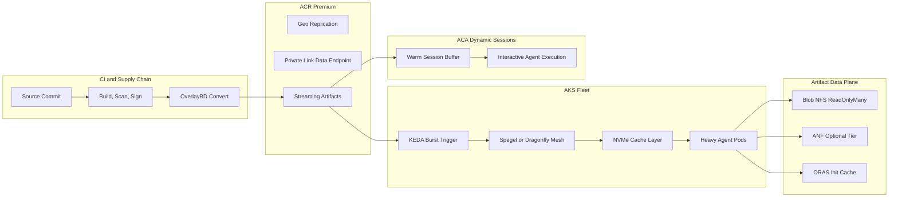
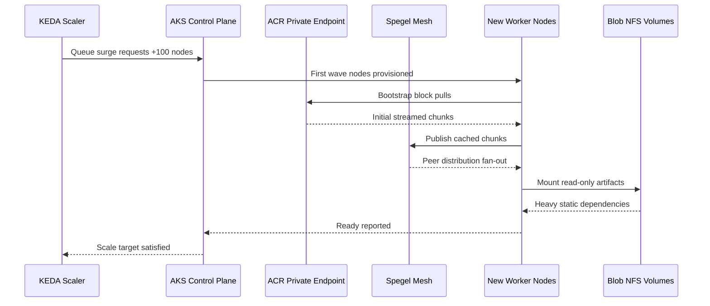

# Enterprise Large Agent Container Distribution FAQ: ACR OverlayBD Artifact Streaming vs AKS P2P+NVMe Mirrors vs Slim Runtime Image with ReadOnly Artifact Volumes vs ACA Warm Session Buffers
> 🌐 **Language Switch**: [中文](large-agent-container-image-streaming-acr-overlaybd-vs-aks-p2p-nvme-vs-volume-mount-selection-faq.md) | **English (current)**  
> Audience: Enterprise Cloud & AI Solution Architects, platform engineering leads, SRE, FinOps, and software-supply-chain governance teams.  
> Core challenge: For `5–35 GB` heavy agent images, how to avoid ACR Private Link thundering-herd failures during `0 -> 100` node KEDA scale-out while preserving latency SLOs, security posture, and cost discipline.  
> Scope boundary: Architecture and operating-model guidance only, not kernel implementation internals.  
## 1. Executive summary: image distribution is an enterprise agent control plane, not a DevOps footnote
Enterprise teams often optimize model inference first.  
In heavy-tooling agent fleets, the first true bottleneck is frequently image distribution.  
When images grow to `8–30 GB`, full download plus decompression dominates startup paths.  
If workload surges trigger `0 -> 100` node expansion, registry pressure rises superlinearly.  
A centralized full-pull design causes queueing storms at exactly the wrong moment.  
Then upper-layer routing, policy checks, and orchestration all inherit avoidable timeout risk.  
That is why image distribution should be treated as a first-class control plane.  
This guide proposes a four-path architecture stack.  
Path A: ACR Premium with OverlayBD lazy block streaming.  
Path B: AKS in-cluster P2P mirrors plus ephemeral NVMe cache.  
Path C: Slim immutable runtime image with read-only artifact volume decoupling.  
Path D: ACA Dynamic Sessions warm standby pools that remove pull from request-time critical path.  
These paths are complementary, not mutually exclusive.  
Each path solves a different bottleneck at a different maturity stage.  
Path A accelerates first-byte startup.  
Path B eliminates herd amplification against centralized registry endpoints.  
Path C decouples release cadence from static heavyweight dependency payloads.  
Path D converts cold-start risk into managed warm-pool economics.  
The strongest enterprise pattern is workload-tiered composition across all four.  
## 2. Problem framing: from image size concern to scale-out shock-absorption design
Layer optimization in Dockerfiles is necessary but insufficient at enterprise concurrency.  
The root risk is not image size alone.  
The root risk is image size multiplied by concurrent expansion events.  
A single-node `25 GB` pull at `210s` is already expensive.  
Eighty such pulls during one burst becomes a platform event.  
In supplier portals, customs filing, and procurement cutoffs, traffic windows are synchronized.  
Synchronized windows require deterministic expansion behavior.  
Therefore architecture decisions should be governed by four metric families.  
Family one covers startup latency and tail behavior.  
Family two covers distribution throughput and success probability.  
Family three covers registry egress and network cost predictability.  
Family four covers supply-chain integrity and auditability.  
A practical SLO baseline can be defined as follows.  
Interactive agent pod cold-start P95 below `35s`.  
Burst expansion from `0` to `60` nodes inside `8` minutes.  
Distribution success above `99.5%` after bounded retries.  
Registry egress variance inside an approved monthly FinOps envelope.  
Artifact and image signature verification coverage at `100%`.  
Without shared metrics, architecture reviews devolve into tool preference debates.  
## 3. Four-way architecture positioning: solve separate bottlenecks with explicit ownership
Path A addresses slow startup first-byte latency.  
Path B addresses registry thundering-herd pressure during sudden fan-out.  
Path C addresses release-cadence coupling between small code changes and huge image republishing.  
Path D addresses request-path dependency on image pull and runtime hydration.  
Each path has a distinct control boundary.  
A is registry and block-streaming centric.  
B is cluster-level replication and topology centric.  
C is software supply-chain and dependency lifecycle centric.  
D is session lifecycle and capacity-buffer centric.  
For globally distributed interactive workloads, A+D usually produce the largest user-perceived gain.  
For concentrated batch windows, B+C usually provide the strongest throughput economics.  
For regulated workloads, A+C often provide the cleanest evidentiary chain for audit.  
For teams with limited platform staffing, start with A before adopting B.  
For teams with mature platform operations, B+C can be a direct target architecture.  
## 4. Twelve-dimension comparison matrix for architecture boards
| Dimension | ACR OverlayBD Streaming | AKS P2P + NVMe | Slim Image + ReadOnly Artifact Volumes | ACA Warm Session Buffers |
|---|---|---|---|---|
| Cold-start improvement potential | high | medium-high | medium | very high |
| Herd-shock resistance | medium | very high | high | high |
| ACR hotspot relief | medium-high | very high | high | high |
| CI/CD refactoring cost | medium | medium-high | medium-high | low |
| Runtime tail-latency stability | medium | high | high | high |
| Registry egress optimization | medium | high | high | medium |
| Audit explainability | high | medium-high | high | high |
| Operational complexity | medium | high | medium-high | medium |
| Multi-region consistency | high | medium | high | medium-high |
| Release agility for app code | medium | medium | very high | high |
| Failure-domain clarity | high | medium | high | high |
| Three-year TCO predictability | high | high | high | medium |
This matrix is a governance accelerator, not a substitute for workload constraints.  
Apply compliance hard filters first.  
Then apply weighted scoring aligned to business KPIs.  
For multi-tenant platforms, assign different default strategies by tenant class.  
## 5. Path A deep dive: ACR Premium OverlayBD lazy block pull
Path A changes startup semantics from full image hydration to on-demand block access.  
For `8–30 GB` images, startup usually requires only a subset of image data blocks.  
In many workloads, startup path consumes less than `10%` of total image payload.  
This enables `5–10s` startup windows for schedulable readiness in favorable conditions.  
Compared with full layer pull plus gzip decompression, startup delay can drop sharply.  
ACR Geo-Replication further improves regional consistency and reduces cross-region pull jitter.  
Dedicated data endpoints improve enterprise network policy control and observability boundaries.  
Path A still has non-trivial trade-offs.  
Build pipelines need conversion stages for block-addressable artifacts.  
Conversion stages add measurable CI cycle time.  
Runtime requires monitoring for read-fault amplification under network stress.  
If Private Link throughput saturates, page-fault tails can increase significantly.  
Therefore Path A requires two performance gates before broad rollout.  
Gate one validates CI conversion throughput impact per release train.  
Gate two validates runtime startup and tail latency under representative burst pressure.  
Only when both gates pass should Path A be promoted as default.  
## 6. Path B deep dive: AKS P2P mirror mesh and local NVMe cache
Path B converts registry fan-out from centralized delivery into distributed in-cluster propagation.  
Spegel or Dragonfly can replicate OCI chunks across nodes after initial seed pulls.  
Early nodes retrieve data from ACR.  
Later nodes preferentially retrieve data from cluster peers over high-speed VNet links.  
With `25–100 Gbps` network capacity, peer delivery often outperforms repeated Private Link pulls.  
Ephemeral NVMe-backed `containerd` cache further accelerates subsequent restart paths.  
For `100` node expansion, this can reduce centralized registry pressure dramatically.  
Enterprises commonly observe `80%–94%` reduction in registry egress during surge windows.  
Path B gains scale with cluster size and burst intensity.  
Small clusters may not justify full operational overhead.  
Large elastic fleets often benefit substantially.  
The main risks are operational and governance complexity.  
Teams must monitor peer-topology health and degradation behavior.  
Teams must govern cache staleness and invalidation policies.  
Teams must define deterministic fallback-to-registry logic when peers degrade.  
Path B therefore requires explicit SRE runbooks and failure exercises.  
Without that operational discipline, gains can regress during incident conditions.  
## 7. Path C deep dive: slim immutable runtime image plus decoupled artifact planes
Path C breaks the release coupling between lightweight orchestration code and heavyweight static dependencies.  
Runtime base images are reduced to sub-`500 MB` targets.  
Static large assets move to read-only artifact mounts.  
Typical assets include browser binaries, OCR packs, geospatial libraries, CAD kernels, and wheelhouse bundles.  
These assets often evolve slower than business orchestration code.  
Decoupling allows CI pipelines to push `30–80 MB` code deltas quickly.  
Deployment and rollback windows become materially shorter.  
Path C is not only a performance strategy.  
It is also a supply-chain lifecycle strategy.  
It requires artifact version governance and compatibility matrices.  
It requires integrity controls for mounted artifact content.  
It requires auditability for who published which artifact when and why.  
Azure implementation options include Blob NFS v3, Azure NetApp Files, and ORAS init-cache patterns.  
The architectural objective is clear separation between runtime image lifecycle and artifact lifecycle.  
That separation enables both agility and controlled governance.  
## 8. Path D deep dive: ACA Dynamic Sessions warm standby pools
Path D removes image pull from request-time latency by pre-hydrating execution pools.  
Requests are mapped to already warm environments rather than waiting for cold provisioning.  
User-facing workloads gain immediate responsiveness from this model.  
This is especially valuable for browser-action agents and step-sensitive enterprise workflows.  
Path D transforms cold-start risk into warm-pool baseline cost.  
The architecture decision therefore depends on workload shape and business criticality.  
Flat traffic profiles can run smaller steady pools.  
Peaky traffic profiles require scheduled or predictive pool scaling.  
Undersized pools revert traffic to cold-start behavior.  
Oversized pools create preventable idle spend.  
A practical enterprise strategy is tiered pool assignment.  
Critical tenants receive guaranteed warm capacity.  
Long-tail tenants use a shared elastic warm pool.  
Priority scheduling policies define preemption behavior during contention.  
This approach balances experience quality and FinOps governance.  
## 9. Reference topology: distribution and execution planes

This topology separates distribution concerns from runtime execution concerns.  
It also shows that AKS and ACA can coexist in one platform strategy.  
AKS handles dense customized compute lanes.  
ACA handles low-latency interactive lanes with warm buffers.  
## 10. Sequence flow: herd-safe `0 -> 100` node expansion

The goal is not to remove ACR entirely.  
The goal is to transform ACR into a seed source rather than a full fan-out bottleneck.  
That transformation is what actually prevents thundering-herd collapse.  
## 11. Quantitative Q&A for architecture and FinOps reviews
**Q1: What is raw traffic demand for `80` nodes each pulling an `18 GB` image?**  
A1: Without reuse, aggregate pull demand is roughly `1,440 GB`.  
If Path B enables `85%` peer reuse, ACR-facing demand falls to roughly `216 GB`.  
That one change materially alters both queue depth and egress spend.  
**Q2: Is OverlayBD conversion overhead in CI worth the trade-off?**  
A2: Suppose conversion adds `6` minutes per build but startup drops from `220s` to `22s`.  
At `40` daily burst events and `30` pods per event, saved waiting time is about `66,000s` daily.  
The runtime gain usually dominates CI overhead in production economics.  
**Q3: How large can page-fault tail impact become under Private Link saturation?**  
A3: If per-fault RTT rises from `8ms` to `40ms` and startup path incurs `25` extra faults,  
tail inflation is about `800ms`.  
This is why ACR data endpoint capacity must be planned as a first-class SLO dependency.  
**Q4: How does P2P fan-out change expansion completion time?**  
A4: With effective `250 Mbps` centralized throughput, full `18 GB` pull takes about `576s` per node.  
If peer transfer runs near `5 Gbps`, equivalent transfer windows can drop near `29s` for replicated chunks.  
Cluster readiness shifts from tens-of-minutes risk to minutes-scale operation.  
**Q5: Does slim-image plus mounted artifacts increase runtime latency risk?**  
A5: It can, especially on first-access paths.  
If mounted storage P95 read is `12ms` versus `1.2ms` on local NVMe, tails can widen.  
Mitigation is hotspot prefetch and tiered local cache, not abandoning decoupling entirely.  
**Q6: How to estimate ACA warm-pool break-even?**  
A6: If one warm session costs `0.08 USD/hour`, then `200` warm sessions cost about `384 USD/day`.  
If warm pools avoid `18,000` requests each incurring `4s` extra wait and delay cost is `0.004 USD/s`,  
benefit is around `288 USD/day`, close to break-even.  
This indicates warm capacity should be tenant-prioritized, not uniformly overprovisioned.  
**Q7: What hidden failure mode appears when combining Path A and Path C?**  
A7: Version skew between runtime image and mounted artifact package manifests.  
Pods may start successfully but execute with incompatible runtime contracts.  
Admission-time compatibility validation is mandatory.  
**Q8: Why do regulated enterprises often prefer A+C before B?**  
A8: Auditability and evidence traceability are easier to formalize in A+C patterns.  
B can deliver stronger surge economics, but requires higher operational maturity and incident playbooks.  
## 12. Production IaC and CLI snippets: ACR Premium + artifact streaming + AKS enablement
```bicep
@description('Deployment region')
param location string = resourceGroup().location
@description('ACR registry name')
param acrName string
resource acr 'Microsoft.ContainerRegistry/registries@2023-11-01-preview' = {
  name: acrName
  location: location
  sku: {
    name: 'Premium'
  }
  properties: {
    adminUserEnabled: false
    publicNetworkAccess: 'Disabled'
    dataEndpointEnabled: true
    zoneRedundancy: 'Enabled'
    networkRuleSet: {
      defaultAction: 'Deny'
    }
    policies: {
      quarantinePolicy: {
        status: 'enabled'
      }
    }
  }
}
```
```bash
# Create ACR Premium with data endpoint
az acr create \
  --name $ACR_NAME \
  --resource-group $RG \
  --sku Premium \
  --location eastasia \
  --data-endpoint-enabled true \
  --public-network-enabled false
# Add geo replication for secondary region resilience
az acr replication create \
  --registry $ACR_NAME \
  --resource-group $RG \
  --location southeastasia
# Enable AKS artifact streaming at cluster level
az aks update \
  --resource-group $RG \
  --name $AKS_NAME \
  --enable-artifact-streaming
```
```yaml
apiVersion: apps/v1
kind: Deployment
metadata:
  name: heavy-agent-runtime
spec:
  replicas: 6
  selector:
    matchLabels:
      app: heavy-agent-runtime
  template:
    metadata:
      labels:
        app: heavy-agent-runtime
    spec:
      containers:
      - name: agent
        image: contoso.azurecr.io/agent/heavy-runtime:2026.11.21
        imagePullPolicy: IfNotPresent
        env:
        - name: ENABLE_STARTUP_PREFETCH
          value: "true"
        resources:
          requests:
            cpu: "2"
            memory: "8Gi"
```
These snippets demonstrate layered controls.  
Registry controls define network boundary and streaming capability.  
Cluster controls enable stream-aware pull behavior.  
Workload controls tune startup prefetch and resource stability.  
## 13. Production volume pattern: Blob NFS v3 ReadOnlyMany artifact hydration
```yaml
apiVersion: storage.k8s.io/v1
kind: StorageClass
metadata:
  name: blob-nfs-rox
provisioner: blob.csi.azure.com
parameters:
  protocol: nfs
  skuName: Premium_LRS
reclaimPolicy: Retain
volumeBindingMode: Immediate
allowVolumeExpansion: false
mountOptions:
  - nconnect=8
  - nolock
  - actimeo=30
---
apiVersion: v1
kind: PersistentVolumeClaim
metadata:
  name: agent-artifacts-rox
spec:
  accessModes:
    - ReadOnlyMany
  storageClassName: blob-nfs-rox
  resources:
    requests:
      storage: 12Ti
---
apiVersion: v1
kind: Pod
metadata:
  name: artifact-consumer
spec:
  containers:
  - name: agent
    image: contoso.azurecr.io/agent/runtime-slim:2026.11.21
    volumeMounts:
    - name: artifacts
      mountPath: /opt/artifacts
      readOnly: true
  volumes:
  - name: artifacts
    persistentVolumeClaim:
      claimName: agent-artifacts-rox
```
This pattern decouples static heavyweight dependencies from fast-moving app images.  
It also allows shared read-only distribution across many runtime pods.  
For lower tails, promote hot subsets into local node cache tiers.  
For stronger governance, enforce artifact checksum policy before pod admission.  
## 14. Enterprise scenarios and FinOps outcomes
### Scenario A: global engineering and geospatial copilot (`18 GB` image, `0 -> 60` expansion)
A global engineering group runs CAD, GIS, and compliance checks through heavy agent containers.  
Morning operational windows trigger concentrated queue spikes.  
Baseline architecture used full image pull on each scale event.  
Cold-start P95 exceeded `190s` during peak windows.  
After adopting A+B, startup P95 dropped to `34s`.  
Expansion completion reduced from `21` minutes to `7` minutes.  
ACR egress at peak dropped by roughly `82%`.  
The platform retained existing AKS orchestration semantics with minimal application changes.  
CI conversion budgeting was added as a governed release control.  
The architecture met morning SLA without replatforming business logic.  
### Scenario B: regulated investment bank research sandbox (strict Private Link, `120` daily releases)
The bank required full traceability for both image and artifact supply chains.  
Public egress was not permitted for runtime hydration paths.  
The team selected A+C to maximize auditability and release agility.  
Base runtime images were reduced to around `420 MB`.  
Static quant libraries and toolkits moved to signed read-only artifact volumes.  
Release flow changed from heavy image republishing to slim image deltas plus controlled artifact promotion.  
Average release duration dropped from `17` minutes to `4` minutes.  
Audit workflows gained direct mapping from artifact hash to approval record.  
Quarterly control validation pass rates improved materially.  
### FinOps and scale-out latency comparison (illustrative baseline)
| Approach | Monthly registry egress cost | `0->60` expansion readiness P95 | CI overhead | Three-year TCO predictability |
|---|---:|---:|---:|---|
| Baseline full pull | \$18,400 | 19.6 min | +0 min | low |
| A only | \$12,700 | 8.8 min | +6 min/build | high |
| B only | \$6,200 | 6.1 min | +2 min/build | medium-high |
| C only | \$7,900 | 7.3 min | +4 min/build | high |
| D only | \$9,600 + warm-pool baseline | 2.4 min | +0 min | medium |
| A+B+C | \$4,900 | 4.2 min | +8 min/build | high |
These values are for architecture comparison and governance discussion.  
Actual numbers must be recalculated by region, SKU, and tenant mix.  
The directional outcome is consistent across deployments.  
Composed strategies outperform isolated single-path optimization in most enterprise contexts.  
## 15. Day-0 and Day-2 twelve-point implementation checklist
1. Define strict boundaries for what belongs in image layers versus artifact volumes.  
2. Add CI gates for scan, signature, SBOM, conversion budget, and promotion policy.  
3. Capacity-plan ACR Private Link and data endpoint throughput for burst windows.  
4. Run burst rehearsal for `0 -> 20 -> 60 -> 100` node expansion profiles.  
5. Add health checks and fallback logic for P2P mesh degradation scenarios.  
6. Enforce semantic version compatibility between runtime image and mounted artifacts.  
7. Standardize observability metrics for pull latency, hit ratio, page-fault tails, and readiness time.  
8. Apply tenant-aware warm-pool policy for ACA sessions to avoid idle-spend drift.  
9. Build incident playbooks for registry throttle, node churn, mount latency, and signature failure.  
10. Surface expansion-state telemetry upstream to prevent blind retry amplification.  
11. Run weekly FinOps reviews on egress, warm-pool baseline, and expansion success SLO variance.  
12. Re-evaluate path weighting quarterly as workload patterns and compliance requirements evolve.  
A pragmatic strategy is to stabilize reliability first, then optimize for extremes.  
Eliminate herd failure modes and audit blind spots before pursuing micro-optimizations.  
That sequence creates a platform that keeps improving instead of regressing after each scale event.  
