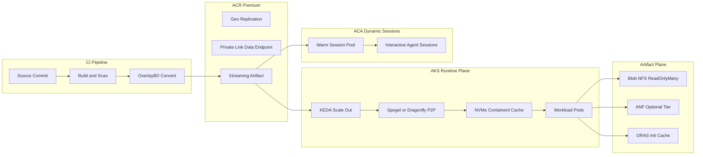
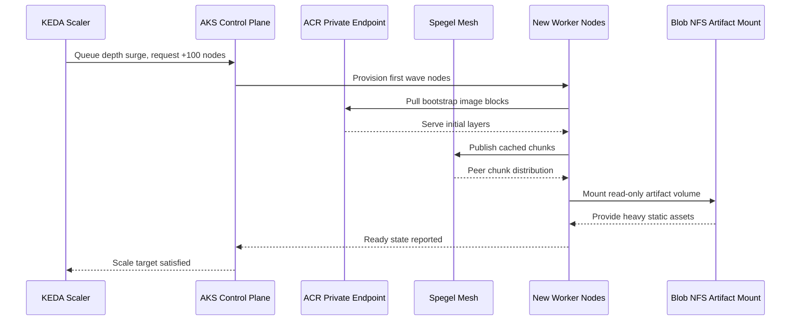

# 企业级大体积 Agent 容器镜像分发选型 FAQ：ACR OverlayBD 流式拉取 vs AKS P2P+NVMe 镜像镜像网格 vs 轻镜像+只读工件挂载 vs ACA 预热池
> 🌐 **Language Switch**: **中文（当前）** | [English](large-agent-container-image-streaming-acr-overlaybd-vs-aks-p2p-nvme-vs-volume-mount-selection-faq.en.md)  
> 适用对象：企业 Cloud & AI Solution Architect、平台工程团队、SRE、FinOps、供应链安全与合规负责人。  
> 核心议题：在 `5–35 GB` 重型 Agent 镜像下，如何在 `0 -> 100` 节点扩容时避免 ACR Private Link 拉取雪崩，并在冷启动、成本、可维护性之间取得可运营平衡。  
> 范围边界：聚焦架构与平台治理，不展开内核驱动细节。  
## 1. 执行摘要：镜像分发是企业 Agent 平台的“隐形控制面”
企业常把大模型推理性能视为首要瓶颈。  
但在重型工具链 Agent 场景，首个阻塞往往是镜像分发。  
当镜像尺寸达到 `8–30 GB`，完整拉取和解压会拖垮扩容时延。  
一旦业务峰值触发 `0 -> 100` 节点弹性，镜像仓库会遭遇突发并发拉取。  
如果此时只依赖中心化 ACR 逐节点全量下载，P95 启动会快速失控。  
这会把上层流量治理、模型路由、任务编排全部拖入连锁超时。  
因此镜像分发不是“运维细节”。  
它是 Agent Runtime 可用性的前置控制面。  
本指南给出四路径组合。  
路径 A：ACR Premium OverlayBD 流式按块拉取。  
路径 B：AKS 集群内 P2P 镜像分发与本地 NVMe 缓存。  
路径 C：轻镜像与静态大工件解耦挂载。  
路径 D：ACA Dynamic Sessions 预热缓冲池。  
它们对应不同业务节奏和组织成熟度。  
推荐实践是按业务分层混用。  
交互式会话优先低冷启。  
批处理任务优先高吞吐。  
合规域优先可审计与网络闭环。  
## 2. 问题建模：从镜像体积问题升级为扩容洪峰问题
很多团队会先优化 Dockerfile 层数。  
这当然必要，但不足以应对企业级突发。  
真实生产问题来自并发系数。  
单节点 `25 GB` 镜像拉取耗时 `210s` 不可接受。  
`80` 节点并发拉取更会放大网络与仓库压力。  
当业务是海关报关、供应商门户、财务批处理时，任务窗口集中且可预期。  
这类窗口式洪峰不容许镜像分发随机抖动。  
因此应将指标分成四类。  
第一类是启动时延。  
第二类是分发吞吐与成功率。  
第三类是仓库与网络成本。  
第四类是安全与可追溯性。  
建议核心 SLO 设定如下。  
交互式 Agent Pod 冷启 P95 小于 `35s`。  
峰值扩容 `0 -> 60` 在 `8` 分钟内完成。  
镜像分发失败重试后成功率高于 `99.5%`。  
仓库侧单小时出口成本可预估。  
供应链签名校验覆盖率达到 `100%`。  
没有这些统一目标，架构评审将停留在主观偏好。  
## 3. 四路径架构定位：按瓶颈拆解，而非单点押注
路径 A 解决“首字节过慢”问题。  
路径 B 解决“并发雪崩”问题。  
路径 C 解决“发布频率与镜像体积耦合”问题。  
路径 D 解决“请求路径仍含拉取阶段”问题。  
四路径的控制边界不同。  
A 重点在 OCI 块级流式与仓库能力。  
B 重点在集群内部传播拓扑。  
C 重点在工件生命周期治理。  
D 重点在会话池化与预热成本权衡。  
若业务要求多区域低抖动交互体验，A+D 通常收益最大。  
若业务要求短窗高并发批处理，B+C 通常性价比更高。  
若处于监管域并要求链路可审计，A+C 更利于证据沉淀。  
若平台团队容量有限，应先上 A 再逐步演进 B。  
如果组织具备平台工程与存储治理能力，可直接规划 B+C 双轨。  
## 4. 12 维选型矩阵（架构评审可直接引用）
| 维度 | ACR OverlayBD 流式拉取 | AKS P2P + NVMe | 轻镜像 + 只读工件挂载 | ACA 预热池 |
|---|---|---|---|---|
| 冷启动改善幅度 | 高 | 中高 | 中 | 极高 |
| 扩容抗雪崩能力 | 中 | 极高 | 高 | 高 |
| 对 ACR 峰值压力缓解 | 中高 | 极高 | 高 | 高 |
| CI/CD 流程改造成本 | 中 | 中高 | 中高 | 低 |
| 运行时尾延迟稳定性 | 中 | 高 | 高 | 高 |
| 网络出口成本优化 | 中 | 高 | 高 | 中 |
| 安全审计可解释性 | 高 | 中高 | 高 | 高 |
| 运维复杂度 | 中 | 高 | 中高 | 中 |
| 多区域一致性落地 | 高 | 中 | 高 | 中高 |
| 工具链更新敏捷性 | 中 | 中 | 极高 | 高 |
| 故障域隔离清晰度 | 高 | 中 | 高 | 高 |
| 三年期 TCO 可控性 | 高 | 高 | 高 | 中 |
矩阵不能替代业务约束。  
但能帮助评审快速发现主要取舍。  
建议先做合规红线过滤。  
再按业务 KPI 对 12 维加权。  
对于多租户平台，推荐分租户应用不同策略。  
## 5. 路径 A 深入：ACR Premium + OverlayBD 流式按块加载
路径 A 的核心价值是把“完整下载后运行”改为“按需取块后运行”。  
对于 `8–30 GB` 镜像，启动阶段常只需读取少量关键块。  
实践中常见首轮读取占比可压到 `<10%`。  
这让 Pod 在 `5–10s` 内进入可调度状态成为可能。  
相较全量层下载与 gzip 解压，首包时间显著下降。  
路径 A 还可与 ACR Geo-Replication 联动。  
多区域部署时可减少跨区域拉取抖动。  
Dedicated Data Endpoint 可提升企业网络策略可控性。  
但 A 不是“零代价”。  
CI 流水线需增加镜像转换步骤。  
转换步骤会增加构建耗时。  
运维需要监控运行期按块读放大与长尾读故障。  
若 Private Link 带宽不足，运行期页缺失会抬高尾延迟。  
因此 A 路径上线前要做两类压测。  
一类是构建侧吞吐压测。  
另一类是运行侧首包与尾延迟压测。  
只有两侧都达标，A 才是真收益。  
## 6. 路径 B 深入：AKS 集群 P2P 镜像网格与本地 NVMe 缓存
路径 B 的思路是把“中心仓库单点发货”变为“集群内分布式扩散”。  
Spegel 或 Dragonfly 可将镜像块在节点间传播。  
首批节点从 ACR 拉取后，其余节点优先从同集群邻居获取。  
在 `25–100 Gbps` VNet 条件下，节点间复制速度远高于跨 Private Link 拉取。  
配合节点本地 NVMe `containerd` 缓存，可显著缩短二次启动。  
对于 `100` 节点扩容，P2P 模式常把仓库出口压力降到原来的小部分。  
实际项目可观测到 `80%–94%` 的仓库流量下降。  
路径 B 的收益与集群规模正相关。  
小规模集群收益有限。  
大规模弹性集群收益极显著。  
其风险主要来自治理复杂度。  
需要管理 peer 拓扑健康。  
需要治理缓存一致性与过期清理。  
需要细化节点故障时的回源策略。  
因此 B 路径应配套 SRE 运维手册。  
并建立演练机制验证回退有效。  
## 7. 路径 C 深入：轻镜像与只读大工件挂载解耦
路径 C 的目标是切断“代码小改动必须重发超大镜像”的耦合链。  
把运行时基础镜像压缩到 `<500 MB`。  
将稳定大工件放入只读挂载层。  
大工件可包括 OCR 模型、浏览器二进制、地理库、CAD 库、轮子仓。  
这些工件变化频率通常低于业务代码。  
解耦后，CI 只需推送几十 MB 差异。  
发布窗口明显缩短。  
回滚也更快。  
路径 C 对组织流程有要求。  
需要工件版本清单治理。  
需要挂载层完整性校验。  
需要审计谁在何时更新了工件。  
在 Azure 上常见承载方式包括 Blob NFS v3、ANF、或 ORAS Init 缓存。  
要点是将“镜像发布”与“工件发布”分离。  
并给每个工件分配明确生命周期和签名策略。  
这样路径 C 不只是性能方案。  
它也是供应链治理方案。  
## 8. 路径 D 深入：ACA Dynamic Sessions 预热缓冲池
路径 D 的核心是把拉取和初始化移出请求关键路径。  
预热池提前准备可用运行环境。  
请求到来时直接分配会话。  
交互式场景对体验提升非常直接。  
尤其是浏览器自动化、报关填报、采购门户等高实时性任务。  
D 路径把冷启动抖动转换为稳态池成本。  
因此决策关键在于负载形态。  
若业务全天均匀，可维持小型常驻池。  
若业务强峰谷，则需按时段动态调池。  
预热池过小会回落到冷启路径。  
预热池过大则形成浪费。  
推荐引入分层池策略。  
核心租户配保底热池。  
长尾租户走共享弹性池。  
并用业务优先级控制抢占顺序。  
这样可兼顾体验与成本。  
## 9. 参考拓扑图：镜像分发与运行时分层

该拓扑强调“分发平面”与“执行平面”分离。  
也强调 AKS 与 ACA 可以并存。  
AKS 承担密集批处理与高度可定制负载。  
ACA 承担交互式低冷启负载。  
## 10. 时序图：`0 -> 100` 节点扩容时的防雪崩流程

这里的关键不是“完全不访问 ACR”。  
而是“把 ACR 从全量分发中心变成种子源”。  
一旦种子建立，集群内部流转承担主负载。  
这就是抗雪崩的本质。  
## 11. 定量问答（至少 6 个关键算式）
**Q1：`80` 节点并发拉取 `18 GB` 镜像，理论总流量是多少？**  
A1：若无复用，理论流量约 `1,440 GB`。  
若路径 B 让 `85%` 数据在集群内复用，则 ACR 对外流量约 `216 GB`。  
这直接决定出口费用与拉取排队长度。  
**Q2：OverlayBD 转换增加了多少 CI 时间，是否值得？**  
A2：假设每次构建多 `6` 分钟转换，但将冷启从 `220s` 降到 `22s`。  
若每天触发 `40` 次扩容批次，每批 `30` Pod，则每日节省约 `66,000s` 启动等待。  
即便扣除 CI 增量，净收益仍显著。  
**Q3：Private Link 饱和时，运行期页缺失会多大影响？**  
A3：若单次页缺失 RTT 从 `8ms` 上升到 `40ms`，且关键路径多 `25` 次缺页。  
额外尾延迟约 `800ms`。  
因此必须监控 ACR 数据端点的饱和度并做容量预留。  
**Q4：P2P fan-out 对 `100` 节点扩容的时间价值如何估算？**  
A4：假设中心仓库单节点有效吞吐 `250 Mbps`，完整 `18 GB` 拉取约 `576s`。  
若 P2P 让后续 `70` 节点以 `5 Gbps` 从邻居取块，单节点传播时间降到约 `29s` 级别。  
整体就绪窗口从“十分钟级”收敛到“分钟级”。  
**Q5：轻镜像+挂载是否会放大运行时 I/O 尾延迟？**  
A5：会，尤其在首次读取大模型文件时。  
若挂载存储 P95 读取 `12ms`，比本地 NVMe `1.2ms` 高一个数量级。  
解决方法是热点文件预取和分层缓存，而非放弃解耦。  
**Q6：ACA 预热池的成本临界点怎么定？**  
A6：假设单会话预热成本 `0.08 USD/小时`。  
若预热 `200` 会话，日成本约 `384 USD`。  
若因此避免 `18,000` 次请求各自 `4s` 额外等待，且每秒等待损失 `0.004 USD`，日收益约 `288 USD`。  
此时接近盈亏平衡，应再按高价值租户做定向预热。  
**Q7：路径 A 与路径 C 联合时，最容易忽视什么？**  
A7：工件版本漂移。  
镜像与挂载工件版本错配会导致“启动成功但行为异常”。  
必须在 Admission 阶段校验兼容矩阵。  
**Q8：合规域为何常选 A+C 而非 B？**  
A8：监管团队更看重证据链。  
A 与 C 更容易形成仓库、签名、挂载版本的一致审计记录。  
B 的运行收益高，但需要更成熟的平台运维体系。  
## 12. 生产级 IaC 与命令示例：ACR Streaming + AKS 开关
```bicep
@description('Region for registry and AKS')
param location string = resourceGroup().location
@description('ACR name')
param acrName string
resource acr 'Microsoft.ContainerRegistry/registries@2023-11-01-preview' = {
  name: acrName
  location: location
  sku: {
    name: 'Premium'
  }
  properties: {
    adminUserEnabled: false
    publicNetworkAccess: 'Disabled'
    dataEndpointEnabled: true
    zoneRedundancy: 'Enabled'
    policies: {
      quarantinePolicy: {
        status: 'enabled'
      }
      trustPolicy: {
        type: 'Notary'
        status: 'disabled'
      }
    }
    networkRuleSet: {
      defaultAction: 'Deny'
    }
  }
}
```
```bash
# ACR Premium with geo-replication and dedicated data endpoint
az acr create \
  --name $ACR_NAME \
  --resource-group $RG \
  --sku Premium \
  --location eastasia \
  --data-endpoint-enabled true \
  --public-network-enabled false
az acr replication create \
  --registry $ACR_NAME \
  --location southeastasia \
  --resource-group $RG
# Enable AKS artifact streaming capability
az aks update \
  --resource-group $RG \
  --name $AKS_NAME \
  --enable-artifact-streaming
```
```yaml
apiVersion: apps/v1
kind: Deployment
metadata:
  name: heavy-agent-runtime
spec:
  replicas: 6
  selector:
    matchLabels:
      app: heavy-agent-runtime
  template:
    metadata:
      labels:
        app: heavy-agent-runtime
    spec:
      containers:
      - name: agent
        image: contoso.azurecr.io/agent/heavy-runtime:2026.11.21
        imagePullPolicy: IfNotPresent
        resources:
          requests:
            cpu: "2"
            memory: "8Gi"
        env:
        - name: ENABLE_STARTUP_PREFETCH
          value: "true"
```
代码示例体现了三层控制。  
仓库层：Premium 与网络边界。  
集群层：artifact streaming 开关。  
工作负载层：启动预取策略。  
## 13. 生产级挂载示例：Blob NFS v3 ReadOnlyMany 工件层
```yaml
apiVersion: storage.k8s.io/v1
kind: StorageClass
metadata:
  name: blob-nfs-rox
provisioner: blob.csi.azure.com
parameters:
  protocol: nfs
  skuName: Premium_LRS
reclaimPolicy: Retain
volumeBindingMode: Immediate
allowVolumeExpansion: false
mountOptions:
  - nconnect=8
  - nolock
  - actimeo=30
---
apiVersion: v1
kind: PersistentVolumeClaim
metadata:
  name: agent-artifacts-rox
spec:
  accessModes:
    - ReadOnlyMany
  storageClassName: blob-nfs-rox
  resources:
    requests:
      storage: 12Ti
---
apiVersion: v1
kind: Pod
metadata:
  name: artifact-consumer
spec:
  containers:
  - name: agent
    image: contoso.azurecr.io/agent/runtime-slim:2026.11.21
    volumeMounts:
    - name: artifacts
      mountPath: /opt/artifacts
      readOnly: true
  volumes:
  - name: artifacts
    persistentVolumeClaim:
      claimName: agent-artifacts-rox
```
该模式把大体积静态依赖从镜像解耦。  
并允许多工作负载共享同一只读工件层。  
如需极低延迟，可对热点子集做本地预热。  
如需强合规，可对工件路径做签名校验与清单审计。  
## 14. 企业场景与 FinOps：从“能跑”到“跑得起”
### 场景 A：全球工程与地理计算 Copilot（`18 GB` 镜像，`0 -> 60` 节点）
某工程集团在 CAD、GIS、BIM 融合任务中使用重型 Agent。  
工作日早间会触发集中批处理。  
原架构采用全量拉取，P95 启动超过 `190s`。  
采用 A+B 组合后，P95 启动降到 `34s`。  
扩容窗口由 `21` 分钟降至 `7` 分钟。  
ACR 高峰出口流量下降约 `82%`。  
同时保留了现有 AKS 调度模型。  
平台团队将镜像转换纳入 CI，并设定每日转换预算。  
最终在不重构业务编排的前提下满足晨峰 SLA。  
### 场景 B：受监管投行量化研究沙箱（严格 Private Link，日均 `120` 次发布）
该投行要求镜像与工件全链路可追溯。  
并且不得出现公网回源。  
团队采用 A+C 组合。  
基础运行时镜像压缩到 `420 MB`。  
静态数学库与研究包转为只读挂载。  
每日发布由“重镜像重发”改为“轻镜像增量+工件版本门控”。  
发布耗时从 `17` 分钟降到 `4` 分钟。  
审计团队可直接追溯工件哈希、镜像摘要与审批单。  
季度审计抽样通过率显著提升。  
### FinOps 与扩容时延对比（示例）
| 方案 | 月度仓库出口成本 | `0->60` 扩容 P95 就绪 | CI 额外耗时 | 三年 TCO 可预期性 |
|---|---:|---:|---:|---|
| 基线：全量拉取 | \$18,400 | 19.6 分钟 | 0 分钟 | 低 |
| A：OverlayBD | \$12,700 | 8.8 分钟 | +6 分钟/构建 | 高 |
| B：P2P+NVMe | \$6,200 | 6.1 分钟 | +2 分钟/构建 | 中高 |
| C：轻镜像+挂载 | \$7,900 | 7.3 分钟 | +4 分钟/构建 | 高 |
| D：ACA 预热池 | \$9,600 + 热池固定成本 | 2.4 分钟 | 0 分钟 | 中 |
| A+B+C 组合 | \$4,900 | 4.2 分钟 | +8 分钟/构建 | 高 |
表中数字用于决策演示，不是固定报价。  
真正落地时应按区域价格和租户负载重算。  
但趋势很稳定。  
复合方案通常优于单路径孤立优化。  
## 15. Day-0 / Day-2 十二项上线与运维清单
1. 定义镜像分层策略，明确“必须进镜像”和“必须外挂载”的边界。  
2. 在 CI 中引入签名、漏洞扫描、SBOM 输出与转换步骤预算。  
3. 对 ACR Private Link、Data Endpoint、Geo-Replication 做容量预估。  
4. 在 AKS 建立扩容演练脚本，覆盖 `0 -> 20 -> 60 -> 100` 阶梯场景。  
5. 为 P2P 组件配置健康探针与回源熔断，避免传播层级联故障。  
6. 为只读挂载工件建立语义版本与兼容矩阵门禁。  
7. 统一观测指标：拉取耗时、镜像命中率、页缺失延迟、就绪时长。  
8. 为 ACA 预热池设定分租户配额与时段调度，避免长期空转。  
9. 建立故障剧本：仓库限流、节点失联、挂载延迟、签名校验失败。  
10. 在 APIM 或平台入口暴露扩容状态，避免上游盲目重试放大压力。  
11. 与 FinOps 每周复盘出口成本、热池成本、扩容成功率与 SLA 偏差。  
12. 每季度重估四路径权重，按业务变化调整默认组合策略。  
最终建议是“先稳态后极致”。  
先把扩容雪崩和审计盲区消除。  
再做细粒度性能榨取。  
这样企业平台会持续可演进，而不是短期冲刺后再回退。  
