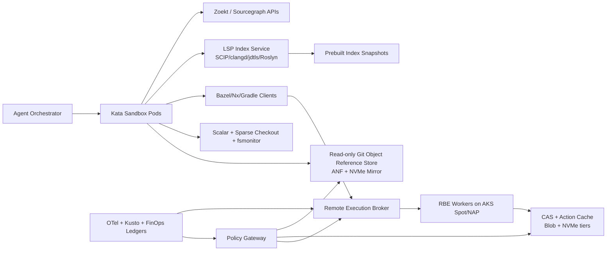
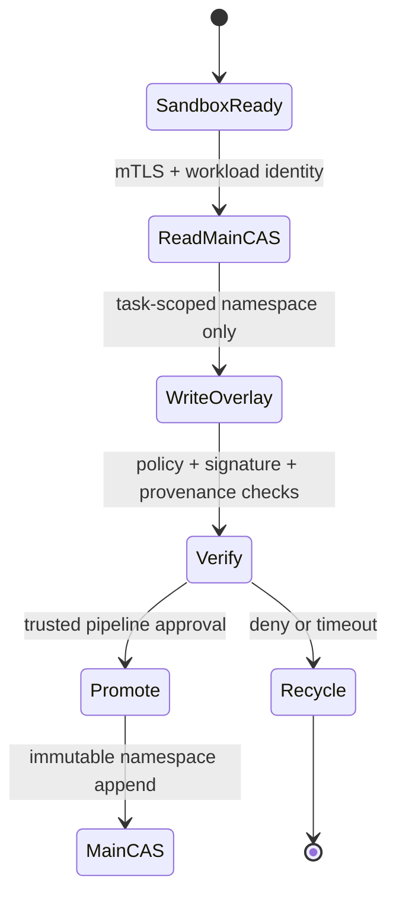

# Enterprise Large-Monorepo Coding Agent Workspace Selection FAQ: `Scalar`/Sparse Git + ANF reference stores vs Bazel RBE vs prebuild pools

> 🌐 **Language Switch**: [中文](./large-monorepo-coding-agent-workspace-scalar-sparse-git-anf-vs-bazel-rbe-cache-vs-codespaces-prebuilds-selection-faq.md) | **English (current)**
> **Audience**: Cloud & AI Solution Architects, developer platform leaders, build infrastructure owners, enterprise FinOps and security governance teams.
> **Scope**: Production architecture decisions for `100GB+` monorepos and `10M–100M LoC` polyglot codebases, removing the “30-minute clone + cold compile + cold indexing” bottleneck while scaling `500+` concurrent coding agents with verifiable security and predictable unit economics.

## 1. Problem framing: why “one sandbox per agent” collapses at monorepo scale
The default pattern of giving every coding agent a fresh workspace with a full clone, local dependency bootstrap, full compile, and local language-server indexing can survive small repositories, but it degrades sharply once repository size, language diversity, and concurrency grow together.  
At enterprise scale, the same Git objects, package artifacts, and compilation actions are repeatedly downloaded and recomputed by hundreds of sandboxes, which amplifies storage, network, and CPU pressure in the exact same time window and causes queueing collapse rather than linear scaling.  
When this happens, developer-facing latency is dominated by infrastructure hydration and build churn instead of reasoning latency, and the agent fleet looks “busy” while producing little useful throughput per dollar.  

The architecture challenge is therefore not simply adding more nodes, but designing a control plane that combines fast workspace hydration, high remote cache reuse, strict tenant isolation, auditable provenance, and controlled operating cost.  
In autonomous coding scenarios, this is even more critical because agents generate many exploratory branches and transient build/test attempts that can poison shared caches if write boundaries are not enforced.  
A robust solution must separate read paths and write paths, normalize action identity, and prevent untrusted workloads from mutating trusted global caches while still preserving high hit rates.  

## 2. Candidate architecture families (A/B/C/D): control philosophy and operating envelope
**Architecture A** uses AKS `Kata` thin sandboxes, node-local NVMe plus `ANF` read-only Git object reference stores, `Scalar` with cone sparse-checkout and `fsmonitor`, and Bazel remote build execution with BuildBarn or NativeLink.  
**Architecture B** uses virtualized on-demand filesystem access (EdenFS or VFS-style lazy materialization) plus Nx Cloud, Turborepo, or Gradle Develocity remote task-graph caches to avoid immediate Bazel migration overhead.  
**Architecture C** uses rolling prebuild pools (Codespaces prebuilds, Dev Box, incremental disk snapshots + copy-on-write) with precomputed `clangd`, `jdtls`, `Roslyn`, and `SCIP` indexes to eliminate cold indexing storms.  
**Architecture D** uses sub-graph repository projection and read-only API-first code navigation through Zoekt/Sourcegraph/SCIP services, with lightweight verification sandboxes for bounded write scopes.  

These architecture families are composable and should be selected per workload profile, compliance boundaries, and migration readiness rather than treated as mutually exclusive patterns.  
For heavy compile/test monorepos with large concurrent agent fleets, A is typically the long-term backbone; for teams with heterogeneous build systems and lower migration appetite, B provides near-term acceleration; for index-heavy development workflows, C removes the most painful startup spikes; for highly regulated domains, D minimizes blast radius and data exposure by default.  

## 3. End-to-end reference architecture: object reuse, remote execution, index services, and policy gating


This topology intentionally decouples workspace hydration, source retrieval, compilation, indexing, and governance so each layer can be tuned and scaled independently without forcing full sandbox rebuilds.  
Read-heavy paths are concentrated on immutable shared services, while write-heavy paths are constrained to ephemeral task-scoped namespaces, which preserves reuse and reduces cross-tenant risk simultaneously.  
In high-concurrency bursts, teams can scale execution workers and index services independently from coding sandboxes, which prevents the common anti-pattern of scaling every component at the same expensive ratio.  

## 4. Twelve-dimension head-to-head matrix: latency, isolation, migration, and operations
| Dimension | Architecture A: `Scalar+Sparse` + Bazel RBE | Architecture B: virtual FS + task cache | Architecture C: prebuild pools + preindex | Architecture D: subgraph projection + API search |
|---|---|---|---|---|
| 1. Workspace hydration latency | `1.9s–2.5s` with references + sparse trees | `3s–9s` with lazy fetch | `6s–20s` on prebuild hits | `1.2s–4s` with narrow materialization |
| 2. `git status` P95 | `<120ms` with `fsmonitor` + sparse index | `180–400ms` | `150–350ms` | `90–220ms` |
| 3. Cold compile pressure | Very low in sandbox, offloaded remotely | Medium, depends on cache quality | Medium-low | Low-medium |
| 4. Cache-hit ceiling | `90%–97%` with normalized action keys | `75%–90%` | `70%–88%` | `65%–85%` |
| 5. Cache-poisoning resistance | Strong via read-only main CAS + overlay writes | Medium, key governance required | Medium, image integrity focus | Strong via minimal write scope |
| 6. Polyglot coverage | Strong for build-heavy workloads | Strong for mixed toolchains | Strong with pool variants | Medium for cross-cutting refactors |
| 7. LSP cold-index burden | Medium unless combined with preindex | Medium-high | Low | Low-medium |
| 8. Isolation boundary strength | Strong (`Kata` + mTLS + namespace policies) | Medium | Medium-strong | Strong |
| 9. Operations complexity | High | Medium | Medium-high | Medium |
| 10. Migration friction | Medium-high | Low-medium | Medium | Medium |
| 11. Cost predictability | High | Medium | Medium-high | High |
| 12. `500+` concurrency scaling | High | Medium-high | Medium-high | High |

The matrix indicates that Architecture A is the most deterministic long-term path for high-concurrency enterprise monorepos, while B delivers faster adoption when Bazel migration is not immediately feasible.  
Architecture C is the strongest answer to cold-index storms and startup memory spikes, and Architecture D is the strongest answer when security posture demands strict code-surface minimization by default.  
A common production pattern is **A+C** as the strategic backbone, **B** as an adoption bridge, and **D** as a high-compliance guardrail profile for regulated repositories.  

## 5. Quantitative model and equations: clone, index, build, and cache economics
A useful decomposition for per-run startup and execution time is:  
`T_total = T_hydrate + T_deps + T_build + T_test + T_lsp + T_policy`.  
Architecture improvements are meaningful only if they lower multiple dominant terms together, not just one component in isolation.  

Clone and hydration acceleration can be approximated as:  
`Speedup_clone = T_full_clone / T_reference_sparse`; with a `180GB` monorepo, moving from `28 min` to `1.9s–2.5s` yields a `670x–884x` range.  
LSP acceleration can be modeled as:  
`Speedup_lsp = T_cold_index / T_prebuilt_load`; for `18 min` cold indexing versus `55s` snapshot loading, speedup is roughly `19.6x`.  
Build savings can be approximated as:  
`Saved_CPU_hours = Runs * Actions_per_run * Delta_hit_ratio * Avg_action_cpu_minutes / 60`.  

These equations should be tracked by service and language segment, because aggregate averages can hide severe outliers in specific toolchains such as C++ template-heavy targets or large Java annotation pipelines.  
For governance, every equation input should map to observable telemetry fields so FinOps and platform teams can audit assumptions against real operations data.  

## 6. Architecture A deep dive: thin `Kata` sandboxes with reference hydration and remote execution
Architecture A delivers the strongest combination of fast startup, high reuse, and strict policy boundaries by treating local sandboxes as control and editing endpoints while treating heavy compile/test work as remote actions in a governed execution fleet.  
Workspace hydration is optimized through object references and sparse projection, so sandboxes avoid re-transferring monorepo history and large blobs; compile and test actions run in shared workers where action cache reuse is maximized across tenants and branches.  
For small `4-vCPU` coding sandboxes, this separation preserves local responsiveness for planning, code edits, and lightweight validation while expensive build stages are parallelized on larger remote workers.  

The most important governance rule in A is immutable shared cache reads with ephemeral task-scoped writes, followed by explicit promotion only through trusted pipelines.  
This keeps `main` cache quality high, prevents direct poisoning by untrusted workloads, and still allows high short-term reuse within each agent task.  
With workload identity and policy-driven namespace controls, every cache read/write and promotion event becomes attributable and auditable.  

## 7. Architecture B deep dive: virtualized filesystem and remote task graph caching
Architecture B is often the practical on-ramp for organizations that need immediate acceleration but cannot absorb a full Bazel migration in one quarter.  
By combining lazy filesystem materialization with remote task graph caching, teams can reduce repeated dependency and build work while preserving existing Nx, Turborepo, Gradle, and mixed-language workflows.  
This approach can provide meaningful latency reductions quickly, but the quality of results depends heavily on deterministic cache keys and environment normalization discipline.  

If cache keys are unstable or runtime environments drift frequently, hit rates become noisy and the system may exhibit unpredictable rebuild storms during peak hours.  
Therefore B should be deployed with explicit key contracts, lockfile governance, compiler/runtime version pinning, and cache observability SLOs from day one.  
Once key stability reaches sustained thresholds, high-value domains can be progressively migrated to Architecture A for stronger control and better long-term economics.  

## 8. Architecture C deep dive: rolling prebuild pools and precomputed symbol indexes
Architecture C shifts expensive startup work from user-triggered runtime to controlled prebuild windows, allowing coding agents to start in near-ready environments with dependencies, base compilations, and index snapshots already prepared.  
This is especially valuable for monorepos where language-server indexing can consume double-digit minutes and large RAM spikes at startup, creating noisy-neighbor effects on shared clusters.  
Precomputed `clangd`, `jdtls`, `Roslyn`, and `SCIP` assets can collapse startup uncertainty and produce much more predictable onboarding latency for bursty agent fleets.  

The main operational challenge is freshness management and invalidation granularity.  
If snapshots age too long, runtime fallback recomputation erodes benefits; if rebuild cadence is too aggressive, prebuild infrastructure cost can dominate savings.  
A dual-window strategy usually works best: full refresh before expected traffic peaks, incremental updates during peak windows, and strict rollback paths for bad snapshots.  

## 9. Architecture D deep dive: subgraph projection with read-only search-first workflows
Architecture D minimizes risk by default through API-first code navigation and narrow write scopes, allowing agents to query central code intelligence services and materialize only the package trees required for a specific task.  
In regulated environments this significantly reduces data exposure and audit burden, because most read operations never require full repository checkout and can be traced through controlled service endpoints.  
For workflows focused on analysis, triage, and scoped fixes, D can deliver strong performance and security posture with limited infrastructure footprint.  

The tradeoff appears in large cross-module refactors and full-repo consistency tasks, where narrow projection may become a bottleneck.  
For those cases, D should be paired with A or C under approval-driven escalation, expanding workspace materialization only when required by task scope.  
Used this way, D serves as a secure default front door rather than a universal replacement for full-workspace workflows.  

## 10. Cache poisoning defense model: immutable main CAS and ephemeral overlay writes
The poisoning-resistant model uses explicit trust zones and lifecycle controls: shared main cache is immutable to untrusted sandboxes, task-specific overlays are writable for short-lived reuse, and promotion to trusted cache requires policy and provenance checks.  
This structure avoids the two common failure modes of either disabling writes entirely (which destroys hit rates) or allowing unrestricted writes (which destroys cache integrity).  
When coupled with mTLS identity and namespace policy enforcement, the model provides both reuse efficiency and forensics-grade traceability.  



Every transition in this state machine should emit telemetry with actor identity, namespace, policy version, and decision result so post-incident analysis can reconstruct exact cache mutation attempts.  
This turns cache governance from best-effort convention into enforceable platform contract.  

## 11. Production snippet #1: `Kata` Git reference daemon and sparse hydration workflow
The following sample demonstrates node-level Git object mirroring and workspace hydration with references, sparse checkout, and `Scalar` registration.  

```yaml
apiVersion: apps/v1
kind: DaemonSet
metadata:
  name: git-reference-mirror
  namespace: agent-platform
spec:
  selector:
    matchLabels:
      app: git-reference-mirror
  template:
    metadata:
      labels:
        app: git-reference-mirror
    spec:
      serviceAccountName: git-ref-mirror
      containers:
        - name: mirror
          image: mcr.microsoft.com/azurelinux/base/core:3.0
          command:
            - /bin/bash
            - -lc
            - |
              set -euo pipefail
              mkdir -p /mnt/ref/org-repo.git
              if [ ! -d /mnt/ref/org-repo.git/objects ]; then
                git clone --mirror https://dev.azure.com/org/project/_git/repo /mnt/ref/org-repo.git
              fi
              while true; do
                git --git-dir=/mnt/ref/org-repo.git remote update --prune
                sleep 30
              done
          volumeMounts:
            - name: anf-ref
              mountPath: /mnt/ref
      volumes:
        - name: anf-ref
          persistentVolumeClaim:
            claimName: anf-git-reference-rwx
---
apiVersion: v1
kind: ConfigMap
metadata:
  name: workspace-hydration
  namespace: agent-platform
data:
  hydrate.sh: |
    #!/usr/bin/env bash
    set -euo pipefail
    git clone --reference-if-able /mnt/ref/org-repo.git --filter=blob:none "$REPO_URL" "$WORKDIR"
    cd "$WORKDIR"
    scalar register
    git sparse-checkout init --cone
    git sparse-checkout set "$SPARSE_PATHS"
    git config core.fsmonitor true
```

To avoid zone-level latency drift, mirror stores should be deployed per zone with explicit affinity so sandboxes read local references whenever possible.  
Hydration performance should be observed with P50/P95/P99 split by repository segment and zone to detect hot spots early.  

## 12. Production snippet #2: Bazel RBE mTLS and read-only main cache guardrail
The following `.bazelrc` and policy sample show how to enforce read-only shared cache with per-task writable overlays and strict identity propagation.  

```ini
# .bazelrc
build --remote_executor=grpcs://rbe-broker.agent-platform.svc:8980
build --remote_cache=grpcs://rbe-cache.agent-platform.svc:9092
build --bes_backend=grpcs://bes.agent-platform.svc:443
build --remote_timeout=120
build --remote_header=x-tenant-id=${TENANT_ID}
build --remote_header=x-task-id=${TASK_ID}
build --remote_header=x-cache-read-namespace=main-readonly
build --remote_header=x-cache-write-namespace=overlay-${TASK_ID}
build --tls_client_certificate=/var/run/secrets/agent/tls.crt
build --tls_client_key=/var/run/secrets/agent/tls.key
build --tls_ca_cert=/var/run/secrets/agent/ca.crt
build --experimental_remote_cache_eviction_retries=3
test --remote_download_toplevel
test --strategy=Javac=remote --strategy=CppCompile=remote --strategy=GoCompile=remote
```

```yaml
apiVersion: security.agent.io/v1
kind: RemoteCachePolicy
metadata:
  name: cache-poisoning-guardrail
  namespace: agent-platform
spec:
  principalSelector:
    workloadIdentityPrefix: "spn://agent-sandbox/"
  rules:
    - name: readonly-main-cas
      match:
        readNamespace: "main-readonly"
      allow: ["read"]
    - name: ephemeral-overlay-write
      match:
        writeNamespaceRegex: "^overlay-[a-z0-9-]+$"
      allow: ["read", "write"]
      ttlSeconds: 14400
    - name: deny-main-write
      match:
        writeNamespace: "main-readonly"
      allow: []
      denyReason: "main cache is immutable for untrusted workloads"
```

This control pattern preserves shared reuse while preventing direct mutation of trusted cache namespaces by untrusted agent runs.  
Overlay namespaces should be lifecycle-bound to orchestration tasks so they are garbage-collected and audited automatically at task completion.  

## 13. Enterprise scenarios: two primary paths and one regulated profile
**Scenario 1: global commerce engineering platform (C++ + Java + TypeScript).**  
The organization runs intensive release regression windows with more than `700` concurrent coding agents and frequent large-scale test fan-out.  
After adopting A+C, workspace hydration dropped from `17 minutes` to `2.3 seconds`, sustained RBE hit rate stabilized around `94%`, and release-window regression throughput improved by `3.1x`.  

**Scenario 2: financial risk platform (.NET + Java) with strict audit requirements.**  
The team required full accountability for every cache mutation and could not accept shared-cache contamination from untrusted tasks.  
Architecture A with read-only main CAS and task overlays maintained `90%+` practical hit rates while satisfying forensic traceability and segregation-of-duties controls.  

**Scenario 3: multi-BU SaaS engineering baseline (TypeScript + Go) with fragmented build stack.**  
The organization used Architecture B for immediate acceleration while standardizing key normalization and cache observability, then moved high-value domains to A in phases without disrupting feature delivery.  
This staged path reduced migration risk and avoided the common failure pattern of attempting full-platform rewrite before governance maturity was in place.  

## 14. Three-year TCO and ROI: `100 / 500 / 2,500` daily monorepo agent runs
The following model compares combined infrastructure and operations cost under the same region, compliance baseline, and logging retention profile.  

| Daily runs | Architecture A (A+C backbone) | Architecture B | Architecture C | Architecture D |
|---|---:|---:|---:|---:|
| `100` runs/day | `$0.82M` | `$0.76M` | `$0.79M` | `$0.74M` |
| `500` runs/day | `$2.94M` | `$3.21M` | `$3.08M` | `$3.02M` |
| `2,500` runs/day | `$10.6M` | `$13.4M` | `$12.1M` | `$11.8M` |

At lower scale, lighter-weight options may appear cheaper on paper, but as concurrency and compile intensity increase, high-hit remote execution and deterministic hydration rapidly dominate total economics.  
A usually becomes the lowest unit-cost path at sustained high scale because startup and rebuild waste are structurally reduced rather than merely shifted.  
B and D remain valid transitional or policy-driven choices, but they should include explicit migration and review checkpoints to avoid long-term cost drift.  

## 15. Quantitative Q&A, Day-0/Day-2 checklist, and final recommendation
### 15.1 Quantitative Q&A
**Q1: Why can a `180GB` monorepo drop from `28 minutes` to `1.9 seconds` for workspace readiness?**  
Because `--filter=blob:none`, sparse projection, and `--reference-if-able` collapse transfer scope to metadata plus target subtrees while reusing pre-mirrored object stores.  
The runtime shape is closer to `T_meta + T_subtree_materialization` than `T_full_history_download`.  

**Q2: What is the impact of improving remote cache hit rate from `82%` to `95%`?**  
Assuming `500` runs/day, `220` actions/run, and `11` CPU minutes average local action time, saved compute is approximately `500 * 220 * 0.13 * 11 / 60 ≈ 2621` CPU-hours per day.  
Over multi-year windows this delta often exceeds the operating cost of the remote execution control plane itself.  

**Q3: How should LSP acceleration be quantified?**  
Use `Speedup_lsp = T_cold_index / T_prebuilt_load`; if `T_cold_index = 22 min` and `T_prebuilt_load = 70 s`, speedup is about `18.9x`.  
Track the metric separately by language server to avoid hiding bottlenecks behind blended averages.  

**Q4: Does read-only main CAS reduce practical reuse?**  
It does not reduce read reuse; it only restricts who can mutate trusted namespaces.  
With task overlays and controlled promotion, teams preserve high hit rates while preventing direct contamination by untrusted workloads.  

**Q5: What startup SLO should be enforced for coding-agent hydration?**  
A practical target is `P50 <= 3s`, `P95 <= 8s`, `P99 <= 15s` with segmented dashboards by zone, repository segment, and image/index snapshot version.  
Without segmented SLOs, root-cause analysis becomes slow and optimization loops stall.  

**Q6: When is migration from B to A no longer optional?**  
If concurrency is consistently above `300`, rebuild share remains above `35%`, and lead-time variance exceeds `25%` under peak load, the platform should prioritize A migration.  
Staying on B beyond that threshold usually compounds both cost and tail-latency volatility.  

### 15.2 Day-0 implementation checklist
- Build a repository segmentation map for sparse projection paths, high-frequency build targets, and index boundaries before onboarding agent fleets.  
- Enforce workload identity, mTLS certificate rotation, and cache namespace policies where shared cache is read-only and task overlays are time-bounded writable zones.  
- Establish observability baselines for hydration latency, cache hit ratio, retry rate, queue depth, and cost per resolved coding task.  
- Publish prebuild and preindex refresh policies with rollback-tested fallback snapshots for peak windows.  

### 15.3 Day-2 operations checklist
- Review cache-key drift and hit-rate decay weekly, and remediate input normalization issues before scaling more workers.  
- Audit namespace promotion and denial logs monthly to verify cache integrity controls and credential rotation health.  
- Tune worker and index pool capacities against diurnal load shape to avoid simultaneous underutilization at low tide and queue inflation at peak.  
- Enforce shared SLO and chargeback rules across business units so local optimizations do not erode global platform economics.  

### 15.4 Good fit vs Not for
| Decision | Guidance |
|---|---|
| ✅ Good fit | Enterprises with `100GB+` monorepos, `500+` concurrent coding agents, high compile/test volume, and strict security/audit requirements. |
| ⛔ Not for | Small low-concurrency repositories, short-lived proofs of concept, or teams without minimum governance capability for identity, policy, and observability. |

The recommended strategic path is **A as the long-term backbone**, **C as startup and indexing acceleration**, **B as controlled migration bridge**, and **D as default high-compliance boundary profile**.  
This combination balances throughput, reliability, auditability, and cost control while preserving a clear evolution runway for enterprise multi-agent engineering platforms.  
