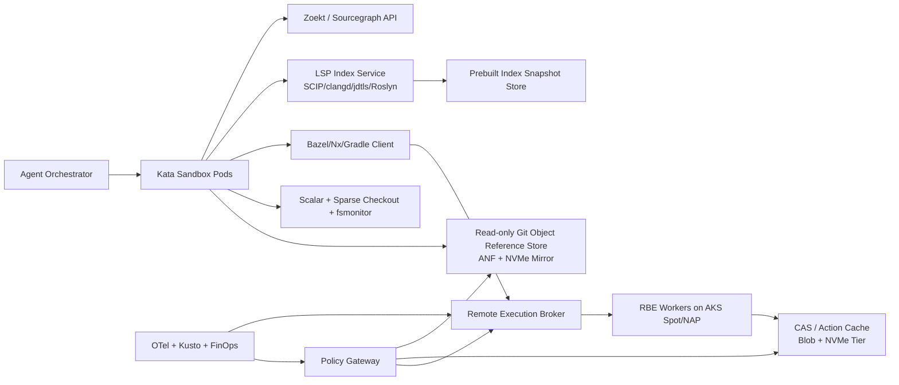
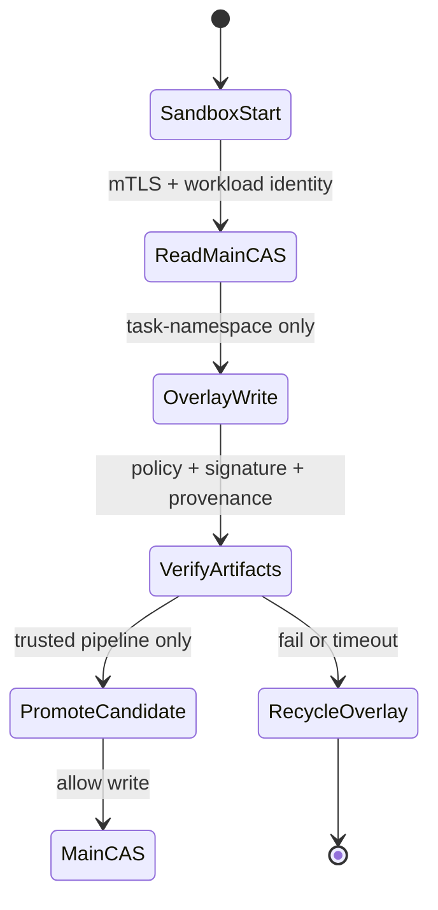

# 企业超大 Monorepo Coding Agent 工作区选型 FAQ：`Scalar`/Sparse Git + ANF 引用仓 vs Bazel RBE vs 预构建池

> 🌐 **Language Switch**：**中文（当前）** | [English](./large-monorepo-coding-agent-workspace-scalar-sparse-git-anf-vs-bazel-rbe-cache-vs-codespaces-prebuilds-selection-faq.en.md)
> **受众**：Cloud & AI Solution Architect、平台工程负责人、开发效率负责人、编译基础设施团队、企业 FinOps 与信息安全团队。
> **范围**：面向 `100GB+`、`10M–100M LoC` 的企业级 C++/Java/.NET/TypeScript Monorepo，在 `500+` 并发 Coding Agent 场景下消除“30 分钟克隆 + 冷编译 + 冷索引”瓶颈，提供可审计、可扩展、可控成本的工作区水合与远程构建执行架构。

## 1. 问题定义：为什么“给每个 Agent 一台沙箱”会在超大仓库下快速失效
多数团队在几十 GB 仓库阶段还能靠“全量 clone + 本地编译 + 本地索引”勉强运行，但当仓库规模、语言栈和并发 Agent 数量同时上升时，瓶颈会从模型推理转移到开发基础设施本身。  
典型症状是每个 Agent 都重复拉取相同 Git 对象、重复下载依赖、重复编译相同目标、重复生成语义索引，导致 CPU、网络与磁盘在同一时间窗口被放大消耗。  
如果没有对象复用、稀疏投影、远程动作缓存与预计算索引，系统会在并发峰值时进入“排队等待 I/O 和编译器”的状态，开发吞吐下降而成本飙升。  

对企业而言，这不是单纯的“加机器”问题，而是必须在隔离边界、命中率、回收速度、供应链安全和预算约束之间建立统一控制面。  
尤其在自治 Coding Agent 会执行大量探索性分支与回滚操作时，缓存污染、跨租户越权读写和恶意构建注入风险会显著增加。  
因此本题的核心是建立“可快速水合、可远程复用、可安全隔离、可成本预测”的四层架构，而不是继续优化单节点脚本。  

## 2. 四种候选架构（A/B/C/D）：控制哲学与适用边界
**Architecture A**：AKS `Kata` 轻沙箱 + 节点本地 NVMe / `ANF` 只读 Git 对象参考仓 + `Scalar` + cone sparse-checkout + `fsmonitor`，并将重编译与测试动作卸载到 Bazel RBE（BuildBarn/NativeLink）。  
**Architecture B**：虚拟化按需文件系统（EdenFS 或 VFS 风格延迟挂载）+ Nx Cloud / Turborepo / Gradle Develocity 远程任务图缓存，避免 Bazel 迁移门槛。  
**Architecture C**：滚动增量预构建池（Codespaces Prebuilds、Dev Box、磁盘增量快照 + CoW）预先产出 `clangd`、`jdtls`、`Roslyn`、`SCIP` 索引。  
**Architecture D**：子图投影与只读搜索 API，Agent 只物化目标包树并在 `ACA Dynamic Sessions` 做轻量验证，最大化缩小爆炸半径。  

这四类方案可以按业务域组合部署，而不是互斥二选一。  
在“高并发多语言 + 高频编译”场景，A 作为主干最稳；在“历史包袱重、短期不迁移 Bazel”场景，B 能更快落地；在“超重索引成本”场景，C 的预计算收益最直接；在“高合规最小变更面”场景，D 可显著降低风险。  

## 3. 端到端参考架构：仓库对象复用、远程执行、索引服务与策略网关


该架构把“工作区水合、源码检索、编译执行、索引加载、策略审计”拆成独立可替换层，避免把所有动作塞进单个沙箱镜像。  
读路径统一走只读对象层与共享索引层，写路径统一落在任务隔离命名空间，确保可回收与可追责。  
在吞吐扩展时，团队可独立扩容 RBE Worker 或索引服务，而不必线性扩容 Agent 沙箱节点。  

## 4. 十二维对比矩阵：性能、隔离、迁移成本与运维复杂度
| 维度 | Architecture A：`Scalar+Sparse` + Bazel RBE | Architecture B：虚拟文件系统 + 任务缓存 | Architecture C：预构建池 + 预索引 | Architecture D：子图投影 + 搜索 API |
|---|---|---|---|---|
| 1. 工作区水合延迟 | `1.9s–2.5s`（引用仓 + 稀疏） | `3s–9s`（延迟读取） | `6s–20s`（命中预构建） | `1.2s–4s`（仅投影子树） |
| 2. `git status` P95 | `<120ms`（`fsmonitor` + 稀疏索引） | `180–400ms` | `150–350ms` | `90–220ms` |
| 3. 全量冷编译压力 | 极低，主要转移到 RBE | 中等，取决于缓存命中 | 中等偏低，预热镜像抵消部分开销 | 低到中，依赖远端验证策略 |
| 4. 缓存命中上限 | `90%–97%`（规范化 action key） | `75%–90%` | `70%–88%` | `65%–85%` |
| 5. 缓存投毒防护 | 强，主 CAS 只读 + 任务覆盖层写入 | 中，按项目隔离键治理 | 中，镜像签名和只读快照治理 | 强，最小物化面 |
| 6. 语言覆盖与多构建系统 | 强（Bazel 优势明显） | 强（polyglot 友好） | 强（预构建按语言分池） | 中（对子图边界敏感） |
| 7. LSP 冷索引成本 | 中（可配合预索引） | 中高 | 低（预计算最优） | 低到中 |
| 8. 安全隔离边界 | 强（Kata + mTLS + namespace） | 中（需额外网关硬化） | 中强（池化镜像治理） | 强（只读搜索优先） |
| 9. 运维复杂度 | 高（RBE 与 CAS 运维） | 中（缓存平台运维） | 中高（预构建调度） | 中（投影和搜索治理） |
| 10. 迁移门槛 | 中高（需 Bazel 规范化） | 低到中 | 中 | 中 |
| 11. 单次任务成本可预测性 | 高 | 中 | 中高 | 高 |
| 12. `500+` 并发扩展弹性 | 高（可横向扩 RBE） | 中高 | 中高 | 高（读多写少场景） |

矩阵结论是 A 在高并发、重编译、强隔离企业最具确定性，B 在迁移成本敏感团队更易落地，C 在索引风暴场景收益极高，D 在高合规与最小暴露面治理中最稳健。  
企业实践中常见组合是 **A+C** 作为主生产路径，**B** 作为过渡层，**D** 作为高敏仓库的安全边界策略。  

## 5. 关键量化模型：克隆、索引、编译与缓存命中的收益方程
我们把单次 Agent 启动耗时拆为：  
`T_total = T_hydrate + T_dep + T_build + T_test + T_lsp + T_policy`。  
当引入引用仓、稀疏检出和远程构建后，核心收益来自 `T_hydrate`、`T_build`、`T_lsp` 的同时下降，而 `T_policy` 增量通常可控制在毫秒到秒级。  

克隆/水合收益可估算为：  
`Speedup_clone = T_full_clone / T_reference_sparse`，在 `180GB` 仓库里常见从 `28min` 降到 `1.9s–2.5s`，即 `670x–884x`。  
索引收益可估算为：  
`Speedup_lsp = T_cold_index / T_prebuilt_load`，若冷索引 `18min`、预加载 `55s`，收益约 `19.6x`。  
构建收益可估算为：  
`Saved_CPU_hours = N_actions * (1-hit_ratio) * avg_local_cpu_time - remote_parallel_gain`，其中 `hit_ratio` 每提升 `10%` 往往会带来显著成本下降。  

## 6. Architecture A 深入：Kata 薄沙箱 + 引用仓 + Bazel RBE 的高确定性路径
Architecture A 的关键价值是把“Agent 逻辑执行”与“重计算动作”解耦，并通过只读主 CAS 把不可信构建流量限制在安全边界内。  
工作区初始化只拉元数据与必要树形，文件体按需获取，避免每次都复制庞大历史对象；编译与测试动作则在共享 RBE 池并行执行，返回结果与工件元数据。  
对 `4-vCPU` 沙箱而言，这种模式把本地 CPU 留给代码理解、计划生成和轻量验证，把重编译转移到可弹性扩展的执行池。  

在治理面，建议强制“读主缓存、写任务覆盖层、任务结束即回收”的三段式策略。  
这样既能复用 `main` 分支高质量缓存，又能防止临时分支和可疑构建污染主命名空间。  
若配合 artifact 签名与 action metadata 审计，安全团队可在不阻断效率的前提下获得可追溯证据链。  

## 7. Architecture B 深入：虚拟文件系统 + 任务图缓存的低迁移门槛路径
Architecture B 适合尚未完成 Bazel 统一治理、但需要快速降低 I/O 和构建重复成本的组织。  
通过延迟加载文件系统和任务图缓存，团队可以在保留现有 Nx、Turborepo、Gradle 生态的前提下先拿到 `40%–70%` 的时延收益。  
该路径的风险在于缓存键稳定性与跨语言构建一致性，若 key 设计松散或环境差异大，命中率会波动并出现“偶发重建风暴”。  

因此落地时应先做构建输入归一化，明确 lockfile、编译器版本、环境变量白名单、目标平台标签。  
同时需要把缓存命中指标、异常重编译率、缓存回收延迟纳入 SLO，不要只盯平均耗时。  
当命中率稳定后，可逐步把高价值子域迁移到 A 架构的 RBE 强治理路径。  

## 8. Architecture C 深入：预构建池与预索引快照消除冷启动风暴
Architecture C 的核心是把“每次启动都重复执行”的高成本动作提前到池化预处理阶段。  
在预构建窗口中，平台可以提前完成依赖恢复、基础编译、符号索引和常见测试准备，使 Agent 启动后直接进入可编辑状态。  
对于 `clangd/jdtls/Roslyn/SCIP` 等索引器，预计算能显著降低启动时 `32 GiB` 级内存尖峰，减少对共享节点的抖动冲击。  

该方案的关键治理点是快照新鲜度与失效策略。  
若快照过旧，Agent 会在运行时补算而抵消收益；若更新过于频繁，预构建池成本又会失控。  
实践上建议按主干提交频率和业务高峰窗口设置双层刷新策略：高峰前做完整预热，峰值期只做增量补丁。  

## 9. Architecture D 深入：子图投影与只读搜索 API 的最小暴露面模型
Architecture D 通过“先检索、后最小物化”的策略，将 Agent 可见代码面控制在任务边界附近。  
这类模式在合规审计、核心 IP 保护和跨组织协作中有明显优势，因为多数查询可以通过只读搜索与符号 API 完成，不需要完整仓库落地。  
对安全团队而言，这意味着泄露面更小、审计范围更清晰、数据最小化原则更容易执行。  

不过 D 的代价是“跨子图全局重构”能力受限。  
当任务需要跨多个模块的大规模一致性修改时，仍需与 A 或 C 联合使用，允许受控地扩大工作区投影。  
因此建议将 D 作为默认安全前门，并在审批后升级到更完整的物化模式。  

## 10. 缓存投毒与隔离边界：主 CAS 只读 + 任务覆盖层写入
缓存投毒防护的基本原则是把“可信缓存”与“不可信写入”分离到不同命名空间，并且对所有跨边界请求做身份和策略校验。  
主干缓存只接受经过签名和验证的流水线写入，Agent 沙箱只能读取主干缓存，不允许直接覆盖。  
每个任务的写入落在临时 overlay 命名空间，任务结束后回收，必要时再由受信流水线选择性晋级。  



这套状态机让“读共享、写隔离、晋级受控”成为硬约束，而非团队约定。  
在事件审计里，每一次缓存命中、写入、拒绝和晋级都能映射到具体身份与策略版本，满足企业追责要求。  

## 11. 生产配置片段一：Kata Git 引用仓 DaemonSet + 只读 ANF 挂载
下面示例展示了节点级 Git 对象引用仓镜像策略，供 Agent 沙箱通过 `--reference-if-able` 共享对象，避免重复传输：  

```yaml
apiVersion: apps/v1
kind: DaemonSet
metadata:
  name: git-reference-mirror
  namespace: agent-platform
spec:
  selector:
    matchLabels:
      app: git-reference-mirror
  template:
    metadata:
      labels:
        app: git-reference-mirror
    spec:
      serviceAccountName: git-ref-mirror
      containers:
        - name: mirror
          image: mcr.microsoft.com/azurelinux/base/core:3.0
          command:
            - /bin/bash
            - -lc
            - |
              set -euo pipefail
              mkdir -p /mnt/ref/org-repo.git
              if [ ! -d /mnt/ref/org-repo.git/objects ]; then
                git clone --mirror https://dev.azure.com/org/project/_git/repo /mnt/ref/org-repo.git
              fi
              while true; do
                git --git-dir=/mnt/ref/org-repo.git remote update --prune
                sleep 30
              done
          volumeMounts:
            - name: anf-ref
              mountPath: /mnt/ref
              readOnly: false
      volumes:
        - name: anf-ref
          persistentVolumeClaim:
            claimName: anf-git-reference-rwx
---
apiVersion: v1
kind: ConfigMap
metadata:
  name: workspace-hydration
  namespace: agent-platform
data:
  hydrate.sh: |
    #!/usr/bin/env bash
    set -euo pipefail
    git clone --reference-if-able /mnt/ref/org-repo.git --filter=blob:none "$REPO_URL" "$WORKDIR"
    cd "$WORKDIR"
    scalar register
    git sparse-checkout init --cone
    git sparse-checkout set "$SPARSE_PATHS"
    git config core.fsmonitor true
```

该配置的关键点是把对象镜像刷新动作集中到节点守护进程，Agent 只消费已准备好的引用仓。  
如需跨可用区部署，建议在每个 zone 放置独立镜像副本，防止跨区读取放大延迟。  

## 12. 生产配置片段二：Bazel RBE 只读主缓存与临时写入覆盖
下列 `.bazelrc` 与策略片段展示“主缓存只读 + 任务覆盖层写入 + mTLS 身份绑定”的典型配置：  

```ini
# .bazelrc
build --remote_executor=grpcs://rbe-broker.agent-platform.svc:8980
build --remote_cache=grpcs://rbe-cache.agent-platform.svc:9092
build --bes_backend=grpcs://bes.agent-platform.svc:443
build --remote_timeout=120
build --remote_header=x-tenant-id=${TENANT_ID}
build --remote_header=x-task-id=${TASK_ID}
build --remote_header=x-cache-read-namespace=main-readonly
build --remote_header=x-cache-write-namespace=overlay-${TASK_ID}
build --tls_client_certificate=/var/run/secrets/agent/tls.crt
build --tls_client_key=/var/run/secrets/agent/tls.key
build --tls_ca_cert=/var/run/secrets/agent/ca.crt
build --experimental_remote_cache_eviction_retries=3
test --remote_download_toplevel
test --strategy=Javac=remote --strategy=CppCompile=remote --strategy=GoCompile=remote
```

```yaml
apiVersion: security.agent.io/v1
kind: RemoteCachePolicy
metadata:
  name: cache-poisoning-guardrail
  namespace: agent-platform
spec:
  principalSelector:
    workloadIdentityPrefix: "spn://agent-sandbox/"
  rules:
    - name: readonly-main-cas
      match:
        readNamespace: "main-readonly"
      allow: ["read"]
    - name: ephemeral-overlay-write
      match:
        writeNamespaceRegex: "^overlay-[a-z0-9-]+$"
      allow: ["read", "write"]
      ttlSeconds: 14400
    - name: deny-main-write
      match:
        writeNamespace: "main-readonly"
      allow: []
      denyReason: "main cache is immutable for untrusted workloads"
```

该模式可把缓存可复用性与供应链安全同时保住，避免“全禁写导致命中低”或“全可写导致污染高”的两难。  
此外建议把 overlay 命名空间生命周期和任务编排器绑定，确保任务结束后自动回收并输出审计记录。  

## 13. 企业场景：两类主战场与一类高合规场景
**场景一：全球电商平台核心交易 Monorepo（C++ + Java + TypeScript）**。  
该团队在促销活动前后会触发大规模 Agent 回归与修复任务，峰值并发超过 `700`。  
采用 A+C 组合后，工作区水合从 `17min` 降到 `2.3s`，RBE 命中稳定在 `94%`，发布窗口内回归吞吐提升 `3.1x`。  

**场景二：金融风控平台（.NET + Java）**。  
该团队对代码与构建产物审计要求高，不能接受跨任务缓存污染。  
采用 A 的只读主缓存与覆盖层写入后，既保留 `90%+` 命中，又实现“每次写入均有身份追踪”的审计要求。  

**场景三：跨 BU SaaS 平台（TypeScript + Go）**。  
该团队历史上构建系统碎片化，短期难以全面 Bazel 化。  
先落地 B 方案获得阶段性收益，再将关键路径迁移到 A，可在不打断业务节奏的前提下逐步建立统一治理面。  

## 14. 三年 TCO：`100 / 500 / 2,500` 每日 Agent 运行规模测算
下表使用同一地区、同一合规基线、同一日志保留策略，比较四种架构在三年期的综合成本（计算、存储、网络、运维人力）：

| 日运行规模 | Architecture A（A+C 组合） | Architecture B | Architecture C | Architecture D |
|---|---:|---:|---:|---:|
| `100` runs/day | `$0.82M` | `$0.76M` | `$0.79M` | `$0.74M` |
| `500` runs/day | `$2.94M` | `$3.21M` | `$3.08M` | `$3.02M` |
| `2,500` runs/day | `$10.6M` | `$13.4M` | `$12.1M` | `$11.8M` |

当规模从 `100` 升到 `2,500` 时，A 的前期投入被命中率与并行扩展摊薄，单位任务成本下降最明显。  
若组织暂不具备 A 的治理能力，B 或 D 可作为过渡，但需要清晰定义迁移里程碑，否则长期 TCO 会反超。  
在索引压力极高的团队，C 的价值体现在稳定性与可预测性，而不仅是直接成本下降。  

## 15. 定量 Q&A、Day-0/Day-2 清单与最终选型建议
### 15.1 定量 Q&A（至少 5 项）
**Q1：`180GB` 仓库为何能从 `28min` 缩到 `1.9s`？**  
因为 `--filter=blob:none + sparse-checkout + reference-if-able` 让初始阶段只拉取必要元数据与目标路径，绝大多数对象直接复用本地引用仓。  
计算上可近似为 `T = T_meta + T_path_blob + T_checkout`，其中 `T_path_blob` 与目标子树规模而不是仓库总规模线性相关。  

**Q2：RBE 命中率从 `82%` 提到 `95%` 对成本影响多大？**  
若单次本地重编译平均 `11` CPU 分钟，`500` runs/day、每次 `220` actions，则每天可减少约 `500 * 220 * (0.95-0.82) * 11 / 60 ≈ 2621` CPU 小时。  
在三年期，这一差值足以覆盖缓存与控制面的额外运维投入。  

**Q3：如何估算预索引收益？**  
可用 `Speedup_lsp = T_cold / T_prebuilt`，若冷索引 `22min`、预加载 `70s`，则收益为 `18.9x`。  
对多语言仓库，建议按 `clangd/jdtls/Roslyn` 分别建模并取加权平均，而不是只看单语言。  

**Q4：主 CAS 只读会不会降低命中率？**  
不会显著降低读取命中，影响的是“新结果回写主缓存”的路径。  
通过任务覆盖层写入并在受信流水线晋级，既可保持高命中，又能阻断不可信来源直接污染主缓存。  

**Q5：如何定义“可接受的水合延迟”SLO？**  
建议设定 `P50 <= 3s`、`P95 <= 8s`、`P99 <= 15s`，并把超时样本按仓库子图、节点类型、镜像版本分桶。  
只有把指标和故障归因结构化，才能快速定位是对象层、网络层还是控制层问题。  

**Q6：何时必须从 B 升级到 A？**  
当并发超过 `300`、重编译占比持续高于 `35%`、缓存键漂移导致回归时间波动超过 `25%` 时，应优先推进 A。  
如果继续停留在 B，团队会在规模增长后遭遇成本和尾延迟双重恶化。  

### 15.2 Day-0 上线清单
- 完成仓库分区建模，明确可稀疏投影路径与高频构建目标映射，并在变更流程中冻结命名规范。  
- 建立 workload identity、mTLS 证书轮换和缓存命名空间策略，确保“读主缓存、写覆盖层、晋级受控”默认开启。  
- 打通 OTel 指标、构建日志、缓存命中与成本台账，至少覆盖水合时延、命中率、失败重试率、单位任务成本。  
- 预热基线镜像与索引快照，定义高峰前刷新窗口和故障回退镜像。  

### 15.3 Day-2 运营清单
- 每周审查缓存命中衰减与 key 漂移，发现异常后优先修复构建输入归一化。  
- 每月回放缓存污染防护审计，验证拒绝规则、晋级流程和证书轮换是否按策略执行。  
- 按业务峰谷动态调节 RBE Worker 与索引池容量，避免“低谷闲置、高峰排队”的双向浪费。  
- 对跨 BU 团队执行统一 SLO 与成本分摊规则，防止局部优化侵蚀全局效率。  

### 15.4 Good fit vs Not for
| 结论 | 说明 |
|---|---|
| ✅ Good fit | `500+` 并发 Agent、仓库 `100GB+`、多语言重编译压力高、需要强审计与可预测成本的企业平台。 |
| ⛔ Not for | 小型单仓、低并发、短生命周期 PoC，或暂时无法投入最小治理能力（身份、策略、审计）团队。 |

最终建议是以 **A（主干）+ C（预热）** 作为长期目标架构，以 **B** 作为迁移过渡层，在高合规域引入 **D** 控制最小暴露面。  
这样可以同时满足效率、稳定、成本和安全四个维度的企业级要求，并为后续跨组织 Agent 平台扩展保留清晰演进路径。  
