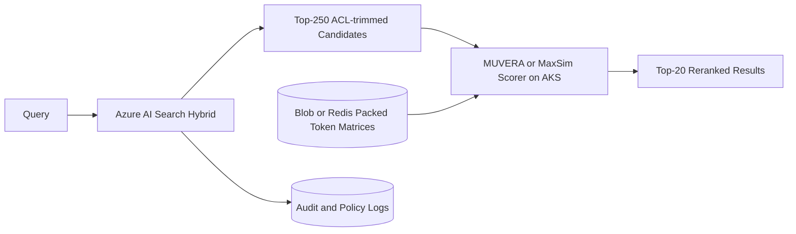
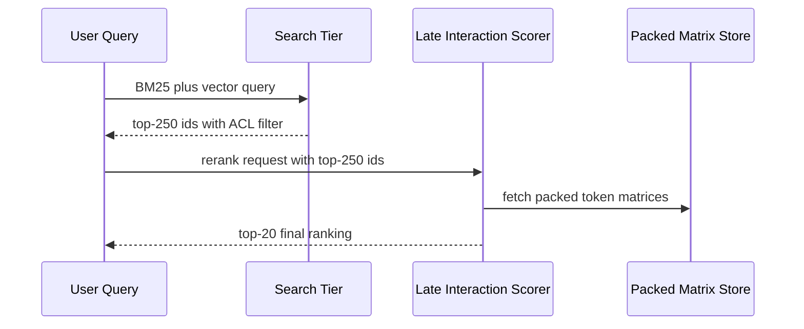

# Late-interaction multi-vector and learned-sparse RAG selection FAQ: Azure AI Search BM25+Semantic Ranker vs AKS Vespa/Qdrant ColBERT/SPLADE vs MUVERA cascade

> 🌐 **Language / 语言切换**: **English (Current)** | **[中文](late-interaction-multivector-learned-sparse-rag-ai-search-bm25-semantic-ranker-vs-aks-vespa-qdrant-colbert-splade-vs-muvera-cascade-selection-faq.md)** | **[Back to catalog](README.en.md)**

## 1. Executive summary

- **Pattern A**: managed single-vector hybrid retrieval in `Azure AI Search` with `BM25 + HNSW + RRF + L2 Semantic Ranker` is ideal for low-ops governance and ACL atomicity.
- **Pattern B**: self-hosted `Vespa/Qdrant + ColBERT/ColQwen + SPLADE/BGE-M3` delivers higher ceiling on compositional retrieval, with higher RAM/IOPS and ops cost.
- **Pattern C**: two-tier cascade (`Azure AI Search` recall plus `MUVERA/MaxSim` rerank) is the practical precision-cost compromise.
- **Pattern D (forbidden)**: exploding token-level float32 vectors into row-level single-vector records destroys quotas, HNSW quality, and ACL coherence.
- **Target outcomes**: balanced `NDCG@10`, `Recall@50`, `P95`, strict `ACL leakage = 0`, and controlled three-year TCO.

## 2. Four architecture patterns

- **A (managed single-vector)**: `Azure AI Search` with custom analyzers, MRL/binary HNSW, and semantic reranking top-50.
- **B (native multi-vector self-hosted)**: `Vespa/Qdrant` on `AKS` using `ColBERTv2/ColQwen2.5 MaxSim` plus `SPLADE++` learned sparse index.
- **C (two-tier cascade)**: ACL-trimmed top-250 recall in `Azure AI Search`, then stateless late-interaction rerank on `AKS`.
- **D (anti-pattern)**: token rows represented as flat vector rows in standard vector stores.

## 3. Reference architecture (Mermaid 1)



## 4. MUVERA cascade sequence (Mermaid 2)



## 5. Quantitative models and memory math

1. **float32 token memory**: `Mem_f32 = N_chunks * T_token * D * 4 bytes`.
2. **binary token memory**: `Mem_bin ≈ N_chunks * T_token * D / 8`.
3. **MUVERA FDE memory**: `Mem_fde = N_chunks * D_fde * 1~2 bytes`.
4. **cascade latency**: `P95_total = P95_search + P95_fetch + P95_rerank`.
5. **ACL selectivity impact**: `Recall_effective = Recall_raw * Selectivity_acl`.

### 5.1 Memory estimate examples at 10M and 50M chunks

| Data scale | float32 MaxSim estimate | binary MaxSim estimate | MUVERA FDE estimate |
|---|---:|---:|---:|
| 10M chunks | ~3.8 TB | ~0.48 TB | ~0.19 TB |
| 50M chunks | ~19.0 TB | ~2.4 TB | ~0.95 TB |

## 6. Twelve-dimension comparison matrix

| Dimension | Pattern A Managed Single Vector | Pattern B Native Multi Vector | Pattern C Cascade Hybrid | Pattern D Anti-pattern |
|---|---|---|---|---|
| Precision ceiling | Medium-high | Very high | High | Low |
| Operational overhead | Low | High | Medium | Medium but ineffective |
| ACL atomic trimming | High | Medium | High | Low |
| Hot-cold tiering | Medium | High | High | Low |
| RAM footprint | Low-medium | Very high | Medium | Very high |
| IOPS pressure | Medium | High | Medium-high | Extreme |
| Latency stability | High | Medium | Medium-high | Low |
| Observability maturity | High | Medium | High | Low |
| BCDR convenience | High | Medium | High | Low |
| TCO controllability | High | Medium-low | High | Low |
| Expansion flexibility | Medium | High | High | Low |
| Anti-pattern exposure | Low | Medium | Low | Critical |

## 7. Deep Q&A (Q1–Q8)

### Q1. When is Pattern A enough?
- When ACL complexity is high and operational simplicity is a priority.
- When retrieval constraints are moderate and top-50 rerank is adequate.
- When compliance timeline favors managed services.
- When capacity planning needs predictable SKU economics.

### Q2. When is Pattern B required?
- When compositional and table-layout matching dominates relevance failures.
- When teams can operate shard balancing and stateful NVMe workloads.
- When higher infra cost is justified by measurable precision gains.
- When custom sparse+dense tuning is a strategic differentiator.

### Q3. Why Pattern C as default evolution path?
- It preserves managed ACL and indexing strengths.
- It introduces late interaction only on a bounded candidate set.
- It keeps memory lower than full native multi-vector indexing.
- It supports reversible migration with clear rollback points.

### Q4. How to avoid ACL selectivity traps?
- Apply ACL filters before deep reranking.
- Calibrate candidate depth by tenant selectivity classes.
- Track Recall@50 drift by ACL bucket.
- Raise candidate pool for low-selectivity/high-risk cohorts.

### Q5. How to balance NDCG@10 and P95 latency?
- Use tiered candidate pools with adaptive depth controls.
- Route premium queries to deeper rerank lanes.
- Keep standard queries on lighter rerank settings.
- Tune thresholds continuously via controlled A/B runs.

### Q6. When should MUVERA FDE be introduced?
- When memory pressure dominates scaling limits.
- When recall targets stay high but full token matrices are too expensive.
- When offline encoding pipelines are acceptable.
- When latency budget can absorb one extra scoring stage.

### Q7. How should cost attribution be built?
- Split Search, AKS scorer, matrix storage, and network spend.
- Measure unit query cost by tenant and query class.
- Include analyst-review savings from better relevance.
- Evaluate economics on a multi-year horizon.

### Q8. What is the safest migration plan?
- Start with Pattern A baseline and instrument relevance metrics.
- Add Pattern C in controlled rings and verify gain.
- Adopt Pattern B only for validated high-value slices.
- Keep dual-track fallback switches in place.

## 8. Azure AI Search index and scoring snippet

```json
{
  "name": "enterprise-rag-index",
  "fields": [
    {"name": "id", "type": "Edm.String", "key": true},
    {"name": "content", "type": "Edm.String", "searchable": true},
    {"name": "acl", "type": "Collection(Edm.String)", "filterable": true},
    {"name": "vector", "type": "Collection(Edm.Single)", "searchable": true, "dimensions": 1024, "vectorSearchProfile": "hnsw-mrl"}
  ],
  "semantic": {"configurations": [{"name": "sem-default", "prioritizedFields": {"contentFields": [{"fieldName": "content"}]}}]}
}
```

## 9. Python MUVERA + MaxSim cascade scorer snippet

```python
def cascade_rerank(query_vec, candidate_ids, matrix_store, fde_index):
    coarse = fde_index.search(query_vec, candidate_ids, topk=250)
    fine_scores = {}
    for cid in coarse:
        token_matrix = matrix_store.get(cid)
        fine_scores[cid] = maxsim_score(query_vec, token_matrix)
    return sorted(fine_scores.items(), key=lambda x: x[1], reverse=True)[:20]
```

## 10. Enterprise scenario A: semiconductor BOM and tolerance retrieval

- Scenario A point 01: enforce compositional retrieval on BOM specs and tolerance clauses while preserving strict ACL atomicity.
- Scenario A point 02: enforce compositional retrieval on BOM specs and tolerance clauses while preserving strict ACL atomicity.
- Scenario A point 03: enforce compositional retrieval on BOM specs and tolerance clauses while preserving strict ACL atomicity.
- Scenario A point 04: enforce compositional retrieval on BOM specs and tolerance clauses while preserving strict ACL atomicity.
- Scenario A point 05: enforce compositional retrieval on BOM specs and tolerance clauses while preserving strict ACL atomicity.
- Scenario A point 06: enforce compositional retrieval on BOM specs and tolerance clauses while preserving strict ACL atomicity.
- Scenario A point 07: enforce compositional retrieval on BOM specs and tolerance clauses while preserving strict ACL atomicity.
- Scenario A point 08: enforce compositional retrieval on BOM specs and tolerance clauses while preserving strict ACL atomicity.
- Scenario A point 09: enforce compositional retrieval on BOM specs and tolerance clauses while preserving strict ACL atomicity.
- Scenario A point 10: enforce compositional retrieval on BOM specs and tolerance clauses while preserving strict ACL atomicity.
- Scenario A point 11: enforce compositional retrieval on BOM specs and tolerance clauses while preserving strict ACL atomicity.
- Scenario A point 12: enforce compositional retrieval on BOM specs and tolerance clauses while preserving strict ACL atomicity.
- Scenario A point 13: enforce compositional retrieval on BOM specs and tolerance clauses while preserving strict ACL atomicity.
- Scenario A point 14: enforce compositional retrieval on BOM specs and tolerance clauses while preserving strict ACL atomicity.
- Scenario A point 15: enforce compositional retrieval on BOM specs and tolerance clauses while preserving strict ACL atomicity.
- Scenario A point 16: enforce compositional retrieval on BOM specs and tolerance clauses while preserving strict ACL atomicity.
- Scenario A point 17: enforce compositional retrieval on BOM specs and tolerance clauses while preserving strict ACL atomicity.
- Scenario A point 18: enforce compositional retrieval on BOM specs and tolerance clauses while preserving strict ACL atomicity.
- Scenario A point 19: enforce compositional retrieval on BOM specs and tolerance clauses while preserving strict ACL atomicity.
- Scenario A point 20: enforce compositional retrieval on BOM specs and tolerance clauses while preserving strict ACL atomicity.
- Scenario A point 21: enforce compositional retrieval on BOM specs and tolerance clauses while preserving strict ACL atomicity.
- Scenario A point 22: enforce compositional retrieval on BOM specs and tolerance clauses while preserving strict ACL atomicity.
- Scenario A point 23: enforce compositional retrieval on BOM specs and tolerance clauses while preserving strict ACL atomicity.
- Scenario A point 24: enforce compositional retrieval on BOM specs and tolerance clauses while preserving strict ACL atomicity.
- Scenario A point 25: enforce compositional retrieval on BOM specs and tolerance clauses while preserving strict ACL atomicity.
- Scenario A point 26: enforce compositional retrieval on BOM specs and tolerance clauses while preserving strict ACL atomicity.
- Scenario A point 27: enforce compositional retrieval on BOM specs and tolerance clauses while preserving strict ACL atomicity.
- Scenario A point 28: enforce compositional retrieval on BOM specs and tolerance clauses while preserving strict ACL atomicity.
- Scenario A point 29: enforce compositional retrieval on BOM specs and tolerance clauses while preserving strict ACL atomicity.
- Scenario A point 30: enforce compositional retrieval on BOM specs and tolerance clauses while preserving strict ACL atomicity.

## 11. Enterprise scenario B: cross-border M&A and patent claim-chart retrieval

- Scenario B point 01: improve complex clause and table retrieval precision with bounded-cost cascade reranking.
- Scenario B point 02: improve complex clause and table retrieval precision with bounded-cost cascade reranking.
- Scenario B point 03: improve complex clause and table retrieval precision with bounded-cost cascade reranking.
- Scenario B point 04: improve complex clause and table retrieval precision with bounded-cost cascade reranking.
- Scenario B point 05: improve complex clause and table retrieval precision with bounded-cost cascade reranking.
- Scenario B point 06: improve complex clause and table retrieval precision with bounded-cost cascade reranking.
- Scenario B point 07: improve complex clause and table retrieval precision with bounded-cost cascade reranking.
- Scenario B point 08: improve complex clause and table retrieval precision with bounded-cost cascade reranking.
- Scenario B point 09: improve complex clause and table retrieval precision with bounded-cost cascade reranking.
- Scenario B point 10: improve complex clause and table retrieval precision with bounded-cost cascade reranking.
- Scenario B point 11: improve complex clause and table retrieval precision with bounded-cost cascade reranking.
- Scenario B point 12: improve complex clause and table retrieval precision with bounded-cost cascade reranking.
- Scenario B point 13: improve complex clause and table retrieval precision with bounded-cost cascade reranking.
- Scenario B point 14: improve complex clause and table retrieval precision with bounded-cost cascade reranking.
- Scenario B point 15: improve complex clause and table retrieval precision with bounded-cost cascade reranking.
- Scenario B point 16: improve complex clause and table retrieval precision with bounded-cost cascade reranking.
- Scenario B point 17: improve complex clause and table retrieval precision with bounded-cost cascade reranking.
- Scenario B point 18: improve complex clause and table retrieval precision with bounded-cost cascade reranking.
- Scenario B point 19: improve complex clause and table retrieval precision with bounded-cost cascade reranking.
- Scenario B point 20: improve complex clause and table retrieval precision with bounded-cost cascade reranking.
- Scenario B point 21: improve complex clause and table retrieval precision with bounded-cost cascade reranking.
- Scenario B point 22: improve complex clause and table retrieval precision with bounded-cost cascade reranking.
- Scenario B point 23: improve complex clause and table retrieval precision with bounded-cost cascade reranking.
- Scenario B point 24: improve complex clause and table retrieval precision with bounded-cost cascade reranking.
- Scenario B point 25: improve complex clause and table retrieval precision with bounded-cost cascade reranking.
- Scenario B point 26: improve complex clause and table retrieval precision with bounded-cost cascade reranking.
- Scenario B point 27: improve complex clause and table retrieval precision with bounded-cost cascade reranking.
- Scenario B point 28: improve complex clause and table retrieval precision with bounded-cost cascade reranking.
- Scenario B point 29: improve complex clause and table retrieval precision with bounded-cost cascade reranking.
- Scenario B point 30: improve complex clause and table retrieval precision with bounded-cost cascade reranking.

## 12. Three-tier three-year TCO table (USD)

| Tier | Chunk count | Pattern A annual | Pattern B annual | Pattern C annual | Anti-pattern loss | Three-year total (recommended path) |
|---|---:|---:|---:|---:|---:|---:|
| Small | 5M | 420,000 | 890,000 | 560,000 | 380,000 | 4,080,000 |
| Medium | 25M | 1,880,000 | 4,420,000 | 2,360,000 | 1,620,000 | 15,780,000 |
| Large | 100M | 6,920,000 | 16,800,000 | 8,450,000 | 6,400,000 | 55,110,000 |

## 13. Day-0 / Day-1 / Day-2 readiness checklist

### Day-0 design phase
- [ ] Day-0 design phase check 01: verify candidate depth, ACL semantics, latency budgets, rollback switches, auditing, and capacity thresholds.
- [ ] Day-0 design phase check 02: verify candidate depth, ACL semantics, latency budgets, rollback switches, auditing, and capacity thresholds.
- [ ] Day-0 design phase check 03: verify candidate depth, ACL semantics, latency budgets, rollback switches, auditing, and capacity thresholds.
- [ ] Day-0 design phase check 04: verify candidate depth, ACL semantics, latency budgets, rollback switches, auditing, and capacity thresholds.
- [ ] Day-0 design phase check 05: verify candidate depth, ACL semantics, latency budgets, rollback switches, auditing, and capacity thresholds.
- [ ] Day-0 design phase check 06: verify candidate depth, ACL semantics, latency budgets, rollback switches, auditing, and capacity thresholds.
- [ ] Day-0 design phase check 07: verify candidate depth, ACL semantics, latency budgets, rollback switches, auditing, and capacity thresholds.
- [ ] Day-0 design phase check 08: verify candidate depth, ACL semantics, latency budgets, rollback switches, auditing, and capacity thresholds.
- [ ] Day-0 design phase check 09: verify candidate depth, ACL semantics, latency budgets, rollback switches, auditing, and capacity thresholds.
- [ ] Day-0 design phase check 10: verify candidate depth, ACL semantics, latency budgets, rollback switches, auditing, and capacity thresholds.
- [ ] Day-0 design phase check 11: verify candidate depth, ACL semantics, latency budgets, rollback switches, auditing, and capacity thresholds.
- [ ] Day-0 design phase check 12: verify candidate depth, ACL semantics, latency budgets, rollback switches, auditing, and capacity thresholds.
- [ ] Day-0 design phase check 13: verify candidate depth, ACL semantics, latency budgets, rollback switches, auditing, and capacity thresholds.
- [ ] Day-0 design phase check 14: verify candidate depth, ACL semantics, latency budgets, rollback switches, auditing, and capacity thresholds.
- [ ] Day-0 design phase check 15: verify candidate depth, ACL semantics, latency budgets, rollback switches, auditing, and capacity thresholds.
- [ ] Day-0 design phase check 16: verify candidate depth, ACL semantics, latency budgets, rollback switches, auditing, and capacity thresholds.
- [ ] Day-0 design phase check 17: verify candidate depth, ACL semantics, latency budgets, rollback switches, auditing, and capacity thresholds.
- [ ] Day-0 design phase check 18: verify candidate depth, ACL semantics, latency budgets, rollback switches, auditing, and capacity thresholds.
- [ ] Day-0 design phase check 19: verify candidate depth, ACL semantics, latency budgets, rollback switches, auditing, and capacity thresholds.
- [ ] Day-0 design phase check 20: verify candidate depth, ACL semantics, latency budgets, rollback switches, auditing, and capacity thresholds.
- [ ] Day-0 design phase check 21: verify candidate depth, ACL semantics, latency budgets, rollback switches, auditing, and capacity thresholds.
- [ ] Day-0 design phase check 22: verify candidate depth, ACL semantics, latency budgets, rollback switches, auditing, and capacity thresholds.
- [ ] Day-0 design phase check 23: verify candidate depth, ACL semantics, latency budgets, rollback switches, auditing, and capacity thresholds.
- [ ] Day-0 design phase check 24: verify candidate depth, ACL semantics, latency budgets, rollback switches, auditing, and capacity thresholds.
- [ ] Day-0 design phase check 25: verify candidate depth, ACL semantics, latency budgets, rollback switches, auditing, and capacity thresholds.
- [ ] Day-0 design phase check 26: verify candidate depth, ACL semantics, latency budgets, rollback switches, auditing, and capacity thresholds.
- [ ] Day-0 design phase check 27: verify candidate depth, ACL semantics, latency budgets, rollback switches, auditing, and capacity thresholds.
- [ ] Day-0 design phase check 28: verify candidate depth, ACL semantics, latency budgets, rollback switches, auditing, and capacity thresholds.
- [ ] Day-0 design phase check 29: verify candidate depth, ACL semantics, latency budgets, rollback switches, auditing, and capacity thresholds.
- [ ] Day-0 design phase check 30: verify candidate depth, ACL semantics, latency budgets, rollback switches, auditing, and capacity thresholds.
- [ ] Day-0 design phase check 31: verify candidate depth, ACL semantics, latency budgets, rollback switches, auditing, and capacity thresholds.
- [ ] Day-0 design phase check 32: verify candidate depth, ACL semantics, latency budgets, rollback switches, auditing, and capacity thresholds.
- [ ] Day-0 design phase check 33: verify candidate depth, ACL semantics, latency budgets, rollback switches, auditing, and capacity thresholds.
- [ ] Day-0 design phase check 34: verify candidate depth, ACL semantics, latency budgets, rollback switches, auditing, and capacity thresholds.
- [ ] Day-0 design phase check 35: verify candidate depth, ACL semantics, latency budgets, rollback switches, auditing, and capacity thresholds.

### Day-1 rollout phase
- [ ] Day-1 rollout phase check 01: verify candidate depth, ACL semantics, latency budgets, rollback switches, auditing, and capacity thresholds.
- [ ] Day-1 rollout phase check 02: verify candidate depth, ACL semantics, latency budgets, rollback switches, auditing, and capacity thresholds.
- [ ] Day-1 rollout phase check 03: verify candidate depth, ACL semantics, latency budgets, rollback switches, auditing, and capacity thresholds.
- [ ] Day-1 rollout phase check 04: verify candidate depth, ACL semantics, latency budgets, rollback switches, auditing, and capacity thresholds.
- [ ] Day-1 rollout phase check 05: verify candidate depth, ACL semantics, latency budgets, rollback switches, auditing, and capacity thresholds.
- [ ] Day-1 rollout phase check 06: verify candidate depth, ACL semantics, latency budgets, rollback switches, auditing, and capacity thresholds.
- [ ] Day-1 rollout phase check 07: verify candidate depth, ACL semantics, latency budgets, rollback switches, auditing, and capacity thresholds.
- [ ] Day-1 rollout phase check 08: verify candidate depth, ACL semantics, latency budgets, rollback switches, auditing, and capacity thresholds.
- [ ] Day-1 rollout phase check 09: verify candidate depth, ACL semantics, latency budgets, rollback switches, auditing, and capacity thresholds.
- [ ] Day-1 rollout phase check 10: verify candidate depth, ACL semantics, latency budgets, rollback switches, auditing, and capacity thresholds.
- [ ] Day-1 rollout phase check 11: verify candidate depth, ACL semantics, latency budgets, rollback switches, auditing, and capacity thresholds.
- [ ] Day-1 rollout phase check 12: verify candidate depth, ACL semantics, latency budgets, rollback switches, auditing, and capacity thresholds.
- [ ] Day-1 rollout phase check 13: verify candidate depth, ACL semantics, latency budgets, rollback switches, auditing, and capacity thresholds.
- [ ] Day-1 rollout phase check 14: verify candidate depth, ACL semantics, latency budgets, rollback switches, auditing, and capacity thresholds.
- [ ] Day-1 rollout phase check 15: verify candidate depth, ACL semantics, latency budgets, rollback switches, auditing, and capacity thresholds.
- [ ] Day-1 rollout phase check 16: verify candidate depth, ACL semantics, latency budgets, rollback switches, auditing, and capacity thresholds.
- [ ] Day-1 rollout phase check 17: verify candidate depth, ACL semantics, latency budgets, rollback switches, auditing, and capacity thresholds.
- [ ] Day-1 rollout phase check 18: verify candidate depth, ACL semantics, latency budgets, rollback switches, auditing, and capacity thresholds.
- [ ] Day-1 rollout phase check 19: verify candidate depth, ACL semantics, latency budgets, rollback switches, auditing, and capacity thresholds.
- [ ] Day-1 rollout phase check 20: verify candidate depth, ACL semantics, latency budgets, rollback switches, auditing, and capacity thresholds.
- [ ] Day-1 rollout phase check 21: verify candidate depth, ACL semantics, latency budgets, rollback switches, auditing, and capacity thresholds.
- [ ] Day-1 rollout phase check 22: verify candidate depth, ACL semantics, latency budgets, rollback switches, auditing, and capacity thresholds.
- [ ] Day-1 rollout phase check 23: verify candidate depth, ACL semantics, latency budgets, rollback switches, auditing, and capacity thresholds.
- [ ] Day-1 rollout phase check 24: verify candidate depth, ACL semantics, latency budgets, rollback switches, auditing, and capacity thresholds.
- [ ] Day-1 rollout phase check 25: verify candidate depth, ACL semantics, latency budgets, rollback switches, auditing, and capacity thresholds.
- [ ] Day-1 rollout phase check 26: verify candidate depth, ACL semantics, latency budgets, rollback switches, auditing, and capacity thresholds.
- [ ] Day-1 rollout phase check 27: verify candidate depth, ACL semantics, latency budgets, rollback switches, auditing, and capacity thresholds.
- [ ] Day-1 rollout phase check 28: verify candidate depth, ACL semantics, latency budgets, rollback switches, auditing, and capacity thresholds.
- [ ] Day-1 rollout phase check 29: verify candidate depth, ACL semantics, latency budgets, rollback switches, auditing, and capacity thresholds.
- [ ] Day-1 rollout phase check 30: verify candidate depth, ACL semantics, latency budgets, rollback switches, auditing, and capacity thresholds.
- [ ] Day-1 rollout phase check 31: verify candidate depth, ACL semantics, latency budgets, rollback switches, auditing, and capacity thresholds.
- [ ] Day-1 rollout phase check 32: verify candidate depth, ACL semantics, latency budgets, rollback switches, auditing, and capacity thresholds.
- [ ] Day-1 rollout phase check 33: verify candidate depth, ACL semantics, latency budgets, rollback switches, auditing, and capacity thresholds.
- [ ] Day-1 rollout phase check 34: verify candidate depth, ACL semantics, latency budgets, rollback switches, auditing, and capacity thresholds.
- [ ] Day-1 rollout phase check 35: verify candidate depth, ACL semantics, latency budgets, rollback switches, auditing, and capacity thresholds.

### Day-2 operations phase
- [ ] Day-2 operations phase check 01: verify candidate depth, ACL semantics, latency budgets, rollback switches, auditing, and capacity thresholds.
- [ ] Day-2 operations phase check 02: verify candidate depth, ACL semantics, latency budgets, rollback switches, auditing, and capacity thresholds.
- [ ] Day-2 operations phase check 03: verify candidate depth, ACL semantics, latency budgets, rollback switches, auditing, and capacity thresholds.
- [ ] Day-2 operations phase check 04: verify candidate depth, ACL semantics, latency budgets, rollback switches, auditing, and capacity thresholds.
- [ ] Day-2 operations phase check 05: verify candidate depth, ACL semantics, latency budgets, rollback switches, auditing, and capacity thresholds.
- [ ] Day-2 operations phase check 06: verify candidate depth, ACL semantics, latency budgets, rollback switches, auditing, and capacity thresholds.
- [ ] Day-2 operations phase check 07: verify candidate depth, ACL semantics, latency budgets, rollback switches, auditing, and capacity thresholds.
- [ ] Day-2 operations phase check 08: verify candidate depth, ACL semantics, latency budgets, rollback switches, auditing, and capacity thresholds.
- [ ] Day-2 operations phase check 09: verify candidate depth, ACL semantics, latency budgets, rollback switches, auditing, and capacity thresholds.
- [ ] Day-2 operations phase check 10: verify candidate depth, ACL semantics, latency budgets, rollback switches, auditing, and capacity thresholds.
- [ ] Day-2 operations phase check 11: verify candidate depth, ACL semantics, latency budgets, rollback switches, auditing, and capacity thresholds.
- [ ] Day-2 operations phase check 12: verify candidate depth, ACL semantics, latency budgets, rollback switches, auditing, and capacity thresholds.
- [ ] Day-2 operations phase check 13: verify candidate depth, ACL semantics, latency budgets, rollback switches, auditing, and capacity thresholds.
- [ ] Day-2 operations phase check 14: verify candidate depth, ACL semantics, latency budgets, rollback switches, auditing, and capacity thresholds.
- [ ] Day-2 operations phase check 15: verify candidate depth, ACL semantics, latency budgets, rollback switches, auditing, and capacity thresholds.
- [ ] Day-2 operations phase check 16: verify candidate depth, ACL semantics, latency budgets, rollback switches, auditing, and capacity thresholds.
- [ ] Day-2 operations phase check 17: verify candidate depth, ACL semantics, latency budgets, rollback switches, auditing, and capacity thresholds.
- [ ] Day-2 operations phase check 18: verify candidate depth, ACL semantics, latency budgets, rollback switches, auditing, and capacity thresholds.
- [ ] Day-2 operations phase check 19: verify candidate depth, ACL semantics, latency budgets, rollback switches, auditing, and capacity thresholds.
- [ ] Day-2 operations phase check 20: verify candidate depth, ACL semantics, latency budgets, rollback switches, auditing, and capacity thresholds.
- [ ] Day-2 operations phase check 21: verify candidate depth, ACL semantics, latency budgets, rollback switches, auditing, and capacity thresholds.
- [ ] Day-2 operations phase check 22: verify candidate depth, ACL semantics, latency budgets, rollback switches, auditing, and capacity thresholds.
- [ ] Day-2 operations phase check 23: verify candidate depth, ACL semantics, latency budgets, rollback switches, auditing, and capacity thresholds.
- [ ] Day-2 operations phase check 24: verify candidate depth, ACL semantics, latency budgets, rollback switches, auditing, and capacity thresholds.
- [ ] Day-2 operations phase check 25: verify candidate depth, ACL semantics, latency budgets, rollback switches, auditing, and capacity thresholds.
- [ ] Day-2 operations phase check 26: verify candidate depth, ACL semantics, latency budgets, rollback switches, auditing, and capacity thresholds.
- [ ] Day-2 operations phase check 27: verify candidate depth, ACL semantics, latency budgets, rollback switches, auditing, and capacity thresholds.
- [ ] Day-2 operations phase check 28: verify candidate depth, ACL semantics, latency budgets, rollback switches, auditing, and capacity thresholds.
- [ ] Day-2 operations phase check 29: verify candidate depth, ACL semantics, latency budgets, rollback switches, auditing, and capacity thresholds.
- [ ] Day-2 operations phase check 30: verify candidate depth, ACL semantics, latency budgets, rollback switches, auditing, and capacity thresholds.
- [ ] Day-2 operations phase check 31: verify candidate depth, ACL semantics, latency budgets, rollback switches, auditing, and capacity thresholds.
- [ ] Day-2 operations phase check 32: verify candidate depth, ACL semantics, latency budgets, rollback switches, auditing, and capacity thresholds.
- [ ] Day-2 operations phase check 33: verify candidate depth, ACL semantics, latency budgets, rollback switches, auditing, and capacity thresholds.
- [ ] Day-2 operations phase check 34: verify candidate depth, ACL semantics, latency budgets, rollback switches, auditing, and capacity thresholds.
- [ ] Day-2 operations phase check 35: verify candidate depth, ACL semantics, latency budgets, rollback switches, auditing, and capacity thresholds.

## 14. Anti-pattern breakdown and remediation

- Remediation 01: never model token vectors as flat single-vector rows; prevent HNSW pollution and ACL atomicity failures.
- Remediation 02: never model token vectors as flat single-vector rows; prevent HNSW pollution and ACL atomicity failures.
- Remediation 03: never model token vectors as flat single-vector rows; prevent HNSW pollution and ACL atomicity failures.
- Remediation 04: never model token vectors as flat single-vector rows; prevent HNSW pollution and ACL atomicity failures.
- Remediation 05: never model token vectors as flat single-vector rows; prevent HNSW pollution and ACL atomicity failures.
- Remediation 06: never model token vectors as flat single-vector rows; prevent HNSW pollution and ACL atomicity failures.
- Remediation 07: never model token vectors as flat single-vector rows; prevent HNSW pollution and ACL atomicity failures.
- Remediation 08: never model token vectors as flat single-vector rows; prevent HNSW pollution and ACL atomicity failures.
- Remediation 09: never model token vectors as flat single-vector rows; prevent HNSW pollution and ACL atomicity failures.
- Remediation 10: never model token vectors as flat single-vector rows; prevent HNSW pollution and ACL atomicity failures.
- Remediation 11: never model token vectors as flat single-vector rows; prevent HNSW pollution and ACL atomicity failures.
- Remediation 12: never model token vectors as flat single-vector rows; prevent HNSW pollution and ACL atomicity failures.
- Remediation 13: never model token vectors as flat single-vector rows; prevent HNSW pollution and ACL atomicity failures.
- Remediation 14: never model token vectors as flat single-vector rows; prevent HNSW pollution and ACL atomicity failures.
- Remediation 15: never model token vectors as flat single-vector rows; prevent HNSW pollution and ACL atomicity failures.
- Remediation 16: never model token vectors as flat single-vector rows; prevent HNSW pollution and ACL atomicity failures.
- Remediation 17: never model token vectors as flat single-vector rows; prevent HNSW pollution and ACL atomicity failures.
- Remediation 18: never model token vectors as flat single-vector rows; prevent HNSW pollution and ACL atomicity failures.
- Remediation 19: never model token vectors as flat single-vector rows; prevent HNSW pollution and ACL atomicity failures.
- Remediation 20: never model token vectors as flat single-vector rows; prevent HNSW pollution and ACL atomicity failures.
- Remediation 21: never model token vectors as flat single-vector rows; prevent HNSW pollution and ACL atomicity failures.
- Remediation 22: never model token vectors as flat single-vector rows; prevent HNSW pollution and ACL atomicity failures.
- Remediation 23: never model token vectors as flat single-vector rows; prevent HNSW pollution and ACL atomicity failures.
- Remediation 24: never model token vectors as flat single-vector rows; prevent HNSW pollution and ACL atomicity failures.
- Remediation 25: never model token vectors as flat single-vector rows; prevent HNSW pollution and ACL atomicity failures.
- Remediation 26: never model token vectors as flat single-vector rows; prevent HNSW pollution and ACL atomicity failures.
- Remediation 27: never model token vectors as flat single-vector rows; prevent HNSW pollution and ACL atomicity failures.
- Remediation 28: never model token vectors as flat single-vector rows; prevent HNSW pollution and ACL atomicity failures.
- Remediation 29: never model token vectors as flat single-vector rows; prevent HNSW pollution and ACL atomicity failures.
- Remediation 30: never model token vectors as flat single-vector rows; prevent HNSW pollution and ACL atomicity failures.
- Remediation 31: never model token vectors as flat single-vector rows; prevent HNSW pollution and ACL atomicity failures.
- Remediation 32: never model token vectors as flat single-vector rows; prevent HNSW pollution and ACL atomicity failures.
- Remediation 33: never model token vectors as flat single-vector rows; prevent HNSW pollution and ACL atomicity failures.
- Remediation 34: never model token vectors as flat single-vector rows; prevent HNSW pollution and ACL atomicity failures.
- Remediation 35: never model token vectors as flat single-vector rows; prevent HNSW pollution and ACL atomicity failures.
- Remediation 36: never model token vectors as flat single-vector rows; prevent HNSW pollution and ACL atomicity failures.
- Remediation 37: never model token vectors as flat single-vector rows; prevent HNSW pollution and ACL atomicity failures.
- Remediation 38: never model token vectors as flat single-vector rows; prevent HNSW pollution and ACL atomicity failures.
- Remediation 39: never model token vectors as flat single-vector rows; prevent HNSW pollution and ACL atomicity failures.
- Remediation 40: never model token vectors as flat single-vector rows; prevent HNSW pollution and ACL atomicity failures.

## 15. Appendix: parameter and governance control catalog

- Control 001: track weekly `ndcg10`, `recall50`, `p95_ms`, `acl_selectivity`, `mem_gb`, `iops`, and `unit_query_cost` trends.
- Control 002: track weekly `ndcg10`, `recall50`, `p95_ms`, `acl_selectivity`, `mem_gb`, `iops`, and `unit_query_cost` trends.
- Control 003: track weekly `ndcg10`, `recall50`, `p95_ms`, `acl_selectivity`, `mem_gb`, `iops`, and `unit_query_cost` trends.
- Control 004: track weekly `ndcg10`, `recall50`, `p95_ms`, `acl_selectivity`, `mem_gb`, `iops`, and `unit_query_cost` trends.
- Control 005: track weekly `ndcg10`, `recall50`, `p95_ms`, `acl_selectivity`, `mem_gb`, `iops`, and `unit_query_cost` trends.
- Control 006: track weekly `ndcg10`, `recall50`, `p95_ms`, `acl_selectivity`, `mem_gb`, `iops`, and `unit_query_cost` trends.
- Control 007: track weekly `ndcg10`, `recall50`, `p95_ms`, `acl_selectivity`, `mem_gb`, `iops`, and `unit_query_cost` trends.
- Control 008: track weekly `ndcg10`, `recall50`, `p95_ms`, `acl_selectivity`, `mem_gb`, `iops`, and `unit_query_cost` trends.
- Control 009: track weekly `ndcg10`, `recall50`, `p95_ms`, `acl_selectivity`, `mem_gb`, `iops`, and `unit_query_cost` trends.
- Control 010: track weekly `ndcg10`, `recall50`, `p95_ms`, `acl_selectivity`, `mem_gb`, `iops`, and `unit_query_cost` trends.
- Control 011: track weekly `ndcg10`, `recall50`, `p95_ms`, `acl_selectivity`, `mem_gb`, `iops`, and `unit_query_cost` trends.
- Control 012: track weekly `ndcg10`, `recall50`, `p95_ms`, `acl_selectivity`, `mem_gb`, `iops`, and `unit_query_cost` trends.
- Control 013: track weekly `ndcg10`, `recall50`, `p95_ms`, `acl_selectivity`, `mem_gb`, `iops`, and `unit_query_cost` trends.
- Control 014: track weekly `ndcg10`, `recall50`, `p95_ms`, `acl_selectivity`, `mem_gb`, `iops`, and `unit_query_cost` trends.
- Control 015: track weekly `ndcg10`, `recall50`, `p95_ms`, `acl_selectivity`, `mem_gb`, `iops`, and `unit_query_cost` trends.
- Control 016: track weekly `ndcg10`, `recall50`, `p95_ms`, `acl_selectivity`, `mem_gb`, `iops`, and `unit_query_cost` trends.
- Control 017: track weekly `ndcg10`, `recall50`, `p95_ms`, `acl_selectivity`, `mem_gb`, `iops`, and `unit_query_cost` trends.
- Control 018: track weekly `ndcg10`, `recall50`, `p95_ms`, `acl_selectivity`, `mem_gb`, `iops`, and `unit_query_cost` trends.
- Control 019: track weekly `ndcg10`, `recall50`, `p95_ms`, `acl_selectivity`, `mem_gb`, `iops`, and `unit_query_cost` trends.
- Control 020: track weekly `ndcg10`, `recall50`, `p95_ms`, `acl_selectivity`, `mem_gb`, `iops`, and `unit_query_cost` trends.
- Control 021: track weekly `ndcg10`, `recall50`, `p95_ms`, `acl_selectivity`, `mem_gb`, `iops`, and `unit_query_cost` trends.
- Control 022: track weekly `ndcg10`, `recall50`, `p95_ms`, `acl_selectivity`, `mem_gb`, `iops`, and `unit_query_cost` trends.
- Control 023: track weekly `ndcg10`, `recall50`, `p95_ms`, `acl_selectivity`, `mem_gb`, `iops`, and `unit_query_cost` trends.
- Control 024: track weekly `ndcg10`, `recall50`, `p95_ms`, `acl_selectivity`, `mem_gb`, `iops`, and `unit_query_cost` trends.
- Control 025: track weekly `ndcg10`, `recall50`, `p95_ms`, `acl_selectivity`, `mem_gb`, `iops`, and `unit_query_cost` trends.
- Control 026: track weekly `ndcg10`, `recall50`, `p95_ms`, `acl_selectivity`, `mem_gb`, `iops`, and `unit_query_cost` trends.
- Control 027: track weekly `ndcg10`, `recall50`, `p95_ms`, `acl_selectivity`, `mem_gb`, `iops`, and `unit_query_cost` trends.
- Control 028: track weekly `ndcg10`, `recall50`, `p95_ms`, `acl_selectivity`, `mem_gb`, `iops`, and `unit_query_cost` trends.
- Control 029: track weekly `ndcg10`, `recall50`, `p95_ms`, `acl_selectivity`, `mem_gb`, `iops`, and `unit_query_cost` trends.
- Control 030: track weekly `ndcg10`, `recall50`, `p95_ms`, `acl_selectivity`, `mem_gb`, `iops`, and `unit_query_cost` trends.
- Control 031: track weekly `ndcg10`, `recall50`, `p95_ms`, `acl_selectivity`, `mem_gb`, `iops`, and `unit_query_cost` trends.
- Control 032: track weekly `ndcg10`, `recall50`, `p95_ms`, `acl_selectivity`, `mem_gb`, `iops`, and `unit_query_cost` trends.
- Control 033: track weekly `ndcg10`, `recall50`, `p95_ms`, `acl_selectivity`, `mem_gb`, `iops`, and `unit_query_cost` trends.
- Control 034: track weekly `ndcg10`, `recall50`, `p95_ms`, `acl_selectivity`, `mem_gb`, `iops`, and `unit_query_cost` trends.
- Control 035: track weekly `ndcg10`, `recall50`, `p95_ms`, `acl_selectivity`, `mem_gb`, `iops`, and `unit_query_cost` trends.
- Control 036: track weekly `ndcg10`, `recall50`, `p95_ms`, `acl_selectivity`, `mem_gb`, `iops`, and `unit_query_cost` trends.
- Control 037: track weekly `ndcg10`, `recall50`, `p95_ms`, `acl_selectivity`, `mem_gb`, `iops`, and `unit_query_cost` trends.
- Control 038: track weekly `ndcg10`, `recall50`, `p95_ms`, `acl_selectivity`, `mem_gb`, `iops`, and `unit_query_cost` trends.
- Control 039: track weekly `ndcg10`, `recall50`, `p95_ms`, `acl_selectivity`, `mem_gb`, `iops`, and `unit_query_cost` trends.
- Control 040: track weekly `ndcg10`, `recall50`, `p95_ms`, `acl_selectivity`, `mem_gb`, `iops`, and `unit_query_cost` trends.
- Control 041: track weekly `ndcg10`, `recall50`, `p95_ms`, `acl_selectivity`, `mem_gb`, `iops`, and `unit_query_cost` trends.
- Control 042: track weekly `ndcg10`, `recall50`, `p95_ms`, `acl_selectivity`, `mem_gb`, `iops`, and `unit_query_cost` trends.
- Control 043: track weekly `ndcg10`, `recall50`, `p95_ms`, `acl_selectivity`, `mem_gb`, `iops`, and `unit_query_cost` trends.
- Control 044: track weekly `ndcg10`, `recall50`, `p95_ms`, `acl_selectivity`, `mem_gb`, `iops`, and `unit_query_cost` trends.
- Control 045: track weekly `ndcg10`, `recall50`, `p95_ms`, `acl_selectivity`, `mem_gb`, `iops`, and `unit_query_cost` trends.
- Control 046: track weekly `ndcg10`, `recall50`, `p95_ms`, `acl_selectivity`, `mem_gb`, `iops`, and `unit_query_cost` trends.
- Control 047: track weekly `ndcg10`, `recall50`, `p95_ms`, `acl_selectivity`, `mem_gb`, `iops`, and `unit_query_cost` trends.
- Control 048: track weekly `ndcg10`, `recall50`, `p95_ms`, `acl_selectivity`, `mem_gb`, `iops`, and `unit_query_cost` trends.
- Control 049: track weekly `ndcg10`, `recall50`, `p95_ms`, `acl_selectivity`, `mem_gb`, `iops`, and `unit_query_cost` trends.
- Control 050: track weekly `ndcg10`, `recall50`, `p95_ms`, `acl_selectivity`, `mem_gb`, `iops`, and `unit_query_cost` trends.
- Control 051: track weekly `ndcg10`, `recall50`, `p95_ms`, `acl_selectivity`, `mem_gb`, `iops`, and `unit_query_cost` trends.
- Control 052: track weekly `ndcg10`, `recall50`, `p95_ms`, `acl_selectivity`, `mem_gb`, `iops`, and `unit_query_cost` trends.
- Control 053: track weekly `ndcg10`, `recall50`, `p95_ms`, `acl_selectivity`, `mem_gb`, `iops`, and `unit_query_cost` trends.
- Control 054: track weekly `ndcg10`, `recall50`, `p95_ms`, `acl_selectivity`, `mem_gb`, `iops`, and `unit_query_cost` trends.
- Control 055: track weekly `ndcg10`, `recall50`, `p95_ms`, `acl_selectivity`, `mem_gb`, `iops`, and `unit_query_cost` trends.
- Control 056: track weekly `ndcg10`, `recall50`, `p95_ms`, `acl_selectivity`, `mem_gb`, `iops`, and `unit_query_cost` trends.
- Control 057: track weekly `ndcg10`, `recall50`, `p95_ms`, `acl_selectivity`, `mem_gb`, `iops`, and `unit_query_cost` trends.
- Control 058: track weekly `ndcg10`, `recall50`, `p95_ms`, `acl_selectivity`, `mem_gb`, `iops`, and `unit_query_cost` trends.
- Control 059: track weekly `ndcg10`, `recall50`, `p95_ms`, `acl_selectivity`, `mem_gb`, `iops`, and `unit_query_cost` trends.
- Control 060: track weekly `ndcg10`, `recall50`, `p95_ms`, `acl_selectivity`, `mem_gb`, `iops`, and `unit_query_cost` trends.
- Control 061: track weekly `ndcg10`, `recall50`, `p95_ms`, `acl_selectivity`, `mem_gb`, `iops`, and `unit_query_cost` trends.
- Control 062: track weekly `ndcg10`, `recall50`, `p95_ms`, `acl_selectivity`, `mem_gb`, `iops`, and `unit_query_cost` trends.
- Control 063: track weekly `ndcg10`, `recall50`, `p95_ms`, `acl_selectivity`, `mem_gb`, `iops`, and `unit_query_cost` trends.
- Control 064: track weekly `ndcg10`, `recall50`, `p95_ms`, `acl_selectivity`, `mem_gb`, `iops`, and `unit_query_cost` trends.
- Control 065: track weekly `ndcg10`, `recall50`, `p95_ms`, `acl_selectivity`, `mem_gb`, `iops`, and `unit_query_cost` trends.
- Control 066: track weekly `ndcg10`, `recall50`, `p95_ms`, `acl_selectivity`, `mem_gb`, `iops`, and `unit_query_cost` trends.
- Control 067: track weekly `ndcg10`, `recall50`, `p95_ms`, `acl_selectivity`, `mem_gb`, `iops`, and `unit_query_cost` trends.
- Control 068: track weekly `ndcg10`, `recall50`, `p95_ms`, `acl_selectivity`, `mem_gb`, `iops`, and `unit_query_cost` trends.
- Control 069: track weekly `ndcg10`, `recall50`, `p95_ms`, `acl_selectivity`, `mem_gb`, `iops`, and `unit_query_cost` trends.
- Control 070: track weekly `ndcg10`, `recall50`, `p95_ms`, `acl_selectivity`, `mem_gb`, `iops`, and `unit_query_cost` trends.
- Control 071: track weekly `ndcg10`, `recall50`, `p95_ms`, `acl_selectivity`, `mem_gb`, `iops`, and `unit_query_cost` trends.
- Control 072: track weekly `ndcg10`, `recall50`, `p95_ms`, `acl_selectivity`, `mem_gb`, `iops`, and `unit_query_cost` trends.
- Control 073: track weekly `ndcg10`, `recall50`, `p95_ms`, `acl_selectivity`, `mem_gb`, `iops`, and `unit_query_cost` trends.
- Control 074: track weekly `ndcg10`, `recall50`, `p95_ms`, `acl_selectivity`, `mem_gb`, `iops`, and `unit_query_cost` trends.
- Control 075: track weekly `ndcg10`, `recall50`, `p95_ms`, `acl_selectivity`, `mem_gb`, `iops`, and `unit_query_cost` trends.
- Control 076: track weekly `ndcg10`, `recall50`, `p95_ms`, `acl_selectivity`, `mem_gb`, `iops`, and `unit_query_cost` trends.
- Control 077: track weekly `ndcg10`, `recall50`, `p95_ms`, `acl_selectivity`, `mem_gb`, `iops`, and `unit_query_cost` trends.
- Control 078: track weekly `ndcg10`, `recall50`, `p95_ms`, `acl_selectivity`, `mem_gb`, `iops`, and `unit_query_cost` trends.
- Control 079: track weekly `ndcg10`, `recall50`, `p95_ms`, `acl_selectivity`, `mem_gb`, `iops`, and `unit_query_cost` trends.
- Control 080: track weekly `ndcg10`, `recall50`, `p95_ms`, `acl_selectivity`, `mem_gb`, `iops`, and `unit_query_cost` trends.
- Control 081: track weekly `ndcg10`, `recall50`, `p95_ms`, `acl_selectivity`, `mem_gb`, `iops`, and `unit_query_cost` trends.
- Control 082: track weekly `ndcg10`, `recall50`, `p95_ms`, `acl_selectivity`, `mem_gb`, `iops`, and `unit_query_cost` trends.
- Control 083: track weekly `ndcg10`, `recall50`, `p95_ms`, `acl_selectivity`, `mem_gb`, `iops`, and `unit_query_cost` trends.
- Control 084: track weekly `ndcg10`, `recall50`, `p95_ms`, `acl_selectivity`, `mem_gb`, `iops`, and `unit_query_cost` trends.
- Control 085: track weekly `ndcg10`, `recall50`, `p95_ms`, `acl_selectivity`, `mem_gb`, `iops`, and `unit_query_cost` trends.
- Control 086: track weekly `ndcg10`, `recall50`, `p95_ms`, `acl_selectivity`, `mem_gb`, `iops`, and `unit_query_cost` trends.
- Control 087: track weekly `ndcg10`, `recall50`, `p95_ms`, `acl_selectivity`, `mem_gb`, `iops`, and `unit_query_cost` trends.
- Control 088: track weekly `ndcg10`, `recall50`, `p95_ms`, `acl_selectivity`, `mem_gb`, `iops`, and `unit_query_cost` trends.
- Control 089: track weekly `ndcg10`, `recall50`, `p95_ms`, `acl_selectivity`, `mem_gb`, `iops`, and `unit_query_cost` trends.
- Control 090: track weekly `ndcg10`, `recall50`, `p95_ms`, `acl_selectivity`, `mem_gb`, `iops`, and `unit_query_cost` trends.
- Control 091: track weekly `ndcg10`, `recall50`, `p95_ms`, `acl_selectivity`, `mem_gb`, `iops`, and `unit_query_cost` trends.
- Control 092: track weekly `ndcg10`, `recall50`, `p95_ms`, `acl_selectivity`, `mem_gb`, `iops`, and `unit_query_cost` trends.
- Control 093: track weekly `ndcg10`, `recall50`, `p95_ms`, `acl_selectivity`, `mem_gb`, `iops`, and `unit_query_cost` trends.
- Control 094: track weekly `ndcg10`, `recall50`, `p95_ms`, `acl_selectivity`, `mem_gb`, `iops`, and `unit_query_cost` trends.
- Control 095: track weekly `ndcg10`, `recall50`, `p95_ms`, `acl_selectivity`, `mem_gb`, `iops`, and `unit_query_cost` trends.
- Control 096: track weekly `ndcg10`, `recall50`, `p95_ms`, `acl_selectivity`, `mem_gb`, `iops`, and `unit_query_cost` trends.
- Control 097: track weekly `ndcg10`, `recall50`, `p95_ms`, `acl_selectivity`, `mem_gb`, `iops`, and `unit_query_cost` trends.
- Control 098: track weekly `ndcg10`, `recall50`, `p95_ms`, `acl_selectivity`, `mem_gb`, `iops`, and `unit_query_cost` trends.
- Control 099: track weekly `ndcg10`, `recall50`, `p95_ms`, `acl_selectivity`, `mem_gb`, `iops`, and `unit_query_cost` trends.
- Control 100: track weekly `ndcg10`, `recall50`, `p95_ms`, `acl_selectivity`, `mem_gb`, `iops`, and `unit_query_cost` trends.
- Control 101: track weekly `ndcg10`, `recall50`, `p95_ms`, `acl_selectivity`, `mem_gb`, `iops`, and `unit_query_cost` trends.
- Control 102: track weekly `ndcg10`, `recall50`, `p95_ms`, `acl_selectivity`, `mem_gb`, `iops`, and `unit_query_cost` trends.
- Control 103: track weekly `ndcg10`, `recall50`, `p95_ms`, `acl_selectivity`, `mem_gb`, `iops`, and `unit_query_cost` trends.
- Control 104: track weekly `ndcg10`, `recall50`, `p95_ms`, `acl_selectivity`, `mem_gb`, `iops`, and `unit_query_cost` trends.
- Control 105: track weekly `ndcg10`, `recall50`, `p95_ms`, `acl_selectivity`, `mem_gb`, `iops`, and `unit_query_cost` trends.
- Control 106: track weekly `ndcg10`, `recall50`, `p95_ms`, `acl_selectivity`, `mem_gb`, `iops`, and `unit_query_cost` trends.
- Control 107: track weekly `ndcg10`, `recall50`, `p95_ms`, `acl_selectivity`, `mem_gb`, `iops`, and `unit_query_cost` trends.
- Control 108: track weekly `ndcg10`, `recall50`, `p95_ms`, `acl_selectivity`, `mem_gb`, `iops`, and `unit_query_cost` trends.
- Control 109: track weekly `ndcg10`, `recall50`, `p95_ms`, `acl_selectivity`, `mem_gb`, `iops`, and `unit_query_cost` trends.
- Control 110: track weekly `ndcg10`, `recall50`, `p95_ms`, `acl_selectivity`, `mem_gb`, `iops`, and `unit_query_cost` trends.
- Control 111: track weekly `ndcg10`, `recall50`, `p95_ms`, `acl_selectivity`, `mem_gb`, `iops`, and `unit_query_cost` trends.
- Control 112: track weekly `ndcg10`, `recall50`, `p95_ms`, `acl_selectivity`, `mem_gb`, `iops`, and `unit_query_cost` trends.
- Control 113: track weekly `ndcg10`, `recall50`, `p95_ms`, `acl_selectivity`, `mem_gb`, `iops`, and `unit_query_cost` trends.
- Control 114: track weekly `ndcg10`, `recall50`, `p95_ms`, `acl_selectivity`, `mem_gb`, `iops`, and `unit_query_cost` trends.
- Control 115: track weekly `ndcg10`, `recall50`, `p95_ms`, `acl_selectivity`, `mem_gb`, `iops`, and `unit_query_cost` trends.
- Control 116: track weekly `ndcg10`, `recall50`, `p95_ms`, `acl_selectivity`, `mem_gb`, `iops`, and `unit_query_cost` trends.
- Control 117: track weekly `ndcg10`, `recall50`, `p95_ms`, `acl_selectivity`, `mem_gb`, `iops`, and `unit_query_cost` trends.
- Control 118: track weekly `ndcg10`, `recall50`, `p95_ms`, `acl_selectivity`, `mem_gb`, `iops`, and `unit_query_cost` trends.
- Control 119: track weekly `ndcg10`, `recall50`, `p95_ms`, `acl_selectivity`, `mem_gb`, `iops`, and `unit_query_cost` trends.
- Control 120: track weekly `ndcg10`, `recall50`, `p95_ms`, `acl_selectivity`, `mem_gb`, `iops`, and `unit_query_cost` trends.
- Control 121: track weekly `ndcg10`, `recall50`, `p95_ms`, `acl_selectivity`, `mem_gb`, `iops`, and `unit_query_cost` trends.
- Control 122: track weekly `ndcg10`, `recall50`, `p95_ms`, `acl_selectivity`, `mem_gb`, `iops`, and `unit_query_cost` trends.
- Control 123: track weekly `ndcg10`, `recall50`, `p95_ms`, `acl_selectivity`, `mem_gb`, `iops`, and `unit_query_cost` trends.
- Control 124: track weekly `ndcg10`, `recall50`, `p95_ms`, `acl_selectivity`, `mem_gb`, `iops`, and `unit_query_cost` trends.
- Control 125: track weekly `ndcg10`, `recall50`, `p95_ms`, `acl_selectivity`, `mem_gb`, `iops`, and `unit_query_cost` trends.
- Control 126: track weekly `ndcg10`, `recall50`, `p95_ms`, `acl_selectivity`, `mem_gb`, `iops`, and `unit_query_cost` trends.
- Control 127: track weekly `ndcg10`, `recall50`, `p95_ms`, `acl_selectivity`, `mem_gb`, `iops`, and `unit_query_cost` trends.
- Control 128: track weekly `ndcg10`, `recall50`, `p95_ms`, `acl_selectivity`, `mem_gb`, `iops`, and `unit_query_cost` trends.
- Control 129: track weekly `ndcg10`, `recall50`, `p95_ms`, `acl_selectivity`, `mem_gb`, `iops`, and `unit_query_cost` trends.
- Control 130: track weekly `ndcg10`, `recall50`, `p95_ms`, `acl_selectivity`, `mem_gb`, `iops`, and `unit_query_cost` trends.
- Control 131: track weekly `ndcg10`, `recall50`, `p95_ms`, `acl_selectivity`, `mem_gb`, `iops`, and `unit_query_cost` trends.
- Control 132: track weekly `ndcg10`, `recall50`, `p95_ms`, `acl_selectivity`, `mem_gb`, `iops`, and `unit_query_cost` trends.
- Control 133: track weekly `ndcg10`, `recall50`, `p95_ms`, `acl_selectivity`, `mem_gb`, `iops`, and `unit_query_cost` trends.
- Control 134: track weekly `ndcg10`, `recall50`, `p95_ms`, `acl_selectivity`, `mem_gb`, `iops`, and `unit_query_cost` trends.
- Control 135: track weekly `ndcg10`, `recall50`, `p95_ms`, `acl_selectivity`, `mem_gb`, `iops`, and `unit_query_cost` trends.
- Control 136: track weekly `ndcg10`, `recall50`, `p95_ms`, `acl_selectivity`, `mem_gb`, `iops`, and `unit_query_cost` trends.
- Control 137: track weekly `ndcg10`, `recall50`, `p95_ms`, `acl_selectivity`, `mem_gb`, `iops`, and `unit_query_cost` trends.
- Control 138: track weekly `ndcg10`, `recall50`, `p95_ms`, `acl_selectivity`, `mem_gb`, `iops`, and `unit_query_cost` trends.
- Control 139: track weekly `ndcg10`, `recall50`, `p95_ms`, `acl_selectivity`, `mem_gb`, `iops`, and `unit_query_cost` trends.
- Control 140: track weekly `ndcg10`, `recall50`, `p95_ms`, `acl_selectivity`, `mem_gb`, `iops`, and `unit_query_cost` trends.
- Control 141: track weekly `ndcg10`, `recall50`, `p95_ms`, `acl_selectivity`, `mem_gb`, `iops`, and `unit_query_cost` trends.
- Control 142: track weekly `ndcg10`, `recall50`, `p95_ms`, `acl_selectivity`, `mem_gb`, `iops`, and `unit_query_cost` trends.
- Control 143: track weekly `ndcg10`, `recall50`, `p95_ms`, `acl_selectivity`, `mem_gb`, `iops`, and `unit_query_cost` trends.
- Control 144: track weekly `ndcg10`, `recall50`, `p95_ms`, `acl_selectivity`, `mem_gb`, `iops`, and `unit_query_cost` trends.
- Control 145: track weekly `ndcg10`, `recall50`, `p95_ms`, `acl_selectivity`, `mem_gb`, `iops`, and `unit_query_cost` trends.
- Control 146: track weekly `ndcg10`, `recall50`, `p95_ms`, `acl_selectivity`, `mem_gb`, `iops`, and `unit_query_cost` trends.
- Control 147: track weekly `ndcg10`, `recall50`, `p95_ms`, `acl_selectivity`, `mem_gb`, `iops`, and `unit_query_cost` trends.
- Control 148: track weekly `ndcg10`, `recall50`, `p95_ms`, `acl_selectivity`, `mem_gb`, `iops`, and `unit_query_cost` trends.
- Control 149: track weekly `ndcg10`, `recall50`, `p95_ms`, `acl_selectivity`, `mem_gb`, `iops`, and `unit_query_cost` trends.
- Control 150: track weekly `ndcg10`, `recall50`, `p95_ms`, `acl_selectivity`, `mem_gb`, `iops`, and `unit_query_cost` trends.
- Control 151: track weekly `ndcg10`, `recall50`, `p95_ms`, `acl_selectivity`, `mem_gb`, `iops`, and `unit_query_cost` trends.
- Control 152: track weekly `ndcg10`, `recall50`, `p95_ms`, `acl_selectivity`, `mem_gb`, `iops`, and `unit_query_cost` trends.
- Control 153: track weekly `ndcg10`, `recall50`, `p95_ms`, `acl_selectivity`, `mem_gb`, `iops`, and `unit_query_cost` trends.
- Control 154: track weekly `ndcg10`, `recall50`, `p95_ms`, `acl_selectivity`, `mem_gb`, `iops`, and `unit_query_cost` trends.
- Control 155: track weekly `ndcg10`, `recall50`, `p95_ms`, `acl_selectivity`, `mem_gb`, `iops`, and `unit_query_cost` trends.
- Control 156: track weekly `ndcg10`, `recall50`, `p95_ms`, `acl_selectivity`, `mem_gb`, `iops`, and `unit_query_cost` trends.
- Control 157: track weekly `ndcg10`, `recall50`, `p95_ms`, `acl_selectivity`, `mem_gb`, `iops`, and `unit_query_cost` trends.
- Control 158: track weekly `ndcg10`, `recall50`, `p95_ms`, `acl_selectivity`, `mem_gb`, `iops`, and `unit_query_cost` trends.
- Control 159: track weekly `ndcg10`, `recall50`, `p95_ms`, `acl_selectivity`, `mem_gb`, `iops`, and `unit_query_cost` trends.
- Control 160: track weekly `ndcg10`, `recall50`, `p95_ms`, `acl_selectivity`, `mem_gb`, `iops`, and `unit_query_cost` trends.
