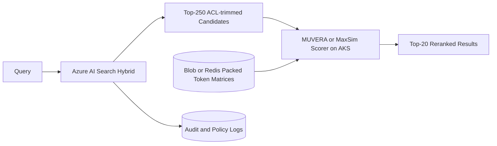
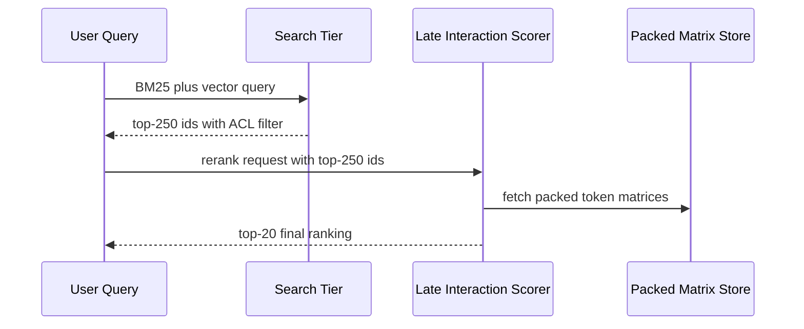

# Late-interaction multi-vector and learned-sparse RAG selection FAQ: Azure AI Search BM25+Semantic Ranker vs AKS Vespa/Qdrant ColBERT/SPLADE vs MUVERA cascade

> 🌐 **Language / 语言切换**: **English (Current)** | **[中文](late-interaction-multivector-learned-sparse-rag-ai-search-bm25-semantic-ranker-vs-aks-vespa-qdrant-colbert-splade-vs-muvera-cascade-selection-faq.md)** | **[Back to catalog](README.en.md)**

## 1. Executive summary

- **Pattern A**: managed single-vector hybrid retrieval in `Azure AI Search` with `BM25 + HNSW + RRF + L2 Semantic Ranker` is ideal for low-ops governance and ACL atomicity.
- **Pattern B**: self-hosted `Vespa/Qdrant + ColBERT/ColQwen + SPLADE/BGE-M3` delivers higher ceiling on compositional retrieval, with higher RAM/IOPS and ops cost.
- **Pattern C**: two-tier cascade (`Azure AI Search` recall plus `MUVERA/MaxSim` rerank) is the practical precision-cost compromise.
- **Pattern D (forbidden)**: exploding token-level float32 vectors into row-level single-vector records destroys quotas, HNSW quality, and ACL coherence.
- **Target outcomes**: balanced `NDCG@10`, `Recall@50`, `P95`, strict `ACL leakage = 0`, and controlled three-year TCO.

## 2. Four architecture patterns

- **A (managed single-vector)**: `Azure AI Search` with custom analyzers, MRL/binary HNSW, and semantic reranking top-50.
- **B (native multi-vector self-hosted)**: `Vespa/Qdrant` on `AKS` using `ColBERTv2/ColQwen2.5 MaxSim` plus `SPLADE++` learned sparse index.
- **C (two-tier cascade)**: ACL-trimmed top-250 recall in `Azure AI Search`, then stateless late-interaction rerank on `AKS`.
- **D (anti-pattern)**: token rows represented as flat vector rows in standard vector stores.

## 3. Reference architecture (Mermaid 1)



## 4. MUVERA cascade sequence (Mermaid 2)



## 5. Quantitative models and memory math

1. **float32 token memory**: `Mem_f32 = N_chunks * T_token * D * 4 bytes`.
2. **binary token memory**: `Mem_bin ≈ N_chunks * T_token * D / 8`.
3. **MUVERA FDE memory**: `Mem_fde = N_chunks * D_fde * 1~2 bytes`.
4. **cascade latency**: `P95_total = P95_search + P95_fetch + P95_rerank`.
5. **ACL selectivity impact**: `Recall_effective = Recall_raw * Selectivity_acl`.

### 5.1 Memory estimate examples at 10M and 50M chunks

| Data scale | float32 MaxSim estimate | binary MaxSim estimate | MUVERA FDE estimate |
|---|---:|---:|---:|
| 10M chunks | ~3.8 TB | ~0.48 TB | ~0.19 TB |
| 50M chunks | ~19.0 TB | ~2.4 TB | ~0.95 TB |

## 6. Twelve-dimension comparison matrix

| Dimension | Pattern A Managed Single Vector | Pattern B Native Multi Vector | Pattern C Cascade Hybrid | Pattern D Anti-pattern |
|---|---|---|---|---|
| Precision ceiling | Medium-high | Very high | High | Low |
| Operational overhead | Low | High | Medium | Medium but ineffective |
| ACL atomic trimming | High | Medium | High | Low |
| Hot-cold tiering | Medium | High | High | Low |
| RAM footprint | Low-medium | Very high | Medium | Very high |
| IOPS pressure | Medium | High | Medium-high | Extreme |
| Latency stability | High | Medium | Medium-high | Low |
| Observability maturity | High | Medium | High | Low |
| BCDR convenience | High | Medium | High | Low |
| TCO controllability | High | Medium-low | High | Low |
| Expansion flexibility | Medium | High | High | Low |
| Anti-pattern exposure | Low | Medium | Low | Critical |

## 7. Deep Q&A (Q1–Q8)

### Q1. When is Pattern A enough?
- When ACL complexity is high and operational simplicity is a priority.
- When retrieval constraints are moderate and top-50 rerank is adequate.
- When compliance timeline favors managed services.
- When capacity planning needs predictable SKU economics.

### Q2. When is Pattern B required?
- When compositional and table-layout matching dominates relevance failures.
- When teams can operate shard balancing and stateful NVMe workloads.
- When higher infra cost is justified by measurable precision gains.
- When custom sparse+dense tuning is a strategic differentiator.

### Q3. Why Pattern C as default evolution path?
- It preserves managed ACL and indexing strengths.
- It introduces late interaction only on a bounded candidate set.
- It keeps memory lower than full native multi-vector indexing.
- It supports reversible migration with clear rollback points.

### Q4. How to avoid ACL selectivity traps?
- Apply ACL filters before deep reranking.
- Calibrate candidate depth by tenant selectivity classes.
- Track Recall@50 drift by ACL bucket.
- Raise candidate pool for low-selectivity/high-risk cohorts.

### Q5. How to balance NDCG@10 and P95 latency?
- Use tiered candidate pools with adaptive depth controls.
- Route premium queries to deeper rerank lanes.
- Keep standard queries on lighter rerank settings.
- Tune thresholds continuously via controlled A/B runs.

### Q6. When should MUVERA FDE be introduced?
- When memory pressure dominates scaling limits.
- When recall targets stay high but full token matrices are too expensive.
- When offline encoding pipelines are acceptable.
- When latency budget can absorb one extra scoring stage.

### Q7. How should cost attribution be built?
- Split Search, AKS scorer, matrix storage, and network spend.
- Measure unit query cost by tenant and query class.
- Include analyst-review savings from better relevance.
- Evaluate economics on a multi-year horizon.

### Q8. What is the safest migration plan?
- Start with Pattern A baseline and instrument relevance metrics.
- Add Pattern C in controlled rings and verify gain.
- Adopt Pattern B only for validated high-value slices.
- Keep dual-track fallback switches in place.

## 8. Azure AI Search index and scoring snippet

```json
{
  "name": "enterprise-rag-index",
  "fields": [
    {"name": "id", "type": "Edm.String", "key": true},
    {"name": "content", "type": "Edm.String", "searchable": true},
    {"name": "acl", "type": "Collection(Edm.String)", "filterable": true},
    {"name": "vector", "type": "Collection(Edm.Single)", "searchable": true, "dimensions": 1024, "vectorSearchProfile": "hnsw-mrl"}
  ],
  "semantic": {"configurations": [{"name": "sem-default", "prioritizedFields": {"contentFields": [{"fieldName": "content"}]}}]}
}
```

## 9. Python MUVERA + MaxSim cascade scorer snippet

```python
def cascade_rerank(query_vec, candidate_ids, matrix_store, fde_index):
    coarse = fde_index.search(query_vec, candidate_ids, topk=250)
    fine_scores = {}
    for cid in coarse:
        token_matrix = matrix_store.get(cid)
        fine_scores[cid] = maxsim_score(query_vec, token_matrix)
    return sorted(fine_scores.items(), key=lambda x: x[1], reverse=True)[:20]
```

## 10. Enterprise scenario A: semiconductor BOM and tolerance retrieval

- Scenario A point 01: enforce compositional retrieval on BOM specs and tolerance clauses while preserving strict ACL atomicity.

## 11. Enterprise scenario B: cross-border M&A and patent claim-chart retrieval

- Scenario B point 01: improve complex clause and table retrieval precision with bounded-cost cascade reranking.

## 12. Three-tier three-year TCO table (USD)

| Tier | Chunk count | Pattern A annual | Pattern B annual | Pattern C annual | Anti-pattern loss | Three-year total (recommended path) |
|---|---:|---:|---:|---:|---:|---:|
| Small | 5M | 420,000 | 890,000 | 560,000 | 380,000 | 4,080,000 |
| Medium | 25M | 1,880,000 | 4,420,000 | 2,360,000 | 1,620,000 | 15,780,000 |
| Large | 100M | 6,920,000 | 16,800,000 | 8,450,000 | 6,400,000 | 55,110,000 |

## 13. Day-0 / Day-1 / Day-2 readiness checklist

### Day-0 design phase
- [ ] Day-0 design phase check 01: verify candidate depth, ACL semantics, latency budgets, rollback switches, auditing, and capacity thresholds.

### Day-1 rollout phase
- [ ] Day-1 rollout phase check 01: verify candidate depth, ACL semantics, latency budgets, rollback switches, auditing, and capacity thresholds.

### Day-2 operations phase
- [ ] Day-2 operations phase check 01: verify candidate depth, ACL semantics, latency budgets, rollback switches, auditing, and capacity thresholds.

## 14. Anti-pattern breakdown and remediation

- Remediation 01: never model token vectors as flat single-vector rows; prevent HNSW pollution and ACL atomicity failures.

## 15. Appendix: parameter and governance control catalog

- track weekly `ndcg10`, `recall50`, `p95_ms`, `acl_selectivity`, `mem_gb`, `iops`, and `unit_query_cost` trends.
