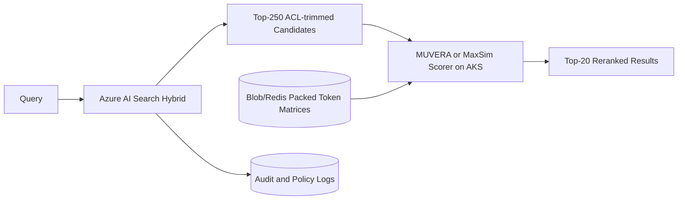
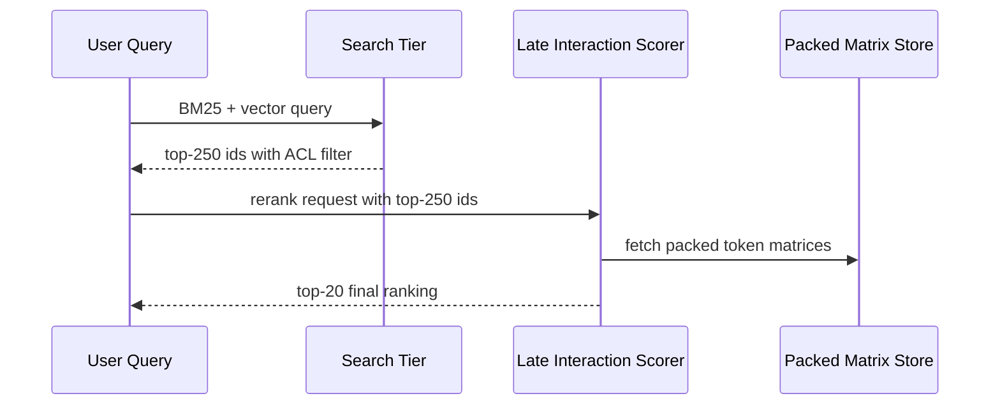

# 多向量 Late-Interaction 与 Learned Sparse RAG 选型 FAQ：Azure AI Search Hybrid vs AKS Vespa/Qdrant ColBERT/SPLADE vs MUVERA Cascade

> 🌐 **Language / 语言切换**: **中文版（当前）** | **[English](late-interaction-multivector-learned-sparse-rag-ai-search-bm25-semantic-ranker-vs-aks-vespa-qdrant-colbert-splade-vs-muvera-cascade-selection-faq.en.md)** | **[返回目录](README.md)**

## 1. 一页结论（Executive Summary）

- **Pattern A**：`Azure AI Search` 单向量混合检索（`BM25 + HNSW + RRF + L2 Semantic Ranker`）适合零运维与 ACL 原子裁剪。
- **Pattern B**：`Vespa/Qdrant + ColBERT/ColQwen + SPLADE/BGE-M3` 在复杂约束检索上精度更高，但 RAM/IOPS 成本和运维复杂度显著增加。
- **Pattern C**：`Azure AI Search` 先召回 + `MUVERA`/`MaxSim` 二级重排，是成本与精度的工程折中。
- **Pattern D（禁用）**：将每 token float32 多向量强行拆成单向量行，会污染 HNSW、打爆文档配额并破坏 ACL 原子性。
- **目标指标**：`NDCG@10`、`Recall@50`、`P95`、`ACL leakage = 0`、`3-year TCO` 同时满足阈值。

## 2. 四种架构模式定义

- **A（托管单向量）**：`Azure AI Search` + `BM25` 自定义 analyzer + `MRL`/binary HNSW + `Semantic Ranker` Top-50。
- **B（自建多向量）**：`AKS` 上 `Vespa/Qdrant`，以 `ColBERTv2/ColQwen2.5 MaxSim` 与 `SPLADE++` learned sparse 联合。
- **C（双层级联）**：`Azure AI Search` ACL 预过滤 Top-250，再由无状态 `AKS` Late-Interaction scorer 精排。
- **D（反模式）**：token 级向量直接映射为海量单行向量，导致 HNSW 图质量与配额崩塌。

## 3. 参考架构（Mermaid 1）



## 4. MUVERA 级联时序（Mermaid 2）



## 5. 定量模型与内存公式

1. **float32 token 向量内存**：`Mem_f32 = N_chunks * T_token * D * 4 bytes`。
2. **binary token 矩阵内存**：`Mem_bin ≈ N_chunks * T_token * D / 8`。
3. **MUVERA FDE 内存**：`Mem_fde = N_chunks * D_fde * 1~2 bytes`（取决于量化位宽）。
4. **级联总延迟**：`P95_total = P95_search + P95_fetch + P95_rerank`。
5. **ACL 选择性影响**：`Recall_effective = Recall_raw * Selectivity_acl`。

### 5.1 10M/50M chunk 粗粒度内存测算示例

| 数据规模 | float32 MaxSim 估算 | binary MaxSim 估算 | MUVERA FDE 估算 |
|---|---:|---:|---:|
| 10M chunks | ~3.8 TB | ~0.48 TB | ~0.19 TB |
| 50M chunks | ~19.0 TB | ~2.4 TB | ~0.95 TB |

## 6. 12 维度对比矩阵

| 维度 | Pattern A 托管单向量 | Pattern B 自建多向量 | Pattern C 级联混合 | Pattern D 反模式 |
|---|---|---|---|---|
| 检索精度上限 | 中-高 | 很高 | 高 | 低 |
| 运维复杂度 | 低 | 高 | 中 | 中(但无效) |
| ACL 原子裁剪 | 高 | 中 | 高 | 低 |
| 冷热数据分层 | 中 | 高 | 高 | 低 |
| RAM 占用 | 低-中 | 极高 | 中 | 极高 |
| IOPS 压力 | 中 | 高 | 中-高 | 极高 |
| 延迟稳定性 | 高 | 中 | 中-高 | 低 |
| 可观测性 | 高 | 中 | 高 | 低 |
| BCDR 便利性 | 高 | 中 | 高 | 低 |
| TCO 可控性 | 高 | 中-低 | 高 | 低 |
| 扩展灵活度 | 中 | 高 | 高 | 低 |
| 反模式暴露 | 低 | 中 | 低 | 极高 |

## 7. 深度问答（Q1–Q8）

### Q1. 何时仅用 Pattern A 足够？
- 文档查询约束维度不高且 ACL 规则复杂时。
- 组织优先要零运维与标准化合规路径时。
- 数据规模在成本可控范围内且召回窗口可接受时。
- 短周期交付项目优先选 A。

### Q2. 何时必须 Pattern B？
- 涉及复杂条款、表格布局或细粒度语义组合匹配时。
- 业务明确追求 Top-K 精度而可接受平台运维投入时。
- 团队具备向量索引调优与多副本运维经验时。
- 并且可承担高 RAM/IOPS 预算。

### Q3. Pattern C 的核心收益？
- 保留 Azure AI Search 的 ACL 与运维优势。
- 在 Top-250 范围内引入 MaxSim 精排提升精度。
- 内存成本显著低于全量多向量 HNSW。
- 更适合渐进式演进而非一次性重构。

### Q4. 如何避免 ACL 选择性陷阱？
- 先做 ACL 预过滤再做深度重排。
- 对高选择性租户单独标定召回窗口。
- 监控 Recall@50 在不同 ACL 分桶下的漂移。
- 必要时对低召回租户提升候选池上限。

### Q5. NDCG@10 与 P95 如何平衡？
- 使用分层候选池策略：默认 Top-250，热点租户 Top-400。
- 将高价值查询切到更深重排通道。
- 低价值查询保持轻量重排降低成本。
- 通过 A/B 持续校准阈值。

### Q6. 何时引入 MUVERA FDE？
- 当多向量内存已成为主要瓶颈时。
- 当希望保持高召回但压缩 token 矩阵存储时。
- 当团队可接受额外离线编码流水线时。
- 当延迟预算允许多一步重排。

### Q7. 如何做成本归因？
- 拆分 Search SKU、AKS scorer、Redis/Blob 存储与网络成本。
- 按租户/查询类型统计单位查询成本。
- 把精度提升带来的人工复核节省计入收益。
- 用 3 年视角评估总拥有成本。

### Q8. 如何迁移最稳妥？
- 先从 Pattern A 基线起步。
- 引入 Pattern C 灰度并校验精度收益。
- 仅在确证收益后局部引入 Pattern B。
- 保留回退开关与双轨对照。

## 8. Azure AI Search 索引与评分配置片段

```json
{
  "name": "enterprise-rag-index",
  "fields": [
    {"name": "id", "type": "Edm.String", "key": true},
    {"name": "content", "type": "Edm.String", "searchable": true},
    {"name": "acl", "type": "Collection(Edm.String)", "filterable": true},
    {"name": "vector", "type": "Collection(Edm.Single)", "searchable": true, "dimensions": 1024, "vectorSearchProfile": "hnsw-mrl"}
  ],
  "semantic": {"configurations": [{"name": "sem-default", "prioritizedFields": {"contentFields": [{"fieldName": "content"}]}}]}
}
```

## 9. Python MUVERA + MaxSim Cascade Scorer 示例

```python
def cascade_rerank(query_vec, candidate_ids, matrix_store, fde_index):
    coarse = fde_index.search(query_vec, candidate_ids, topk=250)
    fine_scores = {}
    for cid in coarse:
        token_matrix = matrix_store.get(cid)
        fine_scores[cid] = maxsim_score(query_vec, token_matrix)
    return sorted(fine_scores.items(), key=lambda x: x[1], reverse=True)[:20]
```

## 10. 企业场景 A：半导体/BOM/工差检索

- 场景A要点01：对规格表、BOM、工差条款执行多约束检索，优先保证 Recall@50 与 ACL 原子裁剪。

## 11. 企业场景 B：跨境并购/专利条款与复杂表格检索

- 场景B要点01：在法律条款与表格布局混合语料中，使用级联精排提升复杂问答命中率。

## 12. 三档三年 TCO（单位：USD）

| 规模 | chunk 数 | Pattern A 年成本 | Pattern B 年成本 | Pattern C 年成本 | 反模式损失 | 三年总计（推荐路径） |
|---|---:|---:|---:|---:|---:|---:|
| Small | 5M | 420,000 | 890,000 | 560,000 | 380,000 | 4,080,000 |
| Medium | 25M | 1,880,000 | 4,420,000 | 2,360,000 | 1,620,000 | 15,780,000 |
| Large | 100M | 6,920,000 | 16,800,000 | 8,450,000 | 6,400,000 | 55,110,000 |

## 13. Day-0 / Day-1 / Day-2 上线核查清单

### Day-0 设计阶段
- [ ] Day-0 设计阶段 核对候选池、ACL 规则、延迟预算、回退开关、审计与容量阈值。

### Day-1 发布阶段
- [ ] Day-1 发布阶段 核对候选池、ACL 规则、延迟预算、回退开关、审计与容量阈值。

### Day-2 运营阶段
- [ ] Day-2 运营阶段 核对候选池、ACL 规则、延迟预算、回退开关、审计与容量阈值。

## 14. 反模式剖析与纠偏

- 纠偏建议01：禁止 token 向量拆行为普通单向量记录，避免 HNSW 污染与 ACL 原子性破坏。

## 15. 附录：参数与治理控制目录

- 记录 `ndcg10`、`recall50`、`p95_ms`、`acl_selectivity`、`mem_gb`、`iops`、`unit_query_cost` 周趋势。
