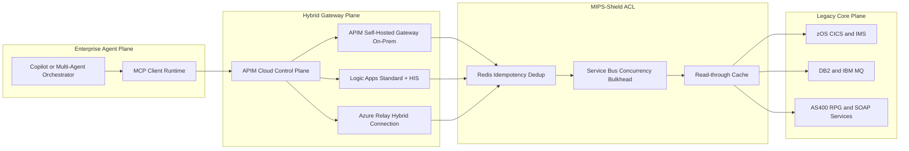
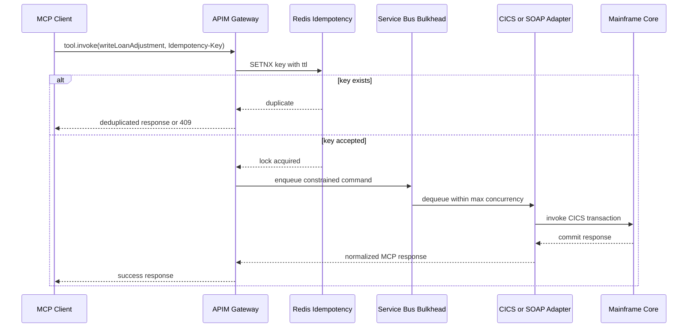

# Enterprise Legacy Mainframe and SOAP-to-MCP Modernization FAQ: APIM Self-Hosted Gateway vs Logic Apps CICS/IMS Connectors vs Azure Relay vs MIPS-Shield ACL
> 🌐 **Language Switch**: [中文](legacy-mainframe-soap-to-mcp-modernization-apim-self-hosted-vs-logic-apps-cics-vs-relay-selection-faq.md) | **English (current)**  
> Audience: Principal Cloud & AI Solution Architects, enterprise integration architects, mainframe platform teams, security/network architects, and FinOps leads.  
> Scope: Wrapping IBM z/OS CICS/IMS/DB2, IBM i (AS/400 RPG), IBM MQ, and SOAP 1.1/WSDL cores into governed MCP tool servers with strict idempotency and MIPS protection.  
> Out-of-scope: GUI RPA screen scraping, source-to-source Java/.NET modernization, and modern GraphQL/gRPC federated domains.  
## 1. Executive outcome: agent modernization succeeds only if legacy cores stay stable
Many agent programs achieve fast early wins in greenfield APIs.  
They slow down when mission-critical legacy systems enter scope.  
High-value operations still run on CICS, IMS, DB2, and RPG estates.  
Those systems are resilient but not elastic in modern autonomous traffic patterns.  
They usually enforce low transactional ceilings and strict batch windows.  
Autonomous retry storms can create cost and availability incidents quickly.  
The core problem is not “can we connect.”  
The core problem is “can we connect safely, governably, and economically.”  
This guide defines four architecture paths for that challenge.  
Path A uses APIM self-hosted gateway for local SOAP-to-MCP projection.  
Path B uses Logic Apps Standard plus HIS connectors for protocol semantics.  
Path C uses Azure Relay for zero-inbound hybrid reachability.  
Path D uses a MIPS-shield anti-corruption layer for retries and concurrency.  
The paths are complementary, not mutually exclusive.  
A is often the governance and policy anchor.  
B handles deep protocol and compensation workflows.  
C accelerates onboarding in constrained network estates.  
D protects all paths from autonomous overrun behavior.  
The target state is stable legacy continuity with modern agent velocity.  
The success condition is zero destabilization of fragile core backends.  
## 2. Business boundaries and architectural constraints
Legacy modernization is primarily a governance engineering task.  
Mission-critical cores often carry deposits, mortgages, pricing, and settlement.  
They are not designed for unconstrained autonomous fan-out patterns.  
Architecture must respect four hard boundaries from the start.  
Boundary one is connectivity policy.  
Most environments prohibit inbound port exposure into core zones.  
Boundary two is throughput envelope.  
Many interfaces must remain at `<=20 TPS` for stable operation.  
Boundary three is semantic impedance mismatch.  
SOAP contracts can contain hundreds of fields and nested optional sections.  
Only a small subset is meaningful for agent action.  
Boundary four is write-side idempotency risk.  
Duplicate writes can create real financial side effects.  
Therefore direct raw SOAP exposure to LLM tool loops is unsafe.  
A curated anti-corruption layer is required for stable operation.  
Concurrency bulkheads and replay controls are also mandatory.  
Credential locality requirements must be preserved by design.  
Ignoring these boundaries creates incident-prone architectures.  
Respecting them enables sustainable modernization without core disruption.  
## 3. Four-path positioning for enterprise legacy MCP delivery
Path A optimizes local conversion and central governance consistency.  
Path B optimizes protocol fidelity and compensating workflow richness.  
Path C optimizes hybrid reachability when network transformation lags.  
Path D optimizes backend protection and cost containment.  
Path A is strongest when low-latency policy-controlled conversion is needed.  
Path B is strongest when copybook precision and multi-step compensation dominate.  
Path C is strongest for subsidiaries and plants with slow network change cycles.  
Path D is strongest whenever autonomous retry and concurrency risk exists.  
Using only A can under-serve complex transactional compensations.  
Using only B can fragment AI gateway policy governance.  
Using only C can weaken centralized observability and policy consistency.  
Using any path without D usually fails under bursty autonomous traffic.  
A pragmatic pattern is A/B/C for integration pathways and D as mandatory shield.  
This preserves incremental delivery while maintaining backend safety.  
It also supports phased migrations without forced big-bang transitions.  
The pattern scales across mixed legacy estates with different constraints.  
It aligns platform governance with business criticality tiers.  
## 4. Twelve-dimension comparison matrix
| Dimension | A: APIM Self-Hosted Gateway | B: Logic Apps + HIS Connectors | C: Azure Relay Hybrid Tunnel | D: MIPS-Shield ACL |
|---|---|---|---|---|
| Time-to-first-production | Medium-high | Medium | High | Medium |
| Protocol transformation depth | High | Very high | Medium | Medium |
| On-prem credential locality | Very high | High | Medium-high | High |
| Legacy TPS protection strength | Medium-high | Medium | Medium | Very high |
| Idempotency and replay control | Medium | High | Medium | Very high |
| No-inbound-port compatibility | Medium | Medium | Very high | High |
| Compensation workflow power | Medium | Very high | Low | Medium |
| Central policy consistency | Very high | High | Medium | High |
| Operating complexity | Medium-high | Medium | Low | Medium |
| Observability explainability | High | High | Medium | High |
| Core-system runtime impact | Low | Medium | Medium | Very low (with cache offload) |
| Three-year TCO convergence | High | Medium-high | Medium | Very high |
The matrix should be weighted by domain risk profile.  
Banking programs usually weight idempotency and MIPS shielding highest.  
Industrial distribution programs often weight onboarding speed highest.  
Global groups often weight no-inbound compatibility for remote sites.  
Maintain one canonical matrix template and adjust weights transparently.  
This improves governance consistency across architecture boards.  
It also shortens repeated decision cycles for similar workloads.  
## 5. Path A deep dive: APIM self-hosted gateway with Liquid SOAP projection
Path A brings conversion close to the legacy source systems.  
The data plane runs in on-prem DMZ or Arc-managed clusters.  
SOAP envelope reduction happens locally before cloud transit.  
This reduces payload bloat and avoids unnecessary round-trip overhead.  
In well-designed LAN enclaves, conversion overhead can stay below `6ms`.  
Path A also preserves existing WS-Security and mTLS boundary expectations.  
Sensitive credentials can remain in local trust domains.  
Cloud APIM remains the control-plane policy authority.  
A critical design point is schema curation.  
Many WSDL contracts expose `300–400` fields per operation.  
Business use often requires only `20–40` fields.  
Expose only curated strongly typed MCP tool schemas.  
Avoid presenting full raw contract surface to autonomous agents.  
Curated schemas reduce context size and tool misselection risk.  
Curated schemas also simplify policy testing and audit documentation.  
Path A is ideal for low-latency read-heavy workloads with strict governance.  
It should be paired with D for retry and write protection.  
It can be paired with B for complex compensating workflows.  
## 6. Path B deep dive: Logic Apps Standard + HIS for semantic integration
Path B handles deep legacy protocol semantics and orchestration needs.  
HIS connectors support CICS/IMS interaction patterns and DB2 bridges.  
They also support IBM i and IBM MQ mediation patterns.  
Copybook parsing and packed-decimal interpretation are first-class concerns.  
EBCDIC-to-UTF8 conversion can be governed in explicit transformation steps.  
This is significantly safer than terminal screen scraping approaches.  
Logic Apps also provides durable workflow and compensation features.  
That is valuable in multi-system write transactions.  
When downstream acknowledgments fail, compensation can be orchestrated deterministically.  
Path B is strong in process-rich transactional modernization domains.  
Its trade-off is throughput economics on high-frequency read paths.  
Avoid routing all repetitive read traffic through B by default.  
Use A+D+cache for repetitive read flows where possible.  
Reserve B for complex orchestration and write semantics.  
This partitioning improves both stability and cost posture.  
Path B should still emit standardized telemetry for central governance.  
Schema versioning and transformation tests should be automated.  
Precision and encoding regressions must be treated as release blockers.  
## 7. Path C deep dive: Azure Relay hybrid connectivity without inbound ports
Path C addresses network realities in distributed enterprises.  
Many acquired environments cannot complete private connectivity quickly.  
Business onboarding cannot always wait for six-month network programs.  
Relay supports outbound TLS connectivity from on-prem to cloud edges.  
No inbound firewall opening is required in core zones.  
This dramatically lowers approval friction for initial integration.  
It is especially effective for regional plants and subsidiaries.  
Path C is best viewed as acceleration lane, not final architecture everywhere.  
A governance risk appears when each site configures independently.  
Policy drift and inconsistent monitoring can emerge rapidly.  
Mitigate by central policy templates and certificate governance.  
Standardize tagging, logging, and retry policy defaults globally.  
Then gradually converge high-value sites to Path A or B.  
This creates a controlled migration gradient.  
Path C therefore reduces time-to-value while preserving strategic alignment.  
It is powerful in phased modernization portfolios.  
It should still be shielded by Path D controls for backend safety.  
## 8. Path D deep dive: MIPS-shield anti-corruption layer
Path D is the non-negotiable safety shell for autonomous access.  
Autonomous agents can produce high-frequency parallel retries by design.  
Legacy systems interpret those as real traffic and cost pressure.  
Without controls, read storms inflate MSU/MIPS bills unexpectedly.  
Without controls, write storms can trigger duplicate financial operations.  
Path D should include three mandatory control classes.  
Control one is deterministic Redis idempotency key deduplication.  
Control two is Service Bus concurrency bulkheads for write lanes.  
Control three is read-through cache and CDC-fed offload replicas.  
Read-heavy operations often have significant cacheability profiles.  
In many account-query domains, read offload can approach `82%`.  
That directly reduces core CPU pressure and MIPS exposure.  
Bulkheads ensure old systems are never asked to absorb burst fan-out.  
This protects `MAXTASK` and queue depth limits.  
Path D decouples model uncertainty from core transaction stability.  
It turns fragile backends into controlled capacity services.  
It also creates deterministic retry semantics for agent frameworks.  
Path D should be mandatory policy, not optional optimization.  
## 9. Reference architecture diagram: legacy-to-MCP hybrid modernization

The diagram emphasizes control-plane and data-plane separation.  
It also shows shield controls as shared mandatory infrastructure.  
Integration pathways can evolve without removing core protections.  
This makes phased modernization safer and easier to govern.  
It reduces migration lock-in to any single path.  
It also helps isolate blast radius during incident response.  
## 10. Sequence model: idempotent write and constrained concurrency

The critical rule is lock-before-write execution.  
Queue bulkheads are required for every write-capable tool path.  
This keeps backend pressure inside deterministic envelopes.  
It also simplifies replay safety and audit reconstruction.  
The pattern should be standardized across all write tools.  
## 11. Quantitative Q&A for architecture and risk review boards
**Q1: Why can uncached autonomous read retries cause MIPS spikes quickly?**  
A1: If one call costs `x` and retry factor is `n`, effective compute demand trends toward `n*x`; concurrent fan-out compounds this into MSU peak exposures.  
**Q2: How is the often-cited `82%` read offload computed?**  
A2: `offload_rate = 1 - core_reads_after / core_reads_before`; reducing from `50,000` to `9,000` read calls per peak hour yields approximately `82%` offload.  
**Q3: What are common COMP-3 and EBCDIC precision failure modes?**  
A3: Packed-decimal sign nibble handling and scale interpretation errors can corrupt monetary values if transformations are text-first instead of type-first.  
**Q4: What is the benefit of shrinking a `400`-field WSDL shape into curated MCP schemas?**  
A4: If business usage needs only `40` fields, schema surface can shrink around `90%`, reducing token and cognitive noise while improving tool selection reliability.  
**Q5: How should deterministic idempotency keys be generated for write protection?**  
A5: Hash business primary key + operation type + semantic version; avoid timestamps and mutable metadata that break retry determinism.  
**Q6: How should initial concurrency bulkhead limits be set for fragile cores?**  
A6: Start at about `60%–70%` of measured stable backend TPS and increase only with controlled canary evidence while reserving headroom for critical manual channels.  
**Q7: When should Path A be preferred over Path B?**  
A7: Prefer A for read-heavy low-latency traffic with strong central policy needs; add B only where deep protocol orchestration and compensation are required.  
**Q8: When is Path C the pragmatic first move?**  
A8: Choose C where network modernization timelines exceed delivery windows and no-inbound connectivity is mandatory for rapid onboarding.  
These Q&As should be attached to recurring architecture review packs.  
They reduce subjective debate and improve reproducible decisions.  
They also align platform and compliance stakeholders on shared metrics.  
## 12. Production policy sample: APIM SOAP-to-MCP Liquid with Redis lock
```xml
<policies>
  <inbound>
    <base />
    <set-variable name="idempotencyKey" value="@(
      context.Request.Headers.GetValueOrDefault("Idempotency-Key","")
    )" />
    <choose>
      <when condition="@((string)context.Variables["idempotencyKey"] == "")">
        <return-response>
          <set-status code="400" reason="Missing Idempotency-Key" />
        </return-response>
      </when>
    </choose>
    <send-request mode="new" response-variable-name="redisResp" timeout="2" ignore-error="false">
      <set-url>https://redis-acl.internal/lock</set-url>
      <set-method>POST</set-method>
      <set-header name="Content-Type" exists-action="override">
        <value>application/json</value>
      </set-header>
      <set-body>@{
        return "{\"key\":\"" + (string)context.Variables["idempotencyKey"] + "\",\"ttl\":120}";
      }</set-body>
    </send-request>
    <choose>
      <when condition="@(((IResponse)context.Variables["redisResp"]).StatusCode != 200)">
        <return-response>
          <set-status code="409" reason="Duplicate or Locked Request" />
        </return-response>
      </when>
    </choose>
    <set-body template="liquid">
{
  "jsonrpc": "2.0",
  "method": "legacy.cics.customer.lookup",
  "params": {
    "customerId": "{{body.Envelope.Body.CustomerLookupRequest.CustomerId}}",
    "regionCode": "{{body.Envelope.Body.CustomerLookupRequest.RegionCode}}"
  }
}
    </set-body>
  </inbound>
  <backend>
    <forward-request />
  </backend>
  <outbound>
    <base />
  </outbound>
  <on-error>
    <base />
  </on-error>
</policies>
```
This policy demonstrates lock-first write protection semantics.  
It also demonstrates SOAP envelope reduction to typed MCP payloads.  
Production use should add certificate pinning and schema validation policies.  
It should also add per-operation concurrency ceilings and observability tags.  
Keep policy templates versioned with explicit rollback plans.  
## 13. Adapter sample: copybook/CICS anti-corruption transformation
```python
from decimal import Decimal
from dataclasses import dataclass
from typing import Dict, Any


@dataclass
class CicsResponse:
    account_no: str
    currency: str
    balance_comp3: bytes
    status_code: str


def decode_comp3(value: bytes, scale: int = 2) -> Decimal:
    digits = ""
    for b in value[:-1]:
        digits += f"{b >> 4}{b & 0x0F}"
    last = value[-1]
    digits += f"{last >> 4}"
    sign = -1 if (last & 0x0F) in (0x0D, 0x0B) else 1
    return Decimal(sign) * (Decimal(digits) / (Decimal(10) ** scale))


def cics_to_mcp_payload(resp: CicsResponse) -> Dict[str, Any]:
    if resp.status_code != "00":
        return {
            "tool_status": "error",
            "legacy_code": resp.status_code,
            "retryable": resp.status_code in {"91", "92"},
        }
    return {
        "tool_status": "ok",
        "accountId": resp.account_no.strip(),
        "currency": resp.currency.strip(),
        "availableBalance": str(decode_comp3(resp.balance_comp3, scale=2)),
    }
```
The key focus here is monetary precision and error semantics.  
Legacy status codes are mapped into explicit retryable behavior.  
This prevents uncontrolled retries by upstream agent frameworks.  
It also improves operator troubleshooting and audit readability.  
Adapter code should be covered with contract tests and golden fixtures.  
## 14. Enterprise scenarios and MIPS-avoidance ROI
### Scenario A: tier-1 retail bank deposit and mortgage servicing agent
The bank runs core servicing on z/OS CICS and IBM MQ estates.  
Peak channels already push backend stability boundaries.  
The program implemented Path A plus Path D as baseline.  
Path B was added for complex cross-system compensation flows.  
Path A unified policy enforcement and schema curation centrally.  
Path D enforced retry controls, dedup, and read offload protections.  
Post-deployment, core read spikes were materially reduced.  
MIPS expansion procurement was deferred without service degradation.  
Audit traceability remained intact across all tool invocations.  
The architecture board approved broader rollout by product line.  
### Scenario B: global industrial distributor with 14 regional AS/400 estates
The company had heterogeneous connectivity constraints after acquisitions.  
Several regions could not complete private network upgrades quickly.  
Path C enabled rapid no-inbound onboarding through outbound tunnels.  
Headquarters used Path A for governance policy centralization.  
Region-specific transactional complexity was handled through Path B.  
Path D was enforced globally for retry and concurrency shielding.  
A cross-region unified tool surface was delivered within 12 weeks.  
No critical backend destabilization was observed during onboarding.  
Regional modernization could proceed incrementally without service interruption.  
### FinOps and MIPS-avoidance TCO table
| Metric | Before modernization | After modernization | Delta |
|---|---:|---:|---:|
| Core read calls (peak/hour) | 50,000 | 9,000 | -82% |
| Duplicate write request rate | 3.8% | 0.2% | -3.6pp |
| `MAXTASK` alert events (monthly) | 27 | 4 | -85% |
| Average tool response latency | 420ms | 170ms | -60% |
| Estimated monthly MIPS cost | \$1.20M | \$0.86M | -28% |
| Annual avoided expansion/incident loss | - | \$5.1M | Positive |
These figures are illustrative for architecture planning decisions.  
Production programs should recalculate with real billing and risk models.  
Compliance control overhead should be included in scenario economics.  
Quarterly recalibration keeps route defaults financially aligned.  
## 15. Day-0 and Day-2 twelve-item implementation checklist
- Inventory legacy interfaces with TPS ceilings and business criticality tags.  
- Define minimal typed MCP schemas for each tool and block raw WSDL passthrough.  
- Standardize APIM self-hosted deployment, certificate rotation, and policy rollout.  
- Build encoding and precision regression tests for copybook and packed-decimal transforms.  
- Enforce mandatory `Idempotency-Key` validation for every write-capable operation.  
- Apply Service Bus bulkheads with conservative initial concurrency thresholds.  
- Deploy cache offload for repetitive read operations with explicit expiry governance.  
- Standardize observability metrics: retries, dedup hit rate, core call rate, error clusters.  
- Add automatic backend-protection thresholds and fail-safe circuit policies in release flow.  
- Define regional onboarding strategy: relay-first, then converge to self-hosted gateway where feasible.  
- Run weekly reviews for MIPS trend, backend alerts, and tool misuse cases.  
- Execute quarterly stress and failover drills with auditable evidence capture.  
Ownership should be split across platform, integration, core-system, and SRE teams.  
Phase one should prioritize the first six protective controls.  
Phase two should optimize latency and long-term operating economics.  
The objective is not to replace legacy cores overnight.  
The objective is to modernize safely without destabilizing critical operations.  
