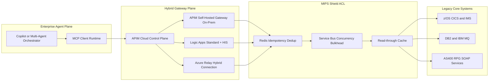
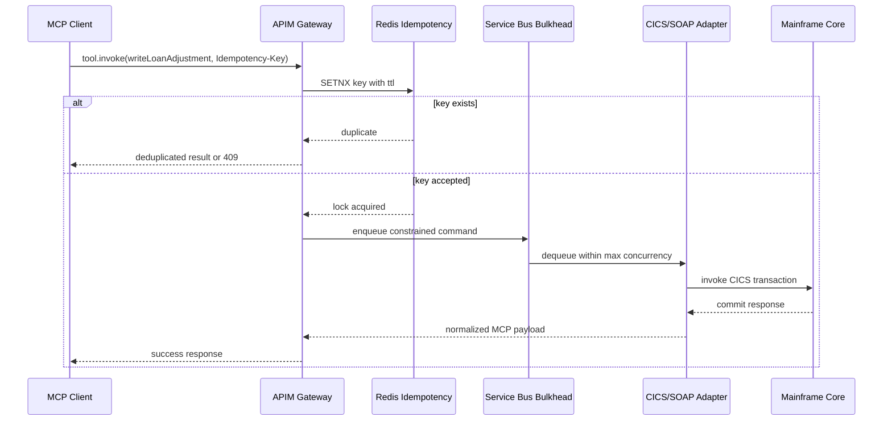

# 企业遗留主机与 SOAP 核心系统 MCP 化选型 FAQ：APIM 自托管网关 vs Logic Apps CICS/IMS 连接器 vs Azure Relay 隧道 vs MIPS 保护 ACL
> 🌐 **Language Switch**: **中文（当前）** | [English](legacy-mainframe-soap-to-mcp-modernization-apim-self-hosted-vs-logic-apps-cics-vs-relay-selection-faq.en.md)  
> 目标读者：Principal Cloud & AI Solution Architect、企业集成架构师、主机平台团队、网络安全与 FinOps 团队。  
> 主题边界：聚焦将 IBM z/OS CICS/IMS/DB2、IBM i (AS/400 RPG)、IBM MQ 与 SOAP/WSDL 核心系统包装为可治理 MCP Tool Server，不涉及 GUI RPA 或代码重写迁移。  
## 1. 执行摘要：现代 Agent 成功与否，取决于能否安全调用“最老的系统”
很多企业 Agent 项目在 PoC 阶段很顺利。  
一旦连接核心主机系统就进入瓶颈。  
真正高价值业务往往仍在 CICS/IMS 或 AS/400。  
这些系统 TPS 低、窗口小、变更风险高。  
任何并发放大都可能触发 MIPS 成本飙升。  
或触发 `MAXTASK` 锁死。  
因此问题不在“能不能连上”。  
而在“如何安全、可控、可审计地连上”。  
本指南提供四路径组合。  
路径 A：APIM Self-Hosted Gateway 就地 SOAP 到 MCP 转换。  
路径 B：Logic Apps Standard + Host Integration Server 连接器治理。  
路径 C：Azure Relay 出站隧道零入站端口接入。  
路径 D：MIPS Shield ACL 防重放、防风暴、防并发刺穿。  
四路径并非互斥。  
常见做法是 A 作为主入口治理平面。  
B 负责复杂编排与协议细节转换。  
C 解决并购子公司或工厂快速接入。  
D 作为所有路径的保护外壳。  
目标是“让老系统稳定活着，同时让新 Agent 可持续扩展”。  
## 2. 业务边界与约束：为什么 legacy MCP 化是治理工程
主机系统通常承载结算、存款、按揭或订单主账。  
这些场景容错窗口很窄。  
且存在强审计约束。  
架构设计必须先明确四个硬边界。  
第一是连接边界。  
多数系统不允许开放入站端口。  
第二是吞吐边界。  
很多服务稳定上限仅 `<=20 TPS`。  
第三是语义边界。  
SOAP 模式字段多且冗长。  
实际业务常只用其中小部分。  
第四是幂等边界。  
重试写请求会造成真实财务副作用。  
因此 MCP 化不能直接暴露原始 SOAP。  
需要抗腐层做协议收敛。  
也需要并发隔离与缓存卸载。  
并需要把安全凭据留在本地边界内。  
当这些边界被忽视时，Agent 会把“低频人工调用”放大成“高频机器洪峰”。  
这就是 legacy 项目失败主因。  
## 3. 四路径定位：从连接可达，到成本可控，再到语义可治理
路径 A 强调“本地就地转换”。  
将 SOAP 到 MCP 的协议开销压缩在本地网络。  
路径 B 强调“异构协议语义治理”。  
把 EBCDIC、Copybook、COMP-3 等难点统一清洗。  
路径 C 强调“无入站改造快速接入”。  
适合网络改造周期长的区域。  
路径 D 强调“主机保护与成本防爆”。  
在 Agent 自动重试场景尤为关键。  
单用 A，通常会缺乏复杂补偿流程。  
单用 B，通常会缺乏统一 AI 网关策略。  
单用 C，通常会遇到可观测性与策略分散。  
缺少 D，则所有路径都会在高峰时失稳。  
推荐是 A/B/C 负责业务适配，D 负责全局安全阀。  
并把所有调用统一纳入 APIM 治理与审计。  
## 4. 12 维比较矩阵（Mainframe/SOAP 到 MCP 专用）
| 维度 | A APIM Self-Hosted | B Logic Apps + HIS | C Azure Relay | D MIPS Shield ACL |
|---|---|---|---|---|
| 上线速度 | 中高 | 中 | 高 | 中 |
| 协议转换灵活度 | 高 | 极高 | 中 | 中 |
| 本地凭据驻留能力 | 极高 | 高 | 中高 | 高 |
| 旧系统 TPS 保护能力 | 中高 | 中 | 中 | 极高 |
| 幂等防重能力 | 中 | 高 | 中 | 极高 |
| 无入站端口适配 | 中 | 中 | 极高 | 高 |
| 编排补偿能力 | 中 | 极高 | 低 | 中 |
| 治理策略统一性 | 极高 | 高 | 中 | 高 |
| 运维复杂度 | 中高 | 中 | 低 | 中 |
| 观测与审计可解释性 | 高 | 高 | 中 | 高 |
| 对主机性能影响 | 低 | 中 | 中 | 极低（有缓存时） |
| 三年 TCO 收敛性 | 高 | 中高 | 中 | 极高 |
矩阵建议按业务线差异加权。  
银行通常提高幂等和 MIPS 保护权重。  
制造业通常提高接入速度权重。  
跨区域集团通常提高无入站适配权重。  
## 5. 路径 A：APIM Self-Hosted Gateway + Liquid SOAP-to-MCP
路径 A 的核心是网关数据面下沉。  
把网关部署到本地 DMZ 或 Arc 管理集群。  
这样 SOAP 转换可在本地完成。  
不必把冗长 XML 来回送到云端再转。  
在典型企业局域网中，这可把转换开销压到 `<6ms` 量级。  
路径 A 还可保留现有 WS-Security 凭据体系。  
凭据不离开本地信任边界。  
云端 APIM 仅同步策略与版本。  
但路径 A 需要治理 schema 爆炸问题。  
许多 WSDL 含 `300-400` 字段。  
真实业务常只用 `20-40` 字段。  
应通过 curated MCP schema 收敛工具面。  
否则模型上下文会被 XML 噪声占满。  
建议把每个工具定义成强类型最小输入。  
并把扩展字段移入受控 metadata。  
路径 A 的价值在于低时延与高治理一致性并存。  
## 6. 路径 B：Logic Apps Standard + HIS 连接器治理平面
路径 B 的优势在异构协议适配。  
尤其是 CICS/IMS/DB2 与 IBM MQ 组合场景。  
HIS 连接器可处理 COBOL Copybook。  
也能处理 `COMP-3` packed decimal。  
并支持 EBCDIC 到 UTF-8 编码转换。  
这比终端屏幕抓取稳定得多。  
Logic Apps 还支持补偿事务编排。  
适合跨系统写入与回滚流程。  
例如账户更新 + 通知 + 日志落库。  
当其中一步失败，可自动执行补偿动作。  
路径 B 适合流程复杂、字段规则多的企业。  
但要注意连接器成本与吞吐上限。  
不应把高频只读查询全部压在 B。  
可将高频读流量交由 A+D+缓存层承接。  
将复杂写事务留给 B。  
这样可平衡成本与稳定性。  
## 7. 路径 C：Azure Relay 混合连接与无入站接入
路径 C 解决“来不及改网络”的现实问题。  
许多并购资产无法短期上 ExpressRoute。  
但业务需要尽快纳入统一 Agent 门户。  
Relay 提供出站隧道模型。  
本地仅需发起出站 TLS 连接。  
不需开放入站防火墙端口。  
这显著降低接入审批阻力。  
对于区域工厂和分支机构尤其有价值。  
路径 C 的主要风险是集中治理薄弱。  
若每个站点独立配置，策略会漂移。  
应通过 APIM 或集中策略中心统一下发规则。  
并统一证书轮换与可观测标签。  
路径 C 适合“先接入、后优化”的阶段策略。  
在成熟后可逐步切换到 A 或 B 的长期形态。  
## 8. 路径 D：MIPS Shield ACL（幂等 + 并发舱壁 + 缓存卸载）
路径 D 是 legacy MCP 化的安全底板。  
Agent 的自动重试与并发调用会放大主机负荷。  
若不设防，读请求就能推高 MSU 计费。  
写请求则可能造成重复扣款或重复出单。  
D 路径建议包含三层。  
第一层是 Redis `Idempotency-Key` 去重。  
第二层是 Service Bus 并发舱壁。  
第三层是读透缓存与 CDC 镜像卸载。  
对高频只读查询，缓存命中率可显著降低主机调用。  
在常见账务查询场景，可见 `82%` 左右读卸载空间。  
这直接降低 MIPS 成本风险。  
并发舱壁则限制写流量爆发。  
防止 CICS `MAXTASK` 被瞬间打满。  
D 的价值在于把“模型不确定性”隔离在主机之外。  
## 9. 参考架构：Legacy Core 到 MCP 的四路径组合拓扑

该拓扑体现控制面与数据面分离。  
也体现保护层独立于接入路径。  
便于后续替换单条路径而不影响整体。  
## 10. 时序：主机写请求的幂等保护与并发舱壁

时序关键在先锁后写。  
并且写流量必须经过队列舱壁。  
这样可把主机压力控制在稳定区间。  
## 11. 定量问答：MIPS、精度、压缩与去重
**Q1：LLM 重试为何会导致 MIPS 成本暴涨？**  
A1：若单次读调用成本为 `x`，请求被重试 `n` 次，总成本近似 `n*x`。  
当并发增长叠加重试时，MSU 峰值计费会放大。  
对核心查询引入缓存后，读流量可显著下降。  
**Q2：`82%` 读卸载是如何计算的？**  
A2：`offload_rate = 1 - core_reads_after / core_reads_before`。  
例如每小时从 `50,000` 次降到 `9,000` 次，卸载率约 `82%`。  
**Q3：`COMP-3` 与 EBCDIC 转换为何易出错？**  
A3：因为 packed decimal 的符号位与小数位处理复杂。  
若按文本直接转，可能造成金额精度漂移。  
应在适配层显式声明位宽、比例和舍入规则。  
**Q4：400 字段 WSDL 到 MCP 的压缩收益如何看？**  
A4：若真实业务只用 `40` 字段，字段面可压缩约 `90%`。  
上下文 token 消耗也会同步下降。  
模型工具选择错误率通常随噪声字段减少而下降。  
**Q5：幂等键如何设计才可跨重试稳定？**  
A5：推荐用业务主键 + 操作类型 + 语义版本做确定性哈希。  
避免包含易变时间戳导致同请求不同键。  
**Q6：并发舱壁阈值如何设？**  
A6：先以 legacy 系统稳定 TPS 的 `60%–70%` 起步。  
再按观测逐步上调。  
始终保留突发余量给人工关键交易。  
**Q7：何时应优先 A 路径而非 B 路径？**  
A7：当调用模式以高频读为主且编排简单时。  
当目标是最低时延与统一策略时。  
**Q8：何时优先 C 路径？**  
A8：当网络改造周期长且需要 6 个月内快速接入时。  
当分支站点无法短期部署本地网关集群时。  
## 12. 生产策略示例：APIM SOAP-to-MCP + Redis 幂等策略
```xml
<policies>
  <inbound>
    <base />
    <set-variable name="idempotencyKey" value="@(
      context.Request.Headers.GetValueOrDefault("Idempotency-Key","")
    )" />
    <choose>
      <when condition="@((string)context.Variables["idempotencyKey"] == "")">
        <return-response>
          <set-status code="400" reason="Missing Idempotency-Key" />
        </return-response>
      </when>
    </choose>
    <send-request mode="new" response-variable-name="redisResp" timeout="2" ignore-error="false">
      <set-url>https://redis-acl.internal/lock</set-url>
      <set-method>POST</set-method>
      <set-header name="Content-Type" exists-action="override">
        <value>application/json</value>
      </set-header>
      <set-body>@{
        return "{\"key\":\"" + (string)context.Variables["idempotencyKey"] + "\",\"ttl\":120}";
      }</set-body>
    </send-request>
    <choose>
      <when condition="@(((IResponse)context.Variables["redisResp"]).StatusCode != 200)">
        <return-response>
          <set-status code="409" reason="Duplicate or Locked Request" />
        </return-response>
      </when>
    </choose>
    <set-body template="liquid">
{
  "jsonrpc": "2.0",
  "method": "legacy.cics.customer.lookup",
  "params": {
    "customerId": "{{body.Envelope.Body.CustomerLookupRequest.CustomerId}}",
    "regionCode": "{{body.Envelope.Body.CustomerLookupRequest.RegionCode}}"
  }
}
    </set-body>
  </inbound>
  <backend>
    <forward-request />
  </backend>
  <outbound>
    <base />
  </outbound>
  <on-error>
    <base />
  </on-error>
</policies>
```
上例重点展示两件事。  
一是先进行幂等锁校验。  
二是将 SOAP envelope 收敛为 MCP 强类型调用。  
## 13. 适配器示例：Copybook/CICS 到 MCP 抗腐转换片段
```python
from decimal import Decimal
from dataclasses import dataclass
from typing import Dict, Any


@dataclass
class CicsResponse:
    account_no: str
    currency: str
    balance_comp3: bytes
    status_code: str


def decode_comp3(value: bytes, scale: int = 2) -> Decimal:
    digits = ""
    for b in value[:-1]:
        digits += f"{b >> 4}{b & 0x0F}"
    last = value[-1]
    digits += f"{last >> 4}"
    sign = -1 if (last & 0x0F) in (0x0D, 0x0B) else 1
    return Decimal(sign) * (Decimal(digits) / (Decimal(10) ** scale))


def cics_to_mcp_payload(resp: CicsResponse) -> Dict[str, Any]:
    if resp.status_code != "00":
        return {
            "tool_status": "error",
            "legacy_code": resp.status_code,
            "retryable": resp.status_code in {"91", "92"},
        }
    return {
        "tool_status": "ok",
        "accountId": resp.account_no.strip(),
        "currency": resp.currency.strip(),
        "availableBalance": str(decode_comp3(resp.balance_comp3, scale=2)),
    }
```
该片段核心是金额精度保护。  
并将主机错误码映射为可治理重试语义。  
这类抗腐层可显著降低模型误用 legacy 接口概率。  
## 14. 企业场景与 MIPS 避险 ROI：银行与工业分销
### 场景 A：Tier-1 零售银行存款与按揭服务 Agent
该银行核心交易仍在 z/OS CICS。  
人工渠道峰值已接近主机稳定上限。  
他们采用 A + D 作为主路径。  
A 统一 SOAP 到 MCP 转换与治理。  
D 控制重试、并发与缓存卸载。  
复杂跨系统事务由 B 补充。  
上线后主机查询峰值明显下降。  
并避免了新一轮 MIPS 扩容采购。  
同时保持审计链路完整。  
### 场景 B：全球工业分销商 O2C Agent（14 个区域 AS/400）
该企业网络形态复杂。  
多个区域无法短期开通专线改造。  
他们先以 C 路径完成快速接入。  
在总部使用 A 路径统一策略。  
区域复杂流程由 B 路径分担。  
全局统一挂接 D 路径防并发风暴。  
12 周内完成跨区域统一工具面。  
并未对区域老系统造成稳定性冲击。  
### FinOps 与 MIPS 避险 TCO 表
| 指标 | 改造前 | 改造后 | 变化 |
|---|---:|---:|---:|
| 主机读调用次数（峰时/小时） | 50,000 | 9,000 | -82% |
| 主机写重复请求率 | 3.8% | 0.2% | -3.6pp |
| 触发 `MAXTASK` 预警次数（月） | 27 | 4 | -85% |
| 平均工具响应时延 | 420ms | 170ms | -60% |
| 估算月度 MIPS 成本 | \$1.20M | \$0.86M | -28% |
| 年化避免扩容与故障损失 | - | \$5.1M | 正向 |
表中值用于架构推演示例。  
实际项目应按主机账单与业务损失模型复算。  
## 15. Day-0 / Day-2 十二项落地清单
- 梳理所有 legacy 接口并标注 TPS 上限与关键业务等级。  
- 为每个工具定义最小 MCP schema，禁止直透全量 WSDL。  
- 建立 APIM 自托管网关部署与证书轮换标准。  
- 为 Logic Apps/HIS 连接器建立编码与精度回归测试。  
- 在所有写请求强制 `Idempotency-Key` 校验。  
- 通过 Service Bus 舱壁限制并发写入峰值。  
- 为高频读接口配置 Redis/Cosmos 缓存与失效策略。  
- 统一观测指标：重试率、去重率、主机调用率、错误码热榜。  
- 在变更流程中加入主机保护阈值与自动熔断规则。  
- 建立区域接入分层策略：优先 Relay，后续收敛到自托管网关。  
- 每周复盘 MIPS 成本、主机告警与工具误调用案例。  
- 每季度执行一次主机压力演练与灾备切换演练。  
建议将清单分配到平台、集成、主机、SRE 四类团队。  
首阶段优先完成前六项硬保护。  
第二阶段再优化体验与成本。  
最终目标是“让旧系统安全服务新 Agent，而不是被新流量拖垮”。  
