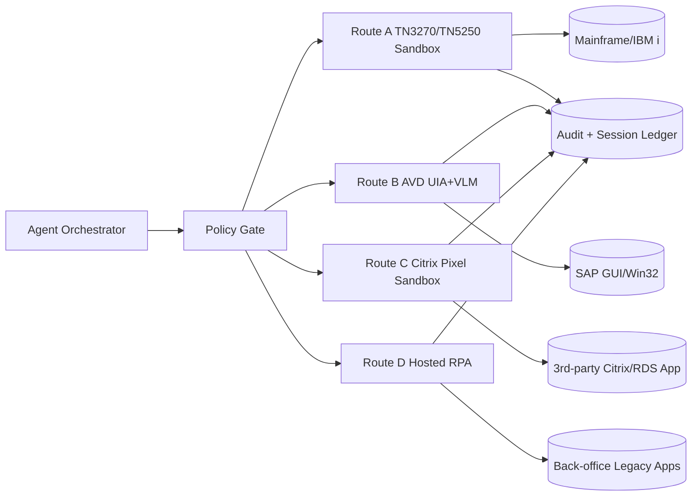
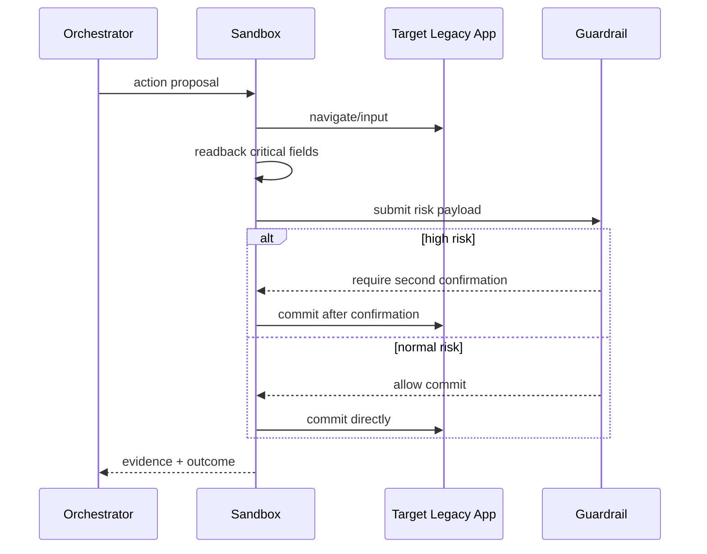

# Legacy Terminal and Thick-Client Agent Sandbox Selection FAQ: Protocol-Native TN3270/TN5250 Containers vs AVD UIA+VLM Hybrid Desktops vs Citrix Pixel Double-Hop Sandboxes vs Managed Hosted RPA

> **Audience**: Cloud and AI Solution Architects, enterprise automation platform teams, mainframe/host operations teams, security and compliance architects.
> **Decision problem**: selecting and hardening execution sandboxes for legacy systems without modern REST or MCP APIs, including green-screen terminals, Win32 thick clients, and partner-hosted Citrix/RDS applications.

---

## 1) Executive summary: choose interaction semantics before execution substrate

In legacy automation, the biggest reliability split comes from interaction semantics:

- structured protocol or control-tree interactions are typically safer than pure pixel automation,
- pixel-only automation can extend coverage but requires stronger commit interlocks and readback guards.

Recommended route posture:

- **Route A** for TN3270/TN5250 protocol-native systems where deterministic field maps exist.
- **Route B** for Windows/SAP thick clients with usable accessibility trees.
- **Route C** for partner systems exposed only as Citrix or RDP pixels.
- **Route D** for organizations prioritizing managed operations and standardized queue governance.

Suggested hard thresholds:

- `critical-field readback consistency >= 99.95%`,
- `destructive mis-commit rate <= 0.02%`,
- `post-recovery orphan-lock rate <= 0.1%`,
- `C_1000 (cost per 1,000 transactions) under business guardrail`,
- `per-agent identity audit coverage = 100%`.

Anti-patterns:

1. applying pixel clicks to every legacy flow even when protocol or UIA semantics are available,
2. shared credentials with no per-agent accountability,
3. no LU-pool and session-backpressure management under burst traffic,
4. no pre-submit interlock before Enter/PF keys on high-risk screens.

---

## 2) Workload context and system boundaries

Typical legacy targets:

- IBM z/OS `TN3270` transaction terminals,
- IBM i `TN5250` line-of-business consoles,
- `SAP GUI` and other Win32 desktop clients,
- third-party applications delivered strictly via `Citrix/RDP` virtualized pixels.

Production constraints:

- no stable API layer,
- state transitions tightly coupled to interactive terminal sessions,
- irreversible operations can be triggered by single key commits,
- compliance expects durable evidence of actor, action, timestamp, and approval path.

---

## 3) Route definitions (A/B/C/D)

### Route A — Headless protocol-native terminal sandbox (s3270 / TN5250)

Design:

- run protocol-native clients in ACA Dynamic Sessions or AKS Kata sandboxes,
- connect over TLS 1.3 through private network paths (VNet/ExpressRoute),
- use deterministic 24x80 EBCDIC field/attribute maps instead of OCR interpretation,
- optimize for low step latency and high session density.

Strengths:

- highest structured-field reliability,
- low latency and high throughput density,
- strong deterministic replay and auditability.

Trade-offs:

- only applicable where protocol-native access is available.

### Route B — Unattended desktop accessibility-tree + VLM fallback hybrid (AVD / Windows 365)

Design:

- UI Automation / SAP GUI Scripting as primary selectors,
- VLM fallback for owner-drawn or low-semantic controls,
- controlled execution on AVD or Windows 365 host pools.

Strengths:

- broad coverage for thick-client desktop apps,
- higher precision than pixel-only workflows where accessibility metadata exists.

Trade-offs:

- lower density than protocol-native route,
- desktop lifecycle operations are required.

### Route C — Double-hop Citrix or remote-pixel VLM computer-use sandbox

Design:

- isolated AVD jump-host connects to partner Citrix/RDP app,
- mandatory post-keystroke ROI OCR readback assertion before Enter/PF commit,
- high-risk actions require second confirmation and escalation path.

Strengths:

- covers pixel-only systems with no protocol or control-tree semantics.

Trade-offs:

- highest latency and error pressure,
- strongest guardrails required to remain safe.

### Route D — Managed hosted RPA machine groups (Power Automate Hosted Machines + Copilot Studio)

Design:

- queue-driven orchestration with hosted execution pools,
- credential brokerage through Key Vault and enterprise vault systems,
- native support for human handover and operational governance.

Strengths:

- mature operational model,
- fast rollout for standardized repetitive workflows.

Trade-offs:

- less runtime customization depth than self-managed sandboxes.

---

## 4) Twelve-dimension comparison matrix

| Dimension | Route A Protocol-Native Terminal | Route B AVD UIA+VLM | Route C Citrix Pixel Double-Hop | Route D Managed Hosted RPA |
|---|---|---|---|---|
| Structured field accuracy | Very high | High | Medium | Medium-high |
| Destructive action risk | Low | Medium | High | Medium |
| Session density per host | High | Medium | Low-medium | Medium |
| Step latency predictability | High | Medium-high | Medium | Medium |
| Crash recovery determinism | High | Medium-high | Medium | Medium-high |
| Implementation complexity | Medium | Medium-high | High | Medium |
| Audit explainability | High | High | Medium-high | High |
| Per-agent accountability | High | High | Medium-high | High |
| Ops model maturity | Medium | Medium | Medium | High |
| Unit transaction cost | Low | Medium | High | Medium-high |
| Fit for sealed third-party apps | Low-medium | Medium | High | Medium-high |
| Recommended posture | Primary for terminal systems | Primary for thick clients | Pixel fallback lane | Managed operations lane |

---

## 5) Core sizing and economics formulas

### 5.1 Cost per 1,000 transactions

`C_1000 = (C_compute + C_license + C_network + C_ops + C_rework) / N_txn * 1000`

### 5.2 Effective throughput

`TPS = N_session / T_txn_avg`

### 5.3 Session availability under failure modes

`A_session = 1 - (F_login + F_lock + F_crash + F_orphan)`

---

## 6) Quantitative Q1: density and cost comparison per 1,000 transactions

Assume:

- Route A supports `40~80` sessions per vCPU (midpoint `60`),
- Route B `D4s_v5` desktop host supports `6~10` sessions (midpoint `8`),
- average transaction service time `T_txn_avg = 22s`.

Then:

- `TPS_A = 60 / 22 = 2.73`,
- `TPS_B = 8 / 22 = 0.36`.

If hourly run rates are `H_A` and `H_B`, cost ratio becomes:

`C_1000_A / C_1000_B ≈ (H_A / TPS_A) / (H_B / TPS_B)`

Implication:

- where protocol-native access exists, Route A typically wins density-adjusted economics,
- Route B trades density for broader thick-client compatibility.

---

## 7) Quantitative Q2: OCR/pixel error compounding vs structured-field accuracy

Pixel chain error approximation:

`E_pixel = 1 - (1 - E_detect)*(1 - E_ocr)*(1 - E_action)`

Structured-field chain error approximation:

`E_field = 1 - (1 - E_parse)*(1 - E_guard)`

Example:

- `E_detect=0.04`, `E_ocr=0.05`, `E_action=0.03` gives `E_pixel=0.1154`,
- `E_parse=0.005`, `E_guard=0.003` gives `E_field=0.0080`.

Takeaway:

- Route A/B can provide materially lower commit error in semantic paths,
- Route C must add stronger interlocks and readback assertion before commit keys.

---

## 8) Quantitative Q3: LU pool exhaustion and host backpressure

Definitions:

- `LU_total`: total terminal logical units,
- `LU_busy`: occupied units,
- `λ_in`: session arrival rate,
- `μ_out`: session completion/release rate.

Pressure metric:

`B_lu = LU_busy / LU_total`

When `B_lu >= 0.85`, enter backpressure mode:

- queue low-priority sessions,
- throttle non-critical flows,
- escalate high-risk commits to supervised path.

Recommended SLO:

- `P95 login wait < 8s`,
- `orphan LU cleanup < 60s`.

---

## 9) Quantitative Q4: per-agent RACF/ACF2 identity mapping and audit coverage

Coverage formula:

`Coverage = N_txn_with_agent_identity / N_txn_total`

Target:

`Coverage = 1.0`

Identity design:

- short-lived certificate or constrained delegated identity per agent lane,
- least-privilege mapping to host security profile,
- explicit prohibition of shared static passwords.

Outcome:

- transaction-level accountability,
- faster incident and compliance investigation.

---

## 10) Quantitative Q5: destructive commit safety interlocks

Define commit key set `K = {Enter, PF3, PF5, PF12}`.

Commit risk score:

`R_commit = w1*Delta_critical_fields + w2*Txn_amount + w3*Context_risk`

Interlock policy:

- if `R_commit >= θ_high`, require second confirmation plus readback equality check,
- if `θ_mid <= R_commit < θ_high`, require diff confirmation,
- else proceed with audited auto-commit.

Targets:

- `mis-commit rate <= 0.02%`,
- `high-risk miss-block rate <= 0.5%`.

---

## 11) Quantitative Q6: startup, crash recovery, and clean logout guarantees

Startup latency:

`L_start = L_alloc + L_auth + L_app_ready`

Crash recovery latency:

`L_recover = L_detect + L_logout + L_reopen + L_replay`

Orphan lock ratio:

`R_orphan_lock = N_orphan_lock / N_total_crash`

SLO:

- `L_start(P95) <= 12s` for desktop, `<= 3s` for protocol-terminal lane,
- `L_recover(P95) <= 45s`,
- `R_orphan_lock <= 0.1%`.

---

## 12) Mermaid: four-route execution topology for legacy systems



---

## 13) Mermaid: pre-commit interlock and readback assertion flow



---

## 14) Production implementation block 1: Python field-map guard for s3270 commits

```python
from dataclasses import dataclass

@dataclass
class Field:
    row: int
    col: int
    length: int
    value: str
    protected: bool

def diff_guard(before: dict[str, Field], after: dict[str, Field], critical: set[str]) -> list[str]:
    changed = []
    for key in critical:
        b = before[key].value
        a = after[key].value
        if b != a:
            changed.append(f"{key}:{b}->{a}")
    return changed

def allow_commit(changes: list[str], risk_score: float) -> bool:
    if risk_score >= 0.72:
        return False
    if len(changes) > 3:
        return False
    return True
```

---

## 15) Production implementation block 2: session governance policy sketch

```yaml
sessionGovernance:
  routeA:
    protocol: tn3270
    tls_required: true
    max_sessions_per_vcpu: 60
    idle_timeout_seconds: 120
  routeB:
    host_pool: avd-d4sv5-prod
    uia_primary: true
    vlm_fallback: true
    force_readback_before_commit: true
  identity:
    per_agent_short_lived_cert: true
    shared_password_forbidden: true
    audit_coverage_target: 1.0
```

---

## 16) Enterprise scenario A: airline disruption PNR reaccommodation on TN3270 host systems

Workflow:

1. agent receives disrupted passenger set and constraints,
2. terminal navigation extracts seat and ticket-rule state,
3. candidate reaccommodation options are generated and pre-validated,
4. high-risk or high-value records require supervised commit approval.

Recommended blend:

- Route A as execution backbone,
- Route D for queueing, human handoff, and workflow governance.

Business outcome:

- reduce rebooking cycle time while preserving host-transaction evidence quality.

---

## 17) Enterprise scenario B: healthcare revenue-cycle and prior-auth reconciliation via Citrix EHR

Workflow:

1. agent connects through isolated jump host to partner-hosted Citrix application,
2. pixel extraction + OCR readback validates key fields,
3. mismatch cases are queued for review with evidence package,
4. approved cases proceed to commit with mandatory interlocks.

Recommended blend:

- Route C for access coverage in pixel-only channels,
- Route D for audit and approval workflow orchestration.

Business outcome:

- accelerate reconciliation throughput without sacrificing compliance posture.

---

## 18) Three-year TCO table (illustrative planning baseline)

| Cost category | Route A | Route B | Route C | Route D |
|---|---:|---:|---:|---:|
| Compute and session runtime (3y) | $2.1M | $3.4M | $3.9M | $3.0M |
| Platform operations (3y) | $0.8M | $1.2M | $1.4M | $1.0M |
| Compliance and audit operations (3y) | $0.5M | $0.6M | $0.8M | $0.7M |
| Rework and incident overhead (3y) | $0.3M | $0.5M | $0.9M | $0.5M |
| **Total 3y cost** | **$3.7M** | **$5.7M** | **$7.0M** | **$5.2M** |

Interpretation:

- Route A usually dominates where protocol-native semantics are available,
- Route C is often required for coverage but should be constrained by stronger guardrails,
- Route D can be the operating backbone for managed governance and scale.

---

## 19) Day-0 / Day-1 / Day-2 checklist

### Day-0 (architecture baseline)

- classify targets by interaction semantics (protocol, control tree, pixel-only),
- define route admission, fallback, and escalation criteria,
- define high-risk commit key and field-diff policy.

### Day-1 (controlled rollout)

- enable unified session ledger and evidence retention,
- enforce readback assertions and pre-commit diff guards,
- verify per-agent identity mapping and audit coverage.

### Day-2 (scale and hardening)

- optimize LU pool and desktop host elasticity,
- tune interlock thresholds from observed mis-commit samples,
- review orphan-lock and recovery-path incidents periodically.

---

## 20) Five-step selection playbook (Good fit vs Not for)

1. **Determine interaction semantics first**: protocol/control-tree preferred, pixel as bounded fallback.
2. **Score commit risk** using critical-field deltas, transaction value, and context risk.
3. **Map workloads to A/B/C/D** rather than forcing one universal lane.
4. **Enforce commit safety interlocks** with readback, second confirmation, and human fallback.
5. **Measure continuously** across cost, reliability, recovery, and auditability metrics.

**Good fit**:

- enterprises with large legacy transaction footprints seeking safe automation scale.

**Not for**:

- systems already offering robust modern APIs with no desktop legacy burden,
- organizations unwilling to operate per-agent identity and evidence governance.

---

## 21) Final recommendation

When protocol or control-tree semantics are available, prioritize **Route A/B** for lower risk and higher determinism.
Use **Route C** only where pixel-only channels are unavoidable, and always pair it with strict interlocks.
Adopt **Route D** as an operating model for managed governance and human handoff at enterprise scale.

---

## 22) Additional governance notes for architecture review boards

To avoid fragile post-launch controls, institutionalize the following board-level guardrails:

1. **Identity guardrail**: every automation session must bind to a traceable agent principal and task identifier; shared credentials are forbidden.
2. **Commit guardrail**: irreversible commit actions must require field readback, risk scoring, and evidence snapshots before and after submission.
3. **Recovery guardrail**: all crash-recovered sessions must run explicit logout and lock-release verification to prevent residual transaction contamination.
4. **Capacity guardrail**: LU pools, desktop host pools, and queue systems must share unified backpressure signals to prevent cascading overload.
5. **Compliance guardrail**: PII-bearing screen regions must follow minimum-visibility and redacted retention policies while preserving forensic utility.

These controls reduce operational surprises by turning reliability, auditability, and recoverability into default platform behavior rather than best-effort runbook discipline.

