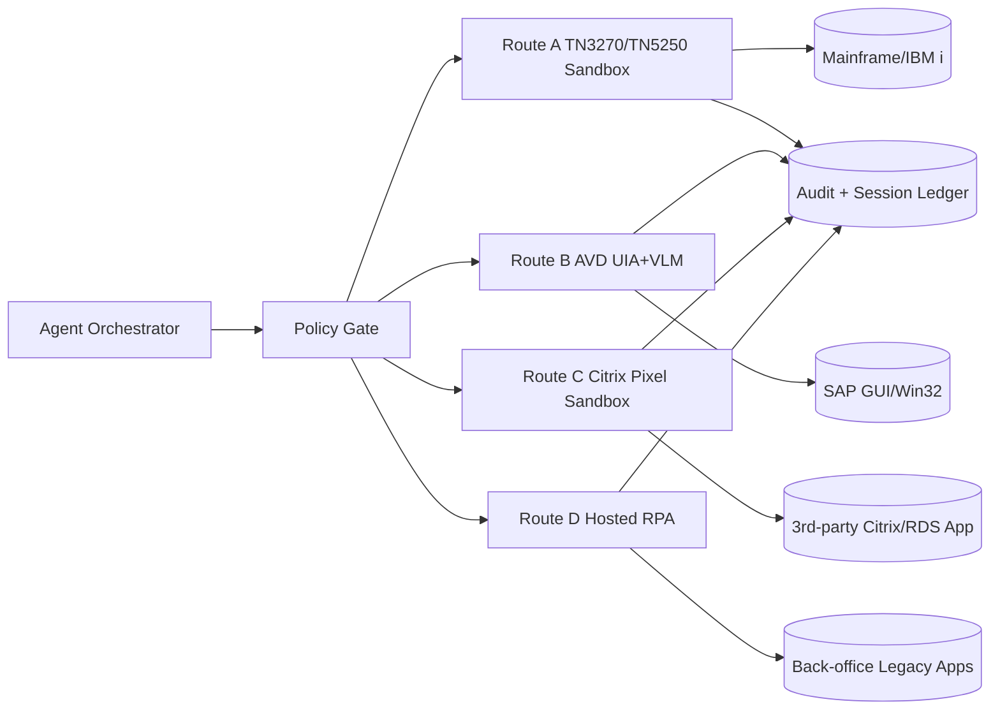
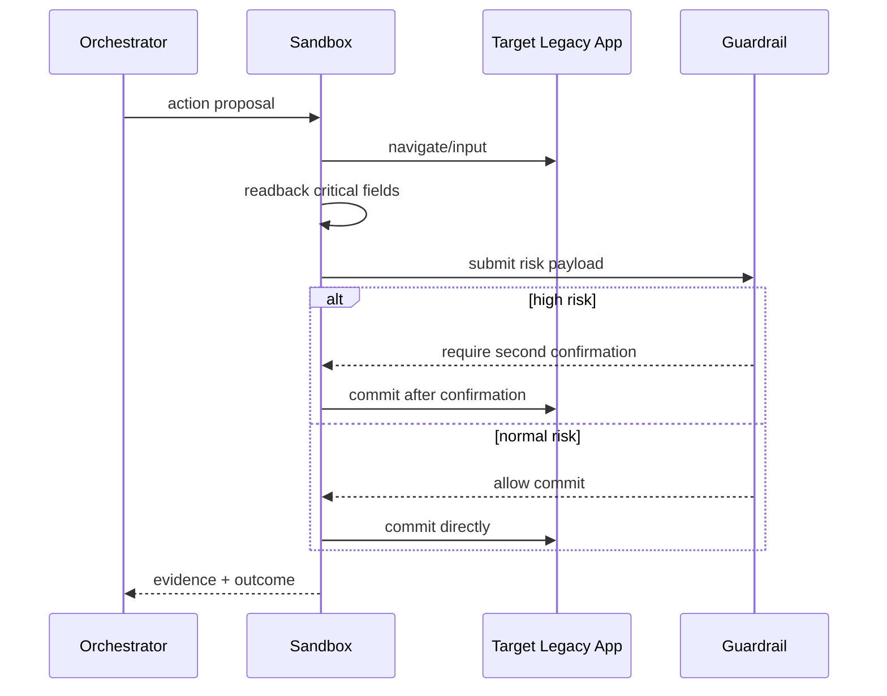

# 传统终端与厚客户端智能体沙箱选型 FAQ：TN3270/TN5250 协议原生容器 vs AVD UIA+VLM 混合桌面 vs Citrix 像素双跳沙箱 vs 托管 Hosted RPA

> **适用对象**：Cloud & AI Solution Architect、企业自动化平台团队、主机系统团队、合规与内控团队。
> **核心问题**：当系统没有现代 API/MCP，仅剩绿屏终端、Win32 厚客户端或第三方 Citrix/RDS 虚拟应用时，如何构建可审计、可恢复、可控风险的执行沙箱。

---

## 1. 执行摘要（先选“交互语义层”，再选执行载体）

在遗留系统自动化中，最大的稳定性差异来自“你与系统交互的语义层级”：

- 读写结构化字段（协议/控件语义）通常比像素点击更稳定。
- 像素路径可覆盖面更广，但需要更强的防误操作门禁。

建议路线：

- **Route A**：优先用于 TN3270/TN5250 场景，结构化字段映射最稳定。
- **Route B**：适合可访问树完整的 Windows/SAP GUI 厚客户端。
- **Route C**：适合仅能以 Citrix/RDP 像素方式交付的第三方系统。
- **Route D**：适合流程标准化、审计与运营托管优先的组织。

硬性门槛建议：

- `提交前关键字段读回一致率 >= 99.95%`
- `误提交率 <= 0.02%`
- `异常恢复后残留锁单率 <= 0.1%`
- `每千笔事务总成本 C_1000 <= 业务阈值`
- `代理身份审计覆盖率 = 100%`

反模式：

1. 把所有遗留系统都直接做像素点击，不做字段回读校验。
2. 使用共享账号，无法做到每个 Agent 可追责身份。
3. 忽略主机 LU 池、并发锁与会话回收，导致高峰崩溃。
4. 关键提交键（如 Enter/PF）无二次门禁与差异确认。

---

## 2. 业务背景与系统边界

遗留系统类型：

- IBM z/OS `TN3270` 绿屏事务。
- IBM i `TN5250` 业务终端。
- `SAP GUI` / Win32 厚客户端。
- 仅以 `Citrix/RDP` 提供的第三方行业系统。

约束条件：

- 无可靠 REST 接口。
- 页面状态强依赖终端会话上下文。
- 键盘提交行为可能触发不可逆事务。
- 合规要求“谁做了什么、在何时、基于何证据”可追溯。

---

## 3. 四条路线定义（A/B/C/D）

### Route A：协议原生无头终端沙箱（s3270 / TN5250）

架构要点：

- 在 ACA Dynamic Sessions 或 AKS Kata 内运行协议原生客户端。
- 通过 TLS 1.3、Private VNet、ExpressRoute 访问主机。
- 使用 24×80 字段属性图避免 OCR 幻觉。
- 提供 `<30 ms` 级步骤延迟与高会话密度。

优势：

- 结构化字段稳定、动作可预测。
- 成本密度高，适合高并发批处理与交易流。

约束：

- 仅适用于终端协议系统。

### Route B：无人值守桌面 UIA + VLM 混合沙箱（AVD / Windows 365）

架构要点：

- 以 UI Automation / SAP GUI Scripting 作为主选择器。
- 对 owner-drawn 或不可访问控件，VLM 作为兜底识别。
- 运行在 AVD/Windows 365 会话主机池。

优势：

- 可覆盖多数 Win32 厚客户端。
- 在可访问树质量高时稳定性显著优于纯像素。

约束：

- 主机密度低于协议原生终端。
- 需要桌面会话生命周期治理。

### Route C：双跳 Citrix/像素 VLM Computer-Use 沙箱

架构要点：

- AVD 隔离跳板连接第三方 Citrix/RDP 应用。
- 执行每次关键键入后的 ROI OCR 回读断言。
- 对高风险动作启用强制确认与回滚队列。

优势：

- 在“仅像素可见”场景下可落地。
- 覆盖最广，适配第三方封闭系统。

约束：

- 时延与误识别风险最高，必须强化门禁。

### Route D：托管 Hosted RPA 机组（Power Automate + Copilot Studio）

架构要点：

- 使用 Hosted Machines 统一调度与队列编排。
- 凭据由 CyberArk/Key Vault 代理注入。
- 支持人工接管与流程审计。

优势：

- 运营体系成熟，上手快。
- 适合标准化流程与批量作业。

约束：

- 深度定制能力低于自建沙箱。

---

## 4. 12 维度对比矩阵

| 维度 | Route A 协议原生终端 | Route B AVD UIA+VLM | Route C Citrix 像素双跳 | Route D Hosted RPA |
|---|---|---|---|---|
| 字段语义准确性 | 极高 | 高 | 中 | 中高 |
| 误操作风险 | 低 | 中 | 高 | 中 |
| 单机并发密度 | 高 | 中 | 低中 | 中 |
| 步骤时延稳定性 | 高 | 中高 | 中 | 中 |
| 会话恢复可预测性 | 高 | 中高 | 中 | 中高 |
| 实施复杂度 | 中 | 中高 | 高 | 中 |
| 合规审计可解释性 | 高 | 高 | 中高 | 高 |
| 身份可追责能力 | 高 | 高 | 中高 | 高 |
| 运维自动化成熟度 | 中 | 中 | 中 | 高 |
| 单位事务成本 | 低 | 中 | 高 | 中高 |
| 对第三方封闭系统适配 | 低中 | 中 | 高 | 中高 |
| 推荐等级 | 终端首选 | 厚客户端首选 | 像素兜底 | 托管运营首选 |

---

## 5. 基础容量与成本模型

### 5.1 每千笔事务总成本

`C_1000 = (C_compute + C_license + C_network + C_ops + C_rework) / N_txn * 1000`

### 5.2 事务吞吐

`TPS = N_session / T_txn_avg`

### 5.3 并发会话可用度

`A_session = 1 - (F_login + F_lock + F_crash + F_orphan)`

---

## 6. 定量 Q1：头less s3270 与桌面主机每千笔成本

设：

- Route A 单 vCPU 支撑 `40~80` 会话，取中值 `60`。
- Route B `D4s_v5` 主机支撑 `6~10` 会话，取中值 `8`。
- 每会话平均 `T_txn_avg=22s`。

估算：

- Route A `TPS_A = 60 / 22 = 2.73`
- Route B `TPS_B = 8 / 22 = 0.36`

若同口径小时成本分别为 `H_A`、`H_B`，则：

`C_1000_A / C_1000_B ≈ (H_A / TPS_A) / (H_B / TPS_B)`

结论：

- 在终端协议可直连前提下，Route A 通常具备显著成本密度优势。
- Route B 的价值在于覆盖厚客户端兼容性，而非最低单笔成本。

---

## 7. 定量 Q2：像素/OCR 错误叠加 vs 结构化字段准确率

像素链路错误近似：

`E_pixel = 1 - (1 - E_detect)*(1 - E_ocr)*(1 - E_action)`

结构化字段链路错误近似：

`E_field = 1 - (1 - E_parse)*(1 - E_guard)`

当：

- `E_detect=0.04`、`E_ocr=0.05`、`E_action=0.03` 时，
- `E_pixel = 0.1154`

若结构化字段：

- `E_parse=0.005`、`E_guard=0.003`，
- `E_field = 0.0080`

结论：

- Route A 在结构化字段场景下风险显著更低。
- Route C 必须依赖强门禁（回读断言 + 二次确认）降低误提交。

---

## 8. 定量 Q3：LU 池耗尽与主机回压

定义：

- `LU_total`：终端逻辑单元总数。
- `LU_busy`：当前占用。
- `λ_in`：会话进入速率。
- `μ_out`：会话退出速率。

队列压力指标：

`B_lu = LU_busy / LU_total`

当 `B_lu >= 0.85` 时，进入回压区：

- 新会话排队。
- 非关键任务降速。
- 高风险提交任务转人工审批。

回压策略目标：

- `P95 登录等待 < 8s`
- `LU orphan 回收时延 < 60s`

---

## 9. 定量 Q4：RACF/ACF2 每 Agent 身份映射与审计覆盖

审计覆盖率：

`Coverage = N_txn_with_agent_identity / N_txn_total`

目标：

`Coverage = 1.0`

身份映射策略：

- 每个 Agent 使用短时证书或受控代理身份。
- 证书映射到最小权限 RACF/ACF2 profile。
- 禁止共享静态密码与共享主账号。

收益：

- 交易级可追责。
- 风险事件可快速定位责任主体。

---

## 10. 定量 Q5：破坏性提交键安全联锁

定义关键提交动作集合 `K = {Enter, PF3, PF5, PF12}`。

提交风险评分：

`R_commit = w1*Delta_critical_fields + w2*Txn_amount + w3*Context_risk`

联锁规则：

- 当 `R_commit >= θ_high`，强制二次确认 + 回读一致校验。
- 当 `θ_mid <= R_commit < θ_high`，执行预提交差异提示。
- 当 `R_commit < θ_mid`，自动提交并留痕。

目标：

- `误提交率 <= 0.02%`
- `高风险漏拦截率 <= 0.5%`

---

## 11. 定量 Q6：会话启动、崩溃恢复与清理保证

会话启动时延：

`L_start = L_alloc + L_auth + L_app_ready`

异常恢复总时延：

`L_recover = L_detect + L_logout + L_reopen + L_replay`

锁单残留率：

`R_orphan_lock = N_orphan_lock / N_total_crash`

SLO：

- `L_start(P95) <= 12s`（桌面）或 `<= 3s`（终端容器）
- `L_recover(P95) <= 45s`
- `R_orphan_lock <= 0.1%`

---

## 12. Mermaid：四路线执行平面拓扑



---

## 13. Mermaid：关键提交前联锁与回读断言



---

## 14. 生产实现片段 1：Python s3270 字段映射与提交前差异守卫

```python
from dataclasses import dataclass

@dataclass
class Field:
    row: int
    col: int
    length: int
    value: str
    protected: bool

def diff_guard(before: dict[str, Field], after: dict[str, Field], critical: set[str]) -> list[str]:
    changed = []
    for key in critical:
        b = before[key].value
        a = after[key].value
        if b != a:
            changed.append(f"{key}:{b}->{a}")
    return changed

def allow_commit(changes: list[str], risk_score: float) -> bool:
    if risk_score >= 0.72:
        return False
    if len(changes) > 3:
        return False
    return True
```

---

## 15. 生产实现片段 2：AVD/ACA 与身份治理策略示例

```yaml
sessionGovernance:
  routeA:
    protocol: tn3270
    tls_required: true
    max_sessions_per_vcpu: 60
    idle_timeout_seconds: 120
  routeB:
    host_pool: avd-d4sv5-prod
    uia_primary: true
    vlm_fallback: true
    force_readback_before_commit: true
  identity:
    per_agent_short_lived_cert: true
    shared_password_forbidden: true
    audit_coverage_target: 1.0
```

---

## 16. 企业场景 A：航空中断 PNR 改签（TN3270 主机 GDS/PSS）

流程：

1. 智能体接收航变旅客名单与约束条件。
2. 通过 TN3270 字段导航读取舱位、票规与候补状态。
3. 生成候选改签方案并执行预提交校验。
4. 高价值或高风险单据触发人工确认后提交。

推荐：

- 主链路 Route A，获得最高字段稳定性与吞吐密度。
- 通过 Route D 承接队列编排与人工接管。

---

## 17. 企业场景 B：医疗收入周期与先授权对账（Citrix EHR + payer portal）

流程：

1. 智能体在隔离跳板上连接第三方 Citrix 应用。
2. 像素识别读取关键字段并执行回读断言。
3. 对账差异进入审阅队列，生成证据链。
4. 人工复核通过后执行提交。

推荐：

- Route C 作为能力兜底。
- 对高风险键入动作强制二次确认。
- 审计日志留存至统一证据账本。

---

## 18. 三年 TCO 对比（示例）

| 成本项 | Route A | Route B | Route C | Route D |
|---|---:|---:|---:|---:|
| 计算与会话运行（3y） | $2.1M | $3.4M | $3.9M | $3.0M |
| 平台运维（3y） | $0.8M | $1.2M | $1.4M | $1.0M |
| 合规与审计（3y） | $0.5M | $0.6M | $0.8M | $0.7M |
| 返工与事故成本（3y） | $0.3M | $0.5M | $0.9M | $0.5M |
| **总计（3y）** | **$3.7M** | **$5.7M** | **$7.0M** | **$5.2M** |

结论：

- Route A 在可用协议语义场景中通常最具成本/质量优势。
- Route C 能力覆盖最广，但必须付出更高治理与返工成本。

---

## 19. Day-0 / Day-1 / Day-2 落地清单

### Day-0（架构定版）

- 完成系统分类：协议语义/可访问树/像素-only。
- 定义四路线准入、回退、升级条件。
- 定义高风险提交动作清单与联锁阈值。

### Day-1（灰度上线）

- 接入统一会话账本与证据归档。
- 上线提交前差异守卫与关键字段回读。
- 验证每 Agent 身份映射审计覆盖率。

### Day-2（规模化）

- 优化 LU 池与主机池弹性策略。
- 分析误提交样本并调优阈值。
- 周期复盘会话残留锁与恢复路径。

---

## 20. 五步选型指南（Good fit vs Not for）

1. **判定交互语义层**：优先协议/控件语义，像素路径作为兜底。
2. **建立提交风险分级**：按字段差异、金额、上下文风险打分。
3. **映射路线**：A 覆盖终端、B 覆盖厚客户端、C 覆盖像素-only、D 覆盖托管运营。
4. **上线联锁机制**：回读断言、二次确认、人工接管、回滚队列。
5. **持续度量**：成本、误提交、恢复时延、审计覆盖率四类指标闭环。

**Good fit**：

- 仍有大量主机/厚客户端交易，且要求自动化提效与合规并重的企业。

**Not for**：

- 已具备高质量 API 且无桌面遗留负担的系统。
- 不具备统一身份审计与会话治理能力的组织。

---

## 21. 最终建议

- 能拿到协议/控件语义时，优先 Route A/B；它们在正确率、成本和可恢复性上更可控。
- 像素-only 场景可用 Route C 打通能力，但必须以强联锁与审计约束风险。
- 若组织优先运营托管与流程标准化，Route D 可作为规模化底座，并与 A/B/C 混合编排。

---

## 22. 补充治理建议（供架构评审会直接落地）

为避免“方案上线后靠人补洞”，建议在架构评审阶段同步固化以下治理条款：

1. **身份治理条款**：所有自动化会话必须绑定到可回溯的 Agent 身份与任务号，不允许共享凭据绕过审计链。
2. **提交治理条款**：所有不可逆提交动作必须经过字段回读与风险分级，且保留可复验的提交前后证据快照。
3. **恢复治理条款**：所有异常退出会话必须在恢复任务中执行显式注销与锁释放检查，避免主机残留事务污染后续请求。
4. **容量治理条款**：LU 池、桌面池和任务队列必须有统一背压信号，防止任意一路过载传导到关键生产链路。
5. **合规治理条款**：对涉及个人敏感信息的屏幕区域必须启用最小可见策略与脱敏归档策略，保证取证可用且最小暴露。

该补充条款的目标不是增加流程复杂度，而是把“可审计、可恢复、可扩展”从运维经验上升为平台默认能力。

